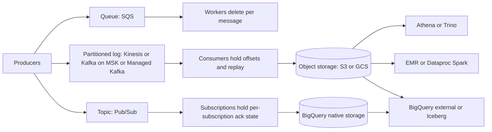

# Messaging, Streaming, and Analytics Translation

## TL;DR

1. Translate by data model, not by product name. SQS is a queue with server-held per-message state, Kinesis and Kafka are partitioned logs with client-held offsets, and Pub/Sub is a topic fanning out to server-held per-subscription state with replay. These models give different answers to ordering, replay, redelivery, and what "scale" means.
2. Kinesis scales by shards you own and by hash-key ranges you can skew. Pub/Sub hides partitioning and scales on its own, and you pay per byte instead of per shard-hour. SQS has no throughput knob except FIFO group cardinality.
3. A Kinesis shard's 5 GetRecords per second is shared by all non-EFO consumers. N shared consumers each poll at 5/N Hz per shard, which sets a latency floor of N x 200 ms and a cost cliff against enhanced fan-out. The right choice usually comes from arithmetic, not preference.
4. Exactly-once delivery is not exactly-once effect. Pub/Sub exactly-once is regional, pull-only, and does not deduplicate publishes. SQS FIFO deduplicates sends in a 5-minute window. Kafka idempotent producers cover one session. Cross-system effects still need an application-level event ID and an idempotent sink.
5. Athena, EMR, and Dataproc compute over files you laid out in object storage, so you own file sizes, partitioning, and the output commit protocol. BigQuery owns the storage layout and bills bytes scanned or slot-time. Unit-cost surprises come from the billing unit: bytes for Athena and BigQuery on-demand, slot-hours for editions and Athena provisioned capacity, node-hours plus a service uplift for EMR and Dataproc.

## Mental Model



There are three messaging primitives and two analytics ownership models.
A queue deletes a message when one consumer finishes it, so state lives per message on the server and replay does not exist.
A partitioned log never deletes on consumption and exposes position as an offset or sequence number that the consumer checkpoints, so replay is free but parallelism is capped by the partition count you chose.
Pub/Sub is a hybrid: a topic with retention and seek, plus per-subscription server-side cursors with per-message ack and lease state, so it behaves like a queue per subscription and a log for replay.
On the analytics side, Athena, EMR, and Dataproc are engines pointed at files, so correctness (commit protocol) and performance (file size, prefix spread) are your problem.
BigQuery is an engine plus a storage system, so it trades control for freedom from that class of failure, and its meter is attached to either bytes read or slots held.

## Internals

### Kinesis Data Streams: hash-key ranges and the read budget

A stream is a set of shards.
Each record carries a partition key. Kinesis takes the MD5 of the key as a 128-bit integer and routes it to the shard whose contiguous hash-key range contains it (AWS docs, as of 2026-10; UNVERIFIED in this authoring pass, recalled from the API reference).
The consequence is that capacity is allocated by key-space, not by load.
A Pareto-distributed key population hashed onto 8 equal ranges in a local simulation put 58.5 percent of traffic on one shard (simulation in the Worked Example).
Adding shards by uniform splitting halves the range of the hot shard but does not halve its load if one key dominates, because a single key cannot be split.

Per-shard limits are the control surface.
A shard accepts up to 1 MiB/s or 1,000 records/s for writes, and read capacity is 2 MiB/s total via GetRecords with at most 5 GetRecords calls per second (AWS re:Post knowledge center, as of 2026-10).
One GetRecords call returns at most 10 MiB and 10,000 records (AWS re:Post knowledge center, as of 2026-10).
Shared fan-out consumers share both the 2 MB/s and the 5 transactions per second (AWS Kinesis FAQ, as of 2026-10).
The 5 TPS budget is the mechanism most getting-started guides skip.
With N shared consumers on a shard, a well-behaved poller can issue at most 5/N calls per second per shard, so the lower bound on end-to-end delivery delay at the tail is roughly N x 200 ms even when the stream is idle and bytes are nowhere near the limit.
Three consumers means 600 ms of polling floor, and a fourth consumer added "just for audit" degrades every other consumer's latency.
Enhanced fan-out (EFO) replaces polling with an HTTP/2 push through SubscribeToShard, with a dedicated 2 MiB/s per consumer per shard (AWS docs, recalled, UNVERIFIED), at a separate consumer-shard-hour and per-GB retrieval charge.
The subscription connection is time-limited (5 minutes, UNVERIFIED), so the KCL renews it. A hand-rolled consumer must handle reconnect and resume from the last sequence number.

Resharding preserves per-key ordering only if consumers respect lineage.
A split or merge closes the parent shard and creates children. The consumer must fully drain the parent before reading children, or records for one key will be processed out of order across the boundary.
The KCL enforces this through lease dependencies on parent shards. Custom consumers frequently do not, and this is a classic silent ordering bug.
Data is replicated synchronously across three AZs (AWS Kinesis FAQ, recalled, UNVERIFIED) and retention defaults to 24 hours and extends to 365 days (AWS docs, recalled, UNVERIFIED).
On-demand mode removes shard management but has its own ceiling: new streams start at a small write quota and by default scale to 200 MB/s and 200,000 records/s for writes (AWS Kinesis FAQ, as of 2026-10).
Scaling is reactive to observed peaks, so a step change far above the previous peak can still throttle for the interval it takes to scale.

### SQS: replicated message state and the polling mechanism

SQS stores each message redundantly across multiple servers and AZs in the region.
The behavior that surprises engineers is short polling. A short-poll ReceiveMessage samples a subset of the servers that hold the queue's messages, so it can return empty or partial results while messages exist on servers it did not query.
Long polling (WaitTimeSeconds up to 20) queries all servers and waits for a message (AWS docs, recalled, UNVERIFIED).
Empty receives are billed requests, so short polling at scale is both slower to drain and more expensive.

Delivery is at-least-once with best-effort ordering on standard queues.
Receiving a message does not delete it. It starts a visibility timeout (default 30 seconds, maximum 12 hours, UNVERIFIED) during which the receipt handle is the only way to delete or extend it.
SQS does not extend the timeout for you, so processing time must be bounded or a heartbeat must call ChangeMessageVisibility.
FIFO queues add a MessageGroupId and a 5-minute deduplication window (AWS docs, recalled, UNVERIFIED).
Within a group, once any message is in flight, SQS withholds later messages of that group until the in-flight ones are deleted or become visible again.
That is the mechanism that makes a single poison message block an entire group, and it is the head-of-line blocking failure in Question 8.
Throughput on FIFO scales with the number of distinct group IDs in high-throughput mode, so a low-cardinality group key caps throughput regardless of the quota.
For queue backlog dynamics, read the Builders' Library article on avoiding insurmountable queue backlogs in Further Reading.

### Pub/Sub: no partitions, leases, and ordering keys

Pub/Sub exposes no partition, offset, or shard. The service is a global control plane over regional storage, and it shards topics internally (Google Cloud Pub/Sub architecture docs, recalled, UNVERIFIED).
Publishes are acknowledged after the message is durably stored in multiple zones of the region (UNVERIFIED).
Delivery state is kept per subscription: each message has a state of outstanding, acked, or expired for that subscription, and a topic with N subscriptions stores independent cursors for each.
This is why fan-out is a billing multiplier (each subscription's delivery is billed as throughput) but not an operational one.

Consumers hold a lease. With StreamingPull, the client library extends the ack deadline automatically until a maximum lease duration, so a slow handler results in held messages and a growing backlog, not duplicate delivery.
SQS inverts this: the same slowness produces duplicates because the timeout expires on its own.
The default ack deadline is 10 seconds and the maximum is 600 seconds (Google Cloud docs, recalled, UNVERIFIED).

Ordering is per ordering key and scoped to a region.
Messages with the same key must be published to the same regional endpoint to be ordered, which is why clients that need ordering set a regional endpoint.
If a publish with an ordering key fails, the client library stops publishing for that key until the application calls resume_publish, because continuing would let later messages overtake the failed one.
On the subscriber side, a nack or ack deadline expiry on one message causes redelivery of that message and every later message for the key that was already delivered, so the failure unit is the key.
Exactly-once delivery is available on pull and StreamingPull subscriptions in a region, and ack returns a result that can fail, so a handler must treat a failed ack-with-response as a possible redelivery (Google Cloud docs, recalled, UNVERIFIED).
It does not deduplicate publisher retries. Two publishes of the same payload get two message IDs.
Replay is a first-class operation: seek to a timestamp or snapshot, and topic message retention can extend replay beyond subscription retention (Google Cloud docs, recalled, UNVERIFIED).
Pub/Sub Lite, the zonal partitioned cheaper variant, was deprecated with a shutdown in 2026 (UNVERIFIED), so there is no current GCP analog to Kinesis-style provisioned zonal logs other than Managed Kafka.

### Kafka: MSK versus Google Cloud Managed Service for Apache Kafka

The Kafka design is described in the NetDB 2011 paper by Kreps, Narkhede, and Rao.
Each partition is an append-only log of segment files replicated to a leader and followers. The in-sync replica set (ISR) determines when the leader may acknowledge, and the effective durability contract is acks=all with min.insync.replicas=2 and replication factor 3 spread across 3 racks or AZs.
With that setting, one AZ loss keeps writes available and zero acknowledged data is lost, while a second concurrent loss makes the partition unavailable for writes rather than lossy. Setting unclean.leader.election.enable=true trades that for availability and silent loss.
Controller metadata moved from ZooKeeper to KRaft (KIP-500, a Raft-based quorum controller); both managed services run a managed controller layer you do not operate.

The mechanism a getting-started guide misses is cross-AZ consumer traffic.
By default consumers read from partition leaders, which are spread across AZs, so roughly two-thirds of consumer bytes cross an AZ boundary in a 3-AZ cluster with consumers in random AZs.
Follower fetching (KIP-392, replica.selector.class=RackAwareReplicaSelector on brokers plus client.rack on consumers) lets a consumer read from an in-zone follower and removes most of that traffic, at the cost of slightly higher end-to-end latency, since followers lag the leader's high-water mark.
Whether in-cluster replication traffic and consumer cross-AZ traffic are billed differs by provider and mode (UNVERIFIED for both), so model the data-transfer line item explicitly. See [[17-Cloud-AI-Engineering/Volume_09_FinOps_and_Cloud_Economics/Chapter_04_Network_Egress_Economics_and_Optimization|Network Egress Economics and Optimization]].

MSK offers provisioned clusters (brokers on EC2 with EBS storage, optional tiered storage), Serverless, and Express brokers. Express brokers were launched at re:Invent 2024 and decouple storage so you no longer size volumes (AWS announcement, recalled, UNVERIFIED).
The Google Cloud service (Managed Service for Apache Kafka) provides clusters sized by vCPU and memory with Kafka Connect support (Google Cloud docs, recalled, UNVERIFIED; GA status and region coverage must be re-checked).
Both give you real Kafka wire compatibility, so the portability story is the client protocol plus MirrorMaker 2, not the control plane APIs, which are entirely different.
For the log semantics and broker internals in depth see [[04-System-Design/06-Messaging-and-Streaming/Apache-Kafka|Apache Kafka]].

### Analytics: files you own versus storage the engine owns

Athena runs Trino-derived distributed SQL on S3 data, with table metadata in the Glue Data Catalog and a per-TB-scanned or provisioned-DPU meter (AWS docs, recalled, UNVERIFIED).
Query planning enumerates partitions and S3 objects, so a table of millions of tiny files spends its time in listing and split generation instead of scanning.
S3 serves a prefix at roughly 5,500 GET or HEAD requests per second (S3 docs, recalled, UNVERIFIED), so a many-small-files scan against few prefixes ends in 503 SlowDown responses and retries.
See [[04-System-Design/05-Data-Stores/Amazon-S3-and-Object-Storage|Amazon S3 and Object Storage]] for the storage side.

Spark on EMR or Dataproc has a correctness mechanism that is invisible until it fails: the output commit protocol.
The classic Hadoop FileOutputCommitter commits by renaming task output directories to the final location.
On object stores, rename is copy plus delete, is not atomic, and is slow in proportion to data size. Algorithm version 2 of that committer also exposes partial output if a job fails mid-commit.
EMR ships an S3-optimized committer that uses multipart upload to make commit a metadata operation, and S3A offers magic and staging committers for the same purpose (Hadoop S3A committers docs, linked in Further Reading).
On GCS the same question exists, and the answer depends on the connector and bucket type (hierarchical namespace buckets support atomic rename, UNVERIFIED).
Table formats such as Apache Iceberg sidestep directory-rename commits by committing through an atomic metadata pointer swap, which is why they are the portable answer across both clouds.

BigQuery executes queries as a tree of stages on a shared pool of slots (units of compute), reading Capacitor columnar data from Colossus and exchanging intermediate results through a dedicated in-memory shuffle tier (Dremel, VLDB 2010; see [[17-Cloud-AI-Engineering/Volume_03_GCP_Deep_Dive/Chapter_13_BigQuery_Dremel_Capacitor_and_Slot_Orchestration|BigQuery: Dremel, Capacitor, and Slot Orchestration]]).
Slots are fair-scheduled across concurrent queries within a reservation, so a heavy query does not fail under load but slows, and the same query can differ in wall time by an order of magnitude depending on neighbors in your reservation.
On-demand projects draw from a shared pool with a per-project concurrent slot cap (2,000 slots by default, UNVERIFIED), while editions let you set a baseline and an autoscaling maximum.
Streaming ingestion goes through the Storage Write API, whose committed streams give exactly-once appends by tracking stream offsets, which is the sink-side half of an exactly-once pipeline (Google Cloud docs, recalled, UNVERIFIED).

## Numbers to Know

Rows marked verified were checked against the cited page during this authoring pass on 2026-10-21.
Rows marked UNVERIFIED are recalled from vendor documentation and must be re-checked against the primary page before this note reaches `status: solid`.

| Quantity | Value | Source and status |
|---|---|---|
| Kinesis shard write | 1 MiB/s or 1,000 records/s | AWS re:Post knowledge center (as of 2026-10), verified |
| Kinesis shard read | 2 MiB/s total, 5 GetRecords/s | AWS re:Post knowledge center (as of 2026-10), verified |
| GetRecords per call | up to 10 MiB and 10,000 records | AWS re:Post knowledge center (as of 2026-10), verified |
| Shared fan-out consumers | share the shard's 2 MB/s and 5 TPS | AWS Kinesis FAQ (as of 2026-10), verified |
| Kinesis on-demand default scale ceiling | 200 MB/s and 200,000 records/s writes | AWS Kinesis FAQ (as of 2026-10), verified |
| Kinesis on-demand raised limit on request | 2 GB/s write announced in 2023 | AWS announcement page (as of 2026-10), verified only via a China-region mirror |
| Kinesis default shards per account per region | 500 in us-east-1, us-west-2, eu-west-1, 200 elsewhere | third-party summary only, UNVERIFIED |
| Kinesis retention | 24 h default, up to 365 days | AWS docs, UNVERIFIED |
| Kinesis EFO throughput | 2 MiB/s per consumer per shard | AWS docs, UNVERIFIED |
| Kinesis price (us-east-1) | about 0.015 USD per shard-hour, 0.014 USD per million PUT payload units | AWS pricing, UNVERIFIED |
| SQS visibility timeout | default 30 s, max 12 h | AWS docs, UNVERIFIED |
| SQS retention | 1 minute to 14 days, default 4 days | AWS docs, UNVERIFIED |
| SQS max message size | 1 MiB after the 2025 increase from 256 KiB | AWS announcement, UNVERIFIED |
| SQS in-flight limit | 120,000 standard, 20,000 FIFO | AWS docs, UNVERIFIED |
| SQS price | about 0.40 USD per million standard requests, billed in 64 KiB chunks | AWS pricing, UNVERIFIED |
| Pub/Sub max message size | 10 MB | Google Cloud docs, UNVERIFIED |
| Pub/Sub ack deadline | default 10 s, max 600 s | Google Cloud docs, UNVERIFIED |
| Pub/Sub retention | subscription up to 7 days, topic retention up to 31 days | Google Cloud docs, UNVERIFIED |
| Pub/Sub price | about 40 USD per TiB for publish and each delivery, first 10 GiB per month free | Google Cloud pricing, UNVERIFIED |
| Athena price | about 5 USD per TB scanned, 10 MB minimum per query | AWS pricing, UNVERIFIED |
| Athena DML query timeout | 30 minutes default | AWS docs, UNVERIFIED |
| BigQuery on-demand | about 6.25 USD per TiB scanned, first 1 TiB per month free | Google Cloud pricing, UNVERIFIED |
| BigQuery editions slot-hour (US) | about 0.04 Standard, 0.06 Enterprise, 0.10 Enterprise Plus | Google Cloud pricing, UNVERIFIED |
| Dataproc service fee | about 0.010 USD per vCPU-hour over Compute Engine | Google Cloud pricing, UNVERIFIED |
| EMR service fee | per-instance-hour uplift that varies by instance type | AWS pricing, UNVERIFIED |
| Inter-region and internet egress (typical list) | about 0.02 and 0.09 USD per GB | AWS and Google Cloud pricing, UNVERIFIED |

Derived numbers used later (these follow from the table rows, not from separate sources):
shared-consumer polling floor = N x 200 ms per shard;
shards needed = max(ceil(MiB/s), ceil(records/s / 1000)) for writes, and ceil(MiB/s x consumers / 2) for shared reads;
Pub/Sub cost per day = TiB published x (1 + subscriptions) x unit price.

## AWS vs GCP Mechanism Parity

| Dimension | AWS | Google Cloud | Critical difference |
|---|---|---|---|
| Work queue | SQS standard and FIFO | Pub/Sub pull subscription (no separate queue product) | SQS per-message state with explicit visibility timeout; Pub/Sub auto-extends leases, so slow handlers cause backlog not duplicates |
| Strict ordering | SQS FIFO by MessageGroupId; Kinesis by shard | Pub/Sub ordering key, regional | Pub/Sub ordering failure unit is the key, with republish of later delivered messages on nack; SQS FIFO blocks the group |
| Partitioned log | Kinesis Data Streams | none native after Pub/Sub Lite shutdown; use Managed Kafka | Kinesis shards are exposed and billed per hour; Pub/Sub hides partitions and bills per byte |
| Fan-out | SNS to SQS, or Kinesis EFO | Pub/Sub subscriptions | Pub/Sub fan-out is N independent cursors on one topic; AWS needs SNS plus N queues or EFO consumers |
| Replay | Kinesis retention; none on SQS | Seek to time or snapshot; topic retention | SQS cannot replay acknowledged messages |
| Dedup and exactly-once | SQS FIFO 5-minute send dedup; Kinesis none at the service level | Exactly-once delivery regional on pull; no publish dedup | Neither gives cross-system exactly-once effects |
| Dead letter | SQS redrive policy with maxReceiveCount, plus redrive back | Dead-letter topic with max delivery attempts | Both are redelivery-count based, which counts expired leases as attempts |
| Managed Kafka | MSK provisioned, Serverless, Express brokers | Managed Service for Apache Kafka (confirm GA status) | Same client protocol, different control planes, networking, and billing |
| Delivery to storage | Amazon Data Firehose to S3 or Iceberg | Pub/Sub BigQuery and Cloud Storage subscriptions | GCP does it as a subscription type with no buffer config; Firehose buffers by size and interval |
| Stream processing | Managed Service for Apache Flink | Dataflow (see [[17-Cloud-AI-Engineering/Volume_03_GCP_Deep_Dive/Chapter_14_Messaging_and_Streaming_Cloud_Pub_Sub_and_Dataflow\|Pub/Sub and Dataflow]]) | Flink code is portable; Beam on Dataflow is a different programming model |
| Serverless SQL on files | Athena | BigQuery external or BigLake tables, or native BigQuery | Athena always reads files; BigQuery can read files but its performance and governance advantage is in native storage |
| Warehouse | Redshift (Serverless or provisioned) | BigQuery | BigQuery is closer to Athena plus Redshift Serverless combined, with no cluster concept |
| Hadoop and Spark | EMR on EC2, EKS, Serverless | Dataproc on GCE, on GKE, Serverless for Apache Spark | Both bill infrastructure plus a service fee; Serverless variants bill by Spark resource-time |
| Metadata | Glue Data Catalog, Lake Formation | BigQuery datasets, Dataplex, Dataproc Metastore | Glue catalog is a separate service the engines call; BigQuery catalog is part of the engine |
| Table format direction | Iceberg on S3 and S3 Tables | Iceberg via BigLake and BigQuery-managed Iceberg tables (confirm GA status) | Format is portable; catalog and commit authority are not |
| Data plane failure domain | Regional services replicated across AZs | Regional Pub/Sub with global control plane; BigQuery multi-region or region location | Location choice at creation is hard to change on both clouds |

For the storage-side translation that this chapter builds on, see [[17-Cloud-AI-Engineering/Volume_04_AWS_vs_GCP_Translation/Chapter_04_Storage_and_Database_Translation|Storage and Database Translation]].
For the AWS service internals, see [[17-Cloud-AI-Engineering/Volume_02_AWS_Deep_Dive/Chapter_13_Messaging_and_Streaming_SQS_SNS_EventBridge_and_MSK|Messaging and Streaming: SQS, SNS, EventBridge, and MSK]].

## Worked Example: Sizing a 20,000 events/s stream and proving the semantics

### Scenario

20,000 events/s of 2 KiB each, three independent consumer applications (stream processor, archiver, anomaly detector), a 30 percent headroom target.

### Step 1: capacity and cost calculator

Prices are inputs.
The defaults are the UNVERIFIED list prices from the Numbers table. Replace them from the pricing pages before relying on the output.

```python
# capacity.py
import math

PRICES = {
    "kinesis_shard_hour": 0.015,
    "kinesis_put_per_million": 0.014,
    "kinesis_efo_consumer_shard_hour": 0.015,
    "kinesis_efo_per_gb": 0.013,
    "sqs_per_million_requests": 0.40,
    "pubsub_per_tib": 40.0,
}

def size(events_per_s, event_bytes, fanout, headroom=1.3, sqs_batch=10):
    mib_s = events_per_s * event_bytes / 2**20
    shards_write = max(math.ceil(mib_s / 1.0), math.ceil(events_per_s / 1000))
    shards_shared_read = math.ceil(mib_s * fanout / 2.0)
    shards_shared = max(shards_write, shards_shared_read)
    shards_efo = math.ceil(shards_write * headroom)
    day = 86400
    gb_day = events_per_s * event_bytes * day / 1e9
    tib_day = events_per_s * event_bytes * day / 2**40
    p = PRICES
    kin_base = shards_efo * 24 * p["kinesis_shard_hour"] \
        + events_per_s * day / 1e6 * p["kinesis_put_per_million"]
    kin_efo = fanout * (shards_efo * 24 * p["kinesis_efo_consumer_shard_hour"]
                        + gb_day * p["kinesis_efo_per_gb"])
    kin_shared = shards_shared * 24 * p["kinesis_shard_hour"] \
        + events_per_s * day / 1e6 * p["kinesis_put_per_million"]
    reqs_per_msg = 3.0 / sqs_batch
    sqs_day = events_per_s * day * reqs_per_msg / 1e6 * p["sqs_per_million_requests"]
    pubsub_day = tib_day * (1 + fanout) * p["pubsub_per_tib"]
    return {
        "ingest_mib_s": round(mib_s, 2),
        "kinesis_shards_min_write": shards_write,
        "kinesis_shards_if_shared_fanout": shards_shared,
        "kinesis_shards_with_headroom_efo": shards_efo,
        "kinesis_usd_day_efo": round(kin_base + kin_efo, 2),
        "kinesis_usd_day_shared": round(kin_shared, 2),
        "shared_poll_floor_ms_per_consumer": round(1000.0 / (5.0 / fanout)),
        "sqs_usd_day_one_queue_batch%d" % sqs_batch: round(sqs_day, 2),
        "sqs_usd_day_fanout_via_sns_approx": round(sqs_day * fanout, 2),
        "pubsub_usd_day": round(pubsub_day, 2),
        "pubsub_tib_day_published": round(tib_day, 3),
    }

if __name__ == "__main__":
    for k, v in size(20000, 2048, 3).items():
        print("%-40s %s" % (k, v))
```

Output of this script as executed in the authoring environment (it makes no cloud calls):

```text
ingest_mib_s                             39.06
kinesis_shards_min_write                 40
kinesis_shards_if_shared_fanout          59
kinesis_shards_with_headroom_efo         52
kinesis_usd_day_efo                      237.09
kinesis_usd_day_shared                   45.43
shared_poll_floor_ms_per_consumer        600
sqs_usd_day_one_queue_batch10            207.36
sqs_usd_day_fanout_via_sns_approx        622.08
pubsub_usd_day                           514.98
pubsub_tib_day_published                 3.219
```

### Step 2: read the numbers

Ingest is 20,000 x 2,048 B = 39.06 MiB/s, so the write-side minimum is 40 shards (bytes bind before the 1,000 records/s limit, which would need only 20).
Three shared consumers read 3 x 39.06 = 117 MiB/s against 2 MiB/s per shard, so the read side binds at 59 shards.
With shared fan-out the stream costs about 45 USD per day, but each consumer gets 5/3 = 1.67 GetRecords per second per shard, a polling floor of 600 ms.
EFO needs only 52 shards but costs about 237 USD per day, because you pay consumer-shard-hours and per-GB retrieval for each of the three consumers.
So the latency you buy with EFO costs about 190 USD per day here, and the correct decision depends on whether any consumer has a sub-second SLO.
Pub/Sub publishes 3.219 TiB per day and is billed on publish plus three deliveries, 4 x 3.219 x 40 = about 515 USD per day.
SQS at about 207 USD per day is for one consumer with batch size 10 (send, receive, delete each batched), and three consumers need three queues behind SNS, roughly tripling the request cost.
The lesson is that per-byte pricing (Pub/Sub) and per-request pricing (SQS) scale with fan-out and with message count respectively, while Kinesis shard pricing is nearly flat in fan-out until you choose EFO.
At 100 bytes per message, SQS cost is unchanged per message and Pub/Sub cost is tiny, which reverses the ranking.
Run the calculator with your own event size before choosing.

### Step 3: prove the shard-skew mechanism locally (no cloud calls)

```python
# skew.py - MD5 hash-key routing of a Pareto-distributed key population
import hashlib, random, collections
random.seed(1)
N = 8
keys = [int(random.paretovariate(1.2)) for _ in range(200000)]
c = collections.Counter()
for k in keys:
    h = int(hashlib.md5(("user-%d" % k).encode()).hexdigest(), 16)
    c[h * N >> 128] += 1
tot = sum(c.values())
print({s: round(v / tot, 3) for s, v in sorted(c.items())})
```

In the authoring environment this printed a distribution in which shard 6 took 0.585 of all records and shard 1 took 0.245.
Doubling to 16 shards splits ranges, but if the key that produces most of the traffic is a single key, its shard stays hot.

### Step 4: prove the queue semantics against real services

The following was not executed in the authoring environment because it needs credentials. Treat the expected comments as the hypothesis the lab tests.

```python
# fifo_probe.py - AWS: SQS FIFO group blocking
import boto3
sqs = boto3.client("sqs")
q = sqs.create_queue(
    QueueName="lab-hol.fifo",
    Attributes={"FifoQueue": "true", "ContentBasedDeduplication": "true",
                "VisibilityTimeout": "30"})["QueueUrl"]
for g in ("A", "B"):
    for i in range(3):
        sqs.send_message(QueueUrl=q, MessageBody="%s%d" % (g, i), MessageGroupId=g)
for n in range(3):
    r = sqs.receive_message(QueueUrl=q, MaxNumberOfMessages=1, WaitTimeSeconds=2)
    print(n, [m["Body"] for m in r.get("Messages", [])])
# expected: first receive returns one group's head, second returns the other
# group's head (not the first group's second message), third returns nothing
# until a visibility timeout expires or a message is deleted
```

```python
# pubsub_probe.py - GCP: ordering key and exactly-once ack result
from google.cloud import pubsub_v1
from google.cloud.pubsub_v1.subscriber import exceptions as sub_exc

project, region = "YOUR_PROJECT", "us-central1"
pub = pubsub_v1.PublisherClient(
    publisher_options=pubsub_v1.types.PublisherOptions(enable_message_ordering=True),
    client_options={"api_endpoint": "%s-pubsub.googleapis.com:443" % region})
topic = pub.topic_path(project, "lab-orders")
for i in range(3):
    pub.publish(topic, ("evt-%d" % i).encode(), ordering_key="cust-1").result()

sub = pubsub_v1.SubscriberClient()
path = sub.subscription_path(project, "lab-orders-sub")

def cb(m):
    try:
        m.ack_with_response().result()
        print("acked", m.data, "attempt", m.delivery_attempt)
    except sub_exc.AcknowledgeError as e:
        print("ack failed, treat as redelivery:", e.error_code)

fut = sub.subscribe(path, callback=cb,
                    flow_control=pubsub_v1.types.FlowControl(max_messages=10))
try:
    fut.result(timeout=15)
except Exception:
    fut.cancel()
```

### Step 5: provision, bound spend, tear down

Estimated cost for a one-hour lab (UNVERIFIED prices): one provisioned Kinesis shard is about 0.015 USD per hour, and SQS, Pub/Sub, Athena, and BigQuery usage at lab scale falls within free tiers or costs cents. Expect under 1 USD if torn down the same day.

```bash
# AWS (set REGION and ACCOUNT_ID)
aws kinesis create-stream --stream-name lab-stream \
  --stream-mode-details StreamMode=PROVISIONED --shard-count 1
aws athena create-work-group --name lab-wg \
  --configuration "ResultConfiguration={OutputLocation=s3://YOUR_BUCKET/athena/},EnforceWorkGroupConfiguration=true,BytesScannedCutoffPerQuery=10485760"

# GCP
gcloud pubsub topics create lab-orders --message-retention-duration=1d
gcloud pubsub topics create lab-orders-dlq
gcloud pubsub subscriptions create lab-orders-sub --topic=lab-orders \
  --ack-deadline=60 --enable-message-ordering --enable-exactly-once-delivery \
  --dead-letter-topic=lab-orders-dlq --max-delivery-attempts=5
bq mk --dataset --location=US lab_ds
bq query --use_legacy_sql=false --maximum_bytes_billed=10485760 \
  'SELECT COUNT(*) FROM `bigquery-public-data.samples.shakespeare`'
```

Budget alarm snippets:

```bash
# AWS Budgets: 5 USD monthly cost budget with an 80 percent email alert
cat > budget.json <<'EOF'
{"BudgetName":"lab-budget","BudgetType":"COST","TimeUnit":"MONTHLY",
 "BudgetLimit":{"Amount":"5","Unit":"USD"}}
EOF
cat > notif.json <<'EOF'
[{"Notification":{"NotificationType":"ACTUAL","ComparisonOperator":"GREATER_THAN",
 "Threshold":80,"ThresholdType":"PERCENTAGE"},
 "Subscribers":[{"SubscriptionType":"EMAIL","Address":"you@example.com"}]}]
EOF
aws budgets create-budget --account-id "$ACCOUNT_ID" \
  --budget file://budget.json --notifications-with-subscribers file://notif.json

# GCP: 5 USD budget with 50 and 90 percent thresholds
gcloud billing budgets create --billing-account=YOUR_BILLING_ACCOUNT \
  --display-name=lab-budget --budget-amount=5USD \
  --threshold-rule=percent=0.5 --threshold-rule=percent=0.9
```

Teardown, exact commands:

```bash
aws kinesis delete-stream --stream-name lab-stream --enforce-consumer-deletion
aws sqs delete-queue --queue-url "$(aws sqs get-queue-url --queue-name lab-hol.fifo --query QueueUrl --output text)"
aws athena delete-work-group --work-group lab-wg --recursive-delete-option
aws budgets delete-budget --account-id "$ACCOUNT_ID" --budget-name lab-budget
gcloud pubsub subscriptions delete lab-orders-sub
gcloud pubsub topics delete lab-orders
gcloud pubsub topics delete lab-orders-dlq
bq rm -r -f -d lab_ds
```

The GCP budget has to be removed from the billing account console or with `gcloud billing budgets delete BUDGET_ID --billing-account=YOUR_BILLING_ACCOUNT`.
The DLQ topic and the queue created by the Python probe are separate resources, so confirm each deletion with `aws sqs list-queues` and `gcloud pubsub topics list`.

### Step 6: measure analytics cost per workload before choosing

BigQuery exposes both billing bytes and slot-time per job, which gives the on-demand versus editions break-even directly.

```sql
SELECT
  SUM(total_bytes_billed) / POW(2, 40) AS tib_billed,
  SUM(total_slot_ms) / 3600000 AS slot_hours
FROM `region-us`.INFORMATION_SCHEMA.JOBS_BY_PROJECT
WHERE creation_time >= TIMESTAMP_SUB(CURRENT_TIMESTAMP(), INTERVAL 7 DAY)
  AND job_type = 'QUERY' AND state = 'DONE';
```

Break-even: editions win when slot_hours x slot_price < tib_billed x on-demand price, with the caveat that editions bill autoscaled slots with a short minimum window and a baseline you pay for whether used or not.
With the UNVERIFIED prices, 100 TiB of scanned bytes per day costs about 625 USD on-demand, so the Enterprise edition wins when the same work uses fewer than 625 / 0.06 = about 10,400 slot-hours per day.
For Athena the equivalent comparison is 5 USD per TB scanned against provisioned capacity in DPU-hours, and the same measurement discipline applies using the query execution statistics for data scanned and engine execution time.

## Failure Modes and Pitfalls

### Kinesis

- Hot shard from key skew. The signature is WriteProvisionedThroughputExceeded on one shard while stream-level IncomingBytes is far below capacity. Only shard-level (enhanced) metrics show it.
- Fix by changing the key, not by adding shards. Salt a hot key with a small suffix and accept the loss of per-key ordering, or split ranges so the hot key's range is isolated.
- Shared consumer starvation. Adding a fourth shared consumer drops every consumer's per-shard polling budget from 1.67 to 1.25 calls per second. IteratorAgeMilliseconds climbs without any throttling error because the 5 TPS limit returns throttling only if you exceed it, and well-behaved clients back off first.
- Resharding ordering bugs. A custom consumer that reads child shards before draining the parent reorders records for keys that moved. The KCL guards against this, a hand-rolled poller does not.
- The Kinesis front-end fleet incident in us-east-1 on 2020-11-25 is the canonical public post-incident review. Adding capacity to the front-end fleet pushed servers past an operating system thread limit, because each server maintains a thread per peer. The failure cascaded into CloudWatch, Cognito, and other dependent services (AWS PIR, https://aws.amazon.com/message/11201/). The lesson for platform design is that an O(N) per-peer resource in a control or membership path turns a capacity addition into an outage, and that dependencies on a shared streaming layer propagate blast radius. Compare this with the static stability principles in [[17-Cloud-AI-Engineering/Volume_01_Cloud_Architecture_Principles/Chapter_02_Regions_Zones_and_Static_Stability|Regions, Zones, and Static Stability]].

### SQS

- Visibility timeout shorter than processing time. If p50 handler time rises past the timeout, each message is received twice, doubling downstream load and accelerating the slowdown. This is a metastable feedback loop: the retry traffic is the load. Messages then hit maxReceiveCount and reach the DLQ even though no handler failed.
- FIFO poison message. One group with a message that always fails blocks all later messages in that group until the message goes to the DLQ. Throughput on that group is zero while others flow, and ApproximateAgeOfOldestMessage is the only alarm that catches it.
- Short polling on a sparse queue. Receives return empty from servers that hold no messages, wasting billed requests while messages sit on unqueried servers.
- Backlog recovery. After an outage the backlog size times the per-message cost can exceed steady-state capacity for hours. Design catch-up capacity and shed or prioritize as described in [[17-Cloud-AI-Engineering/Volume_07_Reliability_and_SRE/Chapter_02_Load_Shedding_Backpressure_and_Admission_Control|Load Shedding, Backpressure, and Admission Control]].

### Pub/Sub

- Ordering key stall. A publish failure with an ordering key pauses that key in the client library until resume_publish is called, and a producer that never resumes silently drops its tail.
- Cross-region ordering assumption. Publishing the same key through different regional endpoints gives no order guarantee.
- Slow ordered subscriber. Because later messages for a key are held behind an unacked one, a slow or failing handler on one key accumulates a per-key backlog that does not show in subscription-level age if other keys are healthy.
- Exactly-once misread. Teams enable exactly-once delivery and then retry publishes after timeouts, producing duplicates with distinct message IDs that the feature will not remove.
- Push endpoint overload. Pub/Sub push delivery adapts its rate to errors from the endpoint, so a downstream that returns 5xx under load can throttle delivery into long backlogs. Pull with flow control gives the consumer direct control.
- A public example of control-plane blast radius on the Google side is the 2025-06-12 incident in which a quota policy path in Service Control crashed and many Google Cloud APIs returned errors across regions (Google Cloud incident report; UNVERIFIED for the list of affected products and the exact trigger description in this pass).

### Kafka on MSK or Managed Kafka

- Partition reassignment storm. Adding brokers does not move data until you reassign partitions, and the reassignment saturates broker network and disk unless throttled.
- ISR shrink under disk or network stress. With min.insync.replicas=2 and RF 3, losing one broker plus a lagging follower stops producers with NotEnoughReplicas. That is the designed behavior and must be an alert, not a surprise.
- Consumer group rebalance storms. Slow processing past max.poll.interval.ms evicts members and triggers rebalances, which stalls the whole group. Use cooperative rebalancing and static membership.
- Cross-AZ consumer traffic without follower fetching. This is a billing failure more than an availability failure, and it appears as a data-transfer line item on the monthly bill.
- Disk exhaustion on provisioned MSK. Storage must be scaled before the volume fills, and tiered storage changes the retention math, since local retention and total retention are separate settings.

### Analytics

- Small files. A streaming job writing a file per micro-batch per partition leaves millions of objects. Athena planning time and S3 503 SlowDown rates grow, and BigQuery external tables suffer the same listing cost.
- SELECT star on wide tables. On-demand BigQuery and Athena bill bytes scanned, so adding a dashboard that selects all columns multiplies cost by the column count ratio. Use required partition filters and a maximum_bytes_billed or workgroup scan cutoff.
- Spark commit corruption. Using the rename-based committer on S3 with speculative execution or a failure during commit can leave partial or duplicate output. Use the S3-optimized or magic committer, or an Iceberg table commit.
- Spot reclamation on EMR core nodes with HDFS. Losing core nodes loses blocks. Keep shuffle and state on task nodes with graceful decommissioning, or use external shuffle where available.
- Slot contention in BigQuery. A reservation shared by ETL and dashboards gives both fair shares, so the interactive latency degrades during the batch window. Separate reservations by workload class.

## Security and Cost Angles

### Security

- Kinesis and SQS encryption use KMS. Kinesis SSE-KMS makes KMS calls per put and get path, so a hot stream can throttle on the KMS request quota. SQS caches data keys for a configurable reuse period (KmsDataKeyReusePeriodSeconds, default 300 seconds, UNVERIFIED), which trades key-rotation immediacy for KMS call volume.
- Pub/Sub supports CMEK per topic and a message storage policy that restricts which regions may persist messages. BigQuery supports CMEK per dataset and column-level policy tags.
- IAM scoping. Producers get kinesis:PutRecord on one stream ARN and nothing else. Consumers get kinesis:GetRecords, GetShardIterator, DescribeStream, and for KCL, scoped DynamoDB lease table and CloudWatch permissions. On GCP use roles/pubsub.publisher on the topic and roles/pubsub.subscriber on the subscription, never project-level editor roles.
- SQS queue policies should require aws:SourceArn or aws:SourceAccount conditions for SNS and EventBridge senders to prevent confused-deputy writes.
- Private paths: interface VPC endpoints for Kinesis and SQS, gateway endpoint for S3, and Athena endpoints, with endpoint policies. On GCP use Private Google Access or Private Service Connect for Pub/Sub and BigQuery, and place both inside VPC Service Controls perimeters. BigQuery to GCS exfiltration and Pub/Sub cross-project subscriptions are the standard perimeter-bypass paths to check. See [[17-Cloud-AI-Engineering/Volume_08_Security_Identity_and_the_Data_Perimeter/Chapter_06_Constructing_an_Impenetrable_Data_Perimeter|Constructing an Impenetrable Data Perimeter]].
- Lake governance. Athena and EMR enforce table permissions through Lake Formation only when engines use its credential vending, and direct S3 access bypasses it. BigQuery enforces row and column policy inside the engine, so there is no side door except exports and external tables.

### Cost levers

- SQS: batch send, receive, and delete up to 10 messages, use long polling, and keep payloads under the billing chunk size. Batching cuts request cost by up to 10x in the calculator above.
- Kinesis: choose shared fan-out with more shards for relaxed latency, EFO only for consumers with real latency SLOs, use KPL aggregation to pack small records under the 1,000 records/s limit, and use on-demand only when traffic is unpredictable, since provisioned is cheaper at steady load (UNVERIFIED comparison, check the pricing page).
- Pub/Sub: bytes are the meter, so compress payloads, drop fields, use subscription filters to avoid delivering unwanted messages to a subscription, and count every subscription as a delivery multiplier.
- Kafka: use follower fetching, tiered storage for long retention, compression at the producer, and right-size partitions, since each partition carries per-broker overhead.
- Athena and BigQuery: columnar formats, partition and clustering keys, partition projection on Athena, require_partition_filter on BigQuery, workgroup and per-query byte caps, and the on-demand versus capacity break-even test from the Worked Example.
- BigQuery storage billing can use physical bytes (compressed) instead of logical bytes, which helps compressible data and hurts high-churn tables with long time-travel windows (UNVERIFIED).
- EMR and Dataproc: ephemeral clusters per job, Spot or preemptible secondary workers, autoscaling, and Serverless variants for bursty jobs, where the per-unit rate is higher but idle time is zero.
- Cross-cloud data movement is the largest hidden line item: moving 100 MB/s between clouds is 8.64 TB per day, about 778 USD per day at 0.09 USD per GB (UNVERIFIED rate).

## Interview Questions and Model Answers

### Question 1 (L5 - Senior)

You are asked to choose between SQS, Kinesis, and Pub/Sub for three workloads: image-resize jobs, a clickstream consumed by three teams that need to replay last week, and per-customer order events that must be processed in order. What do you pick and why?

#### Model Answer

Start from the data model.
Image-resize jobs are independent units of work with no replay need, so a queue fits: SQS standard on AWS, or a Pub/Sub pull subscription on GCP. I would pick SQS with long polling, a visibility timeout set to roughly 6x the p99 handler time, a DLQ with maxReceiveCount near 5, and a heartbeat if jobs have a long tail.
The clickstream has multiple independent consumers and needs replay, so it needs a log or a topic with retention. On AWS that is Kinesis with a retention of at least 7 days, or MSK if the teams already use Kafka. On GCP it is Pub/Sub with topic retention and seek.
I would size Kinesis with the arithmetic from this chapter: with three shared consumers, the 5 GetRecords/s per shard budget gives each consumer a 600 ms polling floor, so if any consumer needs sub-second latency I would use EFO for that one only.
Order events with per-customer ordering need an ordering scope. SQS FIFO with the customer ID as MessageGroupId, Kinesis with the customer ID as partition key, or Pub/Sub with an ordering key all work.
The trade-off is concurrency: ordering scope equals the unit of serial processing, so a skewed customer population (one customer producing 40 percent of events) caps throughput on any of the three.
I would state this limit explicitly in the design and choose a key that is high-cardinality enough, such as the order ID if cross-order ordering is not required.

#### Follow-up Interviewer Question

The order service now needs to process 5x the volume, and one enterprise customer produces 30 percent of events. How does your choice of ordering scope change, and what correctness do you give up?

### Question 2 (L5 - Senior)

A team is porting an SQS standard-queue worker to Pub/Sub pull. Which semantic differences will break them if they port the code mechanically?

#### Model Answer

The first difference is the redelivery trigger. SQS redelivers when the visibility timeout expires, and the worker must extend it explicitly. Pub/Sub client libraries extend the ack deadline automatically up to a maximum lease duration, so a slow handler does not cause duplicates but holds messages leased and shifts the failure into backlog and flow-control stalls.
Second, there is no receipt handle. Ack is by ack ID bound to the delivery, and with exactly-once delivery enabled an ack can fail and must be treated as a possible redelivery.
Third, dead-letter semantics differ in the unit of counting. Both count delivery attempts, but a tuned SQS maxReceiveCount reacts to visibility expiry, while Pub/Sub attempts depend on nacks and deadline expiry under library lease management, so DLQ thresholds need retuning.
Fourth, fan-out is native in Pub/Sub (more subscriptions) while SQS needs SNS plus queues, so a port often simplifies topology but multiplies the bill, because each subscription's delivery is billed as throughput.
Fifth, replay exists in Pub/Sub (seek), so operational runbooks that say "re-send from the source" can change.
Finally, cost units flip from requests to bytes, so batching optimizations stop helping and payload size starts to matter.

#### Follow-up Interviewer Question

After the port, the subscription backlog grows steadily while the handler's error rate is zero. Walk me through how you diagnose whether it is lease management, flow control, or a downstream dependency.

### Question 3 (L6 - Staff)

Your 40-shard provisioned Kinesis stream shows IteratorAge growing for one consumer and WriteProvisionedThroughputExceeded on a few shards, while stream-level IncomingBytes is at 60 percent of capacity. Diagnose it and fix it. How does the answer differ on Pub/Sub?

#### Model Answer

Two independent problems can look like one.
Write throttling on a few shards at 60 percent aggregate utilization means key skew. Enable shard-level metrics and compare IncomingBytes and IncomingRecords per shard to the 1 MiB/s and 1,000 records/s limits.
Because routing is MD5 of the partition key mapped onto contiguous hash ranges, one heavy key lands on one shard no matter how many shards exist. Splitting only helps if the heavy traffic is spread over many keys that happen to share a range.
For a single dominant key I have two options. I can salt the key with a small modulus (key + "#" + (seq mod k)), spreading the key over k shards and losing per-key ordering, which I can restore at the consumer with a sequence number and a small reorder buffer if ordering is required. Or I can isolate the key by splitting so that its range owns a shard alone, keeping order but capping that key at 1 MiB/s.
Consumer lag with no write throttling is a separate read-side diagnosis. If the lagging consumer is a shared fan-out consumer, compute its polling budget: with N shared consumers the per-shard budget is 5/N calls per second, so a fourth consumer joining last week lowers everyone's polling rate, and lag appears without errors.
Remedies are to move that consumer to EFO, reduce the poll interval waste of other consumers, or raise records per call by letting a batch accumulate, since each call can return up to 10,000 records and 10 MiB.
Also check for a consumer that processes slowly and holds a lease, and for resharding-induced parent-shard draining delays.
On Pub/Sub there are no shards to skew, so the failure moves. Key skew only matters if you use ordering keys, where a hot key serializes on one delivery path (UNVERIFIED per-key limit of about 1 MBps), and the read-side polling budget does not exist because StreamingPull is push-like.
The trade is lost control: you cannot isolate a hot key or tune partitioning, and you pay per byte and per subscription.

#### Follow-up Interviewer Question

You chose salting, and the stream consumer maintains per-key aggregates. Which aggregates break under salting, and how would you restore correctness without giving the key a dedicated shard?

### Question 4 (L6 - Staff)

Migrate a 20 TB, 100 MB/s Kafka workload from MSK on AWS to Managed Kafka on GCP with no data loss and per-partition ordering preserved. Include the cost and the cutover plan.

#### Model Answer

Use MirrorMaker 2 (the Kafka Connect source connector, checkpoint connector, and heartbeat connector) to replicate topics and translate consumer group offsets.
To preserve per-partition ordering with a stable mapping, create destination topics first with the same partition count and the same partitioner assumptions, and use an identity replication policy so topic names do not get a source-cluster prefix.
Partition-for-partition replication keeps ordering within each partition, since MM2 copies a partition in order to the same partition number, but it does not preserve offsets, which is why the checkpoint connector's offset translation exists.
Run the mirror until lag is near zero and watch steady-state cost: 100 MB/s is 8.64 TB per day, and at 0.09 USD per GB (UNVERIFIED rate) is about 778 USD per day of cross-cloud transfer plus the 20 TB backfill of roughly 1.8k USD. If the interconnect is dedicated, cost shifts to port fees, see [[17-Cloud-AI-Engineering/Volume_04_AWS_vs_GCP_Translation/Chapter_07_Multi_Cloud_and_Hybrid_Architecture_Reality|Multi-Cloud and Hybrid Architecture Reality]].
Cutover order matters. Move consumers first, using translated offsets and accepting a bounded duplicate window, which requires idempotent handlers.
Then drain: stop producers, wait for mirror lag to reach zero (compare end offsets, not just lag metrics), repoint producers to the destination, and keep the reverse mirror for a rollback window.
Producers should use idempotent mode with acks=all, and I would cap in-flight requests only if the client version does not guarantee ordering with retries.
Validation is per-partition record counts and a checksum of keys and payload hashes in a sampled window, not offset comparison.
Risks include ACL and authentication translation (IAM-based auth on MSK versus Google auth on the destination, UNVERIFIED specifics), quota limits on partitions and throughput per cluster, and different broker version behavior.

#### Follow-up Interviewer Question

Mid-migration, the checkpoint connector's translated offsets for one consumer group are ahead of what that group actually processed. How can that happen, and what does it do to your data-loss guarantee?

### Question 5 (L6 - Staff)

Finance reports that Athena spend tripled after a dashboard launch, and the data team wants to move to BigQuery to "fix cost". Do you agree? How do you decide, and what guardrails do you put in place?

#### Model Answer

A migration is not a cost fix by itself, because both Athena and BigQuery on-demand bill bytes scanned (about 5 USD per TB and 6.25 USD per TiB respectively, UNVERIFIED). A dashboard that scans 3x more bytes costs about 3x more on either.
First find the cause. Query history shows bytes scanned per query. The usual causes are SELECT star on wide tables, missing partition filters, row-oriented formats like CSV or JSON, small files that inflate listing but not bytes, and repeated refreshes with no caching.
BigQuery caches identical query results for free for a limited period, which Athena also supports through query result reuse, so check whether the dashboard defeats caching with a timestamp literal.
Then compute the pricing-model break-even. For BigQuery, sum total_bytes_billed and total_slot_ms from INFORMATION_SCHEMA.JOBS over a representative week. If the slot-hours times the edition price is below the TiB billed times 6.25, an edition wins. With 100 TiB per day, on-demand is about 625 USD, so Enterprise at 0.06 USD per slot-hour wins below about 10,400 slot-hours per day. For Athena, the equivalent is provisioned capacity measured in DPUs.
Migration changes other costs: dual-running, data copy and egress if crossing clouds, re-implementing Lake Formation permissions as policy tags, and engineering time.
Guardrails regardless of engine: workgroup or per-query scan cutoff (Athena) and maximum_bytes_billed (BigQuery), required partition filters, curated aggregate tables for the dashboard, and budget alerts on both clouds.
My recommendation would be to fix the dashboard and partitioning first, then decide on platform based on governance, concurrency, and the team's skills, not on the bill.

#### Follow-up Interviewer Question

The dashboard needs 200 concurrent users with sub-second p95. Does that change your engine recommendation, and what architecture would you use to hit the latency target?

### Question 6 (L7+ - Principal)

Design an event backbone where producers on AWS (Kinesis) feed analytics in BigQuery on GCP, with an exactly-once effect in the warehouse, tolerating the loss of either region. What do you promise, and what do you not?

#### Model Answer

First, define "exactly-once effect": each logical event is reflected once in the sink table regardless of retries, redeliveries, or failover. That cannot be achieved by any single transport's guarantee. It has to be built from at-least-once delivery plus idempotent identification.
Source of truth: the producer generates an event ID at creation (a UUIDv7 or a deterministic hash of business keys), before the first publish attempt. Kinesis producers (including KPL retries) can duplicate records, and Pub/Sub exactly-once does not deduplicate publisher retries because each publish gets a new message ID, so the event ID in the payload is the only stable identity.
Transport: Kinesis to a forwarder (Lambda, Flink, or a KCL worker) to Pub/Sub or to the BigQuery Storage Write API directly. Cross-cloud hops add egress cost and a failure domain, so I would minimize hops and batch.
Sink: write through the Storage Write API. Committed-type streams give exactly-once appends per stream using offsets, which protects against retries inside one writer but not across writer restarts with fresh streams, so I would still apply an event_id deduplication step. Land into a raw table partitioned by ingestion time, then run a MERGE into the curated table on event_id with a bounded dedup window. State the cost: the MERGE scans the recent partitions and the window bounds both cost and the duplicate-detection horizon.
Ordering: only promise per-entity ordering where the entity key maps to one Kinesis partition key and one Pub/Sub ordering key published in one region, and define that late events carry event time and sequence numbers so analytics can order by those instead of arrival.
Failure of a region: AWS-side, Kinesis is regional, so the producers need a second region stream and a replay path from the source system or an outbox, which is why I would use a transactional outbox at the source. GCP-side, BigQuery location is fixed per dataset, so I would keep the raw landing immutable in object storage as a replay source and treat BigQuery as rebuildable.
What I do not promise is a global total order, zero duplicates at intermediate hops, or an RPO of zero across clouds with asynchronous replication. I would publish measured end-to-end lag and duplicate-rate SLIs, see [[17-Cloud-AI-Engineering/Volume_07_Reliability_and_SRE/Chapter_01_SLIs_SLOs_and_Error_Budget_Engineering|SLIs, SLOs, and Error Budget Engineering]].

#### Follow-up Interviewer Question

After a failover replays the last 6 hours from the outbox, your dedup window is 2 hours. What breaks, what is the blast radius, and how do you redesign the dedup so that replay length is not bounded by a window?

### Question 7 (L7+ - Principal)

You are standardizing the batch and interactive analytics platform for a company on both clouds. The choices are Athena, EMR, BigQuery, Dataproc. How do you decide, and what do you do about correctness on object storage?

#### Model Answer

The decision axes are who owns data layout, who owns the commit protocol, the unit of billing, and how portable the data must be.
If the data must be readable by multiple engines and clouds, the layout should be an open table format, Iceberg, stored in S3 or GCS, with one catalog authority per table. Engines then become interchangeable readers: Athena or EMR Spark on AWS, BigQuery (through BigLake or managed Iceberg tables, confirm GA status) or Dataproc Spark on GCP.
That moves the correctness problem into the table commit. Iceberg commits by an atomic pointer swap on a metadata file (via the catalog), so a half-written job is invisible. The directory-rename FileOutputCommitter approach is replaced, which removes the failure where speculative execution or a failed commit leaves partial output on S3 or GCS.
Two writers to the same table from different clouds is the risky case. Pick one catalog and one commit authority, and make the other cloud a reader, because optimistic concurrency across a high-latency link degrades into retries.
For compute selection: BigQuery native tables for interactive, high-concurrency SQL with governance; Athena for ad hoc over files with no cluster; Spark (EMR or Dataproc, Serverless variants for bursty work) when you need custom code, ML feature jobs, or heavy shuffle with control of executors.
Cost model: on-demand scan for spiky, unpredictable SQL, capacity for steady load, and ephemeral Spark with Spot or preemptible workers for batch, each decided by measured bytes versus slot-hours or node-hours.
Operationally: compaction jobs to control small files, snapshot expiration, and orphan-file cleanup, with a runbook for each, since those are the recurring costs of owning layout.
I would explicitly reject running every workload in both clouds for symmetry. The dominant cost is cross-cloud movement and double operations, so I would place compute where the data is created and replicate only curated outputs.

#### Follow-up Interviewer Question

A Spark job with speculative execution enabled wrote duplicate files into an Iceberg table's data directory, but the table's row counts look right. What happened, what is the actual damage, and how would you detect and clean it?

### Question 8 (L6 - Staff)

An SQS-driven service with a 30 second visibility timeout runs fine until a downstream dependency slows from a 5 second p50 to 45 seconds. Within minutes the queue depth, downstream load, and DLQ volume all rise. Explain the dynamics and the fix, and say how the same situation behaves on Pub/Sub.

#### Model Answer

The timeout is shorter than the new processing time, so every message becomes visible again while the first worker is still processing, and a second worker receives it.
Duplicates now double the load on the already slow dependency, which slows it further, which makes more messages exceed the timeout. The retries are the added load, so the system is in a metastable state that persists after the original slowdown ends.
Each message also accrues receive counts without any handler error, so after maxReceiveCount deliveries valid messages move to the DLQ and the real work is lost from the main flow even though the dependency is merely slow.
Immediate mitigation: cap consumer concurrency, raise the visibility timeout (or call ChangeMessageVisibility), and shed lower-priority messages; then redrive the DLQ at a controlled rate once recovered.
Durable fixes: set the timeout to a multiple of p99 (not p50), heartbeat extension for long handlers, idempotent handlers so duplicates are harmless, a circuit breaker with backoff on the dependency so slowness reduces concurrency rather than increasing duplicate attempts (see [[17-Cloud-AI-Engineering/Volume_07_Reliability_and_SRE/Chapter_03_Resilient_Communication_Retries_Jitter_and_Circuit_Breakers|Resilient Communication: Retries, Jitter, and Circuit Breakers]]), and an alarm on ApproximateAgeOfOldestMessage and on the ratio of receives to deletes.
On Pub/Sub the library extends the lease automatically, so the same slowdown shows up as unacked messages held by subscribers up to the flow-control limit and a growing backlog, not duplicate amplification, and no DLQ flood from timeouts. The risk moves to leases held until the max lease duration, and to ordered keys stalling behind one slow message.
The trade is safety versus visibility: Pub/Sub's behavior avoids the retry storm, but it hides the slowness inside held leases until you watch oldest unacked message age.

#### Follow-up Interviewer Question

How would you design the consumer so that it degrades by reducing concurrency under dependency slowness, while still draining the queue fast enough to meet an end-to-end freshness SLO?

## Further Reading

- [AWS Builders' Library: Avoiding insurmountable queue backlogs](https://aws.amazon.com/builders-library/avoiding-insurmountable-queue-backlogs/) - the mechanism-first treatment of queue backlog dynamics and catch-up capacity.
- [AWS Builders' Library: Timeouts, retries, and backoff with jitter](https://aws.amazon.com/builders-library/timeouts-retries-and-backoff-with-jitter/) - explains why retries amplify load, which is the root of the visibility-timeout storm.
- [Summary of the Amazon Kinesis Event in the Northern Virginia (US-EAST-1) Region, November 25, 2020](https://aws.amazon.com/message/11201/) - the public post-incident review for a streaming front-end fleet failure and its cascade.
- [Amazon Kinesis Data Streams FAQs](https://aws.amazon.com/kinesis/data-streams/faqs/) - the authoritative statement of shared versus enhanced fan-out limits and on-demand scaling defaults.
- [AWS re:Post: Troubleshoot Kinesis throughput errors](https://repost.aws/knowledge-center/kinesis-readprovisionedthroughputexceeded) - concise per-shard read and write limits and the GetRecords constraints.
- [Google Cloud Pub/Sub: architectural overview](https://cloud.google.com/pubsub/architecture) - the control plane and data plane split and message storage model.
- [Google Cloud Pub/Sub: message ordering](https://cloud.google.com/pubsub/docs/ordering) - ordering key scope, regional endpoint requirement, and the resume-publish behavior.
- [Google Cloud Pub/Sub: exactly-once delivery](https://cloud.google.com/pubsub/docs/exactly-once-delivery) - the precise limits of what the feature guarantees, which is narrower than most teams assume.
- Kreps, Narkhede, Rao, "Kafka: a Distributed Messaging System for Log Processing" (NetDB 2011) - the original design for partitioned logs, consumer offsets, and the pull model.
- [KIP-392: Allow consumers to fetch from closest replica](https://cwiki.apache.org/confluence/display/KAFKA/KIP-392%3A+Allow+consumers+to+fetch+from+closest+replica) - the mechanism for eliminating cross-AZ consumer traffic.
- Melnik et al., "Dremel: Interactive Analysis of Web-Scale Datasets" (VLDB 2010) - the execution-tree and columnar model behind BigQuery, see also [[17-Cloud-AI-Engineering/Volume_13_Seminal_Papers_and_Case_Studies/Chapter_10_Dremel_Interactive_Analysis|Dremel chapter]].
- Zaharia et al., "Resilient Distributed Datasets" (NSDI 2012) - the lineage-based execution model underlying Spark on EMR and Dataproc.
- Akidau et al., "The Dataflow Model" (VLDB 2015) - event-time, watermarks, and the correctness vocabulary for streaming sinks, see also [[17-Cloud-AI-Engineering/Volume_13_Seminal_Papers_and_Case_Studies/Chapter_14_MillWheel_and_Dataflow_Model|MillWheel and Dataflow Model]].
- [Hadoop S3A committers](https://hadoop.apache.org/docs/stable/hadoop-aws/tools/hadoop-aws/committers.html) - why rename-based commit is unsafe on object stores and what replaces it.
- [[17-Cloud-AI-Engineering/Volume_04_AWS_vs_GCP_Translation/Chapter_06_AI_and_ML_Platform_Translation|AI and ML Platform Translation]] - the next chapter, where these streams and tables feed feature pipelines and training data.
