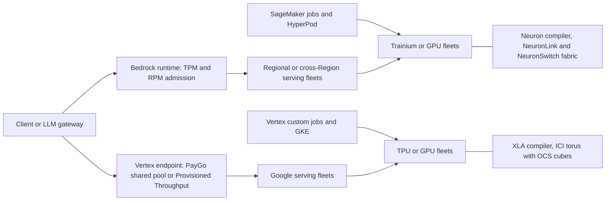

# AI and ML Platform Translation

## TL;DR

1. The serving-plane admission rule is the real contract on both clouds: Bedrock charges a request's `max_tokens` against your token quota at admission and reconciles after completion, while Vertex serves Gemini pay-as-you-go from a shared dynamic pool with no guarantee, and only Provisioned Throughput buys a reserved lane on either cloud.
2. Persistent resilient clusters (SageMaker HyperPod, GKE with TPU or GPU pools) are worth choosing over ephemeral training jobs once job MTBF drops below roughly a day. At 4096 chips with an assumed 50,000 h chip-level MTBF, checkpoint-restart goodput is about 93 percent by the Young-Daly model below, so recovery design is a first-order cost lever.
3. Accelerator choice is a compiler and topology choice before it is a FLOPs choice: Neuron and XLA both compile ahead of execution against static shapes, Trn3 is a switched all-to-all scale-up domain, and TPUs are 2D or 3D tori with optical circuit switching that carves slices out of 64-chip cubes.
4. Memory bandwidth, not peak FLOPs, sets the decode floor: for a 70B FP8 model the weights-plus-KV streaming time is 15 to 22 ms per step on one Ironwood or Trainium3 chip, and no amount of extra FLOPs changes it.
5. Always count the cost of leaving: capacity reservations, model-version lifecycles, compile caches, and checkpoint formats are the lock-in, not the API shape.

## Mental Model



Think of each cloud as three decoupled planes: an admission plane that decides whether a request or job gets capacity, an orchestration plane that places and heals work, and a silicon plane where a compiler binds a model graph to a specific interconnect topology.
Products with similar names (Bedrock and Model Garden, SageMaker and Vertex) map cleanly only on the orchestration plane.
On the admission plane the two clouds use different currency: token-rate quotas with reservation semantics on AWS, shared pools plus dedicated provisioned lanes on GCP.
On the silicon plane the translation is the hardest, because the compiler and the fabric topology are part of the model's performance contract and neither moves with your weights.

## Internals

### Serving-plane admission on Bedrock

Bedrock enforces requests per minute (RPM), tokens per minute (TPM), and tokens per day (TPD) quotas per model and Region.
Tokens are deducted at two points: at request start the quota is charged for total input tokens plus the `max_tokens` value, and after completion the charge is reconciled to input tokens plus cache-write tokens plus output tokens multiplied by a model-specific burndown rate (Bedrock docs, as of 2026-10).
The burndown rate is 5x for output tokens on Anthropic Claude versions 4.7 and below, 10x or 15x on newer listed models, and 1:1 for all other models (Bedrock docs, as of 2026-10).

This is the mechanism a getting-started guide does not tell you.
The admission-time reservation is a function of what you ask for, not what you use, so an application that sets `max_tokens` to 32,000 "to be safe" and emits 500 tokens is billed for 500 tokens but is admitted against 35,000.
The reconciliation step is a refund, but the refund arrives after the request completes, so for the duration of the request the unused reservation is unavailable to every other caller sharing the quota.
My reading of the doc is that the refund is applied at completion; the worked example below models it that way and treats the exact timing as an assumption to measure.
The consequence is that the sustainable request rate is governed by `rps * (60 * final_cost + latency * (reserve - final_cost))`, not by `rps * 60 * final_cost`, and long-latency requests with large `max_tokens` are the most expensive thing you can send to the quota.

Cross-Region inference changes the capacity pool, not the API.
A geographic profile routes within a geography such as US or EU, and a global profile routes to a supported commercial Region worldwide (Bedrock docs, as of 2026-10).
Global profiles can be priced lower per token than geographic ones; for one Claude model the docs state roughly 10 percent savings, with price computed from the source Region (Bedrock docs, as of 2026-10).
The trade-off is a data-residency boundary that you give up in exchange for burst capacity.

### Serving-plane admission on Vertex AI

Vertex quotas apply at the Google Cloud project level, and system limits are separate and cannot be raised (Google Cloud docs, as of 2026-10).
Gemini pay-as-you-go traffic uses Dynamic Shared Quota (DSQ), where throughput is allocated from a large shared pool based on real-time availability and demand across all customers (Google Cloud blog, as of 2026-10).
Google's own description of DSQ's limitation is that it has an upper bound and a risk of quota errors because it is not guaranteed (Google Cloud blog, as of 2026-10).
Provisioned Throughput (PT) is the dedicated alternative, and a per-request header, `X-Vertex-AI-LLM-Request-Type`, selects `dedicated` (use PT) or `shared` (use pay-as-you-go) (Google Cloud docs, as of 2026-10).

The practical difference from Bedrock is that Vertex PayGo failure is a function of other tenants' demand, so it is correlated across your retries and is not something you can fix by tuning request shape.
Bedrock throttling is mostly self-inflicted and diagnosable from your own token arithmetic.
Google's documentation set for these APIs is now branded Gemini Enterprise Agent Platform while the product and API surface still use the Vertex AI name (Google Cloud docs, as of 2026-10), so expect both names in console, IAM role names, and docs.

### Training plane

SageMaker training jobs and Vertex custom training jobs are ephemeral: provision, run, tear down, with data in S3 or Cloud Storage.
They are the right default below a few hundred accelerators.
Above that, job MTBF falls linearly with chip count, and you want a persistent cluster with health monitoring and fast node replacement.
SageMaker HyperPod is AWS's answer, and it now offers checkpointless training, in which a failed component is swapped and training state is recovered by peer-to-peer transfer from healthy accelerators, with AWS claiming over 95 percent goodput on clusters with thousands of accelerators (AWS docs, as of 2026-10).
HyperPod also offers elastic training, which expands a job to absorb idle accelerators and shrinks it when higher-priority work needs capacity (AWS docs, as of 2026-10).
The GCP equivalent is composed rather than packaged: GKE node pools of TPU or GPU capacity with a queueing layer and auto-repair, covered in [[17-Cloud-AI-Engineering/Volume_10_AI_Infrastructure_on_Cloud/Chapter_03_High_Performance_AI_Cluster_Architectures|High-Performance AI Cluster Architectures]].

The model to reason with is Young-Daly.
For a job of N chips with chip-level MTBF m, job MTBF is `m / N`.
With checkpoint write time C, the waste-minimizing interval is approximately `sqrt(2 * C * job_MTBF)` (Young 1974, refined by Daly 2006).
Waste is then roughly `C / interval + (interval / 2 + restart) / job_MTBF`.
The worked example computes this: at 4096 chips and an assumed 50,000 h chip-level MTBF, job MTBF is about 12 hours, the optimal interval is about 38 minutes, and goodput is about 92.7 percent with a 15 minute restart.
At 16,384 chips the same model gives 81 percent.
The 50,000 h figure is an assumption for illustration, not a vendor number; measure your own fleet's interrupt rate.
Checkpointless recovery attacks the restart term and the interval term together, which is why its value grows superlinearly with scale.
See [[17-Cloud-AI-Engineering/Volume_10_AI_Infrastructure_on_Cloud/Chapter_06_High_Throughput_Checkpointing_to_Object_Storage|High-Throughput Checkpointing to Object Storage]] and [[17-Cloud-AI-Engineering/Volume_10_AI_Infrastructure_on_Cloud/Chapter_08_Fault_Tolerance_and_Fleet_Resiliency_at_Scale|Fault Tolerance and Fleet Resiliency at Scale]] for the storage and detection halves.

### Silicon plane: Trainium and TPU topologies

AWS Trn2 instances carry 16 Trainium2 chips joined by NeuronLink-v3 in a 4x4 2D torus, and a Trn2 UltraServer joins four trn2u.48xlarge instances for 64 chips, with same-coordinate chips across instances linked in a ring (Neuron docs, as of 2026-10).
Trainium3 changes the topology class.
Trn3 UltraServers come in a Gen1 form with 64 chips (four servers of 16) and a Gen2 form with 144 chips (36 servers of 4), both using NeuronSwitch-v1 for all-to-all connectivity between chips, explicitly aimed at Mixture-of-Experts and autoregressive serving (Neuron docs, as of 2026-10).
In Gen2, devices within a server connect through a first-level NeuronSwitch-v1 and devices across servers through two second-level NeuronSwitch-v1 planes over NeuronLink-v4 (Neuron docs, as of 2026-10).

TPUs take the opposite approach.
Ironwood (TPU7x in the docs) chips have two TensorCores on a dual-chiplet package and 192 GB of HBM, and slices are specified as 3D topologies whose building block is a 64-chip cube (the docs table expresses 2x2x1 as 1/16 of a cube) (Google Cloud docs, as of 2026-10).
v6e chips have one TensorCore, a 2D torus, and a 256-chip pod (Google Cloud docs, as of 2026-10).
The mechanism that makes this work is optical circuit switching: the TPU v4 paper (Jouppi et al., ISCA 2023, "TPU v4: An Optically Reconfigurable Supercomputer for Machine Learning with Hardware Support for Embeddings") shows that OCS lets the scheduler wire together any healthy cubes into a requested torus, so a failed host removes a cube from the pool instead of fragmenting the machine.
This is a failure-domain feature as much as a performance feature, and it has no direct Trainium equivalent: a Trn2 UltraServer is a fixed physical group of four instances.
The same OCS idea at datacenter scale is described in "Jupiter Evolving" (Poutievski et al., SIGCOMM 2022).

Topology determines which collectives are cheap.
A torus is excellent for ring all-reduce and nearest-neighbor halo exchange, and degrades for all-to-all because bisection bandwidth grows as N to the 2/3 power in 3D (and as the square root of N in 2D) while all-to-all traffic grows with N.
The v6e page publishes both numbers for one 256-chip pod: all-reduce bandwidth 102.4 TB/s and bisection bandwidth 3.2 TB/s (Google Cloud docs, as of 2026-10).
Half of each chip's all-to-all payload must cross the bisection, so a worst-case all-to-all across the full pod runs roughly 32x slower than a per-chip-link bound would suggest (order of magnitude, my arithmetic from the published figures).
That gap is exactly what NeuronSwitch-v1 removes for Trn3 inside a 64 or 144 chip domain, and it is why expert-parallel placement on a torus is done to keep experts within a sub-torus.
See [[17-Cloud-AI-Engineering/Volume_10_AI_Infrastructure_on_Cloud/Chapter_02_Interconnect_Technologies_NVLink_EFA_and_TPU_ICI|Interconnect Technologies: NVLink, EFA, and TPU ICI]].

### The compile contract

Both stacks compile ahead of execution.
XLA traces a JAX or PyTorch/XLA program into HLO and compiles it for the specific TPU topology and tensor shapes.
The Neuron compiler similarly lowers graphs ahead of time into device executables, and Neuron-based inference stacks handle variable sequence lengths by compiling a set of shape buckets and padding requests up to the next bucket.
The consequences are the part a getting-started guide omits:

1. A shape that was not precompiled is a compile event, which on a large graph is minutes of latency, not milliseconds, so the p99 of an unbucketed service is the compile time.
2. Padding to a bucket wastes FLOPs and HBM bandwidth in proportion to the bucket gap, so bucket granularity is a cost knob.
3. A freshly autoscaled replica is not serving-ready when the process starts but when its compile cache is warm, so the compile cache must be a shipped artifact (baked into the image or fetched from object storage), not a runtime side effect.
4. Collective operations are compiled into the program against a fixed device mesh, so the mesh shape (for example 8x8x16 versus 4x8x32) is a compile-time input and changing slice size means recompiling and usually resharding.

These behaviors are well established for XLA; I did not re-verify the Neuron specifics against current docs for this chapter, and they are listed below as such.

### Foundational papers

1. Jouppi et al., "In-Datacenter Performance Analysis of a Tensor Processing Unit," ISCA 2017: the systolic-array rationale and the memory-bandwidth-bound reality for inference.
2. Jouppi et al., "TPU v4," ISCA 2023: OCS-based reconfigurable torus and availability argument.
3. Barham et al., "Pathways: Asynchronous Distributed Dataflow for ML," MLSys 2022: single-controller dispatch across slices that underpins multislice training.
4. Shalev et al., "A Cloud-Optimized Transport Protocol for Elastic and Scalable HPC," IEEE Micro 2020: SRD, the transport under EFA.
5. Yu et al., "Orca: A Distributed Serving System for Transformer-Based Generative Models," OSDI 2022, and Kwon et al., "Efficient Memory Management for LLM Serving with PagedAttention," SOSP 2023: the iteration-level batching and KV paging that every managed endpoint relies on.
6. Young 1974 and Daly 2006 on optimum checkpoint intervals, used above.

The TPU lineage is treated in depth in [[17-Cloud-AI-Engineering/Volume_13_Seminal_Papers_and_Case_Studies/Chapter_15_Google_TPU_Architecture_Evolution|Google TPU Architecture Papers: TPU v1 to v5p]].

## Numbers to Know

| Item | Value | Source |
|---|---|---|
| Trn2 instance (trn2.48xlarge / trn2u.48xlarge) | 16 Trainium2 chips, 4x4 2D torus, 192 vCPUs | Neuron docs, as of 2026-10 |
| Trn2 UltraServer | 4 instances, 64 chips, ring across same-coordinate chips | Neuron docs, as of 2026-10 |
| Trainium3 chip | 2.52 PFLOPs FP8, 144 GB HBM3e, 4.9 TB/s HBM bandwidth | AIwire reporting AWS launch figures, 2025-12, re-checked 2026-10 |
| Trainium3 vs Trainium2 | 1.5x HBM capacity, 1.7x HBM bandwidth, so Trn2 is about 96 GB and 2.9 TB/s (derived) | AWS launch repost, as of 2026-10 |
| Trn3 Gen1 UltraServer | 64 chips, 161 PFLOPs dense MXFP8, 314 TB/s HBM, 9 TB HBM | Neuron docs, as of 2026-10 |
| Trn3 Gen2 UltraServer | 144 chips, 362 PFLOPs dense MXFP8, 706 TB/s HBM, 20 TB HBM (AWS announcement says 20.7 TB) | Neuron docs and AWS announcement, as of 2026-10 |
| Trn3 chip-to-chip fabric delay | under 10 microseconds | Amazon announcement, as of 2026-10 |
| Trn3 status | GA, announced at re:Invent 2025 | AWS announcement, 2025-12 |
| Trainium4 | previewed, no GA date stated | Press reporting, as of 2026-10 (Preview, not GA) |
| TPU v5p chip | 459 TFLOPs bf16, 95 GiB HBM, 2765 GB/s, ICI 1200 GB/s bidirectional | Google Cloud docs, as of 2026-10 |
| TPU v6e chip | 918 TFLOPs bf16, 32 GB HBM, 1638 GB/s, ICI 800 GB/s, 4 ICI ports, 8 chips per host | Google Cloud docs, as of 2026-10 |
| TPU v6e pod | 256 chips, 2D torus, 234.9 PFLOPs bf16, all-reduce 102.4 TB/s, bisection 3.2 TB/s, 25.6 Tbps DCN | Google Cloud docs, as of 2026-10 |
| TPU7x Ironwood chip | 4614 TFLOPs FP8, 192 GB HBM, 7380 GB/s, ICI 1200 GB/s bidirectional, 2 TensorCores, 4 SparseCores | Google Cloud docs, as of 2026-10 |
| Ironwood scale | slice topologies in docs up to 8x16x16 (2048 chips) in 64-chip cubes; 9,216-chip superpod in launch material | Google Cloud docs and Google blog, as of 2026-10 |
| Ironwood status | docs page exists for TPU7x; press sources disagree on GA date (late 2025 versus 2026-04) so treat the GA date as UNVERIFIED | Press reporting, as of 2026-10 |
| TPU 8t and 8i | previewed, press-reported late 2027 target | Press reporting, as of 2026-10 (Preview, not GA) |
| Bedrock output-token burndown | 5x for Claude 4.7 and below, 10x or 15x for newer listed models, 1:1 for others | Bedrock docs, as of 2026-10 |
| Bedrock admission charge | input tokens plus `max_tokens` at start, reconciled to input plus cache-write plus output x burndown | Bedrock docs, as of 2026-10 |
| Bedrock global versus geographic profile | roughly 10 percent lower price for one Claude model, priced by source Region | Bedrock docs, as of 2026-10 |
| HyperPod checkpointless training | recovery in minutes, over 95 percent goodput claimed on thousands of accelerators | AWS docs, as of 2026-10 |
| Vertex PayGo Gemini | Dynamic Shared Quota, shared pool, not guaranteed | Google Cloud blog, as of 2026-10 |
| Vertex request-type header | `X-Vertex-AI-LLM-Request-Type`: `dedicated` or `shared` | Google Cloud docs, as of 2026-10 |
| Per-token and per-chip-hour list prices | not retrieved for this chapter; use current pricing pages | UNVERIFIED |
| p99 latency of managed endpoints | neither cloud publishes a latency SLO for on-demand model APIs in the sources checked | UNVERIFIED |

Derived ratios for reasoning, from the rows above: Trainium3 FP8 peak divided by HBM bandwidth is about 514 FLOPs per byte, and Ironwood FP8 is about 625 FLOPs per byte.
Decode at small batch has arithmetic intensity of order 1 to 100 FLOPs per byte, so decode is bandwidth-bound on every chip listed, and chip choice for decode is a bandwidth-per-dollar decision.
The generation columns are not like-for-like on precision: v5p and v6e peaks above are bf16, Ironwood's is FP8.

## AWS vs GCP Mechanism Parity

| Mechanism | AWS | GCP | Critical difference |
|---|---|---|---|
| ML platform umbrella | Amazon SageMaker AI, with Unified Studio as the workspace layer | Vertex AI, documented under Gemini Enterprise Agent Platform branding | Both are control planes over compute you could also run yourself on EKS or GKE |
| Serverless model API | Bedrock with Converse and InvokeModel | Gemini API on Vertex plus Model Garden managed APIs | Bedrock is multi-provider by design; on GCP the first-party model is the primary path and partners are added through Model Garden |
| Admission currency | RPM, TPM, TPD per model and Region, `max_tokens` reserved at start, output burndown | Project-level quotas, DSQ shared pool for Gemini PayGo | AWS failure is mostly self-inflicted and computable; GCP PayGo failure is correlated with other tenants |
| Dedicated capacity | Bedrock Provisioned Throughput (model units, commitment terms) | Vertex Provisioned Throughput with per-request dedicated or shared header | GCP lets one request choose its lane; verify spillover default before relying on it |
| Cross-region routing | Geographic and global inference profiles, priced from source Region | Regional and global endpoints | AWS exposes routing as a named resource you must grant IAM on; GCP exposes it as an endpoint choice |
| Bring your own weights | Custom Model Import, SageMaker endpoints | Model Garden self-deploy, Vertex endpoints on GPU or TPU | Self-hosting moves capacity risk and compile risk to you on both clouds |
| Managed training | SageMaker training jobs | Vertex custom training jobs | Equivalent for small scale; neither is the right abstraction past a few hundred accelerators |
| Resilient persistent cluster | HyperPod with checkpointless and elastic training | GKE TPU or GPU pools with queueing and auto-repair | AWS packages recovery; GCP composes it |
| Custom silicon | Trainium2, Trainium3, Inferentia2 | TPU v5e, v5p, v6e, Ironwood | Both are compiler-gated; neither runs CUDA code |
| Scale-up domain | Trn2 64 chips as 2D torus plus rings; Trn3 64 or 144 chips switched | v6e 256-chip 2D torus; Ironwood 3D torus in 64-chip cubes with OCS | Switched favors all-to-all; torus favors rings and gives OCS slice shaping |
| Compiler path | Neuron SDK, with NKI for custom kernels | XLA, JAX first, PyTorch/XLA, Pallas for custom kernels | Kernel coverage for new attention variants is the porting bottleneck |
| Failure containment | Replace failed instances within fixed UltraServer groups | OCS routes around failed cubes when forming a slice | TPU slice shape is software-defined; UltraServer shape is physical |

## Worked Example: Quota Admission, Goodput, and Roofline Sizing

### Offline planner

This stdlib script reproduces every derived number in this chapter.
All prices and quotas in it are placeholders you must replace; none are list prices.

```python
#!/usr/bin/env python3
"""Capacity planner for the AI platform translation chapter. Pure stdlib, offline."""
import math

def max_sustainable_rps(tpm_quota, in_tok, out_tok, max_tokens, burn, latency_s):
    final_cost = in_tok + out_tok * burn
    reserve = max(in_tok + max_tokens, final_cost)
    held_extra = reserve - final_cost
    denom = 60.0 * final_cost + latency_s * held_extra
    return tpm_quota / denom, final_cost, reserve

def quota_table():
    Q = 2_000_000
    print("== TPM admission (quota=%d TPM, in=3000, out=500, burn=5x, latency=10s)" % Q)
    print("max_tokens  final_cost  reserve  max_rps  tokens_billed_per_s")
    for mt in (1024, 4096, 8192, 32000):
        rps, fc, rs = max_sustainable_rps(Q, 3000, 500, mt, 5, 10.0)
        print("%10d %11d %8d %8.2f %12.0f" % (mt, fc, rs, rps, rps * 3500))

def goodput(n_chips, chip_mtbf_h, ckpt_write_s, restart_s):
    job_mtbf_s = chip_mtbf_h * 3600.0 / n_chips
    tau = math.sqrt(2.0 * ckpt_write_s * job_mtbf_s)
    waste = ckpt_write_s / tau + (tau / 2.0 + restart_s) / job_mtbf_s
    return job_mtbf_s, tau, 1.0 - waste

def goodput_table():
    print("\n== Checkpoint-restart goodput (assumed chip MTBF 50000 h)")
    for n in (512, 2048, 4096, 16384):
        m, tau, g = goodput(n, 50000, 60, 900)
        _, _, g2 = goodput(n, 50000, 60, 180)
        print("%5d chips: job MTBF %.1f h, interval %.1f min, goodput %.3f (restart 15m) %.3f (restart 3m)"
              % (n, m / 3600, tau / 60, g, g2))

CHIPS = {"Trainium3": (144, 4900), "TPU7x Ironwood": (192, 7380),
         "TPU v6e": (32, 1638), "TPU v5p": (95, 2765)}

def roofline(params_b=70, bytes_per_param=1.0, kv_gb=40, batch=64):
    w_gb = params_b * bytes_per_param
    print("\n== Decode step floor, %dB params, %.0f GB weights, KV %d GB, batch %d" % (params_b, w_gb, kv_gb, batch))
    for name, (hbm, bw) in CHIPS.items():
        n = math.ceil((w_gb + kv_gb) / (hbm * 0.9))
        step_s = (w_gb + kv_gb) / (n * bw)
        print("%-16s chips=%d step_floor=%.2f ms ideal_tok_s=%.0f" % (name, n, step_s * 1e3, batch / step_s))

def pt_breakeven(pt_per_hour, pt_tokens_per_s, blended_per_mtok):
    return pt_per_hour / (pt_tokens_per_s * 3600 / 1e6 * blended_per_mtok)

def pt_table():
    print("\n== PT break-even utilization (PLACEHOLDER prices)")
    for pt_hr, tps, blended in ((40.0, 2500, 6.0), (40.0, 2500, 9.0), (40.0, 4000, 9.0)):
        print("PT $%.0f/h, %d tok/s, blended $%.1f/Mtok -> %.0f%%" % (pt_hr, tps, blended, 100 * pt_breakeven(pt_hr, tps, blended)))

if __name__ == "__main__":
    quota_table(); goodput_table(); roofline(); pt_table()
```

### Back-of-the-envelope results

Quota admission, with a placeholder 2,000,000 TPM quota, 3000 input tokens, 500 output tokens, 5x burndown, 10 s latency:

| max_tokens | Final charge | Admission reserve | Max sustainable rps |
|---|---|---|---|
| 1024 | 5,500 | 5,500 | 6.06 |
| 4096 | 5,500 | 7,096 | 5.78 |
| 8192 | 5,500 | 11,192 | 5.17 |
| 32000 | 5,500 | 35,000 | 3.20 |

Setting `max_tokens` to 32,000 instead of 1,024 cuts sustainable throughput by 47 percent with no change in billed tokens.
The output burndown dominates the final charge here: 500 output tokens at 5x is 2,500 of the 5,500.
The fix is to set `max_tokens` from the measured p99 of completion length per route, and to truncate or continue explicitly beyond that, not to raise the quota.

Goodput at an assumed 50,000 h chip-level MTBF, 60 s checkpoint write:

| Chips | Job MTBF | Optimal interval | Goodput (15 min restart) | Goodput (3 min restart) |
|---|---|---|---|---|
| 512 | 97.7 h | 108 min | 0.979 | 0.981 |
| 2048 | 24.4 h | 54 min | 0.953 | 0.961 |
| 4096 | 12.2 h | 38 min | 0.927 | 0.944 |
| 16384 | 3.1 h | 19 min | 0.814 | 0.879 |

At 4096 chips, each percentage point of goodput is about 983 chip-hours per day (4096 x 24 x 0.01), so the difference between 92.7 percent and a claimed 95 percent is about 2,260 chip-hours per day.
Multiply by your negotiated chip-hour rate to get the value of recovery engineering.

Decode roofline for a 70B model in FP8 (70 GB weights) with 40 GB of KV cache at batch 64, using the HBM figures in the Numbers table:

| Chip | Chips needed to fit | Step floor | Ideal tokens per second per replica |
|---|---|---|---|
| Trainium3 | 1 | 22.45 ms | 2,851 |
| TPU7x Ironwood | 1 | 14.91 ms | 4,294 |
| TPU v6e | 4 | 16.79 ms | 3,812 |
| TPU v5p | 2 | 19.89 ms | 3,217 |

These are upper bounds that ignore collectives, attention kernel efficiency, and FP8 kernel availability.
The v6e figure depends on perfect 4-way tensor-parallel scaling and will be lower in practice because 32 GB per chip forces TP and its all-reduce on every layer.
The lesson is that HBM capacity decides whether you pay a communication tax at all, and the table is the right first filter before any benchmark.

Provisioned break-even with placeholder prices: a PT lane of $40 per hour delivering 2,500 tokens per second against a blended on-demand price of $6 per million tokens breaks even at 74 percent utilization, and at $9 per million it breaks even at 49 percent.
Any workload whose diurnal average utilization of the lane sits below break-even should use PT only for the floor and on-demand for the peak.

### Live probe

This probe measures the real admission charge on each cloud for a sweep of `max_tokens`.
Set `MODEL_ID` to an inference profile or model you have access to; no model ID is hard-coded.

```python
import os, sys, time
N = int(os.environ.get("N", "5"))
SWEEP = [int(x) for x in os.environ.get("MAX_TOKENS_SWEEP", "256,2048").split(",")]
BURN = float(os.environ.get("BURN", "5"))
PROMPT = "Explain consistent hashing in about 150 words."

def aws():
    import boto3, botocore
    cfg = botocore.config.Config(retries={"max_attempts": 1, "mode": "standard"})
    c = boto3.client("bedrock-runtime", region_name=os.environ["AWS_REGION"], config=cfg)
    for mt in SWEEP:
        for _ in range(N):
            t = time.time()
            try:
                r = c.converse(modelId=os.environ["MODEL_ID"],
                               messages=[{"role": "user", "content": [{"text": PROMPT}]}],
                               inferenceConfig={"maxTokens": mt})
                u = r["usage"]
                admit = u["inputTokens"] + mt
                final = u["inputTokens"] + u["outputTokens"] * BURN
                print("aws max_tokens=%d admit=%d final=%.0f latency=%.2fs" % (mt, admit, final, time.time() - t))
            except botocore.exceptions.ClientError as e:
                print("aws max_tokens=%d error=%s" % (mt, e.response["Error"]["Code"]))

def gcp():
    from google import genai
    from google.genai import types
    c = genai.Client(vertexai=True, project=os.environ["GCP_PROJECT"], location=os.environ["GCP_LOCATION"])
    hdr = {"X-Vertex-AI-LLM-Request-Type": os.environ.get("LANE", "shared")}
    for mt in SWEEP:
        for _ in range(N):
            t = time.time()
            try:
                r = c.models.generate_content(
                    model=os.environ["MODEL_ID"], contents=PROMPT,
                    config=types.GenerateContentConfig(max_output_tokens=mt, http_options=types.HttpOptions(headers=hdr)))
                u = r.usage_metadata
                print("gcp max_tokens=%d in=%s out=%s latency=%.2fs" % (mt, u.prompt_token_count, u.candidates_token_count, time.time() - t))
            except Exception as e:
                print("gcp max_tokens=%d error=%s" % (mt, getattr(e, "code", type(e).__name__)))

{"aws": aws, "gcp": gcp}[sys.argv[1]]()
```

Run `python3 probe.py aws` or `python3 probe.py gcp`.
The `http_options` placement on the config object follows the google-genai SDK; if your SDK version differs, pass headers at client construction instead.
On Vertex, compare `LANE=shared` and `LANE=dedicated` only if you own a PT order; without one, `dedicated` is expected to be rejected.

### Cost estimate, budget alarms, teardown

The probe issues at most `N x len(SWEEP)` calls per cloud, about 10 by default, each under 400 tokens.
At the placeholder rates of $3 per million input and $15 per million output tokens, that is well under $0.10 per cloud, and a ceiling of $10 per cloud covers a 100x mistake.
The probe creates no persistent resources, so teardown only removes the budgets.
Budgets alert and do not cap spend.

```bash
export ACCT=$(aws sts get-caller-identity --query Account --output text)
cat > budget.json <<'EOF'
{"BudgetName":"ai-lab-10usd","BudgetLimit":{"Amount":"10","Unit":"USD"},"TimeUnit":"MONTHLY","BudgetType":"COST"}
EOF
cat > notifications.json <<'EOF'
[{"Notification":{"NotificationType":"ACTUAL","ComparisonOperator":"GREATER_THAN","Threshold":80,"ThresholdType":"PERCENTAGE"},
  "Subscribers":[{"SubscriptionType":"EMAIL","Address":"you@example.com"}]}]
EOF
aws budgets create-budget --account-id "$ACCT" --budget file://budget.json --notifications-with-subscribers file://notifications.json

gcloud billing budgets create --billing-account="$BILLING" --display-name=ai-lab-10usd \
  --budget-amount=10USD --threshold-rule=percent=0.8
```

Teardown:

```bash
aws budgets delete-budget --account-id "$ACCT" --budget-name ai-lab-10usd
gcloud billing budgets delete "$(gcloud billing budgets list --billing-account="$BILLING" \
  --filter='displayName=ai-lab-10usd' --format='value(name)')" --billing-account="$BILLING"
```

Training clusters, Trn3 UltraServers, and TPU slices are not provisioned by this lab because the minimum billable unit is large; size them with the planner and reserve capacity through the procedures in [[17-Cloud-AI-Engineering/Volume_09_FinOps_and_Cloud_Economics/Chapter_05_GPU_and_TPU_Unit_Economics|GPU and TPU Unit Economics]].

## Failure Modes and Pitfalls

1. **Throttling at a fraction of quota.** Symptom: `ThrottlingException` while CloudWatch shows consumed tokens at 40 percent of TPM. Cause: large `max_tokens` reserved at admission by long-latency requests. Fix: per-route `max_tokens` from measured p99 completion length, shorter latency through streaming and caching, and an alarm on the ratio of admitted to final tokens.
2. **Retry amplification.** Every retry reserves `input + max_tokens` again at admission, so retrying a throttled request makes the throttle worse. Use capped exponential backoff with full jitter and a retry budget as in [[17-Cloud-AI-Engineering/Volume_07_Reliability_and_SRE/Chapter_03_Resilient_Communication_Retries_Jitter_and_Circuit_Breakers|Resilient Communication]], and shed load by priority per [[17-Cloud-AI-Engineering/Volume_07_Reliability_and_SRE/Chapter_02_Load_Shedding_Backpressure_and_Admission_Control|Load Shedding and Admission Control]].
3. **Hedged requests double burn.** Hedging a slow LLM call sends a second reservation and, if both complete, two full output charges. Hedge only the time-to-first-token phase and cancel the loser on first byte.
4. **Correlated PayGo exhaustion on Vertex.** DSQ is a shared pool, so a regional demand peak yields 429s for many tenants at once, and your retries compete with everyone else's. Mitigation: PT for the floor, a second region or global endpoint for overflow, and a lower-tier model fallback with eval gating.
5. **Cold compile on autoscale.** A new Neuron or XLA replica that must compile its shapes is not ready when the container starts. Ship the compile cache with the image or from object storage, gate readiness on a warm-shape probe, and pre-warm replicas ahead of load, as in [[17-Cloud-AI-Engineering/Volume_11_LLM_Serving_and_Inference_Systems_on_Cloud/Chapter_08_Cloud_GPU_Autoscaling_and_Cold_Start_Mitigation|Cloud GPU Autoscaling and Cold-Start Mitigation]].
6. **Unbucketed shape p99 cliff.** A rare long prompt that misses every bucket triggers compilation inside the request path. Cap input length at the largest bucket and reject or chunk anything larger.
7. **Fragmented accelerator capacity.** A Trn2 UltraServer is four co-located instances, and a TPU slice is whole cubes, so 60 free chips scattered across hosts may satisfy zero 64-chip requests. Reserve in the unit you schedule (UltraServer, cube) and keep a defragmentation policy for preemptible work.
8. **Checkpoint stampede.** After a failure, thousands of ranks read the same checkpoint from object storage at once, and the restart time in the goodput model becomes the object-store throughput limit, not the node replacement time. See [[17-Cloud-AI-Engineering/Volume_10_AI_Infrastructure_on_Cloud/Chapter_06_High_Throughput_Checkpointing_to_Object_Storage|High-Throughput Checkpointing to Object Storage]].
9. **Peer-recovery assumptions.** Checkpointless recovery by peer-to-peer transfer needs a healthy copy of the lost state somewhere. A parallelism layout with no replicated shards has nothing to copy from, so verify with the HyperPod documentation that your layout is eligible before removing checkpoints from your plan (my inference; UNVERIFIED against current docs).
10. **Silent numeric divergence after a port.** bf16 accumulation order, FP8 scaling recipes, and stochastic rounding differ across chips, and loss curves can match for weeks before eval regressions show. Gate ports on eval parity and not only loss.
11. **Region-deny policies breaking routing.** An SCP or org policy that denies all but one Region can block cross-Region inference profiles, because the profile fans out to other Regions. Test the exact profile with the exact deny policy before rollout.
12. **Model lifecycle surprises.** Both clouds retire model versions. Pin versions, track retirement dates, and re-run your eval suite before the forced migration.
13. **Control-plane incidents.** Public post-incident reviews, including the AWS us-east-1 event of October 2025 and the Google Cloud global service-control outage of June 2025, show that managed AI APIs inherit the blast radius of shared control-plane dependencies. Details of these events were not re-verified for this chapter. The design response is regional static stability and a tested fallback, as in [[17-Cloud-AI-Engineering/Volume_07_Reliability_and_SRE/Chapter_07_Anatomy_of_Major_Cloud_Outages|Anatomy of Major Cloud Outages]].

## Security and Cost Angles

### Identity and network boundaries

On AWS, scope `bedrock:InvokeModel` and `bedrock:InvokeModelWithResponseStream` to specific model and inference-profile ARNs and not to `*`.
A cross-Region profile requires permission on the profile and on the underlying foundation models in every destination Region, and the exact resource and condition syntax for global profiles should be confirmed in the current IAM documentation before you encode it in a policy (UNVERIFIED).

```json
{
  "Version": "2012-10-17",
  "Statement": [{
    "Effect": "Allow",
    "Action": ["bedrock:InvokeModel", "bedrock:InvokeModelWithResponseStream"],
    "Resource": [
      "arn:aws:bedrock:us-east-1:111122223333:inference-profile/PROFILE_ID",
      "arn:aws:bedrock:*::foundation-model/MODEL_ID"
    ]
  }]
}
```

Use an interface VPC endpoint for the Bedrock runtime and an endpoint policy to pin callers to your account's profiles.
On GCP, grant `roles/aiplatform.user` on the project for callers, reach the API through Private Service Connect, and put `aiplatform.googleapis.com` inside a VPC Service Controls perimeter, as in [[17-Cloud-AI-Engineering/Volume_03_GCP_Deep_Dive/Chapter_03_VPC_Service_Controls_Security_Perimeters|VPC Service Controls: Security Perimeters]].
The cross-cloud perimeter design is in [[17-Cloud-AI-Engineering/Volume_08_Security_Identity_and_the_Data_Perimeter/Chapter_06_Constructing_an_Impenetrable_Data_Perimeter|Constructing an Impenetrable Data Perimeter]].

### Keys and data

Use envelope encryption with customer-managed keys: AWS KMS for model artifacts in S3, training volumes, and imported model weights, and Cloud KMS CMEK for Vertex datasets, models, and checkpoints, per [[17-Cloud-AI-Engineering/Volume_08_Security_Identity_and_the_Data_Perimeter/Chapter_04_Encryption_Key_Hierarchies_and_Envelope_Encryption|Encryption Key Hierarchies and Envelope Encryption]].
Enable invocation logging deliberately: logged prompts and completions are a new sensitive data store that needs its own key, retention, and access policy.
Checkpoints contain optimizer state and are as sensitive as the weights.

### Unit economics levers

1. Right-size `max_tokens` per route: free capacity, not money, but capacity is what you buy PT for.
2. Use global profiles when residency allows; one documented case gives roughly 10 percent per-token savings (Bedrock docs, as of 2026-10).
3. Hold PT only for the traffic floor; use the break-even formula from the worked example with real prices.
4. Cache stable prefixes and batch offline work; both clouds offer batch and caching modes whose current discounts must be read from pricing pages (UNVERIFIED here).
5. Choose accelerators by cost per useful token: price per chip-hour divided by measured tokens per second at your SLO, times goodput, and not by peak FLOPs.
6. Tag by application inference profile on AWS and by project or label on GCP so spend maps to products, per [[17-Cloud-AI-Engineering/Volume_09_FinOps_and_Cloud_Economics/Chapter_01_Cloud_Billing_Models_and_Unit_Cost_Allocation|Cloud Billing Models and Unit Cost Allocation]].

## Interview Questions and Model Answers

### Question 1 (L5 - Senior)

A team reports Bedrock throttling at 40 percent of their TPM quota. Walk me through diagnosing it.

#### Model Answer

Start with the admission rule: the quota is charged `input + max_tokens` at request start and reconciled to `input + cache_write + output x burndown` at completion (Bedrock docs, as of 2026-10).
So the first question is what `max_tokens` is set to and what the real completion length distribution is.
If completions average 500 tokens and `max_tokens` is 32,000, each in-flight request holds 35,000 tokens of quota for its whole latency, which my model shows cuts sustainable rate from about 6 to 3.2 requests per second at 2M TPM and 10 s latency.
Second, check the burndown for the model in use, because 5x, 10x, or 15x on output tokens makes the final charge much larger than the billed tokens suggest, and dashboards that plot billed tokens will under-report quota use.
Third, check retries: SDK default retries each re-reserve, so a throttled burst inflates itself.
The fix order is: set `max_tokens` from measured p99 per route, cap SDK retries and add jitter, use streaming with early stop where possible, and only then request a quota increase or buy Provisioned Throughput.

#### Follow-up Interviewer Question

You cannot know completion length in advance for an agent that sometimes writes long documents. How do you set `max_tokens` without truncating those outputs?

### Question 2 (L5 - Senior)

When would you choose Provisioned Throughput over on-demand on Bedrock or Vertex, and how do you size it?

#### Model Answer

Provisioned capacity is an insurance and latency-stability purchase, not a discount.
Compute break-even utilization as `PT price per hour / (lane tokens per second x 3600 / 1e6 x blended on-demand price per million tokens)`.
With placeholder numbers the break-even is between 31 and 74 percent depending on lane throughput and token mix, so the answer is workload-specific and must use current prices and measured lane throughput.
On Vertex the on-demand alternative is a shared pool with no guarantee (Google Cloud blog, as of 2026-10), so PT also buys protection from correlated exhaustion, and a per-request header lets individual calls choose the lane (Google Cloud docs, as of 2026-10).
On Bedrock on-demand failure is mostly your own quota arithmetic, so PT is justified more by latency stability and commitment pricing than by availability.
I would size PT to the traffic floor (the 5th to 10th percentile of hourly demand over a month), keep the peak on on-demand with a lower-tier fallback, and re-evaluate quarterly because token mix drifts.

#### Follow-up Interviewer Question

Your traffic is 10x higher during US business hours than at night. How does that change the floor calculation and the commitment term you pick?

### Question 3 (L6 - Staff)

Design failover for a customer-facing LLM feature across two AWS Regions and GCP. What actually breaks?

#### Model Answer

Capacity, not availability, is the binding constraint: failing over shifts full load onto a pool with its own quota, so the secondary needs pre-provisioned headroom (PT in the secondary, or an agreed degraded tier) or the failover just moves the throttle.
Second, retry and hedge behavior: reservations are charged at admission, so naive retries across pools amplify; use a gateway with per-backend circuit breakers, a global retry budget, and deadline propagation.
Third, state that does not fail over: prompt caches live with the serving fleet that processed the prefix, so after failover the cached prefix is a full-price, higher-TTFT input (my reasoning; verify per provider), and mid-stream failures cannot resume, so the client must restart idempotently.
Fourth, behavioral parity: cross-Region profiles of the same model are the same weights, but a different model family on another cloud changes tool-call schemas, refusals, and output length, so failover to a different family needs eval-gated routing per [[13-Agentic-AI/Agentic_AI_Zero_to_Godhood/Volume_10_Evaluation_and_Observability/Chapter_07_Production_Evaluation|Production Evaluation]].
Fifth, governance: cross-Region and cross-cloud paths must be inside the data perimeter and residency policy, and SCP Region denies can silently break profiles.
I would run intra-Region-set failover with a geographic profile as tier one, a second cloud as tier two with a smaller model and explicit degradation UX, and test both monthly with injected 429s and region blackholes.

#### Follow-up Interviewer Question

The secondary cloud's quota is 20 percent of primary. What do you shed first, and how does the gateway decide in under a second?

### Question 4 (L6 - Staff)

Your team wants to move a training run from GPUs to Trainium3 or TPUs to save cost. What determines whether it works?

#### Model Answer

Peak FLOPs is the least interesting variable.
The determinants are compile and kernel coverage, shape discipline, topology fit, and goodput.
Compile and kernels: every op in your model, including new attention variants and custom losses, must lower through XLA or Neuron or have a hand-written kernel in Pallas or NKI, and unsupported ops fall back to slow paths or fail.
Shape discipline: static shapes mean padded batches and sequence buckets, so measure padding waste and recompilation behavior on your real length distribution.
Topology fit: a switched Trn3 domain (64 or 144 chips, all-to-all) suits expert parallelism, while a torus suits ring-structured data and tensor parallelism and needs expert placement inside sub-tori; the v6e pod's 32x gap between all-reduce and bisection bandwidth (Google Cloud docs, as of 2026-10) is the number that makes this concrete.
Goodput: price per chip-hour divided by (tokens per second x goodput) is the metric, and recovery tooling (HyperPod checkpointless, OCS route-around) belongs in it.
Execution plan: port a small variant, prove loss and eval parity over a few thousand steps against the GPU baseline, then scale in stages, and keep a framework-neutral checkpoint format so the exit door stays open.

#### Follow-up Interviewer Question

Loss curves match for 5,000 steps, but a downstream eval is 1.5 points lower. What is your debugging order?

### Question 5 (L6 - Staff)

You run 4096 accelerators. Argue for or against checkpointless training.

#### Model Answer

Model it first.
With an assumed 50,000 h chip-level MTBF, job MTBF is about 12 hours, the Young-Daly interval is about 38 minutes for a 60 s checkpoint, and checkpoint-restart goodput is about 92.7 percent with a 15 minute restart and 94.4 percent with a 3 minute restart.
AWS reports over 95 percent goodput for checkpointless training on clusters of thousands of accelerators (AWS docs, as of 2026-10), so the gain over a well-tuned checkpoint-restart is 1 to 3 points, worth roughly 1,000 to 3,000 chip-hours per day at this scale, and the gain grows quickly at 16K chips where the same model gives 81 percent.
Against that: peer-to-peer recovery needs a healthy replica of the lost state, so it constrains parallelism layout; it adds a new failure mode of its own (corrupted peer state propagating) that periodic checkpoints would have bounded; and you still need durable checkpoints for rollback after a bad data batch or loss spike, so you cannot delete the checkpoint path.
My recommendation is to keep periodic durable checkpoints at a longer interval for rollback, adopt peer recovery for hardware faults if the layout is eligible, and measure goodput directly from step-time telemetry instead of trusting either the model or the vendor figure.

#### Follow-up Interviewer Question

A node returns wrong numerics without crashing. How does peer-to-peer recovery interact with silent data corruption, and what would you add?

### Question 6 (L7+ - Principal)

Trn3 is a switched all-to-all domain and Ironwood is an OCS-shaped 3D torus. You serve a large MoE model. How does that change your design?

#### Model Answer

MoE serving is dominated by two all-to-alls per layer (dispatch and combine) plus the decode bandwidth floor.
On a switched domain, each chip's all-to-all share is limited by its port bandwidth, so expert parallelism can span the whole 64 or 144 chip UltraServer, and routing imbalance is a load problem and not a topology problem.
On a torus, all-to-all across a full pod is bisection-limited: the v6e numbers (102.4 TB/s all-reduce versus 3.2 TB/s bisection for 256 chips, Google Cloud docs, as of 2026-10) imply order-of-32x degradation versus the per-link ideal, and the gap widens with torus edge length.
So on TPUs I would map expert parallelism onto a sub-torus (for example one or two 64-chip cubes), keep tensor parallelism on the shortest-latency axis, put data parallelism across the long axis, and use OCS slice shaping to pick a topology that matches the expert count, which is a lever Trainium does not have.
The other side of the trade is that OCS slice shapes are compile-time inputs, so elastic resizing means recompiling and resharding, whereas a Trn3 UltraServer boundary is physical and fixed at 64 or 144 chips, with the failure of one server degrading the domain.
I would decide on measured tokens per second per dollar at the p99 inter-token latency SLO for my actual routing skew, not on peak numbers, and I would keep the serving engine's parallelism config as data so a re-layout is a config change plus a compile-cache rebuild.

#### Follow-up Interviewer Question

Expert popularity is heavily skewed in production traffic. How do you handle the hot-expert problem differently on a switched fabric versus a torus?

### Question 7 (L7+ - Principal)

The CFO asks whether you should run your AI platform on one cloud or two. Make the decision and defend it.

#### Model Answer

Separate three things people conflate: model access, accelerator capacity, and the platform layer.
Model access is the most portable layer if you put an internal gateway in front with a normalized request and response schema, an eval harness that gates any model swap, and prompts stored as versioned artifacts; this costs a small team and removes the largest API lock-in.
Accelerator capacity is the least portable and the most strategic: both clouds ration scarce accelerators through reservations and commitments, compile caches and kernels are chip-specific, and a second cloud's capacity is only real if you have already ported, tuned, and paid for it.
The platform layer (registry, pipelines, feature store) is where dual-cloud tends to be an expensive mistake, because the control planes differ and the duplication tax is permanent.
My default is one primary cloud for training and platform, a second cloud for inference capacity and model access through the gateway, and an explicit annual exercise that actually fails traffic over.
The decision flips to dual training only if a single provider cannot supply the accelerator volume in the required Region on the required timeline, or if a specific silicon (TPU or Trainium) gives a measured cost-per-useful-token advantage above the porting and operations cost for at least a year.
I would present the CFO a table of exit costs per layer (weeks of engineering, capacity commitments stranded, egress for checkpoints and datasets) next to the savings, because the real price of single-cloud is the stranded commitments if you ever leave.

#### Follow-up Interviewer Question

Your largest commitment on the primary cloud has 26 months remaining and the second cloud offers 30 percent cheaper inference. How do you structure the transition without stranding the commitment?

## Further Reading

1. [Bedrock token counting and quotas documentation](https://docs.aws.amazon.com/bedrock/latest/userguide/quotas-token-burndown.html) - The authoritative statement of admission-time `max_tokens` deduction and burndown rates.
2. [Bedrock cross-Region inference documentation](https://docs.aws.amazon.com/bedrock/latest/userguide/cross-region-inference.html) - Defines geographic versus global profiles and their routing semantics.
3. [Vertex AI generative AI quotas and system limits](https://docs.cloud.google.com/vertex-ai/generative-ai/docs/quotas) - Project-level quota model and the PayGo versus provisioned split.
4. [TPU7x (Ironwood) documentation](https://docs.cloud.google.com/tpu/docs/tpu7x) - Per-chip specs and the cube-based slice topology table used above.
5. [TPU v6e documentation](https://docs.cloud.google.com/tpu/docs/v6e) - Pod-level all-reduce and bisection figures that make torus trade-offs quantitative.
6. [AWS Neuron Trn2 architecture](https://awsdocs-neuron.readthedocs-hosted.com/en/latest/about-neuron/arch/neuron-hardware/trn2-arch.html) - NeuronLink-v3 torus and UltraServer composition.
7. [AWS Neuron Trn3 architecture](https://awsdocs-neuron.readthedocs-hosted.com/en/latest/about-neuron/arch/neuron-hardware/trn3-arch.html) - Gen1 and Gen2 UltraServer specifications and NeuronSwitch-v1 topology.
8. [SageMaker HyperPod features](https://aws.amazon.com/sagemaker/ai/hyperpod/features/) - Checkpointless and elastic training claims and scope.
9. Jouppi et al., "TPU v4: An Optically Reconfigurable Supercomputer for Machine Learning with Hardware Support for Embeddings," ISCA 2023 - The OCS availability and topology argument behind TPU slices.
10. Barham et al., "Pathways: Asynchronous Distributed Dataflow for ML," MLSys 2022 - How a single controller orchestrates multislice TPU jobs.
11. Poutievski et al., "Jupiter Evolving," SIGCOMM 2022 - Optical circuit switching and SDN at datacenter scale.
12. Shalev et al., "A Cloud-Optimized Transport Protocol for Elastic and Scalable HPC," IEEE Micro 2020 - The SRD transport under EFA.
13. Kwon et al., "Efficient Memory Management for LLM Serving with PagedAttention," SOSP 2023 - The KV-cache mechanism underneath managed and self-hosted endpoints.
14. [[17-Cloud-AI-Engineering/Volume_11_LLM_Serving_and_Inference_Systems_on_Cloud/Chapter_09_Managed_Inference_Amazon_Bedrock_vs_Vertex_AI|Managed Inference: Amazon Bedrock vs Vertex AI]] and [[17-Cloud-AI-Engineering/Volume_11_LLM_Serving_and_Inference_Systems_on_Cloud/Chapter_10_Claude_on_Bedrock_and_Vertex_AI|Claude on Bedrock and Vertex AI]] - The serving-side continuation of this chapter.
15. [[17-Cloud-AI-Engineering/Volume_10_AI_Infrastructure_on_Cloud/Chapter_01_Accelerator_Architectures_GPUs_Trainium_TPUs|Accelerator Architectures: GPUs, Trainium, TPUs]] - Chip internals behind the specs quoted here.
16. [[17-Cloud-AI-Engineering/Volume_04_AWS_vs_GCP_Translation/Chapter_05_Messaging_Streaming_and_Analytics_Translation|Messaging, Streaming, and Analytics Translation]] and [[17-Cloud-AI-Engineering/Volume_04_AWS_vs_GCP_Translation/Chapter_07_Multi_Cloud_and_Hybrid_Architecture_Reality|Multi-Cloud and Hybrid Architecture Reality]] - The previous and next chapters in this volume.
