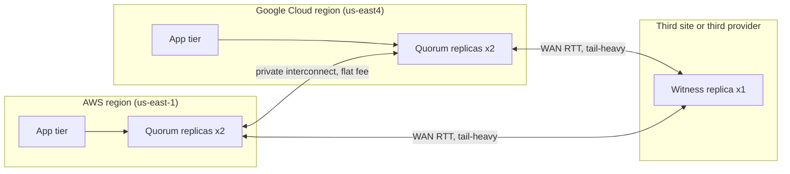

# Multi-Cloud and Hybrid Architecture Reality

## TL;DR

- A synchronous quorum that must survive the loss of a whole provider puts at least one cross-provider acknowledgment in the commit path of every write. The cross-cloud RTT is a floor on write latency, not a tunable.
- Two 99.9% clouds do not compose to 99.9999%. Shared-cause outages (identity, DNS, certificate authorities, your own control plane, a shared colo) dominate. With 10% shared-cause outage minutes, the pair is about 99.99%, and the failover mechanism itself subtracts more.
- Private interconnect is a fixed-fee pipe. Internet egress is metered per GB at the sender. At 10 Gbps the managed pair breaks even against tiered AWS internet egress at roughly 381 TB per month per direction (model below, secondary-source Google prices).
- The failures that hurt are mechanical, not architectural: MTU black holes, overlapping RFC1918 ranges, bulk replication filling a provider edge buffer and starving consensus heartbeats, and failover automation that lives in the cloud that is failing.
- Multi-cloud is justified by a specific, named risk or capability (regulatory exit, capacity, a unique service, M&A). It is not justified by "avoiding lock-in" in the abstract. Whole-job placement and async replication are cheap. Cross-cloud synchronous state and cross-cloud collective communication are expensive.

## Mental Model



Treat each cloud as a failure domain with its own control plane, identity system, and billing meter, and treat the link between them as a long, narrow, shared pipe.
Everything inside a provider region is cheap, fast, and statistically independent per AZ.
Everything across providers is slower, metered, and correlated through things neither provider owns.
Data and control flow therefore have to be decoupled: bulk data moves asynchronously and pays egress once, while the small amount of state that must be strongly consistent moves through a quorum whose placement you choose deliberately.
The diagram shows the only layout in which no single provider holds a quorum (2 + 2 + 1 with quorum 3), which is also the layout where every write waits for at least one cross-provider ack.

## Internals

### The physical and logical shape of a cloud-to-cloud link

A dedicated cross-cloud link is a cross-connect in a facility where both providers have presence, carrying an 802.1Q VLAN, an eBPG session over a link-local /30, and BFD or timers for failure detection.
Historically you built this yourself: Google documents that with Cross-Cloud Interconnect 

you pay for ports and attachments in both clouds and data transfer out for traffic leaving Google Cloud

, with supported speeds of 10, 100, and 400 Gbps (Google Cloud docs, as of 2026-10).
The managed model changes who operates the colo.


AWS Interconnect - multicloud reached general availability on 2026-04-14 with Google Cloud as launch partner, and Azure and OCI planned later in 2026

 (AWS What's New, as of 2026-10).
The AWS docs state that 

traffic is transported on the AWS global backbone until it is handed off to the other cloud provider directly

 (AWS docs, as of 2026-10).
That sentence has a cost implication that getting-started guides skip: pricing is by bandwidth and by geographic scope, so a hand-off far from your source region is billed in a higher tier.
The last-mile sibling product publishes a worked example in which the same 10 Gbps port costs $12.33 per hour at Tier 1 and $51.78 per hour at Tier 4, which is $37,799.40 per month (AWS Interconnect last-mile pricing page, as of 2026-10).
Use that only as an indication of tier spread. The multicloud tier table is a separate page and you must read it for your region pair.

### Mechanism 1: the cross-provider ack invariant

Claim: if a replicated state machine must remain available after the total loss of any one provider, then every committed write requires at least one acknowledgment from a replica outside the leader's provider.

Proof sketch.
Let n be the replica count, q the commit quorum (q > n/2 for classic Paxos or Raft), and n_P the number of replicas in provider P.
Surviving the loss of P requires n - n_P >= q, because the remaining replicas must still form a quorum.
Since q > n/2 and n - n_P >= q, it follows that n_P <= n - q < q.
The leader's provider therefore holds fewer replicas than the quorum size, so a commit that gathers q acks must include at least q - n_P >= 1 acks from other providers.

Consequences you can compute:

- 3 replicas, 2 in A and 1 in B, q = 2: writes are fast (the second ack is a local AZ) but the loss of A loses the quorum. B is a cosmetic replica, not a survival mechanism.
- 3 replicas, 1 per provider, q = 2: survives the loss of any provider, and commit latency is the second-smallest RTT of the three paths. This needs three providers or two providers plus a third site that is not a cloud region you also depend on.
- 5 replicas, 2/2/1, q = 3: survives the loss of any one provider, and the leader pays the nearest cross-provider RTT on every write.

This is the same quorum-intersection argument as Paxos (Lamport, "Paxos Made Simple") and Raft (Ongaro and Ousterhout, USENIX ATC 2014), applied with provider as the failure domain.
Flexible Paxos (Howard, Malkhi, Spiegelman, OPODIS 2016) shows only phase-1 and phase-2 quorums must intersect, so you may shrink the commit quorum.
It does not help here: shrinking the commit quorum to 2 of 5 forces the election quorum to 4 of 5, and the loss of a 2-replica provider then makes leader election impossible.
Leaderless protocols such as EPaxos (Moraru, Andersen, Kaminsky, SOSP 2013) reduce the leader-to-farthest-replica penalty for non-conflicting commands but still require a fast-path quorum that spans failure domains.
Within a single provider, Google Spanner (Corbett et al., OSDI 2012) pays this tax across regions and adds commit wait for external consistency, using TrueTime uncertainty reported in the paper as roughly 1 to 7 ms.
No such shared clock bound exists across two providers, so cross-cloud systems get linearizability from the log order (a leader or a hybrid logical clock), not from synchronized wall clocks. See [[17-Cloud-AI-Engineering/Volume_03_GCP_Deep_Dive/Chapter_10_Cloud_Spanner_TrueTime_and_External_Consistency|Cloud Spanner: TrueTime and External Consistency]] and [[17-Cloud-AI-Engineering/Volume_02_AWS_Deep_Dive/Chapter_12_Aurora_DSQL_Multi_Region_Active_Active_SQL|Aurora DSQL: Multi-Region Active-Active SQL]] for the single-provider versions of the same trade-off.
For the consensus background see [[08-Distinguished-Engineering/02-Distributed-Systems-Internals/Raft-Consensus|Raft Consensus]].

### Mechanism 2: how a bulk flow starves a consensus heartbeat

A cross-cloud link is a fixed-rate pipe with a finite buffer at the provider edge router.
A loss-based TCP flow (CUBIC) keeps increasing its window until the buffer overflows, so a bulk replication stream that has the link to itself sits with a persistently full buffer.
Every other packet on that link then waits behind the buffered bytes.
The added delay is buffer size divided by link rate.
A 16 MB buffer on a 1 Gbps link adds 128 ms to every packet behind it, and a 64 MB buffer adds 512 ms (computed in the model below).
Raft's timing requirement is that broadcast time is much smaller than election timeout, which is much smaller than MTBF, and the paper's suggested election timeout range is 150 to 300 ms.
A heartbeat that normally takes 2 ms but arrives 128 ms late during a bulk copy is inside that margin.
A 512 ms stall is not, and the followers start elections.
The result is leader flapping, which looks like a partition but is actually self-inflicted queueing.
The mitigations are mechanical:

- Pace the bulk flow at the sender (fq with a pacing rate, or BBR) to a fixed fraction of the link, for example 70%.
- Put consensus and control traffic on a separate attachment or VLAN where the provider gives you one, instead of assuming DSCP is honored across the provider hand-off (UNVERIFIED: whether either provider honors DSCP across the cross-cloud hand-off).
- Set election timeouts from the measured p99.9 RTT under load, not the idle median.
- Run hedged or tied requests for read paths, as described in Dean and Barroso, "The Tail at Scale" (CACM 2013), but never for non-idempotent writes.

### Mechanism 3: MTU, MSS, and the path MTU discovery black hole

The two clouds default to different MTUs inside their virtual networks (AWS up to 9001 inside a VPC, Google VPC default 1460; both UNVERIFIED this session, see the table).
A TCP sender chooses its MSS from the local interface MTU and the peer's advertised MSS.
If the path MTU is smaller than the sender's idea of it, the sender relies on ICMP "fragmentation needed" (type 3, code 4) to learn the smaller value.
Security groups, firewall rules, and appliances that drop ICMP create a black hole: the three-way handshake and small requests succeed, then the first full-size segment is silently dropped and the connection hangs.
It looks like an application bug because TLS handshakes with small records can work while large responses stall.
Fixes, in order of preference: set one MTU for the whole cross-cloud domain and verify it end to end with `ping -M do -s <size>`, allow ICMP type 3 code 4 on every hop you control, and as a last resort clamp MSS on the edge.
Never rely on an overlay such as a VPN or a Kubernetes CNI to be MTU-neutral. Each encapsulation subtracts its overhead from the path MTU.

### Mechanism 4: routing and addressing

The cross-cloud link is an eBGP adjacency between your virtual routers (Transit Gateway, Cloud WAN, or Cloud Router). Each side advertises prefixes it should be reachable on.
Three production traps:

- Overlapping RFC1918. Google auto-mode VPC networks use 10.128.0.0/9 and AWS default VPCs use 172.31.0.0/16 (both UNVERIFIED this session), and teams habitually pick 10.0.0.0/16 for AWS. Overlap cannot be fixed with routing, only with renumbering or NAT, so IPAM must be a single source of truth before the first link is ordered.
- Asymmetric return paths. If a VPN backup and an interconnect both advertise the same prefix, a stateful firewall or NAT sees the SYN on one path and the SYN-ACK on another, and drops the flow. Make local preference, MED, and AS-path prepending agree on both sides.
- Prefix and route limits. Both sides cap advertised and learned routes per BGP session, and exceeding the cap typically drops the session rather than truncating the table (UNVERIFIED: exact limits per product). Summarize aggressively.

### Mechanism 5: where the meter runs

Egress is metered at the sender, per direction, in the sending cloud's billing account.
Traffic to the internet from AWS is tiered: 

up to 10 TB at $0.09/GB, then $0.085, $0.07, and $0.05 per GB above 150 TB

 (secondary summary of AWS pricing, as of 2026-10).
Traffic through a managed multicloud interconnect is instead billed as an hourly port-like fee with no per-GB charge on either side (secondary sources, as of 2026-10).
If your cross-cloud traffic goes over the internet path it can also pass through a NAT gateway with its own per-GB processing fee (UNVERIFIED this session), so the true marginal cost is above the headline egress rate.
Inside one provider, cross-AZ traffic is also metered (AWS charges per GB in each direction, UNVERIFIED this session), which is why a chatty service that is "just in the same region" can still be expensive. See [[17-Cloud-AI-Engineering/Volume_09_FinOps_and_Cloud_Economics/Chapter_04_Network_Egress_Economics_and_Optimization|Network Egress Economics and Optimization]].

### Mechanism 6: correlated failure

Let u be each cloud's unavailability for the dependency set you actually use, and let c be the fraction of outage minutes with a shared cause.
Then P(both down) = c * u + (1 - c) * u^2.
With u = 10^-3 and c = 0.10 the pair is about 99.99%, not the 99.9999% that independence predicts.
Shared causes are not exotic.
They include your identity provider, your DNS host, the public certificate authority, a CI/CD system that deploys to both, a shared observability vendor, a shared colo or metro (us-east-1 and the Google N. Virginia region are paired in the same metro per the AWS docs region table, as of 2026-10), and the control-plane automation that performs the failover.
Add the failover mechanism's own unavailability and the number drops again.
See [[17-Cloud-AI-Engineering/Volume_01_Cloud_Architecture_Principles/Chapter_02_Regions_Zones_and_Static_Stability|Regions, Zones, and Static Stability]] and [[17-Cloud-AI-Engineering/Volume_01_Cloud_Architecture_Principles/Chapter_04_Control_Plane_vs_Data_Plane_Separation|Control Plane vs Data Plane Separation]] for why failover must be a data-plane action that works with the control plane down.

### Hybrid attachments

Hybrid (on-premises or colo to cloud) uses the same primitives as cloud-to-cloud: a dedicated port (AWS Direct Connect, Google Dedicated Interconnect), a partner-provided virtual circuit (Direct Connect hosted connections, Partner Interconnect), or IPsec over the internet (AWS Site-to-Site VPN, Google HA VPN) as a lower-bandwidth backup.
The design rule is the same too: two physically diverse paths, BGP with BFD, a tested failover, and no assumption that the backup VPN can carry the primary's load.
AWS now also lists an Interconnect - last mile product, which was found on a pricing page this session but whose details were not verified (UNVERIFIED).
For in-cloud hybrid compute (AWS Outposts, Google Distributed Cloud, EKS Anywhere, GKE Enterprise) the relevant fact is that the control plane stays in the cloud region and the data plane runs on your hardware, so the same static-stability rule applies: the local rack must keep serving when the WAN to the region is cut.
For Kubernetes-level federation see [[04-System-Design/07-Infrastructure-and-Orchestration/Kubernetes-Architecture|Kubernetes Architecture]].

## Numbers to Know

### Verified this session

| Item | Value | Source |
|---|---|---|
| AWS Interconnect - multicloud status | GA since 2026-04-14, Google Cloud first launch partner, Azure and OCI planned later in 2026, five AWS Regions | AWS What's New, as of 2026-10 |
| Pricing model of AWS Interconnect - multicloud | Single fee by selected bandwidth and geographic scope, no per-GB charge | AWS What's New and secondary summaries, as of 2026-10 |
| Free tier | One free local 500 Mbps interconnect per Region starting May 2026 | AWS What's New, as of 2026-10 |
| Bandwidth range at GA | 1 Gbps to 100 Gbps, modifiable without recreating the connection | AWS docs and secondary summary, as of 2026-10 |
| Tier 1 AWS-side rate, 1 Gbps / 10 Gbps | $1.37 / $12.33 per hour (about $1,000 / $9,000 per month) | AWS pricing page example and secondary summaries, as of 2026-10 |
| Tier 1 vs Tier 4 spread (last-mile product, 10 Gbps) | $12.33 vs $51.78 per hour, $37,799.40 per month at Tier 4 | AWS Interconnect last-mile pricing page, as of 2026-10 |
| Region pairs documented in preview | us-east-1 with Google N. Virginia (us-east4); us-west-1 with Google Los Angeles (us-west2) | AWS docs, as of 2026-10 |
| Billing granularity | Starts at creation, stops at deletion, rounded up to the hour | Third-party hands-on report, as of 2026-10 |
| Google Partner Cross-Cloud Interconnect for AWS, North America | 1 Gbps $3.50 per hour, 10 Gbps $19.00 per hour, no data transfer fee | Secondary summary (classmethod), UNVERIFIED against Google pricing page, as of 2026-10 |
| Google Cross-Cloud Interconnect (self-managed) | 10 Gbps port $5.60 per hour, VLAN attachment $0.10 per hour, $0.02 per GiB egress via CCI | Secondary summary, UNVERIFIED against Google pricing page, as of 2026-10 |
| Cross-Cloud Interconnect speeds | 10, 100, 400 Gbps | Google Cloud docs, as of 2026-10 |
| AWS internet egress tiers | $0.09 (to 10 TB), $0.085 (next 40 TB), $0.07 (next 100 TB), $0.05 (over 150 TB) per GB | Secondary summary of AWS pricing, as of 2026-10 |
| Google Cloud Storage internet egress, Premium Tier | $0.12 per GiB to 1 TiB, $0.11 per GiB to 10 TiB | Secondary summary, as of 2026-10 |
| Raft timing guidance | Election timeout 150 to 300 ms; broadcast time much less than election timeout | Raft paper, USENIX ATC 2014 |
| Spanner TrueTime uncertainty | About 1 to 7 ms; leader leases 10 s by default | Spanner paper, OSDI 2012 |

### Recalled, not re-verified this session (treat as UNVERIFIED until checked)

| Item | Value | Status |
|---|---|---|
| AWS cross-AZ data transfer | $0.01 per GB in each direction | UNVERIFIED |
| AWS Direct Connect data transfer out | Roughly $0.02 per GB in US regions, plus port-hours | UNVERIFIED |
| AWS NAT Gateway processing | About $0.045 per GB plus hourly | UNVERIFIED |
| MTU inside AWS VPC / Google VPC default / Google VPC max | 9001 / 1460 / 8896 | UNVERIFIED |
| Direct Connect private VIF / transit VIF jumbo MTU | 9001 / 8500 | UNVERIFIED |
| AWS Site-to-Site VPN per-tunnel throughput | About 1.25 Gbps | UNVERIFIED |
| Google HA VPN per-tunnel throughput | About 3 Gbps | UNVERIFIED |
| AWS Site-to-Site VPN price | $0.05 per connection-hour | UNVERIFIED |
| Google HA VPN price | About $0.075 per tunnel-hour | UNVERIFIED |
| Interconnect SLAs | 99.99% for diverse multi-metro topologies on both Direct Connect and Dedicated Interconnect | UNVERIFIED |

## AWS vs GCP Mechanism Parity

| Concern | AWS | Google Cloud | Critical difference |
|---|---|---|---|
| Cloud-to-cloud private link, managed | AWS Interconnect - multicloud (GA 2026-04) | Partner Cross-Cloud Interconnect for AWS (Google blog and docs) | Single fee by bandwidth and geographic scope on the AWS side; Google side has its own hourly fee (secondary sources) |
| Cloud-to-cloud private link, self-managed | Direct Connect ports at a shared colo, cross-connect to the other provider | Cross-Cloud Interconnect (10/100/400 Gbps) | You pay ports and attachments in both clouds and per-GB egress on the Google side |
| Cloud to on-prem dedicated | Direct Connect dedicated port | Dedicated Interconnect | Same shape: LAG, VLANs, eBGP |
| Cloud to on-prem via partner | Direct Connect hosted connection | Partner Interconnect | Capacity is carved from the partner's port |
| IPsec over internet | Site-to-Site VPN (2 tunnels per connection) | HA VPN (2 interfaces, 4 tunnels to AWS for the documented design) | Per-tunnel throughput caps; use ECMP or multiple tunnels |
| Dynamic routing | VGW, Transit Gateway, Cloud WAN with BGP | Cloud Router with BGP, Network Connectivity Center | Different route limits and propagation rules; summarize |
| Private service access across clouds | PrivateLink | Private Service Connect | Both are same-provider constructs; cross-cloud reach is routed IP, not endpoint-native |
| Workload identity across clouds | IAM roles via OIDC/SAML federation, IAM Roles Anywhere | Workload Identity Federation | Both can trust the other's tokens; see [[17-Cloud-AI-Engineering/Volume_08_Security_Identity_and_the_Data_Perimeter/Chapter_02_Workload_Identity_Federation\|Workload Identity Federation]] |
| Strongly consistent multi-region SQL | Aurora DSQL | Cloud Spanner | Both are single-provider quorums with witness or tie-break replicas; neither spans providers |
| Globally consistent time | Time Sync Service on Nitro | TrueTime inside Google, NTP for customers | No cross-provider uncertainty bound |
| In-cloud hybrid compute | Outposts, EKS Anywhere | Google Distributed Cloud, GKE Enterprise | Control plane stays in region; data plane must tolerate WAN loss |
| Egress billing locus | Sender pays per GB, tiered | Sender pays per GB, by tier and destination | Interconnect paths replace per-GB with hourly fee |
| Exit-fee posture | Fee waivers for customers leaving, offered since 2024 | Same | UNVERIFIED this session; check current programs and EU Data Act timelines |

## Worked Example: Quorum tax, link breakeven, and an HA VPN probe lab

### Part 1 - Capacity and cost model (no cloud resources, runnable anywhere)

The script below uses Python standard library only.
Every RTT is an assumption (inter-AZ 0.8 ms, same-metro cross-cloud 2.0 ms, third site 14 ms) and must be replaced with measured p50 and p99 from your own paths.
The Google side of the link fee is a secondary-source price and must be confirmed.

```python
#!/usr/bin/env python3
"""Multi-cloud sizing model: quorum tax, correlated availability, link breakeven, WAN all-reduce."""
import random

random.seed(7)

def sample_rtt(median_ms, tail_p=0.01, tail_mult=6.0, sigma=0.25):
    x = random.lognormvariate(0, sigma) * median_ms
    if random.random() < tail_p:
        x *= tail_mult
    return x

def commit_ms(rtt_medians_ms, q):
    acks = sorted(sample_rtt(m) for m in rtt_medians_ms)
    return acks[q - 2]          # leader self-acks, need q-1 follower acks

def pct(xs, p):
    xs = sorted(xs)
    return xs[int(p / 100 * (len(xs) - 1))]

INTRA_AZ_X, X_CLOUD, THIRD = 0.8, 2.0, 14.0
layouts = {
  "A: 3 replicas, 3 AZs in one cloud (q=2)":     ([INTRA_AZ_X, INTRA_AZ_X], 2),
  "B: 2 in cloud A + 1 in cloud B (q=2)":        ([INTRA_AZ_X, X_CLOUD], 2),
  "C: 5 replicas 2A/2B/1C, leader in A (q=3)":   ([INTRA_AZ_X, X_CLOUD, X_CLOUD, THIRD], 3),
}
print("== Commit latency (ms), 200k samples ==")
for name, (rtts, q) in layouts.items():
    xs = [commit_ms(rtts, q) for _ in range(200_000)]
    print(f"{name:55s} p50={pct(xs,50):5.2f} p99={pct(xs,99):5.2f} p99.9={pct(xs,99.9):5.2f}")

def survives_loss_of_provider(n_by_provider, q):
    return all(sum(n_by_provider.values()) - n >= q for n in n_by_provider.values())
print("\n== Provider-loss tolerance ==")
for n_by, q in [({"A":3}, 2), ({"A":2,"B":1}, 2), ({"A":2,"B":2,"C":1}, 3), ({"A":1,"B":1,"C":1}, 2)]:
    print(n_by, "q =", q, "survives loss of any one provider:", survives_loss_of_provider(n_by, q))

print("\n== Composite availability of two clouds ==")
u = 1e-3
for c in (0.0, 0.05, 0.10, 0.30):
    both_down = c * u + (1 - c) * u * u
    print(f"shared-cause fraction c={c:4.2f}  both-down={both_down:.3e}  availability={1-both_down:.6f}")
sw = 1e-4
print("add 1e-4 failover-mechanism unavailability on top of c=0.10:", f"{1-(0.1*u+0.9*u*u+sw):.6f}")

AWS_TIERS = [(10_000, 0.09), (40_000, 0.085), (100_000, 0.07), (float("inf"), 0.05)]
def aws_internet_cost(gb):
    cost, left = 0.0, gb
    for size, rate in AWS_TIERS:
        take = min(left, size); cost += take * rate; left -= take
        if left <= 0: break
    return cost
HOURS = 730
fixed_10g = (12.33 + 19.00) * HOURS
lo, hi = 0.0, 5e6
for _ in range(80):
    mid = (lo + hi) / 2
    if aws_internet_cost(mid) < fixed_10g: lo = mid
    else: hi = mid
cap_gb = 10e9 / 8 / 1e9 * 3600 * HOURS
print(f"\n== 10G managed interconnect fixed fee: ${fixed_10g:,.0f}/month ==")
print(f"breakeven one-direction volume vs AWS internet egress: {lo/1000:,.0f} TB/month")
print(f"10 Gbps line-rate capacity per direction: {cap_gb/1000:,.0f} TB/month -> breakeven utilisation {lo/cap_gb:.1%}")

print("\n== Cross-cloud replication egress ==")
for mbps in (50, 200, 1000):
    gb_month = mbps * 1e6 * 3600 * HOURS / 1e9
    print(f"{mbps:5d} MB/s sustained, 1 remote copy: {gb_month/1000:9,.0f} TB/month, "
          f"internet-egress cost ${aws_internet_cost(gb_month):,.0f}/month")

print("\n== Ring all-reduce of bf16 gradients across clouds ==")
for params_b in (8, 70, 405):
    grad_bytes = params_b * 1e9 * 2
    for gbps in (100, 400):
        t = 2 * grad_bytes / (gbps * 1e9 / 8)
        print(f"{params_b:4d}B params, {gbps:3d} Gbps link: >= {t:6.1f} s per optimizer step (no overlap)")

print("\n== Queueing delay = buffer / rate ==")
for buf_mb in (4, 16, 64):
    for gbps in (1, 10):
        print(f"buffer {buf_mb:3d} MB at {gbps:2d} Gbps -> {buf_mb*8e6/(gbps*1e9)*1000:7.1f} ms")
```

Output on the authoring run (seed 7):

```text
== Commit latency (ms), 200k samples ==
A: 3 replicas, 3 AZs in one cloud (q=2)                 p50= 0.70 p99= 1.12 p99.9= 1.33
B: 2 in cloud A + 1 in cloud B (q=2)                    p50= 0.80 p99= 1.63 p99.9= 2.79
C: 5 replicas 2A/2B/1C, leader in A (q=3)               p50= 1.75 p99= 2.83 p99.9= 3.45
== Composite availability (c = shared-cause fraction) ==
c=0.00 -> 0.999999   c=0.05 -> 0.999949   c=0.10 -> 0.999899   c=0.30 -> 0.999699
== 10G managed interconnect fixed fee: $22,871/month ==
breakeven one-direction volume vs AWS internet egress: 381 TB/month
10 Gbps line-rate capacity per direction: 3,285 TB/month -> breakeven utilisation 11.6%
== Ring all-reduce, 70B params, 100 Gbps: >= 22.4 s per optimizer step
```

How to read it, step by step:

1. Layout B looks as fast as layout A because the second ack is a local AZ. It is not a multi-cloud availability design, because the loss of A takes both of A's replicas and leaves 1 of 3. The function `survives_loss_of_provider` returns False.
2. Layout C survives any single provider loss. Its p50 commit (1.75 ms) is about 2.5x layout A, and its p99.9 (3.45 ms) is about 2.6x. In absolute terms the tax is small when the two clouds are in the same metro and large (tens of ms) when the nearest ack is a distant site.
3. Availability: moving c from 0 to 0.10 costs two orders of magnitude. The only effective lever is reducing c by removing shared dependencies, not adding a third replica of the same dependency.
4. Link economics: the 10 Gbps managed pair costs about $22.9k per month in the model, and internet egress at AWS tiers only exceeds it at about 381 TB per month in one direction, about 11.6% line-rate utilization. If traffic is symmetric, the other direction's egress also counts, which lowers the breakeven. Below breakeven, price a smaller link and a lower tier. Above it, the flat fee wins and the meter disappears.
5. A sustained 200 MB/s write stream with one remote copy is 526 TB per month, or about $30k per month of internet egress, which is why the replication topology (one hop, compressed, filtered) dominates the bill.
6. Gradient sync: a 70B-parameter bf16 gradient is 140 GB. A ring all-reduce moves about twice that across the slowest link, so a 100 Gbps cross-cloud link needs at least 22.4 s per step with no overlap. In-cluster fabrics are many times faster, so cross-cloud data-parallel training is bandwidth-bound by construction. See [[17-Cloud-AI-Engineering/Volume_10_AI_Infrastructure_on_Cloud/Chapter_04_Distributed_Training_Parallelism_Strategies|Distributed Training Parallelism Strategies]] and [[17-Cloud-AI-Engineering/Volume_10_AI_Infrastructure_on_Cloud/Chapter_02_Interconnect_Technologies_NVLink_EFA_and_TPU_ICI|Interconnect Technologies]].

### Part 2 - Lab: AWS to Google Cloud over HA VPN with BGP (billable)

This lab builds the self-serve baseline: 2 AWS VPN connections (4 tunnels) to a Google HA VPN gateway, with BGP on a Cloud Router.
It is the cheapest way to observe real cross-cloud RTT, MTU behavior, and BGP convergence before ordering a dedicated link.
The Terraform was written against the documented resource schemas but was not applied in the authoring environment (UNVERIFIED), so run `terraform validate` and review the plan before applying.
Tunnel pre-shared keys are generated by AWS and passed to Google, so they land in Terraform state; use an encrypted remote backend.

Cost estimate (rates UNVERIFIED, confirm on both pricing pages): 2 AWS VPN connections at about $0.05 per hour is $0.10 per hour, and 4 Google HA VPN tunnels at about $0.075 per hour is $0.30 per hour, so roughly $0.40 per hour plus data.
A 4-hour lab is about $1.60 plus under a dollar of data transfer.
The budget below caps the exposure at $25 per month.

```hcl
terraform {
  required_providers {
    aws    = { source = "hashicorp/aws", version = "~> 5.0" }
    google = { source = "hashicorp/google", version = "~> 6.0" }
  }
}

variable "gcp_project" { type = string }
variable "alert_email" { type = string }

provider "aws" {
  region = "us-east-1"
}

provider "google" {
  project = var.gcp_project
  region  = "us-east4"
}

locals {
  region    = "us-east4"
  google_as = 65001
}

resource "aws_vpc" "main" {
  cidr_block = "10.10.0.0/16"
}

resource "aws_vpn_gateway" "vgw" {
  vpc_id          = aws_vpc.main.id
  amazon_side_asn = 64512
}

resource "aws_vpn_gateway_route_propagation" "main" {
  vpn_gateway_id = aws_vpn_gateway.vgw.id
  route_table_id = aws_vpc.main.main_route_table_id
}

resource "google_compute_network" "vpc" {
  name                    = "mc-lab"
  auto_create_subnetworks = false
}

resource "google_compute_subnetwork" "sub" {
  name          = "mc-lab-sub"
  region        = local.region
  network       = google_compute_network.vpc.id
  ip_cidr_range = "10.20.0.0/16"
}

resource "google_compute_ha_vpn_gateway" "gw" {
  name    = "mc-lab-ha"
  region  = local.region
  network = google_compute_network.vpc.id
}

resource "google_compute_router" "r" {
  name    = "mc-router"
  region  = local.region
  network = google_compute_network.vpc.id
  bgp {
    asn = local.google_as
  }
}

resource "aws_customer_gateway" "cgw" {
  for_each   = toset(["0", "1"])
  bgp_asn    = local.google_as
  ip_address = google_compute_ha_vpn_gateway.gw.vpn_interfaces[tonumber(each.key)].ip_address
  type       = "ipsec.1"
}

resource "aws_vpn_connection" "conn" {
  for_each            = toset(["0", "1"])
  customer_gateway_id = aws_customer_gateway.cgw[each.key].id
  vpn_gateway_id      = aws_vpn_gateway.vgw.id
  type                = "ipsec.1"
  static_routes_only  = false
}

locals {
  tunnels = merge([
    for k, c in aws_vpn_connection.conn : {
      "${k}-1" = {
        gw_if   = tonumber(k)
        peer_if = tonumber(k) * 2
        addr    = c.tunnel1_address
        psk     = c.tunnel1_preshared_key
        cgw     = c.tunnel1_cgw_inside_address
        vgw     = c.tunnel1_vgw_inside_address
      }
      "${k}-2" = {
        gw_if   = tonumber(k)
        peer_if = tonumber(k) * 2 + 1
        addr    = c.tunnel2_address
        psk     = c.tunnel2_preshared_key
        cgw     = c.tunnel2_cgw_inside_address
        vgw     = c.tunnel2_vgw_inside_address
      }
    }
  ]...)
}

resource "google_compute_external_vpn_gateway" "aws" {
  name            = "aws-peer"
  redundancy_type = "FOUR_IPS_REDUNDANCY"
  dynamic "interface" {
    for_each = local.tunnels
    content {
      id         = interface.value.peer_if
      ip_address = interface.value.addr
    }
  }
}

resource "google_compute_vpn_tunnel" "t" {
  for_each                        = local.tunnels
  name                            = "aws-${each.key}"
  region                          = local.region
  vpn_gateway                     = google_compute_ha_vpn_gateway.gw.id
  vpn_gateway_interface           = each.value.gw_if
  peer_external_gateway           = google_compute_external_vpn_gateway.aws.id
  peer_external_gateway_interface = each.value.peer_if
  shared_secret                   = each.value.psk
  router                          = google_compute_router.r.id
  ike_version                     = 2
}

resource "google_compute_router_interface" "i" {
  for_each   = local.tunnels
  name       = "if-${each.key}"
  router     = google_compute_router.r.name
  region     = local.region
  ip_range   = "${each.value.cgw}/30"
  vpn_tunnel = google_compute_vpn_tunnel.t[each.key].name
}

resource "google_compute_router_peer" "p" {
  for_each                  = local.tunnels
  name                      = "peer-${each.key}"
  router                    = google_compute_router.r.name
  region                    = local.region
  peer_ip_address           = each.value.vgw
  peer_asn                  = aws_vpn_gateway.vgw.amazon_side_asn
  advertised_route_priority = 100
  interface                 = google_compute_router_interface.i[each.key].name
}

resource "aws_budgets_budget" "lab" {
  name         = "mc-lab-monthly"
  budget_type  = "COST"
  limit_amount = "25"
  limit_unit   = "USD"
  time_unit    = "MONTHLY"
  notification {
    comparison_operator        = "GREATER_THAN"
    threshold                  = 80
    threshold_type             = "PERCENTAGE"
    notification_type          = "ACTUAL"
    subscriber_email_addresses = [var.alert_email]
  }
}
```

Google-side budget alarm (run once; replace the billing account id):

```bash
gcloud billing budgets create --billing-account=BILLING_ACCOUNT_ID \
  --display-name=mc-lab --budget-amount=25USD \
  --threshold-rule=percent=0.5 --threshold-rule=percent=0.9
```

Verification and probes (the MTU probe is the point of the lab):

```bash
aws ec2 describe-vpn-connections --query 'VpnConnections[].VgwTelemetry[].Status'
gcloud compute routers get-status mc-router --region us-east4
# from a test VM on each side, find the real path MTU; 1432 + 28 bytes of headers = 1460
ping -M do -s 1432 PEER_IP
tracepath PEER_IP
```

Exact teardown (removes all billable resources, in dependency order, in one command):

```bash
terraform destroy -auto-approve -var gcp_project=YOUR_PROJECT -var alert_email=you@example.com
```

Afterwards confirm that `aws ec2 describe-vpn-connections --query 'VpnConnections[?State!=`deleted`]'` and `gcloud compute vpn-tunnels list` return nothing, and delete the Google budget in the console or with `gcloud billing budgets delete`.

For a dedicated cross-cloud link, the managed product is ordered through the console and API on both sides. This chapter does not give a CLI or Terraform for it because the resource names were not verified (UNVERIFIED).
Before ordering, measure the VPN RTT and tail from this lab, size the link to at most 50% of expected peak utilization, and price it against the model above.

## Failure Modes and Pitfalls

### Quorum placement that looks multi-cloud and is not

Two replicas in cloud A and one in B passes a diagram review and fails the first provider outage.
Detection: compute `n - n_P >= q` for every provider in design review. Test it with a game day that drops all of A. See [[17-Cloud-AI-Engineering/Volume_07_Reliability_and_SRE/Chapter_05_Chaos_Engineering_and_Game_Days|Chaos Engineering and Game Days]].

### Heartbeat starvation and election storms

Mechanism 2 above.
Symptom: leader changes correlated with bulk transfers, no packet loss, and rising RTT p99.9 on the interconnect.
Fix: pacing, separate attachments, and timeouts derived from loaded RTT.

### MTU black hole

Mechanism 3 above.
Symptom: connect succeeds, small requests succeed, responses above roughly one MSS hang, and it is worse for TLS session resumption with large tickets or large gRPC messages.
Fix: single MTU domain, allow ICMP type 3 code 4, verify with `ping -M do`.

### Overlapping address space

Discovered when the second VPC peers with a Google network that already uses the same range.
The only fixes are renumbering, NAT, or an intermediate translation layer, and each adds a permanent operational cost.

### Hidden dependencies that defeat independence

Publicly documented incidents show the pattern, and you should read them in full (links in Further Reading; details recalled from memory and not re-verified this session, UNVERIFIED):

- The Google Cloud outage of 2025-06-12 began with a bad policy data change that crashed a global API-management component. Cloudflare's published report said parts of its own services were affected because a storage dependency was hosted on Google Cloud. A product marketed as independent of any one cloud had a hard dependency on one.
- The AWS us-east-1 DynamoDB event in October 2025 was traced in AWS's summary to a race in DNS management automation that left an empty record for the regional endpoint, which then cascaded through EC2 launch workflows and load balancer health checks. Teams whose failover automation depended on the same endpoints could not execute it.
- The AWS us-east-1 event of 2021-12-07 impaired the internal network, the monitoring pipeline, and the console. Runbooks that required the console were unusable.

The general failure path is: the failing provider degrades your control plane, your failover is a control-plane operation, and so the failover does not fire.
Static stability, meaning the standby is already running at capacity and the traffic shift is a data-plane change (anycast withdrawal, health-checked DNS with long enough TTL, client-side failover), is the defense.
See [[17-Cloud-AI-Engineering/Volume_07_Reliability_and_SRE/Chapter_07_Anatomy_of_Major_Cloud_Outages|Anatomy of Major Cloud Outages]].

### Antipatterns

- Synchronous cross-cloud calls inside a request path with fan-out. A call that is 2 ms once is 40 ms at fan-out 20 and costs egress per byte. Keep call graphs inside one cloud and replicate data asynchronously.
- The cloud-agnostic abstraction layer. Wrapping managed queues, databases, and IAM in a lowest-common-denominator interface forfeits the managed SLA, transfers pager load to your team, and rarely works at the first real migration because semantics (ordering, visibility timeout, consistency, quota behavior) differ.
- Active-active stateful services across providers with a single writer assumption. Either you built consensus (and pay the invariant) or you built a split-brain (and you will meet it during the first partition).
- Failover that was never exercised. An untested standby has a probability of working that is far below its nameplate.
- Static cloud credentials copied across providers. Federate with short-lived tokens; see [[17-Cloud-AI-Engineering/Volume_08_Security_Identity_and_the_Data_Perimeter/Chapter_02_Workload_Identity_Federation|Workload Identity Federation]].
- Cross-cloud data-parallel training. The all-reduce math above makes the step time communication-bound for any non-trivial model. Place whole jobs in one cloud and move checkpoints asynchronously. See [[17-Cloud-AI-Engineering/Volume_10_AI_Infrastructure_on_Cloud/Chapter_06_High_Throughput_Checkpointing_to_Object_Storage|High-Throughput Checkpointing to Object Storage]].
- Egress-blind pipelines. A nightly sync of a 500 TB lake across the internet path is an unbudgeted line item that scales with data size, not with traffic.

### Quota and capacity pitfalls

Managed interconnects have per-account and per-region limits on connections and attachments that differ from the dedicated-port products (UNVERIFIED: exact limits).
Region pairs are limited: at GA the AWS side was available in five Regions (AWS What's New, as of 2026-10), so a design that assumes any region pair fails at order time.
Azure support was still in preview in a third-party report, restricted to 1 Gbps and local regions (as of 2026-10; verify before relying on it).

## Security and Cost Angles

### Security

- Private link is not a trust boundary. Traffic on the interconnect is isolated from the internet, but it is not encrypted end to end by default unless you add encryption (IPsec over the link, MACsec on dedicated ports where offered, or TLS everywhere, which you should do regardless). Treat the other cloud as an untrusted peer network and authenticate every call with workload identity.
- Data perimeter. Each provider's perimeter controls (SCPs and VPC endpoint policies on AWS, VPC Service Controls on Google) stop at the provider boundary. A routed path to the other cloud is outside every perimeter, so egress rules and firewall policy must be defined at the interconnect attachment. See [[17-Cloud-AI-Engineering/Volume_08_Security_Identity_and_the_Data_Perimeter/Chapter_06_Constructing_an_Impenetrable_Data_Perimeter|Constructing an Impenetrable Data Perimeter]].
- Key hierarchy. Do not share a root key across providers. Use envelope encryption with a KMS in each cloud, and if a dataset must be readable in both, wrap the data key under both KEKs so that loss of one provider's KMS does not lose data and a provider's key compromise has bounded scope. See [[17-Cloud-AI-Engineering/Volume_08_Security_Identity_and_the_Data_Perimeter/Chapter_04_Encryption_Key_Hierarchies_and_Envelope_Encryption|Encryption Key Hierarchies and Envelope Encryption]].
- BGP hygiene. Filter inbound prefixes to the exact set you expect and set max-prefix. A misconfigured advertisement from the other side can attract traffic you did not intend to carry.
- State. VPN pre-shared keys and BGP secrets in Terraform state must be in an encrypted backend with restricted access.

### Cost levers

- Pick path by volume, not by habit: model the monthly TB per direction, apply the egress tiers, and compare to the fixed link fee. Re-run the model quarterly.
- Choose the lowest geographic tier that still meets the latency need. The tier spread on a comparable AWS product was more than 4x.
- Reduce bytes before the link: compress (zstd on Kafka mirroring is workload-dependent), filter topics and columns, replicate deltas not snapshots, and use one hop rather than fan-out.
- Replicate to one remote copy and fan out inside the remote cloud, where traffic is inexpensive.
- Free and small tiers exist for local connectivity (500 Mbps free per Region on AWS since May 2026), which is enough for control traffic and probes.
- Exit economics. Regulation and provider programs have reduced or waived switching egress in some cases (EU Data Act applicability and provider waivers recalled, UNVERIFIED). Check the current terms in your contract, and keep them in the lock-in analysis instead of assuming a one-way door.
- Staffing is the largest line. A second cloud means a second IAM model, network model, quota system, on-call rotation, and upgrade cadence. Price it in headcount, not just in dollars per GB.

## Interview Questions and Model Answers

### Question 1 (L5 - Senior)

Your team mirrors a Kafka cluster from AWS to Google Cloud at a sustained 100 MB/s of produced data. Estimate the monthly network cost and recommend a path.

#### Model Answer

First compute volume.
100 MB/s over a 730-hour month is 100e6 * 2.628e6 s = 262.8 TB sent from the AWS side, one direction, with one remote copy.
On the internet path with AWS tiered egress (0.09 to 10 TB, 0.085 to 50 TB, 0.07 to 150 TB, 0.05 above) that is about 900 + 3,400 + 7,000 + 5,640 = about $16.9k per month, before NAT processing if the mirror sits behind a NAT gateway.
A managed 10 Gbps interconnect pair is about $22.9k per month in the model, so on pure dollars the internet path wins at this volume; breakeven is around 381 TB per month.
But 100 MB/s is 800 Mbps, so a 1 Gbps link would run at 80% and I would not put it there: queueing delay and heartbeat risk matter more than the price difference, and I want at most 50% peak utilization.
The practical answer is a 2 to 5 Gbps managed connection (price from the tier table) or two 1 Gbps, plus compression on the mirror, which for typical JSON or Avro with zstd is a large multiplier but workload-dependent, so I would measure on a sample before committing.
I would also confirm the mirror topology is single-hop and filter topics that the remote side does not need, because bytes avoided are cheaper than any link.
I would not use the internet path for production data without encryption and a NAT cost review.

#### Follow-up Interviewer Question

Consumers on the Google side occasionally see the mirror lag spike to minutes with no packet loss on either side. What do you check first?

### Question 2 (L5 - Senior)

After bringing up a new private link between a VPC in AWS and a network in Google Cloud, ping works and TLS handshakes succeed, but HTTP responses larger than a few KB hang. Diagnose.

#### Model Answer

This signature is a path MTU black hole until proven otherwise.
Small packets pass, so routing and security rules are fine for those flows.
The sender emits full-size segments sized from its local MTU, some hop on the path has a smaller MTU, and the ICMP fragmentation-needed message that would correct the sender is dropped, so the connection stalls after the first full segment.
I would verify with `ping -M do -s N` stepping N down to find the largest unfragmented payload in each direction, since the asymmetry (one side at 9001, the other at 1460) is common, then check which security groups, firewall rules, or appliances drop ICMP type 3 code 4.
The fix is to set one MTU for the cross-cloud domain, allow that ICMP type on every hop I control, and clamp MSS at the edge only if I cannot control the interior.
I would also check for stacked encapsulation, for example a Kubernetes overlay inside an IPsec tunnel, because each layer subtracts its header.

#### Follow-up Interviewer Question

Why does the problem appear only for responses and not requests, and how could you tell which direction is at fault?

### Question 3 (L6 - Staff)

Design a metadata store used by both an AWS and a Google Cloud deployment that must remain writable after the total loss of either cloud. State the latency cost and what you refuse to promise.

#### Model Answer

Start with the invariant: surviving the loss of any provider needs n - n_P >= q, which forces every commit to include at least one cross-provider ack.
With two providers alone that is impossible with an odd quorum, because one provider always holds at least half, so I need a third failure domain: a third provider, or a small witness site that is not on either provider's infrastructure.
The layout is 5 replicas, 2 in each cloud and 1 witness, q = 3, leader in the cloud with most traffic.
Commit latency is the leader's second-nearest follower after the local AZ, so with a same-metro interconnect at about 2 ms RTT I expect p50 near 1.75 ms and p99 near 3 ms in the model, and this rises to the witness RTT if the witness is the only cross-provider replica that is closer than the other cloud.
The witness holds a log, not necessarily a full state machine, and it must be in a different failure domain from both clouds, including identity and network.
Reads: serve leader-leased linearizable reads from the leader, and offer bounded-staleness reads from followers for cross-cloud callers. I do not claim external consistency across clouds because there is no shared clock uncertainty bound, so I use log order, not wall-clock timestamps, to define the order.
Operational: election timeout from the measured loaded p99.9 RTT, bulk traffic paced off the link or on a separate attachment, and a quarterly game day that drops each provider.
What I refuse to promise: write availability under a partition that isolates the leader's cloud from both the other cloud and the witness, because that is the case the quorum must refuse by design, and I say so in the SLO.
Candidates: CockroachDB or a Raft-based store operated by us, with etcd-style semantics for small metadata; for larger data I would not extend this design and would use async replication. See [[04-System-Design/05-Data-Stores/CockroachDB-Distributed-SQL|CockroachDB Distributed SQL]].

#### Follow-up Interviewer Question

The witness site's provider has an outage at the same time as a leader-cloud brownout. Walk me through exactly which operations succeed.

### Question 4 (L6 - Staff)

You must pick the connectivity between AWS and Google Cloud for a latency-sensitive data service. Compare a managed multicloud interconnect, a self-managed colo cross-connect, and HA VPN, and say how you would prove the choice.

#### Model Answer

Frame it with four properties: capacity, latency stability, failure behavior, and cost shape.
HA VPN is cheapest to start and the right first step: it is self-serve, gives me a real RTT distribution and a BGP convergence test, but it rides the public internet, has per-tunnel throughput caps, and its tail is the least predictable.
A self-managed colo cross-connect (Cross-Cloud Interconnect with ports on both sides) gives dedicated capacity up to 10, 100, or 400 Gbps on the Google side and full control of routing, at the cost of ordering lead time, two sets of port and attachment fees, and per-GB egress on the Google side (Google docs, as of 2026-10).
The managed multicloud interconnect (GA 2026-04-14) turns this into an API call with a single AWS-side fee by bandwidth and geographic scope and no per-GB charge, with the traffic carried on the AWS backbone until direct hand-off to the other provider. In exchange, I accept availability only in the supported region pairs, the provider's hand-off locations, and less control of the physical diversity.
Cost shape: fixed fee, so it wins above a volume breakeven (about 11.6% utilization of a 10 Gbps pair in my model) and loses on low-volume links.
Failure behavior is where I would not trust the product page: "built-in resiliency" describes the link, not my path, so I would test by failing a VLAN attachment or BGP session, measure BFD or hold-timer detection, and check that traffic converges to the backup without asymmetric routing or a stateful device dropping flows.
I would keep an HA VPN as a distinct-path backup and size it for the control and critical traffic only, not for the primary's load.
Proof: a two-week measurement of RTT p50, p99, p99.9 under production-like bulk load, a failover drill, and a bill projection from observed GB per direction.

#### Follow-up Interviewer Question

The backup VPN carries 1/10th of the primary's capacity. Which traffic do you shed on failover, and where is that policy enforced?

### Question 5 (L6 - Staff)

A director says: "Each cloud is 99.9%, so running active-active across both gives us 99.9999%." Respond.

#### Model Answer

That is the independence calculation, and it fails for three reasons.
First, outages are correlated through shared causes: identity provider, DNS host, certificate authority, shared CI/CD, shared observability vendor, a shared metro, and the failover automation itself.
With u = 10^-3 per cloud and a shared-cause fraction c of 10%, both-down is c*u + (1-c)*u^2, about 1.0e-4, which is about 99.99%, two orders of magnitude from the claim.
Second, the failover mechanism has its own unavailability. If it is a control-plane action in a failing cloud, it may not fire, and a 10^-4 mechanism unavailability takes the figure to about 99.98%.
Third, a standby carries only the correctness of its last exercise. A rarely-used path has a failure rate dominated by configuration drift, capacity that was never provisioned, quotas, and data that was never replicated at the required RPO.
What I would commit to instead: define the SLO against measured user-visible success, remove shared dependencies one at a time to reduce c (this is the lever that matters), move failover to a data-plane mechanism with pre-provisioned capacity, and test it regularly.
I would also point out that a single provider with well-designed multi-AZ and static stability often achieves a higher real availability than a poorly operated two-cloud setup, because the second cloud adds more failure modes than it removes.

#### Follow-up Interviewer Question

How would you estimate c for your own stack, given you do not have the other provider's incident data?

### Question 6 (L7+ - Principal)

The CEO asks for a multi-cloud strategy "to avoid lock-in". You are asked to produce the decision. What is your framework and your answer?

#### Model Answer

I reject the premise as stated and replace it with a risk and option-value analysis.
Lock-in is the cost of exit times the probability you need to exit, so I estimate both.
Exit cost has three components: data egress (a one-time number I can compute, and which is partly waived by provider and regulatory programs, UNVERIFIED current terms), re-platforming engineering cost (the dominant term, driven by use of proprietary services and semantics), and operational re-learning.
Probability of needing exit is driven by named events: price change, regulatory requirement, provider product failure, M&A, or a capability gap.
Then I list what multi-cloud costs continuously: a second IAM, network, quota, and incident process, cross-cloud egress, loss of volume commitments, and the abstraction tax, usually well above the expected exit cost for a single-product company.
The recommended structure is a tiered posture instead of a binary one.
Tier 1: run in one primary cloud and use its managed services aggressively, because that is where the SLA, the unit economics, and the engineering leverage are.
Tier 2: keep the exit cost bounded and testable: data in open formats, IaC for networks and identity, containers and standard APIs for stateless compute, and an annual restore-and-run drill in a second cloud for the top services.
Tier 3: use a second cloud for named reasons, such as GPU or TPU capacity, a unique service, a customer or regulatory requirement, or a Day-1 acquisition, and place whole workloads there, joined by asynchronous data movement over a measured private link.
I would explicitly reject synchronous active-active across clouds for general services, and cross-cloud collective training.
Success metrics: the exit drill RTO, the percentage of data in portable formats, cost per unit of work in each cloud, and the on-call load. I would revisit annually or on a trigger event.

#### Follow-up Interviewer Question

Finance says commitment discounts require concentrating spend in one provider. How does that interact with your Tier 3 placement, and what do you do about it?

### Question 7 (L7+ - Principal)

Your research org cannot get 4,000 GPUs in one cloud for 10 weeks and proposes training a 405B model across AWS and Google Cloud. Evaluate.

#### Model Answer

First, quantify the synchronization cost.
A 405B-parameter bf16 gradient is 810 GB. A ring all-reduce moves about 2x that across the slowest link, so over a 100 Gbps cross-cloud link it is at least 130 s per optimizer step with no overlap, and over 400 Gbps about 32 s (model above).
In-cluster fabrics run at hundreds of Gbps per accelerator, and step times are measured in seconds, so a pure data-parallel split across clouds makes the job communication-bound by one to two orders of magnitude.
Hierarchical designs reduce that (intra-cloud all-reduce, then a cross-cloud exchange of fewer bytes), as do local-SGD or DiLoCo-style infrequent synchronization and gradient compression, but they change the optimization and need research validation, so they are a model-quality risk and not an infrastructure toggle.
Pipeline parallelism across clouds puts activation transfers on the WAN each microbatch, and adds the latency of one RTT per stage boundary; tensor parallelism is impossible at that bandwidth.
Second, reliability: the failure rate of a job increases with the number of nodes and now also includes two control planes, two schedulers, and a WAN that can degrade; any straggler on the link stalls all workers.
Third, cost: the sync traffic is either a flat-fee link at the required capacity or per-GB egress on the order of the gradient size times the number of steps, which is easy to compute and usually large.
My recommendation: split by job and not by step.
Run two independent, smaller-scale runs or an ablation and fine-tune workloads in the second cloud, or run the large pretraining in one cloud on a reservation and use the second cloud for evaluation, data preprocessing, and inference.
If the research team insists, run a small pilot (8B scale) with low-frequency synchronization to measure the quality delta and the link behavior before committing.
Checkpoints replicate asynchronously to the other cloud so that a regional loss does not lose weeks of work. See [[17-Cloud-AI-Engineering/Volume_10_AI_Infrastructure_on_Cloud/Chapter_08_Fault_Tolerance_and_Fleet_Resiliency_at_Scale|Fault Tolerance and Fleet Resiliency at Scale]].

#### Follow-up Interviewer Question

The pilot shows a 0.8% eval regression with infrequent synchronization. Who decides whether that is acceptable, and what evidence would you require?

### Question 8 (L7+ - Principal)

Your product claims to be multi-cloud, and the last major provider outage took it down anyway. Run the review and define the program that prevents a repeat.

#### Model Answer

I start by treating the claim as a hypothesis and building the real dependency graph, not the architecture diagram.
For each user-visible operation, enumerate every dependency at request time and at recovery time: identity (workforce and workload), DNS (authoritative and recursive), certificate issuance and OCSP, container registries and package mirrors, secret stores, feature flag and config services, telemetry and paging vendors, the deploy pipeline, the failover trigger, and any managed service in either cloud that is in the hot path.
Mark each one with its provider and region.
Anything that appears in both "clouds" is a shared cause and contributes to c.
The Cloudflare report of 2025-06-12 is the instructive pattern: a service marketed as independent had a hard storage dependency on one provider (recalled, UNVERIFIED).
Then classify failure behavior: fail-open, fail-closed, or hang. Hangs without timeouts and retries without jitter turn a partial degradation into an outage through retry amplification.
The program has four parts.
One: a dependency inventory that is generated from traces and egress logs, not hand-maintained, with an owner and a failure policy per edge.
Two: static stability requirements, where the standby is pre-provisioned, the failover is a data-plane action that works when both the console and the failing cloud's control-plane APIs are unavailable, and recovery does not need to pull images or secrets from the failing side.
Three: fault injection that blocks the dependency, not just kills instances, so we test DNS, identity, and registry loss, with a quarterly game day that disables one provider's endpoints at the network layer.
Four: SLOs and an error budget policy so that a failed drill blocks launches the same way an outage would.
I would also publish the c estimate for each service and track it down over time.

#### Follow-up Interviewer Question

Your workforce identity provider is a single SaaS and cannot be duplicated. What is your break-glass design, and how do you keep it from becoming the new single point of failure?

## Further Reading

- [AWS announcement of GA for AWS Interconnect - multicloud](https://aws.amazon.com/about-aws/whats-new/2026/04/aws-announces-ga-AWS-interconnect-multicloud/) - Primary source for GA date, launch partner, free tier, and pricing model.
- [AWS Interconnect user guide](https://docs.aws.amazon.com/interconnect/latest/userguide/what-is.html) - Primary source for the backbone hand-off model and region pairs.
- [AWS Interconnect - multicloud pricing](https://aws.amazon.com/interconnect/multicloud/pricing/) - Read the tier table for your own region pair before sizing.
- [Google Cloud blog: Extending Cross-Cloud Interconnect to AWS and partners](https://cloud.google.com/blog/products/networking/extending-cross-cloud-interconnect-to-aws-and-partners/) - Google's statement of the managed cross-cloud design and its bandwidth range.
- [Cross-Cloud Interconnect overview](https://docs.cloud.google.com/network-connectivity/docs/interconnect/concepts/cci-overview) - Port speeds, tenancy model, and what you pay in each cloud.
- [Raft paper (Ongaro and Ousterhout, USENIX ATC 2014)](https://raft.github.io/raft.pdf) - The timing requirement that links election timeout to the tail of your RTT.
- [Spanner: Google's Globally-Distributed Database (OSDI 2012)](https://www.usenix.org/conference/osdi12/technical-sessions/presentation/corbett) - The reference design for wide-area Paxos plus bounded clock uncertainty.
- [Flexible Paxos (Howard, Malkhi, Spiegelman, 2016)](https://arxiv.org/abs/1608.06696) - Explains exactly which quorum intersections are required, and why shrinking commit quorums moves cost to election.
- [There Is More Consensus in Egalitarian Parliaments (SOSP 2013)](https://dl.acm.org/doi/10.1145/2517349.2517350) - Leaderless consensus and its wide-area latency behavior.
- [The Tail at Scale (Dean and Barroso, CACM 2013)](https://research.google/pubs/the-tail-at-scale/) - Why tail latency dominates fan-out systems and when hedging is safe.
- [Physalia (NSDI 2020)](https://www.usenix.org/conference/nsdi20/presentation/brooker) - Placement of consensus groups to minimize blast radius, directly relevant to quorum placement.
- [AWS Builders' Library: Static stability using Availability Zones](https://aws.amazon.com/builders-library/static-stability-using-availability-zones/) - The design rule behind failover that does not depend on the control plane.
- [Cloudflare incident report, 2025-06-12](https://blog.cloudflare.com/cloudflare-service-outage-june-12-2025/) - A concrete case of a hidden single-provider dependency.
- [AWS summary of the 2021-12-07 us-east-1 event](https://aws.amazon.com/message/12721/) - Shows how internal network congestion degraded monitoring and consoles.
- [Google SRE Book](https://sre.google/sre-book/table-of-contents/) - Error budgets, cascading failures, and addressing them through load shedding.
- [[17-Cloud-AI-Engineering/Volume_09_FinOps_and_Cloud_Economics/Chapter_04_Network_Egress_Economics_and_Optimization|Network Egress Economics and Optimization]] - Detailed egress and interconnect cost structure in this curriculum.
- [[17-Cloud-AI-Engineering/Volume_07_Reliability_and_SRE/Chapter_04_Disaster_Recovery_Tiers_and_RTO_RPO_Engineering|Disaster Recovery Tiers and RTO/RPO Engineering]] - The DR tiers that multi-cloud standbys must be mapped onto.
- [[17-Cloud-AI-Engineering/Volume_04_AWS_vs_GCP_Translation/Chapter_02_Networking_and_Load_Balancing_Translation|Networking and Load Balancing Translation]] - The networking primitives this chapter builds on.
