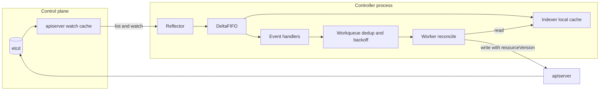

# Kubernetes Control Loop Internals

## TL;DR

- Every Kubernetes controller is a level-triggered loop. It reads desired state and observed state from a local cache, computes a diff, and issues idempotent writes. Events are only hints that a key is dirty, never the source of truth.
- State flows through one pipeline: etcd revision -> apiserver watch cache -> Reflector (LIST then WATCH) -> DeltaFIFO -> Indexer plus handlers -> deduplicating workqueue -> worker. A relist after 410 Gone is the self-healing path for lost events.
- The workqueue stores keys, not events. A key is in at most one of three states: queued, processing, or dirty-while-processing. This gives per-key serialization and event coalescing for free, and it means a handler can never count events.
- `resourceVersion` is an opaque compare-and-swap token backed by an etcd mod revision. A stale PUT returns 409 Conflict, a no-op PUT writes nothing, and PATCH or server-side apply has different conflict semantics. Cached reads can be stale, so every create-after-read needs an expectation or an AlreadyExists path.
- The failure modes are operational, not logical: relist storms, hot loops, client-side QPS starvation, poison keys at 1000 s backoff, unbounded handler buffers, and leader leases that do not fence external side effects.

## Mental Model



A controller is two decoupled halves joined by a set of keys.
The left half is a replicated, eventually consistent read model: a Reflector keeps a local map of objects in sync with the apiserver through LIST plus WATCH, and the Indexer serves all reads from memory.
The right half is a pool of workers that pull a key, read current state for that key from the local map, and drive the world toward the spec with idempotent writes.
The only coupling between the halves is the set of dirty keys in the workqueue, and that set is a set, not a log.
Because of this, losing an event costs nothing as long as some later event, a relist, or a periodic resync marks the key dirty again.
Because the write path goes to the apiserver while the read path comes from a cache, a controller always reads slightly into the past and must write with compare-and-swap semantics.

## Internals

### Level-triggered design and why it exists

The design lineage is Borg's state-reconciling cluster manager, described in [Borg, Omega, and Kubernetes (ACM Queue 2016)](https://queue.acm.org/detail.cfm?id=2898444) and the EuroSys 2015 Borg paper (see [[17-Cloud-AI-Engineering/Volume_13_Seminal_Papers_and_Case_Studies/Chapter_07_Google_Borg_and_Omega|Google Borg and Omega]]).
An edge-triggered system acts on "pod X was deleted" and is wrong forever if that message is lost.
A level-triggered system acts on "desired replicas is 3, observed is 2" and is correct whenever it next looks.
This is the same principle as the constant-work pattern in the AWS Builders' Library article [Reliability, constant work, and a good cup of coffee](https://aws.amazon.com/builders-library/reliability-and-constant-work/): the loop does the same compare-and-fix work whether one thing or ten thousand things changed.
The cost is that the reconciler must be idempotent, must tolerate reading stale state, and must treat "delete" as "key absent from cache" plus finalizer handling, not as an event with a payload.
The broader platform model is in [[04-System-Design/07-Infrastructure-and-Orchestration/Kubernetes-Architecture|Kubernetes Architecture]].

### The storage layer: etcd revisions are the clock

etcd keeps one monotonically increasing 64-bit revision for the whole keyspace, assigned by the Raft leader as each write transaction is applied (see [[08-Distinguished-Engineering/02-Distributed-Systems-Internals/Raft-Consensus|Raft Consensus]]).
Each key stores a `create_revision` and a `mod_revision`.
The apiserver surfaces `mod_revision` as the object's `metadata.resourceVersion`, and it surfaces the store's current revision as the `resourceVersion` of a LIST response.
Therefore a LIST's resourceVersion means "this snapshot is consistent as of revision R", and a WATCH from R means "send me every change with revision greater than R".
That pair is what makes list-then-watch gapless.
The official contract is that clients must treat the value as opaque.
Do not parse it as an integer, do not compute lag by subtraction, and use only equality or pass-through (Kubernetes API concepts docs, as of 2026-10).
Managed offerings and alternative storage backends are free to change the encoding, and the opaque rule is what allows that.

Writes go through a compare-and-swap.
The apiserver's etcd3 storage layer implements `GuaranteedUpdate` as a loop.
It reads the current object, applies the update function (which includes the client's resourceVersion and UID preconditions), and encodes the result.
If the encoded bytes are identical to what is stored, it returns without writing, so a no-op update does not bump the resourceVersion and does not wake any watcher (apiserver source behavior, UNVERIFIED against current tree).
Otherwise it issues an etcd transaction guarded by `mod_revision == previous`, and on transaction failure re-reads from etcd and retries.
For a client PUT that carries a stale `metadata.resourceVersion`, the precondition check fails inside the update function and the client receives 409 Conflict directly.
For a PATCH with no resourceVersion, the apiserver itself re-applies the patch to the fresh object and retries, so the client never sees a conflict.
Server-side apply is different again: conflicts are per field against `managedFields` owners, not per object revision.

### The apiserver watch cache

Controllers rarely talk to etcd.
Each apiserver runs a per-resource-type `Cacher` that holds one etcd watch, a full in-memory snapshot of the type, and a bounded ring buffer of recent events (watch cache internals, UNVERIFIED against current tree).
It serves LISTs with `resourceVersion=0` or `NotOlderThan`, and all WATCHes, from this memory.
Three consequences matter at scale.

1. The window is bounded.
 A WATCH can resume from any revision still in the ring buffer.
 If the requested revision has been evicted the server answers 410 Gone, either as an HTTP 410 or as an in-stream `ERROR` event whose status code is 410, and the client must discard its state and relist (Kubernetes API concepts docs, as of 2026-10).
2. Watch bookmarks cut relists.
 With `allowWatchBookmarks=true` the server periodically sends a `BOOKMARK` event that carries only a resourceVersion and means "everything up to here has been sent to you".
 A client watching a quiet resource then reconnects from a recent revision instead of a stale one that has aged out of the window (Kubernetes API concepts docs, as of 2026-10).
3. A slow watcher is killed, not waited for.
 The cacher dispatches each event into a per-watcher buffered channel, and a watcher whose buffer stays full past a time budget is terminated (watch cache internals, UNVERIFIED against current tree).
 The client sees a closed stream, reconnects, and if its revision has fallen out of the window it relists.
 This is the mechanism by which one overloaded controller turns into repeated full LISTs against the control plane.

### Read consistency modes: the "time travel" hazard

The `resourceVersion` parameter on LIST selects a consistency level (Kubernetes API concepts docs, as of 2026-10).

| resourceVersion | resourceVersionMatch | Served from | Guarantee |
| --- | --- | --- | --- |
| unset | unset | etcd quorum read historically, watch cache since consistent reads from cache went stable | Most recent state, linearizable |
| "0" | unset | apiserver watch cache | Any version, can be arbitrarily stale and can be older than what the client has already seen |
| N | NotOlderThan | watch cache | At least as new as N |
| N | Exact | etcd | Precisely revision N, or 410 if compacted |

The `"0"` mode is the dangerous one.
client-go's Reflector uses it for the very first LIST for performance, because it avoids an etcd round trip.
If the controller reconnects to a different apiserver replica whose watch cache lags (for example a replica that just restarted or is partitioned from etcd), it can receive a snapshot older than the state it previously observed.
The controller then reconciles against the past.
This is the well-known stale-read or time-travel problem.
After a 410 the Reflector deliberately relists with an unset resourceVersion to force a consistent read (client-go Reflector behavior, UNVERIFIED against current tree).

[KEP-2340](https://www.kubernetes.dev/resources/keps/2340/) removed the cost of that consistent read.
It reached alpha in 1.28, beta in 1.31, and stable in 1.34 (KEP-2340, as of 2026-10).
The mechanism is that an unset-resourceVersion LIST is served from the watch cache after the cache proves it is fresh.
The apiserver fetches the current etcd revision with a cheap call, then waits until the cache has seen that revision.
To make an idle cache advance, a background goroutine sends etcd `WatchProgressRequest` messages, repeating about every 100 ms while there are waiting reads (KEP-2340, as of 2026-10).
It requires etcd v3.4.31+ or v3.5.13+, and with an older etcd the apiserver detects this and falls back to quorum reads (Kubernetes website docs commit for the beta, as of 2026-10).
The KEP reports the cache becoming fresh within its 3 s wait timeout in 99.999% of observed cases (KEP-2340, as of 2026-10).
The [Kubernetes 1.31 blog post](https://kubernetes.io/blog/2024/08/15/consistent-read-from-cache-beta/) covers the user-visible effect.
A GitHub issue ([#129931](https://github.com/kubernetes/kubernetes/issues/129931)) tracks create and update latency increases that appeared in some clusters with consistent reads enabled, so treat the feature as a load shift, not free.

### Client side: Reflector, DeltaFIFO, Indexer

**Reflector.**
It performs a paginated or cached LIST, calls `Replace` on its store with the full result, records the list's resourceVersion, then opens a WATCH from it with bookmarks enabled and a randomized server-side timeout of roughly 5 to 10 minutes (client-go source, UNVERIFIED against current tree).
On any watch error it backs off with a jittered exponential manager and rewatches from the last seen resourceVersion.
Only on 410 or "too large resource version" style errors does it fall back to a relist.

**DeltaFIFO.**
This queue holds, per key, an ordered list of deltas (Added, Updated, Deleted, Replaced, Sync).
Two behaviors are invisible in getting-started guides.
First, `Replace` after a relist compares the new list against the known keys and synthesizes a Deleted delta for any key that vanished while the watch was down.
Because the real delete event was lost, the payload is wrapped as `DeletedFinalStateUnknown`, which tells your delete handler that the object it receives may be the last known state, not the final state.
Handlers that cast the delete payload directly to a Pod will panic exactly in the failure scenarios where it matters.
Second, a `Sync` or resync delta is not API traffic.
The informer's resync period re-delivers every object from the local store to the handlers as an Update with old equal to new, purely so that reconcilers get a periodic nudge.
It does not contact the apiserver, and it is not a relist.

**Indexer.**
It is a thread-safe map keyed by `namespace/name`, plus named secondary indexes built from index functions, for example "pods by node name" or "objects by controller owner UID".
Lookups by index are O(matches), which is what makes "find all pods owned by this ReplicaSet" cheap inside a reconcile.
Objects returned by a lister are pointers into the shared cache, so mutating one corrupts every other consumer in the process; always DeepCopy before modifying.

**Shared informer fan-out.**
A SharedIndexInformer runs one Reflector and one store per type per process and fans events out to N handler registrations.
Each registration gets its own `processorListener` with an unbounded ring buffer in front of it.
A slow handler therefore never blocks the Reflector or other handlers, but it silently accumulates memory without limit.

### The workqueue

The client-go workqueue is three data structures.
A FIFO slice of keys, a `dirty` set of keys that need processing, and a `processing` set of keys currently held by a worker.

- `Add(k)`: if k is already in `dirty`, return. Otherwise add to `dirty`, and if k is not in `processing`, append to the FIFO.
- `Get()`: pop the head, move it from `dirty` into `processing`, and return it.
- `Done(k)`: remove from `processing`, and if k is in `dirty` (an event arrived while it was being processed), append to the FIFO again.

The invariants this yields are the reason controllers are simple to write.
A key is never processed by two workers at once, with no per-object locks.
N events for one key coalesce into at most one queued item plus one pending re-run.
Events for different keys have no ordering guarantee.
The reconcile function cannot know how many events arrived or what they were, so it must recompute from state.

Retries go through a rate-limiting layer on top of a delaying queue (a min-heap keyed by ready time).
The default controller rate limiter is the max of two limiters (client-go workqueue defaults, UNVERIFIED against current tree).
A per-item exponential limiter starts at 5 ms and doubles up to a 1000 s cap, and an overall token bucket allows 10 retries per second with a burst of 100.
`AddRateLimited` consults the limiter, plain `Add` does not, and `Forget` resets the per-item failure count.
Forgetting to call `Forget` after success is a classic bug that leaves an item permanently on a long delay.

### Reconcile mechanics: status, finalizers, ownership, expectations

- **Spec versus status.** The `status` subresource has its own endpoint, so a status write does not bump `metadata.generation` and does not re-trigger controllers that filter on generation. Controllers publish `observedGeneration` so clients can tell whether status reflects the current spec.
- **Ownership.** `ownerReferences` with `controller: true` (a ControllerRef) establish which controller owns a child. Controllers adopt matching orphans and release non-matching children, and the garbage collector deletes dependents when the owner is deleted.
- **Finalizers.** A delete on an object with finalizers only sets `deletionTimestamp`. The object lingers until every controller that owns a finalizer does its cleanup and removes its entry. This is the only way a level-triggered controller can reliably run delete-time logic, and its failure mode is objects stuck in Terminating when the owning controller is gone.
- **Expectations.** The built-in ReplicaSet controller records, in a process-local `ControllerExpectations` store, how many creates and deletes it has issued for a key that it has not yet seen reflected in its informer cache. Until the expectations are satisfied (or a 5 minute timeout elapses), it skips the diff for that key (controller manager source, UNVERIFIED against current tree). Without this, the cache lag between a successful POST and the corresponding ADDED event makes the next reconcile see "0 of 3 pods exist" again and create three more. Controllers written without an equivalent (deterministic child names so the second create fails with AlreadyExists, or a similar guard) over-create under load.

### Leader election

Active-passive controllers elect a leader with a `Lease` object.
The holder updates `renewTime` through a compare-and-swap PUT.
Defaults in client-go and the control-plane components are a 15 s lease duration, 10 s renew deadline, and 2 s retry period (client-go leaderelection defaults, UNVERIFIED against current tree).
Candidates do not compare the `renewTime` timestamp against their own wall clock.
They measure, on their own local monotonic clock, how long it has been since they last observed the record change, so clock skew between nodes does not break the protocol.
The lease is advisory.
A leader that stalls for longer than the lease duration (a long GC pause, a CPU-throttled container, a network partition from the apiserver) can wake up and act before it notices it lost the lease.
Writes to the Kubernetes API remain guarded by resourceVersion CAS, but side effects on external systems (cloud APIs, databases) are not, so those need their own fencing token.
Related coordination primitives are discussed in [[04-System-Design/05-Data-Stores/Apache-ZooKeeper|Apache ZooKeeper]], whose one-shot watches contrast with Kubernetes's resumable, revision-addressed watches.

### Load protection: API Priority and Fairness

API Priority and Fairness (APF) replaced the older global in-flight limits by classifying each request into a FlowSchema and a PriorityLevel and fair-queuing requests per flow using shuffle sharding of queues (Kubernetes docs, GA since 1.29, UNVERIFIED as of 2026-10).
The flow identity is typically user plus namespace, so a runaway controller's LISTs queue behind its own flow and are rejected with 429 before they starve system components.
This is the apiserver-side counterpart to the client-side rate limiter described later, and the two interact: a throttled client sees 429 with `Retry-After`, and well-behaved clients honor it.

## Numbers to Know

Rows marked UNVERIFIED were not re-checked against primary sources in this authoring pass and must be confirmed before this note moves to `status: solid`.

| Item | Value | Source and date |
| --- | --- | --- |
| Consistent reads from cache (KEP-2340) | Alpha 1.28, beta 1.31, stable 1.34 | [KEP-2340](https://www.kubernetes.dev/resources/keps/2340/) (as of 2026-10) |
| Minimum etcd for cache-consistent reads | v3.4.31+ or v3.5.13+, else automatic fallback to quorum reads | Kubernetes website beta docs commit (as of 2026-10) |
| Progress request cadence while reads wait | Every 100 ms | KEP-2340 (as of 2026-10) |
| Cache freshness within 3 s wait | 99.999% of observed cases | KEP-2340 (as of 2026-10) |
| Watch history gone | HTTP 410 or in-stream ERROR with code 410, client must relist | [API concepts](https://github.com/kubernetes/website/blob/main/content/en/docs/reference/using-api/api-concepts.md) (as of 2026-10) |
| resourceVersion semantics | Opaque string, equality and pass-through only | API concepts (as of 2026-10) |
| Default controller rate limiter | Per-item 5 ms doubling to 1000 s, plus bucket 10 qps burst 100 | client-go workqueue, UNVERIFIED |
| Time for one key to reach the 1000 s cap | 19th consecutive failure, about 21.8 min cumulative | Derived: 5 ms x 2^18 > 1000 s, UNVERIFIED inputs |
| client-go REST default client limiter | 5 QPS, burst 10 | client-go rest.Config, UNVERIFIED |
| controller-runtime default client limiter | 20 QPS, burst 30 | controller-runtime, UNVERIFIED |
| Leader election defaults | 15 s lease, 10 s renew deadline, 2 s retry | client-go leaderelection, UNVERIFIED |
| Reflector watch timeout | Random 5 to 10 min | client-go reflector, UNVERIFIED |
| etcd default storage quota | 2 GiB, recommended maximum 8 GiB | etcd docs, UNVERIFIED |
| etcd default max request size | 1.5 MiB | etcd docs, UNVERIFIED |
| apiserver etcd compaction interval | 5 min default | kube-apiserver flags, UNVERIFIED |
| Upstream tested scale | 5,000 nodes, 150,000 pods, 110 pods per node | Kubernetes large-cluster docs, UNVERIFIED |
| EKS control plane fee | 0.10 USD per cluster-hour standard support | AWS pricing page, UNVERIFIED |
| GKE cluster management fee | 0.10 USD per cluster-hour, with a monthly free-tier credit | Google Cloud pricing page, UNVERIFIED |

## AWS vs GCP Mechanism Parity

The control loop machinery is upstream Kubernetes on both clouds.
What differs is who owns the control plane, what you can observe, and what you can tune.
Statements below not otherwise marked are UNVERIFIED against current provider docs.

| Concern | Amazon EKS | Google GKE | Operational difference |
| --- | --- | --- | --- |
| Control plane ownership | AWS-managed apiserver and etcd in an AWS account, spread across AZs, reached through ENIs placed in your VPC | Google-managed control plane; regional clusters run replicas across zones, zonal clusters have a single replica | Zonal GKE and any single-AZ assumption means a control plane maintenance window stops all reconciliation, but not running pods |
| Storage backend | etcd family; AWS has described a re-architected consensus layer for its largest clusters (UNVERIFIED) | etcd family; Google has described a Spanner-backed store for its largest clusters (UNVERIFIED) | The resourceVersion contract is the same, so controllers are portable, but list and watch performance envelopes differ |
| Flags for apiserver, controller manager, scheduler | Not exposed | Not exposed | You cannot raise `--concurrent-*-syncs` or APF settings for built-in controllers; only your own controllers are tunable |
| Custom controller leader election | Lease in any namespace through the standard API | Same | Identical semantics; RBAC for `coordination.k8s.io/leases` is the only prerequisite |
| Built-in controller visibility | Control plane logs (api, audit, authenticator, controllerManager, scheduler) can be sent to CloudWatch Logs; apiserver `/metrics` readable with RBAC | Control plane metrics and logs in Cloud Monitoring and Cloud Logging | Both let you see `workqueue_*` and `apiserver_*` series for the control plane, with different retention and cost |
| Identity from controllers to cloud APIs | IRSA or EKS Pod Identity | GKE Workload Identity | Controllers that reconcile cloud resources are subject to cloud API rate limits as well as Kubernetes limits |
| Upgrade behavior | Control plane upgraded by AWS on your trigger; version skew with node groups | Release channels with automatic control plane upgrades | An apiserver upgrade restarts watches cluster-wide and causes a relist wave from every informer |
| Price of the loop | Per-cluster hourly fee plus nodes | Per-cluster hourly fee plus nodes | Control plane fee is flat; the cost of a bad controller shows up as API throttling and node-side cloud API spend |

Related translation material is in [[17-Cloud-AI-Engineering/Volume_04_AWS_vs_GCP_Translation/Chapter_01_Compute_Translation|Compute Translation]], and deep dives on the managed services are in [[17-Cloud-AI-Engineering/Volume_02_AWS_Deep_Dive/Chapter_07_Amazon_EKS_Control_Plane_and_Networking|Amazon EKS: Control Plane and Networking]] and [[17-Cloud-AI-Engineering/Volume_03_GCP_Deep_Dive/Chapter_07_GKE_Deep_Dive_Standard_vs_Autopilot|GKE Deep Dive: Standard vs Autopilot]].

## Worked Example: A Level-Triggered Controller from Scratch and Its Capacity Math

The lab implements the full pipeline in about 280 lines of stdlib-only Python so that every stage is visible: Reflector with list, watch, bookmarks and 410 handling, an indexer, a dedup workqueue with exponential backoff, and a reconciler that writes with resourceVersion compare-and-swap.
It talks to the apiserver through `kubectl proxy`, which handles authentication.
The code was exercised against an in-memory mock apiserver for create, update, drift repair, a lost event recovered by relist after 410, conflict retries, and queue dedup semantics.
It has not been run against a real cluster in this authoring pass, so run it on a throwaway `kind` cluster first.

### Cost and teardown

The lab runs on a local `kind` cluster and provisions no cloud resources, so the cloud cost is 0 USD.
If you instead run it on a managed sandbox cluster, budget at least the control plane fee: 730 h x 0.10 USD = 73 USD per month per cluster (UNVERIFIED pricing, see Numbers to Know) plus node costs.
For that case create a budget alarm before creating anything.

```bash
# AWS: 20 USD monthly cost budget with an 80 percent email alert
aws budgets create-budget --account-id "$AWS_ACCOUNT_ID" \
  --budget '{"BudgetName":"cl-lab","BudgetLimit":{"Amount":"20","Unit":"USD"},"TimeUnit":"MONTHLY","BudgetType":"COST"}' \
  --notifications-with-subscribers '[{"Notification":{"NotificationType":"ACTUAL","ComparisonOperator":"GREATER_THAN","Threshold":80,"ThresholdType":"PERCENTAGE"},"Subscribers":[{"SubscriptionType":"EMAIL","Address":"you@example.com"}]}]'

# GCP: 20 USD budget with a 50 percent threshold
gcloud billing budgets create --billing-account="$BILLING_ACCOUNT" \
  --display-name=cl-lab --budget-amount=20USD --threshold-rule=percent=0.5
```

Teardown for the local lab:

```bash
kill %1 %2 2>/dev/null          # controller and kubectl proxy
kind delete cluster --name cl-lab
```

### The controller

```python
#!/usr/bin/env python3
"""Minimal level-triggered controller using only the Python stdlib.

Talks to the API server through `kubectl proxy` (http://127.0.0.1:8001).
Desired state: every Namespace labelled demo.example/managed=true and carrying the
annotation demo.example/settings (a JSON object of string values) must have a
ConfigMap named managed-settings whose .data equals that object.
"""
import collections
import http.client
import json
import os
import random
import threading
import time

HOST = os.environ.get("K8S_HOST", "127.0.0.1")
PORT = int(os.environ.get("K8S_PORT", "8001"))
CM_NAME = "managed-settings"
OWNER_LABEL = "demo.example/owned-by"


def api(method, path, body=None):
    conn = http.client.HTTPConnection(HOST, PORT, timeout=30)
    data = json.dumps(body).encode() if body is not None else None
    conn.request(method, path, body=data, headers={"Content-Type": "application/json"})
    resp = conn.getresponse()
    raw = resp.read()
    conn.close()
    return resp.status, (json.loads(raw) if raw else {})


class WorkQueue:
    """Same invariants as client-go workqueue: dedup, per-key serialization, rate limiting."""

    def __init__(self, base=0.005, cap=1000.0):
        self.cv = threading.Condition()
        self.queue = collections.deque()
        self.dirty = set()
        self.processing = set()
        self.failures = collections.Counter()
        self.base, self.cap = base, cap
        self.shutting_down = False

    def add(self, key):
        with self.cv:
            if self.shutting_down or key in self.dirty:
                return
            self.dirty.add(key)
            if key in self.processing:
                return
            self.queue.append(key)
            self.cv.notify()

    def add_after(self, key, delay):
        t = threading.Timer(delay, self.add, args=(key,))
        t.daemon = True
        t.start()

    def add_rate_limited(self, key):
        n = self.failures[key]
        self.failures[key] += 1
        self.add_after(key, min(self.cap, self.base * (2 ** n)))

    def forget(self, key):
        self.failures.pop(key, None)

    def get(self):
        with self.cv:
            while not self.queue and not self.shutting_down:
                self.cv.wait()
            if not self.queue:
                return None
            key = self.queue.popleft()
            self.processing.add(key)
            self.dirty.discard(key)
            return key

    def done(self, key):
        with self.cv:
            self.processing.discard(key)
            if key in self.dirty:
                self.queue.append(key)
                self.cv.notify()

    def depth(self):
        with self.cv:
            return len(self.queue)


class Store:
    """Thread-safe indexer keyed by namespace/name (or name for cluster-scoped kinds)."""

    def __init__(self):
        self.lock = threading.Lock()
        self.items = {}

    @staticmethod
    def key(obj):
        m = obj["metadata"]
        return (m.get("namespace", "") + "/" + m["name"]).lstrip("/")

    def get(self, key):
        with self.lock:
            return self.items.get(key)

    def put(self, obj):
        with self.lock:
            self.items[self.key(obj)] = obj

    def delete(self, obj):
        with self.lock:
            self.items.pop(self.key(obj), None)

    def replace(self, objs):
        """Swap in a fresh LIST result and return keys that vanished (tombstones)."""
        with self.lock:
            fresh = {self.key(o): o for o in objs}
            gone = [k for k in self.items if k not in fresh]
            self.items = fresh
            return gone


class Relist(Exception):
    pass


class Reflector(threading.Thread):
    """LIST then WATCH with bookmarks; relist on 410 Gone. on_key(key) feeds the queue."""

    def __init__(self, path, selector, store, on_key, key_of=None):
        super().__init__(daemon=True)
        self.path, self.selector, self.store = path, selector, store
        self.on_key = on_key
        self.key_of = key_of or Store.key
        self.synced = threading.Event()
        self.rv = ""

    def list_and_replace(self):
        # No resourceVersion parameter: a consistent read of current state.
        # (client-go uses rv=0 on the first list to accept a cached, possibly stale, answer.)
        q = "?labelSelector=" + self.selector if self.selector else ""
        status, body = api("GET", self.path + q)
        if status != 200:
            raise RuntimeError("list failed: %s %s" % (status, body))
        items = body.get("items", [])
        gone = self.store.replace(items)  # swap the whole cache atomically
        for o in items:
            self.on_key(self.key_of(o))
        for k in gone:
            self.on_key(k)  # tombstone: object vanished while we were not watching
        self.rv = body["metadata"]["resourceVersion"]
        self.synced.set()

    def watch_once(self):
        q = "?watch=true&allowWatchBookmarks=true&timeoutSeconds=%d&resourceVersion=%s" % (
            random.randint(300, 600), self.rv)
        if self.selector:
            q += "&labelSelector=" + self.selector
        conn = http.client.HTTPConnection(HOST, PORT, timeout=700)
        conn.request("GET", self.path + q)
        resp = conn.getresponse()
        if resp.status == 410:
            raise Relist()
        if resp.status != 200:
            raise RuntimeError("watch failed: %d" % resp.status)
        while True:
            line = resp.readline()
            if not line:
                return  # server closed (timeoutSeconds): rewatch from self.rv
            ev = json.loads(line)
            typ, obj = ev["type"], ev["object"]
            if typ == "ERROR":
                if obj.get("code") == 410:
                    raise Relist()
                raise RuntimeError("watch error: %s" % obj)
            self.rv = obj["metadata"]["resourceVersion"]
            if typ == "BOOKMARK":
                continue
            if typ == "DELETED":
                self.store.delete(obj)
            else:
                self.store.put(obj)
            self.on_key(self.key_of(obj))

    def run(self):
        backoff, need_list = 0.8, True
        while True:
            try:
                if need_list:
                    self.list_and_replace()
                    need_list = False
                self.watch_once()
                backoff = 0.8
            except Relist:
                print("[reflector %s] 410 Gone, relisting" % self.path)
                need_list = True
            except Exception as e:  # network error, apiserver restart, etc.
                print("[reflector %s] error: %s" % (self.path, e))
                time.sleep(backoff * (1 + random.random()))
                backoff = min(30.0, backoff * 2)


class Controller:
    def __init__(self, workers=2):
        self.q = WorkQueue()
        self.ns_store, self.cm_store = Store(), Store()
        sel_ns = "demo.example/managed%3Dtrue"
        sel_cm = OWNER_LABEL
        self.ns_ref = Reflector("/api/v1/namespaces", sel_ns, self.ns_store, self.q.add)
        # ConfigMap events map back to the OWNING namespace key, not the ConfigMap key.
        self.cm_ref = Reflector("/api/v1/configmaps", sel_cm, self.cm_store, self.enqueue_owner)
        self.workers = workers

    def enqueue_owner(self, cm_key):
        cm = self.cm_store.get(cm_key)
        if cm is not None:
            self.q.add(cm["metadata"]["labels"][OWNER_LABEL])
        else:
            self.q.add(cm_key.split("/")[0])  # deleted: namespace part of ns/name

    def desired(self, ns):
        raw = ns["metadata"].get("annotations", {}).get("demo.example/settings", "{}")
        return {str(k): str(v) for k, v in json.loads(raw).items()}

    def reconcile(self, key):
        ns = self.ns_store.get(key)
        if ns is None:
            return  # absent means nothing to converge; children are cleaned up by namespace deletion
        want = self.desired(ns)
        cm = self.cm_store.get(key + "/" + CM_NAME)
        base = "/api/v1/namespaces/%s/configmaps" % key
        if cm is None:
            body = {"apiVersion": "v1", "kind": "ConfigMap",
                    "metadata": {"name": CM_NAME, "namespace": key, "labels": {OWNER_LABEL: key}},
                    "data": want}
            status, resp = api("POST", base, body)
            if status == 409:  # AlreadyExists: our cache is behind the server
                raise RuntimeError("cache lag on create, requeue")
        elif cm.get("data", {}) != want:
            upd = json.loads(json.dumps(cm))  # deep copy: never mutate cached objects
            upd.update({"apiVersion": "v1", "kind": "ConfigMap", "data": want})
            # upd still carries metadata.resourceVersion from the cached copy: this is the CAS token
            status, resp = api("PUT", base + "/" + CM_NAME, upd)
            if status == 409:  # Conflict: stale resourceVersion; the watch will refresh the cache
                raise RuntimeError("conflict on update, requeue")
        else:
            return
        if status >= 300:
            raise RuntimeError("write failed: %s %s" % (status, resp.get("message")))
        print("[reconcile] %s converged" % key)

    def worker(self):
        while True:
            key = self.q.get()
            if key is None:
                return
            try:
                self.reconcile(key)
                self.q.forget(key)
            except Exception as e:
                print("[worker] %s: %s" % (key, e))
                self.q.add_rate_limited(key)
            finally:
                self.q.done(key)

    def run(self):
        self.ns_ref.start()
        self.cm_ref.start()
        self.ns_ref.synced.wait()
        self.cm_ref.synced.wait()  # never reconcile before both caches have synced
        for _ in range(self.workers):
            threading.Thread(target=self.worker, daemon=True).start()
        while True:
            time.sleep(10)
            print("[stats] queue_depth=%d" % self.q.depth())


if __name__ == "__main__":
    Controller().run()
```

### Run it and break it

```bash
kind create cluster --name cl-lab
kubectl proxy --port=8001 &
python3 mini_controller.py &

# 1. Level-triggered convergence
kubectl create namespace lab-a
kubectl label namespace lab-a demo.example/managed=true
kubectl annotate namespace lab-a demo.example/settings='{"tier":"gold"}'
kubectl -n lab-a get cm managed-settings -o jsonpath='{.data}'; echo

# 2. Drift repair: the watch event marks the key dirty, the loop rewrites the data
kubectl -n lab-a patch cm managed-settings --type=merge -p '{"data":{"tier":"drifted"}}'
sleep 2; kubectl -n lab-a get cm managed-settings -o jsonpath='{.data}'; echo

# 3. Optimistic concurrency by hand: stale resourceVersion gets 409, no resourceVersion overwrites
kubectl -n lab-a create configmap cas-demo --from-literal=a=1
RV=$(kubectl -n lab-a get cm cas-demo -o jsonpath='{.metadata.resourceVersion}')
kubectl -n lab-a patch cm cas-demo --type=merge -p '{"data":{"a":"2"}}'
URL=http://127.0.0.1:8001/api/v1/namespaces/lab-a/configmaps/cas-demo
curl -s -X PUT -H 'Content-Type: application/json' "$URL" \
  -d '{"apiVersion":"v1","kind":"ConfigMap","metadata":{"name":"cas-demo","namespace":"lab-a","resourceVersion":"'"$RV"'"},"data":{"a":"stale"}}' \
  | jq '{code, reason, message}'
# Expect code 409 and reason Conflict.

# 4. History gone: a watch from a long-compacted revision
curl -s -N "http://127.0.0.1:8001/api/v1/namespaces/lab-a/configmaps?watch=true&resourceVersion=1" | head -c 400; echo
# Expect an HTTP 410 or an in-stream ERROR event with code 410.

# 5. Observe the apiserver side
kubectl get --raw /metrics | grep -E '^(apiserver_registered_watchers|apiserver_current_inflight_requests)' | head
```

Python is used here because the stdlib keeps the artifact self-contained.
Production controllers use client-go informers or controller-runtime, whose Reflector, DeltaFIFO and workqueue behave as described in Internals, and the Python structure above maps one-to-one onto them.

### Capacity sizing

All inputs are assumptions chosen to illustrate the method, not measurements.
Assume 3,000 nodes, 30 pods per node (90,000 pods), 8 KiB per serialized Pod, 150 pod writes per second cluster-wide, three apiserver replicas, and 15 clients that watch all Pods cluster-wide (scheduler, controller manager, CNI and observability agents, operators).

1. Relist blast radius. One full Pod LIST is 90,000 x 8 KiB = 720,000 KiB, about 703 MiB. If all 15 informers relist at once after an apiserver upgrade, that is about 10.3 GiB of response bodies to serialize, or about 3.4 GiB per replica. This is why list pagination, jittered backoff, streaming list, and APF exist, and it is the reason to stagger apiserver upgrades.
2. Steady-state watch fan-out. 150 writes per second x 8 KiB = 1.17 MiB/s per full watcher. Across 15 watchers that is 17.6 MiB/s of egress from the watch caches. This is small, which is why steady state is rarely the problem and relists are.
3. etcd history before compaction. With a 5 minute compaction interval (UNVERIFIED default), 150 writes/s x 300 s = 45,000 retained revisions x 8 KiB = about 352 MiB. Add the live set of 703 MiB and you are at about 1.03 GiB, roughly 51 percent of a 2 GiB quota, before Events, ConfigMaps, Leases, and CRDs. Compaction frees pages inside the bbolt file but the file does not shrink without defragmentation, and the quota is enforced on file size, so headroom shrinks over time. When the quota is exceeded etcd raises a NOSPACE alarm and the cluster becomes read-only to writes.
4. Worker count by Little's law. Suppose a controller sees 40 distinct dirty keys per second after coalescing and each reconcile takes 25 ms (cache reads plus one write). Required concurrency is 40 x 0.025 = 1.0, so 2 to 4 workers give headroom. More workers add nothing, because a single hot key is serialized by design.
5. Client-side limiter, the usual real bottleneck. At 40 writes per second, a client limiter of 5 QPS (client-go default, UNVERIFIED) drains at 5 per second and the backlog grows by 35 per second. After 60 seconds there are 2,100 queued requests and a new write waits 2,100 / 5 = 420 seconds, which looks exactly like a hung controller with an idle apiserver. controller-runtime's 20 QPS default (UNVERIFIED) still backlogs by 20 per second. Size QPS to at least peak writes per second plus reads that miss the cache, with burst of roughly 2 x QPS.
6. Backoff arithmetic. The per-item delay after the k-th consecutive failure is 5 ms x 2^(k-1). It crosses 1000 s at k = 19, after about 5 ms x (2^18 - 1) = 1,310 s cumulative, so a key that fails permanently is retried about every 17 minutes thereafter. The overall bucket allows 10 retries per second, so 10,000 simultaneously failing keys need at least 1,000 s to retry each once, regardless of per-item delay.

## Failure Modes and Pitfalls

### Relist storms and watch-cache thrash

An apiserver restart or upgrade closes every watch.
Each informer reconnects from its last revision, and any whose revision has aged out of the watch window relists.
The most expensive case is a LIST with an unset resourceVersion before KEP-2340 went stable, which forced a quorum read from etcd and, for large types, an etcd scan per client.
A second trigger is the slow-consumer kill described in Internals: a controller that cannot drain its watch fast enough is cut off, relists, falls behind again while ingesting the list, and loops.
Mitigations are bookmarks, streaming list so clients get the initial state as a watch stream rather than one giant response (KEP-3157, status UNVERIFIED), pagination, APF, per-client jitter, and upgrading with a rolling cadence.
Public post-incident review: OpenAI's December 2024 outage began when a newly deployed telemetry service made expensive Kubernetes API calls across many large clusters, overwhelmed the control plane, and took down service discovery that depended on it (OpenAI status page post-incident report, 2024-12-11, details recalled and UNVERIFIED).
The lesson that generalizes is static stability: the data plane must keep serving when the control plane is saturated, which means no request-path dependency on apiserver-backed DNS or discovery.

### Hot loops from non-idempotent writes

A reconciler that writes a timestamp, a random value, or an unordered list into an object triggers a MODIFIED event for its own write, which re-enqueues the key, which writes again.
The apiserver's no-op elision only helps if the encoded bytes are identical, so any nondeterminism defeats it.
Fixes: compare desired and observed before writing, sort lists, never put wall-clock time in spec or in status fields that you also watch, and use event predicates such as "generation changed" so status-only updates do not enqueue.
Detect it with `workqueue_adds_total` rate far above external event rate, and with `workqueue_depth` that never drains while CPU is high (metric names UNVERIFIED).

### Duplicate creation from stale cache

Between a successful POST and the ADDED event reaching the informer, the next reconcile of the same key reads a cache that does not contain the child.
Without expectations or deterministic naming, it creates another.
Using `generateName` makes this worse because the second create always succeeds.
For external resources (cloud load balancers, disks) there is no AlreadyExists backstop, so use an idempotency token derived from the owner UID and a generation, or tag-and-lookup before create.

### Poison keys and head-of-line effects

A key that fails permanently consumes a worker slot at each retry and, at the 1000 s cap, hides for about 17 minutes between attempts, so a fix to the cause appears to take effect very late.
An unbounded retry on a panic or a permanent validation error also floods logs.
Classify errors: permanent errors set a status condition and are not retried until the object changes, transient errors use rate-limited requeue.
A very slow reconcile (a call with no timeout) pins a worker forever; track `workqueue_longest_running_processor_seconds` and `workqueue_unfinished_work_seconds` (names UNVERIFIED) and put deadlines on every outbound call.

### Slow handlers and memory growth

Because each shared-informer handler registration has an unbounded buffer, a handler doing synchronous work such as an HTTP call grows memory until the pod is OOM-killed.
On restart it relists, repeats the load, and crash-loops.
Handlers should do nothing but compute a key and call `Add`.

### Leader election flapping and split brain at the edges

If apiserver p99 latency approaches the renew deadline, the leader fails to renew in time and exits, and the next candidate takes over after the lease expires, producing a reconcile gap equal to roughly lease duration plus startup plus cache sync.
If instead a leader is paused past its lease, two processes may briefly believe they lead.
Kubernetes writes are safe because of resourceVersion CAS, but external side effects are not, so use fencing tokens (for example the Lease's `leaseTransitions` counter or a generation stored in the external system) on any non-idempotent external call.

### Finalizer deadlocks and ownership fights

Deleting a controller before its CRs leaves objects stuck in Terminating with finalizers no one will clear.
Two controllers that both claim to own a field fight forever, each update waking the other; server-side apply field managers make the conflict explicit instead of silent.
A label selector change that suddenly matches or stops matching a population of objects makes a faithful level-triggered system converge a fleet to the new, possibly wrong, desired state.
A public example of this class is the 2023 Reddit Pi-Day outage, where a Kubernetes upgrade changed node labels that cluster networking configuration selected on (Reddit engineering post-incident write-up, March 2023, details recalled and UNVERIFIED).

### etcd limits

Objects are capped by etcd's request size limit (1.5 MiB default, UNVERIFIED).
Large status blobs, big Secrets, and CRs that embed arrays that grow forever hit this, and a write that fails at that limit fails permanently, which in a controller becomes a poison key.
Every update also writes a full new revision, so frequent writes of large objects amplify etcd history and defragmentation pressure.

### Using the wrong read path

Calling the API directly in the reconcile hot path (a live GET per reconcile) bypasses the cache, multiplies apiserver load by reconcile rate, and under APF makes your controller a noisy neighbor.
The opposite error is reading from the cache right after your own write and expecting to see it.
Write, then either rely on the response body you already have, or rely on the watch event to re-trigger.

## Security and Cost Angles

**RBAC and scoping.**
A controller should list and watch only the types and namespaces it owns, and the lowest-privilege write verbs on only the resource names it manages.
Watch-only cluster-wide Secrets access is functionally read access to every secret in the cluster, so scope informers with namespaces or field selectors where possible.
Use `resourceNames` for Lease access in leader election so a compromised controller cannot touch other Leases.
Status writes need the `/status` subresource verb, which can be granted separately from spec writes.

**Cloud identity.**
Controllers that reconcile cloud resources should use per-controller workload identity (IRSA or EKS Pod Identity on AWS, GKE Workload Identity on GCP) with permissions scoped by resource tags or labels derived from the owning object's UID, so one controller bug cannot delete resources it did not create.
See [[17-Cloud-AI-Engineering/Volume_08_Security_Identity_and_the_Data_Perimeter/Chapter_02_Workload_Identity_Federation|Workload Identity Federation]].

**Encryption at rest.**
Kubernetes can encrypt Secrets in etcd with envelope encryption, where a data encryption key per object is wrapped by a key encryption key in a cloud KMS.
On EKS and GKE this is enabled through the provider's KMS integration (AWS KMS, Cloud KMS).
The control loop implication is that every Secret read that misses the watch cache and every write now involves a KMS decrypt or encrypt, so a KMS outage or throttle degrades Secret operations specifically.
See [[17-Cloud-AI-Engineering/Volume_08_Security_Identity_and_the_Data_Perimeter/Chapter_04_Encryption_Key_Hierarchies_and_Envelope_Encryption|Encryption Key Hierarchies and Envelope Encryption]].

**Network boundaries.**
Webhooks, aggregated APIs, and controllers that call the apiserver from outside the cluster should do so through private endpoints (EKS private endpoint access, GKE private clusters with authorized networks).
The apiserver is the single choke point of the whole platform, so expose it narrowly.

**Unit economics levers.**
The control plane fee is flat per cluster (UNVERIFIED), so the economic cost of control loops is indirect.
Cluster consolidation versus multiple clusters trades a fixed 73 USD per month per cluster against blast radius.
Controllers that create cloud resources can multiply spend if a hot loop or duplicate-create bug runs unchecked, for example one load balancer per reconcile.
Guard with quotas, with tag-based budget alarms, and with a dry-run mode that logs the diff before enabling writes.
Event and audit log volume is another real cost: a hot loop that updates an object 50 times a second generates audit entries at that rate, billed per GiB by the logging service.

## Interview Questions and Model Answers

### Question 1 (L5 - Senior)

A controller process crashes and is down for ten minutes. During that time, three objects it manages are created, two are modified, and one is deleted. What does the controller do on restart, and why does it end up correct?

#### Model Answer

It ends up correct because it is level-triggered and never depended on having seen every event.
On start, its Reflector performs a LIST of each watched type, calls `Replace` on the store, records the list's resourceVersion, and starts a WATCH from that revision.
Every object that exists is delivered to handlers as an Add, so all keys, including the three created and two modified, are enqueued.
The reconciler reads current state from the cache, diffs it against the spec, and fixes any drift.
The deleted object is the subtle case.
If the controller had never seen the object (it was created and deleted while down), there is nothing to do.
If the controller had cached it before the crash, the cache is gone with the process, so there is nothing to tombstone either.
The only way a controller can reliably do delete-time work is a finalizer: the delete sets `deletionTimestamp`, the object remains in the API, and on restart the controller lists it, sees the timestamp, runs cleanup, and removes the finalizer.
Without a finalizer, delete-time work for an object removed while the controller was down is lost, and the controller must either garbage-collect orphans by scanning external state or accept the leak.
Two further points a strong answer includes: the controller must wait for `HasSynced` on all informers before it starts workers, otherwise it reconciles against a half-populated cache and may delete things that exist; and the same recovery mechanism is what runs after a 410 Gone relist, with `DeletedFinalStateUnknown` tombstones covering objects that vanished during the gap.

#### Follow-up Interviewer Question

You cannot add a finalizer because the object is a built-in type that you do not own, and you need to release a cloud load balancer when it is deleted. How do you avoid leaking it?

### Question 2 (L5 - Senior)

Explain what `resourceVersion` is, what a 409 Conflict means, and the three ways a client can update an object. When is each appropriate?

#### Model Answer

`resourceVersion` is an opaque token that the apiserver derives from the etcd `mod_revision` of the object's key.
Clients may only compare it for equality and pass it back; parsing it as an integer is a contract violation because storage backends and encodings can change.
A PUT that includes a `metadata.resourceVersion` becomes a precondition: the write succeeds only if the stored object is still at that version.
Otherwise the apiserver returns 409 Conflict, because someone else wrote after the version you read.
The three update styles are these.
First, read-modify-write with PUT and the resourceVersion you read: the strongest guarantee, appropriate when the new value depends on the old one, such as incrementing a counter or editing a list, and the client must retry the whole read-modify-write loop on conflict.
Second, PATCH, either JSON merge patch or strategic merge patch, usually without a resourceVersion: the apiserver applies the patch to the latest object and retries internally, so it never conflicts, but it is last-writer-wins for the fields it touches. This is appropriate for fields you solely own, such as setting a label.
Third, server-side apply: the apiserver tracks per-field ownership in `managedFields`, and conflicts occur only when two managers set the same field to different values. This is the right default for controllers that own a subset of fields on shared objects.
A no-op update of any style writes nothing and does not change the resourceVersion, which is also why a loop writing identical content does not itself cause event storms.
Omitting resourceVersion on a PUT is allowed on most built-in types and becomes an unconditional overwrite, which is how lost updates happen.

#### Follow-up Interviewer Question

When is retry-on-conflict wrong, and what would you do instead?

### Question 3 (L6 - Staff)

Your ReplicaSet-like controller occasionally creates more Pods than the spec asks for, but only when the cluster is under heavy load. Walk through the mechanism, how the upstream controller avoids it, and how you would fix yours.

#### Model Answer

The root cause is that reads come from an informer cache that lags writes.
The sequence is: reconcile runs, the cache shows 0 of 3 pods, the controller POSTs 3 pods and returns success, a second event for the same key is processed (because the ReplicaSet itself was updated, or an unrelated pod event mapped to it), and the cache still shows 0 pods because the ADDED events have not arrived through the apiserver watch cache, the network, the Reflector, and DeltaFIFO.
The controller computes diff = 3 again and creates 3 more.
Under load the lag grows from milliseconds to seconds, which is why the bug shows only then.
The workqueue's dedup does not help, because the second reconcile is legitimately a separate run after the first finished.
The upstream controller uses `ControllerExpectations`.
Before issuing creates it records "expect 3 adds for key K", and each informer Add handler for an owned pod decrements the count.
While expectations are unsatisfied the reconcile skips the diff for that key, with a timeout (5 minutes in the built-in controllers, UNVERIFIED) so a lost event cannot block forever.
Deletes get the same treatment.
For my controller I would use whichever of the following fits.
If children can have deterministic names (owner UID plus ordinal), a duplicate create fails with AlreadyExists, and the loop treats that as success; this is the simplest and is crash-safe because it needs no in-memory state.
If children use `generateName`, I need expectations keyed by owner, stored in memory, and I must also handle expectations being lost on restart, which is safe because a restart rebuilds the cache fully synced before workers start.
Either way I would also ensure the reconcile path never reads state with a live GET to "fix" staleness, because that moves the cost to the apiserver without fixing the ordering problem across multiple controllers.
I would add a metric for "expectations pending age" to catch the case where an event is dropped.

#### Follow-up Interviewer Question

The children are not Kubernetes objects but cloud load balancers created through a rate-limited cloud API with eventual consistency on list calls. How do the expectations and naming strategies change?

### Question 4 (L6 - Staff)

A custom controller's `workqueue_depth` climbs steadily and p99 queue latency is minutes, but controller CPU is 10 percent and apiserver latency dashboards look healthy. What are your hypotheses, in order, and how do you prove each?

#### Model Answer

The shape "deep queue, idle CPU, healthy server" says workers are blocked on something other than compute or the server.
Hypothesis one is the client-side rate limiter.
`rest.Config` QPS and burst throttle every request from the process, and the wait happens before the request is sent, so server metrics never show it.
Prove it by checking the client's `rest_client_rate_limiter_duration_seconds` histogram and log lines about client-side throttling, and by computing arrival rate of writes versus configured QPS.
At 40 writes per second against a 5 QPS limit the backlog grows by 35 per second.
Fix by raising QPS and burst to peak demand, and by reducing writes through compare-before-write and batching status updates.
Hypothesis two is too few workers or a long reconcile.
By Little's law the concurrency required is arrival rate times reconcile duration.
Prove with `workqueue_work_duration_seconds` and `workqueue_longest_running_processor_seconds`.
Check specifically for a single stuck worker holding a key, because per-key serialization means a hung reconcile on a hot key blocks all updates to that key indefinitely; fix with deadlines on outbound calls and with `MaxConcurrentReconciles` raised after confirming reconciles are independent.
Hypothesis three is retry amplification.
Failing keys are re-added with exponential backoff, and the overall bucket limiter caps retries at 10 per second, so a large failing population occupies the retry budget and delays healthy rate-limited requeues.
Prove with `workqueue_retries_total` and error logs by key; fix by classifying permanent errors so they do not retry.
Hypothesis four is a hot loop making the queue look deep: adds per second exceeds external event rate.
Prove by comparing `workqueue_adds_total` rate to the apiserver event rate for the watched types, and by diffing consecutive object versions to see which field changes each time.
Hypothesis five is external dependency throttling, such as cloud API quota, which shows as reconcile duration growth with low CPU.
I would rule these out in the above order because the first is the most common and the cheapest to confirm.

#### Follow-up Interviewer Question

You raise QPS to 200 and the controller now causes 429s and slows other tenants. How do you decide the right value, and what would you change on the controller side instead?

### Question 5 (L6 - Staff)

You operate a 3,000-node cluster. After a routine control plane upgrade, API latency spikes for several minutes and some controllers briefly act on stale data. Explain what happened mechanically, and what you would change to make the next upgrade boring.

#### Model Answer

An upgrade restarts apiserver replicas, and every watch on a restarting replica is closed.
Each informer reconnects, typically through a load balancer to a different replica, from its last observed resourceVersion.
If the new replica's watch cache was just rebuilt, its ring buffer begins at the revision where it started, so any client whose revision is older gets 410 Gone and relists.
Fifteen or more cluster-wide Pod watchers relisting a 90,000 object type is about 10 GiB of serialization work, concentrated in the first minute on the replicas that are up.
That explains the latency.
The stale data comes from the read consistency modes.
Informers and some clients issue LISTs with `resourceVersion=0`, which the apiserver serves from its watch cache with no freshness guarantee.
A replica that has just started or is still catching up to etcd can serve a snapshot older than what the client has already seen, and the controller reconciles against the past; it recovers when later watch events arrive, but in between it may make decisions on stale state.
From Kubernetes 1.34 (KEP-2340 stable), LISTs with an unset resourceVersion are served from cache only after the cache proves it has caught up to etcd, using progress notifications, so these consistent reads do not suffer the problem, but an explicit `0` still can.
To make the next upgrade boring I would do the following.
Roll replicas one at a time with a pause long enough for watch caches to warm and relists to complete.
Ensure clients use bookmarks and a recent client-go so that reconnects land inside the window and list pagination or streaming list is in use.
Confirm APF is classifying the controllers into distinct flows so a relist storm from one does not starve leader election and node heartbeats.
Review the relist-heavy clients, such as monitoring agents and operators that list cluster-wide on a timer, and move them to informers.
Make critical controllers tolerant of stale reads by having writes carry resourceVersion preconditions, so a decision based on an old snapshot fails with 409 instead of being applied.
On a managed service I cannot control the apiserver rollout, so the client-side measures and the APF-aware design are the levers I own.

#### Follow-up Interviewer Question

Why does a write with a resourceVersion precondition protect you from acting on stale data, and what class of stale-data decisions does it not protect?

### Question 6 (L7+ - Principal)

Design a controller that reconciles 2 million objects with a convergence SLO of 60 seconds for any single change, runs highly available, and must never double-apply an external side effect (for example, provisioning a cloud resource). Address sharding, leader election, fencing, memory, and rollout safety.

#### Model Answer

Start from the constraint that a single process holding all 2 million objects in an informer cache is a memory and relist risk.
At roughly 4 to 8 KiB per object that is 8 to 16 GiB of cache per replica, and a relist of that size at startup can exceed the 60 second SLO by itself.
So I would shard.
Partition the key space by consistent hash of the owner key into N shards (see [[08-Distinguished-Engineering/02-Distributed-Systems-Internals/Consistent-Hash-Ring|Consistent Hash Ring]]), with each shard guarded by its own Lease, and run M replicas that each try to acquire leases for shards.
Each replica's informers use a label selector carrying the shard ID, set by a lightweight mutating webhook or a separate assigner at creation, so the apiserver filters server-side and each replica caches only its shards.
This also isolates blast radius and lets me do rollouts shard by shard, which is the safety mechanism for a bad controller version: canary one shard, watch error and queue metrics, then proceed.
Server-side label filtering has a hazard: if an object's shard label changes, watchers of the old selector see a DELETED event and watchers of the new selector see an ADDED, so shard reassignment must be an explicit, handled operation.
Leader election gives at-most-one holder under normal operation, but the lease is advisory, so correctness of external side effects cannot depend on it.
The fencing design is as follows.
Each Lease acquisition increments `leaseTransitions` (or I store my own epoch in the Lease annotations via CAS).
That epoch is carried into every external call as a fencing token, and the external system, or my idempotency layer in front of it, rejects any token older than the highest it has seen for that shard.
Independently, make each side effect idempotent by deriving a request token from the owner UID, a generation, and the operation, so a retry or a second leader's duplicate maps to the same external resource.
Persist intent before acting: write the desired external ID into the object's status or an annotation using resourceVersion CAS first, then perform the call, then record completion.
After a crash, the next leader reads intent, finds the in-flight operation, and resumes it instead of starting a new one; this is a write-ahead pattern built on top of Kubernetes's CAS.
For the SLO, the dominant terms are failover time (lease duration 15 s plus renew slack plus process start), cache sync after takeover, and queue wait.
To hold 60 seconds I would keep warm standbys that already hold synced caches (informers run on standbys, only workers are gated by the lease), which removes the relist from the failover path and reduces takeover to about the lease duration.
Memory is bounded by sharding, by using metadata-only informers for types where I need only labels and owner references, and by stripping managedFields in a transform function before objects enter the cache.
For observability I would emit per-shard queue depth, queue latency, reconcile duration, lease epoch, and a convergence-lag SLI measured as time between an object's generation change and the matching observedGeneration.

#### Follow-up Interviewer Question

A node running the leader is network-partitioned from the apiserver but can still reach the cloud provider API. The lease expires and a new leader takes over while the old one is mid-operation. Walk through exactly what prevents a double provision, and what still can go wrong.

### Question 7 (L7+ - Principal)

Your platform runs hundreds of controllers across many clusters on EKS and GKE, and a past incident showed that a single misbehaving client can overload the apiserver and take the data plane down with it. Design the platform-level defenses.

#### Model Answer

I would layer defenses at four points: client, control plane admission, architecture, and operations.
At the client, enforce a platform-provided controller template that sets sane QPS and burst, uses informers and never raw LIST in loops, enables bookmarks, uses jittered reconnect backoff, applies a transform that drops `managedFields`, and honors 429 with `Retry-After`.
Lint for direct list calls and for cluster-wide watches of Secrets or Pods without a documented need.
At admission, rely on APF but make it effective: define a dedicated FlowSchema and PriorityLevel per controller class (platform-critical, tenant operators, observability agents) with low concurrency shares for the bulk classes, so a runaway LIST queues in its own flow.
On EKS and GKE the built-in APF configuration is not fully ours to change, but custom FlowSchemas and PriorityLevelConfigurations are normal API objects, so I can add them within what the provider allows.
Because I cannot see inside the managed apiserver, I use the metrics the provider exposes, `apiserver_flowcontrol_*` rejected and queued requests and `apiserver_current_inflight_requests`, and alert on queue wait by priority level, not just on request latency.
At the architectural level, apply static stability.
Nothing in the request path may need the apiserver: service discovery should not depend on apiserver-backed DNS with short TTLs and no stale serving, kube-proxy and CNI must keep their last known rules during control plane outages, and pods must not require the apiserver to serve traffic.
I would test this with a game day that blocks apiserver access for 30 minutes and verifies that serving traffic does not drop, which is the lesson of public incidents where discovery tied to the control plane turned an overload into an outage.
Cell-based design bounds blast radius: multiple clusters per region with a cell router in front, so an overloaded control plane takes out one cell.
This costs a flat per-cluster fee (UNVERIFIED) and extra operations, but for a platform with this many controllers it is cheap relative to a regional outage.
Operationally, ship every new controller or telemetry agent through progressive rollout with a canary cluster and a control plane SLO gate on apiserver p99 and APF rejects, with automatic rollback.
Add a "kill switch" that can scale a misbehaving controller to zero without cluster admin escalation, since during an overload you may not be able to reach the apiserver to do it. That argues for an out-of-band path, such as the cloud provider's node or workload management plane.
Finally, change management for the apiserver's clients is a first-class review: any new component that lists cluster-wide gets a load estimate in the same form as the capacity sizing above.

#### Follow-up Interviewer Question

During the overload you cannot reach the apiserver to scale down the offending controller. What out-of-band actions do you have on a managed control plane, and which ones would you avoid?

## Further Reading

- [Kubernetes API Concepts](https://github.com/kubernetes/website/blob/main/content/en/docs/reference/using-api/api-concepts.md) - the normative description of resourceVersion, list and watch semantics, bookmarks, and 410 handling.
- [KEP-2340: Consistent Reads from Cache](https://www.kubernetes.dev/resources/keps/2340/) - the design of progress-notify based freshness checks and the data behind promoting it to stable.
- [Kubernetes v1.31 blog: Consistent Reads from Cache](https://kubernetes.io/blog/2024/08/15/consistent-read-from-cache-beta/) - the operator-facing summary and the etcd version requirements.
- [Kubernetes issue 129931](https://github.com/kubernetes/kubernetes/issues/129931) - a field report of the latency trade-off of consistent reads.
- [Borg, Omega, and Kubernetes (ACM Queue)](https://queue.acm.org/detail.cfm?id=2898444) - the lineage of the declarative, reconciling control model and why it was chosen.
- [[17-Cloud-AI-Engineering/Volume_13_Seminal_Papers_and_Case_Studies/Chapter_07_Google_Borg_and_Omega|Google Borg and Omega]] - the in-vault treatment of the Borg and Omega papers, including optimistic concurrency in Omega's shared state.
- [Kubernetes controller development guide (sig-api-machinery)](https://github.com/kubernetes/community/blob/master/contributors/devel/sig-api-machinery/controllers.md) - the canonical rules for writing controllers, including the workqueue and expectations patterns.
- [kubernetes/sample-controller](https://github.com/kubernetes/sample-controller) - a minimal client-go controller that exercises the Reflector, DeltaFIFO, indexer, and workqueue described above.
- [client-go workqueue package](https://pkg.go.dev/k8s.io/client-go/util/workqueue) - the exact semantics of Add, Get, Done, Forget, and the rate limiters.
- [Reliability, constant work, and a good cup of coffee (AWS Builders' Library)](https://aws.amazon.com/builders-library/reliability-and-constant-work/) - the design principle behind level-triggered loops.
- [[08-Distinguished-Engineering/02-Distributed-Systems-Internals/Raft-Consensus|Raft Consensus]] - the replication protocol under etcd and the source of the linearizable revision order.
- [[04-System-Design/07-Infrastructure-and-Orchestration/Kubernetes-Architecture|Kubernetes Architecture]] - the vault's whole-system view of control plane components.
- [[17-Cloud-AI-Engineering/Volume_05_Kubernetes_and_Platform_Engineering/Chapter_02_Advanced_Scheduling_and_Topology_Aware_Placement|Advanced Scheduling and Topology-Aware Placement]] - the next chapter, which applies the same informer and queue machinery inside kube-scheduler.
