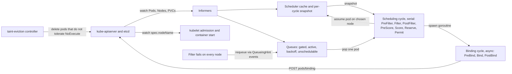

# Advanced Scheduling and Topology-Aware Placement

## TL;DR

- The default scheduler places one pod at a time against an in-memory snapshot. It uses optimistic "assume" bookkeeping and an asynchronous binding cycle. Every placement is a point-in-time decision, and only the taint-eviction controller revisits it later.
- Taints repel, affinity attracts, and topology spread balances. Spread is evaluated only when a pod is scheduled, so scale-down, node loss, and rolling updates silently re-skew the system unless you add `matchLabelKeys`, `nodeTaintsPolicy`, or a descheduler.
- `minDomains`, `nodeTaintsPolicy`, and the domain "global minimum" interact so that a zone outage can leave replacement pods Pending while spare capacity exists. The simulator in the worked example reproduces this.
- At scale the cost is in Filter, not Score. `percentageOfNodesToScore` is non-monotonic in cluster size, and plugins that scan existing pods (inter-pod affinity, spread) dominate cycle time. The queue is driven by `QueueingHint` callbacks, which are an extra correctness surface.
- For AI workloads, per-pod scheduling is the wrong abstraction. Gang scheduling (alpha in v1.35, beta in v1.37), Permit-based barriers, and network-topology-aware placement decide whether a 256-GPU job starts or burns idle accelerators.

## Mental Model



The scheduler is a read-mostly consumer of a cached view of the cluster.
It never talks to nodes.
It reads Pods, Nodes, and volume objects through informers (see [[17-Cloud-AI-Engineering/Volume_05_Kubernetes_and_Platform_Engineering/Chapter_01_Kubernetes_Control_Loop_Internals|Kubernetes Control Loop Internals]]).
It runs a pure function from (pod, snapshot) to a node name.
It writes exactly one thing, a binding, and the kubelet acts on that binding.
Because the scheduler's view lags etcd and the kubelet's real state, it speculates: it "assumes" the pod onto the node in its own cache, then lets the binding race against reality.
Everything after the binding (taint eviction, node-pressure eviction, rescheduling after node loss) belongs to other controllers.
Those controllers do not consult the scheduler's reasoning, so any invariant you want to keep across failures must be expressed in the pod spec in a form the scheduler can re-evaluate when it places the replacement.

## Internals

### Process model and the assume protocol

kube-scheduler is leader-elected, so one instance schedules at any time.
The framework model is that one pod flows through the scheduling cycle at a time.
Per the framework KEP, every extension point up to and including Permit finishes before the next scheduling cycle begins ([KEP-624](https://www.kubernetes.dev/resources/keps/624/), as of 2026-10).
A 2026 research paper describes pending pods being processed by multiple scheduler workers ([arXiv 2608.06987](https://arxiv.org/pdf/2608.06987)).
I could not confirm whether any parallel-cycle mode is enabled by default in v1.37 (UNVERIFIED), so reason about the serial model unless you have checked your version.
Parallelism exists inside a cycle, where Filter and Score fan out across nodes in goroutines.

The binding cycle runs asynchronously.
After Reserve and Permit succeed, the scheduler marks the pod as assumed on the node in its cache.
The next scheduling cycle therefore sees the node's resources and the pod's labels already consumed, before the API server has acknowledged the bind.
If PreBind or Bind fails, the scheduler forgets the assumed pod, runs Unreserve, and requeues the pod.
This is optimistic concurrency in the style of Omega (Schwarzkopf et al., EuroSys 2013), collapsed into one scheduler: speculate locally, commit with one write, and roll back local state on conflict.
Two consequences matter operationally:

- A pod can be "placed" in the scheduler's mind for the duration of volume binding or a Permit wait. Until then it counts against spread skew and node capacity, so a slow PreBind (for example volume provisioning) holds capacity that nothing else can use.
- Two schedulers that share nodes have separate caches. Each assumes the node is free, and the kubelet's admission check becomes the only arbiter. The loser surfaces as a failed pod such as OutOfcpu rather than a Pending pod.

### Snapshot and node ordering

Each cycle starts by updating a snapshot from the cache.
The update is incremental, keyed on a per-node generation counter, so cost scales with the number of nodes that changed since the last cycle rather than the cluster size (recalled from the scheduler source, UNVERIFIED this session).
Filters see a consistent view for the whole cycle even while informers keep mutating the cache.

The node list given to Filter is not in arbitrary order.
The scheduler keeps a zone-keyed tree of nodes and lists them round-robin across zones.
Each cycle also resumes scanning where the previous cycle stopped (recalled from the scheduler source, UNVERIFIED).
Together these ensure that when the scheduler stops early because it found "enough" feasible nodes, the sample is spread across zones and rotates across cycles.
This is the Kubernetes descendant of Borg's "relaxed randomization", where the scheduler examines machines in random order until it has found enough feasible ones to score (Verma et al., EuroSys 2015).

### Queues, gating, and QueueingHint

The scheduling queue has more states than "pending":

- **Gated.** PreEnqueue plugins can hold a pod out of the active queue entirely, for example via scheduling gates ([Kubernetes scheduling framework docs](https://kubernetes.io/docs/concepts/scheduling-eviction/scheduling-framework), as of 2026-10). The gang-scheduling plugin also uses PreEnqueue as a barrier.
- **Active.** This is a priority heap ordered by the single enabled QueueSort plugin. Only one QueueSort plugin may be enabled at a time because two orderings would conflict ([Deep dive into the Kubernetes scheduler framework](https://helayoty.org/blog/deep-dive-into-the-kubernetes-scheduler)).
- **Backoff.** Pods that failed a cycle wait out a per-pod exponential backoff (a config example shows 1 s initial and 10 s maximum, `podInitialBackoffSeconds` and `podMaxBackoffSeconds`).
- **Unschedulable.** Pods that failed Filter wait for a cluster event that might change the verdict, or for a periodic flush.

`QueueingHint` is the mechanism that decides which events wake which pods.
Plugins that implement PreEnqueue, PreFilter, Filter, Reserve, or Permit declare the events they care about through the `EnqueueExtension` interface.
They may attach a callback that returns Queue or Skip for a specific (pod, event) pair ([Kubernetes scheduling framework docs](https://kubernetes.io/docs/concepts/scheduling-eviction/scheduling-framework), as of 2026-10).
QueueingHint is stable as of v1.34 ([same source](https://kubernetes.io/docs/concepts/scheduling-eviction/scheduling-framework), as of 2026-10), and the gate is locked to its default.

The non-obvious part is the in-flight window.
A pod being scheduled is not in any queue, and cluster events keep arriving during its cycle.
If the cycle fails, an event that arrived mid-cycle may already have made the pod schedulable, and ignoring it would lose the wakeup.
The queue therefore tracks in-flight pods and keeps a list of events received while any pod is in flight.
When a pod fails, those events are replayed through the rejecting plugins' hints ([analysis of the v1.28 scheduler OOM](https://zouyee.medium.com/exploring-the-root-cause-of-kubernetes-1-28-scheduler-oom-9ab042a3a3ed)).
That bookkeeping is exactly what made the feature expensive.
It was enabled by default in v1.28, caused scheduler memory growth, and was turned back off in v1.28.5 ([same analysis](https://zouyee.medium.com/exploring-the-root-cause-of-kubernetes-1-28-scheduler-oom-9ab042a3a3ed)).
It was re-enabled by default in v1.32 ([Kubernetes blog, 2024-12-12](https://kubernetes.io/blog/2024/12/12/scheduler-queueinghint/)).
A hint that wrongly returns Skip converts a missed wakeup into a multi-minute stall (see Failure Modes).
[KEP-6132](https://www.kubernetes.dev/resources/keps/6132/) proposes a `PreQueueingHint` extension point so that a plugin can name the affected pods once per event.
That would reduce the requeue path from O(N) in unschedulable pods to O(1) for events that touch specific pods.
A tracking issue describes the extension as beta and on by default, with graduation to GA pending ([kubernetes/kubernetes#140909](https://github.com/kubernetes/kubernetes/issues/140909), as of 2026-10).

### Filter, node sampling, and Score

Filter runs every enabled plugin against candidate nodes in parallel and stops once enough feasible nodes are found.
The default number of feasible nodes to find follows this formula, quoted from the scheduler's defaulting code ([kubernetes/kubernetes#138996](https://github.com/kubernetes/kubernetes/issues/138996), as of 2026-10):

```
percentage = 50 - numAllNodes/125   (integer division, floor of 5)
numNodes   = max(100, numAllNodes * percentage / 100)
```

The result is non-monotonic.
It peaks at 3125 nodes (781 nodes scored) and falls to 281 at 5625 nodes, because the percentage declines faster than the cluster grows until the 5 percent floor is reached ([issue #138996](https://github.com/kubernetes/kubernetes/issues/138996)).
The simulator below reproduces those numbers.

Two things follow that the getting-started material omits.
First, the early stop applies to feasible nodes, not to nodes examined.
If only 40 of 5000 nodes can host a pod (for example GPU nodes with a specific taint), Filter must examine nearly every node, so the sampling optimization does nothing for the pods that are expensive to place.
Second, Score only sees the sample, so a "better" node outside the sample is invisible.
Weighted Score plugins are therefore nudges, not optimizers.

Each Score plugin emits 0 to 100 per node, NormalizeScore rescales within a plugin, and the framework sums weight times score.
My recollection of the default weights is TaintToleration 3, NodeAffinity 2, InterPodAffinity 2, PodTopologySpread 2, and NodeResourcesFit, NodeResourcesBalancedAllocation, and ImageLocality 1 each (UNVERIFIED this session; a tuning example confirms only the three weights of 1).
Ties among top scorers are broken randomly (recalled, UNVERIFIED).
The practical result is that `ScheduleAnyway` spread is a weight-2 preference competing with ImageLocality.
ImageLocality favors nodes that already hold a pod's images, and for multi-gigabyte inference images it can pull replicas toward one warm node and override the spread preference.
Use `DoNotSchedule` where spread is an availability requirement, and treat `ScheduleAnyway` as best effort.

### PodTopologySpread internals

For each constraint, PreFilter computes a map from (topologyKey, value) to the count of matching pods.
It also keeps the two smallest counts (a "critical paths" pair in the source, recalled and UNVERIFIED), so that Filter can evaluate the global minimum in O(1) per node.
During preemption simulation the plugin's AddPod and RemovePod extensions update those counts incrementally.
The Filter rule, per the documentation, is that placing the pod in a domain must keep `matchNum + 1 - globalMin <= maxSkew` ([Pod Topology Spread Constraints docs](https://kubernetes.io/docs/concepts/scheduling-eviction/topology-spread-constraints), as of 2026-10).
The documentation's example is zones holding 2, 2, and 1 matching pods, where the global minimum is 1.

The details that bite:

- **Eligible domains define the minimum.** `nodeAffinityPolicy` defaults to Honor and `nodeTaintsPolicy` defaults to Ignore ([Kubernetes blog, v1.27](https://kubernetes.io/blog/2023/04/17/fine-grained-pod-topology-spread-features-beta/)). With `Ignore`, a zone whose nodes are all tainted still counts as a domain with zero pods and pins the global minimum to 0.
- **`minDomains` zeroes the minimum.** If the number of eligible domains is below `minDomains`, the global minimum is treated as 0. `minDomains` is valid only with `DoNotSchedule` ([Kubernetes docs](https://kubernetes.io/docs/concepts/scheduling-eviction/topology-spread-constraints), as of 2026-10). It has been stable since v1.30, because before v1.30 it required a feature gate that was on by default from v1.28 ([same page](https://kubernetes.io/docs/concepts/scheduling-eviction/topology-spread-constraints)). Its purpose is to force a cluster autoscaler to create the missing domains ([Kubernetes blog, v1.27](https://kubernetes.io/blog/2023/04/17/fine-grained-pod-topology-spread-features-beta/)).
- **One constraint per (topologyKey, whenUnsatisfiable) pair** per pod ([Kubernetes docs](https://kubernetes.io/docs/concepts/scheduling-eviction/topology-spread-constraints)).
- **Cluster defaults exist.** When a pod defines none, the scheduler applies `maxSkew: 3` on hostname and `maxSkew: 5` on zone, both `ScheduleAnyway` ([KEP-1258](https://github.com/kubernetes/enhancements/blob/master/keps/sig-scheduling/1258-default-pod-topology-spread/README.md), as of 2026-10). AWS prescriptive guidance notes these values are not useful for deployments with few pods ([AWS Prescriptive Guidance](https://docs.aws.amazon.com/prescriptive-guidance/latest/ha-resiliency-amazon-eks-apps/spread-workloads.html), as of 2026-10).
- **`matchLabelKeys` scopes counting to a revision.** Adding `pod-template-hash` makes a rolling update count only new-revision pods. Old and new pods otherwise compete for the same skew budget ([community guide](https://kubernetes.recipes/recipes/deployments/kubernetes-pod-topology-spread-advanced/)). The docs page I retrieved labelled `matchLabelKeys` beta since v1.27 and the node policies beta since v1.26. They may have graduated since (UNVERIFIED), so check your cluster's feature gates.
- **No self-healing.** The constraint is evaluated at placement time only. ReplicaSet scale-down chooses victims by its own ranking and does not preserve spread, so you need a descheduler or periodic rebalancing for long-lived skew (recalled from the docs, UNVERIFIED this session).

### Inter-pod affinity and anti-affinity internals

Inter-pod (anti-)affinity is the most expensive built-in plugin.
PreFilter must scan existing pods to build maps of topology-pair counts for the incoming pod's terms.
It must also scan existing pods' anti-affinity terms to see whether any of them repels the incoming pod (recalled from the scheduler source, UNVERIFIED).
Required anti-affinity is symmetric: an existing pod can repel a newcomer even when the newcomer declares nothing.
Required affinity is not symmetric.
A pod whose required affinity term matches only itself is admitted when no matching pod exists anywhere, which bootstraps the first replica.
Both the self-affinity special case and the cost model explain why large clusters should prefer topology spread for replica balancing.
Reserve anti-affinity for hard exclusivity, such as one quorum member per host.

### Taints, tolerations, and eviction

Taint effects have different owners:

- **NoSchedule and PreferNoSchedule** are enforced by the scheduler's TaintToleration plugin, with the second only affecting Score.
- **NoExecute** is also enforced after placement by the taint-eviction controller in kube-controller-manager, which deletes running pods that do not tolerate the taint, after `tolerationSeconds` if one is set.
- The node lifecycle controller applies the condition taints. `node.kubernetes.io/not-ready` (Ready=False) and `node.kubernetes.io/unreachable` (Ready=Unknown) carry both NoSchedule and NoExecute. The memory, disk, PID, network, and unschedulable (cordon) taints use NoSchedule only, and pressure taints never evict because node-pressure eviction is the kubelet's job ([node failure lifecycle write-up](https://sailor.sh/blog/cka-node-failure-lifecycle-node-leases-taint-based-eviction-graceful-non-graceful-shutdown/), as of 2026-10).
- The `DefaultTolerationSeconds` admission plugin adds NoExecute tolerations for not-ready and unreachable with `tolerationSeconds: 300` to every pod that lacks them (same source). Because those tolerations name only the NoExecute effect, the NoSchedule twin of each taint is not tolerated. That asymmetry is why the `nodeTaintsPolicy: Honor` setting excludes a failed node from spread calculations.
- DaemonSet pods automatically tolerate the condition taints ([community guide](https://kubernetes.recipes/recipes/configuration/kubernetes-taint-toleration-guide/)).

A toleration never attracts a pod to a node.
Dedicated pools need a taint (to repel others) plus a nodeSelector or node affinity (to attract).
Extended resources such as `nvidia.com/gpu` are commonly paired with an admission plugin that auto-adds the matching toleration (the `ExtendedResourceToleration` plugin, recalled, UNVERIFIED).

Eviction is rate-limited per zone by the controller manager.
My recollection is that the defaults are 0.1 nodes per second in a healthy zone, falling to 0.01 per second in a zone where at least 55 percent of nodes are unhealthy, with eviction stopped entirely for small clusters (UNVERIFIED this session).
This protects against evicting a whole zone on a partition, but it also means that "evict and replace" after an AZ failure is deliberately slow.

### Preemption and the nominated-node filter pass

Preemption is the default PostFilter plugin (DefaultPreemption).
It runs only when Filter finds zero feasible nodes ([scheduler overview](https://scaleops.com/blog/kubernetes-scheduler/), as of 2026-10).
For each candidate node it simulates evicting lower-priority pods and re-runs Filter on the hypothetical state, which is why PreFilter plugins expose AddPod and RemovePod.
The preemptor receives a `nominatedNodeName` and goes back to the queue.
On later cycles the scheduler evaluates Filter twice per node (recalled, UNVERIFIED).
The first pass adds nominated pods of equal or higher priority, so other pods cannot steal the freed space.
The second pass omits them, so pod-affinity rules that depend on them are not satisfied by pods that may never arrive.
Preemption is therefore a promise of intent, not a reservation.
A higher-priority arrival can take the freed node, and the preemptor re-enters the queue.

### Workload-aware scheduling for AI

The per-pod model breaks for tightly coupled jobs.
If 56 of 64 workers are placed and 8 wait for capacity, the 56 hold accelerators and make no progress.
The Permit extension point is the seam for all-or-nothing behavior.
A plugin returns Wait for the first pod of a group and holds it before any binding is issued, then releases the group when quorum is reached.
Kueue, Volcano, and the Coscheduling plugin register Permit plugins ([kube-scheduler deep dive](https://blog.kubesimplify.com/kube-scheduler-deep-dive), as of 2026-10).

Native support has progressed across three minor releases:

- **v1.35 (2025-12-17).** The alpha Workload API (`scheduling.k8s.io/v1alpha1`) with `minCount` gang policy and a `workloadRef` on pods ([Kubernetes blog](https://www.kubernetes.io/blog/2025/12/29/kubernetes-v1-35-introducing-workload-aware-scheduling/), as of 2026-10). It was implemented with simple barriers at PreEnqueue and Permit. The KEP states this did not address performance at scale, scheduling livelocks, or partial preemption ([KEP-4671](https://www.kubernetes.dev/resources/keps/4671/)). The same release added opportunistic batching to speed scheduling of identical pods ([Kubernetes blog](https://www.kubernetes.io/blog/2025/12/29/kubernetes-v1-35-introducing-workload-aware-scheduling/)).
- **v1.36.** The API was split into a static Workload template and a runtime PodGroup object ([Security Boulevard summary](https://securityboulevard.com/2026/09/kubernetes-1-37-is-here-pod-rightsizing-dra-and-gang-scheduling/), as of 2026-10).
- **v1.37 (2026-08-26).** Gang scheduling is Beta. The release adds workload-aware preemption to avoid preemptions that do not let the workload make progress, and PodGroup queueing to coordinate competing workloads ([Kubernetes v1.37 release blog](https://kubernetes.io/blog/2026/08/26/kubernetes-v1-37-release/), as of 2026-10).

Gang scheduling decides when a group may start.
Topology-aware placement decides where, so that ranks land inside one network block or one TPU slice (see [[17-Cloud-AI-Engineering/Volume_10_AI_Infrastructure_on_Cloud/Chapter_03_High_Performance_AI_Cluster_Architectures|High-Performance AI Cluster Architectures]] and [[17-Cloud-AI-Engineering/Volume_10_AI_Infrastructure_on_Cloud/Chapter_02_Interconnect_Technologies_NVLink_EFA_and_TPU_ICI|Interconnect Technologies]]).
The KEP says the Workload API is intended to grow topology-aware scheduling later ([Cloudsmith summary](https://cloudsmith.com/blog/kubernetes-1-35-what-you-need-to-know)).
I did not verify any native topology-aware gang placement as GA, so assume you still need a queue manager or provider labels for rack and block locality (UNVERIFIED).
Dynamic Resource Allocation moves device selection (GPU models, partitions, links) into the scheduler through ResourceClaims.
An overview of v1.35 lists DRA as GA ([ScaleOps v1.35 overview](https://scaleops.com/blog/kubernetes-1-35-release-overview/)).

### Lineage

- **Borg** (EuroSys 2015): feasibility checking followed by scoring, with relaxed randomization to bound work per decision.
- **Omega** (EuroSys 2013): shared-state, optimistic concurrency between schedulers, which is the structure the assume-then-bind protocol reproduces within a single scheduler. See [[17-Cloud-AI-Engineering/Volume_13_Seminal_Papers_and_Case_Studies/Chapter_07_Google_Borg_and_Omega|Google Borg and Omega]].
- **Sparrow** (SOSP 2013): randomized batch sampling for low-latency scheduling.
- **Quincy** (SOSP 2009) and **Firmament** (OSDI 2016): min-cost-flow global optimization. This is the road not taken by the default scheduler, and it is why you can express cluster-wide optima only through external planners.

## Numbers to Know

| Quantity | Value | Source and date |
|---|---|---|
| Extension points in the framework | PreEnqueue, QueueSort, PreFilter, Filter, PostFilter, PreScore, Score, NormalizeScore, Reserve, Permit, PreBind, Bind, PostBind | KEP-624 and Kubernetes docs, as of 2026-10 |
| Default nodes to find per cycle | `max(100, N * max(5, 50 - N/125) / 100)` | kubernetes/kubernetes#138996, as of 2026-10 |
| Nodes scored at N = 500 / 1000 / 5000 / 10000 | 230 / 420 / 500 / 500 | computed from the formula above with the simulator, as of 2026-10 |
| Local maximum and minimum of that function | 781 nodes at N = 3125, 281 nodes at N = 5625 | kubernetes/kubernetes#138996 and simulator, as of 2026-10 |
| Default spread constraints | maxSkew 3 on hostname, maxSkew 5 on zone, both ScheduleAnyway | KEP-1258 and AWS Prescriptive Guidance, as of 2026-10 |
| Default NoExecute toleration for not-ready and unreachable | 300 s | community write-ups of DefaultTolerationSeconds, as of 2026-10 |
| Node-monitor grace period before Ready flips to Unknown | 40 s default | kube-controller-manager reference, recalled, UNVERIFIED |
| Approximate worst-case replacement start after node loss | 40 s + 300 s + queue and bind time, about 5m40s | derived, depends on the UNVERIFIED 40 s value |
| `minDomains` status | Stable since v1.30 | Kubernetes docs, as of 2026-10 |
| QueueingHint status | Stable (GA) since v1.34, gate locked | Kubernetes docs and kubernetes/kubernetes#141354, as of 2026-10 |
| Reported stall when a QueueingHint wrongly skips an event | about 5 minutes until the unschedulable flush | kubernetes/kubernetes#141354, as of 2026-10 |
| Gang scheduling | Alpha in v1.35 (2025-12-17), Beta in v1.37 (2026-08-26) | Kubernetes release blogs, as of 2026-10 |
| Latest minor release at time of writing | v1.37 | Kubernetes blog dated 2026-08-26, as of 2026-10 |
| Zone-loss headroom for N replicas over Z zones | Z/(Z-1): 1.5x for 3 zones, 1.33x for 4, 1.2x for 6 | derived, exact before node rounding |
| Eviction rate per zone | 0.1 nodes/s normal, 0.01 nodes/s when 55 percent unhealthy | kube-controller-manager reference, recalled, UNVERIFIED |

I did not verify any current cloud list prices for this chapter.
Cost arithmetic below therefore uses named variables instead of price figures.

## AWS vs GCP Mechanism Parity

Kubernetes scheduling semantics are identical on EKS and GKE.
The differences are in what feeds the scheduler (labels), what can change it (control-plane access), and what provisions capacity when it says no.
Items marked UNVERIFIED are from memory of the provider documentation and were not re-checked in this session.

| Concern | EKS on AWS | GKE on Google Cloud | Critical difference |
|---|---|---|---|
| Source of `topology.kubernetes.io/zone` | Zone name label set from the cloud provider. Zone names map to different physical AZs per account, while zone IDs are stable. UNVERIFIED | Zone label set from the cloud provider. Zones are names within a region | Cross-account placement on AWS must use zone IDs to guarantee co-location. UNVERIFIED |
| Scheduler configuration | Managed control plane. Custom KubeSchedulerConfiguration is generally not exposed, so profiles and weights require a second scheduler. UNVERIFIED | Managed control plane with the same constraint. UNVERIFIED | Cluster-wide defaults for spread must be injected by admission or Helm, not by editing the default scheduler |
| Node provisioning driven by Pending pods | Karpenter, which honors pod constraints when launching nodes. Cluster Autoscaler also supported. UNVERIFIED | Node auto-provisioning, Autopilot, and Cluster Autoscaler. UNVERIFIED | Autoscalers re-run scheduler filters in simulation. A custom plugin the autoscaler does not know about causes wrong scale-up decisions |
| Network-proximity placement for AI | EC2 cluster placement groups and instance topology information exposed as node labels or APIs. UNVERIFIED | Compact placement policies and TPU slice topology. UNVERIFIED | Both need labels the scheduler can match. Verify which labels your provider populates before writing `topologyKey` |
| Gang scheduling in the managed offering | Upstream Workload API (Beta in v1.37) when the cluster version supports it, or Kueue or Volcano | Same, plus provider queueing products. UNVERIFIED | The upstream feature is Beta, so gate adoption on provider feature-gate support |
| Node-loss detection | Kubernetes node lifecycle controller (shared). Provider health events can add taints or cordons through add-ons. UNVERIFIED | Same. GKE node auto-repair may replace nodes. UNVERIFIED | The 300 s default toleration applies equally. Provider repair can race with eviction |
| Cross-zone data cost of zone spread | Inter-AZ traffic is billed. UNVERIFIED | Inter-zone traffic within a region is billed. UNVERIFIED | Spread buys availability at an east-west cost. Topology-aware routing offsets it. See [[17-Cloud-AI-Engineering/Volume_09_FinOps_and_Cloud_Economics/Chapter_04_Network_Egress_Economics_and_Optimization\|Network Egress Economics and Optimization]] |

## Worked Example: Zone Spread, Zone Loss, and Capacity Sizing

This lab uses a local kind cluster, so it provisions no billable cloud resources.
Cloud cost: 0 USD.
Budget alarm: not applicable because no cloud account is touched.
Teardown: `kind delete cluster --name spread-lab`.
If you adapt it to EKS or GKE, set a budget alarm first (AWS Budgets or a Cloud Billing budget) and re-run the teardown against that cluster and its node groups.

### Step 1: Capacity arithmetic (do this before touching a cluster)

Take 60 replicas across 3 zones, with 5 pods per node.

1. Steady state: 60 / 3 = 20 pods per zone, so 20 / 5 = 4 nodes per zone and 12 nodes total.
2. Survive one zone loss without relying on the control plane: the 2 surviving zones must hold 60 pods, so 30 pods per zone, 6 nodes per zone, 18 nodes total.
3. Overprovision factor is 18 / 12 = 1.5x, which is Z/(Z-1) for Z = 3. With 4 zones it is 1.33x, and with 6 zones it is 1.2x. Rounding up to whole nodes can raise it, as the simulator shows for 6 zones (1.5x after rounding).
4. Monthly cost of insurance = (18 - 12) * node_hourly_price * 730 hours. Use your own node price. The alternative is to scale out after the failure, which makes recovery depend on the autoscaler and the provider's capacity pool during the event. That contradicts static stability, covered in [[17-Cloud-AI-Engineering/Volume_01_Cloud_Architecture_Principles/Chapter_02_Regions_Zones_and_Static_Stability|Regions, Zones, and Static Stability]].
5. Burst scheduling time is roughly pods * per-cycle latency, because cycles are serial in the framework model. As an assumption (measure with `scheduler_scheduling_attempt_duration_seconds`), at 5 ms per cycle a 10,000-pod burst takes 50 s of pure scheduling, before bind latency and node provisioning.
6. Gang idle cost: a 64-GPU job (8 nodes of 8 GPUs) that holds 6 nodes for 30 minutes while waiting for 2 more wastes 6 * 8 * 0.5 = 24 GPU-hours. Multiply by your GPU-hour rate. Gang scheduling with a Permit barrier converts this to zero held GPUs, at the price of a longer queue wait.

### Step 2: Simulator

Save as `spread_sim.py` and run `python3 spread_sim.py`.

```python
#!/usr/bin/env python3
"""PodTopologySpread skew simulator and zone-loss capacity calculator (stdlib only)."""
import math

def default_nodes_to_score(n, percentage=0):
    # Mirrors the defaulting logic quoted in kubernetes/kubernetes issue 138996.
    if n < 100:
        return n
    if percentage == 0:
        percentage = max(5, 50 - n // 125)
    return max(100, n * percentage // 100)

def feasible(counts, domains, placeable, max_skew, min_domains=None):
    """Return domains where one more matching pod satisfies DoNotSchedule.
    counts: domain -> matching pods.
    domains: domains that COUNT toward the global minimum (eligible domains).
    placeable: domains with at least one node that passes all other filters."""
    domains = list(domains)
    if not domains:
        return []
    known = {d: counts.get(d, 0) for d in domains}
    global_min = min(known.values())
    if min_domains is not None and len(domains) < min_domains:
        global_min = 0
    return [d for d in placeable if d in known
            and known[d] + 1 - global_min <= max_skew]

def place(counts, domains, placeable, n_new, max_skew, min_domains=None):
    counts = dict(counts)
    placed = 0
    for _ in range(n_new):
        ok = feasible(counts, domains, placeable, max_skew, min_domains)
        if not ok:
            break
        d = min(ok, key=lambda x: (counts.get(x, 0), x))
        counts[d] = counts.get(d, 0) + 1
        placed += 1
    return placed, counts

def scenario(name, counts, domains, placeable, n_new, max_skew=1, min_domains=None):
    placed, after = place(counts, domains, placeable, n_new, max_skew, min_domains)
    print(f"{name:<58} placed={placed}/{n_new} pending={n_new - placed} after={after}")

def zone_loss_nodes(replicas, zones, pods_per_node):
    steady_per_zone = math.ceil(replicas / zones)
    surv_per_zone = math.ceil(replicas / (zones - 1))
    return (steady_per_zone, surv_per_zone,
            math.ceil(surv_per_zone / pods_per_node) * zones,
            math.ceil(steady_per_zone / pods_per_node) * zones)

if __name__ == "__main__":
    print("== nodes scored per cycle (default adaptive percentage) ==")
    for n in (50, 100, 500, 1000, 3125, 4000, 5000, 5625, 10000):
        print(f"cluster={n:>6} scored={default_nodes_to_score(n):>5}")
    print()
    print("== zone c lost; 12 replicas were 4/4/4; need to place 4 replacements ==")
    base = {"a": 4, "b": 4, "c": 0}
    ab = ["a", "b"]
    scenario("A: c nodes NotReady+tainted, nodeTaintsPolicy=Ignore", base, ["a", "b", "c"], ab, 4)
    scenario("B: c nodes NotReady+tainted, nodeTaintsPolicy=Honor", base, ab, ab, 4)
    scenario("C: c nodes deleted, minDomains=3", base, ab, ab, 4, 1, 3)
    scenario("D: c nodes deleted, minDomains unset", base, ab, ab, 4)
    print()
    print("== capacity: replicas, zones, pods per node -> nodes needed ==")
    for r, z, p in ((60, 3, 5), (60, 4, 5), (60, 6, 5), (64, 3, 8)):
        steady, surv, n_surv, n_steady = zone_loss_nodes(r, z, p)
        print(f"replicas={r} zones={z} pods/node={p}: steady/zone={steady} "
              f"survive-1-zone/zone={surv} nodes(steady)={n_steady} nodes(survive)={n_surv} "
              f"overprovision={n_surv / n_steady:.2f}x")
```

Output from the run used to write this chapter:

```
cluster=   500 scored=  230
cluster=  3125 scored=  781
cluster=  5000 scored=  500
cluster=  5625 scored=  281
A: c nodes NotReady+tainted, nodeTaintsPolicy=Ignore       placed=0/4 pending=4
B: c nodes NotReady+tainted, nodeTaintsPolicy=Honor        placed=4/4 pending=0
C: c nodes deleted, minDomains=3                           placed=0/4 pending=4
D: c nodes deleted, minDomains unset                       placed=4/4 pending=0
```

The simulator models only the skew rule and domain eligibility, not resources or other filters.
Scenarios A and C are the two ways to strand replacement pods after a zone loss with plenty of capacity in the surviving zones.

### Step 3: Reproduce on kind

```bash
cat > kind-spread-lab.yaml <<'EOF'
kind: Cluster
apiVersion: kind.x-k8s.io/v1alpha4
nodes:
- role: control-plane
- role: worker
- role: worker
- role: worker
- role: worker
- role: worker
- role: worker
EOF

kind create cluster --name spread-lab --config kind-spread-lab.yaml

zones=(zone-a zone-a zone-b zone-b zone-c zone-c)
i=0
for n in $(kubectl get nodes -l '!node-role.kubernetes.io/control-plane' -o name | sort); do
  kubectl label "$n" topology.kubernetes.io/zone="${zones[$i]}" --overwrite
  i=$((i+1))
done

cat > spread-demo.yaml <<'EOF'
apiVersion: apps/v1
kind: Deployment
metadata:
  name: spread-demo
spec:
  replicas: 6
  selector:
    matchLabels:
      app: spread-demo
  template:
    metadata:
      labels:
        app: spread-demo
    spec:
      topologySpreadConstraints:
      - maxSkew: 1
        minDomains: 3
        topologyKey: topology.kubernetes.io/zone
        whenUnsatisfiable: DoNotSchedule
        nodeTaintsPolicy: Honor
        labelSelector:
          matchLabels:
            app: spread-demo
        matchLabelKeys:
        - pod-template-hash
      - maxSkew: 1
        topologyKey: kubernetes.io/hostname
        whenUnsatisfiable: ScheduleAnyway
        labelSelector:
          matchLabels:
            app: spread-demo
        matchLabelKeys:
        - pod-template-hash
      containers:
      - name: pause
        image: registry.k8s.io/pause:3.9
        resources:
          requests:
            cpu: 50m
            memory: 16Mi
EOF
```

Run the three variants against the same simulated zone loss.
The loss is modeled as a custom NoSchedule taint on zone-c plus deletion of the pods there, which is the state after the taint-eviction controller has acted.

```bash
simulate_zone_loss() {
  kubectl taint nodes -l topology.kubernetes.io/zone=zone-c lab/zone-down=true:NoSchedule --overwrite
  for n in $(kubectl get nodes -l topology.kubernetes.io/zone=zone-c -o jsonpath='{.items[*].metadata.name}'); do
    kubectl delete pods -l app=spread-demo --field-selector spec.nodeName="$n" --wait=false
  done
  sleep 15
  kubectl get pods -l app=spread-demo -o wide
  kubectl get events --field-selector reason=FailedScheduling | tail -n 5
}
restore() {
  kubectl taint nodes -l topology.kubernetes.io/zone=zone-c lab/zone-down=true:NoSchedule-
}

# Variant 1: Honor, no minDomains. Expect all 6 Running as 3/3/0.
sed '/minDomains/d' spread-demo.yaml | kubectl apply -f - && kubectl rollout status deploy/spread-demo
simulate_zone_loss; restore

# Variant 2: Honor with minDomains 3. Expect 2 Pending (only 2 eligible domains).
kubectl apply -f spread-demo.yaml && kubectl rollout status deploy/spread-demo --timeout=60s
simulate_zone_loss; restore

# Variant 3: Ignore, no minDomains. Expect 2 Pending (tainted zone-c still counts at 0).
sed -e '/minDomains/d' -e 's/nodeTaintsPolicy: Honor/nodeTaintsPolicy: Ignore/' spread-demo.yaml | kubectl apply -f -
kubectl rollout status deploy/spread-demo --timeout=60s
simulate_zone_loss; restore
```

Read the FailedScheduling events to see which plugin rejected each node.
In production, watch `scheduler_pending_pods` by queue, `scheduler_framework_extension_point_duration_seconds`, and `scheduler_plugin_execution_duration_seconds` to see where cycle time goes (metric names recalled from the scheduler metrics reference, UNVERIFIED this session).

Teardown:

```bash
kind delete cluster --name spread-lab
```

## Failure Modes and Pitfalls

### Zone loss strands replacement pods

Two independent configurations produce the same symptom: pods Pending with a topology-spread rejection while other zones have free CPU.
With `nodeTaintsPolicy: Ignore` (the default), a zone whose nodes are tainted still counts as a domain with 0 pods, so the surviving zones are over the skew limit.
With `minDomains` greater than the number of surviving zones, the global minimum is forced to 0, which is intended behavior when you want an autoscaler to restore the missing domain.
The first is a trap and the second is a deliberate trade, but both turn an availability constraint into an availability hazard if capacity cannot appear in the missing zone.
Set `nodeTaintsPolicy: Honor`, and set `minDomains` only when your provisioner can create nodes in the missing zone without human action.

### QueueingHint regressions

The v1.28 default-on rollout caused scheduler memory growth and was reverted in v1.28.5 ([analysis](https://zouyee.medium.com/exploring-the-root-cause-of-kubernetes-1-28-scheduler-oom-9ab042a3a3ed)).
The cause was in-flight event bookkeeping, covered under Internals.
A more recent report shows the opposite failure.
A replacement pod blocked only by required pod affinity stayed Pending for about 5 minutes after the peer pod was deleted, because the InterPodAffinity hint treated pod-deletion events as irrelevant.
With hints disabled on v1.33.7 the same pod scheduled in the same second.
The reporter notes a node drain stretching from about 1 minute to 5 or 6 minutes per workload wave, and that the gate cannot be disabled once locked in v1.34 ([kubernetes/kubernetes#141354](https://github.com/kubernetes/kubernetes/issues/141354)).
I did not verify whether this was fixed in v1.37 (UNVERIFIED).
The lesson is general: QueueingHint turned "retry when anything changes" into "retry when a plugin's predicate says so", and a plugin bug becomes a latency floor equal to the unschedulable-queue flush interval.
Test drain and rollout latency for any workload that uses required pod affinity.

### Rolling updates against spread constraints

Without `matchLabelKeys: [pod-template-hash]`, old and new ReplicaSets' pods are counted together.
With `maxUnavailable: 0` and a tight maxSkew, surge pods may have no feasible domain, and the rollout stalls ([community guide](https://kubernetes.recipes/recipes/deployments/kubernetes-pod-topology-spread-advanced/)).
Required anti-affinity at hostname granularity with an equal replica and node count is the same deadlock with no escape.

### Silent skew drift

Spread is never rechecked.
After a scale-down, a node replacement, or a spot reclaim, the next scale-up fixes skew only by the amount of new pods.
Alert on actual per-zone pod counts, not on the constraint being present.

### Scheduler cost cliffs

- Inter-pod affinity with a large existing-pod population makes PreFilter cost grow with the number of pods, not nodes.
- A rare-feasibility workload (a specific GPU model) defeats the sampling optimization, so every cycle for those pods scans most of the cluster.
- The non-monotonic node-sampling function means a cluster growing from 3,000 to 5,600 nodes scores fewer candidates per cycle (781 to 281), which can quietly worsen packing quality.
- Scheduler extenders add an HTTP round trip per pod per extension. Prefer in-process plugins.

### Two schedulers, one node pool

Independent caches double-book nodes, and the kubelet rejects the loser.
Partition nodes by label or taint so each scheduler owns a disjoint set, or run one scheduler with multiple profiles.

### Autoscaler and scheduler divergence

The cluster autoscaler and Karpenter simulate scheduling to decide what to launch.
A custom Filter plugin, DRA claim shape, or scheduling gate the simulator does not model produces nodes that cannot host the pod, or no node at all.
Keep the production scheduler close to upstream, and test any plugin against the autoscaler.

### ImageLocality overriding spread

Large container images inflate ImageLocality scores for nodes that already hold them.
Replicas of a multi-gigabyte inference image can concentrate on warm nodes when only soft spread is configured.
Use `DoNotSchedule` for availability-critical constraints.

### Slow eviction after node loss

The default tolerations mean a stateless pod on a dead node keeps serving traffic through the Service until endpoints are removed, then waits about 5m40s before replacement (see Numbers to Know).
Lowering `tolerationSeconds` on latency-sensitive pods speeds this up, but raises the churn caused by transient NotReady flaps.
Stateful pods with exclusive volumes add detach time on top.

### Public incident references

Public analyses relevant to this chapter are the GitHub issues cited above (v1.28 OOM, #141354) and the Reddit "Pi Day" 2023 post-incident write-up, where a Kubernetes upgrade changed node labels that other components selected on (UNVERIFIED: recalled, not re-fetched).
For the control-plane side of mass-pod events, see [[17-Cloud-AI-Engineering/Volume_07_Reliability_and_SRE/Chapter_07_Anatomy_of_Major_Cloud_Outages|Anatomy of Major Cloud Outages]].

## Security and Cost Angles

### Placement is not a security boundary by default

- **Taints are advisory to the pod author.** Anyone who can create a pod can add a toleration. Enforce dedicated pools with an admission policy (ValidatingAdmissionPolicy, Kyverno, Gatekeeper, or the PodTolerationRestriction admission plugin, recalled UNVERIFIED) that validates tolerations per namespace.
- **Node labels can be forged by compromised kubelets** unless the NodeRestriction admission plugin protects the label prefix. Labels under the `node-restriction.kubernetes.io/` prefix cannot be self-set by a kubelet, so use that prefix for tenancy or sensitivity labels (recalled, UNVERIFIED).
- **`spec.nodeName` and the `pods/binding` subresource bypass the scheduler.** A principal with `create` on pods can skip scheduler Filter plugins by naming a node directly. The kubelet re-checks only a subset of constraints. RBAC on `pods/binding` and admission rules on `nodeName` are part of the isolation story. For stronger isolation use separate node pools or clusters. See [[17-Cloud-AI-Engineering/Volume_05_Kubernetes_and_Platform_Engineering/Chapter_05_Multi_Tenancy_Isolation_and_Resource_Quotas|Multi-Tenancy, Isolation, and Resource Quotas]].
- **Scheduler identity.** A custom scheduler's service account needs read on Pods, Nodes, and volumes plus `create` on `pods/binding`. Give it nothing broader, because it can place any pod anywhere.

### Unit economics

- **Static stability is a priced decision.** Surviving one of Z zones costs Z/(Z-1) of steady capacity: 1.5x for 3 zones, 1.33x for 4, 1.2x for 6. More zones reduce insurance cost but raise per-zone minimums, cross-zone chatter, and failure-domain count.
- **Spread costs network money.** With uniform spread across 3 zones and no locality-aware routing, about two thirds of service-to-service calls cross a zone boundary (1 - 1/3). Multiply by traffic volume and your provider's inter-zone rate. Locality-preferring Service routing recovers some of that at the cost of load imbalance (see [[17-Cloud-AI-Engineering/Volume_09_FinOps_and_Cloud_Economics/Chapter_04_Network_Egress_Economics_and_Optimization|Network Egress Economics and Optimization]]).
- **Packing versus spreading.** `LeastAllocated` spreads load and keeps headroom for bursts. `MostAllocated` packs pods onto fewer nodes so autoscalers can remove empties. Run a packing profile for batch and a spreading profile for latency-sensitive services, through scheduler profiles or separate schedulers (see [[17-Cloud-AI-Engineering/Volume_05_Kubernetes_and_Platform_Engineering/Chapter_04_Autoscaling_at_Scale_HPA_KEDA_and_Karpenter|Autoscaling at Scale]]).
- **Accelerator idle time is the dominant cost.** For GPU jobs, partial gang placement is the expensive failure (24 GPU-hours in the worked example). A Permit barrier and a queue manager that admits only what fits are worth more than any bin-packing tweak (see [[17-Cloud-AI-Engineering/Volume_09_FinOps_and_Cloud_Economics/Chapter_05_GPU_and_TPU_Unit_Economics|GPU and TPU Unit Economics]]).

## Interview Questions and Model Answers

### Question 1 (L5 - Senior)

A Deployment with six replicas, zone spread with `maxSkew: 1` and `DoNotSchedule`, has two Pending pods. The event says nodes did not match the topology spread constraints. The cluster has spare CPU. Walk me through how you diagnose it.

#### Model Answer

Start from the rule the plugin enforces: placing a pod in domain D must satisfy `count(D) + 1 - globalMin <= maxSkew`.
The global minimum is taken over eligible domains, not over domains where the pod could actually run.
So I compute per-zone counts of pods matching the constraint's selector (including the right namespace and any `matchLabelKeys` revision scoping).
Then I list which nodes count as eligible under `nodeAffinityPolicy` (default Honor) and `nodeTaintsPolicy` (default Ignore).
The usual causes are, in order of frequency:

- One zone has no schedulable capacity (full, tainted, or cordoned) but still counts at zero or at a low count, which pins the global minimum low and over-skews the others.
- `minDomains` exceeds the number of eligible zones, which forces the minimum to 0.
- During a rollout, old-revision pods are counted with new ones because `matchLabelKeys: [pod-template-hash]` is missing.
- The label selector accidentally matches pods from another workload.

The fix depends on intent.
If the zone is lost on purpose, set `nodeTaintsPolicy: Honor`, or relax to `ScheduleAnyway` for the transition.
If capacity is simply missing in one zone, add nodes there.
I would not raise `maxSkew` as the first move, because it silently weakens the availability guarantee for every future placement.

#### Follow-up Interviewer Question

You set `nodeTaintsPolicy: Honor` and the pods schedule, but now the surviving zones carry 50 percent more load each. When the failed zone returns, what happens to the distribution and what would you do about it?

### Question 2 (L5 - Senior)

You need a GPU node pool that only inference pods can use. Compare nodeSelector, node affinity, and taints and tolerations, and tell me what you would deploy.

#### Model Answer

They answer different questions.
A nodeSelector or required node affinity attracts: the pod can only run on matching nodes, but nothing stops other pods from landing there.
A taint repels: nodes refuse pods that lack a toleration, but a toleration does not attract the pod, so a tolerating pod can still land on a non-GPU node.
Dedicated pools need both: taint the pool with NoSchedule, and give the inference pods a matching toleration and a node affinity (or selector) for the pool's label.
With extended resources like `nvidia.com/gpu`, an admission plugin can add the toleration automatically (recalled, UNVERIFIED), but I would not rely on that for exclusivity.
I would use NoSchedule, not NoExecute, for the steady-state taint, so that a mistake does not evict running workloads.
I would also enforce the taint-and-label contract with admission policy.
Taints are not security boundaries: any pod author can add a toleration, and `spec.nodeName` bypasses the scheduler.
For hard tenant isolation I would use separate node pools or clusters.

#### Follow-up Interviewer Question

A team adds a blanket toleration with `operator: Exists` to get a DaemonSet running everywhere. Their batch jobs start landing on the GPU pool. How do you prevent that class of mistake without blocking legitimate DaemonSets?

### Question 3 (L6 - Staff)

An AZ fails. Your tier-1 service has 60 replicas over three zones with a hard zone-spread constraint, and `minDomains: 3`. The surviving zones have capacity headroom, yet replacement pods stay Pending. Explain the mechanism, then redesign.

#### Model Answer

The mechanism is in how the global minimum is computed.
With the zone gone, only two eligible domains remain, and the constraint requires three.
When eligible domains are fewer than `minDomains`, the scheduler treats the global minimum as 0.
Each surviving zone already holds 20 pods, so `20 + 1 - 0 = 21` exceeds `maxSkew` and every placement is rejected.
`minDomains` is built to force an autoscaler to create the missing domain ([Kubernetes blog, v1.27](https://kubernetes.io/blog/2023/04/17/fine-grained-pod-topology-spread-features-beta/)), so the pods are Pending by design until a third zone appears, which is not what you want during a zone failure.
A related trap is `nodeTaintsPolicy: Ignore` with nodes still present but NotReady: they count as a zero-pod domain and pin the minimum at 0.
My simulator reproduces both cases (A and C above).

The redesign separates normal operation from failure behavior:

1. Keep `DoNotSchedule` zone spread with `maxSkew: 1`, `nodeTaintsPolicy: Honor`, and no `minDomains`. Use `minDomains` only for new-cluster bootstrap, where you want the autoscaler to create all zones.
2. Pre-provision for static stability: with Z = 3 the survivors need 1.5x steady capacity, 18 nodes versus 12 in my 5-pods-per-node example. Do not depend on a scale-out during the event.
3. Add a soft second constraint (`ScheduleAnyway`) so that if the hard rule blocks, the pod still lands. Better, use a PodDisruptionBudget and priority so critical pods preempt batch.
4. Alert on pods Pending with spread rejections for more than a few minutes, which indicates a zone-loss mismatch rather than a capacity problem.

The trade-off is cost (about 50 percent extra for three zones) and the risk of over-skew when the zone returns.
Spread does not rebalance, so I would run a descheduler or a controlled rollout after recovery.

#### Follow-up Interviewer Question

The finance team wants to remove the 50 percent insurance and use the autoscaler for recovery instead. What evidence would you need before agreeing, and what would you propose as a compromise?

### Question 4 (L6 - Staff)

Your 5,000-node cluster must absorb a 20,000-pod burst. The scheduler is the bottleneck. What do you look at, and what do you change?

#### Model Answer

First establish where time goes.
The scheduling cycle is serial in the framework's model, so wall time is roughly pods times per-cycle latency, and the arithmetic is the first sanity check: 20,000 pods at 5 ms is 100 s.
I would look at the scheduler's per-extension-point and per-plugin duration histograms, the pending-pod gauge by queue (active, backoff, unschedulable, gated), and the attempt-duration histogram, to separate Filter cost from queue churn from bind latency.
Then I check the usual causes:

- **Plugins that scan existing pods.** Required inter-pod affinity and anti-affinity make PreFilter proportional to existing pods. Replace replica-balancing anti-affinity with topology spread, and keep required anti-affinity for hard exclusivity.
- **Rare-feasibility pods.** Filter stops after finding enough feasible nodes, and the default is `max(100, N * max(5, 50 - N/125) / 100)`, which is 500 at N = 5000. If only 40 nodes are feasible, the early stop never triggers and each cycle scans most of the cluster. Fix this with more selective pre-filters (node affinity that cheaply eliminates nodes) or by partitioning the pool.
- **Requeue storms.** Pods that fail Filter wait for events. With QueueingHint that depends on plugin hints, so check whether pods are woken too often (CPU burn) or too rarely (stall, as in #141354).
- **Identical pods.** For homogeneous replicas, the v1.35 opportunistic batching feature speeds scheduling of identical pods ([Kubernetes blog](https://www.kubernetes.io/blog/2025/12/29/kubernetes-v1-35-introducing-workload-aware-scheduling/)).
- **Bind and API server cost.** Each pod costs a bind write. Check API server priority-and-fairness and the scheduler's client rate limits.

I would tune `percentageOfNodesToScore` last and carefully.
The default is non-monotonic (781 nodes scored at N = 3125, 281 at N = 5625), so growth in cluster size can reduce scoring breadth.
A smaller sample is faster but packs worse.
For a burst of fungible pods that is the right trade, and for a few pods that need good placement it is not.
If one scheduler is still not enough, run a second scheduler on a disjoint node partition rather than two schedulers on shared nodes, because separate caches double-book.

#### Follow-up Interviewer Question

You find that p99 scheduling latency doubled after a minor-version upgrade, with no change in pod volume. How do you bisect, and which release-level scheduler changes would you suspect first?

### Question 5 (L6 - Staff)

Design placement for a 256-GPU training job (32 nodes of 8 GPUs) sharing a Kubernetes cluster with latency-sensitive inference. What goes wrong with the default scheduler, and what do you put in place?

#### Model Answer

The default scheduler places each pod independently, which produces three problems.
Partial placement: 28 workers start and wait for 4 more, holding 224 GPUs while making no progress.
Deadlock between jobs: two 32-node jobs each hold 20 nodes and neither can finish.
Poor locality: ranks scatter across network blocks, which can make collective communication the bottleneck (see [[17-Cloud-AI-Engineering/Volume_10_AI_Infrastructure_on_Cloud/Chapter_02_Interconnect_Technologies_NVLink_EFA_and_TPU_ICI|Interconnect Technologies]]).

For the first two I need all-or-nothing admission.
Upstream gang scheduling (Beta in v1.37) holds pods at PreEnqueue and Permit until the group can be placed, and adds workload-aware preemption and PodGroup queueing ([Kubernetes v1.37 release blog](https://kubernetes.io/blog/2026/08/26/kubernetes-v1-37-release/)).
The alpha design explicitly did not solve scale performance, livelock, or partial preemption ([KEP-4671](https://www.kubernetes.dev/resources/keps/4671/)), so I would not depend on it for a production fleet without testing those cases.
Until then, or alongside it, I would use Kueue or Volcano.
They admit a job only when quota and capacity exist, so pods are not even created for a job that cannot start.

For locality I need a topology key the scheduler can match.
That means provider node labels for network block or rack, or TPU slice topology, applied through required affinity or a topology-aware queue manager.
I have not verified native topology-aware gang placement as GA, so I would assume the queue manager does it (UNVERIFIED).

For coexistence I would:

- Taint and label a training pool so inference cannot land there, and let inference use a spread-and-headroom profile.
- Give training lower priority than inference, with gang-aware preemption so inference spikes do not kill a job at step N-1.
- Account for fault tolerance. A single node failure kills a synchronous job, so the real design includes checkpoint cadence and automated node replacement (see [[17-Cloud-AI-Engineering/Volume_10_AI_Infrastructure_on_Cloud/Chapter_08_Fault_Tolerance_and_Fleet_Resiliency_at_Scale|Fault Tolerance and Fleet Resiliency at Scale]]).

The trade-off is queueing latency and lower raw utilization (capacity reserved for a waiting gang), against zero idle-accelerator time from partial starts.

#### Follow-up Interviewer Question

One node in the 32-node gang fails at hour 6. Walk me through what the scheduler, the job controller, and the queue manager each do next, and where you would add a policy to avoid thrashing.

### Question 6 (L6 - Staff)

After upgrading, node drains take 5 to 6 minutes per wave instead of about 1 minute. Pods with required pod affinity sit Pending with no scheduling attempts. How do you find the cause?

#### Model Answer

Zero retries after a state change that should have made the pod schedulable means the pod is parked in the unschedulable queue and was never moved.
That points at the requeue path, not at Filter.
I would confirm three things.
First, compare the pod's events: one FailedScheduling event at creation, then silence, then a Scheduled event about 5 minutes later.
Second, check the scheduler metrics for the unschedulable queue size and for queue wakeups by event type.
Third, correlate with the version: QueueingHint became stable in v1.34 with the gate locked.
There is a public report of exactly this behavior, in which the InterPodAffinity hint skipped pod-deletion events that made required self-affinity satisfiable, and the pod waited for the periodic flush ([kubernetes/kubernetes#141354](https://github.com/kubernetes/kubernetes/issues/141354)).
I would not claim that is our cause until reproduced.
Mitigations, in order: avoid required pod affinity on pods replaced during drains (use node or zone affinity or topology spread instead); lower the unschedulable-pod flush interval if your version still exposes the flag; stage upgrades behind a drain-latency canary.
Because the hint gate is locked, we cannot revert to the old behavior in-cluster, so I would pin the control-plane version if the provider allows it.

#### Follow-up Interviewer Question

How would you build a continuous test that catches requeue-latency regressions in the scheduler before they reach production, given that your cluster is managed and you cannot change the scheduler binary?

### Question 7 (L7+ - Principal)

You own the platform for 200 services across two clouds. Leadership wants a guarantee that every tier-1 service survives an AZ loss. Teams will not all write correct topology spread constraints. How do you make the guarantee real?

#### Model Answer

The guarantee has four components, and a constraint in a manifest is only one of them.

1. **Enforce intent at admission, not at review.** The cluster-wide default (maxSkew 3 on hostname and 5 on zone, `ScheduleAnyway`) is too weak for small replica counts ([AWS Prescriptive Guidance](https://docs.aws.amazon.com/prescriptive-guidance/latest/ha-resiliency-amazon-eks-apps/spread-workloads.html)). Managed control planes may not let you change scheduler defaults (UNVERIFIED), so inject constraints with a mutating policy keyed on a `tier: 1` label. Reject tier-1 workloads with fewer than 3 replicas or with `Ignore` taint policy. Include `matchLabelKeys: [pod-template-hash]`, `nodeTaintsPolicy: Honor`, and no `minDomains` outside bootstrap.
2. **Capacity.** A constraint is a promise the scheduler can only keep if capacity exists. Compute Z/(Z-1) headroom per tier-1 pool and provision it statically, because relying on the autoscaler during an AZ event adds the provider capacity pool and the control plane to the failure path (see [[17-Cloud-AI-Engineering/Volume_01_Cloud_Architecture_Principles/Chapter_02_Regions_Zones_and_Static_Stability|Regions, Zones, and Static Stability]]). The cost is explicit and goes to the service owner's budget.
3. **Verification.** Run zone-loss game days. Taint one zone's nodes and delete its pods, as in the lab, and require that replacements schedule within the SLO. This catches the stranded-pod cases (`Ignore` policy, `minDomains`) that no static review will, and it feeds [[17-Cloud-AI-Engineering/Volume_07_Reliability_and_SRE/Chapter_05_Chaos_Engineering_and_Game_Days|Chaos Engineering and Game Days]]. Add continuous drift detection: alert when per-zone pod counts deviate from the intended balance.
4. **Downstream dependencies.** Spread across zones is useless if the service depends on a single-zone database or a zonal load balancer target. The guarantee must be assessed end to end.

Trade-offs: mutation hides placement policy from developers and makes debugging harder, so surface the effective constraints in the workload's status or annotations.
The headroom cost is paid every month to avoid a rare event, so it must be tiered by service criticality, with stateless tier-2 services taking `ScheduleAnyway` and autoscaler recovery.

#### Follow-up Interviewer Question

A team shows that their service tolerates a zone loss at 70 percent of normal traffic and asks for an exemption from the 1.5x headroom. What do you ask them, and under what conditions do you say yes?

### Question 8 (L7+ - Principal)

Should we extend the default scheduler with custom plugins, run a second scheduler, or adopt an external batch scheduler? Defend a choice for a company that runs both latency-sensitive services and large training jobs on shared Kubernetes fleets.

#### Model Answer

The decision turns on four properties: consistency, autoscaler parity, operational ownership, and blast radius.

**Consistency.** One scheduler has one cache and one assume protocol, so it cannot double-book. Two schedulers on shared nodes have separate caches and resolve conflicts at the kubelet, which shows up as failed pods, not as pending pods. So multiple schedulers are acceptable only on disjoint node partitions, or with distinct profiles inside one process.

**Autoscaler parity.** Cluster Autoscaler and Karpenter model scheduling to decide what to launch. Custom in-tree plugins that the autoscaler does not run cause wrong scale-up (UNVERIFIED in detail for each product). Plugins that stay within upstream concepts (labels, taints, spread, gang via PodGroup) keep parity.

**Ownership.** On managed control planes the default scheduler's configuration is generally not editable (UNVERIFIED), so plugin extension means running your own scheduler binary. That is an on-call surface: leader election, version skew against the API server, upgrades, and metrics.

**Blast radius.** A bug in a scheduler affects every pod it owns. Scope custom code to the workload class that needs it.

My choice is: keep the default scheduler for services, with policy expressed through constraints and admission. For training and batch, adopt a queue manager (Kueue or Volcano class) that does admission, fair-share, and gang semantics outside the per-pod loop. Use upstream gang scheduling as it matures, because it is the only option that the autoscaler simulation and every provider will converge on. At Beta in v1.37 it is not yet the sole option ([Kubernetes v1.37 release blog](https://kubernetes.io/blog/2026/08/26/kubernetes-v1-37-release/)).
Put training on a dedicated node partition with its own taints and, if needed, its own scheduler profile for bin packing.
I would write custom plugins only for a constraint the platform cannot express with labels and queues, and only after confirming the autoscaler can simulate it.

The historical lesson from Borg and Omega is that monolithic schedulers hit throughput and flexibility limits, and Omega's answer was shared-state optimistic concurrency between schedulers.
Kubernetes did not adopt multi-scheduler shared state.
It gave each scheduler its own cache and left conflict resolution to the kubelet, which is the reason partitioning matters.

#### Follow-up Interviewer Question

The training team wants to preempt inference pods when a large job has waited more than 30 minutes. What is your position, and what mechanisms (priority classes, PDBs, queue policy, capacity reservation) do you use to make it safe?

## Further Reading

- [Scheduling Framework (Kubernetes docs)](https://kubernetes.io/docs/concepts/scheduling-eviction/scheduling-framework): the authoritative list of extension points, queue behavior, and QueueingHint status.
- [KEP-624: Scheduling Framework](https://www.kubernetes.dev/resources/keps/624/): the design rationale for plugins, the cycle boundaries, and why extenders were insufficient.
- [Pod Topology Spread Constraints (Kubernetes docs)](https://kubernetes.io/docs/concepts/scheduling-eviction/topology-spread-constraints): the skew rule, `minDomains`, and node inclusion policies in the maintainers' words.
- [KEP-1258: Default Pod Topology Spread](https://github.com/kubernetes/enhancements/blob/master/keps/sig-scheduling/1258-default-pod-topology-spread/README.md): where the cluster default constraints come from and why they are weak for small replica counts.
- [Kubernetes v1.32 blog: QueueingHint](https://kubernetes.io/blog/2024/12/12/scheduler-queueinghint/): the motivation for event-driven requeueing and its history of being disabled and re-enabled.
- [kubernetes/kubernetes#141354](https://github.com/kubernetes/kubernetes/issues/141354): a worked failure analysis of a QueueingHint stall, useful as a template for debugging requeue paths.
- [kubernetes/kubernetes#138996](https://github.com/kubernetes/kubernetes/issues/138996): the exact node-sampling formula and its non-monotonic behavior.
- [KEP-4671: Gang Scheduling](https://www.kubernetes.dev/resources/keps/4671/): the design of the Workload and PodGroup APIs and a candid list of what the alpha did not solve.
- [Kubernetes v1.35: Introducing Workload Aware Scheduling](https://www.kubernetes.io/blog/2025/12/29/kubernetes-v1-35-introducing-workload-aware-scheduling/): the first native gang scheduling release, with opportunistic batching.
- [Kubernetes v1.37 release blog](https://kubernetes.io/blog/2026/08/26/kubernetes-v1-37-release/): the current state of gang scheduling, workload-aware preemption, and PodGroup queueing.
- [KEP-6132: PreQueueingHint](https://www.kubernetes.dev/resources/keps/6132/): the proposal to cut requeue cost from O(N) to O(1) for targeted events.
- Verma et al., "Large-scale cluster management at Google with Borg" (EuroSys 2015): the origin of feasibility-then-scoring and relaxed randomization.
- Schwarzkopf et al., "Omega: flexible, scalable schedulers for large compute clusters" (EuroSys 2013): the optimistic shared-state model behind the assume-then-bind design.
- Ousterhout et al., "Sparrow: Distributed, Low Latency Scheduling" (SOSP 2013): the randomized sampling argument behind bounded per-decision work.
- Gog et al., "Firmament: Fast, Centralized Cluster Scheduling at Scale" (OSDI 2016): the min-cost-flow alternative to per-pod heuristics.
- [[04-System-Design/07-Infrastructure-and-Orchestration/Kubernetes-Architecture|Kubernetes Architecture]]: the system-level view of the control plane that this chapter's scheduler sits inside.
- [[17-Cloud-AI-Engineering/Volume_05_Kubernetes_and_Platform_Engineering/Chapter_03_CNI_and_eBPF_with_Cilium|Container Networking Interface and eBPF with Cilium]]: the next chapter, covering what happens on the node after the scheduler's bind.
