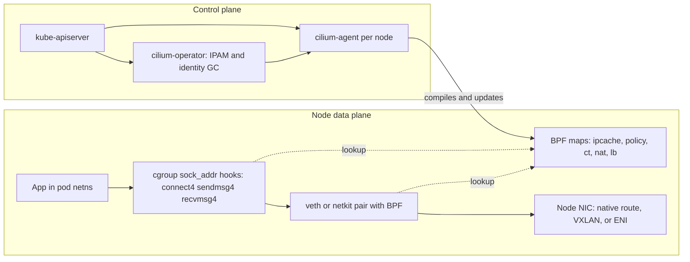

# Container Networking Interface and eBPF with Cilium

## TL;DR

- CNI is a fork/exec contract of six verbs (ADD, DEL, CHECK, STATUS, GC, VERSION). The runtime calls it once per pod sandbox, so pod start latency and IP leaks are properties of your IPAM, not of Kubernetes (CNI spec 1.1.0, as of 2026-10).
- Pod IP supply is the first scaling limit. On AWS VPC CNI the density cap is `ENIs * (IPs per ENI - 1) + 2` (29 pods on m5.large), and prefix mode trades a larger per-node IP footprint for density (AWS docs, as of 2026-10).
- Cilium replaces the kube-proxy service path with cgroup `connect4/sendmsg4/recvmsg4` socket hooks. The ClusterIP is rewritten to a backend IP before a packet exists, so there is no DNAT conntrack entry and `ss` on the client shows the backend address (Cilium docs, as of 2026-10).
- Policy is identity-based. Labels map to a numeric identity, the datapath matches `(identity, port, proto)` in per-endpoint BPF maps, and cluster-local identities are capped near 65,535, so label cardinality is a capacity input (Cilium docs, as of 2026-10).
- Every eBPF map has a fixed capacity: 512k TCP and 256k other conntrack entries per node, 512k NAT, 64k service LB, 16k policy entries per endpoint (Cilium docs, as of 2026-10). Size them like any other resource, because exhaustion shows up as resets and drops that look like application bugs.

## Mental Model



The CNI plugin runs only at sandbox create and delete and does the one-time plumbing: network namespace, interface pair, IP, routes.
After that, nothing in the agent is on the packet path.
The agent compiles BPF programs and writes state into pinned maps, and the kernel executes those programs on every connect(), sendmsg() and packet.
The mental split is control state (Kubernetes objects, identities, CIDRs) versus data state (hash maps in the kernel).
Failures follow that split: control-plane failures stop updates but leave forwarding intact, while map or program failures drop traffic immediately.

## Internals

### The CNI contract and the sandbox lifecycle

The kubelet asks the CRI runtime (containerd or CRI-O) to run a pod sandbox.
The runtime creates a network namespace for the pause container and executes the plugin binary with `CNI_COMMAND` in its environment.
The network configuration arrives on stdin and the result is returned on stdout (CNI spec, as of 2026-10; [spec](https://www.cni.dev/docs/spec/)).
The spec version is 1.1.0 and it added two verbs, STATUS and GC, plus multi-version configs via `cniVersions` ([spec upgrade notes](https://www.cni.dev/docs/spec-upgrades/), as of 2026-10).

Three consequences matter operationally.

- **ADD is on the critical path of pod start.**
  If ADD blocks on a slow IPAM call, the pod sits in ContainerCreating.
  This is why AWS VPC CNI keeps a warm pool in a local daemon and the plugin talks to it by RPC, instead of calling the EC2 API inside ADD ([AWS Containers blog](https://aws.amazon.com/blogs/containers/amazon-vpc-cni-increases-pods-per-node-limits), as of 2026-10).
  See [[17-Cloud-AI-Engineering/Volume_11_LLM_Serving_and_Inference_Systems_on_Cloud/Chapter_08_Cloud_GPU_Autoscaling_and_Cold_Start_Mitigation|Cloud GPU Autoscaling and Cold-Start Mitigation]] for how this stacks with image pulls.
- **DEL is best-effort.**
  A node crash, a force-deleted sandbox, or a runtime bug leaves IPAM reservations behind with no DEL ever called.
  The GC verb exists for this: the runtime passes the set of known-good attachments and the plugin reclaims everything else, including leaked IPAM reservations ([CNI releases](https://github.com/containernetworking/cni/releases), as of 2026-10).
  A runtime that does not support v1.1 still gets a degraded form of GC through DEL on stale cached attachments, per the same release notes.
  `disableGC` lets an administrator turn GC off for a shared configuration where it could be destructive ([spec](https://www.cni.dev/docs/spec/), as of 2026-10).
- **STATUS replaces "a config file exists" as the readiness signal.**
  The release notes state that containerd and CRI-O no longer have to infer network readiness from the presence of a config file.
  The spec also says a plugin must not rely on STATUS being called, and must still expect ADD and DEL after a failing STATUS ([spec](https://www.cni.dev/docs/spec/), as of 2026-10).
  A plugin that runs out of IPs or hardware queues should fail STATUS, per the same text.

Plugins can be chained and delegate to an IPAM plugin.
Cilium and the AWS VPC CNI instead split the work in two: a thin plugin binary for the namespace work, and a long-lived per-node daemon that owns address state (the "IPAMD" in AWS, the agent in Cilium).

### IPAM: where pod IPs come from

| Model | Who allocates | Routing implication |
| --- | --- | --- |
| Kubernetes host scope | kube-controller-manager assigns `Node.spec.podCIDR`, the node allocates inside it | Direct or tunnel; one CIDR per node, no multiple CIDRs per node (Cilium docs, as of 2026-10) |
| Cluster scope (Cilium default) | cilium-operator assigns per-node CIDRs via `CiliumNode`; node-local allocator inside | Direct or tunnel; does not depend on Kubernetes being configured to hand out PodCIDRs (Cilium docs, as of 2026-10) |
| Multi-pool | Operator carves CIDRs from named `CiliumPodIPPool` objects, multiple per node | Direct or tunnel; allows per-workload pools (Cilium docs, as of 2026-10) |
| AWS ENI | Operator or IPAMD attaches ENIs and assigns VPC addresses | Direct routing only; pods get VPC-routable IPs (Cilium docs, as of 2026-10) |
| GKE | GCP-managed alias ranges | Direct routing only (Cilium docs, as of 2026-10) |

The Cilium IPAM documentation says the only supported online migration is cluster-pool to multi-pool, and that for anything else the safest path is a fresh cluster ([Cilium IPAM docs](https://docs.cilium.io/en/stable/network/concepts/ipam/), as of 2026-10).
Treat IPAM mode as a day-0 decision that is effectively immutable.

**AWS VPC CNI slot model.**
Each ENI has a fixed number of address slots, and each pod consumes one slot.
The recommended kubelet `--max-pods` is `(ENIs * (IPs per ENI - 1)) + 2`, which prevents the scheduler from placing pods the node has no IPs for ([aws/amazon-vpc-cni-k8s README](https://github.com/aws/amazon-vpc-cni-k8s/blob/master/README.md), as of 2026-10).
Without configuration, ipamd always tries to keep one extra ENI attached, per the same README.
In prefix assignment mode (VPC CNI 1.9.0 or later, Nitro instances, introduced August 2021) a slot holds a /28 of 16 addresses instead of one address ([AWS blog](https://aws.amazon.com/blogs/containers/amazon-vpc-cni-increases-pods-per-node-limits), [EKS best practices](https://docs.aws.amazon.com/eks/latest/best-practices/prefix-mode-linux.html), as of 2026-10).
The less obvious consequence: prefix mode raises the IP footprint of a lightly loaded node, because the warm pool is now measured in 16-address blocks.
The sizing script in the worked example shows 48 reserved IPs per node versus 30 for 29 pods on m5.large.
Prefix mode wins on density, not on IP frugality at low density.

### The packet path: veth, tcx, netkit, host routing

A classic pod attaches through a veth pair: one end in the pod netns, the other in the host netns.
Cilium attaches BPF to the host-side device and, by default, packets still traverse parts of the host stack, including iptables hooks, unless eBPF host routing is active ([Cilium tuning guide](https://docs.cilium.io/en/stable/operations/performance/tuning/), as of 2026-10).
eBPF host routing, introduced in Cilium 1.9, bypasses iptables and the upper host stack, and gives a faster network namespace switch than regular veth operation (same source and a [third-party walkthrough](https://e-whisper.com/posts/56721/) that cites a kernel 5.10 floor, as of 2026-10).
The mechanism behind the fast switch is the kernel `bpf_redirect_peer()` and `bpf_redirect_neigh()` helpers, which jump straight into the peer namespace or fill the L2 header from the neighbor table without a trip through the per-CPU backlog queue (UNVERIFIED in this pass, taken from Cilium talks).

netkit goes one step further.
It replaces the veth pair with a BPF-programmable device pair, and Cilium attaches the pod-specific BPF programs inside the netkit peer device so they can only be managed from the host namespace through Cilium.
If no program is attached, Cilium configures the peer to blackhole traffic ([Cilium tuning guide](https://docs.cilium.io/en/stable/operations/performance/tuning/), as of 2026-10).
netkit requires eBPF host routing and uses tcx for attachments to non-netkit devices.
There is no in-place upgrade from veth to netkit, because the CNI plugin cannot replace the device after pod creation, and running both flavors in parallel is not supported (same source).
Plan netkit as a node-pool replacement, not a config flip.

### Service load balancing at the socket layer

A getting-started guide says "Cilium replaces kube-proxy".
The mechanism is more specific.

1. Cilium attaches `BPF_PROG_TYPE_CGROUP_SOCK_ADDR` programs to the cgroup v2 root (`connect4/6`, `sendmsg4/6`, `recvmsg4/6`, `getpeername4/6`) ([Cilium 1.9 kube-proxy-free docs](https://docs.cilium.io/en/v1.9/gettingstarted/kubeproxy-free/), as of 2026-10; the same hook family is still described in the current docs).
2. On connect() for TCP or connected UDP, on sendmsg() for unconnected UDP, and on recvmsg() for the reply direction, the destination is compared against the service map.
   If it is a service IP, a backend is picked and the socket's destination is rewritten ([Cilium kube-proxy-free docs](https://docs.cilium.io/en/stable/network/kubernetes/kubeproxy-free/), as of 2026-10).
3. The kernel socket is then connected to the backend address, so no lower-layer NAT is needed, per the same page.

What this changes that docs rarely spell out:

- **No DNAT conntrack entry exists for east-west service traffic.**
  The conntrack-insertion race that makes parallel UDP DNS lookups hit 5 s resolver timeouts under iptables DNAT cannot occur on this path (the race is UNVERIFIED in this pass, from the public Weave Works analysis).
- **Observability inverts.**
  `ss -tn` and `tcpdump` inside the pod show the backend pod IP, not the ClusterIP.
  Anything that expects to see the ClusterIP on the wire breaks, which is why Cilium offers a bypass: `socketLB.hostNamespaceOnly=true` skips the socket rewrite in pod namespaces and falls back to the per-packet tc load balancer.
  Istio sidecars, KubeVirt, Kata Containers and gVisor are the documented cases ([Cilium docs](https://docs.cilium.io/en/stable/network/kubernetes/kubeproxy-free/), as of 2026-10).
- **Policy sees the backend, not the service.**
  Because the rewrite happens before the packet, egress policy and Hubble flows are evaluated against the backend pod identity.
- **Some syscalls need extra hooks.**
  Cilium documents that libceph deployments need `getpeername(2)` support, a symptom of programs that re-read the peer address after connect ([Cilium docs](https://docs.cilium.io/en/stable/network/kubernetes/kubeproxy-free/), as of 2026-10).
- **Reverse state is socket-scoped, not flow-scoped.**
  A cgroup socket-release hook removes reverse-translation state when a socket closes ([socket-hooks walkthrough](https://www.srodi.com/posts/cilium-ebpf-socket-hooks-for-kubernetes-services/), as of 2026-10).

Socket LB covers traffic originating from local sockets.
Traffic arriving from outside the node (NodePort, LoadBalancer) has no local socket to rewrite, so the per-packet tc path handles it, and Cilium can optionally use XDP at the NIC driver for it.
The same walkthrough notes that socket LB can run with kube-proxy still installed, while full replacement means Cilium owns the supported service paths.
For the load-balancer design lineage see Maglev ([[17-Cloud-AI-Engineering/Volume_13_Seminal_Papers_and_Case_Studies/Chapter_11_Maglev_Network_Load_Balancer|Maglev, NSDI 2016]]) and the host-networking virtualization lineage in Andromeda ([[17-Cloud-AI-Engineering/Volume_13_Seminal_Papers_and_Case_Studies/Chapter_12_Andromeda_Network_Virtualization|Andromeda, NSDI 2018]]); [[17-Cloud-AI-Engineering/Volume_03_GCP_Deep_Dive/Chapter_05_Cloud_Load_Balancing_GFEs_and_Maglev|Cloud Load Balancing]] covers the edge side.

### Identity-based policy

Cilium separates security from addressing: the identity of a pod is derived from its labels and shared by all pods with the same label set ([Cilium identity docs](https://docs.cilium.io/en/stable/security/network/identity/), as of 2026-10).
Identities are stored as uint32, and the current ranges are ([Cilium security identities](https://docs.cilium.io/en/latest/internals/security-identities/), as of 2026-10):

| Range | Meaning |
| --- | --- |
| 1 to 255 | Reserved identities |
| 256 to 65535 | Cluster-local identities |
| 65536 to 2^24 - 1 | Identities for remote ClusterMesh clusters (8 bits of cluster-id) |
| 2^24 to 2^25 - 1 | CIDR identities, node-local |
| 2^25 to 2^25 + 2^24 - 1 | Remote-node identities, local |

Two details follow from this table.

- Cluster-local identities are limited to 65535 regardless of whether ClusterMesh is used ([ClusterMesh setup](https://docs.cilium.io/en/stable/network/clustermesh/setup/), as of 2026-10).
  GKE Dataplane V2, which is Cilium-based, inherits the same cap, and Google's guidance is to put high-cardinality metadata in annotations rather than labels ([Google Cloud community post](https://discuss.google.dev/t/gke-dataplane-v2-scaling-cilium-identities-with-labels-and-annotations/366708), as of 2026-10).
- FQDN and CIDR policy mint node-local identities from a separate range.
  Each node allocates them independently, so they are not comparable across nodes.

Allocation is either CRD-backed or kvstore-backed.
The operator garbage-collects stale identities, which is required precisely because the identity is a 16-bit value ([Cilium Operator docs](https://docs.cilium.io/en/stable/internals/cilium_operator/), as of 2026-10).
An identity of 0 in the datapath means "any identity", which is how wildcard allows are encoded in policy maps (security identities docs).

The enforcement path:

1. The source identity is established either from the tunnel header (VXLAN VNI carries it in tunnel mode) or from an IP-to-identity lookup in the `ipcache` map on the node (UNVERIFIED in this pass, from Cilium architecture docs).
2. The destination endpoint's policy map is consulted with `(identity, dport, proto, direction)`.
3. L7 rules (HTTP, DNS) redirect to a node-local Envoy or DNS proxy instead of being decided in BPF (UNVERIFIED in this pass).

The per-endpoint policy map defaults to 16k entries, i.e. "16k allowed identity + port + protocol pairs for a specific endpoint" ([Cilium eBPF maps](https://docs.cilium.io/en/stable/network/ebpf/maps/), as of 2026-10).
A policy that is expressed as thousands of CIDR rules can overflow it even when the YAML looks small.

### Control plane versus data plane

The agent, the operator and Hubble are control and observability components.
The programs and maps they install are pinned in the BPF filesystem and keep executing when the agent is down (UNVERIFIED in this pass, standard Cilium operating knowledge).
Stopping the agent therefore freezes policy and identity updates, but does not by itself drop traffic.
The inverse failure is worse: a datapath that has no program attached (for netkit, a blackhole device) fails closed immediately.
This is the same separation described in [[17-Cloud-AI-Engineering/Volume_01_Cloud_Architecture_Principles/Chapter_04_Control_Plane_vs_Data_Plane_Separation|Control Plane vs Data Plane Separation]].
Related foundations: [[17-Cloud-AI-Engineering/Volume_05_Kubernetes_and_Platform_Engineering/Chapter_01_Kubernetes_Control_Loop_Internals|Kubernetes Control Loop Internals]] for how `CiliumNode` and `CiliumIdentity` objects are reconciled, and [[15-Technical-Whitepapers/01-Systems-Performance-and-Tracing/Linux-Tracing-and-Instrumentation|Linux Tracing and Instrumentation]] for the underlying BPF tooling.

### Failure domains

The per-node blast radius is the node's BPF maps and agent.
The cluster-wide blast radius is the shared identity space, the IPAM CIDRs, and any policy object that selects many endpoints.
The VPC-wide blast radius is the subnet pool when pod IPs are VPC addresses.
This is why a rollout plan for the CNI should use cells, as described in [[17-Cloud-AI-Engineering/Volume_01_Cloud_Architecture_Principles/Chapter_03_Cell_Based_Architecture_and_Shuffle_Sharding|Cell-Based Architecture and Shuffle Sharding]].

## Numbers to Know

| Item | Value | Source |
| --- | --- | --- |
| CNI spec version | 1.1.0; verbs ADD, DEL, CHECK, STATUS, GC, VERSION | (CNI spec, as of 2026-10) |
| Cilium release train | 1.20 released 2026-07-29; 1.19 on 2026-02-03; 1.18 and later supported, 1.17 ended 2026-07-29 | (endoflife.date, as of 2026-09-17) |
| Cilium docs "stable" | Documents 1.20.3 | (Cilium docs, as of 2026-10) |
| Cluster-local identities | Range 256 to 65535, cap 65535 with or without ClusterMesh | (Cilium docs, as of 2026-10) |
| ClusterMesh default MaxConnectedClusters | 255 | (Cilium docs, as of 2026-10) |
| Conntrack default | 512k TCP, 256k UDP and other, per node | (Cilium eBPF maps docs, as of 2026-10) |
| NAT map default | 512k; must not exceed 2/3 of combined CT size when CT is set explicitly | (Cilium eBPF maps docs, as of 2026-10) |
| Neighbor map, IP cache | 512k each | (Cilium eBPF maps docs, as of 2026-10) |
| Endpoints map | 64k local endpoints plus host IPs per node | (Cilium eBPF maps docs, as of 2026-10) |
| Service LB map, backends map | 64k each; about 3k Services across all clusters | (Cilium eBPF maps docs, as of 2026-10) |
| Policy map | 16k entries per endpoint | (Cilium eBPF maps docs, as of 2026-10) |
| LB map entries per Service | `endpoints * port/protocol pairs` | (Cilium eBPF maps docs, as of 2026-10) |
| kube-proxy conntrack sizing | 32768 per core, floor 131072 | (Cilium eBPF maps docs, as of 2026-10) |
| Cilium dynamic CT sizing example | 8 vCPU, 30 GiB, ratio 0.0025: 284,560 entries versus 262,144 for kube-proxy | (Cilium eBPF maps docs, as of 2026-10) |
| VPC CNI max pods, secondary IP mode | `ENIs * (IPs per ENI - 1) + 2`; m5.large (3 ENIs, 10 IPs) gives 29 | (aws-vpc-cni README and AWS community docs, as of 2026-10) |
| VPC CNI prefix | /28 = 16 IPv4 addresses per slot; VPC CNI 1.9.0 or later; Nitro only; /80 IPv6 prefixes | (AWS docs, as of 2026-10) |
| Windows prefix capacity | `(IPs per interface - 1) * 16` | (AWS Containers blog, as of 2026-10) |
| Prices and p99 latencies | Not asserted in this chapter; no primary source was re-verified in this pass. Use [[17-Cloud-AI-Engineering/Volume_09_FinOps_and_Cloud_Economics/Chapter_04_Network_Egress_Economics_and_Optimization\|Network Egress Economics]] | UNVERIFIED |

## AWS vs GCP Mechanism Parity

| Dimension | AWS (EKS) | GCP (GKE) |
| --- | --- | --- |
| Default pod network | VPC CNI: pods get VPC addresses from ENI slots, daemon `aws-node` runs IPAMD plus the plugin (AWS blog, as of 2026-10) | VPC-native clusters with alias IP ranges, Andromeda SDN underneath (see [[17-Cloud-AI-Engineering/Volume_03_GCP_Deep_Dive/Chapter_04_Global_VPC_Andromeda_SDN_and_Network_Tiers\|Global VPC and Andromeda]]); per-node range sizing details UNVERIFIED |
| Cilium-based option | Cilium in ENI IPAM mode (direct routing only) or cluster-pool overlay, replacing or chaining with VPC CNI (Cilium IPAM docs, as of 2026-10) | Dataplane V2 is Cilium-powered and managed (Google Cloud community post, as of 2026-10) |
| Density limit | ENI times IP slot arithmetic; prefix mode raises it (AWS docs, as of 2026-10) | Per-node alias range and max-pods setting (UNVERIFIED specifics) |
| IP exhaustion mitigation | Larger subnets, prefix mode, custom networking, IPv6 (EKS best practices, as of 2026-10) | Additional secondary ranges, multi-pool style designs (UNVERIFIED specifics) |
| Policy engine | Network policy via a separate agent or Cilium; choice is yours | Dataplane V2 enforces Kubernetes NetworkPolicy using Cilium |
| Identity cap | None in VPC CNI itself; enforcement agent specifics UNVERIFIED | 65,535 cluster-local identities in Dataplane V2 (Google Cloud community post, as of 2026-10) |
| Control of the CNI | Customer-managed add-on; upgrade cadence is yours | Managed; Cilium version is Google-chosen and not directly tunable |
| Routing mode with Cilium | Direct only in ENI mode; overlay or native in cluster-pool | Direct only in GKE IPAM mode (Cilium IPAM docs, as of 2026-10) |
| Consensus or state | No consensus in the data plane; state is Kubernetes objects plus EC2 API | Same; state is Kubernetes objects plus managed control plane |
| Key difference | You operate the IPAM daemon and its EC2 API dependency | You inherit Google's choices, including the identity cap and limited tuning |

Cross-cloud translation reference: [[17-Cloud-AI-Engineering/Volume_04_AWS_vs_GCP_Translation/Chapter_02_Networking_and_Load_Balancing_Translation|Networking and Load Balancing Translation]].
Per-service internals: [[17-Cloud-AI-Engineering/Volume_02_AWS_Deep_Dive/Chapter_03_VPC_Networking_Internals|VPC Networking Internals]], [[17-Cloud-AI-Engineering/Volume_02_AWS_Deep_Dive/Chapter_07_Amazon_EKS_Control_Plane_and_Networking|Amazon EKS]], [[17-Cloud-AI-Engineering/Volume_03_GCP_Deep_Dive/Chapter_07_GKE_Deep_Dive_Standard_vs_Autopilot|GKE Deep Dive]].

## Worked Example

### Subtitle: Observe socket LB and identity policy on a local kind cluster, then size the maps

This lab uses kind on a local machine and provisions no billable cloud resources.
Cost estimate: zero cloud spend.
Budget alarm: not applicable because nothing is created in an AWS or Google Cloud account.
If you adapt the lab to EKS or GKE, add a budget alarm per [[17-Cloud-AI-Engineering/Volume_09_FinOps_and_Cloud_Economics/Chapter_06_FinOps_Organizational_Practices_and_Automation|FinOps Organizational Practices and Automation]] before creating any node group.
Prerequisites: Docker, kind, kubectl, helm, and a Linux kernel with cgroup v2.

### Step 1 - Create a cluster with no CNI and no kube-proxy

```yaml
# kind-config.yaml
kind: Cluster
apiVersion: kind.x-k8s.io/v1alpha4
networking:
  disableDefaultCNI: true
  kubeProxyMode: "none"
nodes:
  - role: control-plane
  - role: worker
  - role: worker
```

```bash
kind create cluster --name cni-lab --config kind-config.yaml
```

### Step 2 - Install Cilium with kube-proxy replacement

```bash
helm repo add cilium https://helm.cilium.io
helm repo update
helm install cilium cilium/cilium --version 1.20.3 \
  --namespace kube-system \
  --set ipam.mode=kubernetes \
  --set kubeProxyReplacement=true \
  --set k8sServiceHost=cni-lab-control-plane \
  --set k8sServicePort=6443
kubectl -n kube-system rollout status ds/cilium --timeout=300s
kubectl -n kube-system exec ds/cilium -- cilium-dbg status --verbose | grep -iE "KubeProxyReplacement|Host Routing|Socket"
```

`kubeProxyReplacement=true` and the `k8sServiceHost` and `k8sServicePort` values follow the Cilium kube-proxy-free documentation ([Cilium docs](https://docs.cilium.io/en/stable/network/kubernetes/kubeproxy-free/), as of 2026-10).
Because there is no kube-proxy, Cilium must reach the API server directly, which is why the host and port are set explicitly.

### Step 3 - Prove the rewrite happens at the socket

```bash
kubectl create deployment web --image=nginx:1.27 --replicas=3
kubectl expose deployment web --port=80
kubectl run client --image=nicolaka/netshoot --labels=app=client -- sleep infinity
kubectl wait --for=condition=Ready pod/client --timeout=120s
echo "ClusterIP: $(kubectl get svc web -o jsonpath='{.spec.clusterIP}')"
kubectl exec client -- sh -c 'nc web 80 & sleep 1; ss -tn state established "( dport = :80 )"'
kubectl get pods -l app=web -o wide
```

Expected result: the peer address printed by `ss` is one of the three backend pod IPs, not the ClusterIP.
That is the socket hook having rewritten the destination during connect().
A packet capture on the pod interface shows the same.

### Step 4 - Identity policy

```yaml
# web-ingress.yaml
apiVersion: cilium.io/v2
kind: CiliumNetworkPolicy
metadata:
  name: web-ingress
spec:
  endpointSelector:
    matchLabels:
      app: web
  ingress:
    - fromEndpoints:
        - matchLabels:
            app: client
      toPorts:
        - ports:
            - port: "80"
              protocol: TCP
```

```bash
kubectl apply -f web-ingress.yaml
kubectl run intruder --image=nicolaka/netshoot --labels=app=intruder -- sleep infinity
kubectl wait --for=condition=Ready pod/intruder --timeout=120s
kubectl exec client   -- curl -s -m 3 -o /dev/null -w "client:   %{http_code}\n" http://web
kubectl exec intruder -- curl -s -m 3 -o /dev/null -w "intruder: %{http_code}\n" http://web || echo "intruder: timed out (dropped by policy)"
kubectl -n kube-system exec ds/cilium -- cilium-dbg identity list | head -20
kubectl -n kube-system exec ds/cilium -- timeout 5 cilium-dbg monitor --type drop || true
```

Expected: the client gets 200, the intruder times out, and the identity list shows one identity per distinct label set.
Add a label such as `run-id=$RANDOM` to a pod and re-list to watch a new identity appear per distinct value.
That is the identity-cardinality failure mode in miniature.

### Step 5 - Back-of-the-envelope capacity model

Save as `cni_sizing.py` and run with `python3 cni_sizing.py`.

```python
#!/usr/bin/env python3
"""Back-of-the-envelope CNI capacity model. Pure arithmetic, no cloud calls."""
import math

# ---- Inputs (edit these) ----
nodes = 200
enis_per_node = 3            # m5.large: 3 ENIs
ips_per_eni = 10             # m5.large: 10 IPv4 addresses per ENI
prefix_len_ips = 16          # a /28 prefix holds 16 addresses
warm_prefix_target = 1       # assumed ipamd default; verify in your add-on version
target_pods_per_node = 29

conns_per_pod = 1500         # steady concurrent TCP connections per pod
ct_entries_per_conn = 2      # conservative: forward + service/reverse state
new_conn_rate_per_node = 4000  # new connections per second per node
closed_residency_s = 10      # seconds a closed flow lingers before GC (assumed)
ct_tcp_max = 512 * 1024      # Cilium default, docs.cilium.io eBPF maps, 2026-10
nat_max = 512 * 1024

services = 1500
avg_endpoints = 20
avg_ports = 1.2
lb_map_max = 64 * 1024       # Cilium default service LB map, 2026-10

identity_range = 65535 - 255 # cluster-local range 256..65535
namespaces = 40
workloads_per_ns = 30
concurrent_runs = 500        # jobs that each carry a unique identity-relevant label
identity_gc_lag_factor = 3   # stale identities awaiting operator GC

# ---- AWS VPC CNI secondary-IP mode ----
max_pods_secondary = enis_per_node * (ips_per_eni - 1) + 2
ips_secondary_per_node = enis_per_node * ips_per_eni  # worst case, all ENIs attached
print("VPC CNI secondary mode max-pods: %d" % max_pods_secondary)
print("  subnet IPs reserved per node (worst case): %d" % ips_secondary_per_node)
print("  fleet IPs: %d" % (nodes * ips_secondary_per_node))

# ---- AWS VPC CNI prefix mode ----
prefixes_needed = math.ceil(target_pods_per_node / prefix_len_ips) + warm_prefix_target
ips_prefix_per_node = prefixes_needed * prefix_len_ips
print("VPC CNI prefix mode at %d pods/node:" % target_pods_per_node)
print("  prefixes per node: %d, IPs reserved per node: %d" % (prefixes_needed, ips_prefix_per_node))
print("  fleet IPs: %d (%.2fx secondary mode)" % (nodes * ips_prefix_per_node,
      ips_prefix_per_node / ips_secondary_per_node))
print("  contiguous /28 blocks required in subnet: %d" % (nodes * prefixes_needed))

# ---- Cilium conntrack ----
steady = target_pods_per_node * conns_per_pod * ct_entries_per_conn
churn = new_conn_rate_per_node * closed_residency_s * ct_entries_per_conn
total_ct = steady + churn
print("Cilium CT: steady=%d churn=%d total=%d of %d (%.0f%%)" %
      (steady, churn, total_ct, ct_tcp_max, 100.0 * total_ct / ct_tcp_max))
print("Cilium NAT bound (2/3 of CT TCP+any=%d): %d" % (ct_tcp_max + 256 * 1024,
      (2 * (ct_tcp_max + 256 * 1024)) // 3))
print("  NAT default %d, worst-case masq flows %d" % (nat_max, steady // ct_entries_per_conn))

# ---- Service LB map ----
lb_entries = int(services * avg_endpoints * avg_ports)
print("Service LB entries: %d of %d (%.0f%%)" % (lb_entries, lb_map_max, 100.0 * lb_entries / lb_map_max))
print("  services at limit with same shape: %d" % (lb_map_max // (avg_endpoints * avg_ports)))

# ---- Identities ----
ids = namespaces * workloads_per_ns + concurrent_runs * identity_gc_lag_factor
print("Identities: %d of %d (%.1f%%)" % (ids, identity_range, 100.0 * ids / identity_range))
```

Output with the inputs above (computed by running the script):

```text
VPC CNI secondary mode max-pods: 29
  subnet IPs reserved per node (worst case): 30
  fleet IPs: 6000
VPC CNI prefix mode at 29 pods/node:
  prefixes per node: 3, IPs reserved per node: 48
  fleet IPs: 9600 (1.60x secondary mode)
  contiguous /28 blocks required in subnet: 600
Cilium CT: steady=87000 churn=80000 total=167000 of 524288 (32%)
Cilium NAT bound (2/3 of CT TCP+any=786432): 524288
  NAT default 524288, worst-case masq flows 43500
Service LB entries: 36000 of 65536 (55%)
  services at limit with same shape: 2730
Identities: 2700 of 65280 (4.1%)
```

Reading the output:

- The fleet needs 6,000 subnet IPs in secondary mode and 9,600 in prefix mode at the same density, so prefix mode costs 1.6x the addresses at 29 pods per node.
  It pays back only when density rises well past what the secondary slot count allows.
- Connection churn, not steady state, is the larger conntrack consumer: 80,000 of 167,000 entries come from flows that have already closed but not yet been garbage collected.
  Doubling the new-connection rate to 8,000 per second raises the total to 247,000, about 47 percent of the default, so a 3x traffic spike is the headroom limit.
  The `closed_residency_s` and `ct_entries_per_conn` inputs are assumptions, not documented constants.
- The service LB map is the tightest ceiling: 1,500 Services of 20 endpoints each already use 55 percent, and the same shape tops out near 2,730 Services, which matches the documented "about 3k Services" figure.
- The identity budget looks comfortable (4.1 percent) until a per-run label is added, which is the point of the identity-cardinality term.

### Teardown

```bash
kind delete cluster --name cni-lab
```

## Failure Modes and Pitfalls

### IP exhaustion and the max-pods mismatch

On VPC-addressed pods, the subnet is a shared, non-elastic resource.
Pods stall in ContainerCreating when the node has no free slot or the subnet has no free addresses.
The VPC CNI README recommends setting `--max-pods` to the slot arithmetic so the scheduler never places a pod the node cannot address ([README](https://github.com/aws/amazon-vpc-cni-k8s/blob/master/README.md), as of 2026-10).
Changing prefix mode on an existing node does not update the kubelet value, which needs a restart or node recycle, per the same README.
The EKS best practices guide recommends sizing VPCs and subnets with growth in mind and calls IPv6 a way to avoid the problem from the start ([EKS best practices](https://docs.aws.amazon.com/eks/latest/best-practices/ip-opt.html), as of 2026-10).
A prefix needs a contiguous free /28, so a fragmented subnet can fail prefix allocation while still showing free addresses (UNVERIFIED in this pass; check the AWS prefix delegation guidance and use subnet CIDR reservations).

### Map exhaustion that looks like application flakiness

All BPF maps have an upper capacity, and insertion past the limit fails ([Cilium eBPF maps](https://docs.cilium.io/en/stable/network/ebpf/maps/), as of 2026-10).
Cilium's conntrack maps are LRU hashes in the datapath source ([conntrack_map.h](https://github.com/cilium/cilium/blob/main/bpf/lib/conntrack_map.h), as of 2026-10).
Under pressure, the kernel can evict a live-but-idle entry.
The next packet of that connection is then evaluated as a new flow, which can mean a fresh policy lookup and, for service traffic, loss of the original backend choice, and the symptom is a reset rather than a visible drop.
Symptoms are random resets, intermittent policy drops for established flows, and health checks passing while real traffic fails.
Diagnose from Cilium drop metrics and `cilium-dbg bpf ct list global | wc -l`, not from `nf_conntrack` counters, since the netfilter table can look healthy.
A public lab-style writeup describes this exact signature and the mitigation of raising `bpf-ct-global-tcp-max` and `bpf-ct-global-any-max` and rolling nodes ([write-up](https://www.michal-drozd.com/en/blog/cilium-bpf-conntrack-map-exhaustion/), as of 2026-10; a scenario narrative, not a vendor PIR).
Resizing a pinned map means the old map has to be replaced on agent restart, so stage the change by node pool and expect brief flow disruption ([analysis of agent-restart behavior](https://arthurchiao.art/blog/cilium-handle-conntrack-related-bpf-maps-on-agent-restart/), as of 2026-10).

### Identity explosion

Any label that is unique per run, per job, or per pod revision creates a new identity.
Training and batch platforms are the main offenders: a launcher that stamps `run-id` or a hash label on every pod generates one identity per run.
With the cluster-local cap at 65535, the operator's identity garbage collection lag becomes your real limit, and allocation failure leaves new pods without a valid identity.
Put high-cardinality metadata in annotations, per the Google guidance, and restrict which labels are identity-relevant (the exact agent flag name is UNVERIFIED in this pass; check the Cilium identity-relevant labels documentation).
Alert on `cilium-dbg identity list | wc -l` or the equivalent metric at 50 percent of the range.

### Migration traps

- IPAM mode cannot be switched online except cluster-pool to multi-pool, and during that migration pods referencing a non-default pool must not be scheduled until every agent has restarted in multi-pool mode ([Cilium migration docs](https://docs.cilium.io/en/latest/network/concepts/ipam/cluster-pool-to-multi-pool/), as of 2026-10).
- veth to netkit requires new pods, so it is a node replacement.
- Socket LB is invisible to anything that expects the ClusterIP on the wire (Istio sidecars, VM-based runtimes), so scope `socketLB.hostNamespaceOnly` before enabling mesh or Kata.

### External actors that rewrite routes

A host network manager that "helpfully" reconciles routes and policy rules can delete what the CNI installed.
Datadog's public post-incident review of the 2023-03-08 outage describes a systemd-networkd restart that removed routing state on nodes (UNVERIFIED in this pass; retrieve the report and confirm the Cilium interaction before promoting this note).
The general lesson is to give exactly one component ownership of node routing, and to canary OS and network-manager updates by cell.
See [[17-Cloud-AI-Engineering/Volume_07_Reliability_and_SRE/Chapter_07_Anatomy_of_Major_Cloud_Outages|Anatomy of Major Cloud Outages]] for the class of failures where a routine change races a control loop.

### Leaked IPAM and the missing DEL

Node crashes and force deletions skip DEL.
With a CNI that implements the 1.1 GC verb the runtime can hand over the valid set and the plugin reclaims the rest.
Without it, leaked addresses accumulate until the pool is drained.
Audit that your runtime version actually calls GC and that `disableGC` is not set globally ([CNI spec](https://www.cni.dev/docs/spec/), as of 2026-10).

### Kernel-bypass traffic is not policed

RDMA and OS-bypass fabrics such as EFA do not traverse the tc, netkit or socket hooks that Cilium uses, so pod-level Cilium policy does not apply to that traffic (UNVERIFIED in this pass; derived from the OS-bypass design, see [[17-Cloud-AI-Engineering/Volume_10_AI_Infrastructure_on_Cloud/Chapter_02_Interconnect_Technologies_NVLink_EFA_and_TPU_ICI|Interconnect Technologies]]).
Compensating controls are security groups, subnet and placement isolation, and dedicated node pools.

### SNAT port exhaustion

Masquerading many pods to one node address towards one destination tuple exhausts the ephemeral port range for that tuple, and the NAT map has a hard limit on top (512k default, Cilium docs, as of 2026-10).
Inference gateways calling a small number of upstream model endpoints are exposed to this, so prefer VPC endpoints or private service connectivity and pod-IP-routable egress.

## Security and Cost Angles

### Policy architecture

- Start every namespace from a default-deny policy and allow by identity, not by CIDR.
  Policy selecting an endpoint makes that direction default-deny for it, and explicit deny rules take precedence over allows (UNVERIFIED in this pass; standard Cilium policy semantics, confirm against the policy docs).
- Use FQDN egress rules for model API endpoints rather than IP lists, since the DNS proxy learns resolved addresses.
  FQDN rules mint node-local identities (security identities docs), and long-lived connections can outlive a DNS TTL.
- Prefer an L3/L4 policy plus a mesh or gateway for L7.
  L7 policy redirects through a node-local Envoy, which is a throughput and failure-domain cost on the node (UNVERIFIED in this pass).
- Export flow logs through Hubble to your audit pipeline.
  See [[17-Cloud-AI-Engineering/Volume_08_Security_Identity_and_the_Data_Perimeter/Chapter_06_Constructing_an_Impenetrable_Data_Perimeter|Constructing an Impenetrable Data Perimeter]] for how pod-level policy fits with SCPs, VPC endpoint policies and VPC Service Controls.

### IAM scope of the CNI itself

The VPC CNI daemon and the Cilium operator in ENI mode need EC2 network interface permissions (create, attach, assign addresses, describe subnets).
Scope these to the cluster's subnets and tags, and bind them to the daemon with pod identity rather than the node role, otherwise every pod on the node can reach those permissions through instance metadata.
The AWS-managed policy name commonly used is `AmazonEKS_CNI_Policy`, whose exact contents were not re-verified in this pass.
Mechanics are in [[17-Cloud-AI-Engineering/Volume_08_Security_Identity_and_the_Data_Perimeter/Chapter_02_Workload_Identity_Federation|Workload Identity Federation]].
On Dataplane V2 this surface is Google-managed.

### Encryption in transit

Pod-to-pod encryption is a datapath feature (WireGuard or IPsec in Cilium) and carries a per-packet CPU cost and an MTU reduction.
The Cilium 1.12-era docs stated that kube-proxy replacement could not be combined with transparent encryption ([1.12 docs](https://docs.cilium.io/en/v1.12/gettingstarted/kubeproxy-free/), as of 2026-10); that limitation is old and current support was not re-verified in this pass.
Check compatibility of your exact version before assuming both are on.

### Unit economics levers

- IP cost is capacity cost.
  Prefix mode and IPv6 move the constraint from addresses to subnets and blocks, so quantify it with the sizing script before changing modes.
- Overlay networking (cluster-pool with tunnel) decouples pod IPs from the VPC at the price of encapsulation overhead, while ENI and GKE IPAM modes support direct routing only (Cilium IPAM docs, as of 2026-10).
- Cross-zone pod-to-pod traffic is metered, so combine topology-aware routing from [[17-Cloud-AI-Engineering/Volume_05_Kubernetes_and_Platform_Engineering/Chapter_02_Advanced_Scheduling_and_Topology_Aware_Placement|Advanced Scheduling and Topology-Aware Placement]] with the pricing model in [[17-Cloud-AI-Engineering/Volume_09_FinOps_and_Cloud_Economics/Chapter_04_Network_Egress_Economics_and_Optimization|Network Egress Economics and Optimization]].
  List prices are not asserted here.
- Dropping kube-proxy removes per-node iptables rule churn and its CPU cost, which matters most at thousands of Services, and Cilium's dynamic map sizing (`bpf.mapDynamicSizeRatio`, a documented tuning value) avoids overprovisioning kernel memory.
- Autoscaling interacts directly with IPAM because new nodes need warm pools.
  Plan this with [[17-Cloud-AI-Engineering/Volume_05_Kubernetes_and_Platform_Engineering/Chapter_04_Autoscaling_at_Scale_HPA_KEDA_and_Karpenter|Autoscaling at Scale: HPA, KEDA, and Karpenter]].

## Interview Questions and Model Answers

### Question 1 (L5 - Senior)

A pod is stuck in ContainerCreating with a network setup error. Walk through exactly what happens between the kubelet scheduling the pod and the pod having an IP, and where it can fail.

#### Model Answer

The kubelet calls the CRI runtime to run a pod sandbox.
The runtime creates a network namespace for the pause container and executes the CNI plugin with `CNI_COMMAND=ADD`, the network config on stdin, and the namespace path and interface name in the environment ([CNI spec](https://www.cni.dev/docs/spec/), as of 2026-10).
The plugin must create the interface pair, allocate an address, program routes, and print a result on stdout.
With the AWS VPC CNI the plugin calls the local IPAMD over RPC, so ADD fails fast if the daemon is down or its warm pool is empty and cannot attach an ENI.
With Cilium the plugin talks to the local agent, so ADD fails if the agent is not ready.
Failure classes, in order of frequency: no free IP slot or subnet addresses, agent or IPAMD not ready, EC2 API throttling during ENI attach, and plugin version mismatch with the runtime.
On a failed ADD the kubelet tears down the sandbox, which should trigger DEL, and retries with a new sandbox.
DEL must therefore be idempotent, because it is called for sandboxes whose ADD never completed.
First checks: `kubectl describe pod` for the sandbox error, the agent or `aws-node` logs on that node, free IPs in the subnet, and whether the node's `--max-pods` exceeds its IP slots.
The slot arithmetic is `ENIs * (IPs per ENI - 1) + 2`, so an m5.large can address 29 pods, and a kubelet allowing 110 will schedule pods it cannot network.

#### Follow-up Interviewer Question

The node was force-deleted and the replacement is fine, but the subnet is still losing free addresses. What leaked, and how does CNI 1.1 change that?

### Question 2 (L5 - Senior)

Your EKS cluster uses m5.large nodes and you need 60 pods per node. Compare your options and their costs.

#### Model Answer

Secondary-IP mode caps at 29 pods on m5.large, so raising density needs a different addressing mode or a different instance size.
Prefix mode (VPC CNI 1.9.0 or later, Nitro) assigns /28 blocks of 16 addresses per ENI slot, so the slot count multiplies by 16 ([AWS blog](https://aws.amazon.com/blogs/containers/amazon-vpc-cni-increases-pods-per-node-limits), as of 2026-10).
It solves density but raises the IP footprint of lightly loaded nodes: at 29 pods the sizing model shows 48 reserved addresses per node versus 30.
It also needs contiguous /28 space in the subnet, so it works best in subnets reserved for pods.
Alternatives: IPv6 clusters (prefix mode is the only mode and a /80 prefix goes in a slot, per AWS docs), custom networking to put pods in dedicated subnets, an overlay CNI mode so pod IPs do not consume VPC space, or larger instances with more ENIs.
The trade-off table is: prefix mode keeps native VPC routing and security groups semantics but needs subnet planning, overlay saves VPC IPs but adds encapsulation and removes VPC-level visibility of pod IPs, and bigger instances cost more per node but reduce per-node overhead pods.
I would choose prefix mode in dedicated subnets for the common case, set kubelet max-pods deliberately, and verify with the sizing script that the subnet holds the nodes times prefixes needed.

#### Follow-up Interviewer Question

You enable prefix mode on an existing node group and nothing changes for pod density. Why, and what is the safe rollout?

### Question 3 (L6 - Staff)

Explain how Cilium load-balances a ClusterIP without kube-proxy, and name three things that break or change when it does.

#### Model Answer

East-west traffic from a local socket is handled at the socket layer.
Cilium attaches cgroup `sock_addr` programs to the cgroup v2 root for `connect`, `sendmsg`, `recvmsg` and `getpeername`.
At `connect()` the program looks up the destination in the service map, picks a backend, and rewrites the socket's destination, so the kernel never creates a packet addressed to the ClusterIP ([Cilium docs](https://docs.cilium.io/en/stable/network/kubernetes/kubeproxy-free/), as of 2026-10).
For unconnected UDP the same is done at `sendmsg()`, and `recvmsg()` reverse-translates replies so the application sees the service address.
Traffic from outside the node has no local socket, so the tc path (and optionally XDP) does per-packet DNAT.
What changes:

1. No conntrack DNAT entry exists for the socket path, which removes the iptables conntrack-insertion race behind some DNS timeouts and removes per-Service iptables chain traversal at thousands of Services.
2. Wire-level visibility inverts: `ss` and `tcpdump` show the backend IP.
   Anything that depends on the ClusterIP in the pod namespace, such as Istio sidecar redirection, KubeVirt, Kata and gVisor, needs `socketLB.hostNamespaceOnly=true` so the tc path handles it.
3. Policy is evaluated against the backend identity, and applications that re-read the peer address (the libceph `getpeername` case) need the extra hook.

A fourth, capacity-related point: the service LB map has a default of 64k entries and holds `endpoints * port-protocol pairs` per Service, which the docs translate to about 3k Services, so a platform with many large Services needs a larger map before the migration, not after.
Socket-level rewriting also means an established connection stays bound to its backend, so rebalancing happens only on new connections.

#### Follow-up Interviewer Question

After enabling Istio sidecars, intra-mesh calls to ClusterIPs bypass the sidecar. Why does that happen, and what is the exact fix and its cost?

### Question 4 (L6 - Staff)

After a 3x traffic increase, a Cilium cluster shows random connection resets and intermittent policy drops on established connections. `nf_conntrack` counters look fine. Diagnose.

#### Model Answer

Cilium does not use the netfilter table for its own service and policy paths.
It uses BPF LRU hash maps for conntrack and NAT, with defaults of 512k TCP and 256k other conntrack entries and 512k NAT entries per node ([Cilium eBPF maps docs](https://docs.cilium.io/en/stable/network/ebpf/maps/), as of 2026-10).
So the netfilter counters are the wrong instrument.
My hypothesis is map pressure: when the map is full, the LRU evicts entries that may belong to live but idle flows.
The next packet of such a flow is evaluated as new, so it can hit a policy lookup it should not need, or lose its service backend selection and get reset by a different backend.
Churn matters as much as steady state, because closed flows linger until garbage collection.
In the sizing model, 80,000 of 167,000 entries came from closed-but-uncollected flows.
Evidence to collect: Cilium drop reasons and map pressure metrics, `cilium-dbg bpf ct list global | wc -l` per node against the configured maximum, NAT map usage, and whether resets correlate with nodes that carry the highest connection counts.
Remediation in order: reduce churn (connection pooling and keep-alive in the offending clients), raise `bpf-ct-global-tcp-max` and `bpf-ct-global-any-max` (keeping NAT at or below 2/3 of combined CT, which Cilium sets automatically unless overridden), or use dynamic sizing by memory.
Resizing replaces a pinned map on agent restart, so roll it by node pool and accept brief flow disruption.
The permanent fix is to alert at 60 percent of each map, since the failure is abrupt.

#### Follow-up Interviewer Question

You raised the TCP conntrack limit and the NAT map did not grow with it. What constraint did you miss, and how does it fail?

### Question 5 (L6 - Staff)

Design network policy for a multi-tenant ML platform where each training run launches pods labeled with a unique run ID. What breaks at scale and how do you prevent it?

#### Model Answer

Cilium derives identity from labels, one identity per distinct label set, so a unique run-ID label creates one identity per run.
Cluster-local identities are capped at 65535 (ClusterMesh docs, as of 2026-10), with 255 reserved, and stale identities are removed by operator garbage collection, so the effective limit is concurrent-plus-lagging identities, not live ones.
At 500 concurrent runs and a GC lag factor of 3 the model uses 1,500 identities, which is small, but a platform that labels every pod with a revision or batch hash can reach tens of thousands, and allocation failure is a hard failure for new pods.
Prevention: put run metadata in annotations rather than labels, as Google's Dataplane V2 guidance recommends, restrict identity-relevant labels to a stable set (tenant, role, app), and select policies on those labels only.
Policy shape: default-deny per tenant namespace, allow by identity between roles, FQDN egress for model and package registries, and an explicit rule for the DNS proxy path.
Check the per-endpoint policy map (16k entries by default): a policy that allows thousands of CIDRs per endpoint is the other capacity trap.
Operationally, alert on identity count at 50 percent of the range and on policy map utilization per endpoint.
The limitation to state: RDMA and EFA traffic does not traverse the BPF hooks, so inter-node NCCL traffic is policed by security groups and placement, not by this policy.

#### Follow-up Interviewer Question

Security wants per-run isolation between training jobs in the same namespace. How would you provide it without per-run identities, and what does it cost?

### Question 6 (L7+ - Principal)

You own networking for a 20,000-node mixed fleet, EKS and GKE, with GPU training and latency-sensitive inference. Define the CNI strategy, the rollout and rollback model, and the guardrails.

#### Model Answer

Start from failure domains.
The CNI has three shared resources that can fail fleet-wide: the IP space (VPC subnets or alias ranges), the identity space (65535 per cluster), and policy objects that select many endpoints.
So the strategy is cluster-per-cell with fixed maximum size, not one giant cluster.
Each cell gets its own pod CIDR budget and its own identity budget, which turns a fleet-wide exhaustion into a cell-local one ([[17-Cloud-AI-Engineering/Volume_01_Cloud_Architecture_Principles/Chapter_03_Cell_Based_Architecture_and_Shuffle_Sharding|Cell-Based Architecture and Shuffle Sharding]]).
IPAM: choose it at day 0 because the only supported online migration is cluster-pool to multi-pool, and anything else means a new cluster (Cilium docs, as of 2026-10).
On GKE use the managed Dataplane V2 and treat its identity cap as a platform constraint to design labels around.
On EKS choose between VPC CNI with a policy agent and Cilium in ENI mode (direct routing only) based on whether you need Cilium's identity policy and observability; do not run both unplanned.
The training fleet uses RDMA fabrics that bypass the CNI, so the CNI for those nodes only carries control and checkpoint traffic, and fabric isolation is done with placement, subnets and security groups.
The inference fleet is where the CNI matters: connection churn, SNAT exhaustion and map sizing, so I would size maps from measured connection counts with 40 percent headroom and use pod-routable egress.
Rollout and rollback: agent upgrades go node pool by node pool with a hold between pools, since datapath state persists across an agent restart but policy updates pause.
netkit and IPAM changes are not in-place, so they ship as new node pools with traffic shifted by the scheduler, with the old pool kept for rollback.
Guardrails: admission control that rejects high-cardinality identity labels, alerts at 50 percent identity, 60 percent map and 70 percent subnet usage, canary OS updates because a node network manager can fight the CNI for routes, and a game day that kills the agent and the API server to confirm static stability ([[17-Cloud-AI-Engineering/Volume_07_Reliability_and_SRE/Chapter_05_Chaos_Engineering_and_Game_Days|Chaos Engineering and Game Days]]).
I would explicitly decline a fleet-wide single policy object selecting all pods, because its blast radius is every endpoint.

#### Follow-up Interviewer Question

A single policy change causes a 10 percent traffic drop across three cells before alerts fire. What would have caught it earlier, and what mechanism would you add so the cells cannot all receive the same policy at once?

### Question 7 (L7+ - Principal)

Argue for or against replacing the managed VPC CNI with Cilium on EKS for a platform with strict latency SLOs and a small networking team.

#### Model Answer

The honest answer is conditional.
The case for Cilium: identity-based policy that scales with label sets rather than IP rules, a kube-proxy replacement that removes iptables churn and the DNAT conntrack path, Hubble flow visibility, and a datapath tuning ladder (eBPF host routing, netkit, BIG TCP) that has measurable per-packet savings ([Cilium tuning guide](https://docs.cilium.io/en/stable/operations/performance/tuning/), as of 2026-10).
The case against with a small team: you now own the CNI as a safety-critical component, with a six-month release cadence and three supported minors (1.18 to 1.20 as of 2026-10, per endoflife.date), a map-sizing surface, an identity budget, and kernel-version coupling.
ENI mode gives direct routing only, so you keep the VPC IP constraint, and the operator and agent need EC2 permissions that must be scoped to the cell.
Latency SLOs argue for Cilium only if you can show the CNI is on your critical path; for many services the iptables cost is below the noise floor, and the dominant latency sources are elsewhere.
My decision rule: stay on VPC CNI plus an enforcement agent until one of three triggers fires: Service count or churn makes kube-proxy a measured bottleneck, you need identity or FQDN policy the current agent cannot express, or you need flow-level observability for audit.
If a trigger fires, migrate by new node pool in a canary cell, because IPAM and datapath mode changes are not in-place.
If neither fires, spend the team's budget on subnet planning and map and identity alerts, which are the real incident sources.

#### Follow-up Interviewer Question

Your canary cell on Cilium shows 5 percent lower p99 but a doubled rate of rare connection resets at night. What do you investigate first, and what is your rollback criterion?

## Further Reading

- [CNI Specification 1.1.0](https://www.cni.dev/docs/spec/) - the six verbs, `disableGC`, and the STATUS and GC contracts that define plugin behavior.
- [CNI v1.1 upgrade notes](https://www.cni.dev/docs/spec-upgrades/) - what changed for plugin authors and runtime operators.
- [CNI releases](https://github.com/containernetworking/cni/releases) - the rationale for GC and STATUS in plain language.
- [Cilium: Kubernetes without kube-proxy](https://docs.cilium.io/en/stable/network/kubernetes/kubeproxy-free/) - the socket LB mechanism, its limitations and the bypass mode.
- [Cilium: eBPF maps](https://docs.cilium.io/en/stable/network/ebpf/maps/) - the authoritative table of default map capacities and the sizing formulas.
- [Cilium: Tuning guide](https://docs.cilium.io/en/stable/operations/performance/tuning/) - eBPF host routing, netkit, BIG TCP and their constraints.
- [Cilium: Security identities](https://docs.cilium.io/en/latest/internals/security-identities/) - the identity number ranges and what each range means.
- [Cilium: IPAM](https://docs.cilium.io/en/stable/network/concepts/ipam/) - the mode comparison table and the migration limits.
- [Amazon VPC CNI README](https://github.com/aws/amazon-vpc-cni-k8s/blob/master/README.md) - ENI allocation behavior and the max-pods rule.
- [AWS Containers blog: prefix assignment mode](https://aws.amazon.com/blogs/containers/amazon-vpc-cni-increases-pods-per-node-limits) - how IPAMD and the plugin split work, and how prefix mode changes the model.
- [EKS best practices: IP optimization](https://docs.aws.amazon.com/eks/latest/best-practices/ip-opt.html) - the official guidance on subnet sizing and IPv6.
- [GKE Dataplane V2 identity scaling](https://discuss.google.dev/t/gke-dataplane-v2-scaling-cilium-identities-with-labels-and-annotations/366708) - the identity cap as it applies to a managed Cilium.
- [[17-Cloud-AI-Engineering/Volume_13_Seminal_Papers_and_Case_Studies/Chapter_11_Maglev_Network_Load_Balancer|Maglev (NSDI 2016)]] - the software load balancer design that informs consistent-hash backend selection.
- [[17-Cloud-AI-Engineering/Volume_13_Seminal_Papers_and_Case_Studies/Chapter_12_Andromeda_Network_Virtualization|Andromeda (NSDI 2018)]] - host-based network virtualization, the lineage of programmable per-host datapaths.
- [[04-System-Design/07-Infrastructure-and-Orchestration/Kubernetes-Architecture|Kubernetes Architecture]] - the vault's baseline for kubelet, CRI and the control loops this chapter builds on.
