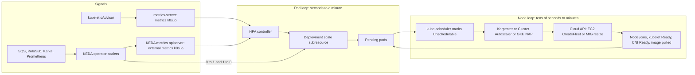

# Autoscaling at Scale: HPA, KEDA, and Karpenter

## TL;DR

1. Autoscaling is three nested feedback loops with very different dead times: the pod loop (HPA or KEDA, tens of seconds), the node loop (Karpenter, Cluster Autoscaler, or GKE node auto-provisioning, one to several minutes), and the capacity loop (quota, reservations, stockouts, hours to days).
2. The slowest loop, not the controller's gain, sets the worst-case recovery time after a burst. Headroom (low-priority pause pods or pre-warmed nodes) is the only lever that removes the node loop from the critical path, and it costs money every hour whether or not the burst arrives.
3. HPA is a proportional controller with a 10 percent deadband, a retrospective-maximum scale-down window, and unready-pod rebalancing. On a saturating metric such as CPU it scales in waves gated by pod readiness. A non-saturating external metric (queue depth, request rate) jumps to the target in one step.
4. KEDA does not replace HPA. It generates an HPA, feeds it through the single `external.metrics.k8s.io` APIService, and owns only the 0-to-1 and 1-to-0 transitions. Its `cooldownPeriod` does not govern N-to-M scale-down.
5. Karpenter is pod-centric: it batches unschedulable pods, simulates scheduling, and asks the cloud for a price-ranked, flexible set of instance types. Cluster Autoscaler and GKE NAP are node-group-centric. Consolidation and drift make voluntary disruption a first-class operating cost, so disruption budgets, `do-not-disrupt`, and PDBs are part of the capacity design.

## Mental Model



Think of the system as a chain of delays rather than a set of controllers.
A burst is first observed late (metric scrape, poll interval, HPA sync), then acted on with a bounded step (scale-up policy), then realized late again (scheduling, node boot, image pull, readiness).
Each stage is stateless with respect to the others: HPA never asks whether a node exists, and the node autoscaler never asks why a pod is pending.
That decoupling is what makes the stack composable and also what makes it slow.
Everything in this chapter is either a way to shorten a delay, a way to hide a delay with pre-paid capacity, or a way to stop the loops from fighting each other.
Pair this chapter with [[17-Cloud-AI-Engineering/Volume_05_Kubernetes_and_Platform_Engineering/Chapter_01_Kubernetes_Control_Loop_Internals|Kubernetes Control Loop Internals]] for the informer and work-queue machinery underneath, and with [[17-Cloud-AI-Engineering/Volume_05_Kubernetes_and_Platform_Engineering/Chapter_02_Advanced_Scheduling_and_Topology_Aware_Placement|Advanced Scheduling and Topology-Aware Placement]] for the constraints that the node autoscaler must satisfy.

## Internals

### Metric pipelines: three APIs, one aggregation layer

The HPA controller runs inside kube-controller-manager and reads metrics through the Kubernetes API aggregation layer.
Three metric APIs exist, each registered as an `APIService` that proxies to a backing Service:

- `metrics.k8s.io` serves per-pod and per-node CPU and memory. The reference backend is metrics-server, which scrapes each kubelet's `/metrics/resource` endpoint on an interval (default 15 seconds, UNVERIFIED) and keeps only the latest sample in memory.
- `custom.metrics.k8s.io` serves metrics attached to Kubernetes objects (a pod, an Ingress). Backends include prometheus-adapter and the Google Cloud custom metrics Stackdriver adapter.
- `external.metrics.k8s.io` serves metrics unrelated to any object (queue depth, subscription backlog). KEDA's metrics adapter is the most common backend.

The detail most getting-started guides skip is that each of those group-versions can be served by exactly one `APIService`.
If prometheus-adapter, the Stackdriver adapter, and KEDA all try to own `external.metrics.k8s.io`, the last to register wins, and HPAs that depended on the others begin failing with `FailedGetExternalMetric`.
This is a cluster-wide singleton, so it is a platform decision, not a per-team one.
The standard resolution is to give KEDA the external API and keep any other adapter on the custom API only.

The staleness of a decision is the sum of every stage between the physical event and the HPA's arithmetic.
For CPU, the chain is: the kernel CFS counters, the kubelet's cAdvisor rate window, the metrics-server scrape (up to one resolution interval old), and the HPA sync (up to one sync period old, default 15 seconds, UNVERIFIED).
For a KEDA queue trigger, the chain is: the source's own consistency (SQS queue attributes are approximate), the KEDA operator's polling interval (default 30 seconds, UNVERIFIED), the gRPC hop from the metrics adapter to the operator, and the HPA sync.
A worst-case measurement age of roughly `pollingInterval + syncPeriod` is therefore 45 seconds with defaults, before any pod has even been requested.
Using the CloudWatch scaler instead of the native SQS scaler adds CloudWatch's delivery delay on top, which is typically minutes (UNVERIFIED), so prefer scalers that call the source API directly.

### The HPA algorithm, past the formula

The documented core is `desiredReplicas = ceil[currentReplicas * (currentMetricValue / desiredMetricValue)]` (Kubernetes HPA docs as summarized in search results, as of 2026-10).
The controller skips any change while the ratio is within a tolerance of 0.1, which is a deadband of plus or minus 10 percent (Kubernetes HPA docs as summarized in search results, as of 2026-10).
For resource metrics with a utilization target, the denominator is the pod's resource request, not its limit and not the node size.
A pod with an inflated CPU request therefore under-scales, and a pod with no request cannot be scaled on utilization at all.
When several metrics are configured, the controller computes a recommendation per metric and takes the maximum.

**Unready-pod rebalancing.**
Pods that are not yet ready, or that are missing metrics, distort the average, so the controller handles them explicitly.
Per the docs, pods with missing metrics are treated as using 100 percent of the target on a scale-down evaluation and 0 percent on a scale-up evaluation, and unready pods are assumed to use 0 percent when scaling up (Kubernetes HPA docs as summarized in search results, as of 2026-10).
After this adjustment, the controller recomputes the ratio, and if the recomputed ratio reverses the scaling direction or falls inside the tolerance, it does not scale.

A worked case makes the consequence concrete.
A Deployment has 10 replicas, a 60 percent CPU target, and a burst has pushed the 6 ready pods to 100 percent while 4 pods are still starting.
First pass: ready-only ratio is 100/60 = 1.67.
Second pass with the 4 unready pods counted at 0: total usage is 6 * 100 = 600, divided by 10 * 60 = 600, so the ratio is 1.0 and the controller holds at 10.
The ready pods are at 167 percent of target, and the HPA correctly refuses to add more until the in-flight pods report real load.
This is conservative by design: it prevents over-shoot while capacity is in flight.
It also means that a saturating metric produces a wave pattern, because utilization can never exceed 100 percent, so the maximum ratio is 1/target = 1.67 and each wave can grow ready capacity by at most that factor before the next wave must wait for readiness.

Two flags control which pods count as unready: `--horizontal-pod-autoscaler-initial-readiness-delay` (default 30 seconds, per a search-result summary of the docs, as of 2026-10) and `--horizontal-pod-autoscaler-cpu-initialization-period` (default 5 minutes, UNVERIFIED).
The practical effect is that CPU samples from a pod that has just become Ready can still be discarded for minutes, which matters for JVM and model-server workloads that burn CPU during warmup.
Managed Kubernetes services generally do not let you change these controller flags, so on EKS and GKE the portable fix is a metric that does not depend on per-pod warmup noise (request rate or queue depth through an external or custom metric).

**The stabilization window is a retrospective maximum, not a cooldown.**
With defaults, scale-down uses a 300 second stabilization window and scale-up uses 0 (Kubernetes HPA docs as summarized in search results, as of 2026-10).
Mechanically, every sync the controller stores its raw recommendation with a timestamp.
On scale-down it acts on the highest recommendation stored within the window, and on scale-up it acts on the lowest.
A single spike 299 seconds ago therefore holds the replica count up for another second, and a replica count that has been correct for 4 minutes can still be rejected.
The recommendation history lives in controller memory (UNVERIFIED), so a kube-controller-manager restart discards it, and the first post-restart scale-down is judged on a short history.

**Rate policies.**
The default scale-up behavior permits the larger of 100 percent of current replicas or 4 pods per 15 seconds, and the default scale-down permits 100 percent per 15 seconds (Kubernetes HPA docs as summarized in search results, as of 2026-10).
From 34 replicas, the 100 percent arm gives 68, 136, 272, 544 in four 15-second periods, so the policy floor to reach 334 is about 60 seconds.
The policy is rarely the binding constraint; dead time is.
`selectPolicy: Min` or a `Pods` policy on scale-down is how you turn a cliff into a ramp for workloads with expensive warm-up.

**Ownership.**
HPA writes `spec.replicas` through the `/scale` subresource.
If your GitOps tool also owns `spec.replicas`, every sync resets the count, and the HPA and the sync loop fight indefinitely.
Remove the field from the manifest or configure the tool to ignore it (see [[17-Cloud-AI-Engineering/Volume_05_Kubernetes_and_Platform_Engineering/Chapter_07_GitOps_Delivery_Argo_CD_and_Flux|GitOps Delivery: Argo CD and Flux]]).
HPA also should not target the same resource metric that a VPA is actively resizing, because a changing denominator makes the loop non-stationary.
For multi-container pods with a mesh sidecar, use the `ContainerResource` metric type (GA in 1.30, UNVERIFIED) so the sidecar's idle CPU does not dilute the application's utilization.

A feature that matters at scale and is changing: a configurable per-HPA tolerance (replacing the single cluster-wide 0.1) has been progressing through the alpha and beta stages in recent releases (UNVERIFIED stage as of 2026-10).
At 1,000 replicas a 10 percent deadband is 100 pods of unresolved error, so a smaller tolerance on large fleets is a legitimate tuning goal once it is available on your managed control plane.

### KEDA: what it actually owns

KEDA is a CNCF graduated project (graduated 2023-08, UNVERIFIED).
It has three runtime pieces: the operator (reconciles `ScaledObject` and `ScaledJob`, holds scaler connections, and polls), the metrics adapter (serves `external.metrics.k8s.io`), and an admission webhook (rejects configurations such as two autoscalers targeting one workload).

For a `ScaledObject` the operator creates a normal HPA, conventionally named `keda-hpa-<name>` (UNVERIFIED), whose metric is an `External` metric of type `AverageValue`.
For `AverageValue` external metrics, the HPA divides the metric total by the per-replica target to get a replica count, and applies the same 10 percent tolerance to the ratio of that average to the target.
Concretely, with `queueLength: 50` and a queue of 5,000 messages the HPA asks for 100 replicas.
At 100 replicas, a queue growing to 5,400 is a ratio of 1.08, which is inside the deadband, so no scale-up occurs until the queue passes roughly 5,500.

The division of labor:

- 1-to-N and N-to-1 scaling is performed by the HPA controller, so the HPA `behavior` block and the stabilization semantics above apply. KEDA exposes them under `advanced.horizontalPodAutoscalerConfig.behavior`.
- 0-to-1 and 1-to-0 scaling is performed by the KEDA operator, which patches the target's scale subresource directly after evaluating each scaler's activation condition (`activationThreshold` style settings). The HPA cannot act on a workload at zero replicas, which is why KEDA must own this edge.
- `cooldownPeriod` (default 300 seconds, UNVERIFIED) applies only to the final step down to zero. It does not delay 10-to-3. A frequent production misconception is raising `cooldownPeriod` to stop N-to-M flapping, which has no effect. The correct knob is the HPA scale-down stabilization window and rate policies.
- `pollingInterval` (default 30 seconds, UNVERIFIED) is the operator's polling cadence against the external source and thus a floor on measurement freshness.
- `fallback` sets a replica count after a configured number of consecutive scaler failures. This turns a monitoring outage into a deliberate choice. A fallback value that is too low silently under-provisions during exactly the incident you cannot see, so set it to at least the recent p95 replica count.

Scaler semantics worth knowing before you trust a number: the Kafka scaler normally caps useful replicas at the partition count of the topic, since extra consumers in a group sit idle; the SQS scaler counts visible plus in-flight messages by default (`scaleOnInFlight`, UNVERIFIED), so slow processing keeps the metric high even with an empty visible queue; the Pub/Sub scaler can scale on subscription backlog size or oldest unacked message age (UNVERIFIED).
Scaling on oldest-message age maps directly to a latency SLO, while backlog size maps to a throughput target, and choosing between them is a product decision (see [[17-Cloud-AI-Engineering/Volume_07_Reliability_and_SRE/Chapter_01_SLIs_SLOs_and_Error_Budget_Engineering|SLIs, SLOs, and Error Budget Engineering]]).
For run-to-completion work, `ScaledJob` creates one Kubernetes Job per unit of backlog instead of resizing a Deployment, which sidesteps scale-down killing in-flight work.

### Node autoscaling: three designs

**Cluster Autoscaler (CA), the node-group model.**
CA is a loop (scan interval 10 seconds, UNVERIFIED) that finds unschedulable pods, and for each candidate node group it builds a template node (from the group's machine type, labels, and taints) and runs the scheduler's predicates against it to ask whether the pod would fit.
Candidate groups are ranked by an expander (random, least-waste, priority, price), and the winner is resized through its cloud primitive (an Auto Scaling group on AWS, a managed instance group on Google Cloud).
Scale-down is the mirror: a node whose requested-resource utilization is below a threshold (0.5 default, UNVERIFIED) for an unneeded period (10 minutes default, UNVERIFIED) is simulated for drainability and removed.
The structural limit is that the shape of every possible node must be pre-declared as a group, and the number of groups is bounded by control-plane cost and API limits.
A workload with unusual requests either needs its own group or wastes a large node.

**Karpenter, the pod-centric model.**
Karpenter (v1 APIs GA since 2024-08, UNVERIFIED) replaces the group abstraction with `NodePool` (constraints and policy) and a cloud-specific node class (`EC2NodeClass` on AWS).
Its provisioning pipeline, in order:

1. A controller watches for pods that kube-scheduler has marked Unschedulable.
2. It batches them with an idle window of 1 second and a maximum of 10 seconds (defaults, UNVERIFIED), so a deployment rollout of 500 pods yields one decision, not 500.
3. It simulates scheduling: pods are sorted largest first and placed on existing nodes and in-flight claims before any new node is considered. Daemonset overhead and `maxPods` (derived from ENI limits unless overridden) are included.
4. For pods that do not fit, it creates a `NodeClaim` whose requirements are the intersection of the pods' constraints and the NodePool's, and it narrows the instance catalog accordingly.
5. The AWS provider calls EC2 `CreateFleet` with many instance-type and zone overrides. The documented behavior is `price-capacity-optimized` for Spot and lowest price for On-Demand, with an upper bound on override count around 60 (UNVERIFIED). The flexibility is the mechanism that converts a single stockout into a successful launch in a different type or zone.
6. After launch, the node registers, and kube-scheduler (not Karpenter) binds the pods. Karpenter records the intended placement through nomination so that it does not launch duplicate capacity in the next loop.

Preferred affinities and preferred topology spread are treated as required on the first attempt and relaxed one at a time if the simulation fails, which is why a "soft" preference can still cause an extra node.
A provider-side unavailable-offerings cache remembers recent `InsufficientInstanceCapacity` responses for a short TTL (about 3 minutes, UNVERIFIED), which stops it hammering a drained pool but also means a recovered pool can be avoided briefly.

Disruption in Karpenter is a proposal-validate-execute pipeline:

- Candidates are filtered by `karpenter.sh/do-not-disrupt`, blocking PDBs, `consolidateAfter` (time since the last pod event on the node), and `NodePool` disruption budgets.
- Empty nodes go first, in parallel. Multi-node consolidation then searches (by binary search over a cost-ordered candidate list) for the largest set removable with at most one cheaper replacement. Single-node consolidation is last. A node is only replaced if the replacement is cheaper.
- Spot-to-spot consolidation is feature-gated and requires at least 15 cheaper instance-type options (UNVERIFIED) so that the replacement does not trade price for interruption risk.
- Before acting, the command is revalidated after a short delay (about 15 seconds, UNVERIFIED), the node is tainted, the replacement is launched and awaited, and only then is the old node drained under PDBs and the pod `terminationGracePeriodSeconds`.
- Drift (an AMI alias, subnet, or security group change in the node class) and `expireAfter` (default 720 hours in v1, UNVERIFIED) are disruption reasons that share the same budgets.
- Budgets are per reason, accept a count or a percentage (default `10%`, UNVERIFIED), and may carry a cron `schedule` and `duration` to block disruption in business hours.

Spot interruption handling needs an SQS queue fed by EventBridge rules for Spot interruption warnings, rebalance recommendations, and scheduled events.
The Spot two-minute notice (AWS docs, UNVERIFIED this session) is enough for Karpenter to cordon, launch a replacement, and drain, but not enough to move a multi-gigabyte in-memory state, so state-heavy pods belong on On-Demand NodePools.

New nodes become Ready before their DaemonSets finish, which opens a race where a pod lands on a node with no CNI or no GPU device plugin yet.
Karpenter's `startupTaints` field declares taints that a DaemonSet is expected to remove, and the simulator ignores them for capacity planning.
Cilium's recommended taint for this purpose, `node.cilium.io/agent-not-ready`, is exactly this pattern (see [[17-Cloud-AI-Engineering/Volume_05_Kubernetes_and_Platform_Engineering/Chapter_03_CNI_and_eBPF_with_Cilium|Container Networking Interface and eBPF with Cilium]]).

**GKE node auto-provisioning (NAP) and compute classes.**
On GKE the node autoscaler is Google-operated and runs in the managed control plane, so there is no autoscaler Deployment to run, upgrade, or bootstrap.
In Standard clusters, cluster autoscaler resizes existing node pools within per-pool bounds, and NAP additionally creates and deletes whole node pools to fit pending pods, subject to cluster-wide resource limits for CPU, memory, and accelerators (UNVERIFIED flag names `--enable-autoprovisioning`, `--max-cpu`, `--max-memory`).
Two operator-visible knobs shape behavior: the autoscaling profile (`balanced` as the default, `optimize-utilization` for more aggressive scale-down, UNVERIFIED), and the location policy (`BALANCED` spreads across zones, `ANY` prefers capacity availability and is the usual choice for Spot and scarce accelerators, UNVERIFIED).
Custom compute classes (a `ComputeClass` CRD, UNVERIFIED GA status and minimum version) express an ordered list of acceptable node shapes with a fallback rule, for example Spot on one machine family, then Spot on another, then On-Demand, and can migrate workloads back toward a higher-priority rule when capacity returns.
The design difference to remember: Karpenter ranks a large flexible set by price at launch time and relies on fleet APIs for capacity-aware selection, while a compute class gives an explicit priority order and relies on node-pool creation and managed-instance-group resize.
A new node pool is more expensive to create than resizing an existing one (UNVERIFIED), so NAP is slower on the first pod of a new shape.

**Autopilot lineage.**
Google's internal vertical autoscaler is described in "Autopilot: Workload Autoscaling at Google" (EuroSys 2020), which shows that moving-window and ML-based recommenders cut slack in Borg jobs while keeping out-of-memory events rare.
The takeaway for HPA and VPA users is that recommendations should be percentile-based on a decayed window, and that automated resizing needs an explicit OOM and throttling feedback path.
Borg itself ("Large-scale cluster management at Google with Borg", EuroSys 2015) is the origin of reclaiming unused reserved resources for lower-priority work, the conceptual ancestor of negative-priority headroom pods.

### The dead-time budget and headroom sizing

Model the time from a demand step to ready capacity as a sum:

`T_dead = T_metric + T_decide + T_node + T_pull + T_start`

where `T_metric` is staleness (up to about 45 seconds for KEDA with defaults), `T_decide` is the sync-period and policy-limited ramp, `T_node` is node launch through Ready and daemonsets, `T_pull` is image fetch and decompress, and `T_start` is application warm-up to readiness.
If demand grows by `dD` requests per second during `T_dead`, the pre-warmed capacity needed to absorb it without queueing is:

`H = ceil( dD / (c * u) )`

where `c` is per-pod capacity and `u` is the target utilization.
This is Little's-law arithmetic on the in-flight gap, and it is the number to defend when someone asks why idle pause pods exist.
The same logic explains why a CPU-triggered HPA is a poor first choice for spiky traffic: the metric saturates, the unready-pod rebalancing gates each wave on readiness, and `T_dead` is paid once per wave instead of once per burst.
The lab model below measures this.

### Failure domains of the autoscaler itself

Karpenter and KEDA are workloads, so they must be scheduled on capacity that does not depend on them.
A Karpenter controller pod running on a node that Karpenter itself consolidates can interrupt its own control loop, and a cold cluster with zero nodes cannot start the controller that would create the first node.
The usual answer is a small fixed managed node group or Fargate profile for system components, or EKS Auto Mode, where the Karpenter-derived engine is operated by AWS and run outside your data plane (UNVERIFIED details).
On GKE the equivalent risk is absent for CA and NAP because they live in the control plane, at the price of less visibility and fewer tunables.
This is the control-plane and data-plane separation argument from [[17-Cloud-AI-Engineering/Volume_01_Cloud_Architecture_Principles/Chapter_04_Control_Plane_vs_Data_Plane_Separation|Control Plane vs Data Plane Separation]] applied to your own platform.

## Numbers to Know

Status column legend: "verified" means confirmed in this session against search results that summarize the cited docs; "UNVERIFIED" means recalled from primary docs but not re-checked in this session and must be re-verified before this chapter reaches `status: solid`.

| Quantity | Value | Source and status |
|---|---|---|
| HPA core formula | `ceil[currentReplicas * (currentMetricValue / desiredMetricValue)]` | (Kubernetes HPA docs as summarized in search results, as of 2026-10) verified |
| HPA tolerance (global) | 0.1 | (Kubernetes HPA docs as summarized in search results, as of 2026-10) verified |
| HPA scale-down stabilization window | 300 s default | (Kubernetes HPA docs as summarized in search results, as of 2026-10) verified |
| HPA scale-up stabilization window | 0 s default | (Kubernetes HPA docs as summarized in search results, as of 2026-10) verified |
| HPA default scale-up rate | max(100 percent, 4 pods) per 15 s | (Kubernetes HPA docs as summarized in search results, as of 2026-10) verified |
| HPA default scale-down rate | 100 percent per 15 s | (Kubernetes HPA docs as summarized in search results, as of 2026-10) verified |
| HPA initial readiness delay | 30 s default | (Kubernetes HPA docs as summarized in a blog, as of 2026-10) verified, secondary source |
| HPA missing-metric handling | 100 percent of target on scale-down, 0 percent on scale-up | (Kubernetes HPA docs as summarized in a blog, as of 2026-10) verified, secondary source |
| HPA sync period | 15 s default | UNVERIFIED |
| HPA CPU initialization period | 5 min default | UNVERIFIED |
| metrics-server scrape resolution | 15 s default | UNVERIFIED |
| KEDA pollingInterval, cooldownPeriod | 30 s, 300 s defaults | UNVERIFIED |
| KEDA CNCF status | graduated 2023-08 | UNVERIFIED |
| Karpenter v1 API GA | 2024-08 | UNVERIFIED |
| Karpenter batch windows | idle 1 s, max 10 s | UNVERIFIED |
| Karpenter default budget, expireAfter | 10 percent nodes, 720 h | UNVERIFIED |
| Karpenter spot-to-spot minimum flexibility | 15 instance types | UNVERIFIED |
| EC2 Spot interruption notice | 2 min | UNVERIFIED |
| GCE Spot VM preemption notice | 30 s | UNVERIFIED |
| Cluster Autoscaler defaults | scan 10 s, scale-down unneeded 10 min, utilization threshold 0.5, max node provision time 15 min | UNVERIFIED (upstream FAQ) |
| Managed cluster fee | EKS and GKE Standard about 0.10 USD per cluster-hour | UNVERIFIED, check pricing pages |
| Lab model: CPU-triggered HPA, 60 s nodes, no headroom | recovery 691 s, peak backlog 219,830 msgs | model output of the script below, not a benchmark |
| Lab model: queue-triggered HPA, 60 s nodes, no headroom | recovery 285 s, peak backlog 104,480 msgs | model output, not a benchmark |
| Lab model: CPU-triggered HPA, 180 s nodes, no headroom | no recovery within 1,500 s | model output, not a benchmark |
| Lab model: queue-triggered, 180 s nodes, 300 headroom pods | recovery 199 s, peak backlog 54,680 msgs | model output, not a benchmark |

## AWS vs GCP Mechanism Parity

| Concern | AWS (EKS) | Google Cloud (GKE) |
|---|---|---|
| Pod autoscaling engine | Upstream HPA in the managed control plane; KEDA or prometheus-adapter self-installed | Upstream HPA in the managed control plane; KEDA self-installed; Google-provided metrics adapters |
| Metric sources | CloudWatch via exporters or KEDA scalers; Amazon Managed Prometheus; direct API scalers (SQS, Kinesis) | Cloud Monitoring and Managed Service for Prometheus; Pub/Sub scalers; Stackdriver custom metrics adapter |
| Single external.metrics.k8s.io backend | Yes, one APIService per cluster | Yes, one APIService per cluster; Stackdriver adapter and KEDA collide if both claim external |
| Node autoscaler | Karpenter (self-managed) or EKS Auto Mode (managed, Karpenter-derived), or Cluster Autoscaler on ASGs | Cluster Autoscaler plus NAP in the managed control plane; Autopilot as fully managed |
| Where the autoscaler runs | In your data plane (Karpenter) so it needs bootstrap capacity; or AWS-operated (Auto Mode) | In Google's control plane; no pod to schedule |
| Node shape selection | Pod-driven: any instance type matching requirements, ranked by price and capacity | Node-pool-driven: NAP creates pools; compute classes give an ordered fallback list |
| Launch primitive | EC2 `CreateFleet` with many overrides, no ASG | Managed instance group resize or creation |
| Capacity types | On-Demand, Spot, On-Demand Capacity Reservations, Capacity Blocks for ML (UNVERIFIED support per Karpenter version) | On-Demand, Spot VMs, reservations, Dynamic Workload Scheduler flex-start for scarce accelerators (UNVERIFIED GA status) |
| Spot reclaim signal | 2-minute notice, rebalance recommendation, via EventBridge to SQS | 30-second preemption notice to the VM |
| Consolidation | Built in: empty, multi-node, and single-node with price comparison | CA scale-down by utilization; `optimize-utilization` profile; compute-class migration toward higher priority rules |
| Voluntary disruption control | `NodePool` disruption budgets by reason with cron windows, `do-not-disrupt`, PDBs | Maintenance windows and exclusions, surge upgrade settings, PDBs |
| Pod density limit | ENI and IP limits unless prefix delegation or custom networking | Per-node pod CIDR from a secondary range (default max pods per node set per pool) |
| Quota ceilings that stall scale-out | vCPU quotas per instance-family group, EC2 API throttling, subnet IP exhaustion | Regional CPU and accelerator quotas, secondary range exhaustion, API rate limits |
| Image pull acceleration | Lazy-loading and pre-pulled data volumes (UNVERIFIED GA status) | Image streaming and secondary boot disks (UNVERIFIED GA status) |

The decisive operating difference is ownership of the node-loop controller.
Self-managed Karpenter gives you control of price ranking, disruption policy, and fast iteration, and in exchange you own its upgrades, its IAM, and its bootstrap circularity.
GKE's managed autoscaler removes that surface and constrains tuning to profiles, location policy, and compute classes.
Cross-reference [[17-Cloud-AI-Engineering/Volume_02_AWS_Deep_Dive/Chapter_07_Amazon_EKS_Control_Plane_and_Networking|Amazon EKS: Control Plane and Networking]] and [[17-Cloud-AI-Engineering/Volume_03_GCP_Deep_Dive/Chapter_07_GKE_Deep_Dive_Standard_vs_Autopilot|GKE Deep Dive: Standard vs Autopilot]].

## Worked Example: Queue Consumers with KEDA, Karpenter, and Headroom

Scenario: an SQS consumer fleet runs 34 pods at 100 msgs/s and must absorb a step to 1,000 msgs/s within a minute.
Each pod handles 5 msgs/s at 100 percent, and the target utilization is 0.6 so each pod is planned at 3 msgs/s.
Pods needed at peak: 1,000 / 3 = 334, so 300 additional pods over the baseline of 34.

### Step 1: Capacity and dead-time model

The script below is stdlib-only Python.
It models CPU-triggered and queue-triggered HPA with the unready-pod rebalancing described above, a 45 second metric lag, a 20 second pod start, and configurable node start time and headroom.
Save it as `autoscale_sim.py` and run `python3 autoscale_sim.py`.

```python
#!/usr/bin/env python3
"""Discrete-time model of HPA + node provisioning for a queue-consumer fleet.
Stdlib only. All outputs are model results, not benchmarks.
metric=cpu  : per-pod utilization (saturates at 100 percent), HPA unready-pod rebalancing applies.
metric=queue: external AverageValue metric = arrival rate + backlog/drain_s, KEDA style.
"""
import math

def simulate(metric, peak_rate, node_start_s, headroom_pods, base_rate=100.0, ramp_s=60,
             per_pod_rps=5.0, target_util=0.6, metric_lag_s=45, sync_s=15, pod_start_s=20,
             horizon_s=1500, max_pods=400, drain_s=60):
    start_pods = math.ceil(base_rate / (per_pod_rps * target_util))
    ready, pending, spare = start_pods, [], headroom_pods
    backlog = peak_backlog = pod_seconds = 0.0
    peak_ready = ready
    hist = []          # (t, cpu_util, queue_demand)
    t_ok = None
    for t in range(horizon_s):
        rate = base_rate + (peak_rate - base_rate) * min(1.0, t / ramp_s)
        cap = ready * per_pod_rps
        backlog = max(0.0, backlog + rate - cap)
        peak_backlog = max(peak_backlog, backlog)
        hist.append((min(1.0, (rate + backlog) / cap), rate + backlog / drain_s))
        arrived = sum(c for ra, c in pending if ra <= t)
        pending = [(ra, c) for ra, c in pending if ra > t]
        ready = min(max_pods, ready + arrived)
        peak_ready = max(peak_ready, ready)
        pod_seconds += ready
        if t > ramp_s and backlog == 0.0 and cap >= rate and t_ok is None:
            t_ok = t
        if t % sync_s or t == 0:
            continue
        cpu, demand = hist[max(0, t - metric_lag_s)]
        in_flight = sum(c for _, c in pending)
        cur = ready + in_flight
        if metric == "cpu":
            ratio = cpu / target_util
            if abs(ratio - 1) <= 0.1:
                rec = cur
            elif ratio > 1 and in_flight:
                ratio = cpu * ready / (target_util * cur)   # unready pods assumed at 0 usage
                rec = cur if (ratio <= 1 or abs(ratio - 1) <= 0.1) else math.ceil(ratio * cur)
            else:
                rec = math.ceil(ratio * cur)
        else:
            want = demand / (per_pod_rps * target_util)
            rec = cur if abs(want / cur - 1) <= 0.1 else math.ceil(want)
        if rec > cur:
            add = min(rec, cur + max(4, cur), max_pods) - cur   # default scaleUp: max(4 pods, 100%) per 15s
            if add > 0:
                h = min(add, spare); spare -= h
                if h: pending.append((t + pod_start_s, h))
                if add - h: pending.append((t + node_start_s + pod_start_s, add - h))
    return round(peak_backlog), t_ok, peak_ready, round(pod_seconds)

if __name__ == "__main__":
    need = math.ceil(1000 / (5 * 0.6))
    print(f"steady-state pods at 100 rps: 34 ; pods needed at 1000 rps: {need}")
    print("metric,node_start_s,headroom_pods,peak_backlog_msgs,recovered_at_s,peak_ready_pods,pod_seconds")
    for metric in ("cpu", "queue"):
        for ns, hp in [(60, 0), (180, 0), (60, 100), (180, 300)]:
            pb, tok, pr, ps = simulate(metric, 1000.0, ns, hp)
            print(f"{metric},{ns},{hp},{pb},{tok},{pr},{ps}")

    # Back-of-the-envelope cost of the pre-warmed headroom (pause pods) in each scenario.
    PRICE_PER_VCPU_HOUR = 0.04   # ASSUMPTION for illustration only; replace with your current rate
    POD_VCPU = 1.0
    HOURS_PER_MONTH = 730
    for hp in (100, 300):
        monthly = hp * POD_VCPU * PRICE_PER_VCPU_HOUR * HOURS_PER_MONTH
        print(f"headroom {hp} pods = {hp * POD_VCPU:.0f} vCPU = ${monthly:,.0f} per month at ${PRICE_PER_VCPU_HOUR}/vCPU-h")
```

Output from running it (model results with the stated synthetic parameters):

```text
metric,node_start_s,headroom_pods,peak_backlog_msgs,recovered_at_s,peak_ready_pods,pod_seconds
cpu,60,0,219830,691,400,456600
cpu,180,0,492830,None,400,289800
cpu,60,100,103130,414,400,511920
cpu,180,300,83330,310,400,528120
queue,60,0,104480,285,400,537900
queue,180,0,204080,504,400,493980
queue,60,100,74480,255,400,543900
queue,180,300,54680,199,400,547980
headroom 100 pods = 100 vCPU = $2,920 per month at $0.04/vCPU-h
headroom 300 pods = 300 vCPU = $8,760 per month at $0.04/vCPU-h
```

Reading the table:

- CPU-triggered scaling with 60 second nodes needs 691 seconds to recover, versus 285 seconds for the queue-triggered metric, because each CPU wave must wait for readiness. With 180 second nodes the CPU-triggered fleet had not recovered after 1,500 seconds in this model.
- Headroom of 300 pods reduces the 180 second node, queue-triggered case from 504 seconds to 199 seconds. It never reaches zero backlog before the first scale action because `T_metric` (45 seconds) is still on the critical path.
- The `peak_ready_pods` of 400 is the `max_pods` clamp; both metrics overshoot because backlog drain demand is added to the arrival rate. Do not read the pod-seconds as a cost comparison between metrics.
- The headroom cost is `H * vCPU * price * 730`. At the assumed 0.04 USD per vCPU-hour, 300 headroom pods is 8,760 USD per month. That number is the insurance premium to compare against the business cost of a 5 minute backlog.

### Step 2: Kubernetes manifests (EKS with Karpenter and KEDA)

Assumptions: an existing scratch EKS cluster with Karpenter installed per upstream instructions, an SQS queue, and the KEDA operator's identity granted `sqs:GetQueueAttributes` on that queue only.
Karpenter install, for reference (set `KARPENTER_VERSION` from the current release notes):

```bash
helm upgrade --install karpenter oci://public.ecr.aws/karpenter/karpenter \
  --version "${KARPENTER_VERSION}" --namespace kube-system \
  --set settings.clusterName="${CLUSTER_NAME}" \
  --set settings.interruptionQueue="${CLUSTER_NAME}" \
  --wait
helm repo add kedacore https://kedacore.github.io/charts && helm repo update
helm upgrade --install keda kedacore/keda --namespace keda --create-namespace --wait
```

Node class and pool.
The `expireAfter` and disruption blocks are the settings that make Karpenter safe for a shared environment.

```yaml
apiVersion: karpenter.k8s.aws/v1
kind: EC2NodeClass
metadata:
  name: default
spec:
  role: "KarpenterNodeRole-${CLUSTER_NAME}"
  amiSelectorTerms:
    - alias: "al2023@latest"   # pin a version in production
  subnetSelectorTerms:
    - tags: { karpenter.sh/discovery: "${CLUSTER_NAME}" }
  securityGroupSelectorTerms:
    - tags: { karpenter.sh/discovery: "${CLUSTER_NAME}" }
  metadataOptions:
    httpTokens: required
    httpPutResponseHopLimit: 1
---
apiVersion: karpenter.sh/v1
kind: NodePool
metadata:
  name: workers
spec:
  template:
    spec:
      nodeClassRef: { group: karpenter.k8s.aws, kind: EC2NodeClass, name: default }
      expireAfter: 336h
      requirements:
        - { key: karpenter.sh/capacity-type, operator: In, values: ["spot", "on-demand"] }
        - { key: kubernetes.io/arch, operator: In, values: ["amd64"] }
        - { key: karpenter.k8s.aws/instance-category, operator: In, values: ["c", "m", "r"] }
        - { key: karpenter.k8s.aws/instance-generation, operator: Gt, values: ["4"] }
  limits:
    cpu: "200"
  disruption:
    consolidationPolicy: WhenEmptyOrUnderutilized
    consolidateAfter: 2m
    budgets:
      - nodes: "10%"
      - nodes: "0"
        schedule: "0 8 * * mon-fri"
        duration: 10h
```

Headroom: a negative-priority Deployment of pause pods that real pods preempt instantly.
Because they request real CPU and memory, Karpenter provisions nodes for them like any other pod, which is exactly the pre-warming effect.

```yaml
apiVersion: scheduling.k8s.io/v1
kind: PriorityClass
metadata:
  name: headroom
value: -10
preemptionPolicy: Never
globalDefault: false
description: "Evictable placeholder pods that hold warm capacity"
---
apiVersion: apps/v1
kind: Deployment
metadata:
  name: headroom
spec:
  replicas: 20
  selector: { matchLabels: { app: headroom } }
  template:
    metadata: { labels: { app: headroom } }
    spec:
      priorityClassName: headroom
      terminationGracePeriodSeconds: 0
      containers:
        - name: pause
          image: registry.k8s.io/pause:3.9
          resources:
            requests: { cpu: "500m", memory: "256Mi" }
```

Consumer and ScaledObject.
Note the Deployment omits `replicas`, so no GitOps loop fights the HPA.

```yaml
apiVersion: apps/v1
kind: Deployment
metadata:
  name: sqs-worker
spec:
  selector: { matchLabels: { app: sqs-worker } }
  template:
    metadata: { labels: { app: sqs-worker } }
    spec:
      terminationGracePeriodSeconds: 60
      containers:
        - name: worker
          image: public.ecr.aws/aws-cli/aws-cli:latest
          command: ["/bin/sh", "-c"]
          args:
            - |
              while true; do
                M=$(aws sqs receive-message --queue-url "$QUEUE_URL" --max-number-of-messages 1 --wait-time-seconds 5 --visibility-timeout 60 --query 'Messages[0].ReceiptHandle' --output text)
                [ "$M" != "None" ] && sleep 0.2 && aws sqs delete-message --queue-url "$QUEUE_URL" --receipt-handle "$M"
              done
          env:
            - { name: QUEUE_URL, value: "https://sqs.us-east-1.amazonaws.com/${ACCOUNT_ID}/${QUEUE_NAME}" }
          resources:
            requests: { cpu: "500m", memory: "128Mi" }
---
apiVersion: keda.sh/v1alpha1
kind: TriggerAuthentication
metadata:
  name: sqs-auth
spec:
  podIdentity:
    provider: aws
---
apiVersion: keda.sh/v1alpha1
kind: ScaledObject
metadata:
  name: sqs-worker
spec:
  scaleTargetRef: { name: sqs-worker }
  pollingInterval: 15
  cooldownPeriod: 120
  minReplicaCount: 2
  maxReplicaCount: 200
  advanced:
    horizontalPodAutoscalerConfig:
      behavior:
        scaleUp:
          stabilizationWindowSeconds: 0
          selectPolicy: Max
          policies:
            - { type: Percent, value: 100, periodSeconds: 15 }
            - { type: Pods, value: 20, periodSeconds: 15 }
        scaleDown:
          stabilizationWindowSeconds: 300
          policies:
            - { type: Percent, value: 20, periodSeconds: 60 }
  triggers:
    - type: aws-sqs-queue
      authenticationRef: { name: sqs-auth }
      metadata:
        queueURL: "https://sqs.us-east-1.amazonaws.com/${ACCOUNT_ID}/${QUEUE_NAME}"
        queueLength: "50"
        awsRegion: "us-east-1"
        identityOwner: operator
```

Sizing check for `queueLength: 50`: at a measured 3 to 5 msgs/s per worker, 50 messages per replica is 10 to 17 seconds of backlog per pod, so the HPA scales out when the backlog implies more than that.
Measure real per-pod throughput first and substitute it; the aws-cli loop above will not hit 5 msgs/s.

Load generator (boto3), sending 60,000 messages, which is 12,000 pod-seconds at 5 msgs/s:

```python
import boto3, uuid
from concurrent.futures import ThreadPoolExecutor
sqs = boto3.client("sqs", region_name="us-east-1")
URL = "https://sqs.us-east-1.amazonaws.com/ACCOUNT_ID/QUEUE_NAME"   # replace
def batch(_):
    sqs.send_message_batch(QueueUrl=URL, Entries=[{"Id": str(i), "MessageBody": uuid.uuid4().hex} for i in range(10)])
with ThreadPoolExecutor(32) as ex:
    list(ex.map(batch, range(6000)))
```

Observe with `kubectl get hpa -w`, `kubectl get nodeclaims -w`, and `kubectl describe nodeclaim`.
Record three timestamps per run: first pending pod, NodeClaim `Initialized`, and last replica Ready.
Those give you the real `T_node + T_pull + T_start` to substitute into the model.

### Step 3: GKE equivalent (NAP with a compute class)

```bash
gcloud container clusters create "${CLUSTER}" --region us-central1 --num-nodes 1 \
  --release-channel regular --workload-pool "${PROJECT}.svc.id.goog" \
  --enable-autoprovisioning --min-cpu 1 --max-cpu 200 --min-memory 1 --max-memory 800 \
  --autoscaling-profile optimize-utilization
```

```yaml
apiVersion: cloud.google.com/v1
kind: ComputeClass
metadata:
  name: workers
spec:
  priorities:
    - { machineFamily: n2, spot: true }
    - { machineFamily: e2, spot: true }
    - { machineFamily: n2, spot: false }
  whenUnsatisfiable: ScaleUpAnyway
  nodePoolAutoCreation:
    enabled: true
```

Select it in the pod spec with `nodeSelector: { cloud.google.com/compute-class: workers }`.
Replace the SQS trigger with KEDA's `gcp-pubsub` trigger using workload identity.
All flag names and `ComputeClass` fields in this block are UNVERIFIED this session and must be checked against current `gcloud container clusters create --help` and the compute class reference.

### Cost estimate, budget alarm, and teardown

Estimate for a 4-hour lab (assumptions, not quotes): cluster fee about 0.10 USD per hour (UNVERIFIED) is 0.40 USD; two baseline vCPUs for 4 hours at the assumed 0.04 USD per vCPU-hour is 0.32 USD; a burst to roughly 100 vCPUs for 30 minutes is 2.00 USD; headroom of 10 vCPUs for 4 hours is 1.60 USD.
Total under 5 USD, plus negligible SQS and EBS charges.
The dominant risk is forgetting the cluster, which is about 73 USD per month in management fees alone (UNVERIFIED) before any nodes.

Budget alarm (AWS CLI):

```bash
cat > budget.json <<'EOF'
{"BudgetName":"autoscaling-lab","BudgetLimit":{"Amount":"20","Unit":"USD"},
 "TimeUnit":"MONTHLY","BudgetType":"COST"}
EOF
cat > notifications.json <<'EOF'
[{"Notification":{"NotificationType":"ACTUAL","ComparisonOperator":"GREATER_THAN",
  "Threshold":50,"ThresholdType":"PERCENTAGE"},
  "Subscribers":[{"SubscriptionType":"EMAIL","Address":"you@example.com"}]}]
EOF
aws budgets create-budget --account-id "${ACCOUNT_ID}" \
  --budget file://budget.json --notifications-with-subscribers file://notifications.json
```

Teardown (order matters: remove the scalers and workloads first so Karpenter drains nodes while its controller still runs):

```bash
kubectl delete scaledobject sqs-worker
kubectl delete deployment sqs-worker headroom
kubectl delete nodepool workers
kubectl wait --for=delete nodeclaim --all --timeout=600s
kubectl delete ec2nodeclass default
helm uninstall keda -n keda
helm uninstall karpenter -n kube-system
aws sqs delete-queue --queue-url "https://sqs.us-east-1.amazonaws.com/${ACCOUNT_ID}/${QUEUE_NAME}"
aws ec2 describe-instances \
  --filters "Name=tag-key,Values=karpenter.sh/nodepool" "Name=instance-state-name,Values=pending,running" \
  --query 'Reservations[].Instances[].InstanceId' --output text   # must print nothing
eksctl delete cluster --name "${CLUSTER_NAME}"        # if the cluster was created for this lab
aws budgets delete-budget --account-id "${ACCOUNT_ID}" --budget-name autoscaling-lab
```

GKE: `kubectl delete -f` the workloads, then `gcloud container clusters delete "${CLUSTER}" --region us-central1`, then confirm no leftover node pools or disks with `gcloud compute instances list` and `gcloud compute disks list`.

## Failure Modes and Pitfalls

**Wave-gated scale-up on saturating metrics.**
A CPU-triggered HPA cannot request more than about 1/target times the ready fleet per wave, and unready pods block the next wave.
Symptom: replica count climbs in steps separated by the full node-plus-start time while queues grow.
Fix: scale on a non-saturating signal (queue depth, request rate, concurrency) and add headroom for the node dead time.

**Autoscaler fights with other writers.**
Symptoms: replica counts reset on every GitOps sync; an HPA and a KEDA `ScaledObject` both targeting one Deployment (rejected by the KEDA webhook if installed, otherwise two controllers oscillate); an HPA and a VPA both resizing CPU.
Fix: one owner per field, omit `replicas` from manifests, and use VPA in recommendation mode or on memory only.

**APIService collision.**
Installing a second metrics adapter silently replaces the owner of `external.metrics.k8s.io`, and unrelated HPAs begin reporting unknown metrics.
HPA then refuses to scale in either direction on those metrics, so the failure is static, not a runaway.
Detect with an alert on HPA condition `ScalingActive=False`.

**Metric source outage.**
HPA with unavailable metrics holds its last replica count (it does not scale up), so a monitoring blip during a burst is a capacity outage.
KEDA's `fallback` turns that into an explicit number, and a number that is too low reproduces the same outage.

**Scale-to-zero cold-start amplification.**
Bursty traffic against a zero-replica service pays `T_node + T_pull + T_start` on the first request, and the 0-to-1 edge is owned by the operator's poll interval, not the HPA.
Use `minReplicaCount: 1` or a cron trigger for known traffic hours, and use activation thresholds to stop 0/1 flapping.

**Scale-down kills in-flight work.**
Deployments terminated by an HPA or by Karpenter drain get SIGTERM and `terminationGracePeriodSeconds`.
For queue consumers, set the queue visibility timeout above the longest job, handle SIGTERM by stopping receive and finishing the current message, and prefer `ScaledJob` for long-running units.

**Consolidation churn.**
Karpenter will repeatedly replace nodes if it keeps finding a cheaper arrangement, evicting long-running or stateful pods nightly.
Mitigations: `consolidateAfter`, a `10%` or lower budget with maintenance-hour windows, `karpenter.sh/do-not-disrupt` on pods that must not move, PDBs, and a separate On-Demand NodePool for stateful workloads.
The opposite failure is a PDB with zero allowed disruptions, which blocks drain forever and stalls drift rollouts unless a `terminationGracePeriod` on the NodePool bounds it.

**Capacity and quota walls.**
`InsufficientInstanceCapacity` on a narrow instance list, a per-family vCPU quota that is smaller than the burst, EC2 API throttling during a mass launch, and subnet or secondary-range IP exhaustion (nodes join but pods stay pending) all present as "autoscaler did nothing."
Check `NodeClaim` conditions and events first, then cloud quotas, then IP availability.
Widen the instance-type requirement rather than raising the same pool's limit.
Accelerator capacity is its own market: Spot GPUs are not a scale-out plan, and reservations or scheduled capacity products are needed (see [[17-Cloud-AI-Engineering/Volume_11_LLM_Serving_and_Inference_Systems_on_Cloud/Chapter_08_Cloud_GPU_Autoscaling_and_Cold_Start_Mitigation|Cloud GPU Autoscaling and Cold-Start Mitigation]]).

**Nodes Ready but not usable.**
The node reports Ready before the CNI agent or GPU device plugin is ready, and the first pods fail sandbox creation.
Use `startupTaints` and a readiness taint removed by the DaemonSet.

**Scale-out as the trigger for the outage.**
The AWS Kinesis event of November 2020 (https://aws.amazon.com/message/11201/) began when capacity was added to a front-end fleet and every server in the fleet exceeded an operating-system thread limit because per-peer thread count grew with fleet size.
The generalization for autoscaling is that adding replicas can increase per-replica or per-dependency cost (connections, threads, gossip, cache fills), so a burst can convert a scale-out into a cascade.
Cap `maxReplicaCount` by downstream capacity (database connection limits, third-party rate limits), and run a scale-out test, not just a load test.
The Google SRE book's chapter on cascading failures (https://sre.google/sre-book/addressing-cascading-failures/) covers the complementary controls: load shedding and graceful degradation, so that the system survives the window before capacity arrives (see [[17-Cloud-AI-Engineering/Volume_07_Reliability_and_SRE/Chapter_02_Load_Shedding_Backpressure_and_Admission_Control|Load Shedding, Backpressure, and Admission Control]]).
The community collection of Kubernetes failure stories at https://k8s.af includes autoscaler and capacity postmortems and is a good source of additional patterns.

**Autoscaler in the recovery path.**
During a zonal impairment, every customer scales at once, cloud APIs are slower, and the zone's spare capacity is the first to vanish.
If your design requires launching nodes to survive the loss of a zone, your recovery depends on the control plane being healthy in the middle of the event (see [[17-Cloud-AI-Engineering/Volume_01_Cloud_Architecture_Principles/Chapter_02_Regions_Zones_and_Static_Stability|Regions, Zones, and Static Stability]]).

## Security and Cost Angles

### Security

**Karpenter controller IAM.**
The controller needs permissions to create and terminate instances and to read pricing and instance-type data.
Scope `ec2:RunInstances`, `ec2:CreateFleet`, and `ec2:TerminateInstances` with conditions on request and resource tags for your cluster and NodePool, grant `iam:PassRole` only for the single node role, and give the controller its own role through IRSA or EKS Pod Identity (see [[17-Cloud-AI-Engineering/Volume_08_Security_Identity_and_the_Data_Perimeter/Chapter_02_Workload_Identity_Federation|Workload Identity Federation]]).
Scope the interruption queue's resource policy to the EventBridge rules that feed it.
Isolated VPCs without internet egress need endpoints for EC2, STS, SSM, and SQS, and the pricing API may lack a private endpoint, which requires an isolated-VPC mode (UNVERIFIED).

**Node class hygiene.**
Require IMDSv2 with hop limit 1 so pods cannot reach the node role, encrypt EBS volumes with a customer-managed KMS key through the block device mapping, and pin the AMI alias in production so that drift-driven node replacement is a reviewed change, not an `@latest` surprise.

**KEDA confused deputy.**
A tenant who can create a `ScaledObject` can point it at any queue the KEDA operator's identity can read when `identityOwner: operator` is used.
Prefer per-workload identity (`identityOwner: pod`, the default for AWS scalers, UNVERIFIED) or namespaced `TriggerAuthentication` with a role that can only see that tenant's queue, and restrict who may create `ClusterTriggerAuthentication`.
Give the operator only the read action it needs (`sqs:GetQueueAttributes`), never `ReceiveMessage`.
On Google Cloud, use workload identity for the Pub/Sub scaler and place Pub/Sub inside the same VPC Service Controls perimeter as the cluster (see [[17-Cloud-AI-Engineering/Volume_03_GCP_Deep_Dive/Chapter_03_VPC_Service_Controls_Security_Perimeters|VPC Service Controls: Security Perimeters]]).

**Autoscaling as an attack surface.**
Unbounded `maxReplicaCount` and NodePool `limits` turn a request flood or a poisoned queue into a billing attack.
Set hard `limits.cpu` on every NodePool, set GKE NAP resource limits, and alert on spend rate. Multi-tenant isolation is covered in [[17-Cloud-AI-Engineering/Volume_05_Kubernetes_and_Platform_Engineering/Chapter_05_Multi_Tenancy_Isolation_and_Resource_Quotas|Multi-Tenancy, Isolation, and Resource Quotas]].

### Cost

Unit economics of autoscaling: `cost = (baseline + headroom + burst-peak-above-headroom * duration) * price`, minus whatever consolidation and Spot recover.
The levers, in rough order of leverage:

1. Right-size requests. Karpenter and the HPA both pack and scale on requests, so the request is the bill. Use VPA in recommendation mode and percentile data before changing anything else.
2. Instance flexibility. A wide `requirements` set with Spot lets the fleet API pick cheap, available capacity, and is a prerequisite for spot-to-spot consolidation.
3. Commitments for baseline only. Cover the steady floor with Savings Plans or committed use discounts and leave the burst on demand or Spot (see [[17-Cloud-AI-Engineering/Volume_09_FinOps_and_Cloud_Economics/Chapter_02_Commitment_Discounts_Savings_Plans_vs_CUDs|Commitment Discounts: Savings Plans vs CUDs]] and [[17-Cloud-AI-Engineering/Volume_09_FinOps_and_Cloud_Economics/Chapter_03_Spot_Economics_and_Interruption_Handling|Spot Economics and Interruption Handling]]).
4. Price the headroom explicitly. At the assumed 0.04 USD per vCPU-hour, a headroom pod with 1 vCPU costs about 29 USD per month, so the question is how many minutes of breach that buys back.
5. Predictive floors. A cron trigger for known peaks is cheaper than permanent headroom for the same coverage.
6. Zone spread has a network price. Cross-zone chatter between spread replicas is billed, so spread for failure domains but keep chatty tiers co-located where the SLO allows (see [[17-Cloud-AI-Engineering/Volume_09_FinOps_and_Cloud_Economics/Chapter_04_Network_Egress_Economics_and_Optimization|Network Egress Economics and Optimization]]).
7. Managed versus self-managed. EKS Auto Mode charges a management premium on managed instances (UNVERIFIED amount), and GKE Autopilot bills on pod requests. Both trade a fee for removing operational ownership.

## Interview Questions and Model Answers

### Question 1 (L5 - Senior)

An HPA targets 60 percent CPU. `kubectl top pods` shows 6 ready pods at 100 percent and the Deployment is stuck at 10 replicas for several minutes. Why, and what do you check?

#### Model Answer

The arithmetic explains it without a bug.
Four of the ten pods are not ready, so the HPA assumes they use 0 percent when scaling up and recomputes: (6 * 100) / (10 * 60) = 1.0, which is inside the tolerance, so the desired count equals the current count.
The controller is deliberately waiting for in-flight pods to report real load before adding more.
The checks I run, in order:

- `kubectl describe hpa` for the conditions `AbleToScale`, `ScalingActive`, and `ScalingLimited`, and for events about missing metrics or a metric without a request.
- Whether the four unready pods are Pending (node loop problem: look at the node autoscaler), or running but not Ready (readiness probe, image pull, init time), or ready but inside the initial readiness delay and CPU initialization period, which discards early samples.
- Whether `maxReplicas` is the real cap, whether `behavior` restricts the rate, and whether the CPU request is large enough that utilization is under-reported.
- Whether the metric is saturating: utilization cannot exceed 100 percent, so the ratio is bounded at 1.67 for a 60 percent target, and the fleet can only grow in waves.

The structural fix is usually a non-saturating metric (request rate or queue depth), and for slow-starting apps a readiness probe that reflects true warm state.

#### Follow-up Interviewer Question

The app is a JVM service that hits 100 percent CPU for 90 seconds after becoming Ready. You cannot change controller flags on the managed cluster. What do you change?

### Question 2 (L5 - Senior)

Your team sets KEDA `cooldownPeriod: 900` to stop a consumer from shrinking from 40 to 5 pods and back every few minutes. It has no effect. Explain, and fix it.

#### Model Answer

`cooldownPeriod` only governs the last step, scaling from the minimum non-zero count to zero, and that edge is owned by the KEDA operator.
N-to-M scaling is performed by the HPA that KEDA generated, so the knobs are the HPA `behavior` fields exposed under `advanced.horizontalPodAutoscalerConfig`.
The default scale-down stabilization window is 300 seconds, applied as a retrospective maximum over recent recommendations, and the default scale-down rate is 100 percent per 15 seconds.
To damp the oscillation I would lengthen the window to cover the burst period of the producer, add a rate policy (for example 20 percent per minute), and check the target: if `queueLength` is too small relative to measurement noise, a queue that hovers near the threshold with a 10 percent tolerance will bounce.
I would also check that the source metric is not itself oscillating, for example because SQS in-flight messages are included and processing time is bursty.

#### Follow-up Interviewer Question

What happens to scaling decisions if the KEDA operator pod crashes during a burst, and how would you make that failure safer?

### Question 3 (L6 - Staff)

Traffic to a queue-fed service steps 10x within 60 seconds several times a day. Measured dead time is 45 seconds of metric lag, 20 seconds of pod start, and 120 seconds of node launch and image pull. Design the autoscaling and size the headroom.

#### Model Answer

First compute `T_dead`: 45 + 15 (sync) + 20 + 120 = 200 seconds, and note that the HPA policy ramp (100 percent per 15 seconds) is about 60 seconds for a 10x step and therefore not the binding constraint.
During `T_dead`, the demand growth `dD` is the full step because the ramp finishes in 60 seconds.
Headroom is `H = ceil(dD / (c * u))`, where `c` is per-pod capacity and `u` is target utilization; for a 900 msg/s step at 5 msg/s per pod and 0.6 utilization, that is 300 pods.
The metric should be non-saturating (queue depth or arrival rate through KEDA), with `scaleUp` stabilization 0 and an aggressive `Pods` or `Percent` policy so the controller can reach the target in one or two steps instead of waves.
Then I decide how much of `H` to pre-pay, because each headroom pod costs roughly one pod of compute continuously.
I would price headroom at pods times price times 730 per month and compare it with the business cost of the backlog the burst creates, which is what the SLO says about oldest-message age.
Components that reduce `H` without paying for idle: shrink `T_node` and `T_pull` (smaller images, lazy-loading, pre-pulled data volumes, a faster node launcher), use a cron-triggered floor for the predictable bursts, and let the queue absorb the first minute, because queues are the cheapest buffer in the stack.
Guardrails: cap `maxReplicaCount` by the downstream database connection budget, and make headroom pods evictable at negative priority.
Finally, verify with a game day that reproduces the step and measures time from first unschedulable pod to last Ready replica, since the model is only as good as the measured delays.

#### Follow-up Interviewer Question

Next quarter the burst is 3x larger, so headroom cost triples. What changes in your design before you accept that bill?

### Question 4 (L6 - Staff)

Compare Karpenter, Cluster Autoscaler, and GKE node auto-provisioning mechanically. When would you not choose Karpenter?

#### Model Answer

Cluster Autoscaler is node-group-centric: it builds a template node per group, simulates whether a pending pod fits, picks a group with an expander, and resizes the group.
Its flexibility is bounded by how many groups you pre-declare, and heterogeneous workloads fragment into many groups.
Karpenter is pod-centric: it batches pending pods, simulates scheduling with largest-first packing across existing nodes and in-flight claims, then emits `NodeClaim`s whose requirements are narrowed from a large instance catalog and launched through a fleet API with many overrides.
That gives price-ranked selection, capacity-aware fallback across types and zones, and integrated consolidation and drift, at the cost of owning another controller and its IAM and bootstrap.
GKE NAP sits between: it creates and deletes node pools to fit pending pods within cluster-wide limits, runs in the managed control plane, and with compute classes gives an explicit priority list of shapes and Spot-versus-On-Demand fallback, rather than price ranking across the whole catalog.
I would not choose Karpenter when the cluster runs on a platform where the autoscaler is managed and that is acceptable (GKE, or EKS Auto Mode if its constraints fit), when I need strict stability per node group (some stateful or licensed workloads), when the team cannot own a second control loop, or on clouds without a Karpenter provider.
For accelerator capacity, the deciding factor is the capacity product (reservations, scheduled blocks), not the autoscaler: neither engine can launch a GPU that the cloud does not have.

#### Follow-up Interviewer Question

Karpenter is evicting a stateful service's pods every night and causing errors. Walk through how you would diagnose and stop it without turning consolidation off for the whole cluster.

### Question 5 (L6 - Staff)

During a spike, 400 pods are Pending for ten minutes. Karpenter logs show NodeClaims created. Where do you look, in what order, and what would you alert on afterward?

#### Model Answer

I treat it as a pipeline and locate the stage where pods stop advancing.
`kubectl get nodeclaims` and the claim's conditions tell me whether launch succeeded, the node registered, and initialization completed.
If claims are not Launched: look at provider events for `InsufficientInstanceCapacity`, a vCPU quota exceeded error, throttling, or an IAM or launch template error, and widen requirements or raise the quota.
If Launched but not Registered: the instance booted but the kubelet could not join, which points at user data, the node role, the AMI, or security groups, or at API server reachability.
If Registered but not Initialized: startup taints or missing DaemonSets, a CNI agent not ready, a device plugin not registered, or IP exhaustion in the subnet so pods cannot get addresses.
If nodes are Ready but pods remain Pending: the pod's constraints, such as topology spread with unsatisfiable `minDomains`, a taint without a toleration, or requests larger than any allowed node.
Afterward I add an SLI for the end-to-end path, time from first Unschedulable to pod Ready (p50 and p99), with alerts on pending pods older than a threshold and on claim-to-initialized duration, plus quota-utilization alerts at 80 percent so quota is raised before the spike.

#### Follow-up Interviewer Question

The quota was fine and the nodes joined, but pods are stuck `ContainerCreating` with IP allocation errors. What is happening and how do you prevent it?

### Question 6 (L7+ - Principal)

You run a latency-sensitive fleet across three zones. The business requirement is to survive the loss of one zone with no autoscaling dependency. Design the capacity and describe how the autoscaler fits.

#### Model Answer

Static stability means the surviving capacity must already exist when the zone fails, because launching capacity during the event is a control-plane operation that is slower and less reliable at exactly that moment, and because every customer is competing for the same remaining zone capacity.
With three zones and even spread, losing one leaves two thirds of capacity, so to carry peak load the steady-state fleet must be provisioned at 150 percent of peak across three zones (each zone carries one half of peak).
That is a standing cost of 50 percent over a no-redundancy design, and I would put a number on it for the business, along with the alternative of degrading to a reduced SLO using load shedding and priority tiers.
Mechanically: topology spread constraints over zones with `DoNotSchedule` for the critical tier, HPA targets set to the post-failure utilization ceiling (for example 70 percent in the survivor zones) so that failover does not immediately saturate, and `minReplicaCount` set to the N+1 floor instead of the average.
The autoscaler then handles organic growth and regional diurnal shape, not failure recovery.
Karpenter's own placement matters: its controller must not be pinned to one zone, it should run on capacity it does not manage, and its NodePool should span all three zones so that zone loss does not strand pending pods in an unlaunchable zone.
I would also account for dependency fate: if the cluster API endpoint, the image registry, or the metrics adapter is zonal, the autoscaler's inputs fail with the zone.
Validate with a game day that drains one zone under production-shaped load and measures the SLO, not only the replica count (see [[17-Cloud-AI-Engineering/Volume_07_Reliability_and_SRE/Chapter_05_Chaos_Engineering_and_Game_Days|Chaos Engineering and Game Days]]).

#### Follow-up Interviewer Question

Finance rejects the 50 percent standing overhead. What are your three best alternatives, and what is the SLO consequence of each?

### Question 7 (L7+ - Principal)

Design autoscaling for an LLM inference fleet on GPUs where the model needs about 6 minutes from node launch to first served token, GPU capacity is scarce, and each replica spans 8 GPUs on one node. What is your control strategy?

#### Model Answer

Reactive scaling alone loses here because `T_dead` is minutes and GPU capacity may not exist when requested, so the strategy is layered.
Signals: the HPA should consume metrics that reflect saturation of the serving engine, not GPU utilization (which is a poor proxy for batched decode), namely queue depth or waiting-request count, KV-cache occupancy, and time-to-first-token against the SLO, delivered through an external metric path such as KEDA with a Prometheus scaler (see [[17-Cloud-AI-Engineering/Volume_11_LLM_Serving_and_Inference_Systems_on_Cloud/Chapter_01_LLM_Inference_Mechanics_Prefill_vs_Decode|LLM Inference Mechanics: Prefill vs Decode Phases]]).
Capacity: a reserved or committed baseline sized to the diurnal floor and the failure margin, a reservation or scheduled-capacity product for the predictable peak, and on-demand or flex capacity as a best-effort overflow, with Spot used only for interruptible tiers.
Never size to hope for burst capacity.
Time: attack `T_dead` directly with weights on local NVMe or streamed from a high-bandwidth object store, a lazy-loaded or pre-pulled image, and a snapshotted warm start, because every minute removed from `T_dead` reduces the headroom the fleet must hold.
Add predictive scaling from request-rate forecasts with a floor from a cron trigger for known peaks, and reactive scaling for deviations.
Scale-down is the dangerous direction: drain in-flight streams (long `terminationGracePeriodSeconds`, stop admitting new requests first), use a long stabilization window and a slow rate policy, and avoid consolidation moving a replica with a hot KV cache.
Admission control is the safety valve while capacity is in flight: reject or queue low-priority tenants at the gateway so that the premium tier stays inside the SLO.
For replicas that span multiple nodes (tensor-parallel over a fabric), neither Karpenter nor HPA is gang-aware, so partial provisioning can deadlock; use a gang scheduler or JobSet-style controller and compact placement, and scale in units of whole replicas.
Finally, the unit economics decision is explicit: cost per million tokens at the target utilization, versus the cost of the headroom that keeps the p99 time-to-first-token.

#### Follow-up Interviewer Question

A replica spans two nodes connected by the cluster's high-speed fabric, and half the replicas have only one of their two nodes after a capacity shortfall. How do you prevent that deadlock and what do you do when it has already happened?

## Further Reading

- [Kubernetes HPA documentation](https://kubernetes.io/docs/tasks/run-application/horizontal-pod-autoscale/) - the authoritative description of the algorithm, readiness handling, `behavior`, and stabilization windows.
- [KEDA documentation](https://keda.sh/docs/) - scaler reference, `ScaledObject` and `ScaledJob` specs, authentication, and `fallback` semantics.
- [Karpenter documentation](https://karpenter.sh/docs/) - NodePool, EC2NodeClass, disruption, and scheduling concepts straight from the project, including the consolidation and budget behavior.
- [Cluster Autoscaler FAQ](https://github.com/kubernetes/autoscaler/blob/master/cluster-autoscaler/FAQ.md) - the node-group model, expanders, scale-down conditions, and every default flag.
- [GKE node auto-provisioning documentation](https://cloud.google.com/kubernetes-engine/docs/how-to/node-auto-provisioning) - NAP limits, profiles, and location policy on the managed autoscaler.
- [GKE custom compute classes documentation](https://cloud.google.com/kubernetes-engine/docs/concepts/about-custom-compute-classes) - the fallback priority model that GKE offers in place of Karpenter-style price ranking.
- [Autopilot: Workload Autoscaling at Google (EuroSys 2020)](https://research.google/pubs/autopilot-workload-autoscaling-at-google-scale/) - evidence-based design of recommenders and the slack versus OOM trade-off.
- [Large-scale cluster management at Google with Borg (EuroSys 2015)](https://research.google/pubs/large-scale-cluster-management-at-google-with-borg/) - priority, preemption, and resource reclamation that underlie headroom designs.
- [AWS Builders' Library: Static stability using Availability Zones](https://aws.amazon.com/builders-library/static-stability-using-availability-zones/) - why capacity must pre-exist a failure, not be launched during it.
- [AWS Builders' Library: Using load shedding to avoid overload](https://aws.amazon.com/builders-library/using-load-shedding-to-avoid-overload/) - the control that protects the system while capacity is in flight.
- [AWS Kinesis event summary, November 2020](https://aws.amazon.com/message/11201/) - a primary post-incident review of scale-out triggering a cascading failure.
- [Google SRE Book: Addressing Cascading Failures](https://sre.google/sre-book/addressing-cascading-failures/) - the overload and degradation playbook that complements autoscaling.
- [[17-Cloud-AI-Engineering/Volume_05_Kubernetes_and_Platform_Engineering/Chapter_01_Kubernetes_Control_Loop_Internals|Kubernetes Control Loop Internals]] - the informer, work-queue, and optimistic-concurrency mechanics that every controller in this chapter runs on.
- [[17-Cloud-AI-Engineering/Volume_11_LLM_Serving_and_Inference_Systems_on_Cloud/Chapter_08_Cloud_GPU_Autoscaling_and_Cold_Start_Mitigation|Cloud GPU Autoscaling and Cold-Start Mitigation]] - extends the dead-time model to accelerator fleets and weight loading.
