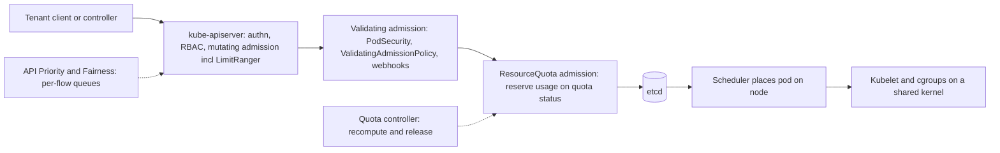

# Multi-Tenancy, Isolation, and Resource Quotas

## TL;DR

1. A namespace is a naming, RBAC, and accounting scope and not a security boundary, so only the cluster (and above it the cloud account or project) holds against a hostile tenant.
2. ResourceQuota is enforced at API admission, as the last plugin in the chain, by a compare-and-swap on the quota object's status; it reserves usage before the object is persisted, releases it asynchronously, and never consults node capacity.
3. LimitRange is the defaulting and shape-validation companion that makes quota usable, and a `max` silently becomes a default limit, so a LimitRange you thought only validated is also injecting limits.
4. Requests become cgroup weights and limits become CFS throttles, so quota requests and memory limits, avoid quota on CPU limits, and size quota for rolling-update surge and zone loss and not for steady state.
5. Native quota is flat and per-namespace, so hierarchy, borrowing, and gang admission need Kueue, an HNC or Capsule style controller, or a bigger boundary, and each carries a race window or a webhook dependency.

## Mental Model



Multi-tenancy in Kubernetes is the problem of sharing five planes that were designed for one trust domain: the API server and etcd, the admission chain, the scheduler, the node kernel, and the network.
Every tenancy primitive attaches to exactly one point on the request path.
RBAC and APF govern who may talk to the API and how much of its concurrency they get.
LimitRange, PodSecurity, ValidatingAdmissionPolicy, and ResourceQuota are admission-time gates, so they constrain what objects may exist and never what a running process does.
Requests and limits cross from API objects into cgroups at the kubelet, and that is the only place where "quota" turns into runtime isolation.
The model to hold is that admission-time accounting (quota) and runtime enforcement (cgroups, seccomp, VM boundaries) are decoupled systems that agree only by convention, and every production surprise in this chapter lives in the gap between them.
Where the tenants are not mutually trusted, you push the boundary outward (node pool, sandbox runtime, virtual control plane, cluster, account) until the shared surface is one you can defend.

## Internals

Disclosure on verification: the web research budget for this authoring pass was exhausted after a handful of queries, so the admission-chain and kubelet mechanics below were read from kubernetes/kubernetes source and documentation in earlier work and were not re-fetched on 2026-10-21.
Statements checked in this pass carry a dated source tag.
Everything else is listed in the batch report as UNVERIFIED and should be re-checked against the release you run.

### Threat model before mechanism

Soft multi-tenancy means tenants are cooperative but fallible: internal teams where the failure mode is accidental harm such as a runaway Deployment or a mistaken `kubectl delete`.
Hard multi-tenancy means tenants may be adversarial: external customers running their own code, where the failure mode is deliberate escape, data theft, or resource exhaustion.
The AWS EKS best practices guide states the practical consequence plainly: 

Kubernetes is a single-tenant orchestrator, and while namespaces, RBAC, quotas and limit ranges create the semblance of multi-tenancy, the cluster is the only construct that provides a strong security boundary

 (AWS EKS Best Practices Guide, as of 2026-10).
The same guide describes hard multi-tenancy as separate clusters per tenant, and it lists node-level placement of tenant workloads as a way to strengthen the soft model (AWS EKS Best Practices Guide, as of 2026-10).

The Borg lineage explains why Kubernetes looks the way it does.
Borg, the system Kubernetes descends from, separated admission-time quota from scheduling and runtime isolation (Verma et al., "Large-scale cluster management at Google with Borg", EuroSys 2015).
In Borg, quota is a vector of resources at a priority band for a period, and it is checked when a job is submitted and not when it is placed.
Borg also classifies CPU as compressible (a process can be throttled) and memory as non-compressible (the only remedy is killing), and Kubernetes inherits that split directly: CPU limits throttle and memory limits OOM-kill.
For multi-resource fairness the reference is Dominant Resource Fairness (Ghodsi et al., NSDI 2011), which is the conceptual ancestor of the fair-sharing modes in batch admission systems such as Kueue.

### The shared surfaces

| Plane | What is shared in one cluster | Control that narrows it | What it does not stop |
|---|---|---|---|
| API server and etcd | One request pipeline, one watch cache, one storage budget | RBAC, APF, `count/*` quota | A tenant with `list` on a big resource still costs everyone CPU and memory |
| Admission | Shared webhooks, shared policy engines | VAP, PodSecurity labels | A slow or down webhook with `failurePolicy: Fail` stalls every tenant |
| Scheduler | One queue, one set of node states | Priority, quota, node pools, taints | A tenant can still fill the queue with unschedulable Pending pods |
| Node kernel | Kernel, page cache, PID table, conntrack, inodes, disk | cgroups, `podPidsLimit`, sandboxes | Kernel exploits and shared-kernel side channels |
| Network | Flat pod network, cluster DNS, shared ingress | NetworkPolicy (needs an enforcing CNI), dedicated ingress | Default is allow-all; DNS and ingress controllers are shared fate |
| Cloud account | IAM, API rate limits, regional vCPU quotas, subnet IPs | Account or project per tenant | Cluster-level quota does not cap cloud-level quota |

Cluster-scoped objects (Nodes, PersistentVolumes, StorageClasses, CRDs, ClusterRoles, PriorityClasses, webhook configurations, RuntimeClasses) have no namespace, so a tenant who may write any of them is a platform administrator in practice.
This is the first-order reason tenants who need CRDs or cluster-scoped operators do not fit in a namespace.

### ResourceQuota admission, mechanism first

The design of the quota plugin has not changed in spirit since the original proposal.
The original design records that usage is updated atomically at admission, which is why a controller creating a pod past the limit is refused, and that a separate controller recomputes observed usage and posts a status update when it differs from the recorded value (Kubernetes ResourceQuota admission design doc and PR #3796, accessed 2026-10-21).
Reading the implementation gives the rest of the mechanism (source-read, UNVERIFIED this pass).

**Position in the chain.**
`ResourceQuota` is ordered last among the built-in plugins, after mutating webhooks, ValidatingAdmissionPolicy, and validating webhooks.
That placement is deliberate: a request rejected by Gatekeeper, Kyverno, or PodSecurity never consumes quota, and the quota plugin sees the final mutated object.

**Reserve, then persist.**
For each matching quota in the namespace, the plugin computes `used + delta`, compares it against `hard`, and writes the new `status.used` to the ResourceQuota object using the resourceVersion it read.
Because quota status is an ordinary etcd object, the write is a compare-and-swap, and a conflicting writer (another kube-apiserver replica or another request in the same namespace) gets a conflict error.
The plugin then retries after a live lookup of the quota (bypassing the informer cache) and re-evaluates, so exactly one of two simultaneous creates at the last free slot wins and the other receives a 403 `exceeded quota`.
The plugin batches queued admission requests per namespace so that many creates share one status write, which matters for the hot-namespace case below.

**The reservation precedes the persistence of the object.**
If the request fails after the quota step (storage error, name collision, a conflict on the object itself), usage has been incremented for an object that does not exist.
The quota controller's recompute repairs this, so `status.used` can transiently overstate real usage.

**Release is asynchronous and controller-driven.**
Deleting a pod does not decrement usage in the delete request path.
The quota controller observes the delete through informers (replenishment) and recomputes usage from the live objects, with a periodic full resync as a backstop (kube-controller-manager defaults: `--resource-quota-sync-period` 5m and `--concurrent-resource-quota-syncs` 5, UNVERIFIED).
The consequence is that creation is synchronous and release is eventually consistent, so a rolling update that deletes old pods and creates new ones at the ceiling sees spurious rejections until the controller catches up.

**What a pod costs.**
For compute quota, the pod's charge is the effective request or limit: the larger of the sum of regular containers (including native sidecars) and the largest init container, plus RuntimeClass pod overhead if declared.
Pods in a terminal phase (Succeeded or Failed) do not count.
A pod with a deletion timestamp stops counting once its deletion grace period has elapsed, even if the kubelet never confirmed the container is gone.
This is the quiet failure in the other direction: on a partitioned node, quota is released while the container may still be consuming the node, so quota can under-count real node usage.

**What it never does.**
Quota does not read node capacity, does not know about zones, and is not consulted by the scheduler or by Karpenter.
Pending pods hold quota while consuming no node resources, and pods that were never created hold nothing, so quota exhaustion presents as "scale-up never happens", which an autoscaler diagnosis would blame on capacity.
See [[17-Cloud-AI-Engineering/Volume_05_Kubernetes_and_Platform_Engineering/Chapter_04_Autoscaling_at_Scale_HPA_KEDA_and_Karpenter|Autoscaling at Scale]] for why the pod must exist before a node is provisioned.

**Object-count quota protects the control plane, not the cluster.**
The documentation frames `count/<resource>` quotas as protection against exhaustion of control plane storage, for example capping Secrets because too many can prevent servers and controllers from starting, and capping Jobs to contain a misbehaving CronJob (Kubernetes docs v1.33, as of 2026-10).
It applies to API-server-backed resources and CRD-backed custom resources, but not to aggregated APIs, where the extension API server must enforce quota itself (Kubernetes docs v1.33, as of 2026-10).

**Scopes and `limitedResources`.**
Scopes narrow which objects a quota counts: Terminating, NotTerminating, BestEffort, NotBestEffort, PriorityClass, and CrossNamespacePodAffinity.
A PriorityClass-scoped quota is how a platform gives each tenant a budget of high-priority pods rather than letting the tenant choose priority freely (Kubernetes docs, resource-quotas page on `main`, as of 2026-10).
The less well-known half is the kube-apiserver admission configuration `limitedResources`, which turns the presence of a matching quota into a permission.
The documentation example restricts cross-namespace pod affinity (`namespaces` and `namespaceSelector` in affinity terms) to namespaces that hold a quota with the CrossNamespacePodAffinity scope (Kubernetes docs, resource-quotas page on `main`, as of 2026-10).
Managed control planes (EKS, GKE) generally do not let you set the apiserver admission configuration, so on those platforms the same policy has to be expressed as ValidatingAdmissionPolicy or an external policy engine (UNVERIFIED).

**Extended resources.**
Quota for extended resources such as `nvidia.com/gpu` uses only the `requests.` prefix, because extended resources cannot be overcommitted and request must equal limit (UNVERIFIED).
A quota entry of `requests.nvidia.com/gpu: "0"` is an explicit deny, whereas the absence of an entry is unlimited, so a platform that wants non-GPU tenants kept off GPU nodes writes the zero explicitly.
Dynamic Resource Allocation moves devices behind ResourceClaims, and quota there is expressed against claim counts and per-device-class device counts, with exact key names that you must check against the release you run (UNVERIFIED).

### LimitRange, the other half

LimitRange is two things in one object: defaulting and validation of containers, pods, and PVCs in a namespace.
Quota requires every pod to declare a value for each tracked compute resource, otherwise the pod is rejected, so a quota without a LimitRange is a quota that rejects every pod that omits requests.

Mechanics worth knowing cold (source-read, UNVERIFIED this pass):

- Defaulting is at admission and not retroactive, so existing pods are unchanged when you edit the LimitRange.
- If a container sets a limit and no request, API defaulting sets request equal to limit before admission, so `defaultRequest` only fires when neither is set.
- If a container sets only a request that is larger than the LimitRange default limit, the pod is rejected as request greater than limit.
- API defaulting of the LimitRange object copies `max` into the default limit when `default` is absent, and copies `min` into `defaultRequest` when that is absent.
  The practical result is that a LimitRange with `max.cpu: 8` and no `default.cpu` gives every container without a CPU limit a CPU limit of 8, and a pod can therefore receive a CPU limit nobody wrote.
- `maxLimitRequestRatio` bounds burst: with ratio 4, a container with a 64Mi request and the 512Mi default limit has ratio 8 and is rejected.
- Pod-type limits apply to the sum of containers, and container-type limits apply per container including init containers.

In the default plugin order, `LimitRanger` runs before the mutating-webhook plugin.
Containers injected by a mutating webhook (a service mesh sidecar, a logging agent) therefore do not receive LimitRange defaults unless the webhook sets resources itself or reinvocation covers it in your version, and under a requests quota that pod is rejected at the quota step (UNVERIFIED, test on your cluster).
This is why mesh sidecars in quota-controlled namespaces need explicit resource annotations; see [[17-Cloud-AI-Engineering/Volume_05_Kubernetes_and_Platform_Engineering/Chapter_08_Service_Mesh_Architecture_and_Trade_Offs|Service Mesh Architecture and Trade-Offs]].

### From request to cgroup: where isolation actually happens

Quota constrains what you may declare, and the kernel enforces what you may use, so you need the translation.

**CPU.**
A CPU request becomes a relative weight (`cpu.weight` on cgroup v2, derived from the legacy shares value of 1024 per core; the conversion formula has been revised in newer runtimes, UNVERIFIED), which matters only under contention.
A CPU limit becomes a CFS bandwidth quota (`cpu.max`) over a period that defaults to 100 ms.
The failure mechanism is arithmetic.
A container limited to 2 CPUs has 200 ms of CPU time per 100 ms period.
If it runs 16 runnable threads in parallel it burns that 200 ms in 12.5 ms of wall time and is then throttled for the remaining 87.5 ms, so a request that needs 5 ms of CPU can see up to 87.5 ms of added latency while average utilization looks like 30 percent.
The signal is `nr_throttled` over `nr_periods` in `cpu.stat`, exported as `container_cpu_cfs_throttled_periods_total` and `container_cpu_cfs_periods_total`.

**Memory.**
A memory limit becomes `memory.max`, and exceeding it triggers the cgroup OOM killer.
Memory requests drive scheduling and eviction ordering, not a hard reservation.

**QoS and eviction.**
Pod QoS class (Guaranteed, Burstable, BestEffort) sets `oom_score_adj`: -997 for Guaranteed, 1000 for BestEffort, and for Burstable roughly `1000 - 1000 * memory_request / node_capacity`, clamped (UNVERIFIED).
A Burstable pod requesting 256Mi on a 64Gi node lands near 996, which is almost as killable as BestEffort.
Under node memory pressure, the kubelet ranks eviction candidates first by whether usage exceeds requests, then by priority, then by the size of the excess.
The tenant-level lesson is that a request is the tenant's protection from its neighbors, so a tenant that sets small requests and large limits is both the first evicted and the most disruptive to others before eviction, which is why a quota on `limits.memory` and a `maxLimitRequestRatio` exist.

**Shared node resources with no default cap.**
PIDs (`podPidsLimit` is unlimited by default upstream, UNVERIFIED), ephemeral storage and inodes, the conntrack table, and cluster DNS QPS are all shared.
Quota on `requests.ephemeral-storage` bounds declared use, and the kubelet evicts on actual overuse, but a fork bomb or a conntrack flood is bounded only if you configured the node for it.

### Control-plane isolation: APF is shuffle sharding

API Priority and Fairness (GA since Kubernetes 1.29, UNVERIFIED) is the mechanism that keeps one tenant's controller from monopolizing the API server.
Requests are classified by FlowSchema into a PriorityLevel, and each PriorityLevel has a number of queues, a hand size, and a queue length limit.
A flow (for example, one namespace or one user, selected by the FlowSchema's distinguisher method) is hashed to a hand of queues and its request is enqueued in the shortest queue of that hand.
This is shuffle sharding in exactly the sense of the Builders' Library article on workload isolation: two flows interfere fully only if their hands overlap entirely.
With the default `workload-low` shape of 128 queues and hand size 6 (UNVERIFIED), the number of distinct hands is C(128,6) = 5,423,611,200, so the chance that two given flows share an identical hand is about 1.8e-10.
With 64 queues and hand size 6 it is C(64,6) = 74,974,368.
Requests carry a seat cost, and a LIST of a large collection is charged more seats than a GET, which is the right behavior because a list scan is what actually hurts.
See [[17-Cloud-AI-Engineering/Volume_01_Cloud_Architecture_Principles/Chapter_03_Cell_Based_Architecture_and_Shuffle_Sharding|Cell-Based Architecture and Shuffle Sharding]] for the combinatorics and the cell-level generalization.

The tenancy-relevant point is that the default FlowSchemas distinguish service-account traffic coarsely.
A per-tenant FlowSchema keyed on the group `system:serviceaccounts:<namespace>` with a ByNamespace distinguisher and its own PriorityLevel gives a tenant a bounded share and a bounded blast radius.
APF protects API server concurrency, but it does not protect etcd's storage budget (default quota 2 GiB, suggested maximum 8 GiB, UNVERIFIED), and that is the job of `count/*` quota.

### Hierarchy: why native quota is flat and what fills the gap

A ResourceQuota is evaluated independently per namespace, so there is no native object that says "team A may use 100 vCPU in total across its 12 namespaces".
The Hierarchical Namespace Controller proposal (HNC, a SIG Multitenancy project) was designed to add parent-child relationships between namespaces with policy object inheritance and tenant-administrator-created subnamespaces, as the EKS guide's "future directions" section summarizes (AWS EKS Best Practices Guide, as of 2026-10).
Its mechanism, as I know it (UNVERIFIED): a `HierarchyConfiguration` named `hierarchy` in each namespace sets the parent, a `SubnamespaceAnchor` created in the parent causes HNC to create the child (so a tenant needs rights only in its own namespace and not cluster-scoped `create namespace`), configured object types such as Roles and RoleBindings are copied down the tree, and every namespace in a tree is labeled with `<ancestor>.tree.hnc.x-k8s.io/depth` so that selectors can target a whole subtree.
Check the upstream repository's maintenance status before adopting HNC, because I could not confirm it in this pass (UNVERIFIED).
GKE's Config Sync offers a hierarchy-by-repository-layout alternative with abstract namespaces, and Capsule and similar operators implement a Tenant CRD that owns several namespaces (UNVERIFIED).

Hierarchical quota is the hard part, and any implementation picks one of two designs:

1. **Admission-time subtree accounting** in a webhook gives tighter limits but adds latency to every pod create and makes the webhook a single point of failure for the namespace.
2. **Dynamic rewriting of per-namespace quotas** (set each child `hard` to its current usage plus a share of the tenant's remaining budget) uses only native enforcement but is eventually consistent, so a burst across namespaces within one reconcile interval can overshoot by up to the sum of the children's headroom.
   Capsule's tenant-scoped quota is reported to work this way (UNVERIFIED).

For batch and GPU workloads, the right primitive is not quota at all but queueing.
Kueue (a Kubernetes SIG project) holds Jobs suspended until a ClusterQueue has quota, then unsuspends them, so no pods exist, and none are charged, until admission succeeds.
ClusterQueues share through cohorts with per-resource nominal quota, borrowing limits, and lending limits, and it supports preemption to reclaim lent quota and fair-sharing between queues (Kueue docs, UNVERIFIED this pass; check the version for hierarchical cohorts).
This is gang admission by design: a 64-GPU training job is admitted whole or not at all, which native quota cannot express because it counts pods individually.

### The isolation ladder

| Rung | Mechanism | Shared with other tenants | Typical use |
|---|---|---|---|
| 1 | Namespace plus RBAC, quota, LimitRange, NetworkPolicy, PodSecurity | Control plane, nodes, kernel | Cooperating internal teams |
| 2 | Rung 1 plus dedicated node pool (taints, tolerations, node selectors) | Control plane, network fabric | Noisy-neighbor and cost isolation |
| 3 | Rung 2 plus sandboxed runtime (gVisor, Kata, microVM) | Control plane, hypervisor or sandbox kernel boundary | Untrusted code in shared clusters |
| 4 | Virtual control plane per tenant (vcluster, Kamaji) | Host cluster nodes unless nodes are dedicated | Tenants needing CRDs and cluster-admin |
| 5 | Cluster per tenant | Cloud account | Strong isolation with moderate fleet size |
| 6 | Account or project per tenant, one cluster each | Cloud provider only | Regulated or external customers |

Notes on the rungs.

- **Rung 2 on managed clusters.**
  The `PodNodeSelector` and `PodTolerationRestriction` admission plugins are not configurable on EKS or GKE (UNVERIFIED), so node-pool pinning is enforced with Kyverno, Gatekeeper, or a ValidatingAdmissionPolicy that rejects pods lacking the tenant's node selector and toleration.
- **Karpenter and node pools.**
  A per-tenant Karpenter NodePool with a taint and `limits` caps tenant node capacity at the cloud layer, which is a second, independent cap beneath namespace quota.
- **Rung 3.**
  GKE Sandbox runs pods under gVisor via a RuntimeClass on a sandbox-enabled node pool, and AWS Fargate runs each pod in its own Firecracker-based microVM, while Kata on EKS is self-managed (UNVERIFIED for all three).
  See [[17-Cloud-AI-Engineering/Volume_00_Foundations_Under_the_Cloud/Chapter_01_Hypervisors_MicroVMs_and_Sandboxing|Hypervisors, MicroVMs, and Sandboxing]] and [[17-Cloud-AI-Engineering/Volume_13_Seminal_Papers_and_Case_Studies/Chapter_04_Firecracker_MicroVM|Firecracker]], and the Firecracker NSDI 2020 paper for the design that made per-tenant microVMs economical.
  Sandboxes narrow the kernel attack surface at a cost in syscall-heavy performance and compatibility, and they do not protect the control plane.
- **Rung 4.**
  A vcluster gives each tenant its own API server and datastore, and a syncer copies tenant pods into a host namespace.
  The tenant can have CRDs, ClusterRoles, and cluster-admin in its virtual cluster, yet its pods are ordinary host pods sharing the host kernel and bound by host-namespace quota.
  Virtual control planes isolate the control plane and are not a data-plane boundary unless the nodes are dedicated.
- **GPU sharing.**
  Multi-Instance GPU (MIG) partitions an A100 or H100 into as many as seven hardware-isolated instances with dedicated memory and cache (NVIDIA docs, UNVERIFIED).
  Time-slicing shares a GPU with no memory isolation and no fault isolation, and MPS shares SMs with weaker isolation than MIG, so only MIG is acceptable across mutually untrusting tenants.

## Numbers to Know

Search access was exhausted before these could be re-verified, so each row carries either a dated verified source or the tag UNVERIFIED.
Derived rows are arithmetic from the stated inputs.

| Quantity | Value | Source and status |
|---|---|---|
| Cluster as strong security boundary | The cluster is the only construct giving a strong boundary; namespaces, quotas, LimitRanges are logical separation | (AWS EKS Best Practices Guide, as of 2026-10) |
| `count/*` quota purpose | Protects control plane storage; does not cover aggregated APIs | (Kubernetes docs v1.33, as of 2026-10) |
| Quota usage update | Atomic at admission, controller recomputes drift | (Kubernetes quota admission design doc, accessed 2026-10-21) |
| Upstream scalability thresholds | 5,000 nodes, 150,000 pods, 300,000 containers, 110 pods per node | UNVERIFIED (Kubernetes large-cluster docs, recalled) |
| etcd storage quota | 2 GiB default, 8 GiB suggested maximum | UNVERIFIED (etcd docs, recalled) |
| etcd max request size | 1.5 MiB default | UNVERIFIED (etcd docs, recalled) |
| Quota controller | Resync period 5 min, 5 concurrent syncs | UNVERIFIED (kube-controller-manager reference, recalled) |
| CFS bandwidth period | 100 ms default | UNVERIFIED (kubelet and kernel docs, recalled) |
| Throttle example | 2 CPU limit, 16 busy threads: quota burned in 12.5 ms, throttled 87.5 ms per period | Derived (200,000 us quota, 100,000 us period) |
| `oom_score_adj` | Guaranteed -997, BestEffort 1000, Burstable about 1000 - 1000 x request / capacity | UNVERIFIED (kubelet source, recalled) |
| Burstable example | 256Mi request on 64Gi node gives about 996 | Derived from the formula above |
| APF default shape | `workload-low`: 128 queues, hand size 6, queue length 50 | UNVERIFIED (Kubernetes flow-control docs, recalled) |
| Distinct APF hands | C(128,6) = 5,423,611,200; C(64,6) = 74,974,368 | Derived |
| MIG partitions | Up to 7 instances per A100 or H100 | UNVERIFIED (NVIDIA MIG docs, recalled) |
| EKS pods per node (VPC CNI) | Bounded by ENIs x (IPs per ENI - 1) + 2; higher with prefix delegation | UNVERIFIED (EKS docs, recalled) |
| GKE pods per node | 110 default with a /24 pod range per node | UNVERIFIED (GKE docs, recalled) |
| EKS control plane price | $0.10 per cluster-hour on standard support, about $73 per month | UNVERIFIED (AWS EKS pricing, recalled) |
| GKE management fee | $0.10 per cluster-hour with a monthly free-tier credit | UNVERIFIED (GKE pricing, recalled) |
| Feature maturity | PodSecurity admission GA 1.25, APF GA 1.29, ValidatingAdmissionPolicy GA 1.30, native sidecars GA 1.33, DRA GA 1.34 | UNVERIFIED (Kubernetes release notes, recalled) |
| Lab zone-loss budget | 24 nodes, 15.0 vCPU and 56 GiB allocatable, 0.5 vCPU and 0.7 GiB DaemonSets per node: 232 vCPU and 885 GiB commitable across 3 zones | Derived from stated assumptions |
| Cluster-per-team control-plane fee | 200 clusters x $0.10 x 730 h = $14,600 per month, $175,200 per year | Derived from the UNVERIFIED $0.10 rate |

## AWS vs GCP Mechanism Parity

The Kubernetes mechanisms (quota, LimitRange, APF, PodSecurity) are upstream and identical on EKS and GKE, so the differences are in the managed layer around them.
Rows are tagged UNVERIFIED where the cloud-specific claim was not re-checked in this pass.

| Concern | AWS (EKS) | Google Cloud (GKE) | Critical difference | Status |
|---|---|---|---|---|
| Quota and LimitRange semantics | Upstream | Upstream | None; identical admission behavior | Upstream docs |
| Apiserver admission configuration (`limitedResources`, extra plugins) | Not user-configurable | Not user-configurable beyond provider defaults | Express quota-as-permission with VAP or policy engines on both | UNVERIFIED |
| Namespace-scoped human access | Access entries with namespace-scoped access policies | Kubernetes RBAC bound to Google identities, plus IAM roles | EKS maps IAM to RBAC groups via access entries, GKE uses Google identities directly | UNVERIFIED |
| Namespace-scoped workload identity | Pod Identity associations per (cluster, namespace, service account); IRSA trust policies on `sub` | Workload Identity Federation for GKE with `principal://` per service account and `principalSet://` per namespace | GCP can grant IAM to a whole namespace in one binding, AWS binds role per service account | UNVERIFIED |
| Namespace as an ABAC attribute | Pod Identity session tags include the namespace and service account | Namespace is part of the principal identifier | Both allow tenant-prefixed storage policies without per-tenant roles | UNVERIFIED |
| Network policy enforcement | VPC CNI network policy (eBPF) or Calico or Cilium | Dataplane V2 (Cilium) or Calico | Enforcement is a CNI choice on EKS and a cluster mode on GKE | UNVERIFIED |
| Sandboxed pods | Fargate (microVM per pod); Kata self-managed | GKE Sandbox (gVisor) via RuntimeClass | Fargate is a different compute model with its own limitations (no DaemonSets, no GPUs) | UNVERIFIED |
| Per-tenant node capacity | Karpenter NodePool with taints and `limits` | Node pools or ComputeClasses, node auto-provisioning limits | Karpenter limits are a native cloud-layer cap | UNVERIFIED |
| Fleet and team management | No native fleet-team object; use accounts, GitOps projects, operators | Fleet teams and scopes | GKE has a first-party multi-team construct | UNVERIFIED |
| Hierarchical config | HNC, Capsule, GitOps | Config Sync hierarchy mode, HNC, Capsule | Config Sync is the supported route on GKE | UNVERIFIED |
| Cost allocation by namespace | Split cost allocation data for EKS, OpenCost | GKE cost allocation exports namespace and labels to billing export | Both need opt-in and tagging discipline | UNVERIFIED |
| Hard-isolation unit | AWS account, enforced with SCPs and RCPs | Project, enforced with Org Policy and VPC Service Controls | Same idea, different hierarchy, see [[17-Cloud-AI-Engineering/Volume_08_Security_Identity_and_the_Data_Perimeter/Chapter_06_Constructing_an_Impenetrable_Data_Perimeter\|Data Perimeter]] | Design level |
| Cloud-level quotas shared by tenants | Per-account and per-region EC2 and API limits | Per-project regional quotas and API limits | Cluster quota never caps these; they are the real shared pool | UNVERIFIED |

## Worked Example: Stamping Tenant Guardrails and Proving Them on a Local Cluster

The lab stamps four tenants onto a local kind cluster with one Python generator, then proves each guardrail by tripping it.
The generator is standard library only and emits a `kubectl apply`-able JSON List, so it works against kind, EKS, or GKE unchanged.

### Back-of-the-envelope sizing

Cluster assumption: 24 nodes of 16 vCPU and 64 GiB (for example m6i.4xlarge on AWS or n2-standard-16 on GCP), spread over 3 zones.
Assume 15.0 vCPU and 56 GiB allocatable per node after kubelet and system reservations (an assumption to replace with `kubectl get node -o jsonpath` output).
Assume DaemonSets (CNI, logging, node agent) take 0.5 vCPU and 0.7 GiB per node.

1. Allocatable after DaemonSets is 24 x 15.0 - 24 x 0.5 = 348 vCPU and 24 x 56 - 24 x 0.7 = 1,327 GiB.
2. Static stability requires that quota commitments survive losing a zone (see [[17-Cloud-AI-Engineering/Volume_01_Cloud_Architecture_Principles/Chapter_02_Regions_Zones_and_Static_Stability|Regions, Zones, and Static Stability]]), so the commitable budget is 2/3 of that: 232 vCPU and 885 GiB.
3. Quota must exceed steady state by the rolling-update surge, because a Deployment with `maxSurge: 25%` needs 125 percent of its steady requests to roll, so each tenant's quota is steady x 1.25.
4. Tenants (steady vCPU, GiB): team-a 40 and 160, team-b 60 and 240, team-c 30 and 120, team-d 20 and 80.
   Quota requests are 50, 75, 38 (37.5 rounded up), and 25 vCPU, which sum to 188 vCPU (81 percent of 232), and 200, 300, 150, and 100 GiB, which sum to 750 GiB (85 percent of 885).
5. Memory limit quota is 1.25 x memory request quota, so team-a gets 250 GiB, which bounds the memory burst a tenant can create in neighbors' eviction rankings.
6. Pod quota for team-a is ceil(40 / 0.5 x 1.25) + 20 = 120, which assumes 0.5 vCPU per pod on average plus slack for Jobs.
7. Cost ceiling for team-a is (50 x $0.04 + 200 x $0.005) x 730 h = $2,190 per month at ILLUSTRATIVE prices of $0.04 per vCPU-hour and $0.005 per GiB-hour, which are placeholders and not list prices.
   Replace them with your instance family's amortized rates, and treat the number as the ceiling the quota allows, not the bill.

The remaining headroom is 44 vCPU and 135 GiB, which is the buffer for DaemonSet growth, a fifth tenant, and the 5 to 10 percent bin-packing loss you should expect in practice.

### Generator

```python
#!/usr/bin/env python3
"""tenant_stamp.py - emit per-tenant namespace guardrails as a kubectl-applyable JSON List.

Usage:
  python3 tenant_stamp.py --tenant team-a --cpu 40 --mem-gib 160 | kubectl apply -f -
Standard library only. Capacity and cost report goes to stderr.
"""
import argparse
import json
import math
import sys


def build(a):
    surge = 1.0 + a.surge
    req_cpu = math.ceil(a.cpu * surge)
    req_mem = math.ceil(a.mem_gib * surge)
    lim_mem = math.ceil(req_mem * a.mem_limit_ratio)
    pods = math.ceil(a.cpu / a.avg_pod_cpu * surge) + a.job_slack
    ns = a.tenant
    meta = lambda name: {"name": name, "namespace": ns}

    namespace = {
        "apiVersion": "v1", "kind": "Namespace",
        "metadata": {"name": ns, "labels": {
            "tenant": a.tenant, "cost-center": a.cost_center,
            "pod-security.kubernetes.io/enforce": "restricted",
            "pod-security.kubernetes.io/audit": "restricted",
            "pod-security.kubernetes.io/warn": "restricted"}},
    }

    compute_hard = {
        "requests.cpu": str(req_cpu),
        "requests.memory": "%dGi" % req_mem,
        "limits.memory": "%dGi" % lim_mem,
        "requests.ephemeral-storage": "%dGi" % a.ephemeral_gib,
        "pods": str(pods),
        "requests.nvidia.com/gpu": str(a.gpus),
    }
    objects_hard = {
        "count/secrets": "100", "count/configmaps": "101",
        "count/services": "30", "services.loadbalancers": "0",
        "services.nodeports": "0", "persistentvolumeclaims": "20",
        "requests.storage": "%dGi" % a.storage_gib,
        "count/jobs.batch": "200", "count/cronjobs.batch": "20",
        "count/deployments.apps": "50",
    }
    quota_compute = {"apiVersion": "v1", "kind": "ResourceQuota",
                     "metadata": meta("compute"), "spec": {"hard": compute_hard}}
    quota_objects = {"apiVersion": "v1", "kind": "ResourceQuota",
                     "metadata": meta("objects"), "spec": {"hard": objects_hard}}

    limit_range = {
        "apiVersion": "v1", "kind": "LimitRange", "metadata": meta("defaults"),
        "spec": {"limits": [{
            "type": "Container",
            "defaultRequest": {"cpu": "100m", "memory": "256Mi", "ephemeral-storage": "256Mi"},
            "default": {"memory": "512Mi", "ephemeral-storage": "2Gi"},
            "min": {"cpu": "10m", "memory": "32Mi"},
            "max": {"cpu": "8", "memory": "32Gi"},
            "maxLimitRequestRatio": {"memory": "4"},
        }]},
    }

    default_deny = {
        "apiVersion": "networking.k8s.io/v1", "kind": "NetworkPolicy",
        "metadata": meta("default-deny"),
        "spec": {"podSelector": {}, "policyTypes": ["Ingress", "Egress"],
                 "ingress": [{"from": [{"podSelector": {}}]}],
                 "egress": [
                     {"to": [{"podSelector": {}}]},
                     {"to": [{"namespaceSelector": {"matchLabels": {
                         "kubernetes.io/metadata.name": "kube-system"}},
                         "podSelector": {"matchLabels": {"k8s-app": "kube-dns"}}}],
                      "ports": [{"protocol": "UDP", "port": 53},
                                {"protocol": "TCP", "port": 53}]}]},
    }

    role = {
        "apiVersion": "rbac.authorization.k8s.io/v1", "kind": "Role",
        "metadata": meta("tenant-developer"),
        "rules": [
            {"apiGroups": [""], "resources": ["pods", "services", "configmaps",
             "secrets", "persistentvolumeclaims"],
             "verbs": ["get", "list", "watch", "create", "update", "patch", "delete"]},
            {"apiGroups": [""], "resources": ["pods/log", "events",
             "resourcequotas", "limitranges"], "verbs": ["get", "list", "watch"]},
            {"apiGroups": ["apps"], "resources": ["deployments", "statefulsets"],
             "verbs": ["get", "list", "watch", "create", "update", "patch", "delete"]},
            {"apiGroups": ["apps"], "resources": ["replicasets"],
             "verbs": ["get", "list", "watch"]},
            {"apiGroups": ["batch"], "resources": ["jobs", "cronjobs"],
             "verbs": ["get", "list", "watch", "create", "update", "patch", "delete"]},
            {"apiGroups": ["autoscaling"], "resources": ["horizontalpodautoscalers"],
             "verbs": ["get", "list", "watch", "create", "update", "patch", "delete"]},
        ],
    }
    binding = {
        "apiVersion": "rbac.authorization.k8s.io/v1", "kind": "RoleBinding",
        "metadata": meta("tenant-developer"),
        "subjects": [{"kind": "Group", "name": "tenant-" + a.tenant,
                      "apiGroup": "rbac.authorization.k8s.io"}],
        "roleRef": {"kind": "Role", "name": "tenant-developer",
                    "apiGroup": "rbac.authorization.k8s.io"},
    }
    items = [namespace, quota_compute, quota_objects, limit_range,
             default_deny, role, binding]
    return {"apiVersion": "v1", "kind": "List", "items": items}, req_cpu, req_mem


def report(a, req_cpu, req_mem):
    alloc_cpu = a.nodes * a.node_alloc_cpu - a.nodes * a.ds_cpu
    alloc_mem = a.nodes * a.node_alloc_gib - a.nodes * a.ds_gib
    keep = (a.zones - 1) / a.zones
    budget_cpu = alloc_cpu * keep
    budget_mem = alloc_mem * keep
    used_cpu = a.committed_cpu + req_cpu
    used_mem = a.committed_mem + req_mem
    hrs = 730
    cost = (req_cpu * a.price_vcpu_hr + req_mem * a.price_gib_hr) * hrs
    out = sys.stderr
    print("allocatable after daemonsets : %.0f vCPU, %.0f GiB" % (alloc_cpu, alloc_mem), file=out)
    print("zone-loss budget (%d of %d)   : %.0f vCPU, %.0f GiB" % (a.zones - 1, a.zones, budget_cpu, budget_mem), file=out)
    print("committed incl. this tenant  : %.0f vCPU (%.0f%%), %.0f GiB (%.0f%%)" % (
        used_cpu, 100 * used_cpu / budget_cpu, used_mem, 100 * used_mem / budget_mem), file=out)
    print("tenant quota ceiling cost    : $%.0f / month at $%.4f per vCPU-hr and $%.4f per GiB-hr (ILLUSTRATIVE prices)" % (
        cost, a.price_vcpu_hr, a.price_gib_hr), file=out)
    if used_cpu > budget_cpu or used_mem > budget_mem:
        print("WARNING: quota commitments exceed the zone-loss budget; a zonal failure will leave quota unsatisfiable", file=out)
        return 2
    return 0


def main():
    p = argparse.ArgumentParser()
    p.add_argument("--tenant", required=True)
    p.add_argument("--cost-center", default="unassigned")
    p.add_argument("--cpu", type=float, required=True, help="steady-state requested vCPU")
    p.add_argument("--mem-gib", type=float, required=True, help="steady-state requested GiB")
    p.add_argument("--gpus", type=int, default=0)
    p.add_argument("--surge", type=float, default=0.25, help="rolling-update headroom fraction")
    p.add_argument("--mem-limit-ratio", type=float, default=1.25)
    p.add_argument("--avg-pod-cpu", type=float, default=0.5)
    p.add_argument("--job-slack", type=int, default=20)
    p.add_argument("--ephemeral-gib", type=int, default=200)
    p.add_argument("--storage-gib", type=int, default=2048)
    p.add_argument("--nodes", type=int, default=24)
    p.add_argument("--node-alloc-cpu", type=float, default=15.0)
    p.add_argument("--node-alloc-gib", type=float, default=56.0)
    p.add_argument("--ds-cpu", type=float, default=0.5)
    p.add_argument("--ds-gib", type=float, default=0.7)
    p.add_argument("--zones", type=int, default=3)
    p.add_argument("--committed-cpu", type=float, default=0.0)
    p.add_argument("--committed-mem", type=float, default=0.0)
    p.add_argument("--price-vcpu-hr", type=float, default=0.04)
    p.add_argument("--price-gib-hr", type=float, default=0.005)
    a = p.parse_args()
    doc, req_cpu, req_mem = build(a)
    rc = report(a, req_cpu, req_mem)
    json.dump(doc, sys.stdout, indent=2)
    sys.stdout.write("\n")
    sys.exit(rc)


if __name__ == "__main__":
    main()
```

I ran the generator for all four tenants in this pass and it emitted valid JSON with the committed totals above (the cluster steps below were not run, because the authoring sandbox has no container runtime).

### Cost, budget alarm, and teardown

The kind path costs $0 in cloud spend because it uses local compute.
If you run the same steps on a managed cluster, a 2-hour lab on a control plane at the UNVERIFIED $0.10 per hour plus 3 nodes at an ILLUSTRATIVE $0.17 per hour is (0.10 + 3 x 0.17) x 2 = $1.22.
Set a budget alarm before creating anything billable.

```bash
# AWS: budget with an 80 percent actual-spend alert
cat > budget.json <<'EOF'
{"BudgetName":"tenancy-lab","BudgetLimit":{"Amount":"25","Unit":"USD"},"TimeUnit":"MONTHLY","BudgetType":"COST"}
EOF
cat > notif.json <<'EOF'
[{"Notification":{"NotificationType":"ACTUAL","ComparisonOperator":"GREATER_THAN","Threshold":80,"ThresholdType":"PERCENTAGE"},"Subscribers":[{"SubscriptionType":"EMAIL","Address":"you@example.com"}]}]
EOF
aws budgets create-budget --account-id "$ACCOUNT_ID" --budget file://budget.json --notifications-with-subscribers file://notif.json

# GCP: equivalent budget
gcloud billing budgets create --billing-account="$BILLING_ACCOUNT" \
  --display-name=tenancy-lab --budget-amount=25USD --threshold-rule=percent=0.8
```

### Run and prove each guardrail

```bash
kind create cluster --name tenancy-lab
for t in "team-a 40 160" "team-b 60 240" "team-c 30 120" "team-d 20 80"; do
  set -- $t
  python3 tenant_stamp.py --tenant "$1" --cpu "$2" --mem-gib "$3" | kubectl apply -f -
done
```

**Proof 1: quota fails silently at the Deployment.**

```bash
cat <<'EOF' | kubectl apply -f -
apiVersion: apps/v1
kind: Deployment
metadata: {name: web, namespace: team-a}
spec:
  replicas: 130
  selector: {matchLabels: {app: web}}
  template:
    metadata: {labels: {app: web}}
    spec:
      securityContext: {runAsNonRoot: true, runAsUser: 65534, seccompProfile: {type: RuntimeDefault}}
      containers:
      - name: pause
        image: registry.k8s.io/pause:3.9
        securityContext: {allowPrivilegeEscalation: false, capabilities: {drop: ["ALL"]}}
EOF
kubectl -n team-a get rs
kubectl -n team-a describe rs | grep -iE 'FailedCreate|exceeded quota'
kubectl -n team-a get resourcequota compute -o jsonpath='{.status.used}'
```

Expected: `kubectl apply` succeeds, at most 120 pods exist (Pending pods still count), and the ReplicaSet events report an `exceeded quota: compute` failure naming `pods`.

**Proof 2: LimitRange defaults and the injected limit.**

```bash
kubectl -n team-a get pod -l app=web -o jsonpath='{.items[0].spec.containers[0].resources}'
```

Expected: requests of `cpu: 100m`, `memory: 256Mi`, `ephemeral-storage: 256Mi`, a memory limit of `512Mi`, and, if the max-to-default-limit behavior described in Internals holds on your version, a CPU limit of `8` that no one wrote.
This is the line to check, because it is the claim in this chapter I most want you to verify rather than trust.

**Proof 3: release is asynchronous.**

```bash
kubectl -n team-a delete deploy web
for i in 1 2 3 4 5 6; do kubectl -n team-a get resourcequota compute -o jsonpath='{.status.used.pods}{"\n"}'; sleep 1; done
```

Expected: `used.pods` falls over a short period and not in the delete request itself.

**Proof 4: explicit zero denies.**

```bash
kubectl -n team-a create service loadbalancer lb --tcp=80:80
```

Expected: forbidden with `services.loadbalancers` limited to 0.
Repeat with a pod requesting `nvidia.com/gpu: 1` to see the GPU deny at quota before scheduling.

**Proof 5: the tenant cannot remove its own guardrails.**

```bash
kubectl auth can-i delete networkpolicies -n team-a --as=dev --as-group=tenant-team-a
kubectl auth can-i update resourcequotas -n team-a --as=dev --as-group=tenant-team-a
kubectl auth can-i create deployments -n team-a --as=dev --as-group=tenant-team-a
```

Expected: no, no, yes.
Using the built-in `edit` ClusterRole here instead would answer yes to the first question, because `edit` can write NetworkPolicies (UNVERIFIED), which is why the Role is custom.
NetworkPolicy enforcement itself depends on your CNI, so test it separately and do not assume kind's default CNI enforces it.

**Teardown.**

```bash
kind delete cluster --name tenancy-lab
rm -f budget.json notif.json
```

## Failure Modes and Pitfalls

### Quota failures hide behind a successful apply

Quota rejections happen when a controller creates pods, so the Deployment, StatefulSet, or Job is accepted and the failure appears only as events and a `ReplicaFailure` condition on the child ReplicaSet.
An HPA then reports a desired replica count far above current, and an autoscaler such as Karpenter provisions nothing because no Pending pods exist.
Alert on `kube_resourcequota` used-to-hard ratios from kube-state-metrics (UNVERIFIED metric name) and on ReplicaSet `FailedCreate` events, and not only on node capacity.

### Rolling updates at the ceiling

A tenant sized to exactly 100 percent of quota cannot roll a Deployment with surge, and because release is asynchronous, a `maxSurge: 0, maxUnavailable: 1` rollout can still see transient rejections right after old pods are deleted.
Size quota at steady x (1 + surge), as in the lab, and treat the surge factor as a platform default that tenants may not reduce.

### Quota reservation and release drift

A reservation made at admission for an object that then fails to persist leaves `used` overstated until the controller recomputes.
A stuck-terminating pod on a partitioned node stops counting after its grace period although the container may still run, so node usage can exceed quota-implied usage.
Do not use `status.used` as a billing source of truth, and reconcile chargeback against actual usage metrics.

### Hot-namespace admission serialization

All pod creates in one namespace converge on one ResourceQuota object's status in etcd, so a Spark driver launching thousands of executors or a Job with huge parallelism serializes on that key and spends retries on conflicts.
Watch `apiserver_admission_controller_admission_duration_seconds` for the ResourceQuota plugin (UNVERIFIED metric name), spread bursty tenants across namespaces, and gate batch work with Kueue so pods are created only after admission.

### Object counts that surprise you

Every namespace contains a `kube-root-ca.crt` ConfigMap, so a `count/configmaps` of 100 gives tenants 99 (the generator sets 101 for this reason).
Helm stores each release revision as a Secret, so an unbounded history exhausts `count/secrets` and breaks deployments, which is why `--history-max` belongs in the tenant's pipeline defaults.
Completed Jobs and their pods linger, so `count/jobs.batch` needs `ttlSecondsAfterFinished` and CronJob history limits.

### LimitRange traps

An edited LimitRange does not change existing pods, so a tightened `max` produces a cluster that passes today and fails on the next restart.
A `max` without a `default` injects a limit, as shown in Proof 2.
A `maxLimitRequestRatio` rejects pods that set a small request and rely on the default limit.
Webhook-injected sidecars bypass LimitRange defaults and fail under a requests quota, as covered in Internals.

### CPU throttling as a noisy-neighbor symptom

Quota on `limits.cpu` forces every pod to declare a CPU limit, which forces CFS throttling, as in the 12.5 ms and 87.5 ms arithmetic above.
Tail latency inflates while dashboards show low average CPU.
The remedy is policy: quota `requests.cpu`, forbid or discourage CPU limits for latency-sensitive services, and use Guaranteed QoS with the static CPU manager policy only where pinning is needed.

### Shared node exhaustion

A fork bomb in a pod without a PID limit, a log-spewing container filling ephemeral storage and inodes, and a conntrack flood all take down the node for every tenant on it.
Set `podPidsLimit`, quota ephemeral storage, and cap logs at the runtime, because none of these is reached by namespace quota.

### Control-plane blast radius

On 2024-12-11, OpenAI published a post-incident review describing how a newly deployed telemetry service generated expensive Kubernetes API load across its clusters, overwhelming the API servers and taking out DNS-based service discovery that depended on the control plane (OpenAI status page incident, URL recalled, UNVERIFIED).
The multi-tenancy lesson is that APF per-tenant flows, `count/*` quota, and a cell boundary between tenants are the controls that bound this class of failure, and that the data plane must not depend on the control plane at runtime, which is the point of [[17-Cloud-AI-Engineering/Volume_01_Cloud_Architecture_Principles/Chapter_04_Control_Plane_vs_Data_Plane_Separation|Control Plane vs Data Plane Separation]].
Namespace deletion has a related shared-fate bug: the namespace controller relies on API discovery across all groups, so one unavailable APIService (for example a dead metrics server) can leave every namespace stuck in Terminating (UNVERIFIED).

### Cross-tenant paths through shared components

- **Shared ingress controllers.**
  CVE-2025-1974 ("IngressNightmare", March 2025) allowed remote code execution through the ingress-nginx admission webhook, and the controller's service account could read Secrets across namespaces, so one shared component turned into a cross-tenant secret-exposure path ([NVD CVE-2025-1974](https://nvd.nist.gov/vuln/detail/CVE-2025-1974)).
- **Service `externalIPs` and LoadBalancer.**
  CVE-2020-8554 let a tenant who can create Services intercept traffic for arbitrary IPs, and the upstream position was that multi-tenant clusters must restrict it with admission, for which the `DenyServiceExternalIPs` plugin or a VAP exist ([NVD CVE-2020-8554](https://nvd.nist.gov/vuln/detail/CVE-2020-8554)).
- **Runtime escapes.**
  Palo Alto Unit 42's "Azurescape" research (2021) showed cross-account container takeover in Azure Container Instances through the runc flaw CVE-2019-5736, which is the canonical argument that shared-kernel multi-tenancy needs a sandbox for hostile tenants ([Unit 42](https://unit42.paloaltonetworks.com/azure-container-instances/), [NVD CVE-2019-5736](https://nvd.nist.gov/vuln/detail/CVE-2019-5736)).
  The same class recurred in CVE-2024-21626 in runc ([NVD](https://nvd.nist.gov/vuln/detail/CVE-2024-21626)).
- **GPU stack escapes.**
  The NVIDIA Container Toolkit had container escapes in CVE-2024-0132 and CVE-2025-23266, so a GPU node shared between untrusting tenants is exposed through the toolkit even when the kernel and runtime are patched ([NVD CVE-2024-0132](https://nvd.nist.gov/vuln/detail/CVE-2024-0132), [NVD CVE-2025-23266](https://nvd.nist.gov/vuln/detail/CVE-2025-23266)).

### Identity and RBAC mistakes

An IRSA trust policy using `StringLike` with a wildcard namespace (`system:serviceaccount:*:app`) lets any namespace's service account of that name assume the role, which is a cross-tenant privilege escalation.
The built-in `edit` role can modify NetworkPolicies, so a tenant with `edit` can delete its default-deny policy.
Granting tenants `create namespace` (cluster-scoped) bypasses every per-namespace guardrail, which is the case for subnamespace anchors or a platform API.

### Hierarchy controller risks

A hierarchy controller with a validating webhook sits on the path of writes in every managed namespace, and `failurePolicy: Fail` makes its outage a tenant outage.
Projects in this space change maintenance status, so verify the repository's activity and your upgrade path before making one a platform dependency (UNVERIFIED).

### GPU sharing failure

Time-sliced GPUs give no memory isolation and no fault isolation, so one tenant's OOM or Xid error can crash a neighbor's job, and only MIG offers hardware partitioning.
A quota of `requests.nvidia.com/gpu` counts devices and not fractions, so a tenant using time-slicing replicas can be charged one unit for a slice or the full device depending on how the device plugin advertises resources.

### Cloud-level shared pools

Namespace quota does nothing about regional vCPU quotas, EC2 or Compute API rate limits, subnet IP addresses for VPC CNI pods, or EBS and Persistent Disk attach limits per node.
A tenant scaling aggressively can exhaust the account's pool, and every other tenant's autoscaling fails with cloud API errors that look like platform outages.

## Security and Cost Angles

### IAM and identity scoping

- Give humans namespace-scoped access: on EKS, access entries with namespace-scoped access policies, and on GKE, RBAC bindings to groups plus narrowly scoped IAM roles (UNVERIFIED for both).
- Give workloads namespace-scoped cloud identity without static keys, using EKS Pod Identity or IRSA with exact `sub` conditions on AWS and Workload Identity Federation for GKE on GCP, as detailed in [[17-Cloud-AI-Engineering/Volume_08_Security_Identity_and_the_Data_Perimeter/Chapter_02_Workload_Identity_Federation|Workload Identity Federation]].
- Use the namespace as an attribute: on AWS, Pod Identity session tags (including the namespace) allow one role to serve every tenant with a policy condition on `aws:PrincipalTag` for tenant-prefixed S3 paths, and on GCP, a `principalSet` for the namespace can be granted a bucket role directly (UNVERIFIED for both).
- Remove the tenant's ability to edit its own guardrails: custom Roles without NetworkPolicy, ResourceQuota, LimitRange, Role, and RoleBinding write access, as in the lab.

### Encryption key hierarchy

Secrets in etcd should be envelope-encrypted with a KMS-held key (EKS with a KMS key you control, GKE application-layer secrets encryption with Cloud KMS, UNVERIFIED), and tenant application data should use per-tenant data keys wrapped by per-tenant KMS keys so that offboarding is key deletion.
A shared cluster key means a control-plane compromise exposes every tenant's secrets, so for regulated tenants the encryption boundary is the account or project, not the namespace.
See [[17-Cloud-AI-Engineering/Volume_08_Security_Identity_and_the_Data_Perimeter/Chapter_04_Encryption_Key_Hierarchies_and_Envelope_Encryption|Encryption Key Hierarchies and Envelope Encryption]].

### Private network boundaries

Default-deny NetworkPolicy per namespace, enforced by a CNI that implements it (VPC CNI network policy, Calico, or Cilium on EKS, Dataplane V2 on GKE, UNVERIFIED), is the in-cluster boundary.
Egress policy should block the instance metadata endpoint for tenant pods unless identity requires it.
For the cloud boundary, use VPC endpoints with endpoint policies on AWS and VPC Service Controls perimeters on GCP, with one perimeter or account per regulated tenant, as in [[17-Cloud-AI-Engineering/Volume_08_Security_Identity_and_the_Data_Perimeter/Chapter_06_Constructing_an_Impenetrable_Data_Perimeter|Constructing an Impenetrable Data Perimeter]].

### Policy as code

PodSecurity `restricted` labels, ValidatingAdmissionPolicy for service types and `externalIPs`, and a policy engine for node-pool pinning together replace the apiserver admission configuration you cannot edit on managed clusters; see [[17-Cloud-AI-Engineering/Volume_06_Infrastructure_as_Code_and_Delivery/Chapter_04_Policy_as_Code_OPA_Sentinel_and_Guardrails|Policy as Code]].
Run new policies in audit or warn mode first, because an enforce-mode policy on a shared cluster rejects every tenant's next deploy at once.

### Unit economics

- Treat quota as a budget and not a reservation: committed requests across tenants should sit near the zone-loss budget (81 percent of it in the lab), and the gap between requests and actual usage is the slack you pay for.
- Chargeback on `max(request, usage)` per tenant rather than usage alone, because requests are what the scheduler reserved and what neighbors could not use.
- Enable per-pod cost allocation (EKS split cost allocation data, GKE cost allocation, or OpenCost, UNVERIFIED) and label namespaces with a cost center, as the generator does; see [[17-Cloud-AI-Engineering/Volume_09_FinOps_and_Cloud_Economics/Chapter_01_Cloud_Billing_Models_and_Unit_Cost_Allocation|Cloud Billing Models and Unit Cost Allocation]].
- Compare the fixed cost of the cluster boundary: 200 clusters at the UNVERIFIED $0.10 per hour is $14,600 per month in control-plane fees alone, before each cluster's system node pool, add-ons, and the DaemonSet tax of roughly 0.5 vCPU per node in the lab model.
- For GPUs, MIG and Kueue cohort borrowing raise utilization of expensive accelerators, and the economics are in [[17-Cloud-AI-Engineering/Volume_09_FinOps_and_Cloud_Economics/Chapter_05_GPU_and_TPU_Unit_Economics|GPU and TPU Unit Economics]].

## Interview Questions and Model Answers

### Question 1 (L5 - Senior)

A team says `kubectl apply` of their Deployment succeeded, `kubectl get deploy` shows 0/20 ready, and no pods exist.
How do you diagnose it, and what do you change?

#### Model Answer

No pods existing means the failure is in pod creation and not in scheduling, because a Pending pod would at least be listed.
The ReplicaSet controller creates pods through the API server, so I look at the child ReplicaSet with `kubectl describe rs` and read its `FailedCreate` events and `ReplicaFailure` condition.
The usual causes are an `exceeded quota` rejection, a quota that requires `requests.cpu` or `limits.memory` on a pod that does not declare them, a PodSecurity violation, or a denying webhook.
For quota, `kubectl describe quota` shows used against hard, and I check whether the namespace has a LimitRange supplying defaults, because without one every pod that omits requests is rejected.
The fix depends on cause: add LimitRange defaults so omission is safe, raise quota if the tenant's steady state plus rolling-update surge genuinely needs it, or reduce per-pod requests.
I would also point out why the symptom was invisible: quota is enforced when the controller creates pods and not when the Deployment is applied, which is why an autoscaler also does nothing here, since no Pending pods exist to trigger a scale-up.
The durable fix is alerting on quota utilization and ReplicaSet creation failures so this is found before the tenant files a ticket.

#### Follow-up Interviewer Question

`kubectl describe quota` says `pods: 90/100`, but `kubectl get pods` shows only 60.
What explains the gap, and how would you resolve it?

### Question 2 (L5 - Senior)

What are ResourceQuota and LimitRange each for, why do you need both, and what would you put in the LimitRange for a general-purpose tenant namespace?

#### Model Answer

ResourceQuota bounds aggregate consumption per namespace, in declared resources and object counts, enforced at admission.
LimitRange shapes individual containers, pods, and PVCs: it supplies defaults for missing requests and limits and validates minimums, maximums, and limit-to-request ratios.
They are complementary because a quota on compute resources requires every pod to declare those resources, so without LimitRange defaults the quota rejects ordinary pods that omit them.
For a general-purpose namespace I would set default requests for CPU, memory, and ephemeral storage, a default memory limit, a `min` to prevent absurdly small requests, a `max` to cap one container's footprint, and a `maxLimitRequestRatio` on memory to bound burst.
I would not set a default CPU limit, because CPU limits cause CFS throttling and I want tenants to burst into idle CPU, with their requests protecting them under contention.
Two subtleties apply: a `max` with no `default` makes the API default the limit to the max, so setting `max.cpu` can inject a CPU limit, and the ratio check rejects pods whose small explicit request sits beneath a larger default limit.
I would verify with a test pod and `kubectl get pod -o jsonpath` rather than assuming, and I would remember that the LimitRange only affects new pods.

#### Follow-up Interviewer Question

A security reviewer asks you to set a `limits.cpu` quota "so no tenant can exceed its allocation".
What is your response?

### Question 3 (L6 - Staff)

Walk through exactly what happens in the API server when two replicas of kube-apiserver each receive a pod create at the same moment, with the namespace one pod below its quota.
Where can quota accounting go wrong?

#### Model Answer

The ResourceQuota admission plugin is last in the chain, so both requests have already passed mutating webhooks and validation and carry final resource values.
Each evaluator reads the namespace's quota from its informer cache, computes `used + delta`, and finds it fits, because both see the same pre-update state.
Each then writes the new `status.used` with the resourceVersion it read, and the write is a compare-and-swap in etcd, so exactly one succeeds.
The loser gets a conflict, does a live lookup that bypasses the cache, re-evaluates against the updated usage, and is rejected with a 403 `exceeded quota`.
The quota object is the serialization point, which is why the plugin batches queued requests per namespace.
The accounting errors come from three places.
First, the reservation is made before the object is persisted, so a request that fails afterwards (conflict, collision, storage error) leaves usage overstated until the controller recomputes.
Second, release is asynchronous: deletes are observed by the quota controller, which recomputes usage, so there is a lag during which creates can be refused even though capacity has been freed.
Third, a pod stops counting once its deletion grace period passes, so a pod on a partitioned node can be released from quota while its container still consumes the node, and quota under-counts real usage.
Quota is therefore a budget for what may exist in the API, never a measurement of node reality, and I would never reconcile billing against `status.used`.

#### Follow-up Interviewer Question

One tenant's Spark job launches 5,000 executor pods within seconds and every other pod create in that namespace slows down.
What is happening, and what do you do?

### Question 4 (L6 - Staff)

You have 40 internal teams and 3 external customers who will run their own code on your platform, on AWS and GCP.
Design the tenancy model and defend where you drew the lines.

#### Model Answer

I start from the threat model, because soft and hard tenancy are different problems.
For the 40 internal teams, trust is high and the dominant risk is accidental harm and cost, so namespaces with a custom Role, default-deny NetworkPolicy, PodSecurity restricted, quota, LimitRange, and VAP policy for dangerous Service types are enough, with per-team cost labels.
Teams that need CRDs, cluster-scoped operators, or privileged DaemonSets do not fit in a namespace, so I give them a virtual cluster or a dedicated cluster, because cluster-scoped objects are platform-administrator rights.
For the external customers, the shared kernel is the problem, so namespaces are insufficient by the cloud providers' own guidance that the cluster is the strong boundary.
I would give each its own account or project and cluster, so the IAM, KMS, VPC, and API-quota boundaries are also separate, and I would use a sandbox runtime where they run arbitrary code (gVisor on GKE, Fargate microVMs on AWS) for defense in depth.
The cost argument is explicit: the cluster boundary costs a control-plane fee per cluster (about $73 per month at the UNVERIFIED $0.10 per hour) plus a system node pool and add-ons, which is negligible for 3 customers and prohibitive for 40 teams, so the line between the two classes is drawn by trust and not by convenience.
I would put the 40 teams on a small number of shared clusters organized as cells so a bad control-plane event hits a fraction of teams, as in the cell-based chapter.
The failure of this design that I would plan for is policy drift between clusters, so tenant stamping is code, as in the lab generator, applied by GitOps, with drift alerts.

#### Follow-up Interviewer Question

One internal team insists on privileged containers and hostPath mounts for a performance-sensitive workload.
Where do you place them, and what do you tell their neighbors?

### Question 5 (L6 - Staff)

A team owns 12 namespaces and the business wants to cap them at 100 vCPU in total.
Native ResourceQuota cannot do that.
What are your options and what are their failure modes?

#### Model Answer

Native quota is evaluated per namespace, so the aggregate cap needs another mechanism, and every option is a trade between precision and dependency.
Option one is a hierarchical quota controller (HNC's hierarchical quota or a Capsule tenant-scoped quota) that rewrites each namespace's quota as its usage plus a share of the remaining tenant budget.
It uses native enforcement at the pod create, so there is no webhook latency, but it is eventually consistent, and a burst across namespaces inside one reconcile interval can overshoot by up to the sum of the namespaces' headroom, so I would cap per-namespace headroom to bound the overshoot.
Option two is an admission webhook that sums the subtree's usage, which is tighter but adds latency to every pod create and is a single point of failure, so it needs careful `failurePolicy`, replicas, and timeouts.
Option three, for batch and GPU, is Kueue: team namespaces get LocalQueues pointing at one ClusterQueue with a nominal quota of 100 vCPU, so the cap is enforced before pods exist and applies to whole jobs.
Option four is cloud-layer: a dedicated node pool or Karpenter NodePool with `limits` at 100 vCPU, which caps real capacity and ignores accounting subtleties but leaves tenant pods Pending and not rejected.
I would layer namespace quota (per-namespace safety), Kueue or a controller (the aggregate), and a NodePool cap (the hard stop), because each fails differently.
The documented caveat is that I could not verify the current maintenance state of HNC in this pass, so I would check that before choosing it over Capsule or Kueue.

#### Follow-up Interviewer Question

How do you bound the overshoot in the dynamic-rewrite design, and what number would you put on it for this team?

### Question 6 (L6 - Staff)

A latency-sensitive service in a shared cluster has p99 at 130 ms against a 40 ms baseline, while node CPU is under 40 percent and nothing is OOM-killed.
Walk through the investigation.

#### Model Answer

Low node utilization with high tail latency and no OOMs points first at CFS throttling.
I check `container_cpu_cfs_throttled_periods_total` over `container_cpu_cfs_periods_total` for the service, and `nr_throttled` in the container's `cpu.stat`.
The mechanism is that a CPU limit is a bandwidth quota per 100 ms period, so a multithreaded service with a 2 CPU limit and 16 busy threads exhausts 200 ms of CPU in 12.5 ms and then stalls for 87.5 ms, which matches a tail that is bimodal around the period boundary.
If throttling is confirmed, I remove or raise the CPU limit while keeping the request, because the request becomes a `cpu.weight` that protects the service under contention while the missing limit lets it use idle cores.
I would also check whether a neighbor is the cause: a neighbor with tiny requests and a large burst can saturate a core, so I look at node-level CPU pressure and the neighbor's request-to-usage ratio.
At the platform level I would set quota on `requests.cpu` and not `limits.cpu`, and use the LimitRange `maxLimitRequestRatio` for memory (where the burst is dangerous) while leaving CPU unconstrained.
For services where even weight-based sharing is too loose, Guaranteed QoS with integer CPU requests and the static CPU manager policy gives exclusive cores, at the cost of bin-packing efficiency.
Other candidates I would rule out in order: memory reclaim and page cache pressure, a noisy neighbor on the same NUMA node or disk, and DNS or conntrack saturation on the node.

#### Follow-up Interviewer Question

Someone objects that removing CPU limits lets one tenant starve the others.
Is that true, and what protects the others?

### Question 7 (L7+ - Principal)

Three shared clusters serve 200 teams.
One team's operator starts issuing frequent full LISTs of Pods and every team sees API timeouts for 30 minutes.
Design the controls that would have contained it, and say what you cannot contain.

#### Model Answer

I treat the control plane as a multi-tenant system in its own right with a bounded concurrency budget and a bounded storage budget, and I assign each tenant a share of both.
For concurrency, I use API Priority and Fairness: a FlowSchema per tenant keyed on the group `system:serviceaccounts:<namespace>` with a ByNamespace distinguisher and a PriorityLevel with a modest share.
APF hashes each flow to a hand of queues (for 128 queues and hand size 6, 5.4 billion distinct hands) and enqueues in the shortest, so a misbehaving flow fills only its own queues and an unrelated tenant is affected only if its whole hand collides, about 1.8 chances in 10^10 per pair.
APF also charges LISTs more seats than GETs, so the expensive requests are the ones throttled.
For storage, `count/*` quota bounds object counts (Secrets, ConfigMaps, Jobs, CRs), because APF does not protect etcd, whose default quota is 2 GiB.
For client behavior, I require informers with `resourceVersion` semantics that read from the watch cache and not repeated quorum LISTs, which I enforce in the operator SDK defaults and review checklists and cannot enforce at admission.
For blast radius, I split tenants into cells, so the worst case is a cell and not the fleet, which is the shuffle-sharding argument applied at cluster granularity.
What I cannot contain with in-cluster controls: a bug in a shared controller I operate (policy engine, CNI, DNS) that is on every tenant's data path, an etcd-wide event, and anything in the control plane that the managed provider owns.
The public lesson is the OpenAI December 2024 review (UNVERIFIED URL), in which a new telemetry service's API load overwhelmed control planes and took down DNS-based discovery, so I also require that the data plane keeps working with a dead control plane.

#### Follow-up Interviewer Question

How would you choose the number of queues and hand size for a PriorityLevel serving 200 tenants, and what breaks if you make the hand too large?

### Question 8 (L7+ - Principal)

You are asked to design tenancy for 2,000 engineers, a multi-thousand-GPU fleet, and some regulated workloads.
Finance wants chargeback, security wants hard isolation for the regulated tenants, and researchers want to burst across the whole GPU fleet.
Lay out the architecture and the numbers you would defend.

#### Model Answer

I would use three tiers keyed on trust and data class and avoid one answer for everyone.
Regulated tenants get an account or project of their own with a dedicated cluster, their own KMS keys, VPC Service Controls or SCP and endpoint-policy perimeters, and a sandbox runtime where they run untrusted code, because the data perimeter and the key hierarchy must be separable from everyone else's.
General engineering runs on a small number of shared clusters organized as cells, with namespace tenancy: custom Roles, default-deny, PodSecurity restricted, quota on requests and memory limits, LimitRange defaults, and policy as code, stamped by GitOps and checked for drift.
GPU capacity is managed by queueing rather than namespace quota: Kueue ClusterQueues per organization with nominal quotas that sum to the fleet, a cohort for borrowing idle quota, lending limits so lenders keep a floor, and preemption so lenders can reclaim, with whole-job admission so gang workloads are never half-admitted.
Preemption must be paired with checkpoint cadence, because the price of borrowing is lost work, and the lending limit is the knob that trades fleet utilization against lender latency.
For GPUs shared across untrusting tenants I use MIG partitions, and time-slicing only inside a trust domain, because time-slicing has no memory or fault isolation.
For chargeback I allocate on `max(request, usage)` per namespace, with cost-center labels and per-pod cost allocation data, plus an explicit idle-capacity line so teams do not game requests low.
For the cost defense, the control-plane fee of cluster-per-team (200 clusters is about $14,600 per month at the UNVERIFIED $0.10 per hour, before system pools and add-ons) is why I use clusters for regulated tenants and cells for everyone else, and I would present the break-even as a spreadsheet with the fleet's real instance prices and not my illustrative ones.
The risks I would call out are policy drift across clusters, shared cloud-level quotas (regional vCPU limits and API rates) that no cluster-level control caps, and the dependence of the borrowing model on checkpointing discipline.

#### Follow-up Interviewer Question

A lender's job is preempted by a borrower three times in a day and the lender escalates.
What do you change in the quota model, and what do you tell the borrower's team?

## Further Reading

- [Kubernetes: Multi-tenancy](https://kubernetes.io/docs/concepts/security/multi-tenancy/) - the upstream statement of the multi-team versus multi-customer distinction and the isolation spectrum.
- [Kubernetes: Resource Quotas](https://kubernetes.io/docs/concepts/policy/resource-quotas/) - the authoritative list of quota scopes, object-count syntax, and the `limitedResources` admission configuration.
- [Kubernetes: Limit Ranges](https://kubernetes.io/docs/concepts/policy/limit-range/) - defaulting and validation semantics to test against, since several behaviors here are version-sensitive.
- [Kubernetes: API Priority and Fairness](https://kubernetes.io/docs/concepts/cluster-administration/flow-control/) - queues, hand size, seats, and borrowing between priority levels for control-plane isolation.
- [KEP-1040: Priority and Fairness for API Server Requests](https://github.com/kubernetes/enhancements/tree/master/keps/sig-api-machinery/1040-priority-and-fairness) - the design rationale including the shuffle-sharding and fair-queuing choices.
- [AWS EKS Best Practices Guide: Multi-tenancy](https://aws.github.io/aws-eks-best-practices/security/docs/multitenancy/) - AWS's position that the cluster is the strong boundary, plus soft and hard tenancy patterns.
- [GKE multi-tenancy overview](https://cloud.google.com/kubernetes-engine/docs/concepts/multitenancy-overview) - Google's framing of tenancy on GKE, including fleet team management and Config Sync patterns.
- [AWS Builders' Library: Workload isolation using shuffle-sharding](https://aws.amazon.com/builders-library/workload-isolation-using-shuffle-sharding/) - the combinatorics behind APF and cell design, written from operating experience.
- [Large-scale cluster management at Google with Borg (EuroSys 2015)](https://research.google/pubs/large-scale-cluster-management-at-google-with-borg/) - where admission-time quota, priority bands, and compressible versus non-compressible resources originate; see also [[17-Cloud-AI-Engineering/Volume_13_Seminal_Papers_and_Case_Studies/Chapter_07_Google_Borg_and_Omega|Google Borg and Omega]].
- [Dominant Resource Fairness (NSDI 2011)](https://www.usenix.org/conference/nsdi11/dominant-resource-fairness-fair-allocation-multiple-resource-types) - the fairness definition behind multi-resource sharing across queues.
- [Firecracker: Lightweight Virtualization for Serverless Applications (NSDI 2020)](https://www.usenix.org/conference/nsdi20/presentation/agache) - how per-tenant microVMs were made cheap enough to be a default isolation unit.
- [Kueue documentation](https://kueue.sigs.k8s.io/) - ClusterQueues, cohorts, borrowing and lending limits, and preemption for batch and GPU tenancy.
- [Hierarchical Namespace Controller repository](https://github.com/kubernetes-sigs/hierarchical-namespaces) - the HNC design and docs; check its maintenance status before adopting.
- [Kubernetes Failure Stories](https://k8s.af/) - a curated list of public Kubernetes post-incident reports for the failure patterns in this chapter.
- [[17-Cloud-AI-Engineering/Volume_05_Kubernetes_and_Platform_Engineering/Chapter_02_Advanced_Scheduling_and_Topology_Aware_Placement|Advanced Scheduling and Topology-Aware Placement]] - the scheduler-side half of tenant placement, which quota does not touch.
- [[04-System-Design/07-Infrastructure-and-Orchestration/Kubernetes-Architecture|Kubernetes Architecture]] - the vault's baseline note on the control-plane components this chapter assumes.
