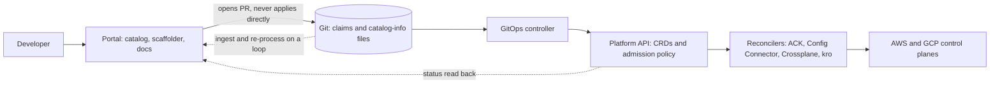

# Internal Developer Platforms and Backstage

## TL;DR

An internal developer platform (IDP) is a product with an API and an optional portal. The portal is a thin UI over that API, and a portal with no API behind it is ClickOps with a nicer theme.
The Backstage software catalog is a derived index, not a source of truth: every entity is re-fetched and re-processed on a jittered loop, and an entity is re-stitched only when its result hash changes (Backstage docs, as of 2026-10). Any nondeterminism you inject into processing (timestamps, unsorted arrays) turns an O(changes) system into an O(entities) one.
The Scaffolder is a workflow runner with no distributed transaction semantics: steps have side effects, there is no compensation, and a retry re-executes the steps. Make templates idempotent and minimal, and make the last step "open a pull request that adds a declarative claim", not "call the cloud".
Real self-service comes from a declarative platform API (CRDs plus admission policy plus reconcilers such as ACK, Config Connector, Crossplane or kro) driven by GitOps. The identity the reconciler runs as is the blast radius of every claim.
The portal and scaffolder are control plane and must be off the critical path of deploy and serve (static stability). Success is measured by adoption and by lead time, not by plugin count.

## Mental Model



Think of the platform as three decoupled layers.
The interaction layer (portal) collects intent and renders state, and it holds no authoritative state of its own beyond a rebuildable index.
The intent layer (Git plus the Kubernetes API machinery) stores desired state as versioned, reviewable, policy-checked objects.
The execution layer (reconcilers) converges cloud reality to that intent using its own narrowly scoped cloud identity.
Data flows down as pull requests and reconciliation and flows back up as status and catalog ingestion, and no layer calls a lower layer synchronously on the developer's click path. That is what lets the portal be down while every service keeps deploying and serving.

## Internals

### Platform as a product: the layering that matters

The CNCF platforms whitepaper and the platform engineering maturity model frame an IDP as a product with customers, capabilities and an interface (see Further Reading).
The mechanism-level consequence is a three-part split that most failed platforms collapse.

- A catalog: who owns what, what depends on what, where the runbook is. It is a read-optimized graph.
- A creation path: templates that stamp out repos and claims. It is write-once and it is workflow.
- A runtime API: declarative objects that are reconciled continuously. It is where drift is repaired.

Backstage covers the first two well and the third only through plugins. The third is Kubernetes API machinery plus reconcilers, and it is covered in [[17-Cloud-AI-Engineering/Volume_05_Kubernetes_and_Platform_Engineering/Chapter_01_Kubernetes_Control_Loop_Internals|Kubernetes Control Loop Internals]].
Backstage was accepted into the CNCF on 2020-09-08 and moved to the Incubating maturity level on 2022-03-15 (CNCF project page, as of 2026-10).

### The catalog pipeline: what getting-started guides skip

The getting-started path ends at "register a `catalog-info.yaml` and see it in the UI".
The mechanism underneath is a database-backed pipeline with three stages: ingestion, processing, and stitching (Backstage docs, "The Life of an Entity", as of 2026-10).

**Ingestion.**
Entity providers emit raw entities into the catalog, either as a full mutation (the provider's complete current set, so anything it previously emitted and now omits is removed) or as delta mutations (explicit adds and removes).
Static `Location` entities with URL targets are expanded by a processor that reads the target through an SCM integration.
The full-mutation semantics are the dangerous part: absence is interpreted as deletion, so a provider that returns an empty list because an upstream API call failed silently can delete everything it owns. This is covered in Failure Modes.

**Processing.**
Each unprocessed entity is held in a database table (`refresh_state` in the schema, UNVERIFIED this session) with a `next_update_at` timestamp.
A processing loop claims due rows, runs the processor chain in registration order (read location, validate, enrich, emit child entities and relations), and records the result and any errors.
Claiming is done in the database so that many backend replicas can run the loop concurrently without a leader. The mechanism is a row-lock style claim (`FOR UPDATE SKIP LOCKED` semantics, UNVERIFIED this session), and because it is coordination-free it scales by adding replicas until the database is the bottleneck.
After each pass the entity is rescheduled with a randomized delay, which the source sets to roughly 100 to 150 seconds by default (Backstage source, UNVERIFIED this session).
This is a constant-work design in the sense of [[17-Cloud-AI-Engineering/Volume_01_Cloud_Architecture_Principles/Chapter_05_Constant_Work_and_Workload_Smoothing|Constant Work and Workload Smoothing]]: every entity is re-read on every cycle whether or not it changed, which makes load a function of catalog size and not of change rate, and the jitter prevents synchronized waves.
The price is that the SCM read rate is also a function of catalog size, which interacts with API rate limits (see the worked example).

**Stitching.**
Stitching assembles the processed output, relations and errors into the "final entity" that the catalog API serves, and refreshes the search table (Backstage docs, as of 2026-10).
Whether an entity is re-stitched depends on a hash computed from the entity body, relations, errors, referred entities and entity parents after processing, and the hash is compared with the one from the previous pass (Backstage docs, as of 2026-10).
The docs call out a consequence that matters operationally: a change in array order, for example `metadata.tags`, changes the hash (Backstage docs, as of 2026-10). The same page also advises monitoring the stitched entity count because it can cause performance problems when it gets high.
Stitching is a fixed process that cannot be extended, so all customization has to happen in ingestion or processing (Backstage docs, as of 2026-10).
The hash short-circuit is the entire reason steady state is cheap: an unchanged entity costs one claim, one fetch and one hash compare. Anything that makes the processed output differ between passes defeats it.
A deferred stitching mode exists that decouples stitching from the processing transaction and runs it from a polling loop (`catalog.stitchingStrategy.mode: deferred`, UNVERIFIED this session). It trades read-after-write freshness for smoother database load during bulk changes.

**Ownership, conflicts, orphans.**
Entities have a location key identifying which provider or location owns them. If two sources emit the same entity reference (`kind:namespace/name`), the later one is rejected with a conflict error and the first writer keeps the entity (UNVERIFIED this session).
When a parent location or provider stops emitting an entity, the child becomes an orphan. It is marked with an orphan annotation and either kept or deleted depending on `catalog.orphanStrategy` (default `keep`, UNVERIFIED this session).

**Splitting the read path from the write path.**
The `CatalogProcessingEngine` interface documents that some backend instances may choose not to call `start` if they focus only on API interactions (Backstage API reference, as of 2026-10).
That is the supported seam for running a pool of API-only replicas that serve reads and a smaller pool that runs the processing and stitching loops, so that a stitch storm cannot starve interactive reads.

**Permissions are pushed into the query.**
The permission framework lets a policy return a conditional decision (for example "allow read if the entity's owner is one of the caller's groups"). The catalog turns conditions into a filter applied in the database query, not a post-filter in memory (UNVERIFIED this session).
This is why per-team catalog visibility is feasible at 10^4 entities and pagination stays correct. It also means rules must be expressible as indexed filters, and a policy that cannot be expressed that way forces a slow path.

**Backing store.**
Production deployments use PostgreSQL, and the catalog is the hottest consumer. Schema bloat from high-churn `UPDATE`s on `refresh_state` is a vacuum problem, covered in [[04-System-Design/05-Data-Stores/PostgreSQL-Architecture|PostgreSQL Architecture]].
The catalog is derived data. Disaster recovery means re-ingesting from Git and the providers, and the recovery time is bounded by processing throughput (catalog size divided by the cycle rate), not by a restore.

### The Scaffolder: workflow without durability

A software template (`apiVersion: scaffolder.backstage.io/v1beta3`, `kind: Template`) declares `parameters` (JSON Schema rendered as a form), `steps` (each an action with `input`), and `output` (links).
Values are interpolated with the `${{ ... }}` template syntax (UNVERIFIED this session).
A submitted form becomes a task row in the backend database. A worker in some replica claims it, creates a local workspace directory, and executes steps sequentially, appending log events that the UI streams (UNVERIFIED this session).
Four properties follow from that design and are not in the tutorials.

1. There is no saga. If step 3 fails after step 2 created a repository, nothing rolls step 2 back, and re-running the template hits "repository already exists".
2. The workspace is local disk. A replica restart mid-task loses the workspace and the task is either failed or, with the experimental recovery features, resumed (UNVERIFIED this session). Do not assume resumability without testing it.
3. Actions run with the backend's credentials (or a token the user supplied), so a template author has the privileges of the actions they can invoke. The template repository is therefore a privileged code path and needs review controls like production code.
4. Templates are create-time only. The generated repository diverges from the template the moment it is created, and there is no update path.

The design response is to make the Scaffolder do as little as possible: render a small set of files and open one pull request (an idempotent operation if the branch name is deterministic). Everything with side effects in the cloud happens in a reconciler after review.

### The platform API: Kubernetes machinery as the product surface

A durable self-service API is a CRD plus admission policy plus a reconciler.
A CRD defines the schema. CEL validation rules (`x-kubernetes-validations`) evaluate in the API server at admission without a webhook, and rules that reference `oldSelf` act as transition rules, which gives you immutability for free (Kubernetes docs, UNVERIFIED this session on GA version, believed 1.29).
Reconcilers consume the claim.

- AWS Controllers for Kubernetes (ACK) and Google Config Connector map Kubernetes objects one to one to cloud resources.
- Crossplane composes lower-level managed resources into a higher-level API using composition functions.
- kro (Kube Resource Orchestrator) defines a new API from a `ResourceGraphDefinition` and builds a dependency graph from expressions between resources, and it is pre-1.0 (UNVERIFIED this session).

Two properties decide whether this works. First, the API shape you publish is a contract you will support for years, so keep it small (cloud, data class, owner, retention) and let the composition choose the implementation. Second, each reconciler runs under a cloud identity, and that identity must be scoped per tenant namespace, not per cluster (see [[17-Cloud-AI-Engineering/Volume_08_Security_Identity_and_the_Data_Perimeter/Chapter_02_Workload_Identity_Federation|Workload Identity Federation]]). The multi-tenancy primitives that make that scoping enforceable are in [[17-Cloud-AI-Engineering/Volume_05_Kubernetes_and_Platform_Engineering/Chapter_05_Multi_Tenancy_Isolation_and_Resource_Quotas|Multi-Tenancy, Isolation, and Resource Quotas]].
Claims are delivered by GitOps, covered next in [[17-Cloud-AI-Engineering/Volume_05_Kubernetes_and_Platform_Engineering/Chapter_07_GitOps_Delivery_Argo_CD_and_Flux|GitOps Delivery: Argo CD and Flux]].

### Failure domains

The portal, the catalog database, the SCM integration, the management cluster API server, and the cloud control planes are separate failure domains.
Design so that losing the first three degrades creation and discovery but not deployment, and losing the fourth degrades convergence of new claims but not running workloads. This is the control plane versus data plane rule from [[17-Cloud-AI-Engineering/Volume_01_Cloud_Architecture_Principles/Chapter_04_Control_Plane_vs_Data_Plane_Separation|Control Plane vs Data Plane Separation]].

## Numbers to Know

| Quantity | Value | Source |
|---|---|---|
| Backstage CNCF acceptance / incubation | 2020-09-08 / 2022-03-15 | CNCF project page, as of 2026-10 |
| Re-stitch trigger | Hash over body, relations, errors, referred entities, parents | Backstage docs, as of 2026-10 |
| Array reorder (for example `metadata.tags`) | Changes the hash, forces a re-stitch | Backstage docs, as of 2026-10 |
| Default per-entity refresh interval | About 100 to 150 s, randomized | Backstage source, UNVERIFIED |
| GitHub REST primary limit, authenticated user | 5,000 requests per hour | GitHub docs, UNVERIFIED |
| GitHub App installation limit | 5,000 per hour base, scales with repos and users; 15,000 on Enterprise Cloud orgs | GitHub docs, UNVERIFIED |
| Conditional GET returning 304 | Does not count against the primary limit when authenticated | GitHub docs, UNVERIFIED |
| Backstage mainline release cadence | Monthly | Backstage project, UNVERIFIED |
| etcd default max request size | About 1.5 MiB | etcd docs, UNVERIFIED |
| etcd default backend quota | 2 GiB | etcd docs, UNVERIFIED |
| Model: 12,000 entities at 125 s mean | 96 processing cycles per second | Derived in the worked example |
| Model: 3,000 SCM files per cycle, no ETag | 86,400 reads per hour, 17.3x a 5,000 per hour budget | Derived in the worked example |
| Model: 40,000-entity full re-stitch at 30 ms, 4 workers | 300 s drain | Derived, assumptions stated |
| DORA 2024 finding on platform engineering | Individual productivity up, throughput and stability down for some teams | DORA 2024 report, UNVERIFIED figures |
| Managed Postgres list prices (RDS, Cloud SQL) | Omitted: not verified this session | n/a |

Every derived number depends on an assumption you must replace with a measurement from your own catalog.

## AWS vs GCP Mechanism Parity

| Concern | AWS | GCP | Critical difference |
|---|---|---|---|
| Portal hosting | EKS or ECS Fargate behind an ALB (see [[17-Cloud-AI-Engineering/Volume_02_AWS_Deep_Dive/Chapter_07_Amazon_EKS_Control_Plane_and_Networking\|EKS]]) | GKE or Cloud Run behind Cloud Load Balancing (see [[17-Cloud-AI-Engineering/Volume_03_GCP_Deep_Dive/Chapter_07_GKE_Deep_Dive_Standard_vs_Autopilot\|GKE]]) | Backstage keeps task workspaces on local disk, so serverless instances that scale to zero lose in-flight scaffolder tasks |
| Catalog database | RDS or Aurora PostgreSQL | Cloud SQL or AlloyDB PostgreSQL | Both are single-writer Postgres; the catalog write rate (about 2 statements per entity per cycle in the model) is the sizing driver, not storage |
| TechDocs publish store | S3 | Cloud Storage | Both are supported publishers (UNVERIFIED); build docs in CI and publish, do not build in the portal at request time |
| Cloud inventory feed | AWS Organizations, AWS Config, Resource Explorer | Cloud Asset Inventory | Community providers exist for EKS and GKE discovery (UNVERIFIED); model them as full-mutation providers and guard against empty results |
| K8s-native cloud resource API | ACK, per-service controllers with varying maturity | Config Connector | Config Connector is one distribution covering many resources, while ACK is a family of per-service controllers installed separately (UNVERIFIED) |
| Reconciler cloud identity | IRSA or EKS Pod Identity | GKE Workload Identity Federation | Scope per namespace; a cluster-wide role makes every claim author an admin |
| Preventive guardrails | SCPs, permission boundaries (see [[17-Cloud-AI-Engineering/Volume_02_AWS_Deep_Dive/Chapter_01_IAM_Policy_Evaluation_Engine\|IAM Policy Evaluation Engine]]) | Org Policy, IAM deny (see [[17-Cloud-AI-Engineering/Volume_03_GCP_Deep_Dive/Chapter_02_Cloud_IAM_Roles_Policies_and_Conditions\|Cloud IAM]]) | Guardrails must sit below the reconciler identity so a bad claim fails at the cloud, not only at admission |
| Managed template-of-infrastructure product | AWS Service Catalog; AWS Proton has an announced end of support (date UNVERIFIED) | Infrastructure Manager (Terraform based, GA status UNVERIFIED) | Do not build a new platform on a service with an announced end of support |
| Cost attribution | Cost allocation tags | Labels plus billing export to BigQuery | Propagate `owner` from the claim into tags or labels in the composition, not by developer convention |

## Worked Example: Catalog Capacity Model and a Claim-Based Golden Path

This lab is entirely local, so it provisions no billable cloud resources.
Estimated cost: 0 USD (a local `kind` cluster, a local Postgres container, and a Python script). No budget alarm is needed, and if you later point the portal at RDS or Cloud SQL, add a budget alarm before creating anything.
Teardown: `kind delete cluster --name idp-lab` and `docker rm -f idp-pg`.

### Step 1: Model catalog load before you scale it

Save as `catalog_capacity.py` and run it (standard library only).

```python
#!/usr/bin/env python3
"""Back-of-envelope model of Backstage catalog load. Standard library only.

All inputs are assumptions you must replace with measurements from your own deployment.
Usage: python3 catalog_capacity.py --entities 12000 --repos 3000
"""
import argparse
import hashlib
import json


def entity_hash(entity, sort_arrays=False):
    """Stand-in for the catalog result hash: any change to the serialized body flips it."""
    e = json.loads(json.dumps(entity))
    if sort_arrays:
        e["metadata"]["tags"] = sorted(e["metadata"].get("tags", []))
    return hashlib.sha256(json.dumps(e, sort_keys=True).encode()).hexdigest()[:12]


def main():
    p = argparse.ArgumentParser()
    p.add_argument("--entities", type=int, default=12000)
    p.add_argument("--repos", type=int, default=3000, help="distinct SCM files read per cycle")
    p.add_argument("--interval-s", type=float, default=125.0, help="mean refresh interval, seconds")
    p.add_argument("--stmts-per-cycle", type=float, default=2.0, help="DB statements per processing cycle with no change")
    p.add_argument("--stitch-ms", type=float, default=30.0, help="DB time per stitch, milliseconds")
    p.add_argument("--stitchers", type=int, default=4, help="concurrent stitch workers across replicas")
    p.add_argument("--changed-fraction", type=float, default=1.0, help="fraction of entities whose hash flips")
    p.add_argument("--scm-budget-per-hour", type=int, default=5000, help="SCM API calls per hour, unconditional")
    a = p.parse_args()

    proc_rate = a.entities / a.interval_s
    idle_stmts = proc_rate * a.stmts_per_cycle
    scm_per_hour = a.repos / a.interval_s * 3600
    stitch_seconds = a.entities * a.changed_fraction * (a.stitch_ms / 1000.0) / a.stitchers

    print("processing cycles per second     : %.1f" % proc_rate)
    print("idle DB statements per second    : %.1f" % idle_stmts)
    print("SCM reads per hour (no ETag)     : %.0f (budget %d, ratio %.1fx)" % (
        scm_per_hour, a.scm_budget_per_hour, scm_per_hour / a.scm_budget_per_hour))
    print("stitch storm drain time          : %.0f s (%.1f min)" % (stitch_seconds, stitch_seconds / 60))

    base = {"apiVersion": "backstage.io/v1alpha1", "kind": "Component",
            "metadata": {"name": "orders", "tags": ["java", "payments"]},
            "spec": {"type": "service", "owner": "group:default/team-a"}}
    reordered = json.loads(json.dumps(base))
    reordered["metadata"]["tags"] = ["payments", "java"]
    print("hash(base)                       :", entity_hash(base))
    print("hash(tags reordered)             :", entity_hash(reordered))
    print("hash(base, sorted)               :", entity_hash(base, True))
    print("hash(reordered, sorted)          :", entity_hash(reordered, True))


if __name__ == "__main__":
    main()
```

Output with defaults (12,000 entities, 3,000 repositories), as run in the authoring environment:

```text
processing cycles per second     : 96.0
idle DB statements per second    : 192.0
SCM reads per hour (no ETag)     : 86400 (budget 5000, ratio 17.3x)
stitch storm drain time          : 90 s (1.5 min)
hash(base)                       : 351aaa91eded
hash(tags reordered)             : 1263ee6344c7
hash(base, sorted)               : 351aaa91eded
hash(reordered, sorted)          : 351aaa91eded
```

Back-of-the-envelope reading:

1. Steady-state processing is 12,000 / 125 = 96 cycles per second, and at an assumed 2 statements per no-change cycle that is about 192 statements per second of pure idle churn. This is cheap for Postgres but it is nonzero write traffic that creates dead tuples, so autovacuum tuning matters.
2. If each of 3,000 repositories is fetched once per cycle with unconditional requests, that is 3,000 / 125 x 3,600 = 86,400 calls per hour, 17.3 times a 5,000 per hour budget. The catalog survives only because conditional requests (ETag, 304) and webhook-driven providers cut this by one to two orders of magnitude, so verify that your integration actually sends `If-None-Match` and that the 304 path is not rate-counted in your SCM tier.
3. A change that flips every hash (for example a bulk edit of an annotation, or a processor that stamps a time) forces 12,000 re-stitches. At an assumed 30 ms of database time with 4 stitch workers that drains in 90 seconds. At 40,000 entities it is 300 seconds. Measure your real stitch cost, because join-heavy relation rewrites are usually well above 30 ms.
4. The reorder demonstration shows why deterministic output matters: the same tags in a different order produce a different hash, matching the documented behavior. Sort any array your own processors emit.

Run `python3 catalog_capacity.py --entities 40000 --repos 8000` to see the 5-minute storm.

### Step 2: A small, versioned platform API

Apply this CRD to a local cluster (`kind create cluster --name idp-lab`, then `kubectl apply -f crd.yaml`). No reconciler is needed to exercise admission.

```yaml
apiVersion: apiextensions.k8s.io/v1
kind: CustomResourceDefinition
metadata:
  name: bucketclaims.platform.acme.example
spec:
  group: platform.acme.example
  scope: Namespaced
  names:
    kind: BucketClaim
    plural: bucketclaims
    singular: bucketclaim
  versions:
    - name: v1alpha1
      served: true
      storage: true
      subresources:
        status: {}
      schema:
        openAPIV3Schema:
          type: object
          required: [spec]
          properties:
            spec:
              type: object
              required: [cloud, dataClass, owner]
              properties:
                cloud:
                  type: string
                  enum: [aws, gcp]
                dataClass:
                  type: string
                  enum: [public, internal, confidential]
                owner:
                  type: string
                  maxLength: 63
                retentionDays:
                  type: integer
                  minimum: 1
                  maximum: 3650
              x-kubernetes-validations:
                - rule: "self.cloud == oldSelf.cloud"
                  message: "cloud is immutable after creation"
                - rule: "self.dataClass != 'confidential' || has(self.retentionDays)"
                  message: "confidential buckets must declare retentionDays"
            status:
              type: object
              x-kubernetes-preserve-unknown-fields: true
```

Test it: a `confidential` claim without `retentionDays` is rejected by the API server, and an update that changes `cloud` is rejected as a transition-rule violation. Both are enforced without a webhook, so there is no extra availability dependency in the admission path.

### Step 3: A template that only opens a pull request

```yaml
apiVersion: scaffolder.backstage.io/v1beta3
kind: Template
metadata:
  name: bucket-claim
  title: Request a Storage Bucket
  description: Opens a pull request that adds a BucketClaim to the platform claims repository.
  tags: [storage, golden-path]
spec:
  owner: group:default/platform-team
  type: resource
  parameters:
    - title: Bucket details
      required: [name, owner, cloud, dataClass]
      properties:
        name:
          type: string
          pattern: '^[a-z][a-z0-9-]{2,40}$'
        owner:
          type: string
          ui:field: OwnerPicker
          ui:options:
            catalogFilter:
              kind: [Group]
        cloud:
          type: string
          enum: [aws, gcp]
        dataClass:
          type: string
          enum: [public, internal, confidential]
        retentionDays:
          type: integer
          minimum: 1
          maximum: 3650
  steps:
    - id: render
      name: Render claim
      action: fetch:template
      input:
        url: ./skeleton
        values:
          name: ${{ parameters.name }}
          owner: ${{ (parameters.owner | parseEntityRef).name }}
          cloud: ${{ parameters.cloud }}
          dataClass: ${{ parameters.dataClass }}
          retentionDays: ${{ parameters.retentionDays }}
    - id: pr
      name: Open pull request
      action: publish:github:pull-request
      input:
        repoUrl: github.com?owner=acme&repo=platform-claims
        branchName: claim-${{ parameters.name }}
        title: "Add BucketClaim ${{ parameters.name }}"
        description: "Requested via Backstage by ${{ user.entity.metadata.name }}"
        targetPath: claims/${{ (parameters.owner | parseEntityRef).name }}
  output:
    links:
      - title: Pull request
        url: ${{ steps.pr.output.remoteUrl }}
```

The skeleton file `skeleton/${{ values.name }}.yaml`:

```yaml
apiVersion: platform.acme.example/v1alpha1
kind: BucketClaim
metadata:
  name: ${{ values.name }}
  namespace: ${{ values.owner }}
  labels:
    owner: ${{ values.owner }}
spec:
  cloud: ${{ values.cloud }}
  dataClass: ${{ values.dataClass }}
  owner: ${{ values.owner }}

  retentionDays: ${{ values.retentionDays }}

```

Why this shape:

- The branch name is deterministic (`claim-<name>`), so a retry after a partial failure converges instead of creating a second artifact.
- There is exactly one side-effecting step, so there is nothing to compensate.
- Validation is duplicated on purpose: the form schema gives fast feedback, and the CRD plus CEL rules are the authoritative check that cannot be bypassed by committing to Git directly.
- Ownership flows from the catalog (`OwnerPicker`) into the namespace and the label, which the composition later turns into cloud tags and labels for cost attribution.

### Step 4: Catalog registration and portal configuration

```yaml
apiVersion: backstage.io/v1alpha1
kind: Component
metadata:
  name: orders
  description: Order intake service
  tags: [java, payments]
  annotations:
    github.com/project-slug: acme/orders
    backstage.io/techdocs-ref: dir:.
    backstage.io/kubernetes-id: orders
spec:
  type: service
  lifecycle: production
  owner: group:default/team-a
  system: checkout
  dependsOn:
    - resource:default/orders-db
```

Run Postgres locally with `docker run -d --name idp-pg -e POSTGRES_PASSWORD=dev -p 5432:5432 postgres:16`, point `backend.database` at it with `client: pg`, and set `catalog.orphanStrategy: keep`. If you want to rehearse a bulk-change storm, try `catalog.stitchingStrategy.mode: deferred` (key names UNVERIFIED this session, check the installed version's config schema).
Create the app with the standard `@backstage/create-app` generator, and import the template via a `Location` entry.

### Step 5: Exercise the failure mode

Add a tiny custom processor that writes `metadata.annotations["acme.io/seen"] = new Date().toISOString()` and watch the stitched entity count and database write rate. Because the output differs on every pass, the hash short-circuit never fires and every entity is re-stitched every cycle. Remove it and the rate falls back to the idle floor.

## Failure Modes and Pitfalls

### Empty provider result deletes the catalog

A full-mutation provider treats absence as deletion. If the upstream call returns a successful but empty page (pagination bug, permission change, SCM outage behind a 200), the provider emits an empty set and the catalog removes every entity it owned.
Downstream consumers that resolve ownership or on-call routing from the catalog then fail at the worst moment.
The public analogue at much larger scale is the October 2025 AWS us-east-1 incident, in which automation applied an empty DNS record for a regional DynamoDB endpoint (AWS post-event summary, details UNVERIFIED this session). The lesson transfers directly: automation that treats "nothing" as a valid desired state needs a refuse-to-apply threshold.
Mitigations: refuse a mutation that removes more than a configured fraction (for example 10 percent) of a provider's entities, keep `orphanStrategy: keep`, snapshot the catalog's source files, and have consumers cache last-known-good ownership.

### Hash instability and stitch storms

Any processor that injects a timestamp, a random value, or an unsorted collection defeats the hash short-circuit, and a bulk change to a shared annotation re-stitches the whole catalog (Backstage docs on hash inputs, as of 2026-10).
Symptoms: steady high write rate with no commits, rising `stitched entities` counts, API latency during bulk edits.
Mitigations: deterministic processors, rolling bulk changes in batches, deferred stitching, and separating API-only replicas from the processing replicas.

### SCM rate-limit exhaustion and shared fate

The refresh loop plus scaffolder plus TechDocs all call the SCM. If they share one token, a catalog polling burst exhausts the quota and template runs fail with 403s.
Use separate GitHub Apps (or equivalent) per function, prefer webhook or event driven providers over polling, and alert on remaining quota.

### Partial failure in the Scaffolder

Step N+1 fails after step N created a repository, a ticket, or a cloud resource. The task is marked failed, retries collide, and humans clean up.
Mitigate with one side effect per template, deterministic names, and idempotent actions. Treat any template with more than one irreversible step as a defect.

### Template drift and the golden cage

Repositories created from a template diverge immediately, and a fix to the template reaches none of them.
Either invest in fleet update tooling (automated pull requests from a shared source such as reusable pipelines and a dependency bot) or push behavior into shared libraries and platform APIs where one change reaches everyone.
The opposite failure is a golden path so rigid that teams fork around it. Keep escape hatches that still register in the catalog so you retain visibility.

### The portal on the critical path

If deployment, rollback, or on-call tooling requires the portal, then a portal outage becomes a delivery outage.
Public control-plane incidents show the pattern at hyperscale: a globally replicated configuration or policy change is crash-looped by every consumer at once (Google Cloud incident of 2025-06-12 in the Service Control path, details UNVERIFIED this session).
Keep the portal as a lens and an initiator, with all execution paths available through Git and the Kubernetes API, and test them with the portal turned off.

### Platform API pitfalls

- Reconciler identity too broad: a claim author can create resources they could not create directly, which is a confused-deputy pattern. Bind each namespace to a narrowly scoped cloud identity and add a permission boundary or Org Policy under it.
- Poison-pill claims: one malformed claim can crash-loop a controller and stall every tenant. Bound the blast radius with per-tenant controller shards, as in [[17-Cloud-AI-Engineering/Volume_01_Cloud_Architecture_Principles/Chapter_03_Cell_Based_Architecture_and_Shuffle_Sharding|Cell-Based Architecture and Shuffle Sharding]].
- Cloud API throttling: thousands of claims resynced by controllers consume the same per-account API quotas as production traffic. Raise resync periods and isolate platform automation in its own account or project.
- Deletion semantics: deleting a claim may delete a bucket. Default to orphan or retain policies for stateful resources and require an explicit second step to destroy data.
- etcd budget: every claim and its managed resources are objects in etcd, and large composed resources approach the request size limit. Capacity-plan objects per tenant.

### Adoption failure

A platform nobody chooses is a cost center. The DORA 2024 research reported that platform engineering was associated with higher individual productivity but not uniformly better delivery throughput and stability (figures UNVERIFIED this session), which is consistent with platforms that add a layer without removing toil.
Measure adoption, time to first deploy, and ticket volume deflected, not plugin count.

### Upgrade treadmill

Backstage ships frequently (monthly mainline, UNVERIFIED) and has gone through backend and frontend system migrations. A heavily customized fork pays a recurring integration cost.
Prefer upstream extension points, keep custom code in plugins and modules, and budget a standing upgrade rotation.

## Security and Cost Angles

### Identity and permissions

- Treat the Scaffolder as a privileged deployment pipeline. Use a least-privilege GitHub App for repository creation, prefer user-delegated tokens for actions that should be attributable to the requester, and pass them as secrets so they do not appear in logs.
- Protect the template repository with CODEOWNERS and required review, since a template step is code that runs with backend credentials. Sandbox-escape class issues in template engines have occurred in the ecosystem (specifics UNVERIFIED), so keep the backend patched and its network egress restricted.
- Use the permission framework with conditional decisions for per-team visibility and for gating sensitive actions. Test policies with deny-by-default.
- The Kubernetes plugin should use read-only service accounts per cluster, and per-user OIDC identity where supported. Never use a local kubectl proxy mode in production.

### Encryption and network boundaries

- Encrypt the catalog database and TechDocs bucket with customer-managed keys (KMS on AWS, Cloud KMS CMEK on GCP) so that revoking the key is a kill switch. See [[17-Cloud-AI-Engineering/Volume_08_Security_Identity_and_the_Data_Perimeter/Chapter_04_Encryption_Key_Hierarchies_and_Envelope_Encryption|Encryption Key Hierarchies and Envelope Encryption]].
- Reach S3 or Cloud Storage over a gateway or interface endpoint (AWS) or Private Google Access with VPC Service Controls (GCP), and keep the database off public IPs. The perimeter design is in [[17-Cloud-AI-Engineering/Volume_08_Security_Identity_and_the_Data_Perimeter/Chapter_06_Constructing_an_Impenetrable_Data_Perimeter|Constructing an Impenetrable Data Perimeter]].
- Put the portal behind your corporate identity provider with short sessions. The backend's service-to-service tokens must not be reachable from the internet.

### Policy as code

Admission rules (CEL in the CRD, plus Kyverno or OPA) are the preventive layer, and cloud-side SCPs or Org Policy are the backstop. See [[17-Cloud-AI-Engineering/Volume_06_Infrastructure_as_Code_and_Delivery/Chapter_04_Policy_as_Code_OPA_Sentinel_and_Guardrails|Policy as Code: OPA, Sentinel, and Guardrails]].

### Cost levers

- Portal run cost is small (a few small replicas plus managed Postgres, list prices not quoted here because they were not verified this session). The dominant cost is engineers, so staff the platform team as a product team and track cost per supported service.
- Cut database load by lengthening the refresh interval for stable entity kinds, using event-driven providers, and eliminating non-deterministic processors.
- Build TechDocs in CI and publish to object storage instead of building at request time.
- Make the claim carry `owner`, and have the composition stamp it into cloud tags or labels, so showback works without developer discipline. Costs flow to the owning team through the same catalog identity.
- Default claims to the cheapest safe configuration (for example lifecycle rules on buckets) and make expensive options explicit enum values requiring review.
- Control runaway self-service with namespace quotas ([[17-Cloud-AI-Engineering/Volume_05_Kubernetes_and_Platform_Engineering/Chapter_05_Multi_Tenancy_Isolation_and_Resource_Quotas|quota chapter]]) and per-team budgets.

## Interview Questions and Model Answers

### Question 1 (L5 - Senior)

A team merges a corrected `catalog-info.yaml` but the portal shows the old owner for several minutes. Walk through what happens and how you would speed it up safely.

#### Model Answer

The file is read by a processor via the SCM integration when the owning `Location` entity is next processed.
Each entity has a scheduled next-update time with random jitter (roughly 100 to 150 seconds by default, UNVERIFIED), so the worst-case staleness is about one refresh interval plus processing queue delay, and several minutes means either a longer configured interval or a backlog.
After processing, the result is hashed. If the hash differs from the previous pass the entity is stitched into the final entity and the search table is refreshed (Backstage docs, as of 2026-10), and only then does the catalog API serve the new owner.
To speed it up safely, prefer an event-driven provider (SCM webhooks) so changes are pushed, or call the catalog refresh endpoint for the specific entity from CI after merge, instead of shortening the global interval.
Shortening the interval globally multiplies SCM reads and database writes for the whole catalog, which can exhaust rate limits.

#### Follow-up Interviewer Question

You halve the interval and the catalog goes stale for hours instead. What happened?

### Question 2 (L5 - Senior)

Design a software template that creates a new service repository. What do you put in it and what do you leave out?

#### Model Answer

Keep steps few and side effects idempotent.
Parameters are validated by JSON Schema (name pattern, owner from `OwnerPicker` limited to groups), and the template renders a minimal skeleton: source layout, CI workflow that calls a shared reusable pipeline, a `catalog-info.yaml`, and docs scaffolding.
Leave out anything that requires coordinated external state: do not create cloud resources, DNS entries, or tickets inside the template. Emit declarative claims in a pull request instead, so a reconciler does the work and retries are safe.
Use deterministic names so a re-run converges.
Prefer shared pipeline libraries over copied YAML because templates are create-time only and generated repositories never receive later template fixes.
Register the new component with `catalog:register` last, so a failure earlier leaves nothing visible.

#### Follow-up Interviewer Question

The repository was created but CI setup failed. The user clicks "retry" and gets an error. How do you design the template so retry works?

### Question 3 (L6 - Staff)

After a platform team renames a shared annotation across 40,000 entities, API p99 for the portal triples for 10 minutes and the database CPU saturates. Diagnose and prevent.

#### Model Answer

A rename changes the processed output for every entity, so every hash differs and every entity is re-stitched (Backstage docs on hash inputs, as of 2026-10).
Stitching rewrites the final entity, relation and search rows and is much heavier than the idle no-change cycle, and it runs on the same replicas and database that serve interactive reads.
My model: 40,000 entities at 30 ms of database time across 4 workers is 300 seconds, and real stitch cost is typically higher, which matches a 10 minute degradation.
Diagnosis: check stitched entity counts and processing throughput, correlate the database's write and lock waits with the commit that landed, and confirm that read latency rose from contention and not from the application.
Prevention in layers.
First, separate API-only replicas from processing replicas using the supported option of not starting the processing engine on read instances (Backstage API reference, as of 2026-10), so reads are not scheduled behind stitch work.
Second, enable deferred stitching if the version supports it (UNVERIFIED) to smooth load.
Third, make bulk changes safe by rolling them in batches or by dual-writing the old and new annotation during a migration window.
Fourth, add a pre-merge check that estimates blast radius (number of entities affected) for changes to shared files.
Fifth, size the database for the storm and watch autovacuum, since large rewrites cause bloat.

#### Follow-up Interviewer Question

How would you detect, in staging, that a new custom processor makes the catalog un-cacheable before it reaches production?

### Question 4 (L6 - Staff)

You must give 600 product engineers self-service access to storage buckets on both AWS and GCP without a ticket queue and without granting cloud admin. Design it and name what can go wrong.

#### Model Answer

Define a small, cloud-neutral `BucketClaim` CRD (cloud, data class, owner, retention) with CEL validation for invariants and immutability, delivered by a Backstage template that only opens a pull request against a claims repository.
GitOps applies the merged claim to a management cluster. A composition or graph definition maps it to ACK's S3 resources on AWS and Config Connector's storage resources on GCP, adding encryption keys, public access blocks, lifecycle rules and tags or labels derived from the owner.
The security core is the reconciler identity. Each tenant namespace maps to a distinct cloud identity (IRSA or Pod Identity on AWS, Workload Identity Federation on GCP) with a permission boundary or Org Policy beneath it, so a claim can never create something the tenant's identity could not.
Review is human only for risky classes, such as `confidential` or `public`, and CODEOWNERS plus admission policy encode that.
What can go wrong: confused-deputy privilege through an over-broad reconciler role; cloud API throttling from mass resyncs that affects production in the same account; delete semantics that destroy data (default to retain); poison-pill claims that stall a shared controller (shard controllers per tenant group); and status invisibility, which I handle by surfacing claim status and conditions in the catalog through the Kubernetes plugin.

#### Follow-up Interviewer Question

A team needs a bucket setting the CRD does not expose. How do you decide between adding a field, a new version, or an escape hatch?

### Question 5 (L6 - Staff)

Build Backstage, buy a commercial portal, or do neither? What would make you choose each?

#### Model Answer

Separate the decision in two: the platform API (CRDs, compositions, GitOps, policy) is mine to own regardless, because it encodes the company's operational contracts. The portal is a replaceable UI over it.
Backstage wins when you need deep customization, plugins for in-house systems, no per-seat pricing, and you can staff a product team that treats upgrades as a standing responsibility. Its costs are the upgrade treadmill, the catalog's operational complexity, and the fact that you build UX yourself.
A commercial portal wins when the team is small, time to value matters, and the catalog model and scorecards fit your needs. Its costs are the data model you do not control, per-seat pricing, and integration limits.
Neither wins when the organization is under roughly a couple hundred engineers and the real pain is a missing CI template and a spreadsheet of owners, in which case a catalog file convention and a docs site are enough.
Whichever you choose, keep the catalog schema close to `catalog-info.yaml` in Git so migration between portals is a re-ingest and not a data rescue.
I would define success metrics before starting: time from new service to first production deploy, share of services registered with an owner, template adoption, and deflected tickets.

#### Follow-up Interviewer Question

Leadership asks you to prove the platform is worth its headcount after a year. What do you measure and what would make you stop?

### Question 6 (L7+ - Principal)

A provider bug caused the catalog to drop 8,000 entities for 40 minutes. On-call paging, cost reports and deploy gating all read ownership from the catalog. Write the post-incident analysis and the design changes.

#### Model Answer

Root cause category: a full-mutation provider interpreted an empty upstream response as an empty desired state, a pattern that mirrors other public incidents where automation applied an empty record (for example the October 2025 AWS regional DNS event, details UNVERIFIED). The deeper cause is that critical systems treated a rebuildable index as the system of record.
Contributing factors: no safety threshold on mutation size, consumers calling the catalog synchronously on the critical path, no last-known-good cache, and recovery time bounded by processing throughput (entities divided by cycle rate, about 96 per second in my model for 12,000 entities, so catalog size over cycle rate is the floor).
Design changes.
Prevent: a provider guardrail that refuses a mutation removing more than a set fraction of its entities and pages a human, plus `orphanStrategy: keep` so removal is not destructive by default.
Contain: consumers read ownership from an exported snapshot (a versioned file in object storage written on each healthy sync), so paging and deploy gating survive a catalog outage. Static stability applies to the control plane's dependents.
Recover: a documented rebuild path from Git, and a pre-computed estimate of rebuild time, rehearsed in a game day.
Detect: alert on entity count deltas by kind, not only on API availability, because the API was healthy while serving the wrong answer.
Organizational: classify the catalog tier by the consumers that depend on it, and give those consumers an SLO and a documented degraded mode.

#### Follow-up Interviewer Question

How would you test the guardrail without a real upstream failure, and what false positives would it cause during a legitimate reorganization?

### Question 7 (L7+ - Principal)

You are the platform lead for 3,000 engineers, two clouds, four regions, and 12,000 components. Describe the architecture, the SLOs, and what must keep working when the platform is down.

#### Model Answer

Layering: Git is the source of truth for intent. A small number of management clusters host the platform API (CRDs, compositions, admission policy) and reconcilers, sharded per tenant group to bound blast radius. The portal is a stateless set of replicas plus Postgres, with an API-only pool and a processing pool.
Invariants: nothing needed to deploy, roll back, scale or page may depend on the portal or the catalog's live availability. Deployment goes through Git and GitOps, paging reads an exported ownership snapshot, and the portal is allowed to be down for hours without a customer-visible effect.
SLOs differ by plane. The portal read path is a convenience SLO (for example 99.5 percent). Claim-to-ready for common resources is a latency SLO with an error budget owned by the platform team (for example p95 under 10 minutes). The reconciliation correctness SLO is about drift and failed-to-converge counts. Deploy-path components follow the strictest targets.
Evolution: version the platform API with a deprecation policy and conversion webhooks only when unavoidable, publish a golden path per workload shape, and measure adoption.
Risk management: per-tenant cloud identities, cloud-side guardrails under every reconciler, quotas on claims per namespace and on cloud API usage, and game days that turn the portal and catalog off.
Sizing: catalog load scales with entities over the refresh interval, so I would shard or at least isolate by business unit only if the database becomes the limit, and I would use events instead of polling to keep SCM calls within quotas.

#### Follow-up Interviewer Question

Two business units want incompatible shapes for the same claim, and one threatens to build its own platform. What do you do?

### Question 8 (L7+ - Principal)

Argue against building a Scaffolder-based provisioning workflow for cloud infrastructure. When, if ever, is it the right choice?

#### Model Answer

The Scaffolder has no durability, retry or compensation semantics. Steps are executed once per task by a worker holding a local workspace, side effects are not transactional, and recovery after a restart is limited (UNVERIFIED on the experimental recovery features). Using it to provision a database, network and IAM roles produces partially built stacks and unrecoverable half states.
It also holds powerful credentials and is invoked synchronously from a UI, so every provisioning request is exposed to portal availability, SCM rate limits and the user's browser session.
A reconciler gives level-triggered convergence, drift repair, deletion handling and status, none of which a one-shot workflow offers.
It is the right choice for create-time work that is naturally one-shot and reversible: stamping a repository, opening a pull request, registering a component, or filing a claim.
A middle path is to let the Scaffolder dispatch to a real workflow engine (for example a CI pipeline or durable workflow service) and poll its status, and then the template is only the front door.

#### Follow-up Interviewer Question

Product wants the portal to show live provisioning progress. Where does that state live, and how do you keep the portal from becoming the source of truth?

## Further Reading

- [Backstage: The Life of an Entity](https://backstage.io/docs/features/software-catalog/life-of-an-entity/) - the primary description of ingestion, processing and stitching, including the hash inputs that decide re-stitching.
- [Backstage catalog configuration](https://github.com/backstage/backstage/blob/master/docs/features/software-catalog/configuration.md) - processors, providers and the knobs that change catalog load.
- [Backstage project page at the CNCF](https://www.cncf.io/projects/backstage/) - authoritative maturity and acceptance dates.
- [CNCF announcement: Backstage joins the Incubator](https://www.cncf.io/blog/2022/03/15/backstage-project-joins-the-cncf-incubator/) - context for the project's governance move.
- [CatalogProcessingEngine reference](https://backstage.io/docs/reference/plugin-catalog-backend.catalogprocessingengine/) - documents running API-only instances that do not start the processing loop.
- [CNCF Platforms whitepaper](https://tag-app-delivery.cncf.io/whitepapers/platforms/) - the vendor-neutral definition of platform capabilities and platform-as-product (link not re-fetched this session).
- [CNCF Platform Engineering Maturity Model](https://tag-app-delivery.cncf.io/whitepapers/platform-eng-maturity-model/) - a framework for staging investment and measuring outcomes (link not re-fetched this session).
- [DORA research program](https://dora.dev/research/) - empirical evidence on platform engineering and delivery performance (link not re-fetched this session).
- [Crossplane documentation](https://docs.crossplane.io/) - composition and function model for building higher-level APIs (link not re-fetched this session).
- [kro project](https://github.com/kro-run/kro) - the graph-of-resources approach to defining platform APIs, a pre-1.0 project (link not re-fetched this session).
- [GitHub REST API rate limits](https://docs.github.com/en/rest/using-the-rest-api/rate-limits-for-the-rest-api) - the quota and conditional request rules that bound catalog polling (link not re-fetched this session).
- Team Topologies (Skelton and Pais, 2019) - the organizational model behind platform teams and cognitive load.
- [[17-Cloud-AI-Engineering/Volume_01_Cloud_Architecture_Principles/Chapter_04_Control_Plane_vs_Data_Plane_Separation|Control Plane vs Data Plane Separation]] - the architectural rule that keeps the portal off the critical path.
- [[17-Cloud-AI-Engineering/Volume_05_Kubernetes_and_Platform_Engineering/Chapter_01_Kubernetes_Control_Loop_Internals|Kubernetes Control Loop Internals]] - the reconciliation mechanics that every platform API depends on.
- [[04-System-Design/07-Infrastructure-and-Orchestration/Kubernetes-Architecture|Kubernetes Architecture]] - background on API server, etcd and admission.

## See also in Developer Toolchain

- [[Platform-Engineering-Paved-Roads-and-Deprecation]], [[Cross-Pillar-Design-Scenario-Bank]]
