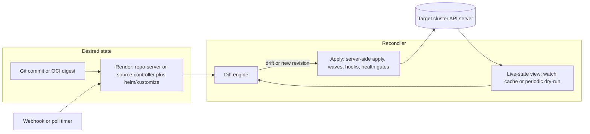

# GitOps Delivery: Argo CD and Flux

## TL;DR

1. GitOps is a level-triggered control loop whose desired state is an immutable, versioned artifact (a Git commit or OCI digest), and the reconciler pulls it from inside the trust boundary, so no CI system holds cluster credentials.
2. Argo CD keeps a watch-driven cache of live objects and diffs it against manifests rendered by a separate repo-server, so drift is noticed in seconds. Flux has no live-object cache, so drift is noticed only at the next `interval`.
3. Neither tool gives atomic multi-resource rollout. Argo CD orders work with phases, waves and hooks. Flux orders it with `dependsOn` and health checks. "Atomic rollback" in practice means "revert the artifact and converge again", and it is bounded by detection time, notice time, render time, apply time and health time.
4. Fleet-wide delivery fails by blast radius, not by throughput. An ApplicationSet whose generator returns the wrong list, or a template change that hits every cluster in one reconcile, is a global outage unless you add rings, `applicationsSync` policy and promotion gates.
5. The reconciler is control plane, not data plane. Design for static stability: if Git, the registry or the hub is down, running workloads must keep serving, and you need a tested break-glass path that suspends reconciliation before anyone runs `kubectl edit`.

## Mental Model



The system has two independent clocks and one comparison.
The first clock tells the reconciler that desired state may have changed. It is a Git poll, an OCI tag poll or a webhook.
The second clock tells it that live state may have changed. It is a watch event in Argo CD, or the `interval` timer in Flux.
The comparison renders desired state into concrete objects, normalizes both sides, and applies the delta.
Everything interesting about the two products is a different answer to three questions.
What is cached, and under what key?
What counts as a difference?
What happens when the apply is partial?
The controllers sit on the control plane of each workload cluster, as described in [[17-Cloud-AI-Engineering/Volume_01_Cloud_Architecture_Principles/Chapter_04_Control_Plane_vs_Data_Plane_Separation|Control Plane vs Data Plane Separation]].
They are never in the request path of the workloads they deploy.

## Internals

### Why a reconcile loop and not a pipeline

The pipeline model (CI runs `kubectl apply` or `helm upgrade` with a deploy credential) is edge-triggered.
It acts once per commit and knows nothing about what happens afterwards.
A reconcile loop is level-triggered: it keeps comparing "what should be" with "what is" until they match.
This is the same lineage as Borg and Kubernetes controllers, described in [Borg, Omega, and Kubernetes](https://queue.acm.org/detail.cfm?id=2898444) (ACM Queue, 2016) and in [[17-Cloud-AI-Engineering/Volume_05_Kubernetes_and_Platform_Engineering/Chapter_01_Kubernetes_Control_Loop_Internals|Kubernetes Control Loop Internals]].
The operational argument for convergence over scripted ordering is older. Traugott and Brown, "Why Order Matters: Turing Equivalence in Automated Systems Administration" (LISA 2002), argue that a host's state should be defined by a declared target, not by the history of commands run against it.
[OpenGitOps](https://opengitops.dev/) states the pattern as four principles: declarative, versioned and immutable, pulled automatically, continuously reconciled.

### Argo CD: components and data flow

Argo CD is split into an API server, a repo-server, an application-controller (a StatefulSet), Redis, and optional Dex, ApplicationSet-controller and notifications-controller.
<!-- sources: Argo CD HA docs, as of 2026-10 -->
Argo CD is largely stateless: all durable data lives as Kubernetes objects in etcd, and Redis is a disposable cache that can be rebuilt without service disruption (Argo CD HA docs, as of 2026-10).
The application-controller asks the repo-server for rendered manifests and asks the Kubernetes API server for live state (Argo CD HA docs, as of 2026-10).
That split matters because the two halves fail differently.
Rendering is CPU-bound and horizontally scalable.
Live-state tracking is memory-bound and sharded by cluster.

### Mechanism 1: the cluster cache is the source of drift detection, and it holds more than you manage

The application-controller does not `GET` each managed object on each reconcile.
It runs a long-lived list-and-watch against every API resource type it discovers in every target cluster, and keeps the results in an in-process cluster cache (the `gitops-engine` library).
Three consequences are absent from getting-started guides.

- Memory scales with the total number of watched objects in the target clusters, not with the number of Applications.
  A cluster full of CRD-backed objects (policy reports, CNI identities, Crossplane managed resources) inflates the controller even if Argo CD manages 5 of them.
  The mitigation is `resource.exclusions` and `resource.inclusions` in `argocd-cm`.
  Defaults already exclude high-churn kinds such as Events, Leases and EndpointSlices (UNVERIFIED: exact default list).
- A watch event on a managed object triggers a comparison for the owning Application. This is why drift appears in seconds.
  Ownership is resolved through the resource tracking label or annotation.
  Annotation-based tracking (`argocd.argoproj.io/tracking-id`) is the default in Argo CD 3.x (UNVERIFIED).
  Label-based tracking (`app.kubernetes.io/instance`) was the older default and collides with Helm charts that set the same label.
- On controller restart, the cache is rebuilt by LISTing every resource type in every cluster.
  Many controller replicas restarting together is a LIST storm against managed API servers.
  The resync is a real load event for EKS and GKE API servers, so it needs the same care as any other bulk reader. See [[17-Cloud-AI-Engineering/Volume_02_AWS_Deep_Dive/Chapter_07_Amazon_EKS_Control_Plane_and_Networking|Amazon EKS: Control Plane and Networking]] and [[17-Cloud-AI-Engineering/Volume_03_GCP_Deep_Dive/Chapter_07_GKE_Deep_Dive_Standard_vs_Autopilot|GKE Deep Dive: Standard vs Autopilot]].

### Mechanism 2: two refresh levels and a manifest cache keyed by commit

Argo CD has a normal refresh and a hard refresh.
A normal refresh re-compares live state against cached rendered manifests.
A hard refresh invalidates the manifest cache and forces a re-render.
You trigger one with the annotation `argocd.argoproj.io/refresh: normal` or `hard`.
The repo-server caches rendered manifests in Redis (24 hours per a secondary source, as of 2026-10), keyed by repository revision (the resolved commit SHA) plus the source parameters.
Revision resolution (`ls-remote` of a branch or tag) has its own short-lived cache (UNVERIFIED: 3 minutes by default).

The key design property is that the cache key includes the commit SHA.
In a monorepo, one commit anywhere changes the SHA for every Application pointing at that repo, so every Application misses the cache and re-renders.
At 2,000 Applications this is a stampede of `helm template` and `kustomize build` runs on the repo-server.
The fix is the annotation `argocd.argoproj.io/manifest-generate-paths`, which lists the repo paths an Application's output depends on.
When a webhook arrives, Argo CD compares the changed files with those paths.
Applications whose paths were not touched keep their cached manifests, and the cache is carried forward to the new revision instead of being re-rendered.
Paths in the annotation are relative to the Application's source path by default and absolute if they start with `/` (UNVERIFIED).
Wrong paths are dangerous because an app that depends on a shared base outside its listed paths will silently not update.

### Mechanism 3: diffing, normalization and server-side apply

Argo CD's comparison is a three-way structured diff over desired, live and last-applied state, after normalization.
Normalization strips fields the API server defaults or other controllers mutate.
You can add to it with `ignoreDifferences` (by `jsonPointers`, `jqPathExpressions` or `managedFieldsManagers`).
`ignoreDifferences` affects only the diff.
It does not stop a sync from overwriting the field unless you also set the sync option `RespectIgnoreDifferences=true`.

The default apply is client-side, equivalent to `kubectl apply`.
It stores the full last-applied object in an annotation, and the API server caps total annotation size at 256 KiB (262144 bytes) (Kubernetes docs, UNVERIFIED in this session).
Large CRDs, including Argo CD's own ApplicationSet CRD, exceed that limit and fail with a "Too long" error.
Setting `ServerSideApply=true` removes the annotation and uses server-side apply under the field manager `argocd-controller`.
The controller also has an optional server-side diff, which dry-run applies to the API server and diffs the result.
It is off by default as a controller flag (`--server-side-diff-enabled`, Argo CD controller CLI reference, as of 2026-10) and can be enabled per Application through the `compare-options` annotation (UNVERIFIED syntax).
Server-side diff is more accurate with admission webhooks and defaulting, at the cost of one dry-run write call per compared object.

### Mechanism 4: server-side apply field ownership defines what "drift" means

Under server-side apply, every field has an owner recorded in `metadata.managedFields`.
An applier owns only the fields it declared.
A field the manifest does not mention can be changed by someone else, such as an HPA owning `spec.replicas`, and the applier neither sees it as drift nor reverts it (Kubernetes server-side apply docs).
A field the manifest does declare is the applier's.
If you declare `replicas: 3` and an HPA writes 8, you get a conflict or a revert loop, depending on the force setting.
This gives "partial ownership" drift semantics that the old three-way merge could not express.
The practical rule is to omit any field you want another controller to own (replicas under HPA, resources under VPA, injected sidecars).
Do not try to "ignore" it after the fact.

### Sync execution: phases, waves, hooks, health

A sync runs in ordered phases: PreSync, Sync, PostSync, with SyncFail on failure (and PostDelete in newer versions).
Within a phase, resources are grouped by an integer sync-wave annotation and applied in ascending order.
Argo CD waits for each wave to be healthy before moving on, with a small delay between waves (UNVERIFIED: 2 seconds, `ARGOCD_SYNC_WAVE_DELAY`).
Hooks are Jobs, Pods or other resources annotated `argocd.argoproj.io/hook`, with delete policies `HookSucceeded`, `HookFailed` and `BeforeHookCreation`.
Health is computed per kind, with Lua overrides for CRDs.
A failed PreSync hook stops the sync before any Sync-phase resource is touched.
This is the only genuinely transactional-looking behavior, and it covers the ordering of hooks, not rollback of what already applied.

### Sharding and scaling

The application-controller shards by cluster, not by Application.
Increase the StatefulSet replicas and set `ARGOCD_CONTROLLER_REPLICAS` to the same value (Argo CD HA docs, as of 2026-10).
The distribution method is selected with `--sharding-method`: `legacy` (UID-based and non-uniform, the default), `round-robin`, or `consistent-hashing` (Argo CD controller CLI reference, as of 2026-10).
You can pin a cluster to a shard with the `shard` property on the cluster secret (Argo CD HA docs, as of 2026-10).
One enormous cluster cannot be split across shards.
Its cache lives wholly in one controller process, so the largest cluster sets the minimum controller memory.
`ARGOCD_APPLICATION_TREE_SHARD_SIZE` caps how many resources are stored per Redis key, which reduces controller-to-Redis traffic (Argo CD HA docs, as of 2026-10).
Redis compression for controller writes defaults to gzip (Argo CD controller CLI reference, as of 2026-10).

Redis is a trust boundary, not just a cache.
Cached rendered manifests are applied as-is, so anything that can write to Redis can inject manifests into every cluster the controller can reach.
Argo CD has had a security advisory in this area (UNVERIFIED: advisory ID, believed to be a 2024 Redis authentication issue).
Rendered Secrets (from Helm values, for example) also sit in Redis in the clear unless you encrypt at the transport layer and restrict access.

### Flux: controllers, artifacts, and interval-driven convergence

Flux is a toolkit of controllers, each with its own CRDs:

- **source-controller** fetches `GitRepository`, `OCIRepository`, `HelmRepository`, `HelmChart` and `Bucket` sources and packages them as immutable, content-addressed artifacts served over an in-cluster HTTP endpoint.
  Each artifact has a revision (for example `main@sha1:...` or an OCI digest).
- **kustomize-controller** fetches an artifact, runs kustomize build (with optional SOPS decryption and `postBuild` variable substitution), applies with server-side apply under the field manager `kustomize-controller`, prunes objects it no longer renders, and runs health assessment (kstatus) when `wait: true` or `healthChecks` are set.
- **helm-controller** reconciles `HelmRelease` by driving the Helm SDK in-cluster, including install and upgrade remediation (retries, rollback) and optional drift detection (`spec.driftDetection.mode`: `enabled`, `warn`, `disabled`).
- **notification-controller** turns events into alerts and handles inbound `Receiver` webhooks that annotate a source with `reconcile.fluxcd.io/requestedAt` to force an immediate fetch.
- **image-reflector and image-automation controllers** scan registries and write new image tags back to Git, using marker comments in manifests.

The Flux model has no live-object cache.
kustomize-controller reconciles each Kustomization when the source revision changes and at every `spec.interval`.
On each run it computes a server-side dry-run against the live object and applies only if there is a difference.
Drift correction latency is therefore up to one `interval`, and the controller does no work between runs except on events for its own CRDs.
That makes Flux's steady-state load flat and predictable (it scales with Kustomization count over interval) and its memory small, in exchange for slower drift reaction.
`retryInterval` governs retries after failure (UNVERIFIED: defaults to `interval`).

A Flux-specific operational property is that the artifact is the unit of delivery.
kustomize-controller reconciles from the last fetched artifact. If the Git host is down but source-controller still serves its stored artifact, drift correction continues.
If source-controller itself is down, Kustomizations cannot fetch and stop converging, but nothing running is touched.
Combine this with OCI as the source (`OCIRepository`, pushed by CI) and the Git host leaves the runtime path entirely.
`OCIRepository` supports semver tag selection and signature verification with cosign or notation (`spec.verify`), and has a `provider` field for `aws`, `gcp` or `azure` registry authentication through workload identity (UNVERIFIED in this session).

### Drift detection compared

| Aspect | Argo CD | Flux |
| --- | --- | --- |
| Live-state source | Watch cache of all discovered kinds | Server-side dry-run per reconcile |
| Drift latency | Seconds (watch event) plus processing queue | Up to `interval` (or `flux reconcile`) |
| Steady-state cost | Memory proportional to cluster object count | CPU and API calls proportional to Kustomizations over interval |
| Self-heal | `syncPolicy.automated.selfHeal`, with a timeout between attempts (`--self-heal-timeout-seconds`, Argo CD controller CLI reference, as of 2026-10) | Default behavior on each reconcile |
| Failed auto-sync retry | Not retried for the same revision and parameters unless a `retry` policy is set (UNVERIFIED) | Retried on `retryInterval` |
| Ordering | Phases, waves, hooks | `dependsOn` plus health gates between Kustomizations |

### ApplicationSet internals

An ApplicationSet is a template plus generators.
Each generator emits a list of parameter maps.
The ApplicationSet controller renders the template once per map and owns the resulting Application objects.
Generators include List, Cluster (from cluster secrets), Git (directories or files), SCM Provider, Pull Request, Cluster Decision Resource, Plugin, and the combinators Matrix and Merge.
Two properties dominate operations.

1. The desired set of Applications is itself a reconciled quantity.
   If a generator returns fewer items, the controller deletes the corresponding Applications.
   If those Applications carry the `resources-finalizer.argocd.argoproj.io` finalizer, deleting them deletes the workloads they deployed.
   A transient empty result, from an SCM API outage, a bad selector, or a deleted cluster secret, can therefore become mass deletion.
   The guards are the ApplicationSet `syncPolicy.applicationsSync` setting (`create-only`, `create-update`, `create-delete`, `sync`), `preserveResourcesOnDeletion: true`, and omitting the resources finalizer on production Applications (policy names UNVERIFIED in this session).
2. A template change fans out to every generated Application in one controller pass.
   There is no built-in ordering across clusters unless you enable Progressive Syncs (`strategy.type: RollingSync` with label-matched steps and `maxUpdate`), which was an alpha feature behind a controller flag (UNVERIFIED: current maturity, check release notes before relying on it).

Flux has no direct ApplicationSet analogue in the core toolkit.
Fleets typically use one Kustomization per cluster directory, a Git directory layout per cluster or ring, and `postBuild.substituteFrom` for per-cluster variables.
The Flux Operator project adds `ResourceSet` and `ResourceSetInputProvider` for templating and for pull-request inputs (UNVERIFIED: GA status).

### Atomic rollback: what is and is not atomic

Neither tool applies a set of resources transactionally.
The Kubernetes API has no multi-object transaction, so any apply of N objects has N-1 intermediate states.
What you can get is the following.

- **A single immutable revision** as the unit of rollback. Revert the commit, or move the OCI tag, and the loop converges the cluster to the previous state.
- **Ordered application** with health gates, so dependents never start before their dependencies.
- **Per-release rollback** in Helm, which Flux drives through `HelmRelease` remediation. This is the closest thing to atomic, scoped to one release.
- **Argo CD history rollback**, `argocd app rollback`, which re-syncs to a previous history entry. It is disabled while automated sync is on (because the loop would immediately undo it), and history depth is bounded by `revisionHistoryLimit` (UNVERIFIED: default 10).
  In a GitOps workflow, `git revert` is the correct rollback, and history rollback is an emergency lever.

Rollback time is a sum, not a constant:

`T_rollback = T_detect + T_decide + T_commit_and_merge + T_notice + T_render + T_apply + T_health`

`T_notice` is near zero with a webhook, and up to poll interval plus jitter without one (UNVERIFIED defaults: 180 s and 60 s for Argo CD).
Rollback also cannot undo one-way state changes such as database migrations or schema registrations.
The AWS Builders' Library article [Ensuring rollback safety during deployments](https://aws.amazon.com/builders-library/ensuring-rollback-safety-during-deployments/) is the canonical treatment: make the old version tolerate the new version's persisted state before you ship the new one (two-phase, expand-then-contract changes).

### Multi-cluster topologies and failure domains

| Topology | Credential flow | Blast radius of reconciler compromise | Failure domain of reconciler outage |
| --- | --- | --- | --- |
| Hub-and-spoke Argo CD | Hub holds a credential for every spoke | All spokes | All drift correction and all deployments, while workloads keep running |
| Per-cluster Argo CD or Flux (pull) | Each cluster pulls from Git or OCI with read-only credentials | One cluster | One cluster |
| Flux with `kubeConfig` to remote clusters | Hub-side controller holds remote credentials | All reachable remotes | Same as hub-and-spoke |
| Agent model (Argo CD agent project) | Agent initiates outbound connection to a principal | Depends on the principal | UNVERIFIED: maturity and GA status |

The pull-per-cluster topology matches the cell boundary described in [[17-Cloud-AI-Engineering/Volume_01_Cloud_Architecture_Principles/Chapter_03_Cell_Based_Architecture_and_Shuffle_Sharding|Cell-Based Architecture and Shuffle Sharding]].
Hub-and-spoke gives a single pane of glass and cheap fleet operations in exchange for a high-value credential store and a global failure domain.
Hub credentials on EKS are normally short-lived tokens from an exec provider using an IAM role, and on GKE they come through Workload Identity or the Connect gateway (UNVERIFIED in this session).
Static bearer tokens in cluster secrets are the failure mode to avoid.

### GitOps for AI platforms

GPU platforms add two GitOps-specific hazards.
The first is health-gate timing.
A Deployment serving a large model may not become Ready for minutes because of image pulls and weight loading, as covered in [[17-Cloud-AI-Engineering/Volume_11_LLM_Serving_and_Inference_Systems_on_Cloud/Chapter_08_Cloud_GPU_Autoscaling_and_Cold_Start_Mitigation|Cloud GPU Autoscaling and Cold-Start Mitigation]].
Argo CD waves and Flux `timeout` must exceed worst-case cold start, or the tool will mark a healthy rollout failed, and with Helm remediation roll it back.
The second is node-level addons (device plugins, drivers, network operators) that must exist before workloads schedule.
Model them as an earlier wave or a `dependsOn` parent, and keep model weights out of Git: pin an image digest and a weights URI or version in the manifest.

## Numbers to Know

Items marked "verified" were checked against official Argo CD documentation in this authoring session.
Everything marked UNVERIFIED is believed correct from prior documentation but was not re-checked on 2026-10-21, and is listed in the batch report.

| Item | Value | Source and status |
| --- | --- | --- |
| Argo CD controller sharding unit | Cluster | Argo CD HA docs, as of 2026-10, verified |
| Sharding methods | `legacy` (default, UID-based, non-uniform), `round-robin`, `consistent-hashing` | Argo CD controller CLI reference, as of 2026-10, verified |
| Controller `--status-processors` default | 20 | Argo CD controller CLI reference, as of 2026-10, verified |
| Redis compression default | gzip | Argo CD controller CLI reference, as of 2026-10, verified |
| Redis role | Disposable cache, safe to rebuild | Argo CD HA docs, as of 2026-10, verified |
| Bundled Redis HA topology | Built for exactly 3 Redis servers or sentinels | Argo CD HA docs, as of 2026-10, verified |
| Rendered manifest cache TTL | 24 hours | Secondary source (devopscube, as of 2026-10), not primary docs |
| Metrics ports (controller, server, repo-server) | 8082, 8083, 8084 | Secondary source (devopscube, as of 2026-10) |
| Argo CD Git poll default | 180 s plus jitter (60 s) | Argo CD docs, UNVERIFIED |
| Operation processors default | 10 | Argo CD docs, UNVERIFIED |
| Sync wave inter-wave delay | 2 s | Argo CD docs, UNVERIFIED |
| `revisionHistoryLimit` default | 10 | Argo CD docs, UNVERIFIED |
| Last-applied annotation ceiling | 262144 bytes total annotations | Kubernetes API validation, UNVERIFIED |
| etcd default max request size and backend quota | 1.5 MiB request, 2 GiB quota | etcd docs, UNVERIFIED |
| GitHub REST rate limit, authenticated user | 5,000 requests per hour | GitHub docs, UNVERIFIED |
| Flux `retryInterval` default | Equal to `interval` | Flux docs, UNVERIFIED |
| Managed control plane and node list prices | Not stated | Not verified, read the pricing pages before costing a managed variant |

Derived numbers from the capacity model in the worked example use assumed inputs (stated there), not measurements.

## AWS vs GCP Mechanism Parity

| Concern | AWS | GCP | Critical difference |
| --- | --- | --- | --- |
| Managed GitOps controller | Amazon EKS Capabilities includes a managed Argo CD, announced around re:Invent 2025 (UNVERIFIED: GA status and scope) | Config Sync (RootSync and RepoSync) from the Fleet and GKE Enterprise feature set (UNVERIFIED: edition and pricing) | EKS option runs the upstream Argo CD API. Config Sync is Google's own reconciler with its own CRDs, so Argo or Flux manifests do not port directly. |
| Self-managed Argo CD or Flux | Fully supported on EKS | Fully supported on GKE | Self-managed means you own upgrades, sharding, Redis and the credential store. |
| Workload cluster auth from a hub | IAM role via exec token, EKS access entries or aws-auth (UNVERIFIED mapping details) | Workload Identity, Connect gateway for private clusters (UNVERIFIED) | EKS tokens are short-lived presigned STS requests. Both clouds eliminate long-lived keys if configured. See [[17-Cloud-AI-Engineering/Volume_08_Security_Identity_and_the_Data_Perimeter/Chapter_02_Workload_Identity_Federation\|Workload Identity Federation]]. |
| In-cluster identity for controllers | IRSA or EKS Pod Identity | GKE Workload Identity Federation | Needed for ECR or Artifact Registry pulls and SOPS KMS decryption without static credentials. |
| OCI artifact store for desired state | ECR | Artifact Registry | Flux `OCIRepository` and Argo CD OCI sources avoid Git host dependency. Both registries need private endpoint or perimeter design. |
| Git hosting | CodeCommit has been closed to new customers since 2024, status since then UNVERIFIED | Cloud Source Repositories was also closed to new customers, UNVERIFIED | Treat GitHub, GitLab or self-hosted Git as the default. Do not couple your control plane to a cloud-native repo you cannot count on. |
| Secrets decryption | SOPS with AWS KMS, or External Secrets with Secrets Manager | SOPS with Cloud KMS, or External Secrets with Secret Manager | Flux decrypts natively. Argo CD does not, so use External Secrets or a plugin. See [[17-Cloud-AI-Engineering/Volume_08_Security_Identity_and_the_Data_Perimeter/Chapter_03_Secrets_Management_and_Dynamic_Credentials\|Secrets Management and Dynamic Credentials]]. |
| Network boundary for reconciler egress | VPC endpoints for ECR, S3, STS, KMS | Private Service Connect and VPC Service Controls for Artifact Registry and KMS | A perimeter breaks anonymous Git or Helm fetches, so mirror what you cannot allow. |
| API server consequence of watch caches | Argo CD LIST storms hit EKS API priority and fairness limits (UNVERIFIED specifics) | Same pattern on GKE control planes | Plan restart staggering and exclusions on both. |

## Worked Example: Drift, Self-Heal, and a Capacity Model

### Part A - Local lab (zero cloud cost)

Cost estimate: 0 USD of cloud spend.
It runs on a local `kind` cluster, so no billable resource is provisioned and no budget alarm is needed.
If you adapt it to EKS or GKE, add the budget guard below first.
Control-plane and node prices must be read from the current pricing pages (UNVERIFIED here), and the estimate is control-plane hours plus node hours plus NAT and registry egress.

```bash
#!/usr/bin/env bash
set -euo pipefail

# Set to a real release tag from the Argo CD releases page.
: "${ARGOCD_VERSION:?set ARGOCD_VERSION, for example v3.x.y}"

kind create cluster --name gitops-lab

# Server-side apply is required: the ApplicationSet CRD exceeds the
# 262144-byte last-applied annotation limit used by client-side apply.
kubectl create namespace argocd
kubectl apply -n argocd --server-side --force-conflicts \
  -f "https://raw.githubusercontent.com/argoproj/argo-cd/${ARGOCD_VERSION}/manifests/install.yaml"
kubectl -n argocd rollout status statefulset/argocd-application-controller --timeout=300s
kubectl -n argocd rollout status deployment/argocd-repo-server --timeout=300s

cat <<'EOF' | kubectl apply -f -
apiVersion: argoproj.io/v1alpha1
kind: Application
metadata:
  name: guestbook
  namespace: argocd
spec:
  project: default
  source:
    repoURL: https://github.com/argoproj/argocd-example-apps.git
    targetRevision: HEAD
    path: guestbook
  destination:
    server: https://kubernetes.default.svc
    namespace: guestbook
  syncPolicy:
    automated:
      prune: true
      selfHeal: true
    syncOptions:
      - CreateNamespace=true
      - ServerSideApply=true
EOF

sleep 60
kubectl -n argocd get application guestbook

# 1. Inject drift and watch the watch-driven cache react.
kubectl -n guestbook scale deploy/guestbook-ui --replicas=5
kubectl -n guestbook get deploy guestbook-ui -w &
WATCH_PID=$!
sleep 20; kill "$WATCH_PID" || true

# 2. Inspect ownership: resource tracking and field managers.
kubectl -n guestbook get deploy guestbook-ui -o yaml | grep -E 'tracking-id|instance'
kubectl -n guestbook get deploy guestbook-ui -o json \
  | jq -r '.metadata.managedFields[] | "\(.manager) \(.operation)"'

# 3. Force a hard refresh, which bypasses the rendered-manifest cache.
kubectl -n argocd annotate application guestbook argocd.argoproj.io/refresh=hard --overwrite

# 4. Flux, for comparison: interval-driven, no live-object cache.
flux install
flux create source git podinfo \
  --url=https://github.com/stefanprodan/podinfo --branch=master --interval=1m
flux create kustomization podinfo \
  --source=GitRepository/podinfo --path=./kustomize --prune=true \
  --interval=5m --retry-interval=1m --target-namespace=default --wait=true
flux get kustomizations
# Drift is corrected on the next interval, or immediately with:
flux reconcile kustomization podinfo --with-source
```

Observations to record:

- Step 1: Argo CD reverts the replica count within seconds because the watch event invalidates the comparison. If Flux owned the same object, the revert would wait for `interval` or `flux reconcile`.
- Step 2: the `managedFields` output should show the field manager `argocd-controller` with operation `Apply` (UNVERIFIED manager name for your version).
- Step 4: observe how long Flux takes to notice a manual `kubectl scale` on a deployment it manages, and compare with Argo CD.

Teardown (exact):

```bash
kind delete cluster --name gitops-lab
```

Optional guards if you adapt this to a managed cluster:

```bash
# AWS: create budget.json and notifications.json first.
cat > budget.json <<'EOF'
{"BudgetName":"gitops-lab","BudgetLimit":{"Amount":"50","Unit":"USD"},"TimeUnit":"MONTHLY","BudgetType":"COST"}
EOF
cat > notifications.json <<'EOF'
[{"Notification":{"NotificationType":"ACTUAL","ComparisonOperator":"GREATER_THAN","Threshold":80,"ThresholdType":"PERCENTAGE"},"Subscribers":[{"SubscriptionType":"EMAIL","Address":"you@example.com"}]}]
EOF
aws budgets create-budget --account-id "$ACCOUNT_ID" \
  --budget file://budget.json --notifications-with-subscribers file://notifications.json

# GCP:
gcloud billing budgets create --billing-account="$BILLING_ACCOUNT" \
  --display-name="gitops-lab" --budget-amount=50USD --threshold-rule=percent=0.8
```

### Part B - Capacity model

The script below models a hub-style Argo CD for a monorepo fleet.
Every input is an assumption. Replace each with a measurement from your own repo-server and controller metrics.

```python
#!/usr/bin/env python3
import math

clusters = 50
apps = 2000
commits_per_hour = 40
render_cpu_s = 0.5
touched_apps_per_commit = 2
objects_per_cluster = 25_000
bytes_per_cached_object = 8 * 1024
poll_s, jitter_s = 180, 60
repo_server_cores = 8
shards = 3

mean_refresh_period = poll_s + jitter_s / 2
refresh_rate = apps / mean_refresh_period

worst_cpu_s_per_commit = apps * render_cpu_s
worst_drain_s = worst_cpu_s_per_commit / repo_server_cores
worst_avg_cores = worst_cpu_s_per_commit * commits_per_hour / 3600

scoped_cpu_s_per_commit = touched_apps_per_commit * render_cpu_s
scoped_avg_cores = scoped_cpu_s_per_commit * commits_per_hour / 3600

cache_bytes_total = clusters * objects_per_cluster * bytes_per_cached_object
per_shard_gib = cache_bytes_total / shards / 2**30

print(f"steady refresh rate (cache hits): {refresh_rate:.1f} apps/s")
print(f"worst case per commit: {apps} renders, {worst_cpu_s_per_commit:.0f} cpu-s, drain {worst_drain_s:.0f} s on {repo_server_cores} cores")
print(f"worst case average render load: {worst_avg_cores:.1f} cores")
print(f"scoped case per commit: {scoped_cpu_s_per_commit:.1f} cpu-s, average {scoped_avg_cores:.3f} cores")
print(f"cluster cache total: {cache_bytes_total/2**30:.1f} GiB, per shard ({shards}): {per_shard_gib:.1f} GiB")
print(f"clusters per shard: {math.ceil(clusters/shards)}")
```

Output with the assumed inputs:

```text
steady refresh rate (cache hits): 9.5 apps/s
worst case per commit: 2000 renders, 1000 cpu-s, drain 125 s on 8 cores
worst case average render load: 11.1 cores
scoped case per commit: 1.0 cpu-s, average 0.011 cores
cluster cache total: 9.5 GiB, per shard (3): 3.2 GiB
clusters per shard: 17
```

Reading the numbers:

- 2,000 Applications refreshing on a roughly 210 s mean period is about 9.5 refreshes per second. That is cheap only because they are cache hits.
- Without `manifest-generate-paths`, each monorepo commit costs 1,000 CPU-seconds of render and takes 125 s to drain on 8 cores. During that window, every commit queued behind it lengthens `T_render` in your rollback budget.
  At 40 commits per hour, that is an average of 11 cores consumed just rendering.
- With path scoping, the same commit costs about 1 CPU-second. The change is three orders of magnitude, and it comes from a one-line annotation, not from hardware.
- The cluster-cache estimate depends on all objects in the clusters, not on Argo-managed objects. If one of the 50 clusters holds 10x the objects of the others, one shard's memory is dominated by that cluster, and `round-robin` will not fix it.
- Validate with `container_memory_working_set_bytes` on the controller pods and the repo-server CPU profile before trusting any of these constants.

## Failure Modes and Pitfalls

### Global-config propagation and blast radius

The defining failure of fleet GitOps is a bad change that reaches every cluster in one reconcile.
Two public analyses show the class, though neither involves Argo CD or Flux.
The Google Cloud incident report for the 2025-06-12 Service Control outage describes a malformed policy record replicated globally within seconds and tripping a crash path, with no feature flag guarding the code path (details recalled, UNVERIFIED).
The CrowdStrike root cause analysis for the 2024-07-19 content update describes configuration content delivered to a very large fleet at once (details recalled, UNVERIFIED).
I could not verify a widely cited public hyperscaler post-incident review specifically about Argo CD or Flux, so use these as analogies for the failure class, not as GitOps incidents.
The AWS Builders' Library piece [Automating safe, hands-off deployments](https://aws.amazon.com/builders-library/automating-safe-hands-off-deployments/) and the SRE workbook chapter [Canarying Releases](https://sre.google/workbook/canarying-releases/) describe the control: waves, bake time, automatic rollback on alarms.
See [[17-Cloud-AI-Engineering/Volume_06_Infrastructure_as_Code_and_Delivery/Chapter_06_Progressive_Delivery_and_Deployment_Pipelines|Progressive Delivery and Deployment Pipelines]] and [[17-Cloud-AI-Engineering/Volume_07_Reliability_and_SRE/Chapter_07_Anatomy_of_Major_Cloud_Outages|Anatomy of Major Cloud Outages]].

### ApplicationSet empty-set deletion

A generator that returns an empty list because of an SCM outage, a mistyped label selector, or a deleted cluster secret instructs the controller to delete every generated Application.
With the resources finalizer present, the workloads go with them.
Mitigations: `applicationsSync: create-update`, `preserveResourcesOnDeletion: true`, no resources finalizer on production Applications, and a CI check that fails a PR which would shrink a generator output by more than N entries.

### Self-heal versus operators and humans

- **Fighting an HPA, VPA or Karpenter-driven change:** declare `replicas` and the loop reverts the autoscaler on every sync.
  Fix by omitting the field, not by ignoring it. See [[17-Cloud-AI-Engineering/Volume_05_Kubernetes_and_Platform_Engineering/Chapter_04_Autoscaling_at_Scale_HPA_KEDA_and_Karpenter|Autoscaling at Scale]].
- **Mutating admission webhooks** (sidecar injectors, defaulting) cause permanent OutOfSync. Fix with `ignoreDifferences` plus `RespectIgnoreDifferences=true`, or server-side diff.
- **Incident-time hand edits:** the on-call engineer changes a ConfigMap with `kubectl edit`, and self-heal reverts it in seconds.
  Break-glass must be a runbook step that pauses reconciliation first (`argocd app set <app> --sync-policy none`, or `flux suspend kustomization <name>`), followed by a commit that makes the fix permanent.

### Repo-server stampede and monorepo fan-out

The commit-keyed manifest cache means every commit invalidates every Application in the repo. See Mechanism 2 and the capacity model.
Symptoms are repo-server CPU saturation, rising manifest-generation latency, `ComparisonError` timeouts, and a long `T_render`.
Fixes: `manifest-generate-paths` with webhooks, more repo-server replicas (each has its own clone, so Git fetch load grows with replicas), and splitting the repo by blast radius, not by team convenience.

### Controller OOM and restart storms

Memory tracks total watched objects.
OOM kills trigger a full relist of every cluster, which adds load to the API servers and lengthens the recovery.
Use resource exclusions, shards sized to the largest cluster, and staggered restarts.
A hub controller that is down stops deployments and drift correction fleet-wide, but running workloads are unaffected.
That is the static-stability property you must preserve by not coupling data-plane scaling to the reconciler. See [[17-Cloud-AI-Engineering/Volume_01_Cloud_Architecture_Principles/Chapter_02_Regions_Zones_and_Static_Stability|Regions, Zones, and Static Stability]].

### Annotation limit failures

Client-side apply of large CRDs fails with a "Too long" annotation error.
Use `ServerSideApply=true` in Argo CD, or rely on Flux's server-side apply.
Related object-size ceilings come from etcd's request limit (1.5 MiB default, UNVERIFIED), which also bounds how big a single ConfigMap or CRD instance can be.

### Prune accidents

Moving an app to a new path, renaming a Kustomization, or changing tracking method can orphan or delete resources.
In Argo CD, protect critical objects with the `Prune=false` sync option annotation.
In Flux, use the annotation `kustomize.toolkit.fluxcd.io/prune: disabled`.
Deleting a Flux Kustomization with `prune: true` garbage-collects what it applied unless suspended or configured otherwise (UNVERIFIED: `deletionPolicy` options).

### Bootstrap and circular dependencies

The GitOps tool deploying its own CNI, CRDs, admission webhooks or ingress is a circular dependency.
A webhook that is unavailable can block the reconciler's own applies. Use `failurePolicy: Ignore` for non-security webhooks, or order webhook workloads earlier.
Keep a minimal bootstrap path (Terraform or `flux bootstrap`) that can rebuild a cluster from nothing and has been rehearsed.
See [[17-Cloud-AI-Engineering/Volume_06_Infrastructure_as_Code_and_Delivery/Chapter_05_State_Management_Drift_Detection_and_Compliance|State Management, Drift Detection, and Compliance]].

### API rate limits and Git host dependence

Webhook-less polling at scale, plus Pull Request or SCM generators calling a hosted API, can hit the host's rate limit (GitHub authenticated limit 5,000 requests per hour, UNVERIFIED).
Use webhooks for latency and keep polling as the safety net, give each controller its own credentials, and mirror Git or publish OCI artifacts to a registry you control.

## Security and Cost Angles

### Identity and permission scoping

- **Argo CD controller privilege:** by default the application-controller can manage most resources cluster-wide (UNVERIFIED for your install method).
  Constrain who may create what with AppProjects: `sourceRepos`, `destinations`, `clusterResourceWhitelist`, and namespace resource blacklists.
  Without a project boundary, anyone who can create an Application or an ApplicationSet effectively has the controller's privileges.
- **ApplicationSet as an escalation path:** restrict which projects and namespaces ApplicationSets may target, because a template renders Applications on the creator's behalf.
- **Flux multi-tenancy:** run tenant Kustomizations under `serviceAccountName` impersonation and set controller flags to forbid cross-namespace references and remote bases (UNVERIFIED: exact flag names).
- **Hub credential store:** one cluster secret per spoke is the highest-value target in the platform. Prefer short-lived tokens through IAM or Workload Identity, or per-cluster pull.

### Supply chain and key hierarchies

- Verify what you deploy. Flux `GitRepository` verifies signed commits, and `OCIRepository` verifies cosign or notation signatures (UNVERIFIED details). Argo CD supports GPG commit verification through project settings (UNVERIFIED).
  Add admission-time verification (policy engines) as a second line. See [[17-Cloud-AI-Engineering/Volume_08_Security_Identity_and_the_Data_Perimeter/Chapter_05_Software_Supply_Chain_Security_SLSA_and_Sigstore|Software Supply Chain Security: SLSA and Sigstore]].
- Secrets belong in Git only as ciphertext. SOPS data keys are wrapped by a KMS key (envelope encryption), and the controller's cloud identity needs `kms:Decrypt` or `cloudkms.cryptoKeyDecrypter` on that key only. See [[17-Cloud-AI-Engineering/Volume_08_Security_Identity_and_the_Data_Perimeter/Chapter_04_Encryption_Key_Hierarchies_and_Envelope_Encryption|Encryption Key Hierarchies and Envelope Encryption]].
- Treat Redis as a trust boundary. Enable authentication and TLS, restrict with NetworkPolicy, and remember that rendered manifests, including Secrets, are cached there.

### Network boundaries

Use VPC endpoints (AWS) or Private Service Connect and VPC Service Controls (GCP) so controllers reach registries, KMS and STS privately.
Mirror public Helm repositories and Git dependencies into the perimeter, because the perimeter will block them otherwise.
Policy checks for manifests in CI and at admission are covered in [[17-Cloud-AI-Engineering/Volume_06_Infrastructure_as_Code_and_Delivery/Chapter_04_Policy_as_Code_OPA_Sentinel_and_Guardrails|Policy as Code]].

### Unit economics

Cost levers, in order of typical impact:

1. **Render CPU:** path scoping and webhooks, shown above, change render load by orders of magnitude.
2. **Controller memory:** resource exclusions and shard count. Right-size from `working_set` metrics, not from limits.
3. **Cross-AZ and NAT traffic:** controllers that list and watch API servers across AZs, and egress to a public Git host through NAT, both bill by the byte. Use in-region registries or mirrors.
4. **Audit log volume:** list and watch traffic from controllers can dominate audit logs on a managed control plane (UNVERIFIED magnitude). Tune the audit policy and log retention.
5. **Per-cluster controllers versus a hub:** per-cluster Flux or Argo costs a few hundred MiB of memory per cluster in exchange for a smaller blast radius. A hub saves that and spends it on a bigger credential store. Decide on risk, then size.

Platform cost per cluster is approximately `(controller memory GiB x memory price + render cores x CPU price + egress GiB x egress price) / clusters`, with prices from the current pricing pages (not verified here).

## Interview Questions and Model Answers

### Question 1 (L5 - Senior)

An Argo CD Application shows `OutOfSync` again within a minute of every successful sync, though nothing changed in Git. How do you diagnose and fix it?

#### Model Answer

An OutOfSync that returns after a clean sync means the diff engine and some other writer disagree about a field.
I start with `argocd app diff <app>` to see the exact paths, because the diff is the ground truth, not the UI.
The usual causes are three.
First, another controller owns the field: an HPA writing `spec.replicas`, VPA writing resources, or Karpenter-related annotations.
Second, an admission webhook mutates the object after the apply: sidecar injection, defaulting, added tolerations.
Third, API-server defaulting that the diff does not normalize, usually on CRDs.
Then I check `managedFields` on the live object to see which manager wrote the differing field.
The fix depends on ownership.
If another controller should own the field, I remove it from the manifest, because with server-side apply an applier owns only the fields it declares.
If a webhook mutates it, I add `ignoreDifferences` on that path and set `RespectIgnoreDifferences=true`, because otherwise the sync itself will still overwrite the field and recreate the diff.
If the cause is defaulting or webhook interaction on CRDs, I consider enabling server-side diff for that app (default off at the controller flag level), accepting one dry-run call per object.
I do not turn off self-heal to hide the symptom, because that converts a visible loop into silent drift.

#### Follow-up Interviewer Question

You set `ignoreDifferences` for `/spec/replicas` but the sync still resets the replica count to the Git value. Why, and what is the cleaner design?

### Question 2 (L5 - Senior)

Why is pull-based GitOps better than a CI job that runs `kubectl apply`, and what does it cost you?

#### Model Answer

The main gain is the credential direction.
A CI push model needs a long-lived or federated credential with write access to every cluster, and CI is a high-exposure system with third-party actions and shared runners.
A pull model keeps the write credential inside the cluster boundary, and the reconciler needs only read access to Git or a registry.
The second gain is convergence.
A push is a one-shot event, so manual drift persists until the next deploy.
A level-triggered loop corrects drift continuously, and the cluster state is explainable by a commit.
The third gain is auditability: each change is a reviewed commit, and rollback is a revert.
The costs are real.
You need a reconciler to operate (control-plane capacity, upgrades, its own HA), and its feedback loop to CI is indirect, so you need notifications or commit-status integrations for CI to see a deploy outcome.
Latency becomes a function of polling and webhooks.
Hand edits become hostile, so you need a break-glass design.
Finally, a pull model does not remove the question of who can merge to the Git repo, so branch protection and signed commits are now part of the production access model.

#### Follow-up Interviewer Question

Your CI pipeline needs to know whether the deploy succeeded before it marks the release done. How do you wire that without giving CI cluster credentials?

### Question 3 (L6 - Staff)

You run 40 clusters across 3 regions through one ApplicationSet. A platform engineer changes a shared template and it reaches all 40 clusters in minutes, one of which dies. Redesign the delivery path.

#### Model Answer

The root cause is that one commit is a single unit that fans out without ordering.
I would introduce rings and make promotion explicit.
Ring 0 is one internal canary cluster, ring 1 is one cluster per region, ring 2 is the rest, and ring 3 is the highest-criticality clusters.
There are two implementation choices.
One is Progressive Syncs (`RollingSync` steps matched on cluster labels, with `maxUpdate`), but it was an alpha feature when I last knew it, so I would verify maturity before putting it in the critical path.
The other, which I prefer for explicitness, is to split desired state by ring: each ring's generator points at a different revision (an OCI tag or Git branch/tag), and a promotion job advances ring N+1's pointer only after ring N has been healthy for a bake time and alarms are green.
That puts the gate in an auditable pipeline step, not in controller internals.
Gates should be SLO-based (error rate and latency from the canary cluster's workloads), not "Application is Healthy", because Healthy means the Deployment rolled out, not that it serves correctly.
I would also separate "template changes" from "values changes" in review, because template changes are the ones that fan out to every Application.
Add generator guards: `applicationsSync: create-update`, `preserveResourcesOnDeletion: true`, and a CI check on the size of the generated set.
Finally, rollback is per ring: revert the ring pointer, and because earlier rings never advanced, only the canary is affected.
This mirrors the wave and bake-time pattern in the AWS Builders' Library article on safe hands-off deployments and the cell boundaries in [[17-Cloud-AI-Engineering/Volume_01_Cloud_Architecture_Principles/Chapter_03_Cell_Based_Architecture_and_Shuffle_Sharding|Cell-Based Architecture and Shuffle Sharding]].

#### Follow-up Interviewer Question

The bad change only manifests under peak traffic, and your canary cluster sees 2 percent of that. How does your gate catch it, and what do you do about the bake-time cost?

### Question 4 (L6 - Staff)

A hub Argo CD managing 300 clusters and 15,000 Applications is slow and its controller pods OOM. Walk me through diagnosis and the scaling plan.

#### Model Answer

I first split the symptom into the two halves of the architecture: rendering (repo-server) and live-state tracking (controller).
For rendering, I check repo-server CPU, manifest-generation latency, and cache hit ratio.
If a monorepo commit causes a CPU spike across many Applications, the cache key (commit SHA) is invalidating everything, and the answer is `manifest-generate-paths` with webhooks, not more replicas.
For the controller, memory is dominated by the cluster cache, which holds every watched object in every cluster, so it scales with objects per cluster and not with Application count.
I measure objects per cluster, find the heavy-tailed clusters, and cut watched kinds with `resource.exclusions`.
Then I shard.
The unit is the cluster, so I set replicas and `ARGOCD_CONTROLLER_REPLICAS` consistently and pick the method.
`legacy` distributes by UID and is non-uniform, `round-robin` equalizes the cluster count, and `consistent-hashing` reduces reshuffling on replica change.
But equal cluster counts are not equal load, so I use the per-cluster `shard` property to isolate the heaviest clusters.
A single huge cluster cannot be split, so its object count sets the floor for controller memory.
I also check the restart behavior, because an OOM triggers a full relist of every cluster on that shard, and a synchronized restart storm hits the managed API servers (EKS and GKE both have API rate protections).
Last, I look at whether a hub is the right topology at that scale at all.
Splitting into several regional hubs, or moving to per-cluster pull for the largest clusters, shrinks the failure domain, not only the memory.
I would validate each change with controller `working_set` memory, reconcile queue depth, and `status-processors` and operation-processor saturation before and after.

#### Follow-up Interviewer Question

After sharding, one shard is still 3x hotter than the others. How do you find out why, and what are your options besides adding replicas?

### Question 5 (L6 - Staff)

Define "atomic rollback" for a GitOps-delivered service that has a database migration, and explain what you would actually build.

#### Model Answer

Kubernetes has no multi-object transaction, so neither Argo CD nor Flux can apply a release atomically.
What I can build is rollback safety, with three layers.
The first layer is a single immutable revision: the Git commit or OCI digest is the release, and rollback is a revert that the loop converges.
The second is ordering and gating: in Argo CD, a PreSync hook runs the migration and blocks the Sync phase if it fails, and in Flux, a `dependsOn` Kustomization or a Helm pre-upgrade hook does the same.
The third, and the one that matters, is data compatibility.
A migration is one-way, so rollback of the application must be safe against the already-migrated schema.
I would use expand-then-contract: release N adds the new column and tolerates both shapes, release N+1 starts using it, and only release N+2 drops the old one.
This is the discipline in the Builders' Library article on rollback safety.
At the release level, I would set the rollback budget explicitly: `T_detect + T_commit + T_notice + T_render + T_apply + T_health`.
I would use webhooks to cut `T_notice` and path scoping to cut `T_render`.
For per-release atomicity, I would configure Helm remediation in Flux so a failed upgrade rolls back to the last good release.
And I would pair that with traffic-level progressive delivery (Argo Rollouts or Flagger) so the unit that is atomic is the traffic shift, not the manifest apply.
In Argo CD I would not rely on `argocd app rollback`, because it requires disabling automated sync and leaves Git disagreeing with the cluster.

#### Follow-up Interviewer Question

The migration in release N dropped a column that release N-1 still reads, and you have already merged N. What are your options, and what do you do first?

### Question 6 (L7+ - Principal)

Design the security architecture for GitOps across 200 clusters in AWS and GCP. A reviewer asks: what happens if the hub is compromised?

#### Model Answer

I start from the threat model, not the tool.
Assets are cluster-admin on 200 clusters.
Entry points are the hub's credential store, the Git or registry write path, the hub's Redis and API, and ApplicationSet or Application creation rights.
A hub-and-spoke Argo CD concentrates all of these.
If the hub is compromised, the attacker holds the hub's credentials for every spoke, so the blast radius is the fleet.
I would reduce this in four steps.
First, remove the hub as a credential store: use pull per cluster (Flux or a per-cluster Argo) with a read-only registry credential obtained through IRSA or Pod Identity on EKS and Workload Identity on GKE, so no cluster credential exists outside its own cluster.
Where a central view is required, use a read-mostly UI tier, or an agent model where clusters dial out, and treat its maturity as a risk (I would verify the current status of the Argo CD agent project before betting on it).
Second, make the write path the control: protected branches, mandatory review, signed commits or signed OCI artifacts verified by the reconciler, and CI-only publishing to a registry that the clusters trust through a verification policy.
That moves the root of trust from "can reach the hub" to "can produce a signed artifact".
Third, bound what a reconciler can do: AppProjects or Flux impersonation per tenant, admission policies as a second line, and separate reconcilers for platform-critical and tenant workloads.
Fourth, bound the Redis and API trust boundaries: authentication, TLS, NetworkPolicy, no Secrets in rendered output, and SOPS or External Secrets for secrets.
The price is operational: 200 small control planes to upgrade, and weaker fleet visibility, which I would recover with metrics aggregation and a catalog, not with shared credentials.
I would say plainly that a per-cluster pull architecture does not make a compromised signing key harmless, so I would add per-ring signing authority and an out-of-band kill switch (a revocation list the clusters check) as the answer to "what if the Git write path is compromised".

#### Follow-up Interviewer Question

Your security team says they will not allow any inbound access to clusters, but your SREs insist on fast fleet-wide visibility and emergency changes. What do you build?

### Question 7 (L7+ - Principal)

You are asked to make the GitOps control plane statically stable, and to prove a region's clusters can be rebuilt after losing both Git and the hub. What do you design and what do you test?

#### Model Answer

Static stability here means that the data plane does not need the reconciler to keep serving.
Because the reconcilers apply objects and then step away, running workloads survive their loss.
That property can be broken accidentally: for example, autoscaling add-ons deployed by the reconciler that need to be re-applied to function, or an admission webhook that the reconciler owns and that fails closed.
I would audit for those and make sure the things in the request path never depend on the reconciler's liveness.
For rebuild, I list the dependencies in order: cluster creation (infrastructure as code), a bootstrap of the reconciler, access to the desired state, access to images and charts, and access to secrets keys.
Git is the weakest link, since it is a SaaS or a single self-hosted service.
So I would publish each release as a signed OCI artifact to the cloud's registry (ECR or Artifact Registry) in each region, and have the clusters pull from the regional registry through a private endpoint.
Git then becomes a development-time dependency and not a recovery-time one.
Image and chart mirrors are in the same registry.
KMS keys for SOPS are regional, and the controllers' identities are created by the bootstrap IaC.
The reconciler is bootstrapped with the minimum: itself, a root Kustomization pointing at the OCI artifact, and nothing else.
The tests: a quarterly game day where I block Git egress and confirm clusters keep reconciling from the registry, a full region rebuild from empty with a measured time-to-ready, and a break-glass drill that suspends reconciliation, applies a hotfix, and lands it back through the artifact.
I would measure recovery time, count manual steps, and treat each manual step as a defect.
The trade-off is that artifact-based delivery adds a build-and-sign step between commit and cluster, which lengthens the deploy path slightly and moves review from "what is in Git" to "what is in the artifact", so I would generate the artifact from a pinned commit and record the SHA in its metadata.

#### Follow-up Interviewer Question

The registry itself is the single point of failure now. How do you decide whether to replicate it cross-region, add a second registry in the other cloud, or accept the risk?

## Further Reading

- [OpenGitOps principles](https://opengitops.dev/) - the four-principle definition that separates GitOps from "CI that applies YAML".
- [Argo CD documentation](https://argo-cd.readthedocs.io/en/stable/) - the operator manual sections on high availability, resource tracking, sync options, ApplicationSet, and reconciliation tuning are the primary source for every mechanism above.
- [Flux documentation](https://fluxcd.io/flux/) - Kustomization, HelmRelease, OCIRepository and multi-tenancy guides are the primary source for the Flux model.
- [Kubernetes server-side apply](https://kubernetes.io/docs/reference/using-api/server-side-apply/) - the field-ownership model that defines what drift means for both tools.
- [Borg, Omega, and Kubernetes (ACM Queue)](https://queue.acm.org/detail.cfm?id=2898444) - the lineage of level-triggered, declarative control loops.
- Traugott and Brown, "Why Order Matters: Turing Equivalence in Automated Systems Administration" (LISA 2002) - the convergence argument for declared target state over scripted sequences.
- [AWS Builders' Library: Automating safe, hands-off deployments](https://aws.amazon.com/builders-library/automating-safe-hands-off-deployments/) - waves, bake time and automatic rollback, which are the missing pieces of fleet-wide GitOps.
- [AWS Builders' Library: Ensuring rollback safety during deployments](https://aws.amazon.com/builders-library/ensuring-rollback-safety-during-deployments/) - the data-compatibility argument that bounds what "rollback" can mean.
- [Google SRE Workbook: Canarying Releases](https://sre.google/workbook/canarying-releases/) - how to choose canary population and metrics, which determines whether your promotion gate works.
- [[17-Cloud-AI-Engineering/Volume_05_Kubernetes_and_Platform_Engineering/Chapter_01_Kubernetes_Control_Loop_Internals|Kubernetes Control Loop Internals]] - informers, work queues and resourceVersion, which the GitOps controllers build on.
- [[04-System-Design/07-Infrastructure-and-Orchestration/Kubernetes-Architecture|Kubernetes Architecture]] - the vault's overview of the API server and etcd limits that bound what GitOps can do.
- [[17-Cloud-AI-Engineering/Volume_06_Infrastructure_as_Code_and_Delivery/Chapter_06_Progressive_Delivery_and_Deployment_Pipelines|Progressive Delivery and Deployment Pipelines]] - canary analysis and traffic shifting that sit on top of a GitOps base.
- [[17-Cloud-AI-Engineering/Volume_05_Kubernetes_and_Platform_Engineering/Chapter_08_Service_Mesh_Architecture_and_Trade_Offs|Service Mesh Architecture and Trade-Offs]] - the next chapter, where mesh configuration becomes one more thing the reconciler must deliver safely.

## See also in Developer Toolchain

- [[Git-Branching-Models-Merge-Queues-and-Code-Review]], [[Progressive-Delivery-Rollbacks-and-Feature-Flags]]
