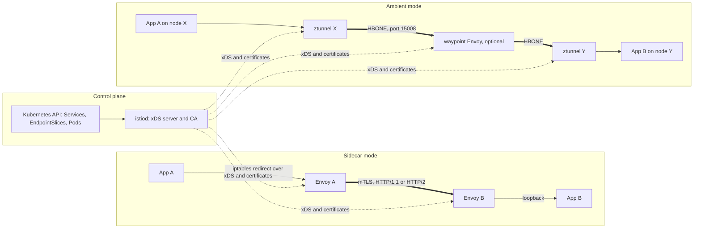

# Service Mesh Architecture and Trade-Offs

## TL;DR

- A service mesh is a fleet of policy-enforcing L4/L7 proxies plus a control plane that compiles intent (identity, routing, authorization) into proxy configuration over xDS. The data path never calls the control plane, so the mesh must stay statically stable when the control plane is down.
- Sidecar mode (one Envoy per pod, traffic captured by iptables redirect) gives per-pod identity and full L7 everywhere. It costs a vCPU and memory reservation per pod, extra socket hops per request, and an O(services) xDS config footprint per proxy unless you scope it.
- Ambient mode (Istio GA in 1.24, 2024-11-07) moves L4 mTLS into a per-node Rust `ztunnel` and L7 into opt-in per-namespace or per-service waypoint Envoys. It trades per-pod blast radius for per-node blast radius and lower reservation cost.
- mTLS bulk encryption is cheap on AES-NI/ARM crypto hardware. The real costs are handshakes amortized over too few requests per connection, proxy parsing and telemetry, retry amplification, config-convergence races during rollouts, and the upgrade treadmill.
- Do not adopt a mesh for a small fleet, a single-language fleet with a good RPC library, kernel-bypass traffic (RDMA/EFA/NCCL), or any team that cannot staff a control-plane on-call. Prefer a platform-managed or library-level alternative first.

## Mental Model



The mesh splits "what the policy is" from "who enforces it on each packet".
The control plane watches Kubernetes objects and mesh CRDs and pushes a compiled view of the world to every proxy.
Each proxy then makes per-connection and per-request decisions (mTLS, authorization, load balancing, retries, timeouts) from its local copy, with no synchronous call upstream.
Sidecar mode places the enforcement point inside each pod's network namespace, so identity and policy are per pod.
Ambient mode places the L4 enforcement point in a node-level agent that operates inside each pod's network namespace on the pod's behalf, and adds L7 processing only where a waypoint is deployed.
Proxyless mode removes the proxy and embeds the xDS client in the RPC library.
Every variant is the same trade: moving cross-cutting network behavior out of application code buys uniformity and costs CPU, memory, latency, a new failure domain, and an upgrade obligation.
For the control-plane versus data-plane doctrine behind this, see [[17-Cloud-AI-Engineering/Volume_01_Cloud_Architecture_Principles/Chapter_04_Control_Plane_vs_Data_Plane_Separation|Control Plane vs Data Plane Separation]].

## Internals

### The sidecar pattern and its interception mechanics

The sidecar pattern for container-based distributed systems was articulated by Burns and Oppenheimer in "Design patterns for container-based distributed systems" (HotCloud 2016).
Istio and Linkerd turned it into a network proxy per pod.

Injection happens in a mutating admission webhook.
The webhook adds an `istio-proxy` container (Envoy plus the `pilot-agent` supervisor) and either an init container or the `istio-cni` node plugin that programs iptables rules in the pod's network namespace.
The CNI-plugin route avoids granting `NET_ADMIN` to every application pod, which matters under Pod Security Admission (see [[17-Cloud-AI-Engineering/Volume_05_Kubernetes_and_Platform_Engineering/Chapter_05_Multi_Tenancy_Isolation_and_Resource_Quotas|Multi-Tenancy, Isolation, and Resource Quotas]]).

The rules do two things.
Outbound TCP from the application is redirected to the Envoy outbound listener, and the original destination is recovered with `SO_ORIGINAL_DST`, so Envoy knows where the application "meant" to connect.
Inbound TCP is redirected to the Envoy inbound listener before it reaches the application port.
Traffic originating from the proxy's own UID is exempted, otherwise the proxy would loop on itself (Istio uses UID 1337 for this, UNVERIFIED in this pass).

The resulting request path for a call from A to B is:

1. App A writes to a socket and the kernel traverses the loopback path through netfilter REDIRECT.
2. Envoy A reads the bytes, parses them (HTTP/1.1, HTTP/2, or opaque TCP), applies routing, picks an endpoint, and writes to a new upstream socket wrapped in TLS.
3. The packet crosses the cluster network.
4. Envoy B terminates TLS, authenticates the peer certificate, evaluates authorization, and writes to the application over loopback.
5. App B reads.

Compared with a direct connection, each direction gains four extra socket read or write operations (two per proxy) and two extra passes through the local TCP stack.
This is the structural source of sidecar latency and CPU, independent of how fast Envoy is.
The Istio docs state that 

a sidecar proxy consumes about 0.5 vCPU per 1000 requests per second

 (Istio 1.22 performance docs, [istio.io/v1.23](https://istio.io/v1.23/docs/ops/deployment/performance-and-scalability/), as of 2026-10), and that memory depends on the total configuration the proxy holds.
That second clause is the one that bites at scale and is covered below.

### Startup and shutdown ordering is a data-plane problem

The application container and the proxy start concurrently in a classic sidecar pod.
If the application issues an outbound call before Envoy has received its first xDS snapshot and certificate, the redirect rules send the call into a proxy that is not listening or has no route, and the call fails.
Istio's mitigation is the `holdApplicationUntilProxyStarts` proxy setting, which reorders container start.
The structural fix is Kubernetes native sidecars, which are restartable init containers with `restartPolicy: Always` and were declared stable in Kubernetes v1.33 (

released April 23, 2025

; [Kubernetes docs](https://v1-33.docs.kubernetes.io/docs/tutorials/configuration/pod-sidecar-containers/), as of 2026-10).
Native sidecars start before and stop after regular containers and no longer prevent Jobs from completing.
Check whether your mesh release uses them by default; do not assume.

Shutdown has the mirror problem.
On termination Kubernetes signals every container, and the proxy must keep serving the application's in-flight and outbound drain traffic.
Envoy's drain duration is a real tunable (`terminationDrainDuration` in the Istio proxy config).
For the full lifecycle model see [[17-Cloud-AI-Engineering/Volume_05_Kubernetes_and_Platform_Engineering/Chapter_01_Kubernetes_Control_Loop_Internals|Kubernetes Control Loop Internals]] and [[04-System-Design/07-Infrastructure-and-Orchestration/Kubernetes-Architecture]].

### xDS: how configuration actually reaches the proxies

Envoy is configured through the xDS family of gRPC APIs: listeners (LDS), routes (RDS), clusters (CDS), endpoints (EDS), and secrets (SDS), defined in the [xDS protocol spec](https://www.envoyproxy.io/docs/envoy/latest/api-docs/xds_protocol).
Istio multiplexes them over one Aggregated Discovery Service (ADS) stream per proxy.
ADS exists for ordering: to change a route to a new cluster without dropping traffic, the server must deliver the cluster (CDS) and its endpoints (EDS) before the route (RDS) that references them, which is the "make before break" sequence.
Without it, a route can reference a cluster Envoy does not yet have, and requests get a 503 with the `NR` or `UH` response flag.

Two properties matter at scale, and neither is in a getting-started guide.

First, the default visibility model is full mesh.
Every sidecar receives a CDS entry and an EDS endpoint set for every service in the mesh, whether or not it ever calls that service.
Proxy memory and CPU for config processing therefore scale with (services in mesh) x (endpoints per service), and push volume scales with proxies x churn.
For 2,000 pods and 1,500 services, that is 2,000 x 1,500 = 3,000,000 cluster objects held fleet-wide.
Declaring dependencies with the Istio `Sidecar` resource (egress `hosts`) or `discoverySelectors` shrinks it to the actual call graph.
With 15 dependencies per service the same fleet holds 30,000 cluster objects, a 100x reduction (derived, see the model in the worked example).

Second, convergence is asynchronous and unbounded by Kubernetes.
When a pod is deleted, the EndpointSlice update, the control plane's debounce window (Istio coalesces events; the defaults are 100 ms quiet and 10 s max, UNVERIFIED in this pass), the push, and each proxy's apply are sequential steps.
Meanwhile the kubelet is already sending SIGTERM.
So for some interval after termination begins, many client proxies still route to an endpoint that is going away.
The same race exists on scale-up: a pod can pass readiness and receive traffic from the Service VIP path before every client proxy has the new endpoint, which is merely suboptimal, but a route or cluster change can produce transient `NR`/`UH` errors.
`istioctl proxy-status` exposes per-proxy sync state, and a stale proxy is a diagnosable thing rather than a mystery.
The mitigation is to make the pod outlive the propagation tail: a `preStop` sleep longer than the p99 push-to-apply latency plus debounce, and a drain duration longer than your longest request.

If the control plane dies, proxies keep their last-good config and continue to serve (static stability, see [[17-Cloud-AI-Engineering/Volume_01_Cloud_Architecture_Principles/Chapter_02_Regions_Zones_and_Static_Stability|Regions, Zones, and Static Stability]]).
What breaks is everything that needs a new decision: new pods cannot obtain their first config or certificate, existing certificates are not renewed, and routing changes do not propagate.
Certificate lifetime is therefore your control-plane outage budget.

### Identity and mTLS

Mesh identity is a SPIFFE ID in the URI SAN of an X.509 certificate (SVID), e.g. `spiffe://cluster.local/ns/default/sa/bookinfo-productpage` as seen in ambient ztunnel access logs ([Tetrate walkthrough](https://tetrate.io/blog/transparent-traffic-interception-in-istio-ambient-mode-a-comprehensive-explanation), as of 2026-10).
The identity is derived from the Kubernetes ServiceAccount, not the pod IP, which is why it survives rescheduling.
See [[17-Cloud-AI-Engineering/Volume_08_Security_Identity_and_the_Data_Perimeter/Chapter_02_Workload_Identity_Federation|Workload Identity Federation]] for the token exchange family this belongs to, and the [SPIFFE concepts](https://spiffe.io/docs/latest/spiffe-about/spiffe-concepts/) for the standard.

In sidecar mode the sequence is:

1. `pilot-agent` generates a private key inside the pod and sends a CSR to the istiod CA, authenticating with the pod's projected ServiceAccount token, which istiod validates through the Kubernetes API.
2. istiod signs a short-lived workload certificate (24 h is the commonly cited default, UNVERIFIED in this pass).
3. `pilot-agent` serves the key and chain to Envoy over a Unix domain socket using SDS, and rotates before expiry without restarting Envoy.
4. Peers perform mutual TLS 1.3, validate the chain against the mesh trust bundle, and extract the SPIFFE ID as the principal for authorization.

Permissive mode works because the mesh's mTLS uses a distinct ALPN value (`istio`) that the inbound listener's TLS inspector can match, so one port can accept both mesh mTLS and plaintext during migration.
That is also why "STRICT" is a per-port enforcement decision and why server-first protocols such as MySQL, where the server speaks first, defeat protocol sniffing unless the port is declared explicitly.

### The cryptographic cost model

Decompose the per-request cost of mTLS into three terms:

```
cpu_per_request = H / n + c_req + c_aead * bytes
```

- `H` is the cost of a full TLS 1.3 handshake on both ends: ECDHE key agreement, a signature and a chain verification each way. It is on the order of hundreds of microseconds of CPU per connection, and you should measure it on your own instance type with `openssl speed ecdsap256 ecdhx25519` (UNVERIFIED as a general number).
- `n` is requests per connection. Mesh proxies pool upstream connections, so `n` is large for HTTP/2 and keep-alive HTTP/1.1 and collapses to 1 for clients that close after every request.
- `c_req` is parsing, routing, authorization, retries, and telemetry in the proxy, and it dominates in practice. The 0.5 vCPU per 1000 rps figure (500 microseconds per request per proxy) is overwhelmingly this term.
- `c_aead` is AES-GCM or ChaCha20-Poly1305 per byte. With AES-NI or ARMv8 crypto extensions it runs at several GB/s per core (UNVERIFIED; check with `openssl speed -evp aes-128-gcm`), so for 2 KB RPC payloads it is single-digit microseconds.

Illustration with an assumed `H` of 300 microseconds: at `n = 1`, handshake adds 300 microseconds per request on top of a 500 microsecond baseline, a 60 percent CPU increase at both ends. At `n = 100` it adds 3 microseconds.
The operational conclusion is that mTLS overhead is a connection-reuse problem, not a cipher problem.
A fleet that "gets slow with mTLS" almost always has a client library defeating pooling or a proxy restart storm forcing mass re-handshake.

### Ambient mode: ztunnel, HBONE, and waypoints

Istio's ambient mode was declared 

generally available in 1.24 on Nov 7, 2024, with ztunnel, waypoints and APIs marked Stable

 ([Istio 1.24 announcement](https://istio.io/latest/news/releases/1.24.x/announcing-1.24/), as of 2026-10).

The data plane has two layers:

- **ztunnel** is a per-node daemon written in Rust. It provides L4 only: mTLS, L4 authorization on identities and ports, and L4 telemetry. The `istio-cni` node agent installs redirect rules, and ztunnel creates its listeners inside each pod's network namespace, so the kernel sees traffic as belonging to the pod and the source address is preserved.
- **Waypoint proxies** are ordinary Envoy deployments created through the Kubernetes Gateway API with `gatewayClassName: istio-waypoint` ([Red Hat OSSM 3.2 ambient docs](https://docs.redhat.com/en/documentation/red_hat_openshift_service_mesh/3.2/html/installing/ossm-istio-ambient-mode), as of 2026-10). They scale independently of workloads and process only the traffic of services enrolled to use them. L7 authorization, header routing, retries, and traffic splitting live here.

ztunnel-to-ztunnel and ztunnel-to-waypoint traffic uses HBONE, which is 

HTTP/2 CONNECT tunneled over mTLS on port 15008

 (same Red Hat source). With a waypoint the path is source ztunnel, then waypoint, then destination ztunnel (Tetrate walkthrough above).

Four mechanisms follow from this design and shape the trade-offs.

1. **Identity custody moves from the pod to the node.** A sidecar holds exactly one workload identity, so compromising it yields one identity. A ztunnel must hold the certificates of every pod on its node to terminate and originate mTLS on their behalf. The control plane mitigates this by issuing a ztunnel only identities for workloads scheduled on its own node, but a node-level compromise still exposes all identities on that node. This is a real regression in blast radius relative to sidecars for multi-tenant nodes, and it is why node isolation (dedicated node pools for sensitive tenants) matters more under ambient.
2. **HBONE multiplexes many application flows over few TCP connections.** That reduces handshake count and connection-table pressure, which helps the `H / n` term. It also couples flows: one lost packet stalls every stream sharing the underlying TCP connection (TCP-level head-of-line blocking), and HTTP/2 flow-control windows bound per-stream throughput at approximately window divided by RTT. Large bulk flows such as checkpoint or weight transfers should be measured through HBONE or exempted.
3. **The failure domain is the node.** A ztunnel crash or upgrade affects every pod on that node simultaneously, while a sidecar failure affects one pod. Sidecar upgrades require pod restarts, which is the other half of the trade-off.
4. **L7 is a per-destination decision, not universal.** If a service has no waypoint, L7 rules attached to it are not evaluated by ztunnel, because ztunnel does not parse HTTP. Policy must be attached to the waypoint, which creates a class of silent-policy-gap bugs where an L7 AuthorizationPolicy exists but is enforced nowhere. Verify enforcement with a negative test, not by reading YAML.

The paper literature on why sidecars cost what they do is "Dissecting Overheads of Service Mesh Sidecars" (Zhu et al., ACM SoCC 2023), which attributes the cost mostly to per-request proxy work and extra kernel crossings rather than encryption. Sidecar-free multi-tenant designs are explored in "Canal Mesh" (Alibaba, SIGCOMM 2024, venue UNVERIFIED in this pass).

### Proxyless gRPC and library meshes

gRPC can speak xDS directly: the client bootstrap file points at an xDS server, a target of `xds:///service` triggers in-process service discovery and load balancing, and certificate providers supply mTLS credentials.
There is no extra hop and no iptables, so latency and CPU overhead nearly vanish.
The cost is coupling: policy features exist only to the extent the library version implements them, every language needs a conforming client, non-gRPC traffic is not covered, and rollout of mesh features becomes an application dependency upgrade.
Istio supports proxyless gRPC as a data-plane flavor, and Google Cloud's managed mesh offering has been documented as supporting it (UNVERIFIED in this pass).
Use it where a few high-volume gRPC services dominate cost and you control the client stack.

### Resilience primitives: what the proxy really does

Envoy's "circuit breaker" is a concurrency limiter per cluster and priority (maximum connections, pending requests, requests, retries), not a stateful breaker with half-open probing.
Outlier detection ejects individual endpoints after consecutive errors for a time that grows with repeated ejections, but is capped by a maximum ejection percentage (10 percent by default in Envoy, UNVERIFIED in this pass) so a systemic failure cannot eject the whole pool.
Separately, when the healthy fraction of a priority level falls below the panic threshold (50 percent by default, UNVERIFIED in this pass), Envoy ignores health status and spreads load across all hosts, trading correctness for availability.
Retries multiply across tiers: if each hop retries `r` times and the call chain is `d` deep, the worst-case attempts at the leaf are `(1 + r)^d`, which is 27 for `r = 2` and `d = 3`.
The mesh makes this easy to get wrong because every sidecar retries by policy and the application may also retry.
Pair mesh retries with retry budgets, per-try timeouts, and deadline propagation as covered in [[17-Cloud-AI-Engineering/Volume_07_Reliability_and_SRE/Chapter_03_Resilient_Communication_Retries_Jitter_and_Circuit_Breakers|Resilient Communication: Retries, Jitter, and Circuit Breakers]] and [[17-Cloud-AI-Engineering/Volume_07_Reliability_and_SRE/Chapter_02_Load_Shedding_Backpressure_and_Admission_Control|Load Shedding, Backpressure, and Admission Control]].
One more subtlety: L4 load balancing by kube-proxy balances connections, so a long-lived HTTP/2 or gRPC connection pins all of its requests to one backend.
A mesh balances per request across endpoints, which is often the first measurable win and also why a mesh can change hot-spot behavior of an existing fleet on day one.

## Numbers to Know

| Item | Value | Source and date | Why it matters |
| --- | --- | --- | --- |
| Istio sidecar CPU | about 0.5 vCPU per 1000 rps per proxy | [Istio 1.22/1.23 performance docs](https://istio.io/v1.23/docs/ops/deployment/performance-and-scalability/), as of 2026-10 (newest-release page not re-checked) | Basis for sizing; two proxies traverse each request |
| Sidecar memory | depends on total config held | Istio performance docs, as of 2026-10 | Scope config with `Sidecar` or discovery selectors |
| Ambient GA | Istio 1.24, 2024-11-07; ztunnel, waypoints, APIs Stable | [Istio 1.24 announcement](https://istio.io/latest/news/releases/1.24.x/announcing-1.24/), as of 2026-10 | Production-supportable sidecar-free option |
| HBONE port | 15008 (HTTP/2 CONNECT over mTLS) | Red Hat OSSM 3.2 docs, as of 2026-10 | Must be allowed in network policies and firewalls |
| Istio support policy | minor releases supported until six weeks after the N+2 release | [Istio 1.28 EOL notice](https://istio.io/latest/news/support/announcing-1.28-eol/), as of 2026-10 | Forces an upgrade cadence of roughly every few quarters |
| Istio 1.28 EOL | 2026-06-28 | Istio EOL notice, as of 2026-10 | Example of the treadmill |
| Istio 1.29 EOL | 2026-10-12, confirmed ended 2026-10-16; recommended upgrade target 1.31.2 | [Istio 1.29 EOL notice](https://istio.io/latest/news/support/announcing-1.29-eol-final/), as of 2026-10 | Anyone on 1.29 today has no security backports |
| Kubernetes native sidecars | stable in v1.33 (released 2025-04-23) | [Kubernetes v1.33 docs](https://v1-33.docs.kubernetes.io/docs/tutorials/configuration/pod-sidecar-containers/), as of 2026-10 | Fixes start/stop ordering and Job completion |
| AWS App Mesh | support ends 2026-09-30; console and resources inaccessible afterwards | [AWS App Mesh docs](https://docs.aws.amazon.com/app-mesh/latest/userguide/meshes.html), as of 2026-10 | Already past end of support; migration target named by AWS is ECS Service Connect |
| Retry amplification | `(1 + r)^d`; 27x for r=2, d=3 | Derived | Why retries need budgets |
| Fleet cluster objects | 2,000 pods x 1,500 services = 3.0M; scoped to 15 deps = 30k | Derived (worked example) | 100x config reduction from scoping |
| Handshake amortization | `H / n`; 300 us assumed `H` gives 300 us at n=1, 3 us at n=100 | Derived, `H` is an assumption to measure | mTLS cost is connection reuse |
| List prices | not quoted | Vendor pricing pages not re-verified in this pass | Worked example uses placeholders |

## AWS vs GCP Mechanism Parity

Rows marked UNVERIFIED were not re-checked against current vendor documentation in this pass and must be confirmed before use in a design review.

| Dimension | AWS | GCP |
| --- | --- | --- |
| Managed Envoy mesh product | AWS App Mesh is past end of support (2026-09-30, AWS docs as of 2026-10); do not start new work on it | Cloud Service Mesh, a managed Istio-based offering with a Google-run control plane (UNVERIFIED current packaging and GA status of ambient support) |
| Recommended AWS-native replacement | ECS Service Connect for ECS workloads (named as migration target in AWS App Mesh docs, as of 2026-10); VPC Lattice as a regional service-networking layer with IAM-based auth (UNVERIFIED feature and pricing details) | Not applicable |
| Kubernetes mesh on managed K8s | Self-operated Istio, Linkerd, or Cilium on EKS; you own the control plane and upgrades | Managed Istio via Cloud Service Mesh on GKE (UNVERIFIED); self-operated Istio also possible |
| Sidecar-free option | Istio ambient on EKS (self-operated; GA upstream since 1.24) | Istio ambient upstream; managed support level UNVERIFIED |
| Proxyless | Istio proxyless gRPC (self-operated) | Documented proxyless gRPC support in Google's managed mesh (UNVERIFIED) |
| Identity root | cert-manager `istio-csr` or istiod plug-in CA backed by AWS Private CA (operator-assembled) | Google-managed CA in the managed offering, or plug-in CA backed by Certificate Authority Service (UNVERIFIED) |
| Control-plane failure domain | In-cluster `istiod` pods; your SLO | Google-run in managed mode; shared fate with the vendor |
| Network layer under the mesh | VPC CNI pod IPs; HBONE 15008 must pass security groups and NetworkPolicy | GKE Dataplane V2 or VPC-native; HBONE 15008 must pass firewall rules and NetworkPolicy |
| Cross-cluster trust | Shared root or federated trust bundles; you build the distribution | Fleet-level trust in managed mode (UNVERIFIED); otherwise the same as AWS |
| Consensus | None in the mesh itself; state comes from the Kubernetes API (etcd, Raft) | Same |

The structural difference is not capability but operating model.
On AWS you assemble and run the mesh control plane or choose a narrower managed substitute.
On GCP you can buy the control plane as a managed service, at the cost of vendor-defined version and feature cadence.
Either way, the data-plane mechanics (iptables or ztunnel redirect, SPIFFE identity, xDS convergence) are the same Istio and Envoy mechanics.
For the broader cross-cloud map see [[17-Cloud-AI-Engineering/Volume_04_AWS_vs_GCP_Translation/Chapter_02_Networking_and_Load_Balancing_Translation|Networking and Load Balancing Translation]] and [[17-Cloud-AI-Engineering/Volume_02_AWS_Deep_Dive/Chapter_03_VPC_Networking_Internals|VPC Networking Internals]].

## Worked Example: Sizing Sidecar vs Ambient and Proving Config Scope

This lab uses a local `kind` cluster and a pure-Python model.
It provisions no billable cloud resources: estimated cloud cost is $0, and the budget alarm is not applicable.
If you instead run it on a cloud cluster, create a budget first and tear down with the cluster deletion command for that provider.

### Step 1: Model the fleet

Save as `mesh_model.py`.
Every default that is not sourced is a labeled assumption to be replaced with measurements from your cluster.

```python
#!/usr/bin/env python3
"""Back-of-the-envelope model: sidecar vs ambient resource reservation, xDS fan-out, retry amplification.
All inputs are planning assumptions unless marked as sourced. Replace defaults with measurements from your own cluster."""
import argparse

HOURS_PER_MONTH = 730.0

def main():
    p = argparse.ArgumentParser()
    p.add_argument("--pods", type=int, default=2000)
    p.add_argument("--nodes", type=int, default=100)
    p.add_argument("--rps-per-pod", type=float, default=50.0, help="inbound requests per second per pod")
    p.add_argument("--sidecar-cpu-req", type=float, default=0.10, help="vCPU request per sidecar (operator choice)")
    p.add_argument("--sidecar-mem-mib", type=float, default=128.0)
    p.add_argument("--vcpu-per-krps", type=float, default=0.5, help="Istio docs: ~0.5 vCPU per 1000 rps per sidecar (1.22 docs)")
    p.add_argument("--ztunnel-cpu-req", type=float, default=0.20, help="ASSUMPTION per-node ztunnel request")
    p.add_argument("--ztunnel-mem-mib", type=float, default=512.0, help="ASSUMPTION per-node ztunnel request")
    p.add_argument("--ztunnel-vcpu-per-krps", type=float, default=0.20, help="ASSUMPTION - measure it")
    p.add_argument("--l7-fraction", type=float, default=0.20, help="share of traffic routed via a waypoint")
    p.add_argument("--waypoint-replicas", type=int, default=6)
    p.add_argument("--waypoint-cpu-req", type=float, default=1.0)
    p.add_argument("--waypoint-mem-mib", type=float, default=1024.0)
    p.add_argument("--usd-per-vcpu-hour", type=float, default=0.04, help="PLACEHOLDER, not a quote")
    p.add_argument("--usd-per-gib-hour", type=float, default=0.005, help="PLACEHOLDER, not a quote")
    p.add_argument("--target-util", type=float, default=0.6, help="planning CPU utilization ceiling")
    p.add_argument("--services", type=int, default=1500)
    p.add_argument("--deps-per-service", type=int, default=15)
    p.add_argument("--retries", type=int, default=2)
    p.add_argument("--depth", type=int, default=3)
    a = p.parse_args()

    total_krps = a.pods * a.rps_per_pod / 1000.0
    def usd(vcpu, mib):
        return (vcpu * a.usd_per_vcpu_hour + (mib / 1024.0) * a.usd_per_gib_hour) * HOURS_PER_MONTH

    # Sidecar: every request crosses two Envoy proxies (client side and server side).
    sc_use = 2 * total_krps * a.vcpu_per_krps
    sc_res_cpu = a.pods * a.sidecar_cpu_req
    sc_res_mem = a.pods * a.sidecar_mem_mib
    print("== Sidecar mode ==")
    print("mesh rps: %.0f" % (total_krps * 1000))
    print("steady CPU used (2 proxies per request): %.1f vCPU" % sc_use)
    print("CPU reserved by requests: %.1f vCPU, memory reserved: %.1f GiB" % (sc_res_cpu, sc_res_mem / 1024))
    sc_prov = max(sc_res_cpu, sc_use / a.target_util)
    print("CPU to provision at %.0f%% target utilization: %.1f vCPU" % (a.target_util * 100, sc_prov))
    print("monthly cost of provisioned CPU + reserved memory: $%.0f" % usd(sc_prov, sc_res_mem))

    # Ambient: two ztunnel traversals per request, plus one waypoint traversal for the L7 fraction.
    am_use = 2 * total_krps * a.ztunnel_vcpu_per_krps + a.l7_fraction * total_krps * a.vcpu_per_krps
    am_res_cpu = a.nodes * a.ztunnel_cpu_req + a.waypoint_replicas * a.waypoint_cpu_req
    am_res_mem = a.nodes * a.ztunnel_mem_mib + a.waypoint_replicas * a.waypoint_mem_mib
    print("== Ambient mode ==")
    print("steady CPU used: %.1f vCPU" % am_use)
    print("CPU reserved: %.1f vCPU, memory reserved: %.1f GiB" % (am_res_cpu, am_res_mem / 1024))
    am_prov = max(am_res_cpu, am_use / a.target_util)
    print("CPU to provision at %.0f%% target utilization: %.1f vCPU" % (a.target_util * 100, am_prov))
    print("monthly cost of provisioned CPU + reserved memory: $%.0f" % usd(am_prov, am_res_mem))

    # xDS fan-out: cluster objects held across the fleet.
    full = a.pods * a.services
    scoped = a.pods * a.deps_per_service
    print("== xDS scope ==")
    print("cluster objects, default full-mesh visibility: %d" % full)
    print("cluster objects, Sidecar-scoped (%d deps): %d (%.1fx fewer)" % (a.deps_per_service, scoped, full / float(scoped)))

    # Retry amplification at the deepest tier of a call chain.
    print("== Retry amplification ==")
    print("worst-case attempts at the leaf: (1+%d)^%d = %d" % (a.retries, a.depth, (1 + a.retries) ** a.depth))

if __name__ == "__main__":
    main()
```

### Step 2: Read the output

Running `python3 mesh_model.py` with the defaults prints these results:

- Mesh load is 100,000 rps. Sidecar steady CPU is 2 x 100 krps x 0.5 = 100 vCPU, but the 2,000 x 100m requests reserve 200 vCPU and 250 GiB. The scheduler and your bill follow the reservation, not the usage.
- Sidecar monthly cost with the placeholder prices is about $6,752 (200 vCPU x $0.04 x 730 plus 250 GiB x $0.005 x 730).
- Ambient under the stated assumptions uses 2 x 100 x 0.2 + 0.2 x 100 x 0.5 = 50 vCPU. The per-node reservation of 26 vCPU is below usage, so at a 60 percent target utilization you must provision 83.3 vCPU. That is the reason the model takes the maximum of reservation and usage over target; an under-requested ztunnel is CPU-throttled and becomes a node-wide latency source.
- Ambient monthly cost is about $2,638, roughly 2.6x lower under these assumptions.
- The ambient ratio depends entirely on `--ztunnel-vcpu-per-krps`, which is an assumption. Measure it with a load test on your workload before using the result in a business case.
- xDS scope: 3,000,000 cluster objects at full visibility versus 30,000 when scoped to 15 dependencies.
- Retry amplification: 27 worst-case attempts at the leaf for 2 retries at depth 3.

### Step 3: Reproduce the mechanisms on a local cluster

```bash
kind create cluster --name mesh-lab
# Gateway API CRDs are required for waypoints; install the version your Istio release documents.
kubectl get crd gateways.gateway.networking.k8s.io >/dev/null 2>&1 || echo "install Gateway API CRDs first"
istioctl install --set profile=ambient --skip-confirmation
kubectl create namespace demo
kubectl label namespace demo istio.io/dataplane-mode=ambient
istioctl waypoint apply -n demo --enroll-namespace
istioctl ztunnel-config workloads
istioctl proxy-status
```

Command names follow the Istio ambient docs; confirm flags with `istioctl --help` for your installed version.
To observe xDS scope in sidecar mode, label a second namespace with `istio-injection=enabled`, deploy a few dozen dummy Services, and compare `istioctl proxy-config clusters <pod> | wc -l` before and after applying a `Sidecar` resource such as:

```yaml
apiVersion: networking.istio.io/v1
kind: Sidecar
metadata:
  name: default
  namespace: checkout
spec:
  egress:
  - hosts:
    - "./*"
    - "istio-system/*"
    - "payments/payments.payments.svc.cluster.local"
```

To observe the rollout race, run a client loop against a Service while executing `kubectl rollout restart` on the backend with and without a `preStop` sleep, and count 503s with Envoy response flags `UH`, `UF`, and `NR` in the access log.

### Step 4: Cost, budget, teardown

- Cloud cost: $0 (local containers only).
- Budget alarm: not applicable. If you adapt this to a cloud cluster, create the budget first, for example `aws budgets create-budget --account-id <ACCOUNT_ID> --budget file://budget.json --notifications-with-subscribers file://notifications.json` for AWS, or a billing budget with a threshold rule for GCP.
- Teardown: `kind delete cluster --name mesh-lab`

## Failure Modes and Pitfalls

### Rollout 503s from config convergence

Symptom: a burst of 503s with `UH`, `UF`, or `NR` flags during deploys, scale-down, or route changes, though every pod was healthy.
Mechanism: SIGTERM and endpoint removal race with debounced xDS propagation (see Internals).
Fix: `preStop` sleep above p99 push-to-apply latency, drain duration above your longest request, readiness gates, and alerting on `istioctl proxy-status` staleness or the equivalent control-plane push-time metrics.

### Startup and shutdown ordering

The application calls out before the proxy has config, or the proxy exits before the application finishes draining.
Fix: native sidecars on Kubernetes 1.33 or later (stable) or `holdApplicationUntilProxyStarts` on older clusters.
Jobs and CronJobs with classic sidecars historically never completed because the proxy kept the Pod running, which native sidecars fix.

### xDS push storms and control-plane overload

Full-mesh visibility turns every endpoint change into pushes to every proxy that holds that cluster.
A rolling update of a 200-pod service with 2,000 proxies in scope can generate tens of thousands of push operations, and the resulting istiod CPU and memory growth delays pushes further, extending convergence windows for everyone.
Fix: `Sidecar` scoping, `discoverySelectors`, istiod horizontal scaling, and PodDisruptionBudgets plus topology spread for istiod.
Treat istiod as tier-0 infrastructure with its own SLO.

### Certificate and root CA expiry

Workload certificates are short-lived, so control-plane unavailability longer than the certificate lifetime causes mass mTLS failure even though the data plane "was fine".
The root is the worse case: a self-signed root created by a quick-start install that nobody inventoried will eventually expire, and every workload certificate chains to it.
Fix: plug-in CA from an offline root with per-cluster intermediates, monitoring of certificate expiry, and a rehearsed root rotation (see [[17-Cloud-AI-Engineering/Volume_08_Security_Identity_and_the_Data_Perimeter/Chapter_04_Encryption_Key_Hierarchies_and_Envelope_Encryption|Encryption Key Hierarchies and Envelope Encryption]]).

### Retry storms and metastable overload

Mesh retries default on, application retries exist too, and each tier multiplies.
Public examples of the pattern include the AWS us-east-1 event of 2021-12-07, where client behavior inside the internal network amplified congestion, and the Google Cloud global incident of 2025-06-12, where recovering tasks lacked randomized backoff and overloaded a dependency.
Both are recalled from the public post-incident write-ups and were not re-verified in this pass (UNVERIFIED).
Primary references for the mechanism are the AWS Builders' Library article [Timeouts, retries, and backoff with jitter](https://aws.amazon.com/builders-library/timeouts-retries-and-backoff-with-jitter/) and the SRE book chapter [Addressing Cascading Failures](https://sre.google/sre-book/addressing-cascading-failures/).
Fix: retry at one layer only, set a retry budget as a percentage of active requests, use per-try timeouts shorter than the overall deadline, and shed load at the server.

### Handshake storms and connection churn

After a mass proxy restart, a ztunnel DaemonSet rollout, or a client that disables keep-alive, `n` in `H / n` collapses and handshake CPU spikes while the proxies are least able to absorb it.
Fix: surge-limited, node-by-node rollouts, connection pool tuning, and a canary that watches handshake rate.

### Strict mTLS migration breakage

PERMISSIVE to STRICT cutovers break kubelet probes (the injector rewrites them to go through the agent), headless services, clients outside the mesh, and server-first protocols whose protocol detection times out.
Fix: namespace-by-namespace migration, port naming or explicit protocol declaration, and a plaintext-traffic dashboard that must read zero before enforcement.

### Ambient-specific hazards

- HBONE port 15008 blocked by a NetworkPolicy, security group, or firewall rule. Traffic simply fails; open it between nodes and waypoints (Red Hat OSSM docs, as of 2026-10).
- L7 policy attached where no waypoint enforces it, producing a silent gap.
- A waypoint becomes a hot spot because it is a shared Envoy deployment: size it by request rate and autoscale it, and consider per-service rather than per-namespace waypoints for large tenants.
- Node-scoped blast radius for ztunnel upgrades and crashes.

### CPU throttling and tail latency

A sidecar with a tight CPU limit is subject to CFS throttling and shows tail latency that tracks the throttling period, not load.
Set requests honestly and avoid CPU limits on the proxy, or size limits above peak.

### Upgrade treadmill and vendor risk

Istio supports a minor release only until six weeks after the N+2 release (Istio EOL notice, as of 2026-10), and 1.29 reached end of life on 2026-10-12.
Every mesh is therefore a standing commitment to roughly one or two minor upgrades per year per cluster, each touching every pod in sidecar mode.
Vendor risk is real: AWS App Mesh ended support on 2026-09-30 (AWS docs, as of 2026-10), and teams that bet on it were forced into a migration to ECS Service Connect or a self-run mesh.
Roll mesh configuration and upgrades through the delivery pipeline described in [[17-Cloud-AI-Engineering/Volume_05_Kubernetes_and_Platform_Engineering/Chapter_07_GitOps_Delivery_Argo_CD_and_Flux|GitOps Delivery: Argo CD and Flux]], and include the mesh in disaster-recovery drills.

### AI workload specifics

- Kernel-bypass traffic (RDMA, EFA collectives) never touches iptables or ztunnel, so a mesh cannot see or protect it. Exempt those interfaces and address ranges explicitly (annotations such as `traffic.sidecar.istio.io/excludeOutboundPorts` and `excludeOutboundIPRanges` exist for sidecars). See [[17-Cloud-AI-Engineering/Volume_10_AI_Infrastructure_on_Cloud/Chapter_02_Interconnect_Technologies_NVLink_EFA_and_TPU_ICI|Interconnect Technologies: NVLink, EFA, and TPU ICI]].
- Streaming token responses hold connections for tens of seconds or minutes. Envoy's stream idle timeout (5 minutes by default, UNVERIFIED in this pass) and route timeouts can cut long silent prefill phases; set them per route for inference services.
- GPU nodes often have few vCPUs per GPU, and a sidecar on every inference pod consumes cores that tokenization, sampling, and data loading need. Prefer ambient or no mesh on GPU pools.
- Large model-weight and KV-cache transfers over HBONE inherit HTTP/2 flow-control and TCP head-of-line characteristics; measure before routing them through the mesh.

## Security and Cost Angles

### Identity and key hierarchy

Use a plug-in CA: an offline root, a per-cluster intermediate stored in a secret or backed by a cloud CA (AWS Private CA or Google Certificate Authority Service, commonly via cert-manager and `istio-csr`; integration details UNVERIFIED in this pass), and short-lived leaf certificates.
Short lifetimes are your revocation mechanism, since CRL and OCSP are not used in the data path.
The trade-off is the control-plane outage budget described above: shorter TTL means smaller blast radius for a leaked key and a tighter dependence on istiod availability.
For multi-cluster or multi-cloud trust, exchange trust bundles from per-cluster intermediates under a common root, or federate trust domains, and keep the root offline.

### Authorization scoping

Default-deny with explicit `ALLOW` policies keyed on SPIFFE principals gives least privilege between workloads.
Identity-based L4 policy is enforceable in both sidecar and ambient modes.
L7 policy (paths, methods, JWT claims) requires a sidecar or waypoint.
istiod needs broad read access to cluster objects and TokenReview permissions, and ztunnel and the CNI agent are privileged node components, so they cannot live in namespaces with the restricted Pod Security profile.
Mesh mTLS secures pod-to-pod traffic inside a trust domain.
It does not replace cloud-level perimeters such as VPC endpoints policies or VPC Service Controls (see [[17-Cloud-AI-Engineering/Volume_08_Security_Identity_and_the_Data_Perimeter/Chapter_01_Zero_Trust_Architecture_in_Hyperscale_Clouds|Zero Trust Architecture in Hyperscale Clouds]]).

### Unit economics

- Sidecar cost is driven by requests, not usage. In the worked example 200 vCPU are reserved against 100 vCPU used. Right-size proxy requests from measured p95 usage.
- Ambient cost shifts to per-node ztunnel plus a pay-for-what-you-use waypoint fleet; the ratio depends on L7 share and must be measured.
- Telemetry cardinality is a hidden cost: per-request metrics with high-cardinality labels and full access logs can exceed the proxy compute cost in managed monitoring bills. Sample access logs and drop unused labels.
- Cross-AZ traffic: locality-aware load balancing keeps requests in-zone and avoids inter-AZ transfer charges; it needs enough replicas per zone to avoid overload (see [[17-Cloud-AI-Engineering/Volume_09_FinOps_and_Cloud_Economics/Chapter_04_Network_Egress_Economics_and_Optimization|Network Egress Economics and Optimization]]).
- Staffing is a cost: a self-operated mesh needs on-call ownership, an upgrade pipeline, and a certificate runbook. A managed control plane trades that for vendor coupling.
- Autoscaling interacts with the mesh: sidecar requests inflate pod size, and HPA on CPU can double-count proxy usage (see [[17-Cloud-AI-Engineering/Volume_05_Kubernetes_and_Platform_Engineering/Chapter_04_Autoscaling_at_Scale_HPA_KEDA_and_Karpenter|Autoscaling at Scale: HPA, KEDA, and Karpenter]]).

### When to avoid a mesh

| Situation | Better choice |
| --- | --- |
| Fewer than a few dozen services, one team | Library-level TLS and retries, plus NetworkPolicy |
| One or two languages with a strong RPC stack | Library or proxyless gRPC with xDS |
| Need only pod-to-pod encryption and L4 identity | Ambient L4 only, or CNI-level encryption and identity (see [[17-Cloud-AI-Engineering/Volume_05_Kubernetes_and_Platform_Engineering/Chapter_03_CNI_and_eBPF_with_Cilium\|Container Networking Interface and eBPF with Cilium]]) |
| Mostly north-south traffic | Ingress or gateway plus API management |
| RDMA, EFA, or NCCL collectives dominate traffic | No mesh on that path; isolate with network design |
| Sub-millisecond latency budgets | No mesh in the hot path |
| No team to own control plane, certificates, and upgrades | Managed service networking, or defer adoption |
| AWS ECS-only estate | ECS Service Connect rather than a Kubernetes mesh |

## Interview Questions and Model Answers

### Question 1 (L5 - Senior)

A request goes from service A to service B in a sidecar mesh with strict mTLS. Walk through exactly what happens, and where identity comes from.

#### Model Answer

A's application opens a connection to B's ClusterIP.
iptables rules installed in A's pod network namespace by the CNI plugin or init container redirect that connection to Envoy's outbound listener, and Envoy recovers the original destination with `SO_ORIGINAL_DST`.
Envoy matches the destination against its LDS and RDS config, selects a cluster, and picks an endpoint from the EDS set using its load-balancing policy.
It originates a TLS 1.3 connection using a workload certificate whose URI SAN is a SPIFFE ID derived from A's ServiceAccount.
That certificate was obtained when `pilot-agent` sent a CSR, authenticated with the projected ServiceAccount token, to istiod, and it is delivered to Envoy by SDS and rotated before expiry.
B's inbound redirect sends the connection to B's Envoy, which validates A's chain against the trust bundle, extracts the principal, evaluates AuthorizationPolicy, and forwards over loopback to B.
The costs are four extra socket operations per direction and the handshake, which is amortized by connection pooling.

#### Follow-up Interviewer Question

You see a 40 percent CPU increase in a caller after enabling the mesh, but payloads are small. What do you check first, and why do you expect the cipher is not the cause?

### Question 2 (L5 - Senior)

After adopting the mesh, every rolling deploy produces a few seconds of 503s with `UH` and `NR` flags. The pods are healthy. Why, and how do you fix it?

#### Model Answer

Endpoint changes propagate asynchronously: EndpointSlice update, control-plane debounce, push, and apply on each client proxy.
On termination the kubelet sends SIGTERM in parallel with endpoint removal, so client proxies keep routing to a pod that is already shutting down for the duration of the propagation tail.
Route or cluster changes can also reach a proxy in an order that briefly references missing clusters if the push is not make-before-break.
Fixes are a `preStop` sleep longer than p99 propagation plus debounce, a proxy drain duration longer than the longest request, readiness gates, and native sidecars so the proxy outlives the application.
Measure with `istioctl proxy-status` and push-latency metrics, and set the sleep from the measured p99, not a guess.

#### Follow-up Interviewer Question

Your service handles 10-minute streaming responses. How do you set the drain duration, and what do you do about deploy frequency?

### Question 3 (L6 - Staff)

You run 3,000 services on EKS. Argue for or against moving from sidecars to ambient, and describe the migration plan and what you would measure.

#### Model Answer

Ambient is GA upstream (Istio 1.24, ztunnel, waypoints and APIs Stable), so the question is fit, not maturity.
For: no per-pod reservation (cost and bin-packing), no pod restart to upgrade the data plane, no start-ordering races, and most services need only L4 mTLS and identity authorization, which ztunnel provides.
Against: the identity blast radius moves from pod to node, so multi-tenant node pools need isolation; ztunnel failure affects a whole node; HBONE couples flows over shared TCP connections; and L7 policy exists only where a waypoint is deployed, creating silent-gap risk.
I would migrate namespace by namespace using the `istio.io/dataplane-mode=ambient` label, run both modes side by side during transition, and add waypoints only for services that need L7 (retries, header routing, JWT).
I would measure per-request CPU of ztunnel versus sidecar on real traffic (the planning ratio is an assumption until measured), p99 latency delta, handshake rate, HBONE connection reuse, ztunnel CPU throttling, and negative authorization tests for every L7 policy.
Exit criteria are cost reduction demonstrated on measured data and no regression in error budget burn.

#### Follow-up Interviewer Question

A security reviewer says that ambient is strictly weaker because a node compromise yields every identity on that node. How do you respond, and what compensating controls would you require?

### Question 4 (L6 - Staff)

Quantify the cost of mTLS in the mesh. A skeptical VP says "encryption is not free, so no mesh". What do you tell them?

#### Model Answer

Split the cost into handshake, per-request proxy work, and bulk encryption.
Bulk AEAD on AES-NI or ARM crypto runs at GB/s per core, so for KB-sized RPCs it is microseconds.
Handshake cost is `H / n`: hundreds of microseconds of CPU per connection (to be measured on the target instance type), and negligible when pooling gives `n` in the hundreds, but a 60 percent overhead at `n = 1` with an assumed 300 microseconds on a 500 microsecond baseline.
The dominant term is per-request proxy work, which Istio documents as roughly 0.5 vCPU per 1000 rps per sidecar, and every request crosses two proxies.
So the honest statement is that the cost is real but is the cost of the proxy, not of encryption, and it is bounded and measurable: at 100,000 rps it is about 100 vCPU of usage and 200 vCPU of reservation in my model.
Whether it is worth it depends on whether you would otherwise have to build identity, mTLS, retries, and authorization into every service in every language.
If the answer is no, then do not run a mesh.

#### Follow-up Interviewer Question

How would you design the load test that produces the `H` and `c_req` numbers, and what would make you distrust the result?

### Question 5 (L6 - Staff)

istiod becomes unavailable for 90 minutes. What breaks, what does not, and how do you make sure your answer is not a guess?

#### Model Answer

Existing proxies keep their last-good xDS config and continue to forward and enforce policy, which is static stability.
What breaks is anything needing a new decision: pods that start during the outage cannot fetch config or a certificate and may never become ready; certificates that reach expiry without renewal begin failing mTLS; and route, policy, and endpoint changes do not propagate, so scale-down leaves clients pointing at dead pods.
The exposure window is therefore min(workload certificate lifetime, time to first new-pod requirement).
With a 24-hour certificate (assumed default) a 90-minute outage is survivable for steady state but not for an autoscaling event or a rollout during that period.
I would prove it with a game day: scale istiod to zero in a staging cell, run a deploy and a scale-up, watch certificate expiry metrics, and record the first failure.
Mitigations: multiple istiod replicas across zones with PDBs, freezing deploys and autoscaling during control-plane incidents, a certificate lifetime chosen against the control-plane SLO, and alerts on certificate time-to-expiry.

#### Follow-up Interviewer Question

How would you design the control-plane topology so that one bad config push cannot take down all clusters at once?

### Question 6 (L6 - Staff)

Latency doubled in a three-tier call chain after enabling default mesh retries, and during a backend brownout the system never recovered. Explain and fix.

#### Model Answer

With `r` retries per hop and depth `d`, worst-case attempts at the leaf are `(1 + r)^d`; with `r = 2` and `d = 3` that is 27 attempts for one user request.
During a brownout, timeouts trigger retries, retries add load to an already slow backend, which causes more timeouts: a metastable overload that persists after the trigger is gone.
Envoy's outlier detection will not save you because ejection is capped by a maximum ejection percentage, and once the healthy fraction drops below the panic threshold Envoy sprays traffic across all hosts, including bad ones.
Fix by retrying at exactly one layer (usually the edge or the caller closest to the user), adding a retry budget as a percentage of in-flight requests, shortening per-try timeouts so the sum fits within the overall deadline, propagating deadlines so deep tiers drop work that nobody is waiting for, and adding server-side admission control.
Add a game day that injects slowness (not just errors) into the leaf.

#### Follow-up Interviewer Question

The product team insists on retries because the leaf has a 0.5 percent transient error rate. How do you give them reliability without the amplification?

### Question 7 (L7+ - Principal)

You own the platform for 400 services across EKS and GKE, with LLM inference and training workloads. Leadership asks whether to adopt a mesh. Give a decision with a defensible framework.

#### Model Answer

I would not give a yes or no for the whole estate; I would segment by traffic class and requirement.
Class 1, business microservices with polyglot teams and compliance mTLS requirements: the strongest case for a mesh, and ambient with selective waypoints is my default, because most of these need L4 identity and authorization, and only a minority need L7 routing.
Class 2, high-volume gRPC services owned by one team: proxyless xDS or library-level security can remove the proxy cost, accepting library coupling.
Class 3, inference serving: long-lived streaming, GPU nodes with scarce CPU, and latency sensitivity push toward ambient at most, with route timeouts raised for streaming, and no sidecars on GPU pods.
Class 4, training and collective traffic over EFA or RDMA: out of mesh by construction, protected by network isolation and identity at the job-scheduler layer.
For the decision itself I would require a written cost model (reserved versus used CPU, staffing, upgrade cadence driven by the N+2 support policy), a security model (what the mesh adds beyond NetworkPolicy and cloud perimeters), and an exit plan, informed by the App Mesh shutdown that forced migrations.
I would run a bounded pilot with explicit success metrics (error-budget burn, p99 delta, reserved CPU delta, number of incidents attributable to the mesh) and a kill criterion.
If no single class has a compelling requirement the mesh does not provide more cheaply, the right answer is "not yet".

#### Follow-up Interviewer Question

Two quarters in, the mesh has caused two incidents and prevented none that you can point to. How do you decide whether to continue, and what evidence would you bring to the exec review?

### Question 8 (L7+ - Principal)

Design the trust architecture for one logical mesh spanning EKS and GKE clusters, including revocation, and explain the failure scenarios you are designing against.

#### Model Answer

Use one offline root CA under HSM control, with a per-cluster intermediate (issued by AWS Private CA or Google Certificate Authority Service, or held as a plug-in secret) and short-lived leaf certificates issued by each cluster's control plane.
Distribute the trust bundle (root plus any federated bundles) through the GitOps pipeline so that rotation is a reviewed change, with overlapping validity during rotation.
Keep trust domains per environment or per tenant tier, and federate bundles rather than sharing a single domain, so that a compromise or misconfiguration in a development cluster cannot mint identities valid in production.
Revocation is by time: lifetimes of hours bound exposure of a stolen key, and compromise of an intermediate is handled by rotating that intermediate and bundle, which requires that the procedure has been rehearsed and that trust-bundle reload does not require restarts.
Failure scenarios: control-plane outage longer than certificate lifetime; root or intermediate expiry; clock skew breaking validation; a bad bundle push that distrusts everything (mitigate with staged cell rollout); and cross-cloud network partitions, where east-west gateways become the failure domain and each cluster must keep working on local config.
Cross-cloud calls add latency and egress cost, so I would keep the call graph cluster-local by default and cross clouds only through explicit gateways.
See also [[17-Cloud-AI-Engineering/Volume_04_AWS_vs_GCP_Translation/Chapter_07_Multi_Cloud_and_Hybrid_Architecture_Reality|Multi-Cloud and Hybrid Architecture Reality]].

#### Follow-up Interviewer Question

An intermediate CA key may have been exposed in a CI log. You have 30 minutes. What is your sequence of actions, and what is the worst thing that can happen during the rotation?

## Further Reading

- [Istio 1.24 announcement and ambient GA blog](https://istio.io/latest/blog/2024/ambient-reaches-ga/) - the primary statement of what is Stable in ambient and the design rationale for ztunnel and waypoints.
- [Istio performance and scalability docs](https://istio.io/v1.23/docs/ops/deployment/performance-and-scalability/) - the vendor's own sidecar CPU and memory figures and the config-size dependence; read the page for your release before sizing.
- [Envoy xDS protocol specification](https://www.envoyproxy.io/docs/envoy/latest/api-docs/xds_protocol) - authoritative description of ADS ordering, state-of-the-world versus incremental updates, and ACK/NACK semantics, which underpin every convergence failure in this chapter.
- [SPIFFE concepts](https://spiffe.io/docs/latest/spiffe-about/spiffe-concepts/) - the identity standard behind mesh certificates and trust bundles.
- Burns and Oppenheimer, "Design patterns for container-based distributed systems" (HotCloud 2016) - where the sidecar pattern was articulated.
- Zhu et al., "Dissecting Overheads of Service Mesh Sidecars" (ACM SoCC 2023) - measurement-driven attribution of sidecar cost to proxy work and kernel crossings.
- "Canal Mesh" (Alibaba, SIGCOMM 2024; venue UNVERIFIED in this pass) - a sidecar-free, multi-tenant mesh design for comparison with ambient.
- [AWS Builders' Library: Timeouts, retries, and backoff with jitter](https://aws.amazon.com/builders-library/timeouts-retries-and-backoff-with-jitter/) - the clearest treatment of retry amplification and why mesh-level retries need budgets.
- [Google SRE book: Addressing Cascading Failures](https://sre.google/sre-book/addressing-cascading-failures/) - the failure-mode vocabulary (retry amplification, load shedding, deadline propagation) that applies directly to mesh policy.
- [Kubernetes native sidecar containers](https://v1-33.docs.kubernetes.io/docs/tutorials/configuration/pod-sidecar-containers/) - the platform-level fix for sidecar start and stop ordering.
- [AWS App Mesh end-of-support notice](https://docs.aws.amazon.com/app-mesh/latest/userguide/meshes.html) - a primary-source case study in managed-mesh vendor risk and the migration path to ECS Service Connect.
- [[17-Cloud-AI-Engineering/Volume_07_Reliability_and_SRE/Chapter_07_Anatomy_of_Major_Cloud_Outages|Anatomy of Major Cloud Outages]] - the full analysis of the retry and recovery failures summarized above.
