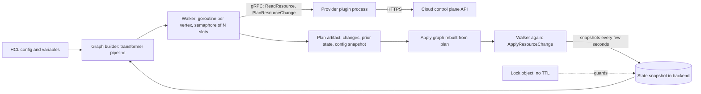

# Terraform and OpenTofu Internals

## TL;DR

- Terraform and OpenTofu are single-process graph walkers: they build a DAG from config, state, and provider schemas, then walk it with one goroutine per vertex gated by a counting semaphore (`-parallelism`, default 10), so makespan is bounded by max(critical path, total work / slots), not by how many resources you have.
- Plan and apply are two different walks over two different graphs: the apply graph is rebuilt from the saved plan, expressions are re-evaluated with newly known values, and core enforces that apply results conform to what the provider promised at plan time.
- State is the only memory of what exists: it carries per-instance dependency lists, `create_before_destroy` flags, and deposed objects, which is why orphans can be destroyed in the right order after their config is deleted.
- The state lock is a whole-state mutual-exclusion object with no TTL and no fencing token: on S3 it is a conditional PUT of a `.tflock` object, on GCS a create-if-absent by generation precondition, so a killed runner leaves a lock that a human must break.
- The blast radius of one command is the whole state, so state layout is a reliability decision: lock hold time sets queueing delay, refresh cost sets plan latency, and the cloud API quota sets the real parallelism ceiling.

## Mental Model



Terraform is not a daemon and has no server-side reconciler.
It is a short-lived client process that holds a lock, reads a snapshot of what it believes exists, asks providers what actually exists, computes a diff by walking a dependency graph, and then walks a second graph to make the diff true.
Everything that matters operationally follows from three boundaries.
The first is the provider boundary: a gRPC contract with strict value-conformance rules, behind which each cloud API's consistency quirks live.
The second is the state boundary: a client-held snapshot with a client-held lock, which is the opposite of CloudFormation's service-held stack state.
The third is the semaphore boundary: concurrency is counted in graph vertices, not in API calls, so a slow vertex occupies a slot for its entire lifetime.
See [[17-Cloud-AI-Engineering/Volume_01_Cloud_Architecture_Principles/Chapter_04_Control_Plane_vs_Data_Plane_Separation|Control Plane vs Data Plane Separation]] for why a tool that only speaks to control planes inherits every control-plane failure mode of the clouds it drives.

## Internals

### Process and plugin architecture

The CLI (core) never talks to AWS or Google directly.
Each provider is a separate executable launched through HashiCorp's go-plugin framework and spoken to over gRPC on a local socket.
Providers speak plugin protocol 5 or 6 (6 adds nested attributes and is used by the Plugin Framework), and the RPC surface is small: `GetProviderSchema`, `ValidateResourceConfig`, `ConfigureProvider`, `ReadResource`, `PlanResourceChange`, `ApplyResourceChange`, `ImportResourceState`, `ReadDataSource`, and `UpgradeResourceState`.
As far as I know each configured provider instance, including each `alias`, is its own plugin process, which is why configurations that fan out across 20 regions hold 20 copies of a large provider in memory.
Providers are cached and verified against hashes in `.terraform.lock.hcl`, which pins version and checksums per platform.

### Graph construction: the transformer pipeline

Core builds the graph with a pipeline of "transformers", each taking the graph so far and mutating it.
The order matters and is part of core's design.
An abridged plan-graph pipeline looks like this (names from `internal/terraform/graph_builder_plan.go`; the exact list changes between releases):

1. `ConfigTransformer` adds one abstract node per resource block in config.
2. Variable, local, and output transformers add nodes for those values.
3. State-based transformers add nodes for resource instances present in state but absent from config (orphans).
4. `AttachResourceConfigTransformer` and `AttachStateTransformer` bind each node to its config and its state.
5. `ProviderConfigTransformer` adds provider-configuration nodes, and every resource gets an edge to its provider node.
6. `ReferenceTransformer` scans every expression for traversals (`aws_vpc.main.id`, `var.x`, `module.m.out`) and adds an edge from the referrer to the referent.
7. Module expansion nodes, then a root node, then pruning of unused nodes.
8. `TransitiveReductionTransformer` removes edges implied by longer paths, which is what `terraform graph` prints.

Three consequences are rarely spelled out in getting-started material.

- Dependency resolution is purely syntactic over HCL references (plus `depends_on` and `replace_triggered_by`).
  Terraform has no knowledge that a subnet "needs" a route table association unless an expression says so, which is the root of most "works on second apply" bugs.
- Cycle detection uses strongly connected components (Tarjan 1972, SIAM J. Comput.), and the error prints the cycle members.
  The canonical cycle is two security groups referencing each other inline, solved by splitting rules into standalone rule resources so the edges point one way.
- `count` and `for_each` cannot be fully resolved at graph-build time, so core uses dynamic expansion: an abstract resource node expands into instance nodes during the walk, once its `count` or `for_each` value is known.
  If that value is unknown at plan time, expansion cannot happen, and you get the "cannot be determined until apply" error.
  That error is a structural limit of a plan that must enumerate every instance, not a validation nicety.
  The build-system literature calls this the difference between static and dynamic dependencies (Mokhov, Mitchell, Peyton Jones, "Build Systems a la Carte", ICFP 2018); Terraform allows dynamic dependencies only through this narrow expansion hook.

### Walking the graph: slots, critical path, and head-of-line blocking

The walker (`internal/dag`) starts a goroutine per vertex.
Each goroutine blocks on the completion of its dependencies, then acquires a slot from a semaphore sized by `-parallelism`, evaluates the vertex (a provider RPC sequence), and releases the slot.
A vertex's slot is held for the entire provider call, including the provider's internal wait-for-ready loops.
A resource that takes 25 minutes to become available (a managed database, a GKE cluster) holds one of ten slots for 25 minutes.
Ten of them stall the whole walk, including unrelated 2-second resources, until one finishes.

Because the walker never idles a slot while a vertex is ready, it is a greedy (work-conserving) scheduler, and Graham's list-scheduling bound (Graham, "Bounds for certain multiprocessing anomalies", Bell System Technical Journal, 1966) applies:

- Lower bound: T >= max(CP, W / p), where CP is the longest dependency chain by duration, W is total vertex time, and p is the slot count.
- Upper bound: T <= W / p + (1 - 1/p) * CP.

This turns `-parallelism` tuning into arithmetic.
If CP dominates, more slots are useless and you must shorten the chain (split states, remove false `depends_on` edges, avoid a mega-module that serializes through one output).
If W / p dominates, raise `-parallelism`, but only until the cloud's API quota becomes the binding constraint, because parallelism counts vertices and one vertex can issue many API calls.
The Worked Example includes a simulator that prints these numbers for a synthetic graph.

### Plan: refresh, diff, and the provider contract

A plan walk does, per resource instance:

1. `ReadResource` (refresh) to update the prior state from reality.
2. Evaluate config with prior values, with not-yet-known values represented as unknowns (`cty.UnknownVal`) that propagate through expressions.
3. `PlanResourceChange` with prior state, config, and proposed new state; the provider returns a planned state in which computed attributes are unknown and a list of attribute paths that force replacement.

Core then validates the provider's answer.
Planned values that config set explicitly must match config, and planned known values must be consistent with prior state.
Violations surface as "Provider produced invalid plan", which is a provider bug, not a user error.

Refresh is not free.
A plan over N instances makes at least N `ReadResource` calls under the same semaphore, and several AWS resources (for example `aws_s3_bucket` in provider v4 and later) fan out to many read calls per instance.
This is why plan latency scales with state size even when nothing changed, and why `-refresh=false` plus scheduled drift runs is the standard large-estate pattern.

### Apply: a second graph, and conformance checks

The apply graph is built from the plan's change set, not from config alone.
It contains create, update, delete, and replace nodes, and expressions are re-evaluated as upstream vertices finish and their outputs become known.
After each `ApplyResourceChange`, core compares the returned object to the planned one.
Any value that was known at plan time must be identical after apply, otherwise core aborts that vertex with "Provider produced inconsistent result after apply".
This invariant is what makes a saved plan reviewable: what you approved in the plan is what you get, except for the attributes explicitly marked as known-after-apply.

On error, core stops scheduling vertices that depend on the failed one, lets in-flight unrelated vertices finish, then writes state and exits non-zero.
There is no rollback.
The state reflects exactly the vertices that completed, which is the root of every "partial apply" runbook.

### Replacement ordering, edge reversal, and deposed objects

Destroy nodes are wired by `DestroyEdgeTransformer` with reversed edges relative to creation: if B depends on A, then A is created before B, and B is destroyed before A.
For a default replace (destroy then create), the dependency chain is walked down for destruction and up for creation.
With `create_before_destroy = true`, the new object is created first and the old one is destroyed afterwards.
In that case core moves the old instance into a "deposed" slot in state while the replacement is created.
Two properties follow that the docs do not emphasize.

- `create_before_destroy` propagates upstream.
  If B has it and depends on A, A is also forced into create-before-destroy behavior, because A's replacement must exist while B is rebuilt.
  Adding the flag to one resource can change the replace ordering of many.
- If the create succeeds but the destroy of the deposed object fails (a dependency violation, a throttle, a crash), the state keeps a deposed instance.
  The next plan shows it as an object to destroy, which is Terraform's mechanism for finishing interrupted replacements.
  Without that record, you would have an orphaned, billable, unreferenced resource.

### State format and why it carries dependencies

State is JSON (format version 4 as of recent releases), with top-level `version`, `terraform_version`, `serial`, `lineage`, `outputs`, and `resources`.
Each resource instance records its attributes, schema version, `create_before_destroy`, and a `dependencies` list of addresses.
That last field exists because when you delete a resource block, config can no longer tell core what the resource depended on.
Core builds destroy ordering for orphans from the dependency list captured in state at the last successful apply.
If you edit state by hand or use `state rm` carelessly, you lose that ordering.

`serial` increments on each state write, and `lineage` is a UUID assigned when the state is first created.
Core uses them as client-side guards: it refuses to overwrite a state of a different lineage without an explicit force, and a saved plan records the lineage and serial it was made against.
Applying a saved plan after any other state change fails with a "Saved plan is stale" error.
This is optimistic concurrency, but it is enforced by the client, not by the storage service.

### State persistence during apply

During apply, core does not wait until the end to write state.
A state hook snapshots the in-memory state and persists it to the backend periodically while the walk proceeds, with a default interval I recall as 20 seconds (UNVERIFIED), plus a final write.
A crash, OOM kill, or spot-instance reclaim therefore loses at most the last interval of completed vertices rather than the whole run.
It also means every persist writes the complete state object, so write volume per apply is roughly (apply duration / interval) times state size, which matters for versioned buckets (see Worked Example).

### State locking mechanics

The lock is a `Locker` interface on the backend: `Lock(info)` returns an ID, `Unlock(id)` releases it.
Lock info is a small JSON document (ID, operation, who, version, creation time, path).
Lock acquisition takes place in `init`-time backend setup for every state-touching command, including plain `plan`, unless `-lock=false` is set; `-lock-timeout` makes the client retry until the timeout, and the default timeout is zero.

Backends implement the lock with whatever primitive the store offers:

- S3 with `use_lockfile = true`: a conditional `PutObject` with `If-None-Match: *` creates `<key>.tflock`; only one concurrent writer can succeed, and others get HTTP 412 (or 409 on a racing conditional write).
  Unlock deletes the object.
  It relies on S3 conditional writes (introduced August 2024) and S3's strong consistency.
- S3 with DynamoDB: a conditional `PutItem` with `attribute_not_exists(LockID)`.
  The DynamoDB path is deprecated in the Terraform docs and slated for removal in a future minor version.
  When both are configured, locks are acquired from both.
- GCS: a create-if-absent on `<prefix>/<workspace>.tflock` using a generation precondition (`ifGenerationMatch=0`).
- Others: Azure blob leases, PostgreSQL advisory locks, Consul sessions, and the HTTP backend's `LOCK` and `UNLOCK` verbs.

What is missing from every one of these is a lease and a fencing token in the Gray-Cheriton sense (Gray and Cheriton, "Leases", SOSP 1989; Kleppmann's fencing-token argument for distributed locks).
A lock holder that stalls (a frozen CI runner, a VM paused during live migration) does not lose the lock, which is safe but means recovery is manual: `terraform force-unlock <ID>`.
A holder that wrongly believes it still holds a lock after someone force-unlocked it can write state with no server-side rejection, because state PUTs are not conditional on the version read.
The serial and lineage checks reduce the damage but are advisory.
Compare this to ZooKeeper-style ephemeral nodes and sessions in [[04-System-Design/05-Data-Stores/Apache-ZooKeeper|Apache ZooKeeper]], where liveness is tied to a session and a dead holder is evicted automatically.

### Plan files

A saved plan (`-out`) is a zip archive containing the serialized plan, the prior state, a snapshot of the configuration, and the provider lock data, so that `apply planfile` needs no variables and no config directory.
Two operational consequences: the plan file contains every resolved value including secrets (treat it as a secret), and it is bound to a state serial, so you cannot hold an approved plan for days while other changes land.

### Terraform versus OpenTofu: where the code diverged

OpenTofu forked from the last MPL-licensed Terraform (1.5.x) after HashiCorp moved Terraform to the Business Source License in August 2023, and is governed under the Linux Foundation and now hosted at the CNCF (UNVERIFIED this session).
The core graph, state, and provider protocol are shared lineage, and providers are largely interchangeable, but features have diverged.

- OpenTofu 1.10 added OCI registry support for providers and modules, native S3 locking, and a global provider cache lock (OpenTofu 1.10 release notes via Spacelift, as of 2026-10).
- OpenTofu 1.11 added ephemeral resources and values, which are guaranteed not to be persisted in state or plan files, and `lifecycle.enabled` as a conditional-creation switch (OpenTofu 1.11 coverage and changelog, as of 2026-10).
- OpenTofu 1.7 added client-side state and plan encryption, 1.8 added early variable evaluation (allowing variables in backend and module source), and 1.9 added `for_each` on providers and the `-exclude` flag (attribution recalled from release notes, UNVERIFIED).
- Terraform 1.15.0 shipped 2026-04-29 and includes a `deprecated` attribute on `variable` and `output` blocks (HashiCorp Discuss release notes, as of 2026-10).
  Terraform has also added ephemeral resources and write-only attributes in the 1.10 and 1.11 timeframe (recalled, UNVERIFIED).
- Support windows matter: the OpenTofu 1.11 series was supported until 2026-08-01 (OpenTofu CHANGELOG, as of 2026-10), so on 2026-10-21 you should be on a newer OpenTofu line, and you should pin and verify against the current release page.
- Supply-chain note: OpenTofu 1.11.10 shipped a security advisory for a crafted-URL issue that could read an arbitrary file during git operations used for module fetches (OpenTofu 1.11.10 release, as of 2026-10).
  Module source fetching is code execution adjacent, so treat module sources and `tofu init` in CI as part of your trust boundary.

Foundational references for the mechanisms above: Mokhov et al., "Build Systems a la Carte" (ICFP 2018), for the dependency-model vocabulary; Tarjan (1972) for cycle detection; Graham (1966) for the scheduling bound; Gray and Cheriton (SOSP 1989) for leases.
HashiCorp has not published an academic paper on Terraform; the authoritative sources are the open-source `internal/dag`, `internal/terraform`, and `internal/states` packages and the provider protocol documentation.

## Numbers to Know

| Quantity | Value | Source and date | Status |
|---|---|---|---|
| Current Terraform minor line | 1.15.0 released 2026-04-29, followed by 1.15.x patches | HashiCorp Discuss release notes, as of 2026-10 | Verified |
| OpenTofu 1.11 support end | 2026-08-01 | OpenTofu CHANGELOG, as of 2026-10 | Verified |
| S3 backend DynamoDB locking | Deprecated, to be removed in a future minor version | Terraform S3 backend docs, as of 2026-10 | Verified |
| `use_lockfile` maturity | Experimental in Terraform 1.10, GA in 1.11 | Terraform release notes, as of 2026-10 | UNVERIFIED |
| OpenTofu native S3 locking | Shipped in 1.10 | OpenTofu 1.10 coverage, as of 2026-10 | Verified |
| Default `-parallelism` | 10 concurrent vertex evaluations | Terraform CLI docs, as of 2026-10 | UNVERIFIED this session |
| Default `-lock-timeout` | 0s (fail immediately on contention) | Terraform CLI docs, as of 2026-10 | UNVERIFIED this session |
| State persist interval during apply | 20 s default | Terraform source `internal/backend/local`, as of 2026-10 | UNVERIFIED |
| State format version | 4 | Terraform internals docs, as of 2026-10 | UNVERIFIED this session |
| S3 conditional writes | `If-None-Match` (Aug 2024), `If-Match` (Nov 2024) | AWS What's New, as of 2026-10 | UNVERIFIED this session |
| S3 read-after-write consistency | Strong, for all PUT, DELETE, LIST (since Dec 2020) | AWS S3 docs, as of 2026-10 | UNVERIFIED this session |
| S3 Standard storage price | about 0.023 USD per GB-month, us-east-1, first 50 TB | AWS S3 pricing, as of 2026-10 | UNVERIFIED |
| S3 PUT price | about 0.005 USD per 1,000 requests, us-east-1 Standard | AWS S3 pricing, as of 2026-10 | UNVERIFIED |
| Route 53 API rate limit | about 5 requests per second per account | AWS Route 53 docs, as of 2026-10 | UNVERIFIED |
| AWS provider default `max_retries` | 25 with `standard` retry mode | Terraform AWS provider docs, as of 2026-10 | UNVERIFIED |
| Graham greedy-schedule bound | T <= W/p + (1 - 1/p) * CP | Graham 1966 | Mathematical |

Treat every UNVERIFIED row as a prompt to run `terraform -help plan`, read the pricing page, or read the provider docs before you put it in a design review.

## AWS vs GCP Mechanism Parity

| Dimension | AWS | Google Cloud | Why it matters |
|---|---|---|---|
| Remote state store | S3 bucket, key per state | GCS bucket, prefix and workspace per state | Both are strongly consistent object stores, so the lock and state read-after-write are safe. |
| Lock primitive | Conditional PutObject `If-None-Match` on `.tflock` (native); DynamoDB conditional put (deprecated) | Create-if-absent on `.tflock` with generation precondition | Neither has a TTL or fencing token; both need a break-glass `force-unlock`. |
| State versioning | S3 Versioning plus noncurrent-version lifecycle | GCS Object Versioning plus lifecycle | Every persist snapshot is a new version, so lifecycle expiry is a cost control. |
| State encryption at rest | SSE-S3 or SSE-KMS (bucket key reduces KMS calls) | Google-managed keys or CMEK | State holds secrets; key policy is a data-access control. See [[17-Cloud-AI-Engineering/Volume_08_Security_Identity_and_the_Data_Perimeter/Chapter_04_Encryption_Key_Hierarchies_and_Envelope_Encryption\|Encryption Key Hierarchies]]. |
| Network boundary for state | Gateway VPC endpoint for S3 plus bucket policy on `aws:SourceVpce` | VPC Service Controls perimeter on `storage.googleapis.com` | Stops a stolen CI credential from reading state off-network. |
| Provider construction | `hashicorp/aws`: hand-written resources, large surface, Plugin SDK plus Framework | `hashicorp/google` and `google-beta`: largely generated from the Magic Modules codebase | Generated providers have uniform behavior; hand-written ones vary by resource in read fan-out and retry. |
| Service-side competitor | CloudFormation: stack state held by the service, change sets, service-side rollback and drift detection | Infrastructure Manager (managed Terraform execution; GA status UNVERIFIED) | Terraform has no rollback and keeps state client-side; CloudFormation trades that for slower coverage and per-stack limits. |
| Credential model for CI | OIDC to `sts:AssumeRoleWithWebIdentity` | Workload Identity Federation to service account impersonation | Both remove static keys. See [[17-Cloud-AI-Engineering/Volume_08_Security_Identity_and_the_Data_Perimeter/Chapter_02_Workload_Identity_Federation\|Workload Identity Federation]]. |
| API consistency quirks | IAM is global and eventually consistent (role then instance profile then launch), Route 53 changes are asynchronous | API enablement via `serviceusage` propagates with lag, IAM policy changes are eventually consistent | Provider retry wrappers paper over both; unlisted ones become flaky first-apply failures. |
| Throttling surface | Per-service per-account per-region token buckets; provider `max_retries` and `retry_mode` | Per-project per-API quotas; provider `request_timeout` and batching for some services | Real ceiling on `-parallelism`; see Worked Example sizing. |
| IAM resource semantics | Policy attachments are additive per principal | `google_*_iam_policy` is authoritative, `_binding` authoritative per role, `_member` additive | A wrong choice on GCP silently strips other principals' access on apply. |
| Native lock owner info | Lock JSON in `.tflock` object | Lock JSON in `.tflock` object | Read it with `aws s3 cp` or `gcloud storage cat` before force-unlocking. |

## Worked Example: Slots, Locks, and State Write Volume

This lab has two parts.
Part A is zero-cost and local, and demonstrates the walker's slot arithmetic.
Part B uses one S3 bucket and demonstrates lock contention and state write amplification.

### Part A: head-of-line blocking (no cloud resources, no cost)

```hcl
# main.tf
terraform {
  required_version = ">= 1.10"
}

variable "slow" {
  type    = number
  default = 10
}

variable "fast" {
  type    = number
  default = 40
}

resource "terraform_data" "slow" {
  count = var.slow
  provisioner "local-exec" {
    command = "sleep 30"
  }
}

resource "terraform_data" "fast" {
  count = var.fast
  provisioner "local-exec" {
    command = "sleep 2"
  }
}

resource "terraform_data" "tail" {
  input = [for s in terraform_data.slow : s.id]
  provisioner "local-exec" {
    command = "sleep 2"
  }
}
```

```bash
terraform init
terraform graph -type=apply | head -40
time terraform apply -auto-approve -parallelism=10
terraform destroy -auto-approve
time terraform apply -auto-approve -parallelism=20
terraform destroy -auto-approve
```

Arithmetic: W = 10 x 30 + 40 x 2 + 2 = 382 s, CP = 30 + 2 = 32 s.
At p = 10: lower bound max(32, 38.2) = 38.2 s, so the ten slow vertices occupying every slot cannot be beaten by any ordering.
At p = 20: lower bound max(32, 19.1) = 32 s, now critical-path bound.
Expect roughly 40 s and roughly 33 s of wall time including Terraform overhead.
The destroy walk shows the same slot behavior with reversed edges.

To explore larger shapes, use this simulator, which models the walker as a greedy semaphore-bounded schedule and prints Graham's bounds:

```python
#!/usr/bin/env python3
import heapq, random

def make_graph(n_fast=200, n_slow=8, slow_s=1800, fast_s=20, chain=40, seed=7):
    rnd = random.Random(seed)
    dur, deps = {}, {}
    for i in range(chain):
        dur["chain%d" % i] = rnd.uniform(5, 30)
        deps["chain%d" % i] = ["chain%d" % (i - 1)] if i else []
    for i in range(n_fast):
        dur["fast%d" % i] = rnd.uniform(0.5 * fast_s, 1.5 * fast_s)
        deps["fast%d" % i] = ["chain%d" % rnd.randrange(chain)]
    for i in range(n_slow):
        dur["slow%d" % i] = rnd.uniform(0.7 * slow_s, 1.3 * slow_s)
        deps["slow%d" % i] = ["chain%d" % rnd.randrange(chain)]
    return dur, deps

def critical_path(dur, deps):
    memo = {}
    def f(v):
        if v not in memo:
            memo[v] = dur[v] + max([f(d) for d in deps[v]] or [0])
        return memo[v]
    return max(f(v) for v in dur)

def simulate(dur, deps, p):
    rdeps = {v: [] for v in dur}
    indeg = {v: len(deps[v]) for v in dur}
    for v, ds in deps.items():
        for d in ds:
            rdeps[d].append(v)
    ready = [v for v in dur if indeg[v] == 0]
    running, now, done = [], 0.0, 0
    while done < len(dur):
        while ready and len(running) < p:
            v = ready.pop(0)
            heapq.heappush(running, (now + dur[v], v))
        now, v = heapq.heappop(running)
        done += 1
        for w in rdeps[v]:
            indeg[w] -= 1
            if indeg[w] == 0:
                ready.append(w)
    return now

dur, deps = make_graph()
W, CP = sum(dur.values()), critical_path(dur, deps)
print("vertices=%d work=%.0fs critical_path=%.0fs" % (len(dur), W, CP))
for p in (1, 5, 10, 20, 50):
    print("p=%-3d lower=%7.0fs simulated=%7.0fs graham_upper=%7.0fs" % (
        p, max(CP, W / p), simulate(dur, deps, p), W / p + (1 - 1.0 / p) * CP))
```

Output on the default graph (248 vertices, 8 of them roughly 30-minute resources): at p = 10 the simulated makespan is about 2,555 s against a lower bound of 2,471 s, and p = 20 and p = 50 both hit the critical path of 2,471 s.
Raising parallelism beyond 20 buys nothing here, because the 40-deep dependency chain and the slow resources set the floor.

### Part B: lock contention and write amplification (billable, pennies)

Cost estimate: one S3 bucket holding under 1 MB of state and a lock object, a few hundred requests in total.
At about 0.005 USD per 1,000 PUTs and 0.023 USD per GB-month (UNVERIFIED prices, as of 2026-10) the total is well under 0.01 USD, provided you run the teardown the same day.

Budget alarm (create before provisioning):

```bash
ACCT=$(aws sts get-caller-identity --query Account --output text)
cat > budget.json <<'EOF'
{
  "BudgetName": "tf-internals-lab",
  "BudgetLimit": { "Amount": "5", "Unit": "USD" },
  "TimeUnit": "MONTHLY",
  "BudgetType": "COST"
}
EOF
cat > notify.json <<'EOF'
[{
  "Notification": {
    "NotificationType": "ACTUAL",
    "ComparisonOperator": "GREATER_THAN",
    "Threshold": 80,
    "ThresholdType": "PERCENTAGE"
  },
  "Subscribers": [{ "SubscriptionType": "EMAIL", "Address": "you@example.com" }]
}]
EOF
aws budgets create-budget --account-id "$ACCT" \
  --budget file://budget.json --notifications-with-subscribers file://notify.json
```

Provision the bucket:

```bash
export AWS_REGION=us-east-1
BUCKET="tfstate-lab-${ACCT}-$RANDOM"
aws s3api create-bucket --bucket "$BUCKET"
aws s3api put-bucket-versioning --bucket "$BUCKET" \
  --versioning-configuration Status=Enabled
aws s3api put-public-access-block --bucket "$BUCKET" \
  --public-access-block-configuration BlockPublicAcls=true,IgnorePublicAcls=true,BlockPublicPolicy=true,RestrictPublicBuckets=true
aws s3api put-bucket-lifecycle-configuration --bucket "$BUCKET" \
  --lifecycle-configuration '{"Rules":[{"ID":"expire-noncurrent","Status":"Enabled","Filter":{},"NoncurrentVersionExpiration":{"NoncurrentDays":7}}]}'
```

Point the Part A configuration at it and add this block in a separate `backend.tf`:

```hcl
terraform {
  backend "s3" {
    key          = "lab/terraform.tfstate"
    region       = "us-east-1"
    use_lockfile = true
    encrypt      = true
  }
}
```

```bash
terraform init -reconfigure -backend-config="bucket=$BUCKET"
# Terminal 1: holds the lock for about 35 s
terraform apply -auto-approve -parallelism=20
# Terminal 2, while terminal 1 runs:
terraform plan -lock-timeout=5s          # fails with "Error acquiring the state lock" and the holder's lock JSON
aws s3 cp "s3://$BUCKET/lab/terraform.tfstate.tflock" -    # lock info: ID, Operation, Who, Created
# After the apply:
aws s3 cp "s3://$BUCKET/lab/terraform.tfstate" - | jq '{version, serial, lineage, terraform_version}'
aws s3api list-object-versions --bucket "$BUCKET" --prefix lab/terraform.tfstate \
  --query 'length(Versions)'             # one version per persisted snapshot
```

Prove that mutual exclusion comes from the store, not from Terraform, by racing eight writers on the same lock key:

```python
#!/usr/bin/env python3
import json, sys, threading, time, uuid
import boto3
from botocore.exceptions import ClientError

bucket, key = sys.argv[1], sys.argv[2] + ".tflock"
n = int(sys.argv[3]) if len(sys.argv) > 3 else 8
s3 = boto3.client("s3")
results = {}

def try_lock(i):
    info = {"ID": str(uuid.uuid4()), "Operation": "OperationTypeApply",
            "Who": "writer-%d" % i,
            "Created": time.strftime("%Y-%m-%dT%H:%M:%SZ", time.gmtime())}
    try:
        s3.put_object(Bucket=bucket, Key=key,
                      Body=json.dumps(info).encode(), IfNoneMatch="*")
        results[i] = "ACQUIRED " + info["ID"]
    except ClientError as e:
        results[i] = "REJECTED " + e.response["Error"]["Code"]

threads = [threading.Thread(target=try_lock, args=(i,)) for i in range(n)]
[t.start() for t in threads]
[t.join() for t in threads]
for i in sorted(results):
    print(i, results[i])
assert sum(r.startswith("ACQUIRED") for r in results.values()) == 1
print("holder body:", s3.get_object(Bucket=bucket, Key=key)["Body"].read().decode())
s3.delete_object(Bucket=bucket, Key=key)
```

Run it as `python3 lock_race.py "$BUCKET" lab/race 8`.
Exactly one writer acquires; the others receive `PreconditionFailed` (HTTP 412) or `ConditionalRequestConflict` (HTTP 409).
Note what is absent: there is no lease, so if you kill the winner before the `delete_object`, the object stays until someone deletes it.

Exact teardown (run in the lab directory, then confirm the bucket is gone):

```bash
terraform destroy -auto-approve
python3 - "$BUCKET" <<'EOF'
import sys, boto3
b = boto3.resource("s3").Bucket(sys.argv[1])
b.object_versions.delete()
b.delete()
print("deleted", sys.argv[1])
EOF
aws budgets delete-budget --account-id "$ACCT" --budget-name tf-internals-lab
```

### Capacity sizing: a 4,000-instance state

Assumptions (state them in the design doc, then measure): 4,000 resource instances, 4 KB average serialized state each, so a 16 MB state; 3 provider read calls per instance during refresh at 250 ms each; p = 10; the busiest API has a 20 requests per second effective quota for this account and region.

1. Refresh work W = 4,000 x 3 x 0.25 s = 3,000 s of vertex time.
2. Slot bound: W / p = 300 s of plan time with nothing changing.
3. Quota bound: 12,000 calls / 20 per second = 600 s.
   The binding constraint is the quota, not the semaphore, so raising `-parallelism` to 30 helps only to the extent that load is spread across multiple APIs with separate quotas.
4. Apply persists: a 20-minute apply with a 20-second persist interval writes up to 60 snapshots, each 16 MB, which is about 960 MB of state PUTs per apply.
5. Version growth: at 150 applies per day, that is about 144 GB per day of new object versions.
   With 7-day noncurrent expiry the steady state is about 1 TB, which is about 23 USD per month at 0.023 USD per GB-month (UNVERIFIED price, as of 2026-10).
   This is small money, but without the lifecycle rule it grows without bound, and a 16 MB state read on every plan is a latency tax of its own.
6. Lock queueing: assume 40 state-changing runs per day against this one state, each holding the lock for 25 minutes.
   Offered load is 1,000 minutes of lock hold per day, which on an 8-hour working window of 480 minutes is utilization above 1, so the queue is unstable.
   Even at 12 runs per day, rho = 300 / 480 = 0.625, and under an M/M/1 approximation (Poisson arrivals, exponential holds, which is crude) mean wait is rho / (1 - rho) x 25 min = 1.67 x 25 = about 42 minutes.
   Splitting into k independent states divides the load per lock and is the single largest lever on engineer wait time.

## Failure Modes and Pitfalls

### Stuck lock after an interrupted run

A runner is killed mid-apply (preempted spot node, CI timeout, OOM), and the `.tflock` object survives.
Every subsequent plan fails until a human runs `terraform force-unlock <ID>`.
The danger is not the stuck lock but the wrong unlock: if the original process is merely frozen rather than dead, force-unlocking lets two writers run, and state writes have no server-side version check.
Runbook: read the lock info, confirm the holder is truly gone (CI job state, instance state), inspect the state `serial`, then unlock.
Put hard timeouts under your CI job timeout so Terraform has time to unlock on SIGTERM; a first interrupt asks core to stop gracefully, and a second interrupt aborts hard and risks a partially recorded state.

### Partial apply and orphaned resources

A create call succeeds in the cloud but the provider times out or the process dies before the ID reaches state.
The resource exists, is billed, and Terraform does not know about it.
The next apply tries to create again, and either collides on a unique name or silently creates a duplicate.
Mitigations: use idempotency tokens where the API offers them, deterministic names, `import` blocks to adopt orphans, and periodic orphan sweeps by tag.
A failed create that did return an ID is stored as tainted, and the next plan replaces it; do not `untaint` unless you have checked the real object.

### Provider contract violations

"Provider produced inconsistent result after apply" and "Provider produced invalid plan" are bugs in a provider's plan or apply logic, not in your config.
They are often triggered by new attribute normalization in a cloud API (the API returns a canonicalized value that differs from config).
Work around with `ignore_changes` on the attribute, pin the provider version, and file an issue.
Never ignore them by `-refresh=false` games, which hide the symptom.

### Unknown values and false `depends_on`

`depends_on` on a module or resource forces data sources that reference it to be deferred until apply if the target has pending changes.
Everything downstream of that data source then becomes "known after apply", including `for_each` keys, producing the "cannot be determined until apply" error or perpetual diffs.
Prefer expressing the dependency through a real attribute reference so the graph carries the value, not just the edge.

### Index shifting and key instability

`count` over a list means removing the first element renumbers every later instance, and Terraform plans destroy and create for each.
Use `for_each` over a map with stable keys.
Likewise, renaming a resource block without a `moved` block plans a destroy and create; `moved` blocks (Terraform 1.1 and later) rewrite state addresses during planning.

### `prevent_destroy` is a config-time guard only

`lifecycle { prevent_destroy = true }` blocks a plan that would destroy the object while the block is present in config.
If someone deletes the whole resource block, the guard goes with it, and the plan simply destroys the object.
Real protection comes from cloud-side deletion protection (RDS deletion protection, S3 versioning with MFA delete, GCP deletion protection fields), IAM that denies delete in the apply role, and policy checks on the plan.

### API throttling and eventual consistency

Parallelism that is safe for compute APIs can exceed Route 53's very low per-account request limit (UNVERIFIED) or a GCP per-API quota.
Providers retry with backoff (the AWS provider defaults to many retries, UNVERIFIED), but retries hold the vertex slot, so throttling converts directly into longer plans and head-of-line blocking.
IAM eventual consistency produces first-apply failures that pass on rerun; the provider's built-in retries cover well-known cases, and anything else shows up as "works on second apply" noise that erodes trust in the pipeline.

### Drift and stale refresh

`-refresh=false` plans against the last recorded state.
If someone changed the resource out of band, the plan is wrong, and apply may overwrite the change or fail on a conditional update.
Run full-refresh drift detection on a schedule and treat its diff as an alert, not an auto-apply.

### Provider upgrades changing plans

A provider minor version can change defaults, split a resource (S3 bucket sub-resources in the AWS provider v4 line), or normalize an attribute.
Commit `.terraform.lock.hcl`, generate hashes for every platform your CI and laptops use (`terraform providers lock -platform=...`), and promote provider upgrades through a plan-only canary first.

### Blast radius of a single command

The 2017 S3 us-east-1 event, per AWS's post-event summary, began with an authorized debugging command in which a mistyped input removed more capacity than intended, and AWS's remediation included making the tool remove capacity more slowly and adding a minimum-capacity safeguard (AWS PIR, 2017-03, [aws.amazon.com/message/41926](https://aws.amazon.com/message/41926/); content recalled, UNVERIFIED this session).
`terraform destroy` against a monolithic state is the same shape of hazard: one command, one lock, a very large set of resources.
Related: Google's June 2025 Service Control incident, in which a policy metadata change replicated globally in seconds without a gradual rollout, is the cloud-side analogue of a single global apply (Google Cloud incident report, June 2025, UNVERIFIED this session).
The IaC response is the same as the cloud-side one: small states, wave-based rollout across accounts or projects, policy checks on the plan, and apply roles that cannot delete protected resource types.

### Supply chain in `init`

`terraform init` and `tofu init` execute network fetches of providers and modules, and module source fetching has had a path-traversal-class advisory (OpenTofu 1.11.10, as of 2026-10).
Pin module versions, mirror providers to an internal registry or OCI repository, and run `init` in an egress-restricted CI environment.

## Security and Cost Angles

### Secrets are in state and in plan files

State stores every attribute the provider returns, including generated passwords, private keys, and database endpoints with credentials.
Sensitive marking only redacts CLI output; it does not remove values from state or plan files.
Controls, in order of strength:

1. Do not let secrets enter state: ephemeral resources and write-only attributes (Terraform 1.10 and 1.11 timeframe, UNVERIFIED; OpenTofu 1.11 ephemeral values, as of 2026-10) keep values out of persisted artifacts, at the cost of provider support being uneven.
2. Encrypt at rest with a key you control: SSE-KMS on S3 or CMEK on GCS.
   With SSE-KMS each object has its own data key wrapped by the KMS key (envelope encryption), and an S3 Bucket Key cuts KMS request volume for high-frequency persists.
3. Client-side encryption with OpenTofu's state and plan encryption, using key providers such as AWS KMS or Google Cloud KMS (UNVERIFIED provider list), so the bucket never holds plaintext.
4. Restrict read access to state to a small set of roles, because `state pull` is a secret dump.

### IAM scoping

Split roles by phase.
The plan role needs read access across managed resource types plus `GetObject` and lock-object write on the state prefix.
The apply role needs mutation rights but should be assumed only from a protected branch pipeline, with explicit denies for destructive actions on protected resource types.
For S3 state: `s3:GetObject`, `s3:PutObject`, and `s3:DeleteObject` on `.../terraform.tfstate*` (the `.tflock` object needs `PutObject` and `DeleteObject`), and `s3:ListBucket` on the bucket scoped by prefix condition.
Use one bucket policy statement requiring TLS and, for production, the gateway endpoint ID (`aws:SourceVpce`).
On GCP, grant `roles/storage.objectUser` or a custom role on the state bucket only, wrap the project in a VPC Service Controls perimeter, and authenticate CI by Workload Identity Federation rather than keys.
See [[17-Cloud-AI-Engineering/Volume_08_Security_Identity_and_the_Data_Perimeter/Chapter_06_Constructing_an_Impenetrable_Data_Perimeter|Constructing an Impenetrable Data Perimeter]].

### Cost levers

- State bucket: noncurrent-version expiry (Worked Example step 5) and avoiding monolithic states, which multiply both snapshot size and persist volume.
- CI compute: refresh dominates plan time, so PR plans with `-refresh=false` plus scheduled full-refresh drift runs cut runner minutes by an order of magnitude on large estates.
- API quota: lowering `-parallelism` for quota-bound services is cheaper than raising quotas, and spreading resources across accounts spreads per-account quotas.
- Licensing and platform: choose Terraform or OpenTofu on governance, feature, and licence grounds, then price managed platforms by resources under management (UNVERIFIED, pricing changes often).
- Tagging: `default_tags` in the AWS provider and `default_labels` in the Google provider feed cost allocation. See [[17-Cloud-AI-Engineering/Volume_09_FinOps_and_Cloud_Economics/Chapter_01_Cloud_Billing_Models_and_Unit_Cost_Allocation|Cloud Billing Models and Unit Cost Allocation]].

Policy-as-code on the plan JSON (`terraform show -json planfile`) and drift workflows are developed in [[17-Cloud-AI-Engineering/Volume_06_Infrastructure_as_Code_and_Delivery/Chapter_04_Policy_as_Code_OPA_Sentinel_and_Guardrails|Policy as Code]] and [[17-Cloud-AI-Engineering/Volume_06_Infrastructure_as_Code_and_Delivery/Chapter_05_State_Management_Drift_Detection_and_Compliance|State Management, Drift Detection, and Compliance]].
Module design that shapes the graph is in [[17-Cloud-AI-Engineering/Volume_06_Infrastructure_as_Code_and_Delivery/Chapter_02_Enterprise_Module_Design_and_Abstraction_Layers|Enterprise Module Design and Abstraction Layers]], and delivery pipelines around plan and apply are in [[17-Cloud-AI-Engineering/Volume_06_Infrastructure_as_Code_and_Delivery/Chapter_06_Progressive_Delivery_and_Deployment_Pipelines|Progressive Delivery and Deployment Pipelines]].

## Interview Questions and Model Answers

### Question 1 (L5 - Senior)

A teammate says "Terraform runs ten things at a time, so my 200-resource apply should take about a tenth of the serial time." Your apply took 28 minutes anyway, and 24 of them were one resource. Explain.

#### Model Answer

Terraform builds a DAG from HCL references and walks it with a goroutine per vertex, but each vertex must acquire a slot from a semaphore of size `-parallelism`, default 10, and holds it for the full provider call.
The speedup bound is not 10x.
Makespan is at least max(critical path, W / p), so if one vertex takes 24 minutes and everything downstream depends on it, the critical path is at least 24 minutes, and no number of slots helps.
If other long resources compete for slots, they also cause head-of-line blocking, since a managed database or cluster that waits for readiness holds its slot while polling.
My diagnostic steps: run `terraform graph` and look at what depends on the slow resource, check whether downstream edges are real value dependencies or needless `depends_on`, and compare W / p to the critical path.
Fixes: break the stack so the slow resource lives in its own state with its own pipeline, remove false edges, and only then raise parallelism if the cloud API quota allows.

#### Follow-up Interviewer Question

You raise `-parallelism` to 50 and the apply now fails with throttling errors on one API. What changed mechanically, and how do you decide the right value?

### Question 2 (L5 - Senior)

Two engineers run `terraform apply` against the same S3 state at nearly the same moment. Describe exactly what happens, and what the second engineer should do when their pipeline shows a lock error.

#### Model Answer

Both clients try to create the `.tflock` object with a conditional PUT (`If-None-Match: *`) in the native S3 mode, or a conditional DynamoDB item in the older mode.
The store arbitrates: one wins, the other receives an HTTP 412 or 409, and Terraform prints the holder's lock info (ID, who, operation, timestamp).
With the default `-lock-timeout` of zero, the loser fails immediately; setting a timeout makes it retry.
The second engineer should read the lock info, check whether the holder is a live job, and wait.
`force-unlock` is a last resort when the holder is confirmed dead, because there is no TTL and no fencing: unlocking under a live holder allows concurrent writes, and state writes are not conditional on the version read.
The state `serial` and `lineage` help detect some mistakes, but they are checked by the client, not the store.

#### Follow-up Interviewer Question

How would you add a lease-and-heartbeat layer in CI so that a dead runner releases its lock automatically without letting a frozen runner resurrect?

### Question 3 (L6 - Staff)

An apply creates an RDS instance and the provider's create times out after 40 minutes while the instance is actually being created. Describe the state of the world, the next plan, and how you design the pipeline so this is recoverable at 3 a.m. without improvisation.

#### Model Answer

Three states are possible and the runbook must distinguish them.
If the provider received the instance identifier from the create API before timing out, it records the object, marks it tainted on failure, and the next plan proposes to destroy and recreate it.
That is dangerous for a database: the correct action is usually to wait for the instance to become available, `untaint`, and run a plan to confirm no diff, rather than recreate.
If the process died before the ID was stored, the instance exists but is not in state, and the next apply fails on a name collision or creates a second one.
The fix is an `import` block or `terraform import` with the identifier, then plan.
If the API call was never accepted, nothing exists and a rerun is safe.
For the pipeline: keep the state snapshot before each run, retain the apply log and the plan file as artifacts, make plans reviewable and stale-checked (a saved plan is bound to the state serial), use deterministic names so collisions are detectable, enable deletion protection on stateful resources so a bad replace plan fails in the cloud rather than destroying data, and raise resource `timeouts` for known slow resources.
Alert on tainted instances in state after apply.
Finally, I would separate stateful and stateless layers into different states so a database timeout does not hold the lock or the slots for the app tier.

#### Follow-up Interviewer Question

The on-call chooses to `terraform state rm` the instance to unblock the pipeline. What do you lose, and what is the risk to resources that depended on it?

### Question 4 (L6 - Staff)

Explain "Provider produced inconsistent result after apply" in terms of the plan/apply protocol, and why Terraform enforces it even though it makes some providers harder to write. Then explain why `for_each = toset(aws_instance.x[*].id)` fails at plan time.

#### Model Answer

Plan is a promise.
The provider returns a planned object in which attributes it can predict are known and the rest are unknown.
Apply returns the final object, and core compares it to the plan: any attribute that was known at plan time must be identical.
The invariant is what makes saved-plan review meaningful, makes policy checks on the plan trustworthy, and lets downstream expressions that depended on known values be planned with confidence.
Violations mean the provider planned a value the API later normalized, or computed a value it should have marked unknown.
Legacy SDK-based providers get some leniency, which is why the error often appears after an SDK or API change; the right fix is in the provider, with `ignore_changes` as a stopgap.
For the `for_each` question: expansion of a resource into instances is a graph operation, and the planner must enumerate instance keys to build the plan.
Instance IDs of resources not yet created are unknown during plan, so the key set is unknown and core cannot expand.
This is a structural limit of a plan that lists every instance, not a missing feature.
Fix by keying on values known at plan time (static names or variable-derived keys) and using the unknown IDs as values, or apply in two stages with a `-target` first as a last resort; the `-target` approach has its own risks since it bypasses the full graph.

#### Follow-up Interviewer Question

OpenTofu 1.9 added `for_each` on providers and early variable evaluation. What problem does early evaluation solve, and what new class of unknown-value errors does it introduce?

### Question 5 (L6 - Staff)

You inherit one Terraform state with 6,000 resources, a 25-minute lock hold, and 30 engineers. Design the target state layout and rollout, with numbers.

#### Model Answer

Diagnose first: measure lock hold time, plan time with and without refresh, state size, and the API quota that bounds refresh.
Queueing says it all: with 20 state-changing runs a day at 25 minutes each, load is 500 minutes against a roughly 480-minute workday, which is unstable.
Then split along blast radius and change frequency, not along organizational charts.
Foundation layers (org, accounts, network) change rarely and have a huge blast radius, so they get their own states, tighter approval, and wave-based rollout.
Platform layers (clusters, databases) change occasionally and are slow to apply, so isolate them to avoid their slots and lock hold affecting app tiers.
Application layers change often and are small, so one state per service per environment per region cell.
Cross-state data flows through narrow outputs published to a stable contract (SSM parameters, or `terraform_remote_state` with read-only access scoped to outputs) rather than direct state reads, since `remote_state` gives consumers read access to everything in the producer's state, including secrets.
Migrate with `moved` blocks and `removed` blocks plus state surgery done by script in a reviewed PR, never by hand in production, and keep the old state versioned for rollback.
Target numbers: no state above roughly 500 resources or 5 MB, lock hold under 5 minutes at p95, PR plans with `-refresh=false` under 2 minutes, and scheduled drift runs with full refresh.
Add policy checks on plan JSON and a break-glass apply role.
Cost: this adds states, buckets or prefixes, and pipelines, but state storage is cheap compared with engineer wait time.

#### Follow-up Interviewer Question

Two services both need to read a VPC ID from the network state, and one of them also needs a secret from the database state. How do you wire those without giving either service read access to the other state?

### Question 6 (L7+ - Principal)

Design the safety model for a platform where 300 teams apply Terraform or OpenTofu into 2,000 AWS accounts and 800 GCP projects. Which failures do you design out, and which do you accept?

#### Model Answer

I treat IaC as a control-plane client with the same discipline as any hyperscale control plane (see the static-stability and cell-based chapters).
Start from the failure that matters: a single bad change reaching many accounts at once.
Design-out measures: states are per account-and-region cell with no cross-cell state sharing; shared modules are versioned and promoted through rings (canary accounts, then low-risk, then the rest) with bake time and automated plan diff checks, so a bad module release is a ring-0 incident; the apply role is assumed only from a protected pipeline via OIDC or Workload Identity Federation and carries explicit denies on protected resource types and on `iam:*` or `setIamPolicy` expansions beyond a permissions boundary; the plan is saved, policy-checked as JSON, reviewed, and applied as the same artifact (stale-plan check binds it to the state serial).
Drift: scheduled full-refresh plans per cell producing alerts, never auto-apply.
Accept: client-side locks without TTL, so a stuck runner means a bounded, per-cell human delay; at-least-once provider semantics, mitigated by deterministic names and orphan sweeps; and provider API consistency quirks, absorbed by retries.
Quantify blast radius: if rings cover 1%, 10%, 100% with 24-hour bake and the module defect is detected in ring 0 or 1, expected exposure is at most 11% of cells; if it is only detectable in the long tail, the exposure is total and you need pre-merge testing (`terraform test`, ephemeral account integration) instead.
State secrets: keep them out of state with ephemeral values and write-only attributes where providers support them, encrypt with per-environment keys, and keep state readers to a minimal role.
Operationally, an apply-rate limiter per organizational unit and a global kill switch (a pipeline-checked flag) turn a bad rollout into a pause rather than an outage.
The AWS 2017 S3 and Google June 2025 incident reports share the lesson: the tool must make the blast radius of one command small by construction.

#### Follow-up Interviewer Question

A module owner needs to ship a security fix to all 2,800 cells in 4 hours. How do you override the ring policy without defeating it?

### Question 7 (L7+ - Principal)

Your CTO asks: "Should we standardize on Terraform or OpenTofu?" Give a recommendation that survives a bar-raiser's scrutiny.

#### Model Answer

Treat it as a decision under reversibility, not a licence debate.
Facts: both share graph, state, and provider-protocol lineage up to the fork, so migration is mostly a binary swap plus lock-file and CI changes, provided you avoid forked-only features; Terraform has been under the Business Source License since August 2023 and HashiCorp is owned by IBM (UNVERIFIED this session), while OpenTofu is MPL-licensed and community-governed (UNVERIFIED this session).
Feature divergence is real and growing: OpenTofu has client-side state and plan encryption, provider `for_each`, OCI distribution, and early evaluation; Terraform has the features HashiCorp ships on its own roadmap and a tighter relationship with its managed platform.
Release cadence also differs and support windows are short on the OpenTofu side (the 1.11 line ended support on 2026-08-01), so either choice requires a pinned-version upgrade program.
My recommendation process: inventory which divergent features you actually use, which providers you depend on (all are consumed through the same registry protocol, but registries differ), and what your managed-platform dependencies are (policy engines, run tasks, private registries).
Default to staying portable: keep the dialect to the intersection, run CI plan on both binaries for a shared core of modules (`terraform test` and `tofu test` against the same fixtures), and make the choice per estate with an exit plan documented.
If the state-encryption requirement is a hard compliance control (customer-managed keys on state itself), OpenTofu is the lower-effort path; if you depend on a managed platform's policy and run-task ecosystem, Terraform is.
Either way, the more valuable decision is the one in the other chapters: state layout, module contracts, and pipeline safety, which dominate outcomes more than the binary.

#### Follow-up Interviewer Question

After a year on OpenTofu, a critical provider releases a feature that only works with Terraform's plugin protocol behavior. How do you decide whether to fork your estate, pin, or migrate back?

### Question 8 (L7+ - Principal)

Propose one change to Terraform's core that would most reduce production incidents, and defend it against the strongest counterargument.

#### Model Answer

I would make state writes conditional on the version read, and make locks leases with a fencing token.
Today, S3 and GCS now offer the primitives (conditional write on ETag or generation), yet state PUTs are not fenced.
With a fenced write, an acquired lock carries a monotonic token, every state write presents the token and the expected prior version, and the store rejects stale writers.
That converts the worst class of incident (two writers racing after a force-unlock or a long pause) from silent corruption into a rejected write.
Add a TTL on the lock that the holder extends with heartbeats, so a dead runner's lock expires and the "stuck lock" runbook disappears for the common case.
Counterargument: a lease means a slow but alive apply (a 40-minute database create where heartbeats miss) can lose its lock mid-apply and be fenced out, leaving cloud resources changed but not recorded.
Rebuttal and design: heartbeats run on a dedicated thread independent of provider calls, lease duration is a multiple of the heartbeat with generous jitter, and on fencing-out the client does not exit silently but persists a recovery journal locally and to a side key so that the orphan can be reconciled.
It is still safer than today, since today the equivalent failure is silent.
Cost: more backend-specific code (S3 `If-Match`, GCS generation preconditions, Azure leases, others with weaker primitives), so it ships as a backend capability flag, not a global change.
This is the same principle as the fencing tokens in distributed lock literature, applied to the one shared mutable object Terraform has.

#### Follow-up Interviewer Question

How would you test that the new protocol never produces a lost update, and what failures would your test harness need to inject?

## Further Reading

- [Terraform CLI and internals documentation](https://developer.hashicorp.com/terraform/internals) - authoritative description of the graph, resource lifecycle, provider protocol, and state format.
- [Terraform S3 backend documentation](https://developer.hashicorp.com/terraform/language/backend/s3) - current locking behavior including the DynamoDB deprecation.
- [OpenTofu documentation and CHANGELOG](https://opentofu.org/docs/) - the source of truth for OpenTofu feature divergence and support windows.
- [Terraform source: `internal/terraform`, `internal/dag`, `internal/states`](https://github.com/hashicorp/terraform) - transformer pipeline, walker, and state manager; read `graph_builder_plan.go` and `dag/walk.go` first.
- [Terraform plugin protocol documentation](https://developer.hashicorp.com/terraform/plugin/terraform-plugin-protocol) - the gRPC contract and the plan-consistency rules providers must satisfy.
- Mokhov, Mitchell, Peyton Jones, "Build Systems a la Carte" (ICFP 2018) - the vocabulary for static versus dynamic dependencies and rebuilders, which maps directly onto expansion and plan staleness.
- Graham, "Bounds for certain multiprocessing anomalies" (Bell System Technical Journal, 1966) - the scheduling bound behind `-parallelism` arithmetic.
- Gray and Cheriton, "Leases: An Efficient Fault-Tolerant Mechanism for Distributed File Cache Consistency" (SOSP 1989) - the mechanism missing from Terraform locks.
- [AWS Builders' Library: Static stability using Availability Zones](https://aws.amazon.com/builders-library/static-stability-using-availability-zones/) - why control-plane tools must not sit on the recovery path for the data plane.
- [Google SRE Book: Release Engineering and Managing Incidents](https://sre.google/sre-book/table-of-contents/) - the operational frame for ring-based rollout and incident command used in the principal-level answers.
- [[17-Cloud-AI-Engineering/Volume_06_Infrastructure_as_Code_and_Delivery/Chapter_02_Enterprise_Module_Design_and_Abstraction_Layers|Next chapter: Enterprise Module Design and Abstraction Layers]] - how module boundaries shape the graph, the state, and the blast radius.
