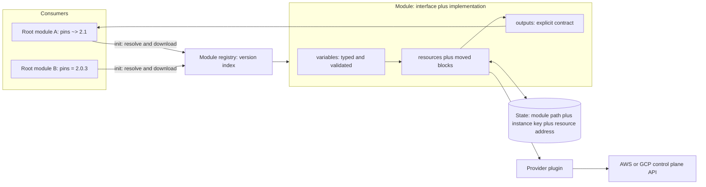

# Enterprise Module Design and Abstraction Layers

## TL;DR

A module is a versioned function with three public contracts: the typed and validated input interface, the explicit output set, and the state addresses of its resources (the contract most teams forget).
Any change that alters any of the three for an unchanged caller is a breaking change, and semver for infrastructure must be judged by the plan diff on a fixed set of consumer inputs, not by the size of the code diff.
Module versions are resolved at `init` and are not recorded in the dependency lock file, so a floating constraint such as `~> 2.1` can make an apply differ from the plan that was reviewed.
Validation, preconditions, postconditions, and checks fire at different points of the plan/apply lifecycle, and the earlier a rule fires the less partial state it can leave behind.
Modules supply defaults and do not enforce anything; enforcement belongs in SCPs, Organization Policies, and plan-time policy checks that hold even when a team bypasses the module.

## Mental Model



Think of a module as a function whose arguments are checked at the call boundary, whose body mutates a remote system through a provider, and whose return value is the output set.
Unlike a library function, the body leaves durable side effects keyed by address in a state file, so renaming an internal variable is free, while renaming an internal resource label is a destroy-and-create unless a `moved` block says otherwise.
The registry is only a version index and a download server, which means the version a consumer runs is decided at `init` time and is not re-verified when the plan is applied.
Abstraction layers (provider resource, primitive module, composition, blueprint) are a dependency discipline: each layer may call only the layer below it, owns its own semver line, and is tested at its own boundary.
Chapter [[17-Cloud-AI-Engineering/Volume_06_Infrastructure_as_Code_and_Delivery/Chapter_01_Terraform_and_OpenTofu_Internals|Terraform and OpenTofu Internals]] covers the graph walk and state locking that this chapter assumes.

## Internals

### The module boundary: conversion, defaults, validation

When a caller passes a value, the engine first converts it to the declared `type`, then applies defaults, then evaluates validation rules, then marks sensitivity.
Optional object attributes are the mechanism most worth understanding.
Terraform's documentation states that an optional attribute with a non-null default is guaranteed never to be null inside the module, because the default is substituted both when the caller omits the attribute and when the caller explicitly sets it to null (HashiCorp docs, as of 2026-10; [type constraints](https://developer.hashicorp.com/terraform/language/expressions/type-constraints)).
The same docs state that defaults are applied top-down in nested types, so an outer default is applied first and then nested defaults are applied to the result.
Without a second argument, `optional(type)` yields a typed null.
The implementation detail behind this is that the underlying `cty` type system cannot carry a default inside a type, so the engine maintains a parallel defaults tree that mirrors the type constraint ([hashicorp/terraform PR 31154](https://github.com/hashicorp/terraform/pull/31154), as of 2026-10).
The practical consequence is that the default is part of the interface contract even though it is invisible in the type signature.
Changing `optional(number, 30)` to `optional(number, 7)` changes behavior for every caller who omitted the field, which is a breaking change under any honest reading of semver.

Validation rules have an ordering property that matters for blast radius.
Before Terraform 1.9 a `validation` condition could refer only to its own variable, and the cross-variable workaround was a `precondition` on a later resource, which HashiCorp notes could lead to a partially completed deployment ([HashiCorp blog, as of 2026-10](https://www.hashicorp.com/en/blog/terraform-1-9-enhances-input-variable-validations)).
The restriction existed because validation is also checked in limited evaluation contexts such as `terraform validate`, which lack a full evaluation context for the module ([HashiCorp Discuss, as of 2026-10](https://discuss.hashicorp.com/t/trying-to-use-another-variable-in-validation-block/53746)).
Since Terraform 1.9 (June 2024) a validation condition can reference other variables, locals, data sources, and resources, provided the values are known at plan time, and it must still reference the variable it is attached to ([mattias.engineer](https://mattias.engineer/blog/2024/terraform-variable-cross-validation/), as of 2026-10).
OpenTofu support for the same cross-object form, and the first OpenTofu version that has it, is UNVERIFIED in this batch, so a module that must run on both engines should keep cross-field rules in `precondition` blocks.

One HCL gotcha belongs in every module reviewer's head: `||` and `&&` are not short-circuiting (HCL specification behavior, UNVERIFIED in this batch).
A condition such as `r.expire_days == null || r.expire_days >= 1` therefore errors when `expire_days` is null, because the right operand is still evaluated.
Use the conditional operator, `r.expire_days == null ? true : r.expire_days >= 1`, or wrap the risky operand in `can()`.

### Where each guard fires

| Guard | Fires at | Can reference | Failure leaves |
| --- | --- | --- | --- |
| `validation` on a variable | Plan, before any resource in the module is evaluated | The variable itself, and from 1.9 other plan-time-known objects | Nothing applied |
| `precondition` on resource, data, output | Plan or apply, immediately before that object is evaluated | Anything the object can see | Earlier siblings may already be applied |
| `postcondition` | After the object is created or read, blocks its dependents | The object's own result attributes | The object exists, dependents do not run |
| `check` block | After apply, non-blocking | Anything, including scoped data sources | Warning only |

The design rule that follows is to push every invariant that can be decided from inputs as early as possible, and reserve postconditions for facts only the cloud can tell you, such as a computed attribute.

### State addressing is the third contract

State keys are the module path, the instance key, and the resource address, for example `module.bucket["ml-data"].aws_s3_bucket.this`.
Renaming a resource label, changing `count` to `for_each`, or moving a resource into a child module changes its key.
By default Terraform interprets an address change as destroy the old object and create the new one, and a `moved` block (Terraform 1.1+) tells it to rename the state entry instead ([HashiCorp docs, as of 2026-10](https://developer.hashicorp.com/terraform/language/modules/develop/refactoring)).
Before planning the `to` address, Terraform checks the state for an object at the `from` address and renames it if found.
Four properties are not in getting-started guides.
Moves chain, so `a -> b` followed by `b -> c` lets a consumer jump from the oldest version straight to the newest, which is why deleting old `moved` blocks is itself a breaking change.
The destination must exist in configuration, since the move is only a bridge between two real addresses.
A `moved` block belongs in the smallest common parent module of the two addresses, so a move from a root resource into a child module is declared in the root and cannot be shipped inside the child module ([nicheelab](https://nicheelab.com/en/articles/terraform/moved-block/), as of 2026-10).
The move is a no-op when the `from` address is absent from state, which is what makes it safe to ship to consumers at any version.
Cross-state moves and one-off repairs still need `terraform state mv`, and the `removed` block with `destroy = false` is the declarative way to stop managing an object without deleting it.

### Version resolution and the lock file gap

Registry modules are resolved at `init`.
The registry protocol (module registry protocol docs, not re-verified in this batch, UNVERIFIED) is a service-discovery document, a versions listing per `namespace/name/system`, and a download endpoint that answers with an `X-Terraform-Get` header pointing at the actual archive.
The resolved version and source are written under `.terraform/modules/`.
The `.terraform.lock.hcl` file records provider versions and hashes and, in the format shown in current guides, nothing about modules ([Terraform Pilot guide](https://www.terraformpilot.com/articles/terraform-managing-version-constraints-for-reliable-infrastructure-as-code/), as of 2026-10).
Consequences:

- A fresh `init` in a new CI container with `version = "~> 2.1"` selects the newest matching release, which can be newer than the one the author tested.
- Git sources with `?ref=v2.1.0` rely on a mutable tag, and a force-moved tag changes the content under a constant name.
- Pre-release versions are not matched by `>`, `>=`, `<`, `<=`, or `~>`; they require an exact pin ([Terraform docs, as of 2026-10](https://www.terraform.io/language/expressions/version-constraints)).

The constraint semantics are `~> 5.1.0` for `>= 5.1.0, < 5.2.0` and `~> 5.1` for `>= 5.1.0, < 6.0.0`.
HashiCorp's guidance is that reusable modules should constrain only minimum Terraform and provider versions, while root modules pin more tightly (Terraform docs, as of 2026-10).
The reason is that provider constraints from every module in the tree are intersected into one selected provider version, so a leaf module pinned to `~> 4.0` and another requiring `>= 5.0` fail `init` together.
That diamond is the practical reason raising a module's provider minimum to a new major is a breaking change for consumers even if no input changed.

### Provider passing and instance expansion

Modules should not contain `provider` blocks.
Modules with local provider configurations cannot use `count`, `for_each`, or `depends_on`, and OpenTofu 1.11.4 extended the same rejection to the new `enabled` argument ([OpenTofu changelog, as of 2026-10](https://github.com/opentofu/opentofu/blob/v1.11.11/CHANGELOG.md)).
Multi-region modules on AWS therefore need `configuration_aliases` in `required_providers` and a `providers = { aws.replica = aws.us_west_2 }` map at the call site, because the AWS provider is bound to one region per configuration.
Most Google provider resources accept an explicit `location` or `region` argument, so a GCP module can usually express multi-region through a variable instead of provider aliasing (UNVERIFIED across resource types).

When a module call uses `for_each`, the keys become part of every state address under it.
Keys must be known at plan time, so keys derived from a resource attribute that is only known after apply fail with an invalid `for_each` argument error.
Key by stable logical names and let the unknown values live on the value side of the map.
Never key by list index, because deleting the first element shifts every address and triggers replacements.

### Output contracts and dependency edges

An output is part of the public API, and its type is part of that API.
Exporting a whole resource object such as `value = aws_s3_bucket.this` couples every consumer to the provider schema, and a provider upgrade that adds or renames an attribute silently changes the module's output type.
Export a flat set of named scalars or a documented object with fixed keys.
A consumer's reference to a module output depends on that output's own references, so an output with a `depends_on` list is a way to publish an ordering contract, for example "this ARN is not usable until the public-access block and the encryption configuration exist" (core graph behavior, engineering knowledge, not re-verified in this batch).
Outputs propagate sensitivity automatically, and since Terraform 1.10 outputs and variables can be marked `ephemeral` so the value never lands in plan or state ([HashiCorp blog, as of 2026-10](https://www.hashicorp.com/en/blog/terraform-1-10-improves-handling-secrets-in-state-with-ephemeral-values)).
Write-only attributes arrived in Terraform 1.11 ([HashiCorp blog](https://www.hashicorp.com/en/blog/terraform-1-11-ephemeral-values-managed-resources-write-only-arguments)).
Because the engine does not store a write-only value, it cannot detect that the value changed, so providers pair these arguments with a version counter such as `secret_string_wo_version` that the author must bump to force a re-send ([Sailor.sh guide](https://sailor.sh/blog/terraform-ephemeral-values-ephemeral-resources-write-only-arguments-secrets/), as of 2026-10).

### Abstraction layers

| Layer | Example | Owner | Rule |
| --- | --- | --- | --- |
| L0 | Provider resource | Provider vendor | Never called directly from blueprints in regulated paths |
| L1 | Primitive module: one resource family with secure defaults | Platform | Pass-through ratio should stay low |
| L2 | Composition: VPC plus endpoints plus flow logs | Platform | Calls L1 only, never sibling L2 |
| L3 | Blueprint: "training cluster", "RAG stack" | Platform plus domain team | Owns the opinionated shape and the state boundary |
| L4 | Portal template or service catalog entry | Product | Generates an L3 call, see [[17-Cloud-AI-Engineering/Volume_05_Kubernetes_and_Platform_Engineering/Chapter_06_Internal_Developer_Platforms_and_Backstage\|Internal Developer Platforms and Backstage]] |

Define the pass-through ratio as the fraction of module variables that map one to one onto an argument of a single underlying resource.
When the ratio is above roughly two thirds (a heuristic, not a published number), the module adds an upgrade burden and no abstraction, and consumers would be better served by the resource itself plus a policy.
Abstractions earn their keep where they encode a decision, for example "prod buckets must use a customer managed key", and not where they rename arguments.
For scarce accelerator capacity the abstraction must expose the zone and the reservation, because capacity is zonal and a module that hides the zone cannot express where the capacity lives (see [[17-Cloud-AI-Engineering/Volume_10_AI_Infrastructure_on_Cloud/Chapter_03_High_Performance_AI_Cluster_Architectures|High-Performance AI Cluster Architectures]]).

### Terraform and OpenTofu divergence as a design constraint

OpenTofu 1.8 added early variable and local evaluation, so variables and locals can be used in module sources, backend configuration, and state encryption, and added `.tofu` file extensions so module authors can use OpenTofu-only features while keeping `.tf` files compatible with Terraform ([OpenTofu 1.8 announcement](https://opentofu.org/blog/opentofu-1-8-0/), as of 2026-10).
Terraform rejects `version = var.module_version`, so this feature is not portable ([oneuptime guide](https://oneuptime.com/blog/post/2026-02-23-use-opentofu-early-variable-evaluation/view), as of 2026-10).
OpenTofu 1.11.0 (December 9, 2025) shipped ephemeral resources, write-only attributes, and the `enabled` meta-argument for resources and modules ([OpenTofu blog](https://opentofu.org/blog/opentofu-1-11-0/)); it also stabilized module deprecation, so callers see warnings when they use deprecated variables ([OpenTofu 1.11 beta announcement](https://opentofu.org/blog/help-us-test-opentofu-1-11-0-beta1/)).
Terraform parity for `enabled` and for variable deprecation warnings is UNVERIFIED in this batch.
A shared module intended for both engines should therefore use `count` for toggles and keep engine-specific features in `.tofu` files or a separate major line.

## Numbers to Know

| Item | Value | Source and date |
| --- | --- | --- |
| `moved` block minimum version | Terraform 1.1 | HashiCorp docs, as of 2026-10 |
| `optional(type, default)` in object types | Terraform 1.3 | oneuptime and brainboard guides citing the 1.3 release, as of 2026-10 |
| Cross-object variable validation | Terraform 1.9, June 2024 | HashiCorp blog, as of 2026-10 |
| Ephemeral variables, outputs, resources | Terraform 1.10 | HashiCorp blog, as of 2026-10 |
| Write-only arguments | Terraform 1.11 (Feb 2025) | Scalr and HashiCorp blog, as of 2026-10 |
| `override_during = plan` in mock providers | Terraform 1.11+ | oneuptime test guide, as of 2026-10 |
| OpenTofu early variable evaluation | 1.8 | OpenTofu blog, as of 2026-10 |
| OpenTofu ephemeral, write-only, `enabled` | 1.11.0, December 9, 2025 | OpenTofu blog, as of 2026-10 |
| OpenTofu 1.11 series status | Final planned patch is v1.11.14 | Releasebot, as of 2026-10 |
| OpenTofu stable release (reference) | 1.12.3 on 2026-06-18; docs site banner names 1.13.x as latest | Wikipedia and OpenTofu docs, as of 2026-10 |
| `~> 5.1.0` | `>= 5.1.0, < 5.2.0` | Terraform docs, as of 2026-10 |
| `~> 5.1` | `>= 5.1.0, < 6.0.0` | Terraform docs, as of 2026-10 |
| Pre-release matching | Not matched by range operators, exact pin only | Terraform docs, as of 2026-10 |
| Public registry module naming | `terraform-<PROVIDER>-<NAME>` on GitHub with SemVer tags | Sailor.sh and oneuptime guides, as of 2026-10 |
| Latest Terraform release | UNVERIFIED in this batch | not verified |
| AWS and GCP list prices relevant to this chapter | Not verified; the lab uses assumptions labelled as such | not verified |

## AWS vs GCP Mechanism Parity

Module semantics are cloud-neutral, so the differences are in provider shape, identity, and guardrail integration.
Rows marked UNVERIFIED were not re-checked against current official documentation in this batch.

| Concern | AWS | GCP | Design consequence |
| --- | --- | --- | --- |
| Location binding | AWS provider is bound to one region and account per configuration; multi-region needs aliased providers and a `providers` map | Many resources take explicit `location` or `region` (UNVERIFIED across types) | AWS modules expose provider aliases; GCP modules expose location variables |
| Scope root | Account is implied by credentials | Project ID must be passed or defaulted for most resources | Every GCP module needs a `project_id` input and a decision on where it comes from |
| API enablement | Services are available by default | Services must be enabled per project, via `google_project_service` or equivalent (UNVERIFIED) | GCP blueprints must own API enablement and handle propagation delay |
| Default tagging | Provider-level `default_tags` | Provider-level default labels (UNVERIFIED) | Cost allocation defaults can live in the provider, not in each module |
| Community module ecosystem | `terraform-aws-modules` organization | `terraform-google-modules` and blueprints (UNVERIFIED) | Wrap, fork, or vendor decision is the same; upstream release cadence differs |
| Managed plan/apply runner | Service Catalog Terraform products or self-run pipelines (UNVERIFIED) | Infrastructure Manager (UNVERIFIED) | Runner choice decides where module version pinning is enforced |
| Native non-Terraform abstraction | CloudFormation modules and CDK constructs, see [[17-Cloud-AI-Engineering/Volume_06_Infrastructure_as_Code_and_Delivery/Chapter_03_Programmatic_IaC_AWS_CDK_and_Pulumi\|Programmatic IaC]] | Config Connector and Terraform-based blueprints (UNVERIFIED) | Native tools have their own versioning and rollback model |
| Org-level backstop | SCPs and RCPs, see [[17-Cloud-AI-Engineering/Volume_02_AWS_Deep_Dive/Chapter_01_IAM_Policy_Evaluation_Engine\|IAM Policy Evaluation Engine]] | Organization Policy constraints, see [[17-Cloud-AI-Engineering/Volume_03_GCP_Deep_Dive/Chapter_01_Resource_Hierarchy_and_Organization_Policies\|Resource Hierarchy and Organization Policies]] | Module defaults are advisory; these are enforcing |
| CI identity | OIDC to an IAM role via web identity | Workload Identity Federation plus service account impersonation, see [[17-Cloud-AI-Engineering/Volume_08_Security_Identity_and_the_Data_Perimeter/Chapter_02_Workload_Identity_Federation\|Workload Identity Federation]] | Module test pipelines must not use static keys |
| Budget resource | `aws_budgets_budget` | `google_billing_budget` (billing-account scoped) | Lab guardrails differ in scope: account versus billing account |
| Global namespace collisions | S3 bucket names are global | GCS bucket names are global | Name inputs need caller-supplied uniqueness on both |

## Worked Example: A Secure Bucket Module with a Contract Test and an Upgrade Gate

The artifact is an AWS module for a hardened S3 bucket (the base layer for training data, checkpoints, and model registries), a contract test that runs without cloud credentials, and an upgrade gate that proves a new version does not delete anything for an unchanged consumer.
The module deliberately keeps cross-field rules in `precondition` blocks so it runs on both Terraform and OpenTofu.

### Module layout

```text
terraform-aws-secure-bucket/
  versions.tf
  variables.tf
  main.tf
  moved.tf
  outputs.tf
  tests/contract.tftest.hcl
  scripts/upgrade_gate.sh
```

### versions.tf

```hcl
terraform {
  required_version = ">= 1.6.0"

  required_providers {
    aws = {
      source  = "hashicorp/aws"
      version = ">= 5.0"
    }
  }
}
```

The module states minimums only, per HashiCorp's guidance for reusable modules.
The root module that consumes it pins tighter and commits its lock file.

### variables.tf

```hcl
variable "name_prefix" {
  description = "Logical bucket name prefix. Bucket name is name_prefix-env. S3 names are global, so the caller owns uniqueness."
  type        = string
  nullable    = false

  validation {
    condition     = can(regex("^[a-z0-9][a-z0-9-]{1,30}[a-z0-9]$", var.name_prefix))
    error_message = "name_prefix must be 3-32 chars: lowercase letters, digits, hyphens, starting and ending alphanumeric."
  }
}

variable "env" {
  description = "Deployment environment."
  type        = string
  nullable    = false

  validation {
    condition     = contains(["dev", "stg", "prod"], var.env)
    error_message = "env must be one of dev, stg, prod."
  }
}

variable "versioning_enabled" {
  description = "Enable object versioning. Default true."
  type        = bool
  default     = true
  nullable    = false
}

variable "kms_key_arn" {
  description = "Customer managed KMS key ARN for SSE-KMS. Required when env is prod."
  type        = string
  default     = null

  validation {
    condition     = var.kms_key_arn == null || can(regex("^arn:aws[a-z-]*:kms:[a-z0-9-]+:[0-9]{12}:key/", var.kms_key_arn))
    error_message = "kms_key_arn must be a KMS key ARN (not an alias)."
  }
}

variable "lifecycle_rules" {
  description = "Map of rule name to rule. Keys are stable logical names and become part of the resource configuration."
  type = map(object({
    prefix                = optional(string, "")
    noncurrent_expire_days = optional(number, 30)
    expire_days           = optional(number)
  }))
  default  = {}
  nullable = false

  validation {
    condition = alltrue([
      for k, r in var.lifecycle_rules :
      r.noncurrent_expire_days >= 1 && (r.expire_days == null ? true : r.expire_days >= 1)
    ])
    error_message = "Expiry day counts must be >= 1. expire_days may be omitted."
  }
}

variable "tags" {
  description = "Resource tags. Must include cost_center."
  type        = map(string)
  default     = {}
  nullable    = false

  validation {
    condition     = contains(keys(var.tags), "cost_center")
    error_message = "tags must include a cost_center key for cost allocation."
  }
}
```

### main.tf

```hcl
locals {
  bucket_name   = "${var.name_prefix}-${var.env}"
  sse_algorithm = var.kms_key_arn == null ? "AES256" : "aws:kms"
}

resource "aws_s3_bucket" "this" {
  bucket = local.bucket_name
  tags   = merge(var.tags, { managed-by = "terraform", module = "secure-bucket" })
}

resource "aws_s3_bucket_public_access_block" "this" {
  bucket                  = aws_s3_bucket.this.id
  block_public_acls       = true
  block_public_policy     = true
  ignore_public_acls      = true
  restrict_public_buckets = true
}

resource "aws_s3_bucket_versioning" "this" {
  bucket = aws_s3_bucket.this.id

  versioning_configuration {
    status = var.versioning_enabled ? "Enabled" : "Suspended"
  }
}

resource "aws_s3_bucket_server_side_encryption_configuration" "this" {
  bucket = aws_s3_bucket.this.id

  rule {
    apply_server_side_encryption_by_default {
      sse_algorithm     = local.sse_algorithm
      kms_master_key_id = var.kms_key_arn
    }
    bucket_key_enabled = var.kms_key_arn != null
  }

  lifecycle {
    precondition {
      condition     = var.env != "prod" || var.kms_key_arn != null
      error_message = "prod buckets must set kms_key_arn (customer managed key)."
    }
  }
}

resource "aws_s3_bucket_lifecycle_configuration" "this" {
  count  = length(var.lifecycle_rules) > 0 ? 1 : 0
  bucket = aws_s3_bucket.this.id

  dynamic "rule" {
    for_each = var.lifecycle_rules
    content {
      id     = rule.key
      status = "Enabled"

      filter {
        prefix = rule.value.prefix
      }

      noncurrent_version_expiration {
        noncurrent_days = rule.value.noncurrent_expire_days
      }

      dynamic "expiration" {
        for_each = rule.value.expire_days == null ? [] : [rule.value.expire_days]
        content {
          days = expiration.value
        }
      }
    }
  }

  depends_on = [aws_s3_bucket_versioning.this]
}
```

### moved.tf (shipped in v2.0.0, where v1 used the label `main`)

```hcl
moved {
  from = aws_s3_bucket.main
  to   = aws_s3_bucket.this
}

moved {
  from = aws_s3_bucket_public_access_block.main
  to   = aws_s3_bucket_public_access_block.this
}

moved {
  from = aws_s3_bucket_versioning.main
  to   = aws_s3_bucket_versioning.this
}
```

The block count is the operational cost of a rename, and it remains until every supported consumer has passed through a version that applied the moves.

### outputs.tf

```hcl
output "bucket_id" {
  description = "Bucket name."
  value       = aws_s3_bucket.this.id
}

output "bucket_arn" {
  description = "Bucket ARN. Not available to dependents until hardening resources exist."
  value       = aws_s3_bucket.this.arn

  depends_on = [
    aws_s3_bucket_public_access_block.this,
    aws_s3_bucket_server_side_encryption_configuration.this,
  ]
}

output "encryption" {
  description = "Effective encryption settings. Keys are stable: algorithm, kms_key_arn."
  value = {
    algorithm   = local.sse_algorithm
    kms_key_arn = var.kms_key_arn
  }
}
```

### tests/contract.tftest.hcl (no credentials needed)

```hcl
mock_provider "aws" {}

variables {
  name_prefix = "acme-ml-data"
  env         = "dev"
  tags        = { cost_center = "ml-platform" }
}

run "defaults_are_secure" {
  command = plan

  assert {
    condition     = aws_s3_bucket_versioning.this.versioning_configuration[0].status == "Enabled"
    error_message = "Versioning must default to Enabled."
  }

  assert {
    condition     = aws_s3_bucket_public_access_block.this.block_public_policy
    error_message = "Public policy must be blocked."
  }
}

run "rejects_unknown_env" {
  command = plan

  variables {
    env = "qa"
  }

  expect_failures = [var.env]
}

run "prod_requires_cmk" {
  command = plan

  variables {
    env = "prod"
  }

  expect_failures = [aws_s3_bucket_server_side_encryption_configuration.this]
}

run "requires_cost_center" {
  command = plan

  variables {
    tags = {}
  }

  expect_failures = [var.tags]
}
```

Mock providers return the original provider schema and generate fake data for computed attributes ([HashiCorp docs, as of 2026-10](https://developer.hashicorp.com/terraform/language/tests/mocking)).
A mock-provider test therefore verifies the module's own contract (types, defaults, validation, preconditions) and cannot catch API-side rejections such as a bucket name that is already taken.
Run it with `terraform test` or `tofu test` ([OpenTofu test docs](https://opentofu.org/docs/cli/commands/test/)).

### scripts/upgrade_gate.sh (needs a sandbox AWS account)

```bash
#!/usr/bin/env bash
# Usage: MODULE_REPO=https://example.com/org/terraform-aws-secure-bucket.git \
#        upgrade_gate.sh v1.4.2 v2.0.0
set -euo pipefail

OLD_REF="${1:?old ref}"
NEW_REF="${2:?new ref}"
REPO="${MODULE_REPO:?set MODULE_REPO}"
PREFIX="upgrade-gate-$(date +%s)"
WORK="$(mktemp -d)"

cleanup() {
  cd "$WORK" && terraform destroy -auto-approve -input=false >/dev/null 2>&1 || true
  rm -rf "$WORK"
}
trap cleanup EXIT

write_root() {
  cat > "$WORK/main.tf" <<EOF
provider "aws" {
  region = "us-east-1"
}

module "bucket" {
  source      = "git::${REPO}?ref=$1"
  name_prefix = "${PREFIX}"
  env         = "dev"
  tags        = { cost_center = "platform" }
}
EOF
}

cd "$WORK"
write_root "$OLD_REF"
terraform init -input=false >/dev/null
terraform apply -auto-approve -input=false >/dev/null

write_root "$NEW_REF"
terraform init -input=false -upgrade >/dev/null

set +e
terraform plan -input=false -detailed-exitcode -out=plan.bin >/dev/null
rc=$?
set -e
if [ "$rc" -eq 1 ]; then
  echo "FAIL: plan errored (interface break)"
  exit 1
fi

terraform show -json plan.bin > plan.json
deletes=$(jq '[.resource_changes[]? | select(.change.actions | index("delete"))] | length' plan.json)
updates=$(jq '[.resource_changes[]? | select(.change.actions == ["update"])] | length' plan.json)
moves=$(jq '[.resource_changes[]? | select(.previous_address != null)] | length' plan.json)

echo "deletes=${deletes} in_place_updates=${updates} moves=${moves}"
if [ "$deletes" -gt 0 ]; then
  echo "FAIL: replacement or deletion for unchanged inputs; missing moved block or major bump required"
  exit 2
fi
```

The gate applies the old version with fixed inputs, swaps the source to the new ref, and inspects the plan JSON.
A `delete` action on any resource for unchanged inputs means either a missing `moved` block or a change that must be released as a major version.
Moved resources appear with a `previous_address` field in the plan JSON (Terraform JSON plan format, not re-verified in this batch, UNVERIFIED).
The gate ignores the exit code split between 0 and 2 on purpose, because I did not verify whether a plan with only moves is reported as a diff.

### Capacity and cost sizing

All inputs below are assumptions for a mid-size platform and are not list prices.

1. Fleet size: R = 240 root modules consume the module, each with a 3-minute plan, run at C = 20 concurrent CI runners.
2. A fleet-wide plan sweep for a candidate release takes R x T / C = 240 x 3 / 20 = 36 minutes of wall time and 720 runner-minutes.
3. At an assumed internal runner cost of 0.008 USD per runner-minute (ASSUMPTION), one sweep costs about 5.76 USD, so sweeping on every release candidate is cheap relative to one unplanned bucket replacement.
4. Ring rollout of 2 percent, 18 percent, and 80 percent gives about 5, 43, and 192 roots; with a 24-hour soak per ring the minimum calendar time of a breaking default change is three days, which is the real cost of semver discipline.
5. Lab cost: one empty bucket and about 15 API calls; the storage charge is zero for an empty bucket and request charges are negligible, but the current S3 request prices were not verified in this batch (UNVERIFIED), so cap the exposure with the budget below.

### Budget alarm for the sandbox account

```hcl
resource "aws_budgets_budget" "lab" {
  name         = "iac-module-lab"
  budget_type  = "COST"
  limit_amount = "5"
  limit_unit   = "USD"
  time_unit    = "MONTHLY"

  notification {
    comparison_operator        = "GREATER_THAN"
    threshold                  = 80
    threshold_type             = "PERCENTAGE"
    notification_type          = "ACTUAL"
    subscriber_email_addresses = ["platform-oncall@example.com"]
  }
}
```

### Teardown

The script destroys its own bucket on exit through the `trap`.
To remove the budget and confirm nothing is left, run:

```bash
terraform destroy -auto-approve -target=aws_budgets_budget.lab
aws s3api list-buckets --query "Buckets[?starts_with(Name, 'upgrade-gate-')].Name" --output text
```

If the second command prints a name, empty the bucket (versioning is on, so delete versions as well) and run `aws s3api delete-bucket --bucket <name>`.

## Failure Modes and Pitfalls

### Plan and apply run different module versions

A reviewer approves a plan produced with module 2.1.4, and the apply job runs a fresh `init` that selects 2.2.0 because the constraint is `~> 2.1`.
The lock file does not pin modules, so nothing detects the difference.
Fixes, in order of strength: pin exact module versions in root modules and move upgrades through automated pull requests that show the plan diff; apply the saved plan artifact rather than re-planning (a saved plan carries a configuration snapshot, not re-verified in this batch, UNVERIFIED); pin git sources to a commit SHA, or consume immutable archives, because tags are mutable.

### Rename without `moved` replaces a stateful resource

A patch release renames `aws_s3_bucket.main` to `this`.
Every consumer's plan shows destroy and create for a bucket that holds data.
S3 refuses to delete a non-empty bucket without force, which is the only reason many teams discover this before data loss, but an RDS instance or a GPU capacity reservation has no such friction.
Replacing a reservation means asking the cloud for capacity again, and that request can fail when the zone is short of accelerators.
The upgrade gate above is the control, and the rule is that a delete action in the upgrade plan is a hard failure for any resource type that holds data or capacity.

### Defaults changed in a minor release

Changing `noncurrent_expire_days` from 30 to 7 deletes object versions sooner for every caller who did not set it.
Nothing in the plan looks dangerous, because the lifecycle configuration updates in place.
Treat default changes as breaking, or introduce them behind a new opt-in variable and flip the default only in a major.

### Narrowing validation breaks existing infrastructure

Tightening a regex to forbid uppercase letters makes existing roots fail `plan` on the next run, because the existing resource name now violates the rule, and the fix is a rename of a live resource.
Validation can only be tightened in a major, or by applying the stricter rule to new instances through a variable that defaults to the old behavior.

### Unknown keys in `for_each`

A module call keyed by `aws_kms_key.x.arn` fails plan, because keys are state addresses and must be known at plan time.
The failure surfaces at plan, not apply, which is good, but the fix is a redesign of the interface from a list to a map keyed by static names.

### Provider constraint diamonds

A new module release raises its AWS provider minimum from 5.0 to 6.0.
Consumers that pinned `~> 5.0` in the root, or that depend on another module capped at 5.x, fail `init`.
Releases that raise a provider major minimum are breaking even if the module's own interface is unchanged.
I recall the AWS provider's 4.0 release splitting S3 bucket arguments into separate resources as the canonical case of an upstream break that cascaded through every wrapper module (UNVERIFIED in this batch).

### Over-broad abstraction

A wrapper with 180 variables, each forwarding one argument, creates a second API that tracks the provider's API with a lag.
Every provider release produces a module backlog, consumers file issues for missing arguments, and the escape hatch becomes a catch-all `extra_args` map that defeats typing and validation.

### Operational analogs from public post-incident reviews

The AWS S3 event of February 28, 2017 began with an operator running a command whose input removed a larger set of servers than intended, and AWS's remediation included making the tool remove capacity more slowly and enforce a minimum capacity ([AWS post-event summary](https://aws.amazon.com/message/41926/), recalled from memory, UNVERIFIED in this batch).
The IaC analog is a module input with no bounds, for example a `count` or `max_size` with no validation ceiling; validation rules that cap blast radius are the cheap equivalent of that safeguard.
The AWS DynamoDB DNS event of October 2025 involved delayed automation applying an older plan after a newer one, followed by cleanup of the newer plan (my recollection of the AWS summary, UNVERIFIED in this batch).
The IaC analog is a stale saved plan; Terraform refuses to apply a saved plan whose base state has moved on, and pipelines should never bypass that check with a re-plan on the fly.
The Google Cloud outage of June 2025, where a policy change replicated globally without gradual rollout exposed a null-handling defect, is the same lesson as module releases without rings (UNVERIFIED in this batch).
See [[17-Cloud-AI-Engineering/Volume_07_Reliability_and_SRE/Chapter_07_Anatomy_of_Major_Cloud_Outages|Anatomy of Major Cloud Outages]] for the full treatment.

### Secrets in module interfaces

A password passed through a normal sensitive variable still lands in state.
Moving to an ephemeral variable plus a write-only argument keeps it out of state, but removes drift detection for that value and requires the version-counter pattern to rotate it.
A module that exposes a secret as an output makes every consumer's state a secret store.

## Security and Cost Angles

### Identity and supply chain

- The pipeline that publishes module releases should be the only principal allowed to create release tags, with tag protection on and signed tags where the platform supports them.
- Test pipelines authenticate by OIDC federation to a sandbox role (see [[17-Cloud-AI-Engineering/Volume_08_Security_Identity_and_the_Data_Perimeter/Chapter_02_Workload_Identity_Federation|Workload Identity Federation]]), scoped by a permissions boundary to actions on resources tagged as test resources, and denied everything in production accounts.
- Consumers should resolve modules only from an allowlisted registry and organization, enforced by a plan-time or repo-scan policy, because a typosquatted source is arbitrary code execution at `init` for module and provider downloads.
- Modules run with the apply role's full credentials, so a malicious release is a privilege escalation; use cell and ring rollout, and do not auto-merge module bumps into production roots.
- Policy as code is the independent backstop: [[17-Cloud-AI-Engineering/Volume_06_Infrastructure_as_Code_and_Delivery/Chapter_04_Policy_as_Code_OPA_Sentinel_and_Guardrails|Policy as Code]] evaluates the plan JSON, so it still catches an unencrypted bucket created by a team that bypassed the module.

### Encryption design in the interface

- The module above makes SSE-KMS with a customer managed key mandatory in prod and uses a bucket key to reduce KMS request volume.
- A key ARN, not an alias, is accepted so that the key's identity is stable and auditable in plan output.
- The envelope-encryption hierarchy and key-policy design are in [[17-Cloud-AI-Engineering/Volume_08_Security_Identity_and_the_Data_Perimeter/Chapter_04_Encryption_Key_Hierarchies_and_Envelope_Encryption|Encryption Key Hierarchies and Envelope Encryption]].
- Do not create the key inside every bucket module by default; key sprawl and per-key cost scale linearly with consumers, while a shared key concentrates blast radius.

### Network boundary

A module for regulated data should accept a list of allowed VPC endpoint IDs and render a bucket policy that denies requests from outside them, so that the perimeter is part of the interface and not a manual add-on.
The perimeter design belongs to [[17-Cloud-AI-Engineering/Volume_08_Security_Identity_and_the_Data_Perimeter/Chapter_06_Constructing_an_Impenetrable_Data_Perimeter|Constructing an Impenetrable Data Perimeter]].

### Unit economics

- Versioning without a noncurrent-version expiry is a silent cost leak, which is why the lifecycle default sets `noncurrent_expire_days` to 30; defaults are the most effective cost lever a platform team owns.
- Required `cost_center` tags make allocation possible at the module boundary, and provider-level default tags remove per-module repetition.
- Module test pipelines are the main recurring cost of the module program; use mock-provider unit tests on every commit and real-cloud upgrade gates only on release candidates.
- Fleet sweeps should run against plan-only (no apply) so they incur CI minutes and read API calls but no resource spend.
- For accelerator fleets the dominant cost is idle reserved capacity, so a blueprint must make the reservation lifecycle explicit and must never place it behind a convenience default that can be toggled by `count`.

## Interview Questions and Model Answers

### Question 1 (L5 - Senior)

You are designing a module with about 25 configuration options.
Do you use flat variables or one object variable with `optional()` attributes, and what happens when a caller passes `null`?

#### Model Answer

The decision is about how the interface evolves and how errors are reported.
Flat variables give per-variable descriptions, per-variable validation errors, easy `-var` overrides, and clean generated documentation.
A single object variable lets me add a new optional field without adding a new top-level variable, which keeps additions invisibly backward compatible and groups related knobs.
Its cost is that one validation block must cover the whole object, error messages are coarser, and the whole object is marked sensitive if any field is.
My default is flat variables for scalars and a typed `map(object(...))` for collections keyed by stable logical names, which preserves state addresses.
On `null`: with `optional(number, 30)`, Terraform substitutes the default both when the caller omits the attribute and when the caller sets it to null, so inside the module the value is never null (HashiCorp type-constraint docs).
Without a default, the value is a typed null and the module must handle it, which is why my validation uses the conditional operator rather than `||`.
At the top level, a flat variable with a default still accepts an explicit `null` unless I set `nullable = false`; with `nullable = false`, null is replaced by the default.
I set `nullable = false` on anything the module logic dereferences.
The interface rule I enforce is that the default is part of the contract, so changing it is a breaking change even though the type signature is identical.

#### Follow-up Interviewer Question

A caller sets `lifecycle_rules = { logs = { expire_days = null } }`.
Walk me through exactly what value each attribute has inside the module and which of your validation expressions would error if you had written it with `||`.

### Question 2 (L5 - Senior)

You must rename a resource inside a shared module and move another into a child module without destroying anything.
How do you do it, where do the `moved` blocks go, and when can you delete them?

#### Model Answer

A `moved` block records that the object at address `from` is now at `to`, and before planning Terraform looks for the `from` address in state and renames it if present (HashiCorp refactoring docs).
For an intra-module rename, the block goes in the module that owns both addresses and ships in the same release as the rename.
For moving a root-level resource into a child module, the block must be declared where both addresses are expressible, which is the root, so a library module cannot ship that move on behalf of consumers.
The destination must already exist in configuration, and I verify with a plan that shows the move and zero replacements before applying.
Moves chain, so a consumer upgrading across two releases still lands at the right address.
That is why I do not delete `moved` blocks when the next release ships.
I delete them only when telemetry or an inventory scan shows no supported consumer is on a version that predates the move, which in practice means after a major version boundary and a published support window.
For state that lives in a different state file I use `terraform state mv` or an `import` plus `removed` with `destroy = false`, since `moved` is within one state.
The same mechanism converts `count` to `for_each`: `from = aws_instance.web` and `to = aws_instance.web["a"]`.
I add a CI step that applies the old version and plans the new one, because the move block being syntactically valid does not prove the addresses match.

#### Follow-up Interviewer Question

A consumer on version 1.2 skips straight to 3.0, and in 2.0 you renamed a resource and in 3.0 you renamed it again.
Would they be safe if you had deleted the 2.0 `moved` block in 3.0, and why or why not?

### Question 3 (L6 - Staff)

Release 3.4.1 of a platform module was labelled a patch and produced plan diffs in 40 of 300 consumer roots.
Define what counts as breaking for an infrastructure module and design the gate that would have caught it.

#### Model Answer

For libraries, semver is about API signatures.
For infrastructure modules there are three contracts, and a change to any of them for an unchanged caller is breaking.
The interface contract covers variable names, types, required versus optional, defaults, validation strictness, output names and types, and the provider and engine minimums.
The state contract covers resource addresses and instance keys; changing them without a `moved` block is a replacement.
The behavior contract covers the plan diff for a fixed set of inputs, including in-place updates caused by changed defaults and ForceNew attributes.
Patch means no change to any of the three for any caller; minor means additive optional interface plus no change to existing callers' plans; major is everything else, including narrowing validation and raising a provider major minimum.
The gate has three layers.
Layer one is a static interface diff between the previous tag and the candidate, using a parser such as `terraform-config-inspect` to dump variables and outputs as JSON (tool name from memory, UNVERIFIED), which classifies additions and removals mechanically.
Layer two is the upgrade test from this chapter: apply the old tag with fixed inputs, swap the source, plan, and fail on any `delete` action, and report in-place updates for human review.
Layer three is consumer-driven: run plan-only against a sampled corpus of real consumer inputs, because synthetic fixtures miss the one team that sets an obscure combination.
The release bot computes the required bump from these results and refuses a lower label.
For 3.4.1, layer two would have shown the in-place updates or deletes immediately.

#### Follow-up Interviewer Question

Layer three needs real consumer inputs that may contain account IDs or internal names.
How do you build and secure that corpus, and how do you keep it from becoming a stale test suite?

### Question 4 (L6 - Staff)

A production apply changed something the reviewer never saw in the plan.
Investigation shows the module constraint was `~> 2.1` and a new 2.2.0 was published between plan and apply.
Explain why the lock file did not prevent this and how you would fix the pipeline.

#### Model Answer

The dependency lock file records provider selections and hashes; module resolution is a separate mechanism that happens at `init`, writes into `.terraform/modules`, and is not hash-pinned by the lock file.
So two `init` runs at different times under a range constraint can legitimately resolve different module versions.
The second contributing factor is a pipeline that re-plans inside the apply job instead of applying the reviewed artifact.
The fix has four parts.
First, in root modules use exact module versions, or a commit SHA for git sources, because a tag can be force-moved; use a bot to open upgrade pull requests that include a plan diff, so a version bump is a reviewed change.
Second, apply the saved plan output from the plan job, so the thing reviewed is the thing executed; a saved plan carries its configuration snapshot and is rejected if the state has changed since, which also gives me protection against stale-plan application (I would verify the snapshot behavior in the target version).
Third, publish releases as immutable artifacts with checksums to a registry or versioned bucket with object lock, so the content under a version never changes.
Fourth, keep ranges for libraries only: composition modules state minimum provider versions, and roots decide.
The principle is that the version resolution decision must be made once, in a reviewed commit, and not re-made by whichever runner happens to run `init`.
Because plans are environment-specific, I promote the module version through environments, not the plan file.

#### Follow-up Interviewer Question

Your pipeline caches `.terraform` between the plan and apply jobs to save two minutes.
What new failure modes does the cache introduce and how do you detect them?

### Question 5 (L6 - Staff)

Security mandates TLS-only access on every bucket within 60 days.
You own the module used by about 400 roots.
How do you ship the change?

#### Model Answer

The change alters the behavior contract: a new bucket policy statement appears in every consumer's plan, and a TLS-only policy can break clients that use plain HTTP, so it is a breaking default.
I would not flip it in a patch or a minor.
Release 2.5.0 adds `enforce_tls` with the default set to the old behavior, plus a deprecation warning for callers who leave it unset (OpenTofu 1.11 supports module variable deprecation warnings; Terraform parity is UNVERIFIED, so I would use a plan-time `check` warning as the portable alternative).
Next, run a fleet plan-only sweep with `enforce_tls = true` injected, and use the results to identify roots with existing bucket policies that conflict, because the module's policy resource is a singleton per bucket and merging policies is a classic outage cause.
Roll out in rings: a handful of internal roots, then about a fifth of the fleet, then the rest, with a soak period and client-error metrics (4xx and SSL errors from access logs) as the gate.
Auto-open pull requests with the plan diff; teams that need exceptions register them in a registry with an expiry.
At day 45 release 3.0.0 flips the default; at day 60 an SCP or bucket-level control denies non-TLS requests organization-wide, which is the real enforcement.
The module is the convenience path, and the SCP is the guarantee, because teams that bypass the module still have to comply.
The failure I design against is making the module the only control: it only governs consumers who upgrade.

#### Follow-up Interviewer Question

Thirty roots already attach their own bucket policy to buckets created by your module.
How does your 2.5.0 interface let them adopt TLS enforcement without the two policies overwriting each other?

### Question 6 (L7+ - Principal)

You are defining the module architecture for an organization with roughly 1,500 engineers on AWS and GCP, including GPU training clusters.
Design the layers, ownership, and rules, and say what you would refuse to build.

#### Model Answer

I start from the failure modes, not from a catalog.
The two that kill module programs are leaky abstractions that become a second, lagging provider API, and fleet-wide upgrades that nobody can roll out safely.
Layering: L1 primitive modules encode security decisions for one resource family and are cloud-specific; L2 compositions assemble L1 modules with a documented topology; L3 blueprints are the units teams instantiate, such as a training cluster or a RAG stack, and each blueprint owns its state boundary and its blast radius.
Dependencies point down only, and each layer has its own semver line, test suite, and release train.
Cross-cloud: I refuse a lowest-common-denominator "bucket" or "cluster" module that hides AWS versus GCP differences, because the hidden differences are exactly the ones that cause incidents (zonal capacity, IAM propagation, project-scoped API enablement, regional versus global networks).
I abstract at the intent level only where the schema is shared, for example a declared "storage for checkpoints" requirement, and implement it separately per cloud with a common documented output contract.
For accelerators, the blueprint must expose zone, reservation, and topology placement, and any plan that deletes a reservation or a placement group is a hard gate failure.
Escape hatches: every L3 has a supported way to attach extra resources to its outputs (a documented extension point) and a policy that says wrapping with a fork is not allowed, because forks cost the upgrade path.
I measure the program with pass-through ratio per module, median time from release to 90 percent adoption, number of plans with unexpected deletes caught by the gate, and number of exception requests per quarter.
I would refuse to build modules for single-use stacks, a universal "everything" module, and any module whose only value is renaming arguments.
Staffing follows from the release process: the platform team owns L1 and L2 and the gate; domain teams co-own L3.
Enforcement stays outside the modules, in SCPs, Organization Policies, and plan-time policy, so the layering is about developer productivity and not about security guarantees.

#### Follow-up Interviewer Question

A product team needs an attribute your training-cluster blueprint does not expose, and your backlog is six weeks deep.
What is your escape-hatch policy, and what do you do to ensure it does not erode the abstraction?

### Question 7 (L6 - Staff)

Design the interface of a database module that needs an administrator password.
How do you keep the secret out of state, and what do you lose by doing so?

#### Model Answer

The baseline is that a sensitive variable only masks display; the value still lands in plan and state.
Terraform 1.10 introduced ephemeral input variables, outputs, and resources, and 1.11 added write-only arguments on managed resources, so a secret can flow from an ephemeral source into a write-only argument without being persisted (HashiCorp blogs, as of 2026-10); OpenTofu added the same capability in 1.11.0 (OpenTofu blog).
The module declares `ephemeral = true` on the password variable, passes it to a `_wo` argument on the resource, and exposes a plain integer `password_version` variable that maps to the provider's companion version argument.
What I lose: because the engine does not store a write-only value, it cannot compare it with the previous value, so rotation happens only when the version integer changes; drift in the real credential is invisible to plan; and ephemeral values can only be used in ephemeral contexts, so I cannot, for example, compute a non-ephemeral local from them.
Provider support is also per-argument, so I need to check that the target resource has a write-only variant in the pinned provider version.
Where the service supports it, I prefer to avoid handling the secret at all, for example having the database service create and rotate the master credential in the cloud secret manager (RDS has a managed master user password option; I would confirm the argument name against the pinned provider version).
Then the module outputs only the secret's ARN, never the value.
The interface contract is therefore: no secret value ever appears in outputs, and any rotation is an explicit, versioned input.

#### Follow-up Interviewer Question

How do you detect, and alert on, the case where someone rotated the real credential out of band, given that Terraform cannot see it?

### Question 8 (L7+ - Principal)

Your company wants shared modules that work on both Terraform and OpenTofu, and some teams want OpenTofu-only features.
How do you handle this without forking the module catalog?

#### Model Answer

First, I treat engine compatibility as part of the module's interface contract, stated in `required_version` and in the README, and tested in CI against both engines.
The known divergences are concrete.
OpenTofu 1.8 allows variables and locals in module sources and backend blocks through early evaluation, which Terraform rejects.
OpenTofu 1.11 added the `enabled` meta-argument for resources and modules and module deprecation warnings, and I have not verified Terraform equivalents.
OpenTofu supports `.tofu` extension files so a module can ship OpenTofu-only code next to `.tf` code that Terraform loads.
The practical policy: shared L1 and L2 modules use only the intersection of the two languages, with `count` for toggles and `precondition` for cross-field rules, since I have not verified OpenTofu support for cross-object variable validation.
Features that exist in only one engine go into an overlay file (`.tofu`) with a fallback in the `.tf` file, or into a separate major line, with the divergence called out in the changelog.
CI runs `init`, `validate`, `test`, and the upgrade gate on a matrix of the oldest supported and newest versions of each engine, including the OpenTofu release series that are still in security support (the 1.11 series reached its final planned patch, so I plan for 1.12 and 1.13 now).
The `required_version` constraint is a trap, because the two engines use independent version numbers, so a `>= 1.9` constraint can pass on an OpenTofu version that lacks a feature that Terraform 1.9 has; I gate on tested engine and version pairs.
Strategically I decide this once at the platform level, because dual-engine support doubles the test matrix, and the decision depends on license and governance risk tolerance more than on technical merit.

#### Follow-up Interviewer Question

Which three language features would you ban from shared modules today to keep portability, and what is your process for revisiting that ban?

## Further Reading

- [Terraform: Refactor modules](https://developer.hashicorp.com/terraform/language/modules/develop/refactoring) - The primary description of `moved` semantics, chaining, and module splits.
- [Terraform: Type constraints](https://developer.hashicorp.com/terraform/language/expressions/type-constraints) - Exact rules for `optional()`, null substitution, and top-down default application.
- [Terraform 1.9 input variable validation](https://www.hashicorp.com/en/blog/terraform-1-9-enhances-input-variable-validations) - Why cross-object validation exists and what failure mode it removes.
- [Terraform version constraints](https://www.terraform.io/language/expressions/version-constraints) - Operator semantics, pre-release handling, and HashiCorp's guidance for module versus root constraints.
- [Terraform 1.10 ephemeral values](https://www.hashicorp.com/en/blog/terraform-1-10-improves-handling-secrets-in-state-with-ephemeral-values) and [Terraform 1.11 write-only arguments](https://www.hashicorp.com/en/blog/terraform-1-11-ephemeral-values-managed-resources-write-only-arguments) - The design of secrets that never reach state.
- [Terraform provider mocking](https://developer.hashicorp.com/terraform/language/tests/mocking) - What mock providers generate and what they cannot verify.
- [hashicorp/terraform PR 31154](https://github.com/hashicorp/terraform/pull/31154) - Implementation notes on the defaults tree behind `optional()`.
- [OpenTofu 1.8 announcement](https://opentofu.org/blog/opentofu-1-8-0/) - Early evaluation, provider mocking, and `.tofu` files, the first major divergence from Terraform.
- [OpenTofu 1.11 announcement](https://opentofu.org/blog/opentofu-1-11-0/) - Ephemeral resources, write-only attributes, and the `enabled` meta-argument.
- [OpenTofu changelog](https://github.com/opentofu/opentofu/blob/v1.11.11/CHANGELOG.md) - Day-to-day semantics fixes around moves, provider addresses, and local provider configurations in modules.
- [AWS S3 service disruption summary, February 2017](https://aws.amazon.com/message/41926/) - The canonical input-bounds failure that motivates validation ceilings (UNVERIFIED in this batch).
- [[17-Cloud-AI-Engineering/Volume_06_Infrastructure_as_Code_and_Delivery/Chapter_01_Terraform_and_OpenTofu_Internals|Terraform and OpenTofu Internals]] - The graph walk, state, and plan/apply lifecycle that these module contracts sit on.
- [[17-Cloud-AI-Engineering/Volume_06_Infrastructure_as_Code_and_Delivery/Chapter_05_State_Management_Drift_Detection_and_Compliance|State Management, Drift Detection, and Compliance]] - State boundaries and drift, which determine blueprint blast radius.
- [[17-Cloud-AI-Engineering/Volume_06_Infrastructure_as_Code_and_Delivery/Chapter_06_Progressive_Delivery_and_Deployment_Pipelines|Progressive Delivery and Deployment Pipelines]] - Ring rollout and automated rollback applied to module releases.
- [[17-Cloud-AI-Engineering/Volume_06_Infrastructure_as_Code_and_Delivery/Chapter_03_Programmatic_IaC_AWS_CDK_and_Pulumi|Programmatic IaC: AWS CDK and Pulumi]] - The next chapter, where constructs and components replace HCL modules as the abstraction unit.
