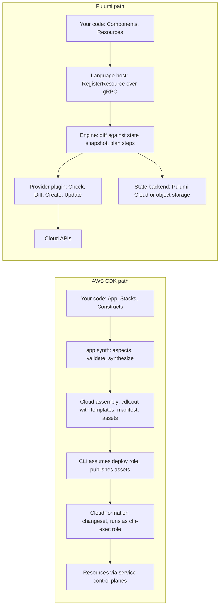

# Programmatic IaC: AWS CDK and Pulumi

## TL;DR

- A programmatic IaC tool is a compiler front end: your code runs once to build an in-memory resource graph, and a separate deployment engine (CloudFormation for AWS CDK, the Pulumi engine for Pulumi) converges the cloud toward that graph. The language never touches the cloud, except through Pulumi's resource-registration RPCs.
- Resource identity is derived from tree position. AWS CDK's CloudFormation logical ID is a function of the construct path, and Pulumi's URN is a function of the parent type chain, type, and name. A refactor that moves a resource in the tree is therefore a delete-and-create unless you pin or alias the identity.
- Values that depend on deployment results are not values at synthesis time. CDK tokens are encoded placeholders, and Pulumi Outputs are promise-like objects that are unknown during preview. Branching or validating on them in program code is the most common source of subtle bugs.
- Unit tests on synthesized templates or mocked resource registrations assert invariants of your code. They do not validate provider behavior, quotas, or IAM evaluation. Pair them with policy checks, `diff` review, and an integration deploy in a sandbox account.
- The maintainability cost is real. Abstraction layers hide blast radius, CloudFormation caps a stack at 500 resources, and vendor risk is not hypothetical: HashiCorp archived CDK for Terraform on 2025-12-10 (HashiCorp GitHub, as of 2026-10).

## Mental Model



CDK is a batch compiler with a hard seam.
Your program runs to completion, emits JSON, and exits before anything is deployed.
The seam is the cloud assembly directory, and everything after it is CloudFormation, which owns state, ordering, rollback, and retries service-side.
Pulumi has no such seam.
The program and the engine run concurrently, and every `new Resource(...)` is an RPC to the engine, so the engine can start creating early resources while your code is still constructing later ones.
That difference drives nearly every operational trade-off in this chapter: where state lives, what "rollback" means, and what your tests can see.

## Internals

### The CDK construct tree

The AWS CDK models an application as a tree of constructs rooted at an `App`.
Stacks are children of the app, and each stack becomes one CloudFormation stack.
Constructs come in three conventional levels.
L1 constructs (`CfnBucket`) are generated one-to-one from the CloudFormation resource specification.
L2 constructs (`s3.Bucket`) add defaults, grants, and derived resources, and own one primary L1 child, conventionally with the ID `Resource`.
L3 constructs, or patterns, compose several L2s into a use-case shape.
The tree is the unit of abstraction, and it is also the unit of identity, which is the first mechanism not covered in getting-started guides.

### Mechanism 1: logical IDs are a hash of the tree path

CloudFormation tracks resources across deployments by logical ID, and if a logical ID disappears from a template and a new one appears, CloudFormation deletes one resource and creates another.
The CDK generates logical IDs by concatenating the construct path components excluding the stack and appending an 8-character hash (AWS CDK docs, as of 2026-10; [Identifiers and the AWS CDK](https://docs.aws.amazon.com/cdk/v2/guide/identifiers.html)).
The hash exists because paths `A/B/C` and `A/BC` would otherwise collapse to the same alphanumeric string.
The older CDK documentation states the hash is an eight-character MD5 of the delimited path.
Two path components get special treatment.
The component `Default` is dropped before both hashing and readable-name construction.
The component `Resource` is dropped from the readable part but stays in the hash input.
This is why wrapping an existing construct in a new parent whose ID is `Default` preserves its logical ID, and why the community-documented refactoring techniques include exactly that trick ([dev.to refactoring guide](https://dev.to/aws-heroes/4-ways-to-safely-refactor-aws-cdk-code-without-resource-replacement-405o)).

The following function reimplements the algorithm.
I checked it against two published values: `MyQueueE6CA6235` and `Queue4A7E3555`.
The CDK source is the authority, so treat this as a teaching model rather than a drop-in replacement.

```python
import hashlib
import re


def logical_id(path_components):
    parts = [p for p in path_components if p != "Default"]
    deduped = [p for i, p in enumerate(parts) if i == 0 or p != parts[i - 1]]
    human = "".join(re.sub(r"[^A-Za-z0-9]", "", p) for p in deduped if p != "Resource")[:240]
    digest = hashlib.md5("/".join(parts).encode("ascii")).hexdigest()[:8].upper()
    return human + digest
```

The operational consequences follow directly.
Renaming a construct ID, moving a construct under a new parent, or splitting a monolithic L3 into two changes the path, hence the hash, hence the logical ID.
For a stateless resource this is a blip.
For an RDS instance, DynamoDB table, S3 bucket with data, or KMS key, it is a replacement, which at best fails on a physical-name conflict and at worst deletes data that had no retention policy.
Mitigations, from least to most invasive:

1. Set `removal_policy=RETAIN` on stateful resources, so a replacement orphans the old resource instead of deleting it.
2. Use `cdk diff` in CI and fail the pipeline on any replacement of a resource type on a stateful allowlist.
3. Use the `Default` ID trick or `overrideLogicalId` on the L1 child to pin identity.
4. Use `cdk refactor`, which at the time of the source I reviewed required the `--unstable=refactor` flag and so is not a stable surface (dev.to, undated; treat as preview).
5. Use `cdk orphan` plus `cdk import` to detach and re-adopt resources.

### Mechanism 2: tokens are encoded placeholders, not values

At construction time, `bucket.bucket_name` for a bucket without an explicit name is not a string known to your program.
It is a token: a string like `${Token[TOKEN.11]}` that stands for `{"Ref": "..."}` in the final template.
A GitHub issue against an alpha module shows the encoding clearly: validation code that does not check `Token.isUnresolved()` runs against the placeholder string (`${Token[TOKEN.11]}`) or, for numbers, a sentinel around -1.9e289, and throws even though the real value would have been valid (aws/aws-cdk issue 38949, as of 2026-10).
The encoding choice is deliberate.
Tokens have to travel through typed APIs that accept `str` and `float`, so the CDK smuggles a reference through the type system as a string or number that is recognizable at resolution time.
String concatenation of tokens works because the concatenated string still contains the placeholders, and resolution turns it into an `Fn::Join` (UNVERIFIED: the Fn::Join output is from memory of the CDK token design docs).
Practical rules:

- Never compare, parse, slice, or range-check a token in your own code. Use `Token.is_unresolved(x)` to skip validation, or use `CfnCondition` and `Fn::If` for deploy-time branching.
- Anything that must decide structure (how many subnets, whether to create a resource) must come from synth-time inputs: context, props, or environment variables, never from another resource's attributes.
- `Stack.resolve(obj)` resolves a tokenized value in the context of that stack, which is useful in tests to see what a token becomes (AWS CDK API reference, v2.273.0 docs, as of 2026-10).
- `Vpc.from_lookup`-style context lookups are the exception that proves the rule. They run a real API call at synth, cache the answer in `cdk.context.json`, and therefore must be committed or synthesis becomes non-deterministic across machines.

### Synthesis lifecycle and aspects

When `cdk deploy` runs, the CLI executes your app as a subprocess.
The app goes through construction, validation, and synthesis, with synthesis triggered by `app.synth()`, which traverses the tree and invokes the synthesize hook on constructs (AWS CDK docs summary, as of 2026-10).
Aspects run after your constructors finish and before validation and synthesis, visiting every node in the tree (UNVERIFIED: ordering relative to validate and the priority mechanism are from memory).
That placement is the reason they are the right place for org-wide guardrails.
An aspect sees the final tree, including L1 resources that an L2 created internally and that the application developer never typed.
The output is a cloud assembly directory (`cdk.out`) containing one template per stack, a `manifest.json` describing stacks, dependencies, and required bootstrap version, a `tree.json` dump of the construct tree, and asset directories (UNVERIFIED: file inventory from memory).
File and Docker assets are content-addressed by hash, so an unchanged Lambda bundle produces no re-upload.

### Bootstrapping is a trust boundary

`cdk bootstrap` deploys a `CDKToolkit` stack into each account and region.
It creates an assets bucket, a container repository, and IAM roles with names of the form `cdk-<qualifier>-<purpose>-<account>-<region>`, with the default qualifier `hnb659fds` (AWS CDK docs, as of 2026-10).
The deploy role is assumed by the CLI and possibly CodePipeline to start deployment, and its trust policy controls who can deploy with the CDK in that environment.
The CloudFormation execution role is what CloudFormation actually runs as, and its attached policies bound what any CDK app in the account can create (AWS CDK docs, [Customize CDK stack synthesis](https://docs.aws.amazon.com/cdk/v2/guide/customize-synth.html)).
The file-publishing role uploads assets.
Because names are predictable, Aqua Security showed that an attacker who knew an account ID could pre-register the assets bucket name in another region where the victim had not bootstrapped, and then have the victim's file-publishing role write to the attacker's bucket (Aqua Security, [AWS CDK Risk](https://www.aquasec.com/blog/aws-cdk-risk-exploiting-a-missing-s3-bucket-allowed-account-takeover/), as of 2026-10).
AWS mitigated it from CDK v2.149.0 by adding a condition so the file-publishing role only trusts buckets in the user's own account.
The lesson for a staff engineer is that the bootstrap template is infrastructure you own, and you should customize qualifier, execution-role policy, and trust policy deliberately, not accept defaults for production accounts.
Landing zone design is covered in [[17-Cloud-AI-Engineering/Volume_01_Cloud_Architecture_Principles/Chapter_06_Multi_Account_and_Multi_Project_Landing_Zones|Multi-Account and Multi-Project Landing Zones]].

### CloudFormation as the execution engine

Everything after the seam is CloudFormation: changeset creation, dependency ordering from `Ref`, `GetAtt`, and `DependsOn`, parallel resource operations, and automatic rollback on failure.
Because state is service-side, there is no state file to corrupt, lock, or leak secrets from, and no `refresh` step.
The costs are that you cannot see or mutate state directly, a stack stuck in `UPDATE_ROLLBACK_FAILED` needs a `continue-update-rollback` with resources to skip, and drift detection is a separate, opt-in API call.
Cross-stack references are implemented as stack exports and `Fn::ImportValue`, and CloudFormation refuses to change or delete an export while another stack imports it.
That produces the well-known "deadly embrace", which is a refactor you cannot deploy forward because the exporter cannot drop the export until the importer stops using it, and the importer cannot stop until the exporter has changed.

### Synthesized Terraform: CDKTF and its sunset

CDK for Terraform used the same construct-tree model but synthesized Terraform JSON and then ran `terraform` itself (UNVERIFIED: JSON filename from memory).
HashiCorp's notice states that CDKTF was sunset and archived on 2025-12-10, with no further updates, fixes, or compatibility work, and that it "did not find product-market fit at scale" (HashiCorp GitHub, as of 2026-10).
The release docs mark it deprecated as of the same date (HashiCorp docs, as of 2026-10).
Pulumi published a migration guide the following week ([Pulumi blog](https://www.pulumi.com/blog/cdktf-is-deprecated-whats-next-for-your-team/)).
The design lesson is that a synthesizer layered on someone else's engine inherits that engine's roadmap but not its governance.
For synthesized Terraform today, the supported choices are hand-written HCL (see [[17-Cloud-AI-Engineering/Volume_06_Infrastructure_as_Code_and_Delivery/Chapter_01_Terraform_and_OpenTofu_Internals|Terraform and OpenTofu Internals]]) or an engine that is itself the product.

### Pulumi: engine, language host, providers

Pulumi inverts the CDK's architecture.
The `pulumi up` process is the engine.
It launches a language host plugin for your runtime, and the host runs your program, which connects back to the engine's resource monitor over gRPC (UNVERIFIED: all Pulumi architecture in this section is from memory of the Pulumi docs and was not re-verified in this session).
Each resource constructor becomes a `RegisterResource` call carrying type, name, inputs, parent, explicit dependencies, and options.
The engine runs the provider's `Check` and `Diff` against the last state snapshot, decides on a step (create, update, replace, delete, same, read), executes it, and returns outputs to the program.
Providers are separate plugin processes speaking gRPC.
Many, including the GCP provider, are generated by a bridge that wraps the Terraform provider, so schema quirks and replace-versus-update semantics are inherited from the Terraform provider.

**Mechanism 3: identity is the URN, and the URN encodes the parent type chain.**
A URN looks like `urn:pulumi:<stack>::<project>::<qualified type>::<name>`.
The qualified type is the chain of parent component types joined with `$`, followed by the resource's own type.
Notably it contains parent types, not parent names, so renaming a parent component instance leaves child URNs unchanged, while changing a component's type token or reparenting a child changes the child's URN and triggers replace.
`aliases` on a resource tell the engine "this resource was previously known as X", so the engine rewrites state instead of replacing.
This is the Pulumi counterpart of `overrideLogicalId`, with the advantage that it is a first-class engine feature rather than a template trick.

**Mechanism 4: Outputs carry dependency edges and "known-ness".**
An `Output<T>` is not just a future.
It carries the set of resources it derives from, which is how the engine builds the dependency graph without you writing `depends_on`.
It also carries a known flag, and during `pulumi preview` the outputs of resources not yet created are unknown.
`apply` callbacks do not run for unknown values during preview, so code that logs or branches inside an `apply` behaves differently in preview and up.
Side effects inside `apply` (creating resources, calling APIs) are a documented anti-pattern for exactly this reason: preview will not show them.

**Auto-naming.**
When you omit a physical name, Pulumi appends a random suffix (seven hex characters, UNVERIFIED) to the logical name and stores it in state.
CloudFormation does a similar thing server-side with the stack name and logical ID.
In both systems, the "unnamed" resource name is stable only as long as state remembers it, which matters when you adopt resources into a new stack.

**State and failure semantics.**
Pulumi checkpoints state after every step against a backend: Pulumi Cloud, or a self-managed backend such as S3 or GCS selected with `pulumi login s3://...` (UNVERIFIED).
There is no automatic rollback.
A failed `up` leaves earlier steps applied and recorded.
In-flight operations are recorded as pending operations so that a crashed run can be reconciled.
Recovery is `pulumi refresh`, `pulumi cancel`, and in the worst case `pulumi stack export` and `import` with hand edits.
State secrets are encrypted per stack with a configurable provider (passphrase, or cloud KMS), a different custody model from CloudFormation, where no state file exists to protect.
See [[17-Cloud-AI-Engineering/Volume_06_Infrastructure_as_Code_and_Delivery/Chapter_05_State_Management_Drift_Detection_and_Compliance|State Management, Drift Detection, and Compliance]] for the locking and migration mechanics.

### Testing mechanics

CDK unit tests run `Template.from_stack(stack)`, which synthesizes and returns the template as an assertable object.
Fine-grained assertions (`has_resource_properties`, `resource_count_is`, `Match.object_like`, `Match.array_with`) pin the properties you care about.
Snapshot tests pin everything, which is why they churn on every CDK upgrade and train reviewers to rubber-stamp diffs.
Both only test your code's output, not CloudFormation's acceptance of it.
Pulumi unit tests install a mock via `pulumi.runtime.set_mocks` before importing the program, and the mock implements `new_resource` and `call`.
The program then runs in-process with no engine and no provider, so provider `Check` validation (required fields, enum values, replace-on-change rules) never runs.
A mock-based test can pass on a program the real provider would reject.
Pulumi's Automation API embeds the engine in a host program, which allows integration tests that actually deploy ephemeral stacks.

## Numbers to Know

| Item | Value | Source |
|---|---|---|
| CloudFormation resources per stack | 500, hard, no quota increase | AWS docs, [CloudFormation quotas](https://docs.amazonaws.cn/en_us/AWSCloudFormation/latest/UserGuide/cloudformation-limits.html) (as of 2026-10); raised to 500 on 2020-10-22 (AWS announcement) |
| Template body size via S3 URL | 1 MB (previously 450 KB) | AWS announcement, 2020 (as of 2026-10) |
| Template body passed directly in request | 51,200 bytes | third-party summary, oneuptime (as of 2026-02); UNVERIFIED against AWS primary |
| Dynamic references per template | 60 | AWS docs, CloudFormation quotas (as of 2026-10) |
| Custom resource response and cfn-signal data | 4,096 bytes each | AWS docs, CloudFormation quotas (as of 2026-10) |
| Logical ID hash | 8 characters of MD5 over delimited path | AWS CDK docs and legacy CDK docs (as of 2026-10) |
| Default CDK bootstrap qualifier | `hnb659fds` | AWS CDK docs (as of 2026-10) |
| Bootstrap role name pattern | `cdk-<qualifier>-<purpose>-<account>-<region>` | AWS CDK docs, Aqua (as of 2026-10) |
| CDK version with file-publishing role trust condition | v2.149.0 | Aqua Security (as of 2026-10) |
| CDK v2 API docs version observed | 2.273.0 | AWS CDK Python API reference (as of 2026-10) |
| Number token sentinel | about -1.9e289 | aws/aws-cdk issue 38949 (as of 2026-10) |
| CDKTF end of life | archived 2025-12-10 | HashiCorp GitHub and docs (as of 2026-10) |
| KMS customer managed key price | about 1 USD per key-month | UNVERIFIED (AWS pricing page not re-checked, as of 2026-10) |

## AWS vs GCP Mechanism Parity

Google Cloud has no first-party construct-tree framework equivalent to the AWS CDK.
The Google-aligned declarative engines are Terraform-based or Kubernetes-resource-model-based, and Pulumi is the common way to get a general-purpose language against GCP.

| Dimension | AWS CDK + CloudFormation | Pulumi on AWS or GCP | GCP-native options |
|---|---|---|---|
| Authoring model | Construct tree in TS, Python, Java, C#, Go | Resources and Components in TS, Python, Go, C#, Java, YAML | Terraform HCL, Config Connector YAML (UNVERIFIED) |
| Engine location | CloudFormation, service-side | Client-side engine, optionally in a hosted service | Infrastructure Manager runs Terraform managed (UNVERIFIED GA status); Config Connector runs in-cluster |
| State | Held by CloudFormation per stack | Snapshot in a backend you choose | Terraform state in GCS object; Config Connector state is the cluster object (UNVERIFIED) |
| Rollback | Automatic on create and update failure | None; partial apply is recorded | Terraform: none; KRM controllers: continuous reconcile |
| Identity of a resource | Logical ID derived from construct path | URN from parent type chain, type, name | Terraform address; KRM object name |
| Rename-safe refactor | `overrideLogicalId`, `Default` ID, `cdk refactor` (unstable at last check), import | `aliases` option | Terraform `moved` blocks |
| Execution identity | Dedicated cfn-exec role assumed by CloudFormation | Credentials of whoever runs the engine | Service account used by the runner |
| Drift detection | Opt-in API call per stack | `pulumi refresh` or preview with refresh | Terraform plan with refresh; KRM controllers reconcile |
| Cross-resource references | `Ref`, `GetAtt`, exports and imports | Output lineage | Terraform references; KRM references |
| Provider coverage | CloudFormation coverage lags some new services | Providers bridged from Terraform plus native providers | Google provider for Terraform is first-party-aligned |
| Policy hook in author loop | Aspects, cdk-nag (community), CloudFormation Hooks | Policy packs (CrossGuard) | Org Policy, Terraform policy tools |

For GCP, the practical conclusion is that if the estate is GCP-first, the idiomatic path is Terraform or OpenTofu, and Pulumi is the escape hatch when teams insist on real languages (UNVERIFIED: Deployment Manager deprecation timeline not re-checked this session).
Policy enforcement across these engines is the next chapter: [[17-Cloud-AI-Engineering/Volume_06_Infrastructure_as_Code_and_Delivery/Chapter_04_Policy_as_Code_OPA_Sentinel_and_Guardrails|Policy as Code: OPA, Sentinel, and Guardrails]].

## Worked Example: A Guardrailed L3 Construct, Logical-ID Pinning, and Mock Tests

The goal is a reusable `ModelArtifactBucket` L3 for model checkpoints and weights.
It expands to a KMS key, an S3 bucket with bucket-key encryption, a TLS-only bucket policy, and noncurrent-version expiry.
It ships with an Aspect that fails synthesis for unencrypted buckets, assertion tests, and a test that pins the logical ID so refactors that would replace the bucket fail CI.
Module design principles carry over from [[17-Cloud-AI-Engineering/Volume_06_Infrastructure_as_Code_and_Delivery/Chapter_02_Enterprise_Module_Design_and_Abstraction_Layers|Enterprise Module Design and Abstraction Layers]].
I executed only the `logical_id` helper in a sandbox.
The CDK and Pulumi code below was written against the documented APIs and was not executed here, because the sandbox has no CDK or Pulumi packages and no network (see the UNVERIFIED list).

### Capacity and cost arithmetic

1. Resource expansion: the construct emits 1 KMS key, 1 bucket, 1 bucket policy. Adding the stack's budget gives 4 CloudFormation resources. (KMS key alias is not created here.)
2. Stack ceiling: 500 / 3 = 166 buckets maximum per stack. Reserve 50 percent headroom for growth of the construct itself, since a v2 of the construct that adds an alias and a replication role would make it 5 resources and cut the ceiling to 100. Plan for at most about 80 instances per stack on the current construct.
3. Lab cost: one KMS key at about 1 USD per month (UNVERIFIED) prorated for one hour is about 0.0014 USD. S3 with no objects costs nothing meaningful. Bootstrap adds an assets bucket and a container repository that are effectively free when empty. Expected lab spend is below 0.01 USD, but the budget guard is set at 5 USD to catch mistakes.
4. KMS deletion is not immediate. With `pending_window=7 days` the key sits in pending deletion for the minimum window.

### Files

`model_bucket.py`

```python
import jsii
from aws_cdk import (
    Annotations,
    Duration,
    IAspect,
    RemovalPolicy,
    aws_kms as kms,
    aws_s3 as s3,
)
from constructs import Construct


class ModelArtifactBucket(Construct):
    def __init__(self, scope: Construct, id: str, *, retain: bool = True,
                 noncurrent_days: int = 30) -> None:
        super().__init__(scope, id)
        policy = RemovalPolicy.RETAIN if retain else RemovalPolicy.DESTROY
        self.key = kms.Key(
            self, "Key",
            enable_key_rotation=True,
            pending_window=Duration.days(7),
            removal_policy=policy,
        )
        self.bucket = s3.Bucket(
            self, "Bucket",
            encryption=s3.BucketEncryption.KMS,
            encryption_key=self.key,
            bucket_key_enabled=True,
            block_public_access=s3.BlockPublicAccess.BLOCK_ALL,
            enforce_ssl=True,
            versioned=True,
            lifecycle_rules=[
                s3.LifecycleRule(
                    noncurrent_version_expiration=Duration.days(noncurrent_days),
                    abort_incomplete_multipart_upload_after=Duration.days(7),
                )
            ],
            removal_policy=policy,
        )


@jsii.implements(IAspect)
class RequireEncryptedBuckets:
    def visit(self, node) -> None:
        if isinstance(node, s3.CfnBucket) and node.bucket_encryption is None:
            Annotations.of(node).add_error(
                "S3 bucket must set BucketEncryption (guardrail: RequireEncryptedBuckets)"
            )
```

`lab_stack.py`

```python
import aws_cdk as cdk
from aws_cdk import Aspects, aws_budgets as budgets
from constructs import Construct

from model_bucket import ModelArtifactBucket, RequireEncryptedBuckets


class LabStack(cdk.Stack):
    def __init__(self, scope: Construct, id: str, *, retain: bool, alert_email: str, **kw):
        super().__init__(scope, id, **kw)
        self.models = ModelArtifactBucket(self, "Models", retain=retain)
        Aspects.of(self).add(RequireEncryptedBuckets())

        budgets.CfnBudget(
            self, "LabBudget",
            budget=budgets.CfnBudget.BudgetDataProperty(
                budget_type="COST",
                time_unit="MONTHLY",
                budget_limit=budgets.CfnBudget.SpendProperty(amount=5, unit="USD"),
            ),
            notifications_with_subscribers=[
                budgets.CfnBudget.NotificationWithSubscribersProperty(
                    notification=budgets.CfnBudget.NotificationProperty(
                        notification_type="ACTUAL",
                        comparison_operator="GREATER_THAN",
                        threshold=80,
                        threshold_type="PERCENTAGE",
                    ),
                    subscribers=[
                        budgets.CfnBudget.SubscriberProperty(
                            subscription_type="EMAIL", address=alert_email
                        )
                    ],
                )
            ],
        )
```

`app.py`

```python
import os

import aws_cdk as cdk

from lab_stack import LabStack

app = cdk.App()
LabStack(
    app, "CdkLab",
    retain=False,
    alert_email=os.environ["ALERT_EMAIL"],
    env=cdk.Environment(account=os.environ["CDK_DEFAULT_ACCOUNT"],
                        region=os.environ.get("CDK_DEFAULT_REGION", "us-east-1")),
)
app.synth()
```

`cdk.json`

```json
{ "app": "python3 app.py" }
```

`logical_id.py` is the helper shown in Internals.

`tests/test_lab.py`

```python
import aws_cdk as cdk
from aws_cdk import Aspects, aws_s3 as s3
from aws_cdk.assertions import Annotations, Match, Template

from lab_stack import LabStack
from logical_id import logical_id
from model_bucket import RequireEncryptedBuckets


def synth():
    app = cdk.App()
    stack = LabStack(app, "T", retain=False, alert_email="ops@example.com")
    return stack, Template.from_stack(stack)


def test_bucket_invariants():
    _, t = synth()
    t.resource_count_is("AWS::S3::Bucket", 1)
    t.has_resource_properties("AWS::S3::Bucket", {
        "BucketEncryption": {"ServerSideEncryptionConfiguration": [
            Match.object_like({"BucketKeyEnabled": True})]},
        "PublicAccessBlockConfiguration": Match.object_like({"BlockPublicAcls": True}),
        "VersioningConfiguration": {"Status": "Enabled"},
    })
    t.has_resource_properties("AWS::KMS::Key", {"EnableKeyRotation": True})
    t.has_resource_properties("AWS::S3::BucketPolicy", {
        "PolicyDocument": {"Statement": Match.array_with([
            Match.object_like({"Effect": "Deny",
                               "Condition": {"Bool": {"aws:SecureTransport": "false"}}})])}})


def test_logical_id_is_pinned():
    _, t = synth()
    ids = list(t.find_resources("AWS::S3::Bucket").keys())
    assert ids == [logical_id(["Models", "Bucket", "Resource"])]


def test_aspect_rejects_unencrypted_bucket():
    app = cdk.App()
    stack = cdk.Stack(app, "Bad")
    s3.CfnBucket(stack, "Naked")
    Aspects.of(stack).add(RequireEncryptedBuckets())
    Template.from_stack(stack)
    errs = Annotations.from_stack(stack).find_error("*", Match.string_like_regexp("must set"))
    assert len(errs) == 1
```

The pinning test is the important one.
For path `Models/Bucket/Resource`, the helper yields `ModelsBucket970C6ADA`.
Any refactor that moves the bucket, such as hoisting it out of the L3 or renaming `Models`, fails this test and forces the author to choose an explicit migration instead of a silent replacement.

### Run, budget guard, and teardown

```bash
python -m venv .venv && . .venv/bin/activate
pip install aws-cdk-lib constructs pytest
export ALERT_EMAIL=you@example.com
pytest -q
npx cdk bootstrap            # creates the CDKToolkit stack in the target account and region
npx cdk diff
npx cdk deploy --require-approval never
aws s3 ls | grep -i cdklab   # verify
```

The budget alarm is the `CfnBudget` in `LabStack`: 5 USD monthly limit, email at 80 percent of actual spend.
Budgets are account-scoped, so deploying this in a shared account adds a second budget alongside existing ones.
AWS Budgets pricing beyond the free allowance should be checked before using this in a production account (UNVERIFIED).

Exact teardown:

```bash
npx cdk destroy --force
aws cloudformation describe-stacks --stack-name CdkLab   # expect: does not exist
# only if the account was bootstrapped for this lab alone:
aws cloudformation delete-stack --stack-name CDKToolkit
aws s3 ls | grep cdk-hnb659fds-assets                     # empty and remove any retained bucket manually
```

The KMS key remains in pending deletion for the 7-day window, which is the minimum.
Do not set `retain=True` for the lab, or the key and bucket survive `cdk destroy` and keep billing.

### Pulumi equivalent with mock tests

The same invariant, expressed with Pulumi.
Resource class names such as `BucketV2` have changed between major versions of the AWS provider, so check your installed version (UNVERIFIED).

`infra.py`

```python
import pulumi_aws as aws

key = aws.kms.Key("models", enable_key_rotation=True, deletion_window_in_days=7)
bucket = aws.s3.BucketV2("models")
pab = aws.s3.BucketPublicAccessBlock(
    "models",
    bucket=bucket.id,
    block_public_acls=True,
    block_public_policy=True,
    ignore_public_acls=True,
    restrict_public_buckets=True,
)
```

`test_infra.py`

```python
import unittest

import pulumi


class Mocks(pulumi.runtime.Mocks):
    def new_resource(self, args):
        return [args.name + "_id", args.inputs]

    def call(self, args):
        return {}


pulumi.runtime.set_mocks(Mocks(), project="lab", stack="test", preview=False)

import infra  # noqa: E402  must import after set_mocks


class InfraTest(unittest.TestCase):
    @pulumi.runtime.test
    def test_rotation(self):
        return infra.key.enable_key_rotation.apply(lambda v: self.assertTrue(v))

    @pulumi.runtime.test
    def test_public_access_blocked(self):
        return infra.pab.block_public_acls.apply(lambda v: self.assertTrue(v))
```

Run with `pulumi up`, then clean up with `pulumi destroy --yes && pulumi stack rm --yes`.
To keep identity stable across a refactor, pass `opts=pulumi.ResourceOptions(aliases=[pulumi.Alias(name="old-name")])`.
Note what the mock test cannot tell you: that the provider accepts `deletion_window_in_days=7`, or that the bucket policy and public access block are applied in an order S3 allows.

## Failure Modes and Pitfalls

**Replacement by refactor.**
A construct ID rename is semantically a delete plus create.
Defenses are `RETAIN` on stateful resources, a replacement-detecting `cdk diff` gate in CI, and a logical-ID pinning test like the one above.
In Pulumi the same failure appears as an unaliased reparent or type-token change.

**The 500-resource ceiling surfaces late.**
CloudFormation enforces the limit at changeset creation, not at synthesis, so a pipeline that only runs `cdk synth` passes and then fails in the deploy stage (GitHub issue in an AWS sample repository, as of 2026-10; limit confirmed by AWS quotas documentation).
Because L2 and L3 constructs create hidden resources such as IAM roles, policies, and custom resource providers, the count grows without any visible change in your code.
Count resources in CI by loading each synthesized template and failing at 80 percent of the cap.

**Export deadlock.**
Cross-stack references create exports that cannot be removed while imported.
Decompose stacks by lifecycle (stateful data stores separate from stateless compute) and pass values through SSM parameters or explicit props passed at deploy time when stacks must be independently deployable.
If you must delete a reference, deploy a first change that keeps the export alive with `exportValue()` while the consumer stops using it, then remove it in a second deployment (UNVERIFIED: `exportValue` behavior from memory).

**Tokens in program logic.**
An `if` on a token is evaluated against the placeholder, not the deployed value, and validation of a token-valued field fails with the placeholder in the error message (aws/aws-cdk issue 38949, as of 2026-10).
The Pulumi analog is doing real work inside `apply`, where preview skips the callback for unknown values and shows a different plan than the real run.

**Non-deterministic synthesis from context lookups.**
If `cdk.context.json` is not committed, two machines can synthesize different templates for the same commit because lookups hit live APIs.
Commit the file and refresh it deliberately.

**Bootstrap trust and naming.**
The predictable bootstrap resource names enabled the cross-account bucket-claiming attack described by Aqua Security.
Pin the qualifier, upgrade bootstrap stacks in lockstep with CLI upgrades, and scope the execution role policy.
This is the closest thing to a public postmortem-style analysis for the IaC layer itself, and I did not find a hyperscaler post-incident review in this research that was specifically caused by a CDK or Pulumi bug.
The general operational failure class, a control-plane change propagating blast radius through a shared dependency, is covered in [[17-Cloud-AI-Engineering/Volume_07_Reliability_and_SRE/Chapter_07_Anatomy_of_Major_Cloud_Outages|Anatomy of Major Cloud Outages]].

**Partial applies with no rollback.**
A Pulumi run killed mid-flight leaves real resources and a snapshot that may carry pending operations.
Run `pulumi refresh` before the next `up`, and never run two engines against one stack even if the backend permits it.
CloudFormation fails differently: `UPDATE_ROLLBACK_FAILED` freezes the stack until you skip the offending resources.

**Over-abstraction and the upgrade treadmill.**
An L3 that hides 30 resources makes a one-line change a 30-resource diff that no reviewer reads.
Snapshot tests for such constructs are rubber-stamped.
Pin construct library versions, review `cdk diff` output not code, and keep L3s thin.

**Vendor and project risk.**
CDKTF's archival shows that a framework with no standalone engine can disappear without a migration tool.
Weigh the governance of the engine and the framework, not just the features.

## Security and Cost Angles

**IAM scoping.**
The CDK's deploy role chain (CLI to deploy role to CloudFormation execution role) gives you three places to constrain blast radius.
Restrict who may assume the deploy role through its trust policy, restrict what CloudFormation can create via the execution role policy, and pin the qualifier per environment.
The default execution role is broadly permissive, so tighten it in production accounts.
In Pulumi the engine runs with the caller's credentials, so scope the pipeline's role instead, using short-lived federated credentials as described in [[17-Cloud-AI-Engineering/Volume_08_Security_Identity_and_the_Data_Perimeter/Chapter_02_Workload_Identity_Federation|Workload Identity Federation]].

**Encryption and secrets.**
In the worked example the key hierarchy is KMS key to S3 bucket key to per-object data keys, and `bucket_key_enabled` reduces KMS request volume (and cost) by letting S3 derive object keys locally from a bucket-level key.
Envelope encryption details are in [[17-Cloud-AI-Engineering/Volume_08_Security_Identity_and_the_Data_Perimeter/Chapter_04_Encryption_Key_Hierarchies_and_Envelope_Encryption|Encryption Key Hierarchies and Envelope Encryption]].
Pulumi state contains resource outputs, including secrets, encrypted with the stack's secrets provider.
Treat the backend bucket as a high-value asset: versioned, private, with access logged and KMS-encrypted.
CloudFormation templates are visible in the console, so never inline a secret as a literal. Use dynamic references to Secrets Manager or SSM (limit 60 per template, AWS docs as of 2026-10).

**Guardrails as code.**
Aspects enforce rules at synth time, CloudFormation Hooks enforce at deploy time, and SCPs enforce regardless of tooling.
Layer all three, because an Aspect can be removed by whoever owns the app code.
Community rule packs such as cdk-nag implement common rule sets as aspects (UNVERIFIED: not re-checked this session).
The next chapter formalizes the policy engines.

**Cost levers.**
IaC itself is nearly free, and the cost lever is shape.
Defaults inside L2s (NAT gateways in a VPC construct, multi-AZ database defaults) turn into recurring spend invisible in your code.
Add a cost-review step on `cdk diff` output, tag via `Tags.of(app)` at the root so allocation tags propagate to every taggable resource, and set a budget in the same stack, as above.
Hosted state and policy services have per-resource or per-seat pricing that I did not verify, so check the vendor's pricing page before committing to a platform.

## Interview Questions and Model Answers

### Question 1 (L5 - Senior)

You rename a construct ID in a CDK stack and the next `cdk deploy` plans to replace a DynamoDB table. Explain why, and how you prevent data loss.

#### Model Answer

CloudFormation identifies resources by logical ID, and the CDK computes the logical ID from the construct path: path components excluding the stack, concatenated for readability, plus an 8-character MD5 hash of the delimited path.
Renaming an ID changes the path, which changes both the readable prefix and the hash.
From CloudFormation's point of view, the old logical ID vanished and a new one appeared, so it creates the new resource and deletes the old one.
For a table with a fixed physical name, creation fails on a name conflict, and for an auto-named table the old data is deleted when the stack cleans up.
Prevention happens at three layers.
First, `RemovalPolicy.RETAIN` on stateful resources, so replacement orphans rather than deletes.
Second, a CI gate that parses `cdk diff` or the changeset and fails on any replacement of a stateful resource type.
Third, an explicit migration: `overrideLogicalId` on the L1 child, wrapping the construct in a parent with the ID `Default`, `cdk refactor` (which was behind an unstable flag when I last checked), or `cdk orphan` plus `cdk import`.
I would also add a logical-ID pinning unit test so the failure shows up in the PR rather than at deploy.

#### Follow-up Interviewer Question

Your CI gate flagged a replacement on a table that is only a cache. How do you decide between letting it proceed and blocking it, and who owns that decision?

### Question 2 (L5 - Senior)

A teammate writes `if bucket.bucket_name.startswith("prod-"):` in a CDK stack and it never behaves as expected. Why?

#### Model Answer

`bucket.bucket_name` for an unnamed bucket is a token, an encoded placeholder string standing in for a `Ref` that CloudFormation resolves at deploy time.
Your Python runs at synthesis, when the real name does not exist, so `startswith` evaluates against a placeholder of the form `${Token[TOKEN.n]}`.
The same encoding exists for numbers, where a sentinel around -1.9e289 stands in, which is why range validation on a token-valued number throws with absurd values in the message.
The correct fixes depend on intent.
If the decision is structural (whether to create a resource), it must derive from synth-time inputs such as props, context, or environment, not from resource attributes.
If it is a deploy-time decision, use a CloudFormation condition (`CfnCondition` with `Fn.condition_equals`) and `Fn::If`.
If you are writing a library and validating inputs, guard validation with `Token.is_unresolved(value)`, since a token cannot be validated until deployment.
You can call `Stack.resolve()` in a test to see what a token becomes.

#### Follow-up Interviewer Question

How would you design an L2 construct's API so that users cannot accidentally pass a token where a literal is required?

### Question 3 (L6 - Staff)

Your org runs AWS for training and GCP for TPU workloads. Argue for CDK, Pulumi, or Terraform/OpenTofu for a 40-engineer platform team.

#### Model Answer

I would decide on the engine, state model, and talent supply, not the language.
CDK is AWS-only by construction, because its synthesized artifact is CloudFormation.
That is a strength on AWS: CloudFormation owns state, locking, ordering, and rollback server-side, so there is no state backend to operate, and the CDK execution role chain gives a clean permission story.
It is a hard blocker on GCP, and the sunset of CDKTF on 2025-12-10 removes the only first-party route to carry the construct model onto Terraform.
Pulumi covers both clouds with one engine and real languages, but the team then operates state (a hosted backend or self-managed object storage with a secrets provider), owns partial-failure recovery since there is no rollback, and inherits Terraform provider semantics for GCP through the bridged provider.
Terraform or OpenTofu has the broadest provider surface and the best-understood plan/apply review loop, and on GCP it is the center of gravity, but its abstraction mechanism (modules) is weaker than components for composition and testing.
For this org I would not pick one tool for everything.
I would choose Terraform or OpenTofu for the shared foundation (accounts, projects, networking, IAM) where review-by-plan and a common language across clouds matter, and allow CDK for AWS application stacks if teams already have TypeScript or Python depth and want L3 patterns.
If the team needs a single abstraction across both clouds for ML platform components, Pulumi is defensible, but only with a funded owner for backend, secrets provider, upgrade cadence, and CI.
The risk I would put in the decision record is bus factor of the framework: CDKTF shows a synthesizer can die, so I prefer the layer where the engine and the framework have the same owner.

#### Follow-up Interviewer Question

Two years in, a quarter of teams use CDK and a quarter use Pulumi alongside Terraform. What do you standardize and what do you let diverge?

### Question 4 (L6 - Staff)

Design the testing strategy for a shared L3 construct library consumed by 100 teams. What do unit tests prove, and what do they not prove?

#### Model Answer

I would layer four kinds of tests, each aimed at a distinct failure.
The first is fine-grained assertions on synthesized templates: encryption on, public access blocked, TLS-only policy, key rotation, and a resource-count envelope.
These assert invariants of my code and run in milliseconds.
I avoid whole-template snapshots for security-relevant properties, because snapshots churn on every CDK upgrade, so reviewers learn to approve them without reading.
I keep a small snapshot only for logical IDs of stateful resources, or better, a pinning test that computes the expected ID from the construct path, so identity is checked explicitly.
The second is aspect and annotation tests, which prove the guardrail fires on a deliberately non-compliant tree.
The third is a compatibility test: synthesize a corpus of representative consumer apps against the new library version and diff the output against the previous version, failing on any replacement of a stateful resource or any new IAM wildcard.
This is the test that catches the breaking change consumers care about.
The fourth is a real deployment into a sandbox account, with an automated destroy, because unit tests cannot see CloudFormation or service-side validation, quota errors, IAM propagation, or ordering problems.
For Pulumi the equivalent is mock-based unit tests plus Automation API integration tests, and the caveat is sharper: mocks bypass provider `Check`, so a mock test can pass on a program the provider rejects.
What unit tests do not prove: that the template is accepted, that the resources work together at runtime, that your IAM is least privilege under real evaluation, or that a later construct version is safe for stacks already deployed.
That last one is why upgrade safety needs the corpus diff and not just green unit tests.

#### Follow-up Interviewer Question

The corpus diff shows a replacement of a bucket in 3 of 400 consumer apps after a security fix. Do you ship, and how?

### Question 5 (L6 - Staff)

A stack is at 470 of 500 resources and a team wants to add a service. Walk through your options and their blast-radius implications.

#### Model Answer

The 500-resource limit is hard and is enforced at changeset creation, so `cdk synth` passes while the pipeline fails at deploy time; I want a CI check on resource count at 80 percent.
Options in order of preference: split by lifecycle, not by size.
Move stateful resources (databases, buckets, keys) to a stack that deploys rarely, and stateless compute to a stack that deploys often.
Splitting by size alone produces arbitrary boundaries that fight each other.
The cost of splitting in CDK is cross-stack references, which become exports and imports.
Those create a deploy-order dependency and the export lock: you cannot change an exported value while it is imported.
To keep stacks independently deployable I would pass values via SSM parameters or deployment-time configuration for anything that might change, and keep direct references only for rarely changing foundations.
Nested stacks raise the effective ceiling and keep one deployment unit, but they also keep one blast radius and one rollback domain, and CDK nested stacks add their own template-upload and parameter-passing mechanics.
The resource count is also an abstraction smell: an L3 that expands to 12 resources per instance consumes 40 instances of headroom, so I would measure expansion per construct and publish it in the library docs.
Moving existing resources between stacks is itself a replacement unless done with retain plus import, so I schedule it as a migration with a plan, not a refactor.

#### Follow-up Interviewer Question

How do you move a live production database from the full stack into a new stack with no data loss and no downtime?

### Question 6 (L7+ - Principal)

You own the platform construct library used across an org and you must ship a security fix that changes the logical ID of a stateful resource in every consumer. Describe how you execute it.

#### Model Answer

The first question is whether the fix must change identity at all.
Usually it does not: I prefer a design where the fix is applied as a property change or a new sibling resource, and the original logical ID is pinned with `overrideLogicalId` or the `Default` ID.
If identity truly must change, replacement is a data migration, and I treat it as one.
Step one is classify: what is stateful, which consumers are affected (the corpus diff from my test pipeline gives the list), and what the RPO is.
Step two is make the change opt-in behind a construct prop or CDK feature flag for one release, defaulting to the old behavior, so consumers adopt on their own schedule and the library stays releasable.
Step three is provide the migration path as tooling: retain the old resource, import it under the new logical ID (`cdk import` or the refactor command, noting that `cdk refactor` was gated behind an unstable flag when I last checked), and verify with `cdk diff` that the changeset shows no replace.
Step four is guard rails: a CI check across the corpus that fails on unintended replacement, a lint that blocks removal policies other than retain on the construct, and a deprecation date after which the default flips.
Step five is the escape hatch: the security property still gets enforced for non-migrated consumers by an Aspect shipped in the same release that reports the gap, and by an org-level control (SCP or Hook) for the case where the fix is urgent.
Communication matters as much as mechanics: a dated advisory, a dashboard of migrated versus not migrated consumers, and an owner for stragglers.
The principle is that a library with 100 consumers has the blast radius of 100 stacks, so every release is a deployment to all of them, and the deployment process I need is staged rollout, not a changelog.

#### Follow-up Interviewer Question

A consumer ignored the advisory, and your flag default flips next week. They have a stateful resource in production and no owner. What do you do?

### Question 7 (L7+ - Principal)

Compare failure recovery for a `pulumi up` killed at step 40 of 100 and a CloudFormation stack that ends in `UPDATE_ROLLBACK_FAILED`. What does that imply for pipeline design?

#### Model Answer

They fail in opposite directions.
CloudFormation is transactional by intent: on error it attempts to return to the previous state, and the failure mode is that the rollback itself fails, for example because a resource was changed out of band or a dependency vanished.
The stack then sits in a state that blocks further updates until an operator runs a continue-update-rollback, optionally skipping the resources that cannot roll back, and then reconciles the template with reality.
Pulumi applies forward and checkpoints after each step.
A kill at step 40 leaves 40 resources created and recorded, and any in-flight create recorded as a pending operation.
Recovery is `pulumi refresh` (reconcile state with the cloud, resolving pending operations), then re-run `up`, which converges forward.
In the pathological case you export state, repair it, and import it.
The deeper difference is where correctness lives.
In CloudFormation the service holds state and enforces single-writer semantics, so a pipeline cannot corrupt it, but you cannot repair it directly.
In Pulumi the state is a file, and a pipeline bug (two concurrent runs, a restored old snapshot, or a lost backend) can corrupt it.
Pipeline design follows: for Pulumi, serialize runs per stack, protect and version the backend, back up state, and make `refresh` a pre-step with alerting on drift; for CloudFormation, deploy through a changeset with a replacement gate, forbid console edits via SCP to keep rollback reliable, and set termination protection on stateful stacks.
For both, keep stacks small by lifecycle, because blast radius and recovery time scale with stack size.

#### Follow-up Interviewer Question

You discover the Pulumi state file is missing 12 resources that exist in the cloud. How do you recover without recreating them, and how do you prevent recurrence?

### Question 8 (L6 - Staff)

Where should guardrails live: Aspects, CloudFormation Hooks, Pulumi policy packs, or SCPs? Justify a layered answer.

#### Model Answer

Each layer has a different adversary model.
Aspects and Pulumi policy packs execute inside the author's toolchain, so they give the fastest feedback, and they see the full tree including L1 resources hidden inside L2s.
They are advisory against an adversary or a careless team, because whoever owns the app code can remove the Aspect or skip the policy pack.
CloudFormation Hooks run inside the deployment service and apply regardless of the authoring tool, so they cover a team that bypasses CDK, but they only see what CloudFormation sees.
SCPs and resource control policies sit in the authorization path of every API call, so they cover Pulumi, Terraform, console, and CLI alike, and they cannot be bypassed by the account's own admins, but their feedback is a runtime `AccessDenied`, which is a poor developer experience.
So the design is: Aspects or policy packs for fast, explainable feedback in the PR; a Hook or an equivalent pre-deploy check for deployment-time enforcement; SCPs for the small set of invariants that must hold even when everything else is wrong (no public S3 access, encryption required, region restriction).
The cost is policy drift between layers, so I would generate or test them from one rule catalog and track coverage per rule.
The next chapter covers the engines and rule languages.

#### Follow-up Interviewer Question

How do you roll out a new SCP that would break existing deployments without causing an outage?

## Further Reading

- [Identifiers and the AWS CDK](https://docs.aws.amazon.com/cdk/v2/guide/identifiers.html): the official statement of path, unique ID, and logical ID generation, which is the identity model behind every replace-on-refactor incident.
- [Customize CDK stack synthesis](https://docs.aws.amazon.com/cdk/v2/guide/customize-synth.html): the bootstrap contract, the role chain, and the qualifier mechanism you must tailor for production accounts.
- [CloudFormation quotas](https://docs.amazonaws.cn/en_us/AWSCloudFormation/latest/UserGuide/cloudformation-limits.html): the hard limits that shape stack decomposition (check the global AWS docs for current values).
- [Aqua Security analysis of the CDK bootstrap bucket risk](https://www.aquasec.com/blog/aws-cdk-risk-exploiting-a-missing-s3-bucket-allowed-account-takeover/): a public analysis of how predictable names in the bootstrap contract became an account-takeover path.
- [Pulumi: CDKTF is deprecated](https://www.pulumi.com/blog/cdktf-is-deprecated-whats-next-for-your-team/): the vendor's view of the migration options, to be read with the awareness that it is a competitor's account.
- [HashiCorp CDKTF repository sunset notice](https://github.com/hashicorp/terraform-cdk): the primary source for the 2025-12-10 end of life.
- [aws/aws-cdk issue 38949](https://github.com/aws/aws-cdk/issues/38949): a concrete, real-world illustration of token placeholders leaking into validation logic.
- Pulumi documentation on resource options (`aliases`, `parent`, `protect`) and the Automation API: the primary reference for the identity and testing mechanics described above, which I did not re-verify in this session.
- [[17-Cloud-AI-Engineering/Volume_06_Infrastructure_as_Code_and_Delivery/Chapter_01_Terraform_and_OpenTofu_Internals|Terraform and OpenTofu Internals]]: the plan/apply engine that Pulumi's providers and CDKTF were both built around.
- [[17-Cloud-AI-Engineering/Volume_06_Infrastructure_as_Code_and_Delivery/Chapter_06_Progressive_Delivery_and_Deployment_Pipelines|Progressive Delivery and Deployment Pipelines]]: how to stage the deployments of a shared construct library across consumers.
