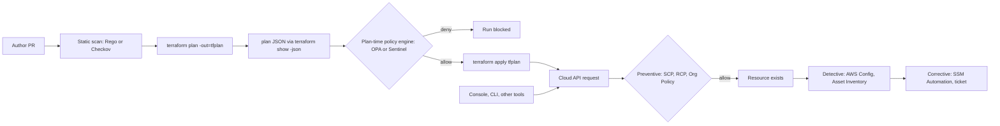

# Policy as Code: OPA, Sentinel, and Guardrails

## TL;DR

Research caveat: the web-search budget for this authoring session was exhausted after one successful OPA docs lookup, so almost every volatile figure below is tagged `UNVERIFIED` and listed in the batch report. Mechanism descriptions come from primary docs and papers recalled from memory and were not re-fetched.

- A guardrail is only as strong as its enforcement point: plan-time policy (OPA, Sentinel) sees intent but not outcome, preventive control-plane policy (SCP, Org Policy) sees every API call but few resource attributes, and detective policy (AWS Config, Cloud Asset Inventory) sees reality but only after the fact.
- Rego has three-valued behavior in practice (true, false, undefined), and a `deny` rule whose body hits an undefined reference or a swallowed builtin error silently produces "no violation", so every policy must be written and tested to fail closed.
- `terraform show -json` omits unknown values from `after` and flags them in `after_unknown`, so cross-resource invariants such as "every bucket has KMS encryption" must be joined through `configuration.*.expressions.*.references`, not through attribute values.
- Org Policy and SCPs are checked at request time and are not retroactive, while AWS Config is recorder-driven and eventually consistent, so each layer has a different detection latency and a different bypass path.
- Policy is code that ships to a global blast radius: stage it (dry-run, advisory, canary OU), version it, test negative cases, and design what happens when the policy engine itself fails.

## Mental Model



Think of policy as four independent evidence checkpoints along one resource lifecycle, each decoupled from the others by a different data plane.
The plan-time checkpoint evaluates a JSON document that Terraform produced, so it is cheap, fast, and can give developers line-level feedback, but it only covers changes that flow through that pipeline.
The preventive checkpoint sits inside the cloud's authorization or request path, so it covers every caller including the console, but it can only reason about the attributes the owning service exposes to it.
The detective checkpoint reads a recorded copy of resource configuration, so it covers everything that ever existed, at the price of latency and per-item cost.
No single checkpoint is sufficient, and the engineering skill is deciding which invariant is enforced where, and making the same invariant consistent across layers.

## Internals

### The Rego evaluation engine

OPA parses Rego into an AST, runs the AST through a multi-stage compiler, and evaluates queries top-down with backtracking.
The compiler resolves references, rewrites `with` and comprehension constructs, type-checks against known builtins, and reorders expressions inside rule bodies so every variable is bound before use (the safety check).
The consequence is that expression order in a body is not execution order, and you cannot rely on a "guard first" idiom for performance unless the guard is indexable.

Evaluation treats a rule body as a conjunction of expressions.
Each `some x in coll` or `coll[_]` is a generator that binds variables, and the evaluator explores the cross product depth-first, backtracking when an expression is false or undefined.
Rules come in four shapes: complete rules (one value), partial set rules (`deny contains msg if`), partial object rules, and functions.
Virtual documents (rule results) are cached per query evaluation, so a helper rule such as `kms_protected` is computed once per evaluation, while a function with arguments is cached by argument value.

Rule indexing is the mechanism that keeps large rule sets cheap.
At compile time OPA inspects rule bodies for equality expressions between a reference rooted at `input` or `data` and a ground value, such as `input.request.kind == "Pod"`, and builds a trie keyed on those references.
At evaluation time only rules whose indexed conditions match the input are visited.
Rules that express the same test through a non-ground comparison, a function call, or a negation are not indexable and are always evaluated, which is the usual cause of linear slowdowns as policy count grows.
Measure with `opa eval --profile` and `--explain=notes` rather than guessing (OPA docs, recalled, not re-fetched 2026-10-21).

The semantic detail that most guides skip is what "undefined" does.
A reference to a missing key, an out-of-range index, or a builtin that errors (for example `split` on a non-string) makes the enclosing expression undefined, and an undefined expression makes the whole rule body fail without any error.
For a positive `allow` rule that is fail-closed.
For a `deny` rule it is fail-open: the violation condition cannot be established, so no message is emitted, so the plan passes.
By default OPA swallows builtin errors into undefined; `--strict-builtin-errors` on `opa eval` and `opa test` turns them into hard errors, and `opa check --strict` catches unused variables and imports.
Treat both flags as mandatory in CI.

Other engine properties worth knowing cold:

- `input` and `data` are fully materialized as in-memory values, so evaluation is not streaming and memory scales with plan size.
- Builtins such as `http.send` are nondeterministic and make decisions non-reproducible, while `time.now_ns` is fixed for the duration of one query.
- `with input as ...` and `with data.x as ...` override values for one expression, which is how `opa test` mocks inputs, and it invalidates cached virtual documents that depend on the overridden path.
- Partial evaluation (`opa eval --partial`) treats chosen inputs as unknown and emits residual queries, and `opa build -t wasm` compiles an entrypoint to WebAssembly for embedding in a gateway or edge runtime.
- Since OPA 1.0 the `in`, `every`, `if`, and `contains` keywords are part of the language by default and the `rego.v1` import is the compatibility bridge for older versions (OPA docs v0.60.0 migration page, retrieved 2026-10-21).

Conceptually Rego descends from Datalog, and its undefined semantics are what distinguish it from a pure logic engine.
Amazon's Cedar language takes the opposite design stance, with a bounded, analyzable language and explicit default deny, as described in the Cedar paper (OOPSLA 2024).
For IAM, AWS also uses SMT-based reasoning (Zelkova, FMCAD 2018) to answer "can this policy ever allow X" for all inputs, which evaluation-based engines like OPA cannot do.
That is the trade-off: OPA answers "does this concrete input pass", while solver-backed tools answer "for all inputs", at the cost of a restricted language.

### Terraform plan JSON as a data contract

The plan-time pipeline is `terraform plan -out=tfplan` followed by `terraform show -json tfplan`.
The JSON document has a `format_version` (a 1.x string at the time of writing, UNVERIFIED), `planned_values`, `resource_changes`, `configuration`, `prior_state`, `resource_drift`, and `output_changes`.
See [[17-Cloud-AI-Engineering/Volume_06_Infrastructure_as_Code_and_Delivery/Chapter_01_Terraform_and_OpenTofu_Internals|Terraform and OpenTofu Internals]] for how the graph walk produces these.

Each `resource_changes` entry carries `address`, `module_address` (absent for the root module), `mode`, `type`, `name`, optional `index`, and a `change` object with `actions`, `before`, `after`, `after_unknown`, `before_sensitive`, and `after_sensitive`.
`actions` is an array and its exact value matters: `["no-op"]`, `["create"]`, `["update"]`, `["delete"]`, `["delete","create"]` (replace, destroy first), and `["create","delete"]` (replace, create first).
A check that tests `actions == ["create"]` silently skips replacements.

Three mechanisms matter for correctness:

1. **Unknown values are omitted, not null.** An attribute whose value is computed during apply (for example a KMS key ARN created in the same plan) is absent from `after` and appears as `true` in `after_unknown`, with the same nesting shape as the resource. A policy that reads `after.kms_master_key_id` gets undefined, which is not the same as null and not the same as a bad value.
2. **Cross-resource references are only visible in `configuration`.** With AWS provider v4 and later, S3 bucket encryption is a separate resource, `aws_s3_bucket_server_side_encryption_configuration`, whose `bucket` attribute is a reference to a bucket created in the same plan. In `resource_changes` that attribute is unknown (`after_unknown.bucket == true`), so you cannot join on it. The join key lives in `configuration.root_module.resources[].expressions.bucket.references`, which lists strings such as `aws_s3_bucket.logs.id` and `aws_s3_bucket.logs`. This is the mechanism the worked example uses.
3. **Sensitive values are present in plain text.** `*_sensitive` flags mark values for display redaction, but `terraform show -json` and the plan file still contain them, so the plan JSON is a secret-bearing artifact (see Security and Cost Angles).

There is also a structural time-of-check/time-of-use gap.
The plan is a prediction made against a state snapshot, and apply resolves unknowns, provider-side defaults, and server-normalized values afterward.
Saved plans are bound to the state lineage and serial and are rejected as stale if state moved, which protects you from applying a plan you did not evaluate, but it does nothing about values that were unknown when you evaluated it.
Anything a plan-time policy cannot see must be enforced by a layer that sees the final request or the final resource.

### Sentinel and HCP Terraform policy enforcement

Sentinel is HashiCorp's embedded policy language.
In HCP Terraform and Terraform Enterprise, policies are grouped into policy sets attached to workspaces or projects, and they are evaluated in the run pipeline after the plan (and cost estimation) and before the apply confirmation.
Sentinel policies read data through imports such as `tfplan/v2`, `tfconfig/v2`, `tfstate/v2`, and `tfrun`, and a policy's `main` rule yields the pass or fail verdict.
Sentinel has three enforcement levels: `advisory` (logged), `soft-mandatory` (blocks unless a user with override permission approves), and `hard-mandatory` (blocks, no override) (HashiCorp docs, recalled, UNVERIFIED as of 2026-10).
HCP Terraform also accepts OPA/Rego policies in policy sets, with a smaller set of enforcement levels (UNVERIFIED), and each OPA policy declares the query that determines pass or fail.
Sentinel has an explicit `undefined` value in its type system, so the same "does a missing key fail open" question applies, and you answer it with `sentinel test` cases that include missing and unknown attributes rather than by reading the language reference.

The operational value of Sentinel and the HCP policy pipeline is not the language.
It is the control-flow integration: the policy result is bound to a specific run and plan, overrides are permissioned and audited, and policy sets can be rolled out workspace by workspace at `advisory` before being promoted.
The cost is lock-in to one execution platform and a proprietary language; OPA in a generic CI job is portable but you build the override, audit, and rollout machinery yourself.

### Terraform-native guardrails

Before reaching for an external engine, use the language.
`precondition` and `postcondition` blocks in `lifecycle` (Terraform 1.2 and later), `check` blocks (1.5 and later), and `terraform test` (1.6 and later) all evaluate with full visibility of resolved values at plan or apply time (HashiCorp docs, recalled, UNVERIFIED version numbers).
A `postcondition` is the only plan-adjacent mechanism that sees values after the provider has resolved them, so it closes part of the unknown-value gap for a single resource.
The limit is organizational: these guards live in the module author's code, so they are not a central control.

### AWS preventive, proactive, and detective layers

AWS splits enforcement across several services, and AWS Control Tower names the behaviors preventive, detective, and proactive.

- **Preventive:** Service Control Policies and Resource Control Policies filter IAM authorization decisions for principals and resources in an organization, and they can only use condition keys the request context exposes. Declarative policies enforce baseline service configuration for supported services at the organization level, independent of which API path made the change (UNVERIFIED launch details). See [[17-Cloud-AI-Engineering/Volume_02_AWS_Deep_Dive/Chapter_01_IAM_Policy_Evaluation_Engine|IAM Policy Evaluation Engine]] and [[17-Cloud-AI-Engineering/Volume_02_AWS_Deep_Dive/Chapter_02_AWS_Organizations_and_Account_Governance|AWS Organizations and Account Governance]].
- **Proactive:** CloudFormation Hooks (including Guard-based hooks) run before a stack operation provisions a resource and can fail or warn. AWS Config rules can also run in proactive evaluation mode against a resource configuration supplied before deployment. Both only see changes that go through CloudFormation or an integration that calls the evaluation API.
- **Detective:** AWS Config records configuration items (CIs) for supported resource types into a per-region recorder and evaluates rules against them. Rules are managed (AWS-authored), custom Lambda, or custom policy rules written in CloudFormation Guard. Results are `COMPLIANT`, `NON_COMPLIANT`, `NOT_APPLICABLE`, or `INSUFFICIENT_DATA`. Rules trigger on configuration change or on a periodic frequency of 1, 3, 6, 12, or 24 hours (AWS docs, recalled, UNVERIFIED).
- **Corrective:** Config remediation actions invoke SSM Automation documents on NON_COMPLIANT resources, optionally automatically with retry limits.

The mechanism most guides skip is that Config evaluation latency is the sum of the recorder's change detection, CI construction (service describe calls), CI delivery, and rule execution, and the recorder can be stopped, scoped, or throttled without any rule turning red.
A rule on a resource type the recorder is not recording has no data, so the absence of `NON_COMPLIANT` is not evidence of compliance.
Always alert on recorder status and on `INSUFFICIENT_DATA` counts.
Also, remediation and Terraform are two reconciliation loops over the same attribute; if they disagree on the target value they will fight, generating CIs, evaluations, and cost on every cycle.

### GCP Organization Policy and Policy Library

Organization Policy attaches constraints to nodes of the resource hierarchy (organization, folder, project), and the effective policy for a resource is computed by merging policies down the tree.
See [[17-Cloud-AI-Engineering/Volume_03_GCP_Deep_Dive/Chapter_01_Resource_Hierarchy_and_Organization_Policies|Resource Hierarchy and Organization Policies]].
A policy resource has a `spec` (and optionally a `dryRunSpec`), whose `rules` can be `enforce` (boolean constraints), `values` with `allowedValues` or `deniedValues`, `allowAll`, or `denyAll` (list constraints), each optionally conditioned on resource tags, plus `inheritFromParent` and `reset` controls.

Enforcement is performed by the service that owns the resource, at request time, using the effective policy from the Org Policy service.
Three consequences follow, and all three differ from a plan-time scan:

1. It is not retroactive: existing resources that violate a newly enforced constraint are left alone and typically fail on their next update.
2. It only works for constraints a service implements, so coverage is per service and per resource type.
3. Policy changes take time to propagate to enforcing services (documented as up to roughly 15 minutes, UNVERIFIED), so automation that sets a policy and immediately creates a resource can race.

Custom constraints let you write a CEL condition over a resource's fields for specific resource types and methods (`CREATE`, `UPDATE`) and choose `ALLOW` or `DENY` as the action (Google Cloud docs, recalled, UNVERIFIED field coverage).
Dry-run mode (`dryRunSpec`) evaluates a candidate policy on live traffic and records violations in Cloud Audit Logs without blocking, which is the safest rollout primitive in either cloud.
AWS SCPs have no equivalent native dry-run (UNVERIFIED), so the usual substitutes are CloudTrail analysis and staged OU rollout.

For plan-time checks on GCP, Policy Library constraint templates are written in Rego and evaluated against Terraform plans with `gcloud beta terraform vet` (beta at last recall, UNVERIFIED).
That means the same Rego skills transfer, but you must track the beta status and the input shape it converts the plan into, which is not the raw `terraform show -json` document.
See [[17-Cloud-AI-Engineering/Volume_03_GCP_Deep_Dive/Chapter_03_VPC_Service_Controls_Security_Perimeters|VPC Service Controls: Security Perimeters]] and [[17-Cloud-AI-Engineering/Volume_08_Security_Identity_and_the_Data_Perimeter/Chapter_06_Constructing_an_Impenetrable_Data_Perimeter|Constructing an Impenetrable Data Perimeter]] for the perimeter layer that complements these.

### Policy engines in the cluster

Kubernetes admission control is the same pattern applied to a different API: OPA Gatekeeper and Kyverno evaluate objects at the API server's admission webhook, which is a preventive checkpoint equivalent to Org Policy.
See [[04-System-Design/07-Infrastructure-and-Orchestration/Kubernetes-Architecture|Kubernetes Architecture]] for the admission chain, and note that a webhook with `failurePolicy: Ignore` is fail-open while `Fail` makes the policy engine a hard dependency of every write.

## Numbers to Know

Verification status: only the first row was fetched this session.
Every other row is recalled from official documentation and carries an explicit `UNVERIFIED` tag; do not promote this chapter to `status: solid` until each is re-checked.

| Quantity | Value | Source |
| --- | --- | --- |
| Rego keywords `in`, `every`, `if`, `contains` | Default in OPA 1.0; `import rego.v1` is the bridge for older versions | OPA docs v0.60.0 migration page, retrieved 2026-10-21 |
| Terraform plan JSON `format_version` | 1.x series | UNVERIFIED (HashiCorp docs, recalled; re-check as of 2026-10) |
| Terraform in-language guards | `precondition`/`postcondition` 1.2+, `check` 1.5+, `terraform test` 1.6+ | UNVERIFIED (HashiCorp docs, recalled) |
| HCP Terraform Sentinel enforcement levels | advisory, soft-mandatory, hard-mandatory | UNVERIFIED (HashiCorp docs, recalled) |
| AWS Config periodic rule frequencies | 1, 3, 6, 12, 24 hours | UNVERIFIED (AWS docs, recalled) |
| AWS Config price per configuration item | $0.003 per CI, continuous recording | UNVERIFIED (AWS pricing, recalled) |
| AWS Config rule evaluation price | $0.001 for first 100,000, $0.0008 for next 400,000, $0.0005 beyond, per account-region per month | UNVERIFIED (AWS pricing, recalled) |
| AWS Config rules per account-region (default) | 1,000, soft limit | UNVERIFIED (AWS docs, recalled) |
| SCP maximum document size | 5,120 characters | UNVERIFIED (AWS docs, recalled) |
| Org Policy propagation delay | Up to about 15 minutes | UNVERIFIED (Google Cloud docs, recalled) |
| Org Policy custom constraints per organization | 20 | UNVERIFIED (Google Cloud docs, recalled) |
| Org Policy dry-run | Violations logged to Cloud Audit Logs, no enforcement | UNVERIFIED (Google Cloud docs, recalled) |
| Plan JSON size heuristic | Roughly 1-4 KB per resource change, so 10,000 resources is on the order of tens of MB | Engineering estimate, not sourced; measure your own plans |

## AWS vs GCP Mechanism Parity

| Concern | AWS | GCP |
| --- | --- | --- |
| Plan-time policy | OPA/Conftest, Sentinel, Checkov on `terraform show -json`; CloudFormation Guard and Hooks for CFN | OPA/Conftest on plan JSON; Policy Library via `gcloud beta terraform vet` (UNVERIFIED beta) |
| Language for custom checks | Rego, Sentinel, CloudFormation Guard, Lambda code | Rego (Policy Library), CEL (custom constraints), Cloud Functions code |
| Preventive control location | IAM authorization layer (SCP, RCP) filters requests; declarative policies enforce service baselines | Owning service checks the request against effective Org Policy |
| Visible attributes at enforcement | IAM condition keys only (principal, tags, service keys) | Resource fields via CEL, per supported service and resource type |
| Hierarchy semantics | OU tree; SCPs are a ceiling, intersected at every level | Org, folder, project; policies merge with `inheritFromParent` and `reset` |
| Dry-run before enforce | No native SCP dry-run (UNVERIFIED); Config and CloudTrail used for impact analysis | `dryRunSpec` on Org Policy, logged to audit logs |
| Retroactivity | Not retroactive for SCP; Config evaluates existing resources | Not retroactive; Asset Inventory and Security Health Analytics scan existing resources |
| Detective engine | AWS Config recorder, rules, conformance packs, organization aggregator | Cloud Asset Inventory, Security Command Center findings (UNVERIFIED tier details) |
| Detection latency drivers | Recorder detection, CI build, delivery, rule execution; periodic rules at 1-24 hours | Asset feed and scan cadence, per detector |
| Corrective action | SSM Automation via Config remediation | Cloud Functions or Workflows triggered from Pub/Sub feeds |
| Typical fail-open trap | Recorder stopped or resource type unrecorded | Service does not implement the constraint, or tag condition omitted |
| Exception model | Principal ARN or tag conditions inside SCP | Tag-conditioned rules, folder or project-level override |

## Worked Example: Fail-Closed Plan Policy and Runtime Backstop

The lab has two parts.
Part A is plan-only: it creates no billable resources and needs no cloud credentials.
Part B adds an AWS Config rule and a GCP Org Policy dry-run as the runtime backstops for the same invariant.

### Invariant

Every `aws_s3_bucket` created or updated by Terraform must have an `aws_s3_bucket_server_side_encryption_configuration` that uses `aws:kms`.
The same invariant is later enforced at runtime by the Config managed rule `S3_DEFAULT_ENCRYPTION_KMS`, so the two layers agree on what "compliant" means.

### Part A: Terraform, Rego, and tests

`main.tf` uses mock credentials so `terraform plan` works offline:

```hcl
terraform {
  required_version = ">= 1.6"
  required_providers {
    aws = {
      source  = "hashicorp/aws"
      version = ">= 5.0"
    }
  }
}

provider "aws" {
  region                      = "us-east-1"
  access_key                  = "mock"
  secret_key                  = "mock"
  skip_credentials_validation = true
  skip_requesting_account_id  = true
  skip_metadata_api_check     = true
}

resource "aws_kms_key" "logs" {
  description         = "policy demo"
  enable_key_rotation = true
}

resource "aws_s3_bucket" "logs" {
  bucket_prefix = "policy-demo-logs-"
}

resource "aws_s3_bucket_server_side_encryption_configuration" "logs" {
  bucket = aws_s3_bucket.logs.id

  rule {
    apply_server_side_encryption_by_default {
      sse_algorithm     = "aws:kms"
      kms_master_key_id = aws_kms_key.logs.arn
    }
  }
}
```

`policy/s3.rego` joins through `configuration` references and fails closed:

```rego
package terraform.s3

import rego.v1

# Fail closed on plan formats this policy was not written against.
deny contains msg if {
	not startswith(object.get(input, "format_version", ""), "1.")
	msg := "unsupported plan format_version; this policy requires 1.x"
}

# Resources being created or updated (replacements include "create").
changed(type) := {rc |
	some rc in input.resource_changes
	rc.mode == "managed"
	rc.type == type
	some action in rc.change.actions
	action in {"create", "update"}
}

# Resources that will exist after apply, including unchanged ones.
present(type) := {rc |
	some rc in input.resource_changes
	rc.mode == "managed"
	rc.type == type
	rc.change.actions != ["delete"]
}

bucket_name(rc) := sprintf("%s.%s", [rc.type, rc.name])

ref_base(ref) := concat(".", [parts[0], parts[1]]) if {
	parts := split(ref, ".")
	count(parts) >= 2
}

is_kms(rc) if {
	some r in rc.change.after.rule
	some d in r.apply_server_side_encryption_by_default
	d.sse_algorithm == "aws:kms"
}

# Bucket addresses bound to a KMS encryption config in this plan.
# The join key is configuration.*.expressions.bucket.references because
# change.after.bucket is unknown when the bucket is created in the same plan.
kms_protected contains name if {
	some cfg in input.configuration.root_module.resources
	cfg.type == "aws_s3_bucket_server_side_encryption_configuration"
	some ref in cfg.expressions.bucket.references
	startswith(ref, "aws_s3_bucket.")
	name := ref_base(ref)
	some rc in present(cfg.type)
	rc.name == cfg.name
	not rc.module_address
	is_kms(rc)
}

deny contains msg if {
	some rc in changed("aws_s3_bucket")
	not rc.module_address
	name := bucket_name(rc)
	not name in kms_protected
	msg := sprintf("%s: no aws:kms encryption configuration bound to this bucket in the same plan", [rc.address])
}

# Fail closed for module-resident buckets instead of silently skipping them.
deny contains msg if {
	some rc in changed("aws_s3_bucket")
	rc.module_address
	msg := sprintf("%s: bucket inside a module cannot be verified by this policy", [rc.address])
}
```

`policy/s3_test.rego` covers positive and negative cases, including the ones that bite in production:

```rego
package terraform.s3_test

import rego.v1

import data.terraform.s3

bucket(actions) := {
	"address": "aws_s3_bucket.logs",
	"mode": "managed",
	"type": "aws_s3_bucket",
	"name": "logs",
	"change": {"actions": actions, "after": {"bucket_prefix": "logs-"}},
}

sse(alg, actions) := {
	"address": "aws_s3_bucket_server_side_encryption_configuration.logs",
	"mode": "managed",
	"type": "aws_s3_bucket_server_side_encryption_configuration",
	"name": "logs",
	"change": {
		"actions": actions,
		"after": {"rule": [{"apply_server_side_encryption_by_default": [{"sse_algorithm": alg}]}]},
		"after_unknown": {"bucket": true},
	},
}

sse_cfg := {
	"type": "aws_s3_bucket_server_side_encryption_configuration",
	"name": "logs",
	"expressions": {"bucket": {"references": ["aws_s3_bucket.logs.id", "aws_s3_bucket.logs"]}},
}

plan(rcs) := {
	"format_version": "1.2",
	"resource_changes": rcs,
	"configuration": {"root_module": {"resources": [sse_cfg]}},
}

test_kms_pair_allowed if {
	count(s3.deny) == 0 with input as plan([bucket(["create"]), sse("aws:kms", ["create"])])
}

test_aes256_denied if {
	count(s3.deny) == 1 with input as plan([bucket(["create"]), sse("AES256", ["create"])])
}

test_missing_sse_denied if {
	count(s3.deny) == 1 with input as plan([bucket(["create"])])
}

test_unchanged_kms_sse_protects_updated_bucket if {
	count(s3.deny) == 0 with input as plan([bucket(["update"]), sse("aws:kms", ["no-op"])])
}

test_delete_only_bucket_ignored if {
	count(s3.deny) == 0 with input as plan([bucket(["delete"])])
}

test_module_bucket_fails_closed if {
	b := object.union(bucket(["create"]), {"module_address": "module.m"})
	count(s3.deny) == 1 with input as plan([b])
}

test_unknown_plan_format_denied if {
	p := object.union(plan([bucket(["create"]), sse("aws:kms", ["create"])]), {"format_version": "2.0"})
	count(s3.deny) == 1 with input as p
}
```

Run it:

```bash
terraform init
terraform plan -out=tfplan
terraform show -json tfplan > tfplan.json
opa fmt --rego-v1 --diff policy/
opa check --strict policy/
opa test --strict-builtin-errors -v policy/
opa eval --strict-builtin-errors --fail-defined --format pretty \
  --data policy --input tfplan.json 'data.terraform.s3.deny[_]'
```

`--fail-defined` makes `opa eval` exit non-zero when the query returns any result, which turns a non-empty `deny` set into a failed CI job.
To see the fail-open trap, replace the bucket join with a rule that reads `after.rule[0]...sse_algorithm != "aws:kms"` and delete the `rule` block from the config: the plan will pass.

Gate the apply on the exact artifact you evaluated:

```bash
sha256sum tfplan tfplan.json > plan.sha256
# policy job passes -> apply job verifies hashes, then:
terraform apply tfplan
```

### Part B: Runtime backstops

Prerequisite: an AWS account where a Config recorder is already running and records `AWS::S3::Bucket` (Control Tower accounts qualify), and a GCP project you can modify with `roles/orgpolicy.policyAdmin`.
Check with `aws configservice describe-configuration-recorder-status` before starting.

Cost estimate for Part B (all prices UNVERIFIED, recalled):

- One test bucket produces a handful of CIs, about 5 x $0.003 = $0.015.
- Rule evaluations for one rule over that bucket are well under 100 x $0.001 = $0.10.
- GCP Org Policy and dry-run are free; the test bucket costs cents for a few minutes.
- Expected total: under $0.25.

Budget alarm for AWS (`budget.json` and `notif.json`):

```json
{"BudgetName":"policy-lab","BudgetLimit":{"Amount":"5","Unit":"USD"},"TimeUnit":"MONTHLY","BudgetType":"COST"}
```

```json
[{"Notification":{"NotificationType":"ACTUAL","ComparisonOperator":"GREATER_THAN","Threshold":80,"ThresholdType":"PERCENTAGE"},"Subscribers":[{"SubscriptionType":"EMAIL","Address":"you@example.com"}]}]
```

```bash
ACCOUNT_ID=$(aws sts get-caller-identity --query Account --output text)
aws budgets create-budget --account-id "$ACCOUNT_ID" \
  --budget file://budget.json --notifications-with-subscribers file://notif.json
```

Budget alarm for GCP:

```bash
gcloud billing budgets create --billing-account=BILLING_ACCOUNT_ID \
  --display-name=policy-lab --budget-amount=5USD --threshold-rule=percent=0.8
```

AWS Config rule and a non-compliant bucket:

```bash
cat > rule.json <<'EOF'
{"ConfigRuleName":"s3-default-encryption-kms",
 "Source":{"Owner":"AWS","SourceIdentifier":"S3_DEFAULT_ENCRYPTION_KMS"},
 "Scope":{"ComplianceResourceTypes":["AWS::S3::Bucket"]}}
EOF
aws configservice put-config-rule --config-rule file://rule.json
BUCKET=policy-lab-$ACCOUNT_ID-$RANDOM
aws s3api create-bucket --bucket "$BUCKET" --region us-east-1
aws configservice start-config-rules-evaluation --config-rule-names s3-default-encryption-kms
aws configservice get-compliance-details-by-config-rule \
  --config-rule-name s3-default-encryption-kms --compliance-types NON_COMPLIANT
```

New buckets get SSE-S3 by default, so the bucket should appear as NON_COMPLIANT against a KMS-only rule, which demonstrates why the plan policy and runtime rule must express the same invariant.
Expect minutes of latency between bucket creation and the result, which is the detective-layer lag.

GCP Org Policy dry-run (`ubla-dry-run.yaml`):

```yaml
name: projects/PROJECT_ID/policies/storage.uniformBucketLevelAccess
dryRunSpec:
  rules:
  - enforce: true
```

```bash
gcloud org-policies set-policy ubla-dry-run.yaml
gcloud storage buckets create gs://policy-lab-PROJECT_ID-$RANDOM --no-uniform-bucket-level-access
# Inspect Cloud Audit Logs for the dry-run policy violation entry (filter fields UNVERIFIED).
```

If your organization already enforces this constraint by default, the create call is blocked and you will see the enforced behavior rather than the dry-run.

Teardown (run all of it):

```bash
aws configservice delete-config-rule --config-rule-name s3-default-encryption-kms
aws s3api delete-bucket --bucket "$BUCKET" --region us-east-1
aws budgets delete-budget --account-id "$ACCOUNT_ID" --budget-name policy-lab
gcloud org-policies delete storage.uniformBucketLevelAccess --project=PROJECT_ID
gcloud storage buckets delete gs://YOUR_GCP_TEST_BUCKET
gcloud billing budgets list --billing-account=BILLING_ACCOUNT_ID   # find and delete policy-lab
```

### Capacity and cost sizing for the detective layer

The plan-time layer is effectively free: a few hundred plans a day at roughly 20 seconds of extra CI time each is on the order of two CI-hours per day, and OPA evaluation is a small fraction of that (measure with `opa eval --profile`).
The detective layer is where unit economics bite.

Model: cost per account-region = CIs x $0.003 + tiered evaluation cost on (CIs x rules per resource type).
Assume 60 account-regions and 50,000 CIs per account-region per month, 10 change-triggered rules applying per CI.

```python
CI_PRICE = 0.003
EVAL_TIERS = [(100_000, 0.001), (400_000, 0.0008), (float("inf"), 0.0005)]

def eval_cost(n):
    cost, left = 0.0, n
    for size, price in EVAL_TIERS:
        take = min(left, size)
        cost += take * price
        left -= take
        if left <= 0:
            break
    return cost

def monthly(account_regions, ci_per_ar, rules_per_resource):
    per_ar = ci_per_ar * CI_PRICE + eval_cost(ci_per_ar * rules_per_resource)
    return per_ar, per_ar * account_regions

for label, ci, rules in [("baseline", 50_000, 10),
                         ("daily-record high churn types", 20_000, 10),
                         ("scoped rules", 50_000, 3)]:
    per_ar, total = monthly(60, ci, rules)
    print(f"{label}: per account-region ${per_ar:,.0f}, fleet ${total:,.0f} per month")
```

Output of this script: baseline is $570 per account-region and $34,200 per month fleet-wide, the reduced-churn case is $14,400, and the scoped-rules case is $17,400 (prices UNVERIFIED, so treat the shape as the lesson).
Two conclusions: evaluations, not CIs, dominate the bill once rules per resource climb, and high-churn resource types (network interfaces, security group rules, ephemeral compute) are where recording strategy pays back.
Reducing cost is a policy decision: record fewer types, use daily recording for churny types where AWS supports it (UNVERIFIED), and scope each rule to the resource types it can actually judge.
See [[17-Cloud-AI-Engineering/Volume_09_FinOps_and_Cloud_Economics/Chapter_06_FinOps_Organizational_Practices_and_Automation|FinOps Organizational Practices and Automation]] for the budget loop that should watch this line item.

## Failure Modes and Pitfalls

### Policy that fails open

- **Undefined deny.** A `deny` body that dereferences a missing or unknown field never fires. Fix by writing the positive requirement as a helper (as `kms_protected` does) and denying on its absence, and add tests where the field is missing, null, and unknown.
- **Swallowed builtin errors.** A `regex.match` or `split` over an unexpected type yields undefined, not an error, unless `--strict-builtin-errors` is set. Make that flag non-optional in CI and in the server configuration where supported.
- **Action-array equality.** `actions == ["create"]` skips replacements, and `["create","delete"]` versus `["delete","create"]` ordering differs by `create_before_destroy`. Use set membership on actions.
- **Count and for_each.** `resource_changes` entries have `index`, while `configuration` does not, so joins must use `type` and `name`, which weakens the guarantee to "some instance". State this limitation in the policy comments.
- **Module blind spots.** Resources inside modules have `module_address` in `resource_changes` and live under `module_calls` in `configuration`. A root-only policy silently ignores them. The example fails closed for modules, and a production policy should flatten the configuration tree with `walk`.
- **Exceptions that never expire.** Waivers stored as data with no expiry become permanent. Store `expires` timestamps, evaluate against a time input supplied by the caller (not `time.now_ns` inside a cached decision), and alert on waivers older than N days.

### Plan versus reality

- **Time of check versus time of use.** The plan JSON is a prediction. Unknown values, server-side defaults, and out-of-band console changes all escape it. Pair every plan-time invariant with a preventive or detective control. See [[17-Cloud-AI-Engineering/Volume_06_Infrastructure_as_Code_and_Delivery/Chapter_05_State_Management_Drift_Detection_and_Compliance|State Management, Drift Detection, and Compliance]].
- **Sensitive data in artifacts.** Plan JSON uploaded to a build artifact store or a third-party scanner leaks secrets in clear text.

### Runtime layer failures

- **Config recorder gaps.** A stopped or scoped recorder produces no evaluations, which dashboards display as nothing wrong. Alert on recorder state and `INSUFFICIENT_DATA`.
- **Remediation fights IaC.** SSM auto-remediation and Terraform apply converge on different values and flap, burning CI and evaluation spend. Make Terraform authoritative and have remediation open a ticket or a pull request, or ensure both target the same value.
- **Non-retroactive preventive policy.** Org Policy and SCP changes do not touch existing resources, so a "new guardrail" leaves a violating estate until something updates it. Pair with a Config or Asset Inventory sweep and a burn-down plan.
- **Propagation races.** Automation that sets an Org Policy and then creates a resource can see the old policy for minutes. CI that tests enforcement needs retries with a bounded wait, not a fixed sleep.
- **Service coverage holes.** A constraint exists in the catalog but a given service or API path may not enforce it. Test with a real violating request, not by reading the constraint name.
- **Lockout.** An SCP that denies too broadly can block the very roles needed to fix it, and SCPs do not apply to the management account's principals, so break-glass design must be explicit (SCP size limit and exempt principals UNVERIFIED).

### Public post-incident precedents

These are not Terraform incidents; they are the same failure class applied to guardrail and policy data.

- **Google Cloud, 2025-06-12.** A policy-related data record with blank fields was replicated globally to a service that evaluated quota policy, hit an unguarded null path, and crash-looped regional binaries; recovery was prolonged by herd load on the backing database. Lessons: policy data is code, it needs staged rollout and feature flags, and a global replication path is a global blast radius. Details recalled from the Google Cloud incident report (not re-fetched, UNVERIFIED).
- **Meta, 2021-10-04.** An audit tool that was supposed to stop a destructive backbone command had a bug and let it through. The guardrail failed open. Lesson: test the guardrail's negative path with the same rigor as the system it guards (Meta engineering post, recalled).
- **CrowdStrike, 2024-07-19.** A content validator bug allowed a malformed channel file to ship to the sensor. Lesson: validators of data pushed at fleet scale are production-critical code and need their own canary stage (CrowdStrike root cause analysis, recalled).

Related: [[17-Cloud-AI-Engineering/Volume_07_Reliability_and_SRE/Chapter_07_Anatomy_of_Major_Cloud_Outages|Anatomy of Major Cloud Outages]] and [[17-Cloud-AI-Engineering/Volume_01_Cloud_Architecture_Principles/Chapter_03_Cell_Based_Architecture_and_Shuffle_Sharding|Cell-Based Architecture and Shuffle Sharding]] for staging policy by cell.

## Security and Cost Angles

### Identity and key boundaries

- Separate the plan role from the apply role. The plan job needs read access and policy evaluation, and only the post-policy apply job gets write credentials, bound to the evaluated plan hash.
- Policy repositories need CODEOWNERS with a security reviewer and mandatory tests, since a merged `allow` is equivalent to a permission grant. Sign OPA bundles (OPA supports signed bundles) so a compromised bucket cannot swap policy.
- Org Policy administration is a high-privilege role (`roles/orgpolicy.policyAdmin`, recalled), so restrict it, require approvals, and keep dry-run as the default first step.
- Plan JSON contains sensitive values in clear text, so encrypt build artifacts with a customer-managed key, set short retention, and never send raw plans to a third-party service without redaction. See [[17-Cloud-AI-Engineering/Volume_08_Security_Identity_and_the_Data_Perimeter/Chapter_04_Encryption_Key_Hierarchies_and_Envelope_Encryption|Encryption Key Hierarchies and Envelope Encryption]].
- Config delivery buckets and aggregators concentrate configuration data for the whole organization, so use SSE-KMS, bucket policies that restrict to the Config service principal, and a separate audit account.
- Network boundaries: run Config aggregation and policy bundle distribution over private endpoints where supported, and keep Org Policy and perimeter definitions aligned with VPC Service Controls.

### Unit economics levers

- **Shift left, but price the layers separately.** Plan-time policy is nearly free per check, preventive policy is free per check but costs engineering time per exception, and detective policy carries per-CI and per-evaluation cost.
- **Scope recording and rules.** Cut evaluations by restricting each rule to the resource types it judges, using change-triggered rules where sub-hour latency is not required and periodic rules where it is.
- **Aggregate before you alert.** Use organization aggregators and conformance packs for baselines, and individual rules only for exceptions.
- **Measure exception cost.** Every waiver is a future audit finding; track count, age, and owner as a FinOps and risk metric.
- **HCP Terraform and Sentinel licensing** is a platform cost that depends on tier and resource count (UNVERIFIED current pricing), so compare it against the cost of building override, audit, and rollout tooling around OPA in your own CI.

## Interview Questions and Model Answers

### Question 1 (L5 - Senior)

Your Rego policy denies S3 buckets whose encryption algorithm is not KMS, and a teammate shows a plan with an unencrypted bucket that passed. What are the likely causes and how do you harden the policy?

#### Model Answer

The most likely cause is fail-open undefined behavior.
A `deny` body that reads `after.rule[0].apply_server_side_encryption_by_default[0].sse_algorithm` becomes undefined if the `rule` block is absent, so the rule yields no message and the plan passes.
A second cause is unknown values: if the encryption config references a key or bucket created in the same plan, the attribute is omitted from `after` and flagged in `after_unknown`, so value-based checks see nothing.
A third cause is a coverage gap, such as the bucket being in a module, or a replacement whose `actions` array was `["delete","create"]` and an equality check on `["create"]` skipped it.

Hardening has five parts.
First, invert the logic: compute the set of buckets that are provably protected and deny every changed bucket not in that set, so absence of evidence is a violation.
Second, for cross-resource invariants, join through `configuration...references` because attribute values are unknown at plan time.
Third, test the negative cases explicitly: missing block, AES256, unknown reference, module-resident bucket, delete-only.
Fourth, run with `--strict-builtin-errors` and `opa check --strict`.
Fifth, add a runtime backstop (Config `S3_DEFAULT_ENCRYPTION_KMS`) since plan-time can never see everything.

#### Follow-up Interviewer Question

How would you make the same policy work for buckets inside shared modules without hard-failing every module consumer?

### Question 2 (L5 - Senior)

When would you pick Sentinel, OPA in CI, AWS Config, or Org Policy for a given control?

#### Model Answer

Choose by where the evidence exists and who can bypass.
OPA in CI or Sentinel in HCP Terraform is right when the control is about intent in code and you want fast, line-level feedback; the bypass is anything that does not go through that pipeline.
Sentinel buys you integrated overrides, audit, and per-workspace rollout, at the cost of a proprietary language and platform dependence; OPA is portable and reusable across Terraform, Kubernetes admission, and APIs, but you build the surrounding workflow.
Org Policy and SCPs are right when the control must hold for every caller, including humans in the console; SCPs are limited to request-context condition keys, while Org Policy custom constraints see resource fields for supported services.
Config or Asset Inventory is right when the control is about the state of the world, covers pre-existing resources, and can tolerate minutes to hours of detection latency and per-CI cost.
For a high-value invariant such as encryption or public access, use at least two layers: one preventive that is complete, and one detective that proves the preventive layer is working.

#### Follow-up Interviewer Question

Which of those layers can you dry-run on live traffic before enforcement, and how do you get the equivalent for the others?

### Question 3 (L6 - Staff)

A hard-mandatory policy is blocking a production hotfix during an incident. Design the exception path so the guardrail stays credible.

#### Model Answer

Separate "the policy is wrong" from "the policy is right but the situation is exceptional".
For the first case the fix is a policy change through the normal review path, which should be fast because policies are tested code.
For the second case, build a break-glass path that is pre-authorized, narrow, time-boxed, and loud.
In HCP Terraform that is `soft-mandatory` for controls where human judgment is acceptable, with override permission limited to an on-call group and every override recorded against the run; `hard-mandatory` is reserved for controls where no one should be able to waive, such as disabling audit logging.
In a generic OPA pipeline, implement waivers as data: a signed record with resource address, policy id, approver, and an expiry, evaluated by the policy and surfaced in a dashboard.
Do not use a "skip policy" CI variable, because it is invisible and permanent.
Pair the exception with an automatic follow-up: a ticket that expires the waiver and a Config or Asset Inventory rule that tracks the resulting resource until it is compliant.
Measure the exception rate per policy; a policy with a high waiver rate is miscalibrated, not under-enforced.

#### Follow-up Interviewer Question

What if the incident is that the policy engine itself is down or returning errors, and you cannot deploy the fix?

### Question 4 (L6 - Staff)

You need to roll out a new organization-wide guardrail across about 2,000 projects or accounts. How do you do it without a wave of broken pipelines?

#### Model Answer

Treat it as a deployment with stages and a rollback, per [[17-Cloud-AI-Engineering/Volume_06_Infrastructure_as_Code_and_Delivery/Chapter_06_Progressive_Delivery_and_Deployment_Pipelines|Progressive Delivery and Deployment Pipelines]].
Stage 0 is measurement: on GCP, set the constraint in `dryRunSpec` at the organization and read violation logs for a full business cycle; on AWS, which lacks a native SCP dry-run (UNVERIFIED), deploy a Config rule or analyze CloudTrail to quantify who would be blocked.
Stage 1 is plan-time `advisory`: add the check to Sentinel at advisory or OPA as a warning so teams see the message in the PR.
Stage 2 is burn-down: publish the violating inventory per owner with a deadline, and fix it with automation where the remediation is mechanical.
Stage 3 is enforcement on a canary OU or folder of volunteer teams, with an expiry-bound exception mechanism, then widening in rings sized by blast radius, not by org chart.
Throughout, enforce at the cheapest layer first (plan-time) and only then at the control plane, because a control-plane deny with no prior warning surfaces as an opaque API error in someone else's pipeline.
Roll back means flipping the enforcement level or detaching the SCP, so rehearse it.
Success metrics are violation count trend, exception count and age, and the number of production pipeline failures attributed to the policy.

#### Follow-up Interviewer Question

Org Policy propagation can take minutes and is not retroactive; how does that change your canary design and your claim that a ring is "done"?

### Question 5 (L6 - Staff)

Your plan-time policy passes, but a security scan finds an unencrypted bucket created by the same pipeline. Walk through how that can happen and what you change.

#### Model Answer

Enumerate the gaps between check and use.
First, unknown values: the attribute was computed at apply, so the plan never showed the final value, and a value-based rule was undefined and failed open.
Second, a different path: the bucket was created by a different workspace, a module that the policy ignored, a CloudFormation stack, or the console, none of which hit the plan check.
Third, drift: a person changed the encryption configuration after apply, and the next plan either showed it (if refresh ran) or not (if refresh was skipped for speed).
Fourth, a provider default: a server-normalized value differed from the planned one.
Fixes by layer: strengthen the plan policy to fail closed and join through references; add `postcondition` blocks in the module for single-resource invariants that need resolved values; add an SCP or Org Policy that prevents the unsafe configuration at request time where the service supports it; and add Config or Asset Inventory detection with an SLO on time to detect.
Finally, instrument the layers so you can answer "which layer should have caught this" for every escape, and use that to prioritize.

#### Follow-up Interviewer Question

How do you decide whether this class of escape is acceptable risk versus worth another control, in numbers?

### Question 6 (L7+ - Principal)

Design the policy platform for a company with 5,000 engineers, AWS and GCP, hundreds of Terraform workspaces, and an auditor asking for evidence that controls work. What are the components, and what are the failure semantics?

#### Model Answer

Start with a control catalog: each control has an id, an owner, an invariant stated in cloud-neutral terms, and a mapping to enforcement in up to four layers (plan-time, preventive, detective, corrective).
Policy code lives in a monorepo, one directory per control, each with unit tests including negative and unknown-value cases, and a test that every control id has at least one preventive or detective mapping for high-severity invariants.
Distribution is by signed bundles with versioned releases; plan-time engines pull a pinned version, and a ring system (canary workspaces, then 10 percent, then all) promotes versions only if the false-positive and error rates stay within a threshold.
Failure semantics are decided per control and written down.
Security-critical controls fail closed when the engine is unavailable, with a documented break-glass path; low-severity controls fail open with an alert.
The engine's availability is therefore an SLO, and for a CI-embedded engine this is naturally high because there is no network hop, which argues for evaluating in the pipeline rather than calling a central decision service for plan-time checks.
For preventive layers, rollout uses dry-run and canary OUs; for detective layers, aggregation across accounts with a recorder-health control that is itself monitored.
Evidence for the auditor comes from immutable logs: the policy version evaluated per run, the plan hash, overrides, and Config or Asset Inventory compliance history.
The two public lessons that shape this are that policy data is code with a global blast radius (the June 2025 Google Cloud incident class) and that guardrails need tested negative paths (the 2021 Meta audit tool failure).
Cost is managed by scoping detective recording and rules, and by a policy for exceptions with expiry.

#### Follow-up Interviewer Question

A control owner wants to move from a Rego policy to a solver-backed analysis like the one AWS uses for IAM; what do you gain, what do you lose, and when is it worth it?

### Question 7 (L7+ - Principal)

AWS Config spend has tripled quarter over quarter without a matching growth in resources. Diagnose it and propose a fix that does not weaken compliance.

#### Model Answer

First decompose the bill: CIs recorded, evaluations by rule, conformance pack evaluations, and by account-region and resource type.
Evaluations scale as CIs times applicable rules, and CIs are driven by churn, so the usual culprits are a high-churn resource type being recorded continuously (network interfaces, security group rules, short-lived compute or container resources), a remediation loop that keeps flipping an attribute and generating CIs, or a new conformance pack that added many rules to every resource of a common type.
Use the cost model: with 10 applicable rules per CI, evaluations are roughly 80 to 90 percent of the bill in the baseline example, so adding a rule is the expensive act, not adding a resource.
Fixes in order: stop the remediation fight by making one reconciler authoritative; scope recording by excluding types no rule judges and use daily recording for churny types where the platform supports it (UNVERIFIED); scope each rule to the types it can evaluate; replace broad periodic rules with change-triggered rules for the few types where latency matters; and move invariants that can be enforced preventively (Org Policy, SCP, declarative policy) out of the detective layer, keeping Config as a sampled proof that the preventive layer works.
Compliance is preserved because the invariant is now enforced earlier and proven continuously at lower cost.
Track cost per account-region per month as a FinOps KPI with an anomaly alert.

#### Follow-up Interviewer Question

What is your detection-latency budget for each control class, and how does it determine the rule trigger type?

### Question 8 (L7+ - Principal)

Explain precisely why an SCP and an Org Policy constraint are not interchangeable for "no public storage", and how you would build the equivalent guarantee on both clouds.

#### Model Answer

An SCP is a filter on IAM authorization.
It can allow or deny an API action for principals in the organization based on the request context, so it can say "deny `s3:PutBucketPolicy` unless condition X", but it cannot inspect an arbitrary attribute of the resource payload unless the service exposes it as a condition key, and it does not apply to service-linked roles or the management account.
An Org Policy constraint is evaluated by the owning service against the resource configuration at create or update time, so it can express "this bucket must not have public access" directly, but only where the service implements that constraint, and it is not an identity control.
The equivalent guarantee on AWS composes S3 Block Public Access enforced at the account or organization level (and declarative policy where available, UNVERIFIED), an SCP denying the actions that disable it, an RCP for resource-side data perimeter conditions, and a Config rule as continuous proof.
On GCP it composes a boolean constraint for public access prevention, IAM deny policies for the permissions that grant `allUsers`, VPC Service Controls for exfiltration paths, and Asset Inventory or Security Health Analytics for detection.
In both clouds I add the plan-time check so developers learn at PR time.
The principal-level point is that guarantees are about bypass paths: for each layer, list who can bypass it (management account principals, service-linked roles, unsupported services, out-of-pipeline tools), and ensure the union of layers leaves no unmonitored path.

#### Follow-up Interviewer Question

Name one bypass path per layer in your design and the specific signal you would alert on for each.

## Further Reading

- [Open Policy Agent documentation](https://www.openpolicyagent.org/docs/) - the Policy Language, Policy Performance, and OPA 1.0 migration pages are the authority on undefined semantics, indexing, strict mode, and Rego v1.
- [Terraform JSON output format](https://developer.hashicorp.com/terraform/internals/json-format) - the contract for `resource_changes`, `after_unknown`, and `configuration` that every plan-time policy depends on.
- [Sentinel documentation](https://developer.hashicorp.com/sentinel) - language semantics, imports, enforcement levels, and testing with mocks.
- [AWS Config Developer Guide](https://docs.aws.amazon.com/config/latest/developerguide/WhatIsConfig.html) - recorder, rule types, evaluation modes, conformance packs, and remediation.
- [Google Cloud Organization Policy overview](https://cloud.google.com/resource-manager/docs/organization-policy/overview) - hierarchy evaluation, constraints, custom constraints, and dry-run.
- Cedar: A New Language for Expressive, Fast, Safe, and Analyzable Authorization (OOPSLA 2024) - why a bounded, analyzable policy language changes what you can prove.
- Semantic-based Automated Reasoning for AWS Access Policies using SMT (Zelkova, FMCAD 2018) - the contrast between evaluating a concrete input and reasoning about all inputs.
- [AWS Builders' Library: Automating safe, hands-off deployments](https://aws.amazon.com/builders-library/automating-safe-hands-off-deployments/) - the deployment discipline that policy rollouts should copy.
- [Meta engineering: More details about the October 4 outage](https://engineering.fb.com/2021/10/05/networking-traffic/outage-details/) - a guardrail audit tool failing open.
- Google Cloud incident report for 2025-06-12 (Service Control, search the Google Cloud status history by date) - policy data as a global blast radius.
- [[17-Cloud-AI-Engineering/Volume_08_Security_Identity_and_the_Data_Perimeter/Chapter_06_Constructing_an_Impenetrable_Data_Perimeter|Constructing an Impenetrable Data Perimeter]] - how SCP, RCP, endpoint, and VPC-SC controls compose with the layers in this chapter.
