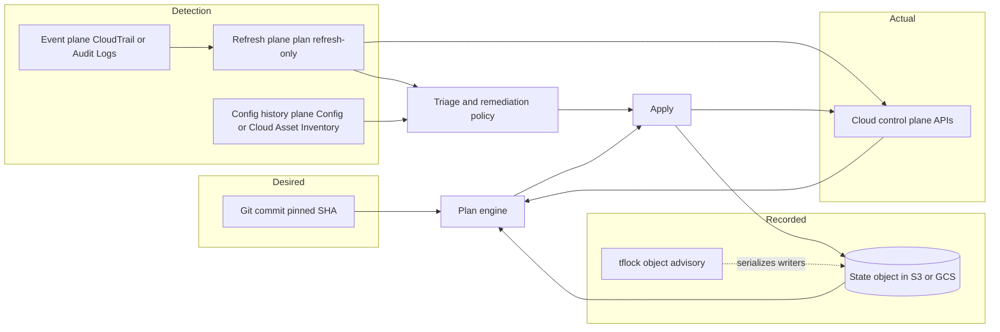

# State Management, Drift Detection, and Compliance

## TL;DR

1. Terraform and OpenTofu state is a schema-shaped cache of provider Read results, so its correctness depends on two things you must run yourself: a serialized writer and a faithful refresh.
2. The remote lock is an advisory create-only object with no lease, no heartbeat and no fencing token.
   On S3 it is a `<key>.tflock` object written with `If-None-Match: *`.
   On GCS it is a `<prefix>/<workspace>.tflock` object that fails with HTTP 412 when it already exists (HashiCorp and OpenTofu docs, as of 2026-10).
3. Drift has four detection planes: the IaC refresh plane, the provider config-history plane (AWS Config, Cloud Asset Inventory), the event plane (CloudTrail to EventBridge, Cloud Audit Logs to Pub/Sub), and the controller plane (Config Connector style reconcilers).
   Only the refresh plane can see attribute drift inside the state's schema, and none of the planes except the config-history plane can see resources that were never in state.
4. Migrations fail when the lineage and serial relationship is broken, usually by `init -reconfigure` or a restored object version.
   Gate every migration on a no-op `plan -detailed-exitcode` before unfreezing the pipeline.
5. Auto-remediation is a blast-radius decision, not a feature flag.
   Revert only an allowlist of security-relevant attributes automatically, from a pinned commit, with a debounce.
   Alert on everything else, and make "accept drift" an explicit, audited action.

## Mental Model



Think of three truths: desired (config at a commit), recorded (state), and actual (the cloud).
The plan engine reconciles all three on every run: it refreshes recorded against actual, then diffs the refreshed result against desired.
The lock only serializes writers of the recorded truth.
It says nothing about whether the actual truth is changing under you, which is why drift exists as a separate problem.
Detection is a sampling problem: the refresh plane polls everything it manages, the event plane tells you when to poll, and the config-history plane sees resources the other two never knew about.

## Internals

### State is a cache with a schema, not a database

The state document is JSON with a small header and a list of resources.
The header carries `version` (the state format version), `terraform_version`, `serial` and `lineage`.
Each resource instance carries a provider-defined `schema_version`, the attribute map, a `dependencies` list and an opaque `private` blob that providers use for their own bookkeeping.
Foundational reference: [Terraform state docs](https://developer.hashicorp.com/terraform/language/state).

Four mechanisms follow from that structure that getting-started guides skip:

- **Serial** is a monotonically increasing counter bumped when a write changes content.
  **Lineage** is a UUID minted when the state is first created.
  Lineage identifies "the same logical state" and serial orders its versions.
  `terraform state push` compares them and refuses mismatched lineage or older serial unless forced.
  This is the guardrail that `init -reconfigure` bypasses by creating a brand new empty state at the new location.
- **The version ratchet.**
  When a newer CLI writes state it records its own `terraform_version`, and older CLIs refuse to read state written by a newer one.
  Provider schema upgrades also run on read and are persisted on the next write.
  A mixed fleet during a CLI upgrade therefore can only move forward, and your rollback path is the bucket's object version history, not the CLI.
- **Sensitive values are stored in plaintext in state.**
  `sensitive = true` redacts UI output only.
  Read access to the state object is equivalent to read access to every secret attribute in it.
  OpenTofu added client-side state encryption in 1.7 with pluggable key providers (UNVERIFIED this session for exact providers), whereas Terraform relies on backend encryption at rest only.
- **`terraform_remote_state` couples blast radius.**
  A consumer that reads another stack's state needs read on the entire state object, secrets included.
  Publish narrow outputs to SSM Parameter Store or Secret Manager instead, and keep the state bucket readable by only the CI roles.

### The plan is a three-way diff, and drift is the middle arrow

A normal plan does three things in order.
It reads prior state.
It calls each provider's Read for every managed resource to produce a refreshed state.
It diffs refreshed state against configuration to produce planned changes.
The difference between prior and refreshed state is reported as `resource_drift` in the plan's JSON representation ([JSON format](https://developer.hashicorp.com/terraform/internals/json-format)).

`terraform plan -refresh-only` stops after step two and shows only that delta.
`terraform apply -refresh-only` accepts the delta into state without touching infrastructure.
`-detailed-exitcode` makes the exit status 0 for no changes, 1 for error and 2 for a non-empty result.

What the refresh plane cannot see, by construction:

- **Unmanaged resources.**
  A security group created in the console is not in state, so refresh never reads it.
  Only an inventory plane can find it.
- **Attributes outside the provider schema** or ignored by `lifecycle.ignore_changes`.
- **Changes that revert before the next scan.**
  A temporary console change that is rolled back between scans is invisible, and only the event plane records it.
- **Apparent drift that is not drift.**
  Provider normalization (case, ordering, JSON whitespace), server-side defaults changing under you, and eventually consistent read APIs immediately after an apply all produce false positives.

### Locking mechanisms

**S3 native lock.**
With `use_lockfile = true`, the backend writes a lock object next to the state using a conditional `PutObject` with `If-None-Match: *`, so exactly one concurrent writer wins.
The lock body is JSON with `ID`, `Operation`, `Info`, `Who`, `Version`, `Created` and `Path`, which is what contenders print when they fail (OpenTofu docs, as of 2026-10).
S3 added create-only conditional writes in August 2024 and `If-Match` in November 2024 (AWS what's-new posts, from memory, UNVERIFIED this session).
Conditional writes are only meaningful because S3 has been strongly consistent for reads after writes and lists since December 2020 ([AWS announcement](https://aws.amazon.com/blogs/aws/amazon-s3-update-strong-read-after-write-consistency/)).
A losing writer sees HTTP 412, and I recall a distinct 409 `ConditionalRequestConflict` for racing conditional writes (UNVERIFIED).

**DynamoDB legacy lock.**
The older path does a conditional `PutItem` on a `LockID` key.
It also kept a second digest item holding the MD5 of the state object, which was originally a defense against S3's pre-2020 eventual consistency (recalled, UNVERIFIED).
The digest creates a restore trap: if you restore an older S3 object version out of band, the digest no longer matches and the backend refuses to read until you update or delete the digest item.
HashiCorp now documents DynamoDB-based locking as deprecated and slated for removal in a future minor version, and says both mechanisms may be enabled together to ease migration (HashiCorp docs, as of 2026-10).
OpenTofu states it has no plans to deprecate either (OpenTofu docs, as of 2026-10).

**GCS lock.**
The GCS backend writes `<prefix>/<workspace>.tflock` using a generation precondition, so a second writer receives `412 conditionNotMet` (HashiCorp backend docs and a public GitHub issue showing the error, as of 2026-10).
GCS generation numbers are the natural CAS primitive.
See [[17-Cloud-AI-Engineering/Volume_03_GCP_Deep_Dive/Chapter_09_Cloud_Storage_and_Colossus_Filesystem|Cloud Storage and Colossus]] for why object metadata operations are strongly consistent.

**What the lock does not give you.**
It is the textbook "distributed lock without a fencing token" problem described in [Kleppmann's analysis](https://martin.kleppmann.com/2016/02/08/how-to-do-distributed-locking.html) and addressed in [Chubby](https://research.google/pubs/the-chubby-lock-service-for-loosely-coupled-distributed-systems/) (OSDI 2006) with sequencers.
Specifically:

- There is no lease expiry.
  A SIGKILLed CI job leaves the lock forever, and recovery is a human running `force-unlock`.
  This is deliberate: an automatic expiry would let two writers race, which is worse than a stuck pipeline.
  Compare with leases in [Gray and Cheriton, SOSP 1989].
- The state write is, to my reading, not conditional on the object's ETag or generation, so a writer whose lock was force-unlocked can still overwrite the state (UNVERIFIED against backend source).
  S3 `If-Match` makes a stronger design possible, but treat it as an architectural option, not a current guarantee.
- Locks are objects, so they replicate.
  If the state bucket has cross-region replication, a `.tflock` can replicate to the DR region and present as a stale lock after failover.
  Exclude lock objects from the replication filter or accept a documented `force-unlock` step in the DR runbook.
- On versioned buckets every lock/unlock cycle creates a version and a delete marker.
  Hundreds of workspaces times dozens of runs per day produce tens of thousands of tiny versions per day, and very large delete-marker populations slow `ListObjectVersions` on a prefix (general S3 behavior, recalled).
  Add lifecycle rules for noncurrent versions and expired delete markers.

### Detection planes and what each costs

| Plane | Mechanism | Sees unmanaged resources | Sees transient changes | Cost shape |
|---|---|---|---|---|
| Refresh | `plan -refresh-only` per workspace | No | No | Provider read API calls and runner time, linear in resource count |
| Config history | AWS Config recorder, Cloud Asset Inventory snapshots and feeds | Yes | Partly (per change record) | Per recorded item or per export, linear in change rate |
| Event | CloudTrail management events to EventBridge, Cloud Audit Logs to a log sink | Yes (as a write event) | Yes | Per event delivered, linear in change rate |
| Controller | Config Connector, Crossplane, similar | Only for resources it owns | Corrected on next reconcile | Continuous control-plane load |

The efficient design uses the event plane to trigger the refresh plane.
A CloudTrail write event whose principal is not the CI role names the account, region and often the resource, so you plan only the affected workspace and skip the nightly full sweep for most of the fleet.

### Remediation as a state machine

```text
DETECTED -> DEBOUNCED (second scan confirms after settle delay)
         -> CLASSIFIED (critical allowlist | tolerated | unknown)
         -> critical:  AUTO_REVERT (apply pinned-SHA plan, scoped, audited)
         -> tolerated: ACCEPT (apply -refresh-only or fix code, via PR)
         -> unknown:   TICKET (human decides) and ALERT
```

Three design rules make this safe:

- Revert from the **last deployed commit**, never from `main` HEAD, or an automated revert will ship unreviewed changes.
- Scope the revert (`-target` is acceptable here as an incident tool, or a dedicated small stack) so remediation cannot become a general deploy.
- Break-glass changes must be taggable (for example a session tag or a change ticket in the CloudTrail `userIdentity`) so the classifier does not revert an on-call scale-up in the middle of an incident.

### Migration mechanics

- `terraform init -migrate-state` copies the existing state to the new backend, preserving lineage and serial, and works across backend types, including S3 to GCS.
- `terraform init -reconfigure` re-initializes the backend without copying.
  The next plan sees an empty state and proposes to create everything.
- Refactoring across states uses `import` blocks and `removed` blocks, where `removed` with `lifecycle { destroy = false }` forgets the resource without destroying it.
  Import into the destination first, then remove from the source, and never leave both managing the same object during an apply window.
- Address changes inside one state use `moved` blocks, which are recorded in config and are reviewable, unlike `terraform state mv`, which mutates state immediately and is invisible in review.

See [[17-Cloud-AI-Engineering/Volume_06_Infrastructure_as_Code_and_Delivery/Chapter_01_Terraform_and_OpenTofu_Internals|Terraform and OpenTofu Internals]] for the graph and plan/apply lifecycle that this chapter builds on.

## Numbers to Know

| Item | Value | Source and date | Verification |
|---|---|---|---|
| S3 backend DynamoDB locking status | Deprecated, to be removed in a future minor version | HashiCorp S3 backend docs, as of 2026-10 | Verified 2026-10 |
| OpenTofu native S3 locking | Introduced in 1.10, via `If-None-Match`; OpenTofu says no plans to deprecate DynamoDB | OpenTofu S3 backend docs, as of 2026-10 | Verified 2026-10 |
| Terraform release cadence | 1.14 released 2025-11-19, security support ended 2026-08-26; 1.15 released 2026-04-29 | endoflife.date, as of 2026-10 | Verified 2026-10; a different source listed a 1.16.x line, so confirm the latest minor |
| Lock file object | `<key>.tflock` on S3, `<prefix>/<workspace>.tflock` on GCS | HashiCorp and OpenTofu docs, as of 2026-10 | Verified 2026-10 |
| Lock TTL | None; no heartbeat | Terraform CLI behavior (`force-unlock`), as of 2026-10 | Recalled, UNVERIFIED |
| `plan -detailed-exitcode` | 0 no changes, 1 error, 2 changes | Terraform CLI docs, as of 2026-10 | Recalled, UNVERIFIED |
| Default `-parallelism` | 10 concurrent resource operations | Terraform CLI docs, as of 2026-10 | Recalled, UNVERIFIED |
| S3 request rates | 3,500 write and 5,500 read requests per second per prefix | AWS S3 docs, as of 2026-10 | Recalled, UNVERIFIED |
| S3 consistency | Strong read-after-write and list consistency since 2020-12 | AWS announcement | Recalled, UNVERIFIED this session |
| GCS same-object write rate | About one write per second per object name | Google Cloud Storage quotas docs, as of 2026-10 | Recalled, UNVERIFIED |
| GCS dual-region default replication RPO | Target 100 percent within 12 hours, turbo replication 15 minutes | Google Cloud Storage docs, as of 2026-10 | Recalled, UNVERIFIED |
| S3 Standard list price, us-east-1 | About 0.023 USD per GB-month for the first 50 TB | AWS S3 pricing, as of 2026-10 | Recalled, UNVERIFIED |
| CloudFormation drift detection charge | No additional charge | AWS CloudFormation pricing, as of 2026-10 | Recalled, UNVERIFIED |

Treat the Recalled rows as pointers to re-check before they appear in a design review.

## AWS vs GCP Mechanism Parity

| Concern | AWS | GCP |
|---|---|---|
| State store | S3 bucket with versioning | GCS bucket with Object Versioning |
| Lock primitive | `PutObject` with `If-None-Match: *` (native), or DynamoDB conditional put (deprecated) | Object create with generation precondition, 412 on conflict |
| Lock durability model | Advisory, no lease, no fencing | Advisory, no lease, no fencing |
| Consistency substrate | S3 strongly consistent for object reads and lists | GCS strongly consistent for object reads and metadata, including dual-region and multi-region buckets |
| State encryption | `encrypt = true` with `kms_key_id` (SSE-KMS) | Default Google-managed keys, `kms_encryption_key` for CMEK, `encryption_key` for CSEK |
| Replication hazard | CRR copies `.tflock` and can strand a lock in the DR region | Dual-region or turbo replication carries lock objects too |
| Native drift detection for IaC stacks | CloudFormation `DetectStackDrift` on supported resource types and template-declared properties | No first-party equivalent verified for Terraform state; Config Connector reconciles KRM-managed resources continuously |
| Inventory plane | AWS Config configuration items and rules | Cloud Asset Inventory snapshots, exports to BigQuery, and real-time feeds to Pub/Sub |
| Event plane | CloudTrail management events to EventBridge | Cloud Audit Logs Admin Activity to a log sink and Pub/Sub |
| Auto-remediation primitive | AWS Config remediation actions invoking SSM Automation documents | Pub/Sub triggered Cloud Run or Cloud Run functions, or Config Sync revert |
| Preventive guardrail | SCPs, RCPs, permission boundaries | Organization Policy, Deny policies, VPC Service Controls |
| Audit of state access | CloudTrail S3 data events (off by default, billed per event) | Cloud Audit Logs Data Access for GCS (off by default for most services) |

Critical differences:

- On AWS you choose between two lock backends today, and the choice is on a deprecation clock.
  On GCP there is one mechanism with no migration decision.
- GCP's real-time Asset feeds make the inventory plane event-driven out of the box.
  On AWS the equivalent is Config plus EventBridge on configuration-item change, with a recording cost per item.
- Neither cloud provides a fenced lock for IaC state.
  Fencing must come from your CI concurrency groups.

Related chapters: [[17-Cloud-AI-Engineering/Volume_02_AWS_Deep_Dive/Chapter_08_S3_Deep_Dive_Consistency_and_ShardStore|S3 Deep Dive]], [[17-Cloud-AI-Engineering/Volume_02_AWS_Deep_Dive/Chapter_10_Amazon_DynamoDB_Architecture_and_Partitioning|DynamoDB]], [[17-Cloud-AI-Engineering/Volume_04_AWS_vs_GCP_Translation/Chapter_03_Identity_Security_and_Governance_Translation|Identity, Security, and Governance Translation]].

## Worked Example: A Locked, Encrypted State Backend with a Debounced Drift Scanner

The lab builds an S3 state bucket with KMS, versioning and lifecycle, a stack using native locking, and a scanner that detects deliberate drift and publishes a metric.
It uses SSM standard parameters so the managed resources cost nothing.
A GCS equivalent follows.

### Capacity and cost sizing (assumptions, not sourced facts)

Assume one platform team with 400 workspaces, an average of 3,000 resources per workspace in the largest 10 percent and 300 in the rest.

1. State size: 3,000 resources at about 3 KB each is about 9 MB.
   Every apply rewrites the whole object, so a state that large costs a 9 MB PUT plus a 9 MB GET per run.
   S3 throughput is irrelevant here; the practical limit is how long the lock is held.
2. Refresh duration for a large workspace: reads per resource average 2.5 provider calls at 120 ms with parallelism 10.
   `3000 * 2.5 * 0.12 / 10 = 90 s`, ignoring throttling.
   The steady request rate against that account and region is `10 / 0.12`, about 83 requests per second, which is enough to trip Describe API throttles if several large workspaces in one account scan together.
3. Fleet sweep: 40 large workspaces at 90 s plus 360 small ones at about 10 s is `3600 + 3600 = 7200` runner-seconds, or 2 runner-hours.
   With 8 runners and a per-account concurrency cap of 2, a sweep fits in well under an hour.
   Without the per-account cap the same sweep causes throttling and long retry tails.
4. Version storage: 50 applies per day on a 9 MB state is 450 MB per day.
   With 90-day noncurrent retention that is about 40 GB, or about 0.9 USD per month at 0.023 USD per GB-month (price UNVERIFIED).
   Keeping only the newest 20 noncurrent versions bounds it at 180 MB for that workspace.
5. Lock contention: a scheduled drift plan holds the lock for its whole refresh, 90 s here.
   Running scans with `-lock=false` avoids blocking deploys, because a plan does not write state.
   The trade-off is that a scan overlapping an in-flight apply may report transient false drift, which the debounce step absorbs.

Lab cost estimate: under 1 USD for a few hours (KMS key 1 USD per month prorated, S3 and requests pennies; prices UNVERIFIED).

### Step 1 - Bootstrap bucket and key (`bootstrap/main.tf`)

```hcl
terraform {
  required_version = ">= 1.10"
  required_providers {
    aws = { source = "hashicorp/aws", version = ">= 5.80" }
  }
}

variable "region"      { default = "us-east-1" }
variable "bucket_name" { type = string }

provider "aws" { region = var.region }

resource "aws_kms_key" "state" {
  description             = "tfstate lab key"
  enable_key_rotation     = true
  deletion_window_in_days = 7
}

resource "aws_kms_alias" "state" {
  name          = "alias/tfstate-lab"
  target_key_id = aws_kms_key.state.id
}

resource "aws_s3_bucket" "state" {
  bucket        = var.bucket_name
  force_destroy = true # lab only; remove in production
}

resource "aws_s3_bucket_versioning" "state" {
  bucket = aws_s3_bucket.state.id
  versioning_configuration { status = "Enabled" }
}

resource "aws_s3_bucket_server_side_encryption_configuration" "state" {
  bucket = aws_s3_bucket.state.id
  rule {
    bucket_key_enabled = true
    apply_server_side_encryption_by_default {
      sse_algorithm     = "aws:kms"
      kms_master_key_id = aws_kms_key.state.arn
    }
  }
}

resource "aws_s3_bucket_public_access_block" "state" {
  bucket                  = aws_s3_bucket.state.id
  block_public_acls       = true
  block_public_policy     = true
  ignore_public_acls      = true
  restrict_public_buckets = true
}

resource "aws_s3_bucket_lifecycle_configuration" "state" {
  bucket     = aws_s3_bucket.state.id
  depends_on = [aws_s3_bucket_versioning.state]

  rule {
    id     = "bound-noncurrent-versions"
    status = "Enabled"
    filter {}
    noncurrent_version_expiration {
      noncurrent_days           = 90
      newer_noncurrent_versions = 20
    }
    abort_incomplete_multipart_upload { days_after_initiation = 2 }
  }

  rule {
    id     = "expire-delete-markers"
    status = "Enabled"
    filter {}
    expiration { expired_object_delete_marker = true }
  }
}

data "aws_iam_policy_document" "tls_only" {
  statement {
    sid       = "DenyInsecureTransport"
    effect    = "Deny"
    actions   = ["s3:*"]
    resources = [aws_s3_bucket.state.arn, "${aws_s3_bucket.state.arn}/*"]
    principals {
      type        = "*"
      identifiers = ["*"]
    }
    condition {
      test     = "Bool"
      variable = "aws:SecureTransport"
      values   = ["false"]
    }
  }
}

resource "aws_s3_bucket_policy" "state" {
  bucket = aws_s3_bucket.state.id
  policy = data.aws_iam_policy_document.tls_only.json
}

output "bucket" { value = aws_s3_bucket.state.id }
```

### Step 2 - Stack with native locking (`app/main.tf`)

```hcl
terraform {
  required_version = ">= 1.10"
  required_providers {
    aws = { source = "hashicorp/aws", version = ">= 5.80" }
  }
  backend "s3" {
    key          = "lab/drift-demo/terraform.tfstate"
    region       = "us-east-1"
    encrypt      = true
    kms_key_id   = "alias/tfstate-lab"
    use_lockfile = true
    # bucket is supplied at init time: -backend-config="bucket=..."
  }
}

provider "aws" { region = "us-east-1" }

resource "aws_ssm_parameter" "feature_flag" {
  name  = "/lab/drift/feature_flag"
  type  = "String"
  value = "on"
}

resource "aws_ssm_parameter" "limit" {
  name  = "/lab/drift/limit"
  type  = "String"
  value = "100"
}
```

### Step 3 - Drift scanner (`drift_scan.py`)

```python
#!/usr/bin/env python3
"""Debounced refresh-only drift scan. Never prints attribute values."""
import json, subprocess, sys, time
import boto3

CRITICAL_PREFIXES = ("aws_iam_", "aws_security_group", "aws_s3_bucket_policy", "aws_kms_")


def tf(workdir, *args):
    return subprocess.run(["terraform", *args], cwd=workdir, capture_output=True, text=True)


def one_scan(workdir):
    r = tf(workdir, "plan", "-refresh-only", "-lock=false", "-input=false",
           "-detailed-exitcode", "-out=drift.tfplan")
    if r.returncode == 1:
        raise RuntimeError(r.stderr[-2000:])
    show = tf(workdir, "show", "-json", "drift.tfplan")
    plan = json.loads(show.stdout)
    drift = {}
    for d in plan.get("resource_drift", []):
        ch = d["change"]
        before, after = ch.get("before") or {}, ch.get("after") or {}
        keys = sorted(k for k in set(before) | set(after) if before.get(k) != after.get(k))
        drift[d["address"]] = {"actions": ch["actions"], "attributes": keys}
    return drift


def scan(workdir, settle_seconds=60):
    first = one_scan(workdir)
    if not first:
        return {}
    time.sleep(settle_seconds)  # absorb eventual consistency and in-flight applies
    second = one_scan(workdir)
    return {a: second[a] for a in first if a in second}


def publish(workspace, drift):
    cw = boto3.client("cloudwatch")
    critical = [a for a in drift if a.split(".")[0].startswith(CRITICAL_PREFIXES)]
    cw.put_metric_data(Namespace="IaC/Drift", MetricData=[
        {"MetricName": "DriftedResources", "Value": len(drift),
         "Dimensions": [{"Name": "Workspace", "Value": workspace}]},
        {"MetricName": "CriticalDriftedResources", "Value": len(critical),
         "Dimensions": [{"Name": "Workspace", "Value": workspace}]},
    ])


if __name__ == "__main__":
    workdir, workspace = sys.argv[1], sys.argv[2]
    result = scan(workdir)
    publish(workspace, result)
    print(json.dumps(result, indent=2))
    sys.exit(2 if result else 0)
```

### Step 4 - Run it

```bash
export AWS_REGION=us-east-1
export BUCKET="tfstate-lab-$(aws sts get-caller-identity --query Account --output text)-$RANDOM"

(cd bootstrap && terraform init && terraform apply -auto-approve -var "bucket_name=$BUCKET")
(cd app && terraform init -backend-config="bucket=$BUCKET" && terraform apply -auto-approve)

# Prove the lock: run two applies in two shells and observe the second print the lock holder.
# Introduce drift out of band:
aws ssm put-parameter --name /lab/drift/feature_flag --value off --type String --overwrite

python3 drift_scan.py app lab-drift-demo    # exit 2, names aws_ssm_parameter.feature_flag and attribute "value"

# Accept the drift instead of reverting it:
(cd app && terraform apply -refresh-only -auto-approve)
# Or revert it:
(cd app && terraform apply -auto-approve)
```

Observe the lock object during an apply with `aws s3 ls s3://$BUCKET/lab/drift-demo/` in a second terminal.
You will see `terraform.tfstate` and `terraform.tfstate.tflock` while the run is active.

### Step 5 - Alarm and budget guardrails

```bash
aws cloudwatch put-metric-alarm \
  --alarm-name iac-critical-drift-lab-drift-demo \
  --namespace IaC/Drift --metric-name CriticalDriftedResources \
  --dimensions Name=Workspace,Value=lab-drift-demo \
  --statistic Maximum --period 3600 --evaluation-periods 1 \
  --threshold 0 --comparison-operator GreaterThanThreshold --treat-missing-data notBreaching

ACCT=$(aws sts get-caller-identity --query Account --output text)
aws budgets create-budget --account-id "$ACCT" \
  --budget '{"BudgetName":"iac-state-lab","BudgetLimit":{"Amount":"5","Unit":"USD"},"TimeUnit":"MONTHLY","BudgetType":"COST"}' \
  --notifications-with-subscribers '[{"Notification":{"NotificationType":"ACTUAL","ComparisonOperator":"GREATER_THAN","Threshold":80,"ThresholdType":"PERCENTAGE"},"Subscribers":[{"SubscriptionType":"EMAIL","Address":"you@example.com"}]}]'
```

### Step 6 - Teardown

```bash
(cd app && terraform destroy -auto-approve)
(cd bootstrap && terraform destroy -auto-approve -var "bucket_name=$BUCKET")   # force_destroy empties all versions
aws cloudwatch delete-alarms --alarm-names iac-critical-drift-lab-drift-demo
aws budgets delete-budget --account-id "$ACCT" --budget-name iac-state-lab
```

The KMS key enters its 7-day deletion window, which is the minimum, after destroy.

### GCP equivalent

```bash
export PROJECT=my-lab-project
export GBUCKET="tfstate-lab-$RANDOM"

gcloud storage buckets create "gs://$GBUCKET" --project="$PROJECT" \
  --location=us-central1 --uniform-bucket-level-access --public-access-prevention
gcloud storage buckets update "gs://$GBUCKET" --versioning

cat > lifecycle.json <<'EOF'
{"rule":[{"action":{"type":"Delete"},"condition":{"isLive":false,"numNewerVersions":20,"daysSinceNoncurrentTime":90}}]}
EOF
gcloud storage buckets update "gs://$GBUCKET" --lifecycle-file=lifecycle.json

gcloud billing budgets create --billing-account="$BILLING_ACCOUNT" \
  --display-name=iac-state-lab --budget-amount=5USD --threshold-rule=percent=0.8
```

Backend block (add `kms_encryption_key` for CMEK, and grant the CI service account `roles/storage.objectAdmin` on the bucket only):

```hcl
terraform {
  backend "gcs" {
    bucket = "REPLACE_WITH_GBUCKET"
    prefix = "lab/drift-demo"
  }
}
```

Teardown:

```bash
gcloud storage rm --recursive --all-versions "gs://$GBUCKET"
gcloud storage buckets delete "gs://$GBUCKET"
gcloud billing budgets delete BUDGET_ID --billing-account="$BILLING_ACCOUNT"
```

## Failure Modes and Pitfalls

**Stale lock after CI kill.**
The runner is terminated by a spot reclaim or an OOM kill and never runs unlock.
Every subsequent pipeline fails with the lock holder's `Who`, `Created` and `ID`.
The fix is `terraform force-unlock <ID>`, but only after confirming the holder process is dead, for example by checking the CI job state, since force-unlock on a live apply creates the two-writer scenario.
Mitigation: CI concurrency groups per state key, graceful termination handlers, and a lock-age alert that pages at a threshold longer than your longest apply.

**Two writers after an overeager force-unlock.**
Apply A is still running; an engineer force-unlocks; apply B acquires the lock and finishes.
A then writes its state last.
Resources B created exist in the cloud but not in the state, so the next plan proposes duplicates or hits name conflicts.
Recovery: restore the bucket version that B wrote, then `import` A's orphaned resources, or restore A's and import B's, depending on which set is smaller.
Prevention is serialization at the CI layer, so the lock is a safety net and not the only mutex.

**`-reconfigure` instead of `-migrate-state`.**
The new backend is empty, so the next plan wants to create every resource and an unattended auto-apply will collide with the existing infrastructure or, worse, partially replace it.
Gate pipelines on a plan-size or "creates greater than N" check.

**Restoring an old S3 version with DynamoDB digest enabled.**
The digest mismatch makes every subsequent run fail with a state integrity error until the digest item is corrected.
This only applies to setups still using DynamoDB, which is another reason to complete the migration to `use_lockfile` before the DynamoDB path is removed.

**Mixed CLI versions during the lock migration.**
Clients older than the native-lock release ignore `use_lockfile` and take only the DynamoDB lock.
If you remove `dynamodb_table` from the backend block while old clients are still in use, those clients lose mutual exclusion.
Run both mechanisms until every runner image is upgraded, as HashiCorp documents for migration.

**Scan-induced throttling.**
A nightly sweep launches hundreds of refreshes at the same time against the same account.
Describe-class API buckets are shared with production consumers, so you throttle your own platform.
The same mechanism drives the retry amplification discussed in [[17-Cloud-AI-Engineering/Volume_07_Reliability_and_SRE/Chapter_03_Resilient_Communication_Retries_Jitter_and_Circuit_Breakers|Resilient Communication]].
Mitigate with per-account concurrency caps, jittered schedules and `-parallelism` tuning.

**False drift from eventual consistency.**
IAM propagation and some EC2 reads lag, so a scan immediately after an apply can report differences that vanish seconds later.
The debounce step in the lab script exists for exactly this reason.

**Auto-revert fights an incident.**
During a capacity incident an operator raises an autoscaling maximum in the console.
The drift remediator reverts it five minutes later and the incident worsens.
This is a shape of failure seen across public post-incident reviews of automation amplifying the original fault (see [[17-Cloud-AI-Engineering/Volume_07_Reliability_and_SRE/Chapter_07_Anatomy_of_Major_Cloud_Outages|Anatomy of Major Cloud Outages]]).
Mitigation: a break-glass tag that suppresses auto-revert and starts a time-boxed reconciliation ticket.

**State bucket region outage.**
You need Terraform to repair infrastructure, but Terraform needs the state bucket in the impaired region.
That is a circular dependency of exactly the kind described in [[17-Cloud-AI-Engineering/Volume_01_Cloud_Architecture_Principles/Chapter_02_Regions_Zones_and_Static_Stability|Regions, Zones, and Static Stability]].
Keep a replicated, read-capable copy of recent state in another region, exclude lock objects from replication, and rehearse a "recover into a new backend" runbook.

**Secrets in state leaking through `terraform_remote_state`.**
Consumers read the whole document.
Treat state read access as secret-read access and audit it.

**Lock churn on versioned buckets.**
Tens of thousands of delete markers accumulate under busy prefixes.
Add the expired-delete-marker lifecycle rule shown above.

## Security and Cost Angles

**IAM scoping.**
The CI role for one stack needs `s3:GetObject`, `s3:PutObject` and `s3:DeleteObject` on that stack's key and its `.tflock` (and `s3:ListBucket` on the prefix), plus `kms:Decrypt` and `kms:GenerateDataKey` on the state key.
It should not have access to other stacks' keys.
Use one prefix per environment and bucket-policy conditions on `aws:PrincipalOrgID` or on the CI role ARN.
Separate the plan role (read-only on the cloud, read on state, lock write) from the apply role.
This lets pull-request plans run with credentials that cannot mutate infrastructure.
On GCP, bind `roles/storage.objectAdmin` at bucket scope to a per-environment service account and use impersonation from CI, never exported keys.
Related: [[17-Cloud-AI-Engineering/Volume_08_Security_Identity_and_the_Data_Perimeter/Chapter_02_Workload_Identity_Federation|Workload Identity Federation]].

**Key hierarchy.**
SSE-KMS with a bucket key reduces KMS request volume substantially by deriving per-bucket data keys.
That matters because every plan, apply and lock operation touches the state object.
Use a dedicated key per environment so a key policy can restrict decrypt to the CI roles, and note that the key policy is the real access boundary for secrets in state.
See [[17-Cloud-AI-Engineering/Volume_08_Security_Identity_and_the_Data_Perimeter/Chapter_04_Encryption_Key_Hierarchies_and_Envelope_Encryption|Encryption Key Hierarchies and Envelope Encryption]].
For OpenTofu, client-side state encryption adds protection against a compromised bucket reader but moves key custody into the CLI configuration.

**Private network and perimeter.**
Reach S3 through a gateway endpoint and constrain the bucket policy with `aws:SourceVpce` for runner traffic.
On GCP, put the state project inside a VPC Service Controls perimeter and allow CI through an ingress rule.
See [[17-Cloud-AI-Engineering/Volume_08_Security_Identity_and_the_Data_Perimeter/Chapter_06_Constructing_an_Impenetrable_Data_Perimeter|Constructing an Impenetrable Data Perimeter]].

**Compliance evidence chain.**
For SOC 2 style change-management controls, the auditable chain is: commit SHA, saved plan artifact, approval record, apply log, state object version ID, and the cloud provider's own audit log of the resulting API calls.
Enable CloudTrail S3 data events (billed per event) or Cloud Audit Logs Data Access for the state bucket, since both are off by default, so that "who read the state" is answerable.
Preventive controls from [[17-Cloud-AI-Engineering/Volume_06_Infrastructure_as_Code_and_Delivery/Chapter_04_Policy_as_Code_OPA_Sentinel_and_Guardrails|Policy as Code]] stop non-compliant plans, and drift detection proves the running environment still matches what was approved.
Treat them as the preventive and detective halves of one control.
See [[17-Cloud-AI-Engineering/Volume_08_Security_Identity_and_the_Data_Perimeter/Chapter_07_Compliance_Auditing_and_Non_Repudiation|Compliance, Auditing, and Non-Repudiation]].

**Unit economics.**
The dominant drift cost is runner time and API quota, not storage.
Levers:

- Event-triggered scans instead of blanket nightly sweeps.
- Tiered cadence: hourly for security-critical stacks, daily for the rest.
- Smaller states, because refresh time is linear in resources.
- Skipping refresh in the deploy path where a separate scheduled scan already covers it (`-refresh=false`), with the trade-off that the deploy plan then trusts stale state.
- Bounding Config recording to resource types you actually remediate, since recording is billed per configuration item (price UNVERIFIED).

See [[17-Cloud-AI-Engineering/Volume_09_FinOps_and_Cloud_Economics/Chapter_06_FinOps_Organizational_Practices_and_Automation|FinOps Organizational Practices and Automation]] for the alerting thresholds.

## Interview Questions and Model Answers

### Question 1 (L5 - Senior)

Your team's pipeline is failing with "Error acquiring the state lock" and the job that held it was killed two hours ago.
Explain what the lock actually is, whether it is safe to force-unlock, and how you would prevent a repeat.

#### Model Answer

On the S3 backend with `use_lockfile`, the lock is a `<key>.tflock` object created with a conditional PutObject (`If-None-Match: *`), so exactly one writer can create it.
On GCS it is a `.tflock` object created with a generation precondition, and the loser sees a 412.
The object body records the lock ID, operation, who and when, so the error already tells me whose it was.
There is no lease or heartbeat, so a killed job leaves the lock indefinitely.
That is intentional, because expiring automatically would allow two writers.

Force-unlock is safe only if I can prove the holder is dead.
I check the CI system for the job's final state, and I check that no cloud API activity from that role is still occurring (a CloudTrail query on the CI role for the last few minutes).
If the job died mid-apply I also run a plan after unlocking and review it carefully, because the state may be missing resources the dead job created, or the dead job may have written a partial state.
The state is written incrementally during apply, so a partial apply typically leaves a consistent but incomplete state, which the next plan reconciles.

To prevent repeats, I would use CI concurrency groups keyed by state path so only one job per state can exist at all, handle termination signals so Terraform can unlock on interrupt, avoid spot runners for long applies, and alert on lock age beyond the longest expected apply.
I would also stop using `-lock=false` in apply paths.

#### Follow-up Interviewer Question

You force-unlock, and thirty seconds later a colleague's apply that you did not know about finishes and writes state.
What did you just break, and how do you recover?

### Question 2 (L5 - Senior)

You must move 60 Terraform stacks from an S3 backend with DynamoDB locking to S3 native locking with no downtime.
Describe the procedure and the traps.

#### Model Answer

HashiCorp documents DynamoDB locking as deprecated, and it permits enabling both mechanisms at once for migration.
I would do it in three phases.

Phase one: upgrade all runner images and developer CLIs to a version that supports `use_lockfile`, and pin `required_version` so older clients fail fast instead of silently skipping the new lock.
Clients that do not know `use_lockfile` would ignore it, so removing DynamoDB too early removes their only mutual exclusion.

Phase two: add `use_lockfile = true` alongside `dynamodb_table`, run `terraform init -reconfigure` per stack (safe here because the bucket and key are unchanged, so no state needs copying), and verify with a deliberate lock contention test that both lock objects appear.
I would grant `s3:PutObject` and `s3:DeleteObject` on the `.tflock` keys in the bucket policy before the change, since a missing permission shows up as a lock failure.

Phase three: after a soak period, remove `dynamodb_table`, re-init, and delete the table last.
The traps are the digest item (if I ever restore an S3 version while DynamoDB is still configured, the digest check fails), replication rules that copy lock objects, and lifecycle rules that must cope with the new lock object churn.
The migration is a backend config change, not a state copy, so I would still take a `terraform state pull` backup and verify with a no-op plan on each stack.

#### Follow-up Interviewer Question

One team's repo still pins Terraform below the native-lock version and cannot upgrade for a quarter.
How do you keep them safe without blocking the migration for everyone else?

### Question 3 (L6 - Staff)

Design drift detection for 400 workspaces across 60 AWS accounts and 20 GCP projects.
Cover scan mechanics, noise, API quota, unmanaged resources, and what you page on.

#### Model Answer

I start from the observation that there are different drift classes and each needs a different plane.

Attribute drift on managed resources is found only by the refresh plane.
I would run `plan -refresh-only -lock=false -detailed-exitcode` from saved plans and parse `resource_drift` from `terraform show -json`, logging attribute names only, because values may be sensitive.
I use `-lock=false` so scans never block deploys, accepting that overlapping an in-flight apply can produce transient drift, which I absorb with a debounce: rescan after a settle delay and report the intersection.

Unmanaged resources are invisible to refresh.
For those I use the inventory plane: AWS Config or Resource Explorer on AWS, Cloud Asset Inventory exports to BigQuery on GCP, joined against the set of resource IDs extracted from all state files.
The anti-join of "exists in cloud" minus "in any state" is the unmanaged set, filtered by an ownership tag to remove legitimately console-managed resources.

For scheduling I use events to drive scans.
A CloudTrail write event (or Cloud Audit Log Admin Activity entry) whose principal is not a CI identity maps to an account, region and resource type, and from there to the owning workspace via a resource-to-workspace index I maintain from state.
That workspace is queued for an immediate scan, and a slow baseline sweep (daily, weekly for low-risk stacks) catches whatever the event path missed.

API quota is the real scaling limit.
A 3,000-resource workspace at parallelism 10 and about 120 ms per call generates roughly 80 requests per second, so I cap concurrent scans per account at one or two, add jitter, and split giant workspaces.
Refresh time is linear in resource count, which is also an argument for smaller states.

Noise control matters as much as detection.
I keep an explicit ignore list per resource type for known normalization noise, and measure a false-positive rate per workspace.
I page only on a critical allowlist (IAM, security groups and firewall rules, bucket policies, KMS key policies, public access settings).
Everything else goes to a daily ticket digest.
Each detection records the principal and time from the audit log, so triage starts with who did it.

#### Follow-up Interviewer Question

A product team's autoscaler legitimately mutates `desired_capacity` on 200 stacks every hour.
How do you stop that from drowning the signal without hiding real capacity drift?

### Question 4 (L6 - Staff)

Explain why Terraform's state lock is not a correct distributed lock and what failure that allows.
Then describe what you would build or configure to close the gap.

#### Model Answer

A correct lock for protecting a shared resource needs a way for the resource itself to reject stale holders, usually a monotonic fencing token checked at write time, as argued by Kleppmann and implemented as sequencers in Chubby.
Terraform's lock is a create-only object that proves who got there first, but it has no expiry, so a stalled or partitioned holder cannot lose it.
Combined with an operator-driven `force-unlock`, a holder can continue to run after someone else has legitimately taken the lock.
The state write path does not, to my reading, carry a precondition tying it to the lock identity (I would verify against the backend source before asserting it in a review).
So last writer wins, and the loser's resources become orphans, or the survivor's state loses entries.

The practical failure is a split brain on the recorded truth: both applies called real APIs, but only one state records the results.
Cloud resources exist that no state knows about, and the next plan proposes recreating things that already exist.

The mitigations I would put in place are layered.
First, serialize at the control plane of the pipeline: one active job per state key through CI concurrency groups, so the lock is a backstop, not the primary mutex.
Second, make `force-unlock` a gated operation that records the previous holder and checks job liveness.
Third, enable bucket versioning and a lifecycle that keeps enough history to restore any recent state version.
Fourth, where I own the backend wrapper or use a service that supports it, make the state write conditional using S3 `If-Match` on the ETag read at lock time, or a GCS generation match, which turns a lost lock into a failed write instead of silent corruption.
Fifth, run a post-incident reconciliation: plan, import orphans, and verify with a no-op plan.

#### Follow-up Interviewer Question

If the state PUT were made conditional on the ETag from lock time, what new failure modes would that introduce for long-running applies that write state incrementally?

### Question 5 (L6 - Staff)

Security wants drift to be "automatically fixed".
Make the case for and against, and give the design you would approve.

#### Model Answer

The case for: security-relevant drift such as a world-open security group or a widened IAM policy has an exposure window that scales with human response time, and auto-revert shrinks it from hours to minutes.

The case against: the revert is an apply, so it carries all the risks of an apply with no human in the loop.
It can undo legitimate emergency changes, it can ship unreviewed config if it runs from `main`, it can fight another controller (an autoscaler or a Kubernetes controller) in a loop, and it can fail halfway.
The "fixing" action also destroys the evidence of what was changed unless the detector snapshot is stored first.

The design I would approve has tiers.
A narrow critical allowlist of resource types and attributes gets auto-revert.
Everything else alerts, and the human choices are "revert" or "accept" where accept means a PR that changes code or a `-refresh-only` apply, and both leave an audit trail.

The mechanics: the event plane (CloudTrail to EventBridge, or a Cloud Asset feed to Pub/Sub) triggers a scoped scan of the single workspace.
After a debounce, a second scan confirms, and the remediator applies a saved plan generated from the last deployed commit, scoped to the drifting addresses.
The remediator runs under a role that can only modify the allowlisted resource types.
A break-glass tag or change ticket on the offending principal suppresses auto-revert and opens a time-boxed ticket instead.
A rate limit stops the loop: more than N reverts of the same address in a window disables remediation and pages, because it signals another controller.
For purely native cases such as S3 public access or a single security group rule, an AWS Config rule with an SSM Automation remediation action may be simpler than a Terraform apply, but then the state holds the old value, so the remediator should also trigger a refresh and plan afterwards to confirm convergence.

#### Follow-up Interviewer Question

The remediator reverted a security group rule that an on-call engineer added at 03:00 to restore customer traffic.
Walk through the controls that should have prevented the revert and the controls that should limit the damage when it still happens.

### Question 6 (L7+ - Principal)

You own state strategy for an organization with 2,000 workspaces on two clouds.
The state bucket's region has a multi-hour impairment while you also have an incident in a workload that requires a Terraform change.
Design the state topology, DR posture and operating model so the platform's ability to change infrastructure is statically stable.

#### Model Answer

The core issue is a control-plane dependency cycle: the tool used to repair infrastructure depends on a regional service that may itself be impaired.
The remedy is the static stability principle applied to the delivery system: the recovery path must not require a new call to the failing dependency.

Topology.
State is partitioned into cells that match failure and ownership domains: per environment, per account or project, and per layer (network, platform, workload).
A state's refresh time and blast radius are linear in its size, so a cell is capped by resource count and by the largest thing I can tolerate losing the ability to deploy.
Foundation layers (org, network) change rarely and live in a separate, tightly controlled cell so a workload incident never needs to touch them.

DR posture.
Each cell's state bucket lives in the same region as the workload it manages (so a region impairment takes out both and the dependency is aligned) with a replica in a second region.
Replication is asynchronous, so RPO is bounded by the replication lag; I would record it and treat the replica as read-only evidence unless I decide to cut over.
I exclude lock objects from replication so failover does not carry stale locks.
Because replica state can lag by minutes, a cutover runbook begins with a plan against actual cloud state; if the replica missed a recent apply, the plan will show resources to create that already exist, and the correct response is to import, not apply.

Break-glass.
There is a documented, rehearsed procedure to run Terraform against a recovery backend: pull the latest replica version, `init -migrate-state` or a fresh init with `state push`, plan to a no-op, then apply the emergency change.
The break-glass role is separate from normal CI, heavily alarmed, and it writes a mandatory incident record.
For the most critical changes (scaling, traffic shifting) I would not route through Terraform at all, and instead pre-provision capacity or use data-plane controls, in line with [[17-Cloud-AI-Engineering/Volume_01_Cloud_Architecture_Principles/Chapter_04_Control_Plane_vs_Data_Plane_Separation|Control Plane vs Data Plane Separation]].

Operating model.
Quarterly game days exercise the recovery backend, and I track time-to-first-successful-plan from the replica as an SLO.
Version history and lifecycle policies are tested by actually restoring state.
Everything is measured: lock age, scan success rate, drift per workspace, mean time to remediate.

Trade-offs: more cells mean more pipelines and more cross-state outputs to manage.
Cross-region replication adds cost and the lock replication hazard.
A recovery path that is rarely used decays, which is why the rehearsal matters more than the design.

#### Follow-up Interviewer Question

Your replica is 9 minutes behind and you discover during the failover plan that an apply 6 minutes before the impairment created a database.
Do you trust the replica, and how do you reconcile?

### Question 7 (L7+ - Principal)

An auditor asks you to prove that production matched its approved configuration continuously for the last 12 months.
Design the control, state what the evidence is, and say where it is weak.

#### Model Answer

"Continuously" cannot be proven by a sampling detector, so I define the claim precisely: at every moment, any divergence between approved configuration and actual configuration was detected within time T and resolved or formally accepted within time R.
Then I build evidence for T and R.

Preventive evidence: every change flows through a pipeline where a policy engine (see the previous chapter) evaluates the plan, the approval is linked to the commit, and the apply uses a plan artifact stored with its hash.
IAM prevents humans from having direct write access except through a break-glass role, and an SCP or Organization Policy denies the highest-risk actions outside the pipeline roles.

Detective evidence: the event plane gives me a complete write-event stream from the cloud audit logs (CloudTrail management events, Cloud Audit Logs Admin Activity).
A stored log of "write by a principal that is not an approved pipeline identity" is exactly the set of potential divergences, and I can show each was followed by a scan or an accepted ticket.
That sets T by the event-to-scan latency, which I measure.
The refresh plane's scheduled scans, with their success metrics and artifacts, show the baseline.
The inventory plane's anti-join shows unmanaged resources.

Resolution evidence: each drift record is tied to a ticket, a remediation apply or a PR, and the resulting state version ID.
State bucket version history is immutable with Object Lock or retention policy, which gives non-repudiation for the recorded truth, with access logging on the bucket.

The weak points I would state openly.
Audit logs have delivery latency and some services or data-plane changes are not captured as management events.
Resources and attributes outside provider schema coverage are invisible to the refresh plane.
Changes reverted between scans are visible only through the event plane.
Break-glass periods are evidence of control bypass and must be documented as accepted exceptions.
The state itself can be wrong if a provider's Read has a bug.
Finally, the Config recording and data-event costs scale with change rate, so I would scope the highest-fidelity recording to in-scope resource types rather than the full account.

#### Follow-up Interviewer Question

The auditor points out that your event-to-scan latency p99 is 40 minutes during a provider event backlog.
Is that a control failure, and what would you change?

## Further Reading

- [Terraform S3 backend documentation](https://developer.hashicorp.com/terraform/language/backend/s3) - authoritative statement of `use_lockfile`, DynamoDB deprecation, and versioning guidance.
- [Terraform GCS backend documentation](https://developer.hashicorp.com/terraform/language/backend/gcs) - the GCS lock and CMEK or CSEK options.
- [OpenTofu S3 backend documentation](https://opentofu.org/docs/language/settings/backends/s3/) - the differing stance on keeping both lock mechanisms.
- [Terraform state documentation](https://developer.hashicorp.com/terraform/language/state) - state purpose and format, including why sensitive values remain in state.
- [Terraform JSON output format](https://developer.hashicorp.com/terraform/internals/json-format) - the `resource_drift` structure that the scanner in this chapter parses.
- [AWS S3 conditional writes](https://docs.aws.amazon.com/AmazonS3/latest/userguide/conditional-writes.html) - the primitive underneath native locking and the basis for ETag-fenced writes.
- [Cloud Storage request preconditions](https://cloud.google.com/storage/docs/request-preconditions) - generation and metageneration preconditions behind the GCS lock.
- [Amazon S3 strong consistency announcement](https://aws.amazon.com/blogs/aws/amazon-s3-update-strong-read-after-write-consistency/) - explains why conditional-write locking became sound on S3.
- [Detecting unmanaged configuration changes to stacks and resources (CloudFormation drift detection)](https://docs.aws.amazon.com/AWSCloudFormation/latest/UserGuide/using-cfn-stack-drift.html) - scope and limits of the native AWS stack-level drift plane.
- [AWS Config remediation](https://docs.aws.amazon.com/config/latest/developerguide/remediation.html) - how rule violations trigger SSM Automation.
- [Cloud Asset Inventory: monitoring asset changes](https://cloud.google.com/asset-inventory/docs/monitoring-asset-changes) - real-time feeds to Pub/Sub for the GCP event plane.
- [How to do distributed locking (Kleppmann)](https://martin.kleppmann.com/2016/02/08/how-to-do-distributed-locking.html) - the fencing-token argument that explains the advisory-lock gap.
- [The Chubby lock service (OSDI 2006)](https://research.google/pubs/the-chubby-lock-service-for-loosely-coupled-distributed-systems/) - lock delays and sequencers as a design reference.
- [Static stability using Availability Zones (AWS Builders' Library)](https://aws.amazon.com/builders-library/static-stability-using-availability-zones/) - the principle behind a delivery system that survives its own dependency failing.
- [[17-Cloud-AI-Engineering/Volume_06_Infrastructure_as_Code_and_Delivery/Chapter_06_Progressive_Delivery_and_Deployment_Pipelines|Progressive Delivery and Deployment Pipelines]] - the next chapter, which applies these state and drift controls to rollout safety.
