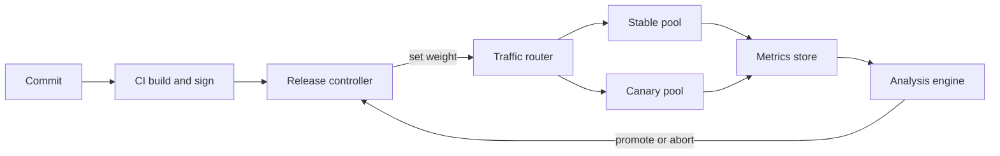

# Progressive Delivery and Deployment Pipelines

## TL;DR

Progressive delivery is a control loop that exposes a change to a bounded fraction of traffic, measures it against a baseline, and either widens or reverts the exposure without a human in the loop.
The exposure knob is only as good as the traffic router behind it: replica-ratio canaries are per-connection and quantized, while ALB listener rules, Gateway API HTTPRoutes, Lambda alias weights, and Cloud Run revision splits are per-request and exact.
Rollback triggers are statistical instruments with a latency floor and a sample-size floor, so the first canary step should be sized as `n / (rps * T_floor)` (about 3.6% in the worked example), not picked by feel.
Every pipeline is a control plane that must degrade safely: a dead rollout controller freezes traffic at a partial split, a GitOps self-heal can fight the controller, and config or data pushes that bypass the pipeline are the classic way a "canaried" system still goes global in seconds.
Rollback is itself a deployment of the previous version, so it is only safe if N and N+1 can coexist on every wire format, schema, and cache, which means expand-contract changes, flags separating deploy from release, and rehearsed reverts.

## Mental Model



The system has three decoupled loops.
The artifact loop (CI) produces an immutable, signed build and never touches traffic.
The actuation loop (release controller plus router) converts a desired exposure percentage into a concrete data-plane configuration such as ReplicaSet counts, ALB target group weights, or HTTPRoute backend weights, and the router keeps serving that configuration even if the controller dies.
The judgment loop (metrics store plus analysis engine) reads telemetry, compares canary to a baseline, and emits a verdict that the controller turns into the next step or an abort.
The boundaries matter: the judgment loop has latency (scrape interval, metric publication delay, rate window), the actuation loop has propagation delay (endpoints, target health checks, connection draining), and the sum of those two delays is the time during which a bad version keeps serving traffic.
See [[17-Cloud-AI-Engineering/Volume_01_Cloud_Architecture_Principles/Chapter_04_Control_Plane_vs_Data_Plane_Separation|Control Plane vs Data Plane Separation]] for why the data plane must hold its last weights when the control plane is gone.

## Internals

### The release controller as a state machine

Argo Rollouts replaces the Deployment controller with a `Rollout` custom resource.
Each pod template revision gets its own ReplicaSet, identified by a `rollouts-pod-template-hash` label, and the controller steps through a list of `steps` (`setWeight`, `pause`, `analysis`, `experiment`) while persisting its position in `status`.
`setWeight` is an intent, not a measurement.
Without `trafficRouting`, 

Argo approximates the weight by changing stable and canary replica counts; with a router it writes a weight into an Istio, NGINX, ALB, Gateway API, or other supported routing resource

 (OneUptime Argo Rollouts guide, secondary source, 2026-08).
The latest release listed on the project releases page is v1.10.1 (Argo Rollouts GitHub releases, as of 2026-10).
Official docs: [Argo Rollouts](https://argo-rollouts.readthedocs.io/).

### Mechanism 1: what a weight actually is at each layer

| Layer | Unit of splitting | Granularity | Stickiness | Where the weight lives |
|---|---|---|---|---|
| Replica ratio (no router) | Pod share behind a ClusterIP Service | `1/N` of pods, quantized by replica count | None, per TCP connection via kube-proxy | ReplicaSet sizes |
| ALB forward action | Request | Integer weights across target groups | Optional target group stickiness | Listener rule, outside the cluster |
| Gateway API HTTPRoute | Request (implementation dependent) | Integer `backendRef` weights | Implementation dependent | HTTPRoute object |
| Lambda alias | Invocation | Percentage between exactly two versions | None | Alias routing config |
| Cloud Run traffic split | Request | Percentage per revision or tag | Optional best-effort session affinity | Service spec |
| DNS weighted records | Resolver cache fill | Bounded by TTL and resolver behavior | Per resolver | Hosted zone |

The replica-ratio canary is the one that surprises people.
A Kubernetes Service load-balances connections, not requests, because kube-proxy (iptables or IPVS mode) picks an endpoint when the TCP connection is established.
An HTTP/2 or gRPC client that holds one connection open for hours therefore pins to one pod, so a "10 percent canary" can see 0 percent or 100 percent of a client's traffic.
With 10 replicas, a 5 percent step cannot exist: the nearest representable splits are 0, 1/10 and 2/10, so the controller rounds up to one canary pod and you get roughly 9 to 10 percent of connections.
Request-level routers (ALB, Gateway API, a mesh sidecar) remove both defects but add their own: the weight is only real once the router has converged and the targets behind it are healthy.

### Mechanism 2: the propagation timeline between "pod Ready" and "pod serving"

A getting-started guide shows the Rollout going green.
The data plane lags the control plane through a chain of asynchronous hops.

1. The kubelet marks the pod Ready after its readiness probe passes.
2. The EndpointSlice controller publishes the endpoint, and kube-proxy or the CNI datapath programs it.
3. For an ALB in IP target mode, the AWS Load Balancer Controller registers the pod IP as a target, and the target is not In Service until `HealthCheckInterval x HealthyThresholdCount` has elapsed. The ALB API defaults are 30 s and 5 (about 150 s), and the controller's annotation defaults are lower; treat both as UNVERIFIED and read your own target group.
4. On removal, the target enters draining for the deregistration delay, which defaults to 300 s (AWS docs, UNVERIFIED in this pass).

Two consequences follow.
First, blue/green cutover is a selector patch on the active Service, and the old ReplicaSet must stay alive until every hop has observed the patch, which is the purpose of `scaleDownDelaySeconds`: 

it gives the router or cluster network time to observe the switch before the old stable ReplicaSet is scaled down

 (OneUptime Argo Rollouts guide, 2026-08).
A short delay makes cutover produce a burst of 502 and 503 responses from targets that disappeared before the router noticed.
The same delay is what makes rollback cheap: 

keeping the old ReplicaSet running turns rollback into a selector flip, not fresh Pod startup

 (dev.to Argo Rollouts guide, secondary, 2026-10).
Second, a controller that trusts its own write is wrong whenever the router is slower than the controller.
The ALB reconciler in Argo Rollouts exposes a `VerifyWeight` method and, since v1.6.0, `VerifyWeightPerIngress` (Go package docs for `rollout/trafficrouting/alb`), which exists to read the weight back from the load balancer before the controller counts the step as achieved.
The controller-side flag names and IAM permissions for this verification are UNVERIFIED here, so confirm them in the ALB traffic management page before relying on them.
The fix on the workload side is a `preStop` sleep at least as long as the propagation chain, `terminationGracePeriodSeconds` longer than that sleep plus drain time, and pod readiness gates so that "Ready" means "In Service" for ALB targets.

### Mechanism 3: the sample-size floor, the latency floor, and the optimal first step

An analysis step is a hypothesis test with a finite sample requirement.
Using a one-sided test at alpha 0.05 and power 0.80, detecting an error-rate shift from p0 = 0.1% to p1 = 0.2% needs about 8,000 canary requests against a known baseline, or about 18,500 per arm when the baseline arm is the same size (derived by `canary_sizing.py` in the worked example).
At 1,000 rps total, a 1% canary sees 10 rps and needs about 800 s (known baseline) to 1,850 s (equal arms), while a 10% canary needs 80 to 185 s.
There is also a latency floor that no weight can beat: routing propagation, scrape interval plus rate window, analysis cadence times the failure limit, and rollback propagation.
Taking 220 s for that floor (an illustrative sum, not a measurement), the number of failed requests the canary serves before the rollback decision is `w * R * p1 * max(T_floor, n / (w * R))`.
In the sample-bound regime the `w` cancels, so exposure equals `n * p1`, about 16 failed requests for the subtle regression at any weight below the crossover.
Above the crossover weight `w* = n / (R * T_floor)`, which is 3.6% here, you are latency-bound and exposure grows linearly with weight: 44 failed requests at 10% and 110 at 25% for the subtle case, and 1,100 at 10% for a severe 5% regression.
The practical rule is that the first step should sit near `w*`, and later steps exist to test load-dependent behavior, not to improve statistical power.

### Mechanism 4: baseline versus canary, and why "stable" is the wrong control

Comparing a fresh canary to long-running stable pods biases the result: the canary has cold caches, cold JIT, fresh connection pools, and a different age distribution.
Netflix's Kayenta popularized a three-way design in which a new baseline cluster running the old version is started at the same time and size as the canary, and the verdict compares canary to that baseline rather than to production (Netflix Tech Blog, Kayenta).
Argo Rollouts has an `Experiment` resource, and an `experiment` step, that launches ad hoc ReplicaSets for the baseline and the candidate and runs analysis against them; the exact field layout is UNVERIFIED here, so check the Experiment docs.
Google's Canary Analysis Service paper (Davidovic and Beyer, ACM Queue 2018) makes the related point that the canary population must be representative and the evaluation window must cover the traffic mix that triggers the bug.
Netflix's Kayenta uses nonparametric comparison (Mann-Whitney U) on metric distributions rather than a threshold on a single mean (recalled, UNVERIFIED).

### Analysis semantics worth knowing cold

An `AnalysisTemplate` defines metrics, and an `AnalysisRun` is its instantiation with a list of measurements.
Fields seen in upstream examples include `count`, `interval`, `initialDelay`, `failureLimit`, `inconclusiveLimit`, `consecutiveErrorLimit`, `successCondition`, and `failureCondition` (Argo Rollouts GitHub issue examples).
The three verdicts are distinct: Failed (conditions evaluated and failed), Error (the provider query itself failed, governed by consecutive errors), and Inconclusive (neither condition held, which pauses the rollout for a human).
An empty Prometheus result is the trap: 

an empty result satisfies neither condition and counts as an inconclusive measurement

 (OneUptime Argo Rollouts guide on Prometheus results, 2026-08).
A canary that crashes before emitting any series therefore looks "inconclusive" rather than "failed", and you must decide that policy deliberately, for example with `failureCondition: len(result) == 0`.
Analysis may run inline as a step, or as background analysis for the whole rollout, and a pre-promotion analysis gates a blue/green cutover.
`failureLimit` counts total failed measurements, not consecutive ones, so with k independent checks at per-check alpha the chance of at least one false failure is `1 - (1 - alpha)^k`: 5%, 23%, 40%, 79% for k = 1, 5, 10, 30 at alpha 0.05.
Setting `failureLimit: 2` (three failures to trip) over 30 checks at alpha 0.05 still produces a false rollback in about 19% of rollouts if checks were independent, which is why per-check alpha should be about 0.01 or lower and why repeated peeking needs a sequential or corrected test.
Checks on overlapping rate windows are positively correlated, so the independence figures are upper-bound idealizations.

A canary-scoped Prometheus query uses the pod-template hash that the controller exposes as an argument:

```yaml
apiVersion: argoproj.io/v1alpha1
kind: AnalysisTemplate
metadata:
  name: canary-5xx-ratio
spec:
  args:
  - name: canary-hash
    valueFrom:
      podTemplateHashValue: Latest
  metrics:
  - name: five-xx-ratio
    interval: 60s
    count: 10
    failureLimit: 1
    inconclusiveLimit: 1
    successCondition: len(result) == 1 && result[0] <= 0.005
    failureCondition: len(result) == 0 || (len(result) == 1 && result[0] > 0.005)
    provider:
      prometheus:
        address: http://prometheus.monitoring:9090
        query: |
          sum(rate(http_requests_total{rollouts_pod_template_hash="{{args.canary-hash}}",code=~"5.."}[2m]))
          /
          sum(rate(http_requests_total{rollouts_pod_template_hash="{{args.canary-hash}}"}[2m]))
```

The label name depends on your scrape relabeling.
The 2-minute rate window must be shorter than the step duration, otherwise the query mixes samples from before the step.
Scoping to the canary hash avoids the dilution error: an aggregate query over stable plus canary at weight `w` reports `w * p_canary`, so a threshold calibrated for the canary alone is silently `1/w` too lax.

### Pipelines above the controller: waves, bake time, render-once

The AWS Builders' Library article on automating safe, hands-off deployments describes a pipeline that deploys through pre-production, then a one-box stage that takes a small share of production, then progressively larger waves across Availability Zones and Regions, with alarm-driven automatic rollback and a bake time at each stage ([AWS Builders' Library](https://aws.amazon.com/builders-library/automating-safe-hands-off-deployments/)).
The invariant is that a change reaches a failure domain only after it has survived in a smaller, less critical one, and the wave order follows the blast-radius boundaries described in [[17-Cloud-AI-Engineering/Volume_01_Cloud_Architecture_Principles/Chapter_03_Cell_Based_Architecture_and_Shuffle_Sharding|Cell-Based Architecture and Shuffle Sharding]].
Google's SRE Workbook chapter on canarying releases frames the canary as a partial, time-limited deployment plus evaluation, and stresses choosing population size and duration against the signal you need ([SRE Workbook, Canarying Releases](https://sre.google/workbook/canarying-releases/)).
Microsoft's Gandalf (NSDI 2020) shows the fleet-scale version: correlate deployment waves with health signals to decide automatically whether to stop a rollout ([Gandalf, USENIX NSDI '20](https://www.usenix.org/conference/nsdi20/presentation/li-chenggang)).
Google Cloud Deploy renders manifests per target when a release is created, via Skaffold, so promotion moves an already-rendered artifact through targets rather than re-rendering (Google Cloud Deploy docs, UNVERIFIED in this pass).
That render-once property is what keeps "what we tested in staging" identical to "what we promote to prod".

### Rollback safety is a property of the change, not the tool

The Builders' Library article on ensuring rollback safety describes a two-phase approach to incompatible changes: first ship a version that can read the new format while still writing the old one, then, only after the first phase is everywhere and cannot be rolled back past, ship the version that writes the new format ([AWS Builders' Library](https://aws.amazon.com/builders-library/ensuring-rollback-safety-during-deployments/)).
Progressive delivery guarantees mixed-version operation by construction, so every persisted or on-wire artifact (database schema, cache key layout, queue message, protobuf field, KV-cache or checkpoint format) must tolerate N and N+1 at the same time.
Feature flags separate deploy from release: the binary ships dark, and exposure is a flag percentage evaluated per user, which also gives sticky cohorts that request-level weights cannot.

### Infrastructure changes use the same shape

A Terraform or OpenTofu change is also a rollout, and the wave unit is a state file or workspace per cell, account, or region.
Apply to a canary cell, wait for a bake period during which drift detection and health alarms run, then fan out, as discussed in [[17-Cloud-AI-Engineering/Volume_06_Infrastructure_as_Code_and_Delivery/Chapter_05_State_Management_Drift_Detection_and_Compliance|State Management, Drift Detection, and Compliance]] and [[17-Cloud-AI-Engineering/Volume_06_Infrastructure_as_Code_and_Delivery/Chapter_01_Terraform_and_OpenTofu_Internals|Terraform and OpenTofu Internals]].
Policy checks run before each wave per [[17-Cloud-AI-Engineering/Volume_06_Infrastructure_as_Code_and_Delivery/Chapter_04_Policy_as_Code_OPA_Sentinel_and_Guardrails|Policy as Code]].

## Numbers to Know

Status "Verified" means checked against a search result in this authoring pass; "UNVERIFIED" means recalled from official documentation and not re-fetched, so confirm before quoting in an interview or design review.

| Quantity | Value | Source and date | Status |
|---|---|---|---|
| Latest Argo Rollouts release | v1.10.1 | Argo Rollouts GitHub releases, as of 2026-10 | Verified |
| `VerifyWeightPerIngress` in ALB reconciler | Added in v1.6.0 | Go package docs, as of 2026-10 | Verified |
| Rollout `setWeight` without `trafficRouting` | Replica-count based | OneUptime guide (secondary), 2026-08 | Verified |
| Blue/green `scaleDownDelaySeconds` default | 30 s | Argo Rollouts docs, as of 2026-10 | UNVERIFIED |
| Rollout `progressDeadlineSeconds` default | 600 s | Argo Rollouts and Kubernetes docs, as of 2026-10 | UNVERIFIED |
| ALB deregistration delay default | 300 s | AWS ELB docs, as of 2026-10 | UNVERIFIED |
| ALB target health default | 30 s interval, healthy threshold 5, so about 150 s to In Service | AWS ELB docs, as of 2026-10 | UNVERIFIED |
| ALB forward action | Weighted target groups, up to 5 groups, weights 0 to 999 | AWS ELB docs, as of 2026-10 | UNVERIFIED |
| CodeDeploy Lambda canary configs | `Canary10Percent5Minutes`, `10Minutes`, `15Minutes`, `30Minutes` | AWS CodeDeploy docs, as of 2026-10 | UNVERIFIED |
| CodeDeploy Lambda linear configs | `Linear10PercentEvery1Minute`, `2Minutes`, `3Minutes`, `10Minutes` | AWS CodeDeploy docs, as of 2026-10 | UNVERIFIED |
| CodeDeploy ECS configs | `ECSCanary10Percent5Minutes`, `ECSCanary10Percent15Minutes`, `ECSLinear10PercentEvery1Minutes`, `ECSLinear10PercentEvery3Minutes`, `ECSAllAtOnce` | AWS CodeDeploy docs, as of 2026-10 | UNVERIFIED |
| Lambda alias routing | Weighted split between exactly two versions | AWS Lambda docs, as of 2026-10 | UNVERIFIED |
| Lambda CloudWatch metric granularity | 1 minute | AWS Lambda docs, as of 2026-10 | UNVERIFIED |
| Requests to detect 0.1% to 0.2% errors | about 8,000 (known baseline), about 18,500 (equal arms) | Derived, `canary_sizing.py`, 2026-10 | Derived |
| First-step crossover weight in the example | 3.6% at 1,000 rps and 220 s floor | Derived, `canary_sizing.py`, 2026-10 | Derived |
| False rollback, 10 independent checks at alpha 0.05 | 40% | Derived, 2026-10 | Derived |
| GPU surge cost, 32 pods x 8 GPUs, 50% surge, 1.5 h | USD 768 at an assumed USD 4.00 per GPU-hour | Derived with an assumed price, not a quote, 2026-10 | Derived |
| Cloud Deploy pricing | per active delivery pipeline per month | Google Cloud pricing, as of 2026-10 | UNVERIFIED |

## AWS vs GCP Mechanism Parity

| Concern | AWS | Google Cloud |
|---|---|---|
| Orchestrator for managed compute | CodeDeploy (EC2, Lambda, ECS) and ECS built-in blue/green (announced 2025; GA date and linear/canary support UNVERIFIED) | Cloud Deploy for GKE and Cloud Run, plus Cloud Run native revisions |
| Serverless traffic primitive | Lambda alias routing config, two versions, per invocation | Cloud Run revision percentages and tags, per request |
| Container request-level split | ALB forward action across target groups, weights in listener rule | GKE Gateway API HTTPRoute weights, or Cloud Run split |
| Where the weight state lives | Load balancer or alias, so it survives pipeline failure | Gateway object or Cloud Run service spec, same property |
| Automatic rollback trigger | CloudWatch alarms attached to the deployment group, plus lifecycle hook failure | Cloud Deploy verify jobs and automations (repair rollout, rollback), plus custom metrics checks (details UNVERIFIED) |
| Hooks | `BeforeInstall`, `AfterInstall`, `AfterAllowTestTraffic`, `BeforeAllowTraffic`, `AfterAllowTraffic` | Predeploy and postdeploy actions, deploy verification (UNVERIFIED) |
| Canary data source latency | CloudWatch Lambda and ALB metrics, 1-minute class; alarm needs M of N periods | Cloud Monitoring, typically similar order; check per-metric sampling and delay |
| Approval gates | CodePipeline manual approval, IAM-scoped | Cloud Deploy approvals via IAM (permission names UNVERIFIED) |
| Kubernetes-native option | Argo Rollouts or Flagger with ALB or mesh | Argo Rollouts or Flagger with Gateway API or mesh |
| Test traffic before exposure | ALB test listener on a second port | Cloud Run revision tag URL |
| Failure semantics if orchestrator dies | Stuck deployment, traffic frozen at last split | Same; Cloud Run split persists in service spec |
| Cost of the orchestrator | CodeDeploy for Lambda and ECS has no extra charge (UNVERIFIED) | Cloud Deploy per active pipeline (UNVERIFIED) |

The parity is mechanical, not conceptual: both clouds persist the split in a data-plane object, both gate on a metric alarm or verification job, and both leave you to supply the statistical rigor.
One real difference is granularity: the ALB lets you shift exact percentages across arbitrary target groups, whereas Lambda aliases are limited to two versions at a time, which forces CodeDeploy to serialize overlapping releases.
Cross-reference [[17-Cloud-AI-Engineering/Volume_04_AWS_vs_GCP_Translation/Chapter_01_Compute_Translation|Compute Translation]] and [[17-Cloud-AI-Engineering/Volume_04_AWS_vs_GCP_Translation/Chapter_02_Networking_and_Load_Balancing_Translation|Networking and Load Balancing Translation]].

## Worked Example: Canary with Alarm Rollback on Lambda, Plus a Local Argo Rollouts Lab

### Step 0: Back-of-the-envelope sizing

Assume 1,000 rps total, baseline error rate 0.1%, a regression of interest to 0.2%, and a latency floor of 220 s (15 s scrape plus 120 s rate window plus 60 s cadence plus 25 s propagation).
Requests needed are about 8,000 against a known baseline, so `w* = 8027 / (1000 * 220) = 3.6%`, and a first step of 5% is the nearest convenient value.
At 5% the canary sees 50 rps, the sample requirement is met in about 160 s, which is below the floor, so exposure is `0.05 * 1000 * 0.002 * 220 = 22` failed requests.
At 25% the same subtle regression serves about 110 failed requests, and a severe regression serves 2,750.
For an AI serving fleet of 32 pods with 8 GPUs each, a traffic-routed canary that keeps stable at 100% and surges 50% costs `16 pods * 8 * 1.5 h * USD 4.00 = USD 768` per rollout at an assumed price, and USD 256 for a 25% surge held 1 hour.
Slow model loads make the surge window longer than the analysis window, so see [[17-Cloud-AI-Engineering/Volume_11_LLM_Serving_and_Inference_Systems_on_Cloud/Chapter_08_Cloud_GPU_Autoscaling_and_Cold_Start_Mitigation|Cloud GPU Autoscaling and Cold-Start Mitigation]] for the cold-start side.

Sizing script (`canary_sizing.py`, standard library only):

```python
import math
from statistics import NormalDist

N = NormalDist()

def n_canary(p0, p1, alpha=0.05, power=0.80, baseline_ratio=None):
    """Canary requests needed to detect error rate p0 -> p1 (one-sided).
    baseline_ratio=None: baseline arm is effectively infinite (known p0).
    baseline_ratio=r: baseline arm has r times as many requests as the canary arm."""
    za, zb = N.inv_cdf(1 - alpha), N.inv_cdf(power)
    if baseline_ratio is None:
        var0 = p0 * (1 - p0)
        var1 = p1 * (1 - p1)
        return math.ceil((za * math.sqrt(var0) + zb * math.sqrt(var1)) ** 2 / (p1 - p0) ** 2)
    r = baseline_ratio
    pbar = (p1 + r * p0) / (1 + r)
    num = (za * math.sqrt((1 + 1 / r) * pbar * (1 - pbar)) +
           zb * math.sqrt(p1 * (1 - p1) + p0 * (1 - p0) / r)) ** 2
    return math.ceil(num / (p1 - p0) ** 2)

def false_rollback_prob(k_checks, alpha):
    return 1 - (1 - alpha) ** k_checks

def exposure(total_rps, w, p0, p1, t_floor_s):
    """Failed requests served by the canary before a rollback decision.
    Detection time is the larger of the latency floor (propagation + metric window +
    analysis cadence + rollback propagation) and the sample-bound time n / (w * rps)."""
    n = n_canary(p0, p1)
    t = max(t_floor_s, n / (w * total_rps))
    return t, w * total_rps * p1 * t

if __name__ == "__main__":
    total_rps = 1000
    p0, p1 = 0.001, 0.002
    n_inf = n_canary(p0, p1)
    n_eq = n_canary(p0, p1, baseline_ratio=1)
    print(f"requests needed, known baseline: {n_inf}; equal arms: {n_eq}")
    for w in (0.01, 0.05, 0.10, 0.50):
        rps = total_rps * w
        print(f"weight {w:>4.0%}: canary {rps:>5.0f} rps -> {n_inf / rps:>6.0f} s (known baseline), "
              f"{n_eq / rps:>6.0f} s (equal arms)")
    for k in (1, 5, 10, 30):
        print(f"{k:>2} independent checks at alpha=0.05: P(any false alarm) = {false_rollback_prob(k, 0.05):.2f}")

    t_floor = 220.0
    n = n_canary(p0, p1)
    w_star = n / (total_rps * t_floor)
    print(f"latency floor {t_floor:.0f} s -> sample-bound crossover weight w* = {w_star:.1%}")
    for label, q1 in (("subtle regression 0.1% -> 0.2%", 0.002), ("severe regression 0.1% -> 5%", 0.05)):
        print(label)
        for w in (0.005, 0.01, 0.036, 0.05, 0.10, 0.25):
            t, bad = exposure(total_rps, w, p0, q1, t_floor)
            print(f"   w={w:>6.1%}: decision after {t:>5.0f} s, failed requests served ~ {bad:>7.0f}")
```

Running it prints 8027 and 18519 for the two sample sizes and the 3.6% crossover quoted above.

### Lab A: Lambda alias canary with CloudWatch alarm rollback (AWS)

Cost estimate: one Lambda function with a few thousand invocations per run, one standard CloudWatch alarm, and CodeDeploy for Lambda.
Expected total is well under USD 1 for a few runs (Lambda free tier, alarm monthly price, and CodeDeploy no-charge for Lambda are all UNVERIFIED in this pass; confirm on the pricing pages).
The Terraform file includes a budget alarm, and the exact teardown is `terraform destroy -auto-approve` (or `tofu destroy -auto-approve`).

`main.tf`:

```hcl
terraform {
  required_version = ">= 1.6.0"
  required_providers {
    aws     = { source = "hashicorp/aws", version = "~> 5.0" }
    archive = { source = "hashicorp/archive", version = "~> 2.4" }
  }
}

variable "region"        { default = "us-east-1" }
variable "name"          { default = "pdlab" }
variable "alert_email"   { type = string }
variable "code_variant"  {
  description = "v1, v2, or v2bad"
  default     = "v1"
}

provider "aws" {
  region = var.region
}

locals {
  handlers = {
    v1 = <<-PY
      def handler(event, context):
          return {"version": "v1"}
    PY
    v2 = <<-PY
      def handler(event, context):
          return {"version": "v2"}
    PY
    v2bad = <<-PY
      def handler(event, context):
          raise RuntimeError("regression")
    PY
  }
}

data "archive_file" "pkg" {
  type        = "zip"
  output_path = "${path.module}/pkg.zip"
  source {
    content  = local.handlers[var.code_variant]
    filename = "app.py"
  }
}

resource "aws_iam_role" "fn" {
  name = "${var.name}-fn"
  assume_role_policy = jsonencode({
    Version = "2012-10-17"
    Statement = [{
      Effect = "Allow", Action = "sts:AssumeRole",
      Principal = { Service = "lambda.amazonaws.com" }
    }]
  })
}

resource "aws_iam_role_policy_attachment" "fn_logs" {
  role       = aws_iam_role.fn.name
  policy_arn = "arn:aws:iam::aws:policy/service-role/AWSLambdaBasicExecutionRole"
}

resource "aws_lambda_function" "app" {
  function_name    = "${var.name}-fn"
  role             = aws_iam_role.fn.arn
  runtime          = "python3.12"
  handler          = "app.handler"
  filename         = data.archive_file.pkg.output_path
  source_code_hash = data.archive_file.pkg.output_base64sha256
  publish          = true
}

resource "aws_lambda_alias" "live" {
  name             = "live"
  function_name    = aws_lambda_function.app.function_name
  function_version = aws_lambda_function.app.version
  lifecycle {
    # CodeDeploy owns the alias after creation. Terraform must not shift traffic.
    ignore_changes = [function_version, routing_config]
  }
}

resource "aws_cloudwatch_metric_alarm" "errors" {
  alarm_name          = "${var.name}-live-errors"
  namespace           = "AWS/Lambda"
  metric_name         = "Errors"
  statistic           = "Sum"
  period              = 60
  evaluation_periods  = 1
  threshold           = 1
  comparison_operator = "GreaterThanOrEqualToThreshold"
  treat_missing_data  = "notBreaching"
  dimensions = {
    FunctionName = aws_lambda_function.app.function_name
    Resource     = "${aws_lambda_function.app.function_name}:live"
  }
}

resource "aws_iam_role" "codedeploy" {
  name = "${var.name}-codedeploy"
  assume_role_policy = jsonencode({
    Version = "2012-10-17"
    Statement = [{
      Effect = "Allow", Action = "sts:AssumeRole",
      Principal = { Service = "codedeploy.amazonaws.com" }
    }]
  })
}

resource "aws_iam_role_policy_attachment" "codedeploy" {
  role       = aws_iam_role.codedeploy.name
  policy_arn = "arn:aws:iam::aws:policy/service-role/AWSCodeDeployRoleForLambda"
}

resource "aws_codedeploy_app" "app" {
  name             = var.name
  compute_platform = "Lambda"
}

resource "aws_codedeploy_deployment_group" "dg" {
  app_name               = aws_codedeploy_app.app.name
  deployment_group_name  = "${var.name}-dg"
  service_role_arn       = aws_iam_role.codedeploy.arn
  deployment_config_name = "CodeDeployDefault.LambdaCanary10Percent5Minutes"

  deployment_style {
    deployment_option = "WITH_TRAFFIC_CONTROL"
    deployment_type   = "BLUE_GREEN"
  }

  alarm_configuration {
    enabled = true
    alarms  = [aws_cloudwatch_metric_alarm.errors.alarm_name]
  }

  auto_rollback_configuration {
    enabled = true
    events  = ["DEPLOYMENT_FAILURE", "DEPLOYMENT_STOP_ON_ALARM"]
  }
}

resource "aws_budgets_budget" "lab" {
  name         = "${var.name}-budget"
  budget_type  = "COST"
  limit_amount = "5"
  limit_unit   = "USD"
  time_unit    = "MONTHLY"
  notification {
    comparison_operator        = "GREATER_THAN"
    threshold                  = 80
    threshold_type             = "PERCENTAGE"
    notification_type          = "ACTUAL"
    subscriber_email_addresses = [var.alert_email]
  }
}

output "function_name"    { value = aws_lambda_function.app.function_name }
output "codedeploy_app"   { value = aws_codedeploy_app.app.name }
output "deployment_group" { value = aws_codedeploy_deployment_group.dg.deployment_group_name }
```

`deploy.sh` publishes nothing itself; Terraform publishes the new version, and this script asks CodeDeploy to shift the alias from the current version to the newest one:

```bash
#!/usr/bin/env bash
set -euo pipefail
FN=$(terraform output -raw function_name)
APP=$(terraform output -raw codedeploy_app)
DG=$(terraform output -raw deployment_group)
CUR=$(aws lambda get-alias --function-name "$FN" --name live --query FunctionVersion --output text)
NEW=$(aws lambda list-versions-by-function --function-name "$FN" --query 'Versions[-1].Version' --output text)
APPSPEC=$(cat <<EOF
version: 0.0
Resources:
  - app:
      Type: AWS::Lambda::Function
      Properties:
        Name: "$FN"
        Alias: "live"
        CurrentVersion: "$CUR"
        TargetVersion: "$NEW"
EOF
)
REV=$(jq -n --arg c "$APPSPEC" '{revisionType:"AppSpecContent",appSpecContent:{content:$c}}')
ID=$(aws deploy create-deployment --application-name "$APP" --deployment-group-name "$DG" \
      --revision "$REV" --query deploymentId --output text)
echo "deployment $ID"
aws deploy get-deployment --deployment-id "$ID" --query 'deploymentInfo.[status,rollbackInfo]'
```

`drive.py` sends traffic at the alias and tallies which version served each call and whether it errored:

```python
import collections, concurrent.futures as cf, json, sys, time
import boto3

fn, secs, rps = sys.argv[1], int(sys.argv[2]), int(sys.argv[3])
lam = boto3.client("lambda")

def call(_):
    r = lam.invoke(FunctionName=f"{fn}:live", Payload=b"{}")
    ver = r.get("ExecutedVersion", "?")
    return f"v{ver}" + (":error" if "FunctionError" in r else ":ok")

tally = collections.Counter()
with cf.ThreadPoolExecutor(max_workers=rps * 2) as pool:
    for _ in range(secs):
        t0 = time.time()
        for k in pool.map(call, range(rps)):
            tally[k] += 1
        time.sleep(max(0, 1 - (time.time() - t0)))
print(dict(tally))
```

Run sequence:

1. `terraform init && terraform apply -var alert_email=you@example.com` creates version 1 and points `live` at it.
2. `terraform apply -var alert_email=you@example.com -var code_variant=v2` publishes version 2 while the alias stays on version 1 because of `ignore_changes`.
3. `./deploy.sh` and then `python drive.py pdlab-fn 360 10` shows about 10% of calls on version 2 for 5 minutes, then 100%.
4. `terraform apply -var alert_email=you@example.com -var code_variant=v2bad`, `./deploy.sh`, and `python drive.py pdlab-fn 360 10` shows `v3:error` counts, then the alarm fires within a few minutes (1-minute metric period plus evaluation) and CodeDeploy reverts the alias to the previous version.
5. Teardown: `terraform destroy -auto-approve -var alert_email=you@example.com`.

Note the point this lab makes: Terraform and the deployer both want to own `function_version`, and `ignore_changes` is the explicit handoff, the same ownership problem covered in the drift chapter.

### Lab B: Local Argo Rollouts canary with a Job analysis (no cloud cost)

This runs on kind, costs nothing, and demonstrates replica-based weight, aggregate dilution, and an automatic abort.
Install kind, kubectl, and the `kubectl-argo-rollouts` plugin, then install the controller using the install manifest from the Argo Rollouts docs.

```bash
kind create cluster --name pd
kubectl create namespace argo-rollouts
kubectl apply -n argo-rollouts -f https://github.com/argoproj/argo-rollouts/releases/latest/download/install.yaml
kubectl apply -f demo.yaml
kubectl argo rollouts get rollout demo --watch
```

`demo.yaml`:

```yaml
apiVersion: v1
kind: ConfigMap
metadata:
  name: app-src
data:
  app.py: |
    import os, random
    from http.server import BaseHTTPRequestHandler, HTTPServer

    class H(BaseHTTPRequestHandler):
        def do_GET(self):
            bad = random.random() < float(os.environ.get("FAIL_RATE", "0"))
            self.send_response(500 if bad else 200)
            self.end_headers()
            self.wfile.write(os.environ.get("VERSION", "v1").encode())
        def log_message(self, *args):
            pass

    HTTPServer(("", 8080), H).serve_forever()
---
apiVersion: v1
kind: Service
metadata:
  name: demo
spec:
  selector:
    app: demo
  ports:
  - port: 80
    targetPort: 8080
---
apiVersion: argoproj.io/v1alpha1
kind: AnalysisTemplate
metadata:
  name: error-rate
spec:
  args:
  - name: max-fail-pct
    value: "5"
  metrics:
  - name: http-error-rate
    count: 3
    interval: 10s
    failureLimit: 0
    provider:
      job:
        spec:
          backoffLimit: 0
          template:
            spec:
              restartPolicy: Never
              containers:
              - name: probe
                image: curlimages/curl:8.10.1
                command: ["sh", "-c"]
                args:
                - |
                  fails=0; n=200
                  for i in $(seq 1 $n); do
                    code=$(curl -s -o /dev/null -w '%{http_code}' http://demo/)
                    [ "$code" = "200" ] || fails=$((fails+1))
                  done
                  echo "fails=$fails of $n"
                  [ $((fails*100/n)) -le {{args.max-fail-pct}} ]
---
apiVersion: argoproj.io/v1alpha1
kind: Rollout
metadata:
  name: demo
spec:
  replicas: 10
  revisionHistoryLimit: 2
  selector:
    matchLabels:
      app: demo
  template:
    metadata:
      labels:
        app: demo
    spec:
      containers:
      - name: app
        image: python:3.12-alpine
        command: ["python", "/src/app.py"]
        env:
        - name: VERSION
          value: v1
        - name: FAIL_RATE
          value: "0"
        ports:
        - containerPort: 8080
        readinessProbe:
          tcpSocket:
            port: 8080
        volumeMounts:
        - name: src
          mountPath: /src
      volumes:
      - name: src
        configMap:
          name: app-src
  strategy:
    canary:
      maxSurge: 1
      maxUnavailable: 0
      steps:
      - setWeight: 20
      - analysis:
          templates:
          - templateName: error-rate
      - setWeight: 50
      - pause: {duration: 20s}
```

Trigger a bad release and watch the abort:

```bash
kubectl patch rollout demo --type json -p '[
 {"op":"replace","path":"/spec/template/spec/containers/0/env/0/value","value":"v2"},
 {"op":"replace","path":"/spec/template/spec/containers/0/env/1/value","value":"0.5"}]'
kubectl argo rollouts get rollout demo --watch
```

Two canary pods (20% of 10) with a 50% failure rate produce about 10% aggregate failures on the shared `demo` Service, which exceeds the 5% threshold, so the AnalysisRun fails and the rollout aborts and scales the canary back.
Try `FAIL_RATE` of 0.2: the aggregate is about 4%, which passes, which demonstrates the dilution error from the Internals section (a 20% canary failure rate sails through a 5% aggregate threshold).
Teardown: `kind delete cluster --name pd`.
The image tag `curlimages/curl:8.10.1` and the `latest` install manifest are UNVERIFIED here, so pin to versions you have confirmed.

### Lab C: Cloud Run revision split (GCP)

Cost estimate: the sample hello image on Cloud Run stays inside the free request allowance for a few hundred requests (UNVERIFIED pricing in this pass).
Budget alarm:

```bash
gcloud billing budgets create --billing-account=BILLING_ACCOUNT_ID \
  --display-name=pdlab --budget-amount=5USD --threshold-rule=percent=0.8
```

Canary and rollback:

```bash
gcloud run deploy pdlab --image=us-docker.pkg.dev/cloudrun/container/hello \
  --region=us-central1 --allow-unauthenticated
gcloud run deploy pdlab --image=us-docker.pkg.dev/cloudrun/container/hello \
  --region=us-central1 --no-traffic --tag=canary
gcloud run services update-traffic pdlab --region=us-central1 --to-tags=canary=10
gcloud run services update-traffic pdlab --region=us-central1 --to-latest
```

Rollback is `gcloud run services update-traffic pdlab --region=us-central1 --to-revisions=PREVIOUS_REVISION=100`, which takes effect without starting new instances because the previous revision still exists.
Teardown: `gcloud run services delete pdlab --region=us-central1 --quiet`.
The same shape in Cloud Deploy is a `DeliveryPipeline` with a `canary` strategy and `canaryDeployment.percentages` plus `verify: true`; field names are UNVERIFIED here, so read the Cloud Deploy canary page before writing it.

## Failure Modes and Pitfalls

1. **Weight is not traffic.**
   Replica-based canaries round to pod counts and balance per connection, so gRPC and HTTP/2 clients bypass them, and a 5% step silently becomes 10%.
   Detect it by measuring served requests per version, not by trusting `setWeight`.
2. **Cutover races the data plane.**
   Scaling the old ReplicaSet down before endpoints, target registration, and draining have converged yields 502 and 503 bursts.
   Set `scaleDownDelaySeconds` and `preStop` sleep above the measured propagation, use pod readiness gates, and consider ALB weight or target-group verification.
3. **The controller is a single point of partial exposure.**
   If the rollout controller or pipeline stalls mid-canary, the router holds the last split with no analysis attached, so a 20% canary can run for days.
   Alert on rollout age in a non-terminal step, and set `progressDeadlineSeconds` deliberately: a large model that takes ten or more minutes to load will trip the 600 s default (UNVERIFIED default) and abort healthy releases.
4. **GitOps fights the controller.**
   Argo CD self-heal sees Ingress annotations, Service selectors, or HTTPRoute weights that the rollout controller mutated and reverts them, which oscillates the weight or breaks the selector switch.
   Add `ignoreDifferences` for the managed fields, as described in [[17-Cloud-AI-Engineering/Volume_05_Kubernetes_and_Platform_Engineering/Chapter_07_GitOps_Delivery_Argo_CD_and_Flux|GitOps Delivery: Argo CD and Flux]]; the upstream release notes reference a `managedFieldsManagers` option for GitOps setups (Argo Rollouts release notes, as of 2026-10).
5. **Metric blind spots.**
   Empty results are Inconclusive, not Failed, so a crash-looping canary can stall a rollout in a human-wait state instead of aborting.
   Aggregate queries dilute the signal by the canary weight.
   CloudWatch alarms with `notBreaching` for missing data treat "canary emitted nothing" as healthy.
   Metrics with a 1-minute publication cadence plus a 5-minute rate window can lag a fast failure by several minutes.
6. **Peeking inflates false rollbacks.**
   Thirty independent per-minute checks at alpha 0.05 give about a 79% chance of at least one false failure, so teams respond by raising thresholds until real regressions pass.
   Use per-check alpha near 0.01 or lower, require multiple failures, and prefer baseline-versus-canary comparison.
7. **Bake time shorter than the bug's fuse.**
   Memory leaks, certificate expiries, cache-warming cliffs, and connection pool exhaustion at full load do not appear in 10 minutes at 5% traffic.
   Set bake time from the longest failure horizon you have seen, and run a final wave at real scale.
8. **Surge without capacity.**
   Canary and blue/green need extra capacity: GPU quota, IP addresses in EKS secondary-IP mode, and node provisioning latency.
   A surge request that cannot schedule shows up as a stuck rollout, not a clean failure; see [[17-Cloud-AI-Engineering/Volume_05_Kubernetes_and_Platform_Engineering/Chapter_04_Autoscaling_at_Scale_HPA_KEDA_and_Karpenter|Autoscaling at Scale]].
9. **Rollback of an incompatible change.**
   If version N+1 has written data or messages that N cannot read, "roll back" becomes an outage.
   Gate such changes on the two-phase pattern from the Builders' Library rollback-safety article.
10. **The change that never went through the pipeline.**
    The Google Cloud incident of 2025-06-12 began when a policy change with blank fields was written to regional metadata tables and replicated globally within seconds, tripping a null-pointer path in Service Control that was not behind a feature flag; recovery was then slowed by a herd effect on restart (Google Cloud incident report and post-incident write-up, recalled, UNVERIFIED in this pass; read the primary report at [status.cloud.google.com](https://status.cloud.google.com/)).
    The lesson generalizes: binary canaries do not protect against config, policy, or data pushes, which need their own wave gates, flags, and randomized backoff on restart.
    The July 2024 CrowdStrike content update is the other canonical example of a fleet-wide push without staged exposure (public RCA, recalled, UNVERIFIED).
    Cross-reference [[17-Cloud-AI-Engineering/Volume_07_Reliability_and_SRE/Chapter_07_Anatomy_of_Major_Cloud_Outages|Anatomy of Major Cloud Outages]].
11. **Analysis templates are an injection surface.**
    A web or job provider executes arbitrary requests or containers, so whoever can write an `AnalysisTemplate` can run code in the cluster and can also make a bad release pass by editing the template.

## Security and Cost Angles

**Identity and permissions.**
Separate the CI role (push images), the release role (create deployments), and the approval role (promote), so a compromised build cannot also approve itself.
The CodeDeploy service role needs only the managed Lambda or ECS deployment policy plus access to the alarms it reads.
The Argo Rollouts controller should run with workload identity ([[17-Cloud-AI-Engineering/Volume_08_Security_Identity_and_the_Data_Perimeter/Chapter_02_Workload_Identity_Federation|Workload Identity Federation]]) and, if ALB verification is enabled, only read-only Elastic Load Balancing describe permissions (exact list UNVERIFIED).
Restrict Kubernetes RBAC on `AnalysisTemplate`, `ClusterAnalysisTemplate`, and `Rollout` objects as strictly as on Deployments, because the gate is part of the trust boundary.
Verify image signatures at admission so the canary and the promoted artifact are provably the same digest, per [[17-Cloud-AI-Engineering/Volume_08_Security_Identity_and_the_Data_Perimeter/Chapter_05_Software_Supply_Chain_Security_SLSA_and_Sigstore|Software Supply Chain Security: SLSA and Sigstore]].
Cloud Deploy approvals are IAM-gated, which lets you require a named approver role for production targets (permission names UNVERIFIED).

**Network and key boundaries.**
Metric providers need private paths: Prometheus behind an internal address, CloudWatch via VPC endpoints, and Cloud Monitoring via Private Google Access, so analysis traffic does not traverse the internet.
Secrets for providers (Datadog keys, tokens) belong in a secrets manager, not in the template.
Deployment artifacts that are encrypted at rest should use the same KMS key policy across waves, or the canary region will fail on a key it was never granted.

**Cost levers.**
Cost has four components: surge capacity, bake time during which both versions run, analysis query volume, and the orchestrator itself.
Blue/green doubles the fleet for the preview and scale-down delay window, canary at 5% to 25% costs far less, and for GPU fleets the surge dominates (USD 768 per rollout in the example at an assumed price).
Levers: scale preview replicas down with `previewReplicaCount`, use controller options that scale the stable set down in proportion to canary weight where supported (UNVERIFIED here), shorten model load time so surge windows shrink, and shift the first step to `w*` instead of a fixed 25%.
Metric API costs are usually small, but per-minute analysis against CloudWatch `GetMetricData` scales with metrics times runs, so keep queries to a few well-chosen SLIs.
Cloud Deploy bills per active pipeline and CodeDeploy for Lambda and ECS adds no direct charge (both UNVERIFIED), so the real cost is capacity and delay, which is a FinOps decision covered in [[17-Cloud-AI-Engineering/Volume_09_FinOps_and_Cloud_Economics/Chapter_05_GPU_and_TPU_Unit_Economics|GPU and TPU Unit Economics]].

## Interview Questions and Model Answers

### Question 1 (L5 - Senior)

You run a stateless HTTP API on ECS behind an ALB. When would you pick blue/green over canary, and what does each cost you?

#### Model Answer

Both strategies keep the old version running while the new one takes traffic, so the choice is about exposure shape, capacity, and rollback latency.
Canary shifts a growing fraction of live traffic and learns from real requests, so a bad build hurts only that fraction, and the cost is a long window of mixed-version operation plus the need for good metrics to decide.
Blue/green stands up a full second fleet, tests it with synthetic or test-listener traffic, and flips everything at once, so there is no mixed-version window for end users and rollback is a flip back while the old fleet is still up, but the blast radius at flip time is 100% and the cost is roughly double capacity for the duration of the scale-down delay.
I pick blue/green when mixed versions are unsafe (a breaking cache or wire change that cannot be made backward compatible) or when pre-flip verification on a full-size fleet is valuable.
I pick canary for the default stateless case, because exposure is bounded by the first step and I get statistical evidence from real traffic.
On AWS I would use CodeDeploy with an ECS canary configuration or a linear one when I want a smooth ramp, with CloudWatch alarms for automatic rollback.
In either case the flip is not instantaneous: ALB targets need time to pass health checks and old targets drain for the deregistration delay, so I keep the old tasks until draining is over.

#### Follow-up Interviewer Question

The new version needs a database column added and an old column dropped; how do you ship it with either strategy?

### Question 2 (L5 - Senior)

Design automatic rollback for a Lambda function deployed through CodeDeploy. What can make the rollback fire late or never?

#### Model Answer

I attach a CloudWatch alarm to the deployment group and enable automatic rollback on deployment failure and on alarm.
The alarm should measure the alias, using the `FunctionName` and `Resource` (`function:alias`) dimensions, so it sees traffic through the live alias during the shift; I would also consider the `ExecutedVersion` dimension to isolate the new version.
It can fire late because Lambda publishes metrics at one-minute granularity and the alarm needs a full period, so the earliest rollback is a few minutes in, which is why I choose a canary config with a window of 5 minutes or more rather than a one-minute linear step.
It can fail to fire at all in three ways.
First, an aggregate metric on the whole function dilutes a canary at 10% by a factor of 10.
Second, `notBreaching` for missing data means a version that fails before emitting metrics looks healthy.
Third, a version that errors only on a code path the canary traffic never exercises passes any metric.
To cover the last case I add a `BeforeAllowTraffic` hook function that runs smoke tests against the new version, and I keep a short canary at low traffic plus a longer bake before the final shift.

#### Follow-up Interviewer Question

Traffic is 2 requests per second; how do you make a 10% canary statistically meaningful?

### Question 3 (L6 - Staff)

A team says their Argo Rollouts canary is at 5% but the canary pods show 30% of CPU and customers complain about one tenant. Walk through why.

#### Model Answer

I start by asking whether `trafficRouting` is configured, because without it the weight is a replica ratio and nothing about request distribution is enforced.
With 10 replicas, 5% is not representable, so the controller rounds up to one canary pod, which is at least 9 to 10% of endpoints.
The Service balances connections, not requests, so a tenant with a few long-lived HTTP/2 or gRPC connections lands entirely on whichever pod the connection hit, which can be the canary, so one tenant sees 100% of their traffic on the new version while the global share looks small.
CPU share being higher than the weight is consistent with that tenant being heavy, or with the canary being cold and doing JIT or cache fill.
The fix has three parts.
Use a request-level router (ALB weighted target groups, Gateway API, or a mesh) so weights apply per request.
For tenant-consistent behavior, use a sticky cohort mechanism, either target group stickiness or a flag evaluated by tenant hash, so a tenant is consistently in or out.
Measure per-version request share and per-tenant exposure as first-class metrics, because `setWeight` is intent, not telemetry.
I would also raise the replica count or use a router so 5% is exactly representable, and I would verify the router actually applied the weight, since the controller writing a weight and the load balancer honoring it are separated by propagation delay.

#### Follow-up Interviewer Question

You adopt ALB weighted target groups; what extra verification do you add so a step is not marked complete before the weight is real?

### Question 4 (L6 - Staff)

Your canary gate rolls back about one in three healthy releases. The team proposes raising the error threshold. What do you do instead?

#### Model Answer

A one-in-three false rollback rate usually comes from repeated testing, noisy thresholds, and comparing against the wrong control, not from the threshold being low.
First, count checks: 30 per-minute checks each at alpha 0.05 give about a 79% chance of at least one false positive if they were independent, and even with correlation across overlapping windows the rate is far above 5%.
I would lower the per-check alpha (0.01 or less), require several failures rather than one (`failureLimit`), and move to a sequential test so peeking is accounted for.
Second, compare canary to a fresh baseline running the previous version, not to long-running stable pods, because cold caches and connection warm-up make the canary look worse; Argo Rollouts `Experiment` or a Kayenta-style three-way comparison does this.
Third, size the evidence: for a 0.1% to 0.2% error shift I need about 8,000 canary requests against a known baseline, so at 50 rps that is about 160 s, and a gate with a one-minute window at 50 rps is statistically underpowered, which means it fires on noise.
Fourth, combine metrics carefully: if I test five SLIs I need a multiple-comparison correction or a composite score, otherwise the false positive rate multiplies again.
Finally, keep absolute guardrails for severe failures (5xx above 2%, say) separate from the sensitive statistical test, so catastrophic regressions abort fast and subtle ones get proper evidence.

#### Follow-up Interviewer Question

How do you choose the first step weight, and what happens to harm if you raise it?

### Question 5 (L6 - Staff)

Explain how Argo CD and Argo Rollouts interact and the failure modes when a bad release must be rolled back under pressure.

#### Model Answer

Argo CD reconciles Git to the cluster, and Argo Rollouts reconciles the pod template into stable and canary ReplicaSets and manages router fields.
They are two controllers that both write to related objects, so the contract has to be explicit.
Argo CD owns the Rollout spec, and the rollout controller owns the derived fields: Service selectors, Ingress annotations or HTTPRoute weights, and ReplicaSet sizes.
If Argo CD's self-heal treats those as drift it reverts them, so I add `ignoreDifferences` for the managed fields or configure the field-manager exemption, and I make Argo CD health assessment understand the Rollout so a paused rollout is shown as progressing, not healthy.
For rollback there are three levers with different speeds.
`abort` stops the rollout and returns traffic to stable quickly, but if Git still declares the bad version, Argo CD will keep the Rollout spec at the bad template, so the state is aborted and Degraded until Git changes.
A Git revert is the durable fix but is gated by CI and sync latency.
Re-promoting the previous ReplicaSet is fastest when that ReplicaSet is still alive within its scale-down delay, since it is a selector flip rather than a fresh pod start.
Under pressure I abort first for the data plane, then revert in Git for durability, and I keep a break-glass path that does not depend on the pipeline being healthy, with an audit trail.
The failure mode to design against is the pipeline itself being down during an incident, so the abort command must work with direct cluster access.

#### Follow-up Interviewer Question

What alerts tell you a rollout is stuck partway rather than failing cleanly?

### Question 6 (L7+ - Principal)

Design progressive delivery for a multi-region LLM inference platform on AWS and GCP where a release changes the engine, the model weights, and routing config. Cover cells, gates, capacity, and rollback.

#### Model Answer

I treat three artifacts separately because they have different failure modes and rollback rules: the engine image, the weights, and the config.
Each flows through its own pipeline into the same wave structure, and none of them is allowed to bypass waves, including config, because the 2025 Service Control incident shows config and metadata replicate globally in seconds.
Waves follow cell and region boundaries: an internal-traffic cell, then a one-box in one region taking a small share of production, then one region per cloud, then the rest, with bake time at each wave sized to the longest failure horizon I have observed, such as KV-cache pressure or memory growth over hours, not minutes.
Within a cell I use a request-level router with a first step near `w* = n / (R * T_floor)` for the SLI I care about, because beyond that point more exposure adds harm without adding evidence.
Gates are layered.
Hard guardrails abort fast on error rate, TTFT p99, and queue depth.
A statistical comparison against a fresh baseline pod set of the old version handles subtle regressions.
For model quality, latency and error metrics are blind, so I add shadow traffic scored by an offline evaluation and a judge model on a sampled stream, with the caveat that the judge itself drifts, per [[13-Agentic-AI/Agentic_AI_Zero_to_Godhood/Volume_10_Evaluation_and_Observability/Chapter_07_Production_Evaluation|Production Evaluation]].
Capacity is the constraint unique to this workload: a surge needs GPUs that may not exist, and cold start is minutes, so I reserve surge capacity or run the canary by taking GPUs from the stable pool proportionally (stable scales down as canary scales up) and accept a thinner safety margin during the bake.
That trade-off should be explicit with numbers: at 32 pods by 8 GPUs, a 50% surge for 1.5 hours is 128 extra GPUs and about USD 768 at an assumed USD 4.00 per GPU-hour.
Rollback safety: weights and engine must be mutually compatible in both directions at wave boundaries, so I never roll weights and an engine that changes the KV-cache layout in the same wave, and I use two-phase changes when formats change.
Rollback is a pre-tested operation: the previous ReplicaSet or revision stays warm for a window, and I rehearse reverts under load.
The controller is a control plane, so a controller outage must freeze at a safe split with alerts on non-terminal rollout age.

#### Follow-up Interviewer Question

A new model version passes every automated gate but users report worse answers two days later; what does your system do next?

### Question 7 (L7+ - Principal)

A release passed canary at 5%, 25%, and 50% with no alarms, then caused a global outage at 100%. Give the taxonomy of why canaries miss, and what you change.

#### Model Answer

There are six recurring classes, and I would check which one applies before changing thresholds.
First, load-dependent failure: connection pools, lock contention, or a shared dependency saturating only at full load, which no fraction of traffic reproduces because the dependency was shared and had headroom until the last step.
The fix is to include a stage at near-full load per failure domain, load tests with the new version, and dependency saturation SLIs in the gate.
Second, time-bombs: leaks, expirations, and cache cliffs that outlast the bake time, so bake time must be derived from incident history, not convenience.
Third, representativeness: the canary population missed the traffic that triggers the bug (a rare tenant, region, or request type), so canary cohorts must be stratified and gates must cover tail features, with synthetic probes for rare paths.
Fourth, metric blindness: dilution, empty results treated as inconclusive, or SLIs that do not capture the failure, such as correctness regressions or partial data corruption.
Fifth, coupling that bypasses the wave structure: config pushes, data replication, and shared control planes that make a "canary" reach everyone, as in the 2025 Google Cloud and 2024 CrowdStrike cases.
Sixth, mixed-version and rollback hazards: the new version wrote data the old one cannot read, so the revert makes things worse.
My changes are structural: wave boundaries aligned to failure domains, bake time from the longest fuse, one gate type per failure class, flags for config, and a rollback-safety review as a deployment prerequisite.
I also require a mandatory failure drill: inject a regression in staging and prove that the gate aborts within a stated time and exposure budget.

#### Follow-up Interviewer Question

How would you pick the bake time for a service whose worst historical leak took nine hours to cause a restart?

## Further Reading

- [AWS Builders' Library: Automating safe, hands-off deployments](https://aws.amazon.com/builders-library/automating-safe-hands-off-deployments/) - the canonical description of one-box stages, waves, bake time, and alarm-driven rollback in a pipeline.
- [AWS Builders' Library: Ensuring rollback safety during deployments](https://aws.amazon.com/builders-library/ensuring-rollback-safety-during-deployments/) - the two-phase pattern that makes rollback a safe operation.
- [Google SRE Workbook, Canarying Releases](https://sre.google/workbook/canarying-releases/) - how to size canary populations and durations and what to measure.
- Davidovic and Beyer, "Canary Analysis Service", ACM Queue, 2018 - Google's account of automated canary evaluation and its pitfalls.
- [Netflix Tech Blog: Automated Canary Analysis at Netflix with Kayenta](https://netflixtechblog.com/automated-canary-analysis-at-netflix-with-kayenta-3260bc7acc69) - the baseline-versus-canary design and metric comparison approach.
- [Gandalf, USENIX NSDI 2020](https://www.usenix.org/conference/nsdi20/presentation/li-chenggang) - fleet-scale safe deployment driven by health correlation.
- [Argo Rollouts documentation](https://argo-rollouts.readthedocs.io/) - authoritative source for strategies, traffic router integrations, analysis, and experiments.
- [AWS CodeDeploy User Guide](https://docs.aws.amazon.com/codedeploy/latest/userguide/) - deployment configurations, hooks, and alarm-based rollback for Lambda and ECS.
- [Google Cloud Deploy documentation](https://cloud.google.com/deploy/docs) - delivery pipelines, canary strategy, verification, and automations.
- [Google Cloud status incident history](https://status.cloud.google.com/) - the primary post-incident report for the June 2025 Service Control outage cited above.
- Kohavi, Tang, and Xu, "Trustworthy Online Controlled Experiments" - the statistics behind peeking, multiple comparisons, and sample sizing used by canary gates.

## See also in Developer Toolchain

- [[Release-Trains-Backports-and-Artifact-Registries]], [[Progressive-Delivery-Rollbacks-and-Feature-Flags]], [[Contain-and-Roll-Back-a-Bad-Production-Release]]
