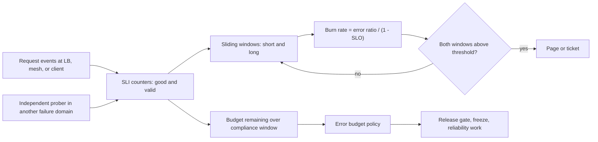

# SLIs, SLOs, and Error Budget Engineering

## TL;DR

- An SLI is a ratio of good events to valid events, built from counters or cumulative histogram buckets that sum across instances. Averaged or pre-aggregated percentiles cannot be summed this way, so they make bad SLIs.
- Burn rate is the observed error ratio divided by the budget ratio (1 - SLO). A multiwindow alert (long window for significance, short window for fast reset) is a budget-spend threshold in disguise: the 14.4x / 1h / 5m page fires after about 2% of a 30-day budget is spent, whatever the severity.
- Detection speed buys you little against pipeline latency. At 99.99% one minute of total outage burns 23% of a 30-day budget, and 1 to 3 minutes of metric delay is the real alerting floor. Both clouds also fail silently if the SLI is measured only inside the failure domain it is meant to detect.
- An error budget policy only works if it is written before the incident, defines scope and exceptions, and is wired to a release gate. On a rolling 30-day window, one 4-hour outage at 99.9% freezes releases for about 30 days unless the policy uses burn-based tiers or a bounded freeze.
- For LLM serving the default HTTP success SLI is wrong. Streams return 200 at the first byte, so you need stream-completion, time-to-first-token (TTFT), and inter-token-latency ratio SLIs. You must also decide explicitly whether provider throttles (429) burn your budget (they do, from the user's point of view).

## Mental Model



The data plane produces events and the SLI is a pure function of those events: two monotonic counters, or a cumulative histogram, aggregated into a good fraction.
Everything downstream is arithmetic on windows of that ratio.
Alerting asks "how fast is the budget leaving right now" (burn rate over short and long windows), while governance asks "how much is left over the compliance window" (budget remaining).
These are different questions answered by different windows, and conflating them is the root of most noisy or silent SLO programs.
The measurement point and the monitoring pipeline are themselves dependencies with their own failure domains, which is why an independent prober feeds the same counters.

## Internals

### SLI as a ratio of good to valid events

The SLI specification says what a good event is.
The SLI implementation says where and how it is measured.
Keep them separate, because a single specification (for example "a request is good if it returns non-5xx within 300 ms") can be implemented at the load balancer, in the service, or at the client, and each implementation has a different blind spot.

A well-formed SLI has three parts:

- Valid events: the denominator. This excludes traffic that should not count, such as health checks, requests rejected for client faults (400, 401, 403, 404), and your own synthetic traffic if you track it separately.
- Good events: the numerator. For availability that is typically non-5xx. For latency it is requests completing under a threshold.
- Aggregation: sums of counters across instances, then a ratio. Never average per-instance ratios, because a 10 rps instance and a 10,000 rps instance would get equal weight.

The measurement point determines what you cannot see:

- Server-side counters miss requests that never reach the server (DNS failure, connection refused, TLS failure, overloaded accept queues).
- Load balancer metrics see requests the LB accepted. In AWS ALB, `RequestCount` is incremented only when the node could choose a target, so a 503 generated because no healthy target exists can be absent from the denominator (AWS docs, as of 2026-10, UNVERIFIED in this pass).
- Client-side or edge measurement sees what users see, but you may not own the client.
- Synthetic probes see a constant, known workload, but only the paths you encode.

Prefer layered SLIs: an LB or mesh SLI for fast paging and a black-box prober or client SLI for ground truth.
Cross-check them continuously, since divergence between them is itself a signal that one is blind.

### Latency SLIs are threshold ratios, not percentiles

A "p99 under 300 ms" alarm and a "99% of requests under 300 ms" SLO look equivalent, but they are computed very differently.

Percentiles do not compose.
The p99 of a fleet is not the mean, max, or median of per-instance p99s.
The mean of p99s can be below the true fleet p99 when one instance is slow, and the max of p99s can be above it.
Cumulative histogram buckets do compose: you sum bucket counters across instances and divide the `le=300ms` bucket by the `+Inf` bucket.
That ratio is a proper SLI and feeds the same burn-rate machinery as availability.

Histogram quantile estimation also has a systematic error.
Prometheus-style `histogram_quantile` assumes observations are uniformly distributed inside a bucket and interpolates linearly, so error is bounded by the bucket width at the quantile.
If you define the SLO threshold at a bucket boundary you read the exact count, with no interpolation.
This is why the SLO threshold must be a bucket boundary, and why changing bucket layouts during a deploy silently changes the SLI.
High-dynamic-range histograms (HdrHistogram, Gil Tene's "How NOT to Measure Latency" work) keep bounded relative error across several orders of magnitude, at the cost of more series or memory.

On AWS, CloudWatch publishes percentile statistics per period and dimension set, and percentiles cannot be recombined afterwards.
CloudWatch also offers a percentile-rank statistic (`PR(lower:upper)`) that returns the fraction of samples within a range, which is exactly a good-fraction latency SLI (AWS docs, as of 2026-10, UNVERIFIED in this pass).
On GCP, Cloud Monitoring distribution metrics carry bucket counts, and a distribution-cut SLI counts the fraction of samples in a range (Google Cloud docs, as of 2026-10, UNVERIFIED in this pass).

Fan-out makes tail latency worse than per-service numbers suggest.
Dean and Barroso (CACM 2013, "The Tail at Scale") give the example that if each of 100 servers exceeds 1 s on 1% of requests, then 1 - 0.99^100 = 63% of user requests that wait on all 100 will see at least one slow response.
For retrieval-augmented or multi-agent inference paths, define the latency SLI at the user-facing boundary, not per hop.

### Burn-rate algebra

Let the SLO be s, the budget ratio b = 1 - s, the compliance window P, and the observed error ratio over a window e.
Burn rate BR = e / b.
At constant BR the budget lasts P / BR.
For P = 30 days: BR 1 lasts 30 days, BR 6 lasts 5 days, BR 14.4 lasts 50 hours (derived).

If you want to alert when a fraction f of the budget has been spent within a window W, the threshold is BR = f * P / W.
The Google SRE Workbook recommends these starting points for paging and ticketing (Google SRE Workbook ch. 5, as of 2026-10):

| Severity | Budget spent | Long window | Short window | Burn rate |
| --- | --- | --- | --- | --- |
| Page | 2% | 1 hour | 5 minutes | 14.4 |
| Page | 5% | 6 hours | 30 minutes | 6 |
| Ticket | 10% | 3 days | 6 hours | 1 |

Check: 0.02 * 720 h / 1 h = 14.4, 0.05 * 720 / 6 = 6, 0.10 * 720 / 72 = 1.
At a 99.9% SLO the corresponding error-ratio thresholds are 1.44%, 0.6%, and 0.1% (derived).

### The detection invariant

This is the mechanism most guides skip.
Assume uniform traffic, a clean long window at the start of an incident, and a sustained error ratio e >= BR * b.
The long window average crosses the threshold when e * t / W = BR * b, so t = W * BR * b / e.
The budget burned at that moment is e * t / (b * P) = BR * W / P = f.

The budget spent at detection is independent of the severity of the failure.
A total outage and a 20x burn both page after about 2% of the budget is gone; the total outage just gets there in 52 seconds and the 20x burn gets there in about 43 minutes.
The simulator in the worked example confirms this: 2.0% at 20x, 5.0% for the 6x tier, 10.0% for the ticket tier (sandbox run, 1-minute resolution).
Two consequences follow:

- Choosing f (2%, 5%, 10%) is the actual design decision. The burn-rate and window numbers are derived from it.
- Faster detection only helps when the pipeline is faster than the time the budget takes to drain. For a total outage at 99.99% (4.32 min budget per 30 days), the alert threshold is crossed after 5 seconds in theory, but 1 minute of outage already burns 23% and 3 minutes burn 69% (derived). Metric ingestion latency, not window math, sets the floor.

Traffic uniformity matters.
The budget is measured in requests, but the ratio-based burn rate is normalised per window.
With diurnal traffic, a night-time error spike has a high ratio but low request cost, and the same ratio at peak costs far more requests.
Burn-rate alerting therefore over-alerts at the trough and is slower than the request-weighted budget cost at the peak.
Mitigations: a minimum-volume guard on the short window, request-weighted budget reporting on dashboards, and ticket-tier alerts tied to absolute failed-request counts.

### Why the short window exists

Without the short window, a long-window alert stays firing long after the incident ends.
For a 1-hour window and a threshold of 1.44%, an outage of any length keeps the alert in ALARM until almost all of the bad minutes age out of the window, which is about 59 minutes after recovery (derived).
The short window is ANDed in so the alert clears when the problem is actually gone.
The Workbook suggests a short window of one twelfth of the long window (Google SRE Workbook ch. 5, as cited by Splunk Observability docs, as of 2026-10).
The simulator measures reset times of 5 minutes (page, fast), 30 minutes (page, slow), and 6 hours (ticket) after a total outage, matching the short windows.
The Workbook also quantifies the alternative: alerting when a 10-minute error ratio simply reaches the SLO fires on events that consume only 0.02% of the monthly budget, and can fire up to 144 times per day while the service still meets its SLO (Google SRE Workbook ch. 5, as of 2026-10).

Gaps are by design.
A sustained 5.9x burn never pages under the table above and only produces a ticket after 3 days, having already consumed about 10% and heading for exhaustion in about 5 days.
If that is unacceptable, add a tier (for example 3x over 1 day) rather than lowering the 6x threshold.

### Sliding versus tumbling windows, and pipeline lag

The guarantees above assume a true sliding window evaluated frequently.
Prometheus-style recording rules with range vectors and Cloud Monitoring's `select_slo_burn_rate(slo, lookback)` filter both compute over a trailing interval.
CloudWatch metric alarms evaluate a statistic per period, and each evaluation uses datapoints at the alarm's period granularity.
Whether a 1-hour-period alarm sees a sliding hour or period-aligned buckets, including partially filled ones, changes the window guarantee, and you should verify it from alarm history before trusting the invariant above (AWS docs, as of 2026-10, UNVERIFIED in this pass).
An "N out of M datapoints" alarm is a different statistic from a window ratio.
Requiring 6 consecutive hourly ratios above 6x is stricter than requiring the 6-hour aggregate ratio above 6x: a single 36x hour followed by five clean hours pages in the second case and never in the first.

Total alert latency is the sum of:

- Metric emission and ingestion delay. ALB publishes at 60-second granularity (AWS docs, as of 2026-10, UNVERIFIED in this pass). Cloud Monitoring documents a per-metric visibility delay, up to about 180 seconds for many system metrics (Google Cloud docs, as of 2026-10, UNVERIFIED in this pass).
- Evaluation interval of the alert engine.
- Notification delivery and human acknowledgement.

### Compliance windows, rolling versus calendar, and the freeze cliff

A rolling window never resets.
A bad minute stays in the window for exactly P and then drops out.
A calendar window resets to full budget at the boundary.

Rolling window cliff.
At 99.9% over 30 days the budget is 43.2 minutes.
A 4-hour total outage (240 minutes) is 5.6x the budget.
You are back within SLO only when the in-window bad time falls to 43.2 minutes, which is when 196.8 minutes of the outage have aged out.
That is about 30 days after the outage began, so a literal "freeze while out of SLO" rule keeps releases frozen for roughly the entire window (derived).
Policies handle this with one of:

- A fixed, time-boxed freeze scoped to the cause (for example, freeze until the corrective action items are verified, maximum N days).
- Tiered gating on budget remaining and burn rate instead of a binary in/out-of-SLO flag.
- A shorter window (the Workbook's example policy uses four weeks).

Calendar window amnesty.
At a month boundary the budget refills.
Teams then rationally push risky launches to day 1 and avoid them in the last week.
That is the incentive the budget was meant to create, but it concentrates risk and distorts the signal.
Calendar windows also make mid-month budgets incomparable across months with different lengths.
Rolling windows are better for gating, calendar windows are better for contracts and reporting; many teams run both and gate on the rolling one.

### Composition and dependency budgets

For serial hard dependencies availability multiplies.
Three hard dependencies at 99.95% each cap a service at 0.9995^3 = 99.85% (derived), so a 99.9% SLO is infeasible unless some dependencies are made soft (cached, degraded, queued) or retried across independent replicas.
Redundancy follows 1 - (1 - a)^n only for independent failures.
Replicas sharing a deployment pipeline, a configuration push, a control plane, or an availability zone fail together, and that correlation is what budgets actually get spent on.
See [[17-Cloud-AI-Engineering/Volume_01_Cloud_Architecture_Principles/Chapter_02_Regions_Zones_and_Static_Stability|Regions, Zones, and Static Stability]] and [[17-Cloud-AI-Engineering/Volume_01_Cloud_Architecture_Principles/Chapter_03_Cell_Based_Architecture_and_Shuffle_Sharding|Cell-Based Architecture and Shuffle Sharding]].

Retries interact with SLIs.
A client-side SLI per logical request hides server errors that retries absorb, while a server-side SLI per attempt counts each failed attempt and also shows the amplified load.
Track both: the logical-request SLI is what the user sees, and the per-attempt SLI is what the dependency sees.
See [[17-Cloud-AI-Engineering/Volume_07_Reliability_and_SRE/Chapter_03_Resilient_Communication_Retries_Jitter_and_Circuit_Breakers|Resilient Communication: Retries, Jitter, and Circuit Breakers]].

### The monitoring plane is a dependency

The SLI pipeline has a control plane (rule and alarm definitions, notification routing) and a data plane (metric ingestion and evaluation), and both can fail with the thing they watch.
Principles from [[17-Cloud-AI-Engineering/Volume_01_Cloud_Architecture_Principles/Chapter_04_Control_Plane_vs_Data_Plane_Separation|Control Plane vs Data Plane Separation]] apply directly:

- The pager path must not depend on the failing region's services. Prefer notification routes that work when the primary region's control plane is degraded.
- A missing-data policy of "not breaching" turns a metrics outage into a green dashboard. For counters that should always move, alert on absence of data separately.
- Run at least one prober outside the failure domain being measured. Probers from another region or provider see failures that in-region metrics cannot.

### Error budget policy

The policy is a pre-agreed decision table, not a dashboard.
The Google example policy (Google SRE Workbook, "Example Error Budget Policy", as of 2026-10) contains these elements:

- If the service is within SLO, releases proceed per the release policy.
- If the service exceeded its budget over the preceding four-week window, all changes and releases stop except P0 issues and security fixes until the service is back within SLO.
- If a single incident consumes more than 20% of the budget over four weeks, the team must write a postmortem, and it must contain at least one P0 action item addressing the root cause.
- It lists situations where the freeze is lifted or loosened, for example when the outage was caused by a company-wide networking problem rather than by the service itself, and situations where a team is held responsible, such as a code bug or procedural error, or miscategorised errors that failed to consume budget.

Engineering mechanics that make the policy real:

- The gate reads the same SLI the pager uses, from one source of truth, so there is no second calculation to argue about.
- The gate is advisory-to-hard by tier: for example, budget remaining below 50% requires extra review, below 20% blocks non-critical changes, at 0% blocks everything except an allow-list.
- Scope is per service and per SLO, and cause attribution is recorded (own change, dependency, platform), because attribution decides whether the freeze is the right remedy. Freezing releases does not fix a dependency outage.
- SLO definitions live in Git with review, because weakening an SLO is the cheapest way to dodge a freeze.

### LLM serving SLIs

Serving large models changes SLI design in four ways (see [[17-Cloud-AI-Engineering/Volume_11_LLM_Serving_and_Inference_Systems_on_Cloud/Chapter_01_LLM_Inference_Mechanics_Prefill_vs_Decode|LLM Inference Mechanics]] and [[17-Cloud-AI-Engineering/Volume_11_LLM_Serving_and_Inference_Systems_on_Cloud/Chapter_11_End_to_End_Latency_Throughput_and_Cost_Modeling|End-to-End Latency, Throughput, and Cost Modeling]]):

- Streaming responses send HTTP 200 and headers at the first token. A mid-stream failure (decoder crash, preemption, client disconnect, upstream reset) is invisible to a status-code SLI. Define a stream-completion SLI: streams that end with the protocol's normal terminator over streams started.
- Latency has two components with different physics. TTFT is dominated by queueing and prefill (compute bound). Inter-token latency is dominated by decode (memory-bandwidth bound). Define separate threshold-ratio SLIs for each, with thresholds per prompt-length bucket, because prefill time scales with input tokens.
- Goodput beats throughput. A request that meets TTFT and ITL thresholds and completes is good. Count tokens of good requests, not tokens generated.
- Throttling is an availability event from the user's view. A 429 caused by your own quota, a provider's regional capacity, or tenant rate limits is a failed user request. Exclude it from the provider's SLI if you are the provider, but include it in the tenant-visible SLI. Quota planning is therefore an SLO activity; see [[13-Agentic-AI/Agentic_AI_Zero_to_Godhood/Volume_12_Production_Engineering/Chapter_06_Capacity_and_Quotas|Capacity and Quotas]] and [[17-Cloud-AI-Engineering/Volume_07_Reliability_and_SRE/Chapter_02_Load_Shedding_Backpressure_and_Admission_Control|Load Shedding, Backpressure, and Admission Control]].

Quality is a separate axis.
A fast, available endpoint that returns degraded outputs after a bad model rollout is not caught by availability or latency SLIs.
Use evaluation-based quality SLIs fed by sampled production traffic; see [[13-Agentic-AI/Agentic_AI_Zero_to_Godhood/Volume_10_Evaluation_and_Observability/Chapter_07_Production_Evaluation|Production Evaluation]].

### Foundational references

- Beyer et al., Site Reliability Engineering (O'Reilly 2016), ch. 4 "Service Level Objectives", and the Site Reliability Workbook (2018), ch. 2 and ch. 5.
- Dean and Barroso, "The Tail at Scale", CACM 2013.
- Adams et al., "Monarch: Google's Planet-Scale In-Memory Time Series Database", VLDB 2020, for how a planet-scale metrics system separates collection, evaluation, and regional versus global query paths.
- Pelkonen et al., "Gorilla: A Fast, Scalable, In-Memory Time Series Database", VLDB 2015, for the observation that monitoring data is read mostly in the last few hours and that availability of recent data beats durability of old data.

## Numbers to Know

| Quantity | Value | Source |
| --- | --- | --- |
| Error budget, 99.9% over 30 days | 43.2 minutes of total outage | derived, 0.001 * 43,200 min |
| Error budget, 99.95% / 99.99% / 99.999% over 30 days | 21.6 min / 4.32 min / 0.43 min (26 s) | derived |
| Error budget, 99.9% over 28 days / 7 days | 40.32 min / 10.08 min | derived |
| One minute of total outage as share of 30-day budget | 2.31% at 99.9%, 23.1% at 99.99% | derived |
| Page tier 1 | burn 14.4, 1h long, 5m short, 2% budget | Google SRE Workbook ch. 5, as of 2026-10 |
| Page tier 2 | burn 6, 6h long, 30m short, 5% budget | Google SRE Workbook ch. 5, as of 2026-10 |
| Ticket tier | burn 1, 3d long, 6h short, 10% budget | Google SRE Workbook ch. 5, as of 2026-10 |
| Time to exhaust 30-day budget at burn 14.4 / 6 / 1 | 50 h / 120 h / 30 d | derived |
| Error-ratio thresholds at 99.9% for those tiers | 1.44% / 0.6% / 0.1% | derived |
| Error-ratio thresholds at 99.99% | 0.144% / 0.06% / 0.01% | derived |
| Short window to long window ratio | 1/12 | Google SRE Workbook, as cited by Splunk docs, as of 2026-10 |
| Naive 10-minute "error ratio >= SLO" alert | up to 144 alerts/day while still meeting SLO; each event may consume only 0.02% of monthly budget | Google SRE Workbook ch. 5, as of 2026-10 |
| Low-traffic example | 10 req/h, 99.9% SLO: one failure is a 10% hourly error ratio, 13.9% of the 30-day budget, and the budget allows about 7 failures per 30 days | Google SRE Workbook ch. 5, as of 2026-10 (the text prints 1,000x burn; the arithmetic gives 100x) |
| Example policy windows | 4-week budget window; postmortem if one incident consumes more than 20% | Google SRE Workbook, Example Error Budget Policy, as of 2026-10 |
| Freeze after a 4-hour total outage, rolling 30d, 99.9%, binary in/out-of-SLO rule | about 30 days | derived |
| Serial availability of 3 hard dependencies at 99.95% | 99.85% | derived |
| Fan-out tail: 100 servers, each 1% slow | 63% of requests see at least one slow response | Dean and Barroso, CACM 2013 |
| ALB metric publication interval | 60 s | AWS docs, as of 2026-10, UNVERIFIED in this pass |
| Cloud Monitoring metric visibility delay | up to about 180 s for many system metrics | Google Cloud docs, as of 2026-10, UNVERIFIED in this pass |
| CloudWatch high-resolution alarm period | 10 s or 30 s | AWS docs, as of 2026-10, UNVERIFIED in this pass |
| CloudWatch alarm price | order of $0.10 to $0.30 per alarm-month depending on type | AWS pricing, as of 2026-10, UNVERIFIED in this pass |

## AWS vs GCP Mechanism Parity

| Mechanism | AWS | GCP |
| --- | --- | --- |
| Native SLO object | CloudWatch Application Signals service level objectives with request-based and period-based SLIs, rolling or calendar intervals (AWS docs, as of 2026-10, UNVERIFIED in this pass) | Cloud Monitoring Service Monitoring SLOs: request-based and windows-based SLIs, rolling or calendar compliance periods (Google Cloud docs, as of 2026-10, UNVERIFIED in this pass) |
| Burn-rate alert primitive | Application Signals burn-rate alarms (UNVERIFIED), or DIY metric-math alarms plus composite alarms | `select_slo_burn_rate(slo, lookback)` filter in an alert policy condition (Google Cloud docs, as of 2026-10, UNVERIFIED in this pass) |
| Multiwindow AND | `aws_cloudwatch_composite_alarm` with `ALARM(a) AND ALARM(b)` | Alert policy with `combiner = "AND"` over two conditions |
| Window semantics | Alarm period and evaluation periods; period-aligned versus sliding must be verified from alarm history; max evaluation range is capped (UNVERIFIED) | Lookback duration over trailing interval for SLO burn rate |
| Prometheus-native alternative | Amazon Managed Service for Prometheus with recording and alerting rules | Google Cloud Managed Service for Prometheus, rules evaluated in managed rule evaluators |
| Ratio from raw metrics | Metric math with `FILL` and `IF` for sparse series and zero denominators | MQL or PromQL ratio of aligned rate series; SLO filters take good, bad, and total filters |
| Latency SLI from distributions | Percentile-rank statistic or EMF histograms; no native cumulative-bucket sum across arbitrary dimensions (UNVERIFIED) | Distribution metrics with bucket counts; distribution-cut SLI |
| Missing data | `treat_missing_data` per alarm: breaching, notBreaching, ignore, missing | Alert policy "no data" handling per condition; metric-absence conditions |
| Edge SLI source | ALB/NLB/CloudFront metrics, CloudWatch Synthetics canaries | Load balancer and Cloud Run request metrics, Uptime checks from multiple regions |
| IaC resources | `aws_cloudwatch_metric_alarm`, `aws_cloudwatch_composite_alarm`, `aws_budgets_budget` | `google_monitoring_custom_service`, `google_monitoring_slo`, `google_monitoring_alert_policy`, `google_billing_budget` |
| Notification path | SNS topic with CloudWatch alarm actions | Notification channels (email, Pub/Sub, webhooks, and others) |
| Consensus and consistency note | Metrics are eventually consistent across the pipeline; the alarm engine reads recent data that may still be filling in | Same; per-metric ingestion delay is documented in the metric descriptor |
| Key difference | Native alarms are per-period statistics, so sliding-window burn rate needs Application Signals or AMP | Burn-rate over a lookback is a first-class filter, so multiwindow is two conditions |

## Worked Example: Multiwindow Burn-Rate Alerts on Both Clouds, With a Simulator

### Step 1: back-of-the-envelope sizing

Workload: an HTTP API at 200 requests per second with a 99.9% availability SLO over 30 days.

1. Requests per window: 200 * 2,592,000 s = 518.4 million.
2. Budget: 0.001 * 518.4 M = 518,400 failed requests.
3. Page tier 1 (14.4x, 1h/5m): threshold error ratio 1.44% means 2.88 failed requests per second. It fires after about 2% of budget, which is 10,368 failures.
4. Page tier 2 (6x, 6h/30m): 0.6% means 1.2 failures per second, firing after 5% of budget, which is 25,920 failures.
5. Minimum useful traffic for the 5-minute window. At 1.44% you want at least about 5 expected failures in the short window to avoid single-error pages: 300 s * rps * 0.0144 >= 5 means rps >= 1.16. Below that, use a minimum-volume guard or the low-traffic options in the Workbook (artificial traffic, combine services, or change the product so a failure is less impactful).
6. Alarm count: 2 page tiers * (2 window alarms + 1 composite) = 6 alarms per service. For 200 services that is 1,200 alarms. At an assumed $0.10 to $0.30 per alarm-month (AWS pricing, as of 2026-10, UNVERIFIED in this pass) that is $120 to $360 per month, a figure to weigh against a managed SLO product or a single Prometheus rule group.

### Step 2: simulator (runs offline, ASCII, numpy only)

This script simulates the three Workbook tiers on a uniform-traffic synthetic outage and reports detection time, budget burned at detection, and reset time.

```python
"""Sliding-window multiwindow multi-burn-rate simulator (1-minute resolution, uniform traffic)."""
import numpy as np

SLO = 0.999
B = 1.0 - SLO                    # error budget ratio
PERIOD_MIN = 30 * 24 * 60        # 30-day compliance window in minutes
RULES = [                        # name, burn rate, long window (min), short window (min)
    ("page_fast", 14.4, 60, 5),
    ("page_slow", 6.0, 360, 30),
    ("ticket", 1.0, 4320, 360),
]

def run(err_ratio, start_min, dur_min, horizon_min=6 * 24 * 60):
    e = np.zeros(horizon_min)
    e[start_min:start_min + dur_min] = err_ratio
    cs = np.concatenate([[0.0], np.cumsum(e)])
    res = {}
    for name, burn, long_w, short_w in RULES:
        thr = burn * B
        fired = cleared = None
        for t in range(1, horizon_min + 1):
            lng = (cs[t] - cs[max(0, t - long_w)]) / long_w
            sht = (cs[t] - cs[max(0, t - short_w)]) / short_w
            firing = lng >= thr and sht >= thr
            if firing and fired is None and t > start_min:
                fired = t - start_min
            if fired is not None and not firing and cleared is None and t > start_min + dur_min:
                cleared = t - (start_min + dur_min)
        res[name] = (fired, cleared)
    return res

SCENARIOS = [
    ("100% outage, 30 min", 1.0, 30),
    ("100% spike, 4 min", 1.0, 4),
    ("2.0% errors (20x), 2 h", 0.02, 120),
    ("0.7% errors (7x), 12 h", 0.007, 720),
    ("0.3% errors (3x), 24 h", 0.003, 1440),
    ("0.15% errors (1.5x), 48 h", 0.0015, 2880),
]

if __name__ == "__main__":
    print("budget minutes at 100%% errors per 30d: %.1f" % (B * PERIOD_MIN))
    for label, err, dur in SCENARIOS:
        out = run(err, 300, dur)
        cells = []
        for name, (fired, cleared) in out.items():
            if fired is None:
                cells.append("%s=none" % name)
            else:
                burned = err * min(fired, dur) / (B * PERIOD_MIN) * 100
                cells.append("%s=det %dm/%.1f%% budget/reset %dm" % (name, fired, burned, cleared))
        print("%-28s %s" % (label, " | ".join(cells)))
```

Output from a sandbox run (not a cloud measurement):

| Scenario | page_fast | page_slow | ticket |
| --- | --- | --- | --- |
| 100% outage, 30 min | det 1m, 2.3% budget, reset 5m | det 3m, 6.9%, reset 30m | det 5m, 11.6%, reset 360m |
| 100% spike, 4 min | det 1m, 2.3%, reset 5m | det 3m, 6.9%, reset 30m | none |
| 2.0% errors (20x), 2 h | det 44m, 2.0%, reset 2m | det 109m, 5.0%, reset 22m | none |
| 0.7% errors (7x), 12 h | none | det 309m, 5.0%, reset 5m | det 618m, 10.0%, reset 309m |
| 0.3% errors (3x), 24 h | none | none | det 1440m, 10.0%, reset 241m |
| 0.15% errors (1.5x), 48 h | none | none | det 2880m, 10.0%, reset 121m |

Read the table with the detection invariant in mind.
Budget burned at detection sits at about 2%, 5%, and 10% regardless of severity, except where one-minute resolution quantises it (the 100% outage rows).
A 4-minute total outage burns 9.3% of the budget and the slow page fires only 3 minutes in, which is a real consequence of window size: paging policy is not a substitute for fast mitigation.

### Step 3: AWS - CloudWatch metric math alarms plus composite alarms

This sketch uses ALB metrics.
`FILL` handles sparse series where a metric is not emitted for periods with zero events, and `IF` guards division by zero.
The denominator adds `HTTPCode_ELB_5XX_Count` because `RequestCount` excludes requests rejected before a target is chosen (AWS docs, as of 2026-10, UNVERIFIED in this pass); a small double count is possible for 504s emitted after target selection.
Validate with `terraform validate` and test the expression in the console before relying on it.

```hcl
terraform {
  required_providers {
    aws = { source = "hashicorp/aws", version = ">= 5.0" }
  }
}

variable "alb_arn_suffix" { type = string } # for example app/my-alb/50dc6c495c0c9188
variable "alert_email" { type = string }
variable "slo_target" {
  type    = number
  default = 0.999
}

locals {
  budget = 1 - var.slo_target
  tiers = {
    fast = { burn = 14.4, long = 3600, short = 300 }
    slow = { burn = 6, long = 21600, short = 1800 }
  }
  windows = merge([
    for k, t in local.tiers : {
      "${k}-long"  = { burn = t.burn, period = t.long }
      "${k}-short" = { burn = t.burn, period = t.short }
    }
  ]...)
}

resource "aws_sns_topic" "pager" {
  name = "slo-burn-pager"
}

resource "aws_sns_topic_subscription" "email" {
  topic_arn = aws_sns_topic.pager.arn
  protocol  = "email"
  endpoint  = var.alert_email
}

resource "aws_cloudwatch_metric_alarm" "burn" {
  for_each            = local.windows
  alarm_name          = "slo-burn-${each.key}"
  comparison_operator = "GreaterThanOrEqualToThreshold"
  evaluation_periods  = 1
  datapoints_to_alarm = 1
  threshold           = each.value.burn * local.budget
  treat_missing_data  = "notBreaching"

  metric_query {
    id = "t5xx"
    metric {
      namespace   = "AWS/ApplicationELB"
      metric_name = "HTTPCode_Target_5XX_Count"
      dimensions  = { LoadBalancer = var.alb_arn_suffix }
      period      = each.value.period
      stat        = "Sum"
    }
  }
  metric_query {
    id = "e5xx"
    metric {
      namespace   = "AWS/ApplicationELB"
      metric_name = "HTTPCode_ELB_5XX_Count"
      dimensions  = { LoadBalancer = var.alb_arn_suffix }
      period      = each.value.period
      stat        = "Sum"
    }
  }
  metric_query {
    id = "req"
    metric {
      namespace   = "AWS/ApplicationELB"
      metric_name = "RequestCount"
      dimensions  = { LoadBalancer = var.alb_arn_suffix }
      period      = each.value.period
      stat        = "Sum"
    }
  }
  metric_query {
    id         = "bad"
    expression = "FILL(t5xx, 0) + FILL(e5xx, 0)"
  }
  metric_query {
    id         = "total"
    expression = "FILL(req, 0) + FILL(e5xx, 0)"
  }
  metric_query {
    id          = "ratio"
    expression  = "IF(total > 0, bad / total, 0)"
    label       = "error_ratio"
    return_data = true
  }
}

resource "aws_cloudwatch_composite_alarm" "page" {
  for_each      = local.tiers
  alarm_name    = "slo-burn-page-${each.key}"
  alarm_rule    = "ALARM(\"${aws_cloudwatch_metric_alarm.burn["${each.key}-long"].alarm_name}\") AND ALARM(\"${aws_cloudwatch_metric_alarm.burn["${each.key}-short"].alarm_name}\")"
  alarm_actions = [aws_sns_topic.pager.arn]
  ok_actions    = [aws_sns_topic.pager.arn]
}

resource "aws_budgets_budget" "lab" {
  name         = "slo-lab"
  budget_type  = "COST"
  limit_amount = "10"
  limit_unit   = "USD"
  time_unit    = "MONTHLY"
  notification {
    comparison_operator        = "GREATER_THAN"
    threshold                  = 80
    threshold_type             = "PERCENTAGE"
    notification_type          = "ACTUAL"
    subscriber_email_addresses = [var.alert_email]
  }
}
```

Two caveats are baked into this design.
Each window alarm uses one datapoint at a period equal to the window, which approximates a trailing window only to the extent CloudWatch evaluates the most recent period; verify with `aws cloudwatch describe-alarm-history` while injecting synthetic 5xx at a known rate.
The 3-day ticket tier is omitted because a 259,200-second alarm period may exceed alarm limits (UNVERIFIED in this pass); use a daily report from Application Signals or Prometheus for that tier.

### Step 4: GCP - Service Monitoring SLO plus burn-rate alert policy

```hcl
terraform {
  required_providers {
    google = { source = "hashicorp/google", version = ">= 5.0" }
  }
}

variable "project_id" { type = string }
variable "billing_account_id" { type = string }
variable "alert_email" { type = string }
variable "cloud_run_service" { type = string }

provider "google" {
  project = var.project_id
}

resource "google_monitoring_notification_channel" "email" {
  display_name = "slo-lab-email"
  type         = "email"
  labels       = { email_address = var.alert_email }
}

resource "google_monitoring_custom_service" "api" {
  service_id   = "slo-lab-api"
  display_name = "SLO lab API"
}

locals {
  base = join(" ", [
    "metric.type=\"run.googleapis.com/request_count\"",
    "resource.type=\"cloud_run_revision\"",
    "resource.labels.service_name=\"${var.cloud_run_service}\"",
  ])
}

resource "google_monitoring_slo" "availability" {
  service             = google_monitoring_custom_service.api.service_id
  slo_id              = "availability-999"
  display_name        = "99.9 percent of requests are not 5xx, rolling 30 days"
  goal                = 0.999
  rolling_period_days = 30
  request_based_sli {
    good_total_ratio {
      bad_service_filter   = "${local.base} metric.labels.response_code_class=\"5xx\""
      total_service_filter = local.base
    }
  }
}

resource "google_monitoring_alert_policy" "fast_burn" {
  display_name = "SLO fast burn: 14.4x over 1h AND 5m"
  combiner     = "AND"
  conditions {
    display_name = "burn rate over 1h"
    condition_threshold {
      filter          = "select_slo_burn_rate(\"${google_monitoring_slo.availability.name}\", \"3600s\")"
      comparison      = "COMPARISON_GT"
      threshold_value = 14.4
      duration        = "0s"
    }
  }
  conditions {
    display_name = "burn rate over 5m"
    condition_threshold {
      filter          = "select_slo_burn_rate(\"${google_monitoring_slo.availability.name}\", \"300s\")"
      comparison      = "COMPARISON_GT"
      threshold_value = 14.4
      duration        = "0s"
    }
  }
  notification_channels = [google_monitoring_notification_channel.email.id]
}

resource "google_monitoring_alert_policy" "slow_burn" {
  display_name = "SLO slow burn: 6x over 6h AND 30m"
  combiner     = "AND"
  conditions {
    display_name = "burn rate over 6h"
    condition_threshold {
      filter          = "select_slo_burn_rate(\"${google_monitoring_slo.availability.name}\", \"21600s\")"
      comparison      = "COMPARISON_GT"
      threshold_value = 6
      duration        = "0s"
    }
  }
  conditions {
    display_name = "burn rate over 30m"
    condition_threshold {
      filter          = "select_slo_burn_rate(\"${google_monitoring_slo.availability.name}\", \"1800s\")"
      comparison      = "COMPARISON_GT"
      threshold_value = 6
      duration        = "0s"
    }
  }
  notification_channels = [google_monitoring_notification_channel.email.id]
}

resource "google_billing_budget" "lab" {
  billing_account = var.billing_account_id
  display_name    = "slo-lab"
  amount {
    specified_amount {
      currency_code = "USD"
      units         = "10"
    }
  }
  threshold_rules { threshold_percent = 0.8 }
  threshold_rules { threshold_percent = 1.0 }
}
```

### Step 5: cost, validation, and teardown

- Cost estimate: 6 alarms, 1 SNS topic, and 1 budget on AWS; 1 SLO, 2 alert policies, 1 channel, and 1 budget on GCP. The estimate is a few dollars per month at most under the assumed unit prices, plus whatever the monitored workload costs. Alarm and alert-policy unit prices are UNVERIFIED in this pass; check current pricing pages before applying.
- Validation: inject a known error rate (for example a fault-injecting sidecar returning 503 for 3% of requests) and check that both tiers fire in the order the simulator predicts. Inject a 100% failure for 5 minutes and confirm the fast page fires within about 2 to 4 minutes (60 to 180 seconds of metric delay plus window math) and clears within about 5 to 10 minutes.
- Teardown, run in each stack directory:

```bash
terraform destroy -auto-approve
```

Confirm in the console that no composite alarms, SLOs, or alert policies remain, and delete the budget if it was created outside the stack.

## Failure Modes and Pitfalls

### The alert that never fires because the metric never arrives

With `treat_missing_data = notBreaching`, an ingestion outage or a deleted target group turns the alarm green.
ALB metrics are sparse for some series, so you need `FILL`, and a separate absence alarm on `RequestCount` for services that should always have traffic.
In Cloud Monitoring, add a metric-absence condition for the SLI's total series.

### Measuring only inside the failure domain

When a regional load balancer, DNS record, or certificate fails, in-region server metrics show fewer requests, not more errors.
The ratio stays healthy while users see failures.
Public post-incident analyses show how failures in shared dependencies and control planes hit monitoring and paging at the same time as the services they watch.
Examples to study: AWS's post-event summary for the October 2025 us-east-1 disruption rooted in DynamoDB DNS management (https://aws.amazon.com/message/101925/, details UNVERIFIED in this pass), and Google Cloud's incident report for the June 2025 Service Control event on status.cloud.google.com (details UNVERIFIED in this pass).
The SLO lesson is the same in both: a regional or global dependency event can spend a month's budget in hours across many services at once, per-service freeze rules do not model this, and your paging path must not share its failure domain with the thing being paged on.
See [[17-Cloud-AI-Engineering/Volume_07_Reliability_and_SRE/Chapter_07_Anatomy_of_Major_Cloud_Outages|Anatomy of Major Cloud Outages]].

### Denominator errors

The ALB `RequestCount` caveat above is one example.
Others: health checks counted as valid traffic (inflates the ratio), retries counted per attempt (inflates both numerator and denominator), canary traffic mixed into the aggregate, and sampled logs used as the denominator.
A denominator that is too small inflates the burn rate and a denominator that is too large hides outages.
Always compute the SLI from one source of truth and diff it against an independent source weekly.

### Success at the first byte

Streaming and long-poll APIs return 200 before the work is done.
A status-code SLI reports 100% while streams die mid-response.
Count terminal events, not status lines.

### Retry masking and amplification

Client libraries retry 5xx and timeouts.
A client-side SLI per logical request looks fine while the server sees up to N times the load, which can tip a degraded service into collapse.
Alert on retry ratio and on per-attempt SLI in addition to the logical-request SLI.

### Averaging over tenants

A single large tenant can satisfy the aggregate SLO while a small tenant sees 90% availability.
Segment SLIs by tenant tier or cell (see [[17-Cloud-AI-Engineering/Volume_01_Cloud_Architecture_Principles/Chapter_03_Cell_Based_Architecture_and_Shuffle_Sharding|Cell-Based Architecture and Shuffle Sharding]]), and keep cardinality bounded: per-tenant alarms cost money and per-tenant series cost cardinality.

### Canary traffic hidden by aggregate SLIs

A 5% canary failing completely is a 5% error ratio in aggregate and pages at 50x burn, but a 1% canary failing completely is below a 14.4x threshold at 99.9% only if the failure rate is under 1.44%.
Use a per-version SLI for canary analysis; see [[17-Cloud-AI-Engineering/Volume_06_Infrastructure_as_Code_and_Delivery/Chapter_06_Progressive_Delivery_and_Deployment_Pipelines|Progressive Delivery and Deployment Pipelines]].

### SLO set to current performance

An SLO copied from last quarter's actuals either freezes the team permanently (too tight) or never constrains anything (too loose).
Derive targets from user journeys and dependency ceilings.
Expect the first quarter to be a calibration period with a documented review cadence.

### Policy gaming and cliff effects

Weakened SLOs, shifted windows, and re-categorised errors are all ways to dodge a freeze.
The Workbook's own example policy lists miscategorised errors as a reason the budget may be treated as exceeded; review error classification as part of postmortems.
Calendar windows add a month-start rush, and rolling windows add a long freeze tail after one large incident.

### Noisy low-traffic services

At 10 requests per hour, one failure is a 10% hourly error ratio and consumes 13.9% of the 30-day budget (Google SRE Workbook ch. 5, as of 2026-10).
Fixes from the Workbook: generate artificial traffic, combine services into a larger user-visible function, or change the design so that a logical failure needs multiple attempts.
A minimum-volume guard on the short window is a common additional mitigation.

### Alert-engine and quota limits

Large alarm fleets hit account quotas for alarms and API throttles on `PutMetricAlarm` and `GetMetricData` (AWS docs, as of 2026-10, UNVERIFIED in this pass), and per-project alert policy and condition quotas on GCP (Google Cloud docs, as of 2026-10, UNVERIFIED in this pass).
Manage alerts as generated code from SLO definitions, not by hand, and test the generator.

## Security and Cost Angles

### IAM and key scoping

- The release-gate service needs read access to metrics only (for example `cloudwatch:GetMetricData` on AWS and `roles/monitoring.viewer` on GCP) and write access to one feature flag or pipeline variable. It must not hold deploy permissions, so a compromised gate cannot ship code.
- Restrict who can edit SLO definitions, alarm actions, and notification channels. Weakening an alert or muting a route is an integrity attack on your reliability signal. Require code review and log changes through CloudTrail and Cloud Audit Logs.
- CloudWatch alarms publishing to an SNS topic encrypted with a customer managed KMS key need the key policy to allow the CloudWatch service principal, otherwise notifications fail silently. Test the full path with `aws cloudwatch set-alarm-state` (AWS docs, as of 2026-10, UNVERIFIED in this pass).
- SNS topic policies should restrict `sns:Publish` to the specific alarm ARNs with `aws:SourceArn` and `aws:SourceAccount` conditions.

### Private network boundaries

- Keep probers and notification webhooks inside controlled egress paths. On AWS use VPC endpoints for CloudWatch and SNS where supported; on GCP confirm that the Monitoring API is covered by your VPC Service Controls perimeter and that on-call tooling can still reach it during an incident (Google Cloud docs, as of 2026-10, UNVERIFIED in this pass).
- Do not put customer identifiers, prompts, or other sensitive content in metric labels or alarm descriptions. SLI dimensions should be coarse (route, tier, cell), not per-user.

### Unit economics

- The cost of each nine is roughly a 10x smaller budget. Going from 99.9% (43.2 min per month) to 99.99% (4.3 min) usually requires multi-zone or multi-region active-active, automated failover tested monthly, and staffed on-call coverage, so price the SLO before agreeing to it.
- Alarm and series counts scale as services * tiers * windows. Generate rules from SLO specs and share recording rules across services.
- High-resolution metrics and custom metrics have per-metric charges (AWS pricing, as of 2026-10, UNVERIFIED in this pass). Prefer counters emitted by the load balancer or mesh over per-request custom metrics where the SLI allows.
- Log-based SLIs are costly at high volume. Use counters for the SLI and logs for debugging.
- Error budget as a currency. A budget left unspent is waste. A policy that converts remaining budget into faster rollout cadence, chaos experiments, or capacity cuts turns reliability into a cost lever; see [[17-Cloud-AI-Engineering/Volume_09_FinOps_and_Cloud_Economics/Chapter_05_GPU_and_TPU_Unit_Economics|GPU and TPU Unit Economics]] for the accelerator-side trade-off.

### SLO versus SLA

An SLA is a contract with financial remedy, usually looser than the internal SLO, with exclusions and a claim process.
Keep the internal SLO strictly tighter than any SLA you offer, and do not assume that a provider's SLA credit compensates for your own customers' losses.
Provider SLA figures change; check current terms before basing a design on them (UNVERIFIED in this pass).

## Interview Questions and Model Answers

### Question 1 (L5 - Senior)

Derive the burn-rate thresholds for a 99.9% SLO over 30 days, and explain why the page uses two windows.

#### Model Answer

Define burn rate as observed error ratio divided by the budget ratio b = 0.001.
If I want to be told when a fraction f of the budget has been spent inside a window W of a compliance period P, the threshold is BR = f * P / W.
For f = 2% and W = 1 hour in a 720-hour period, BR = 14.4, which is an error ratio of 1.44%.
For f = 5% and W = 6 hours, BR = 6, which is 0.6%.
For f = 10% and W = 3 days, BR = 1, which is 0.1% and appropriate for a ticket.

Two windows solve two different problems.
The long window sets significance: it ensures that by the time the alert fires, at least f of the budget is really gone, independent of severity, because the crossing time is W * BR * b / e and the budget spent at that moment is BR * W / P.
The short window sets reset time: without it, a one-hour window above 1.44% stays in alarm for about an hour after a total outage ends, so the pager keeps firing and responders stop trusting it.
Making the short window about one twelfth of the long one bounds reset to roughly 5 minutes for the fast page.
Both must be true to fire.

Trade-offs: the policy has deliberate gaps.
A sustained 5.9x burn never pages and exhausts the budget in about 5 days, and I only learn about it through the 3-day ticket.
If that is unacceptable I add a tier, I do not lower the existing thresholds.

#### Follow-up Interviewer Question

The service moves to 99.99%. Which of your numbers change, which do not, and what stops being achievable?

Expected direction: the burn rates and budget fractions do not change, the error-ratio thresholds drop to 0.144%, 0.06%, and 0.01%, and the 4.32-minute budget means 1 minute of total outage burns 23% before metric latency of one to three minutes is even considered.
The pipeline latency, not the window math, now dominates, and 5-minute short windows over minute-granularity metrics have too few samples at moderate traffic.

### Question 2 (L5 - Senior)

Define an availability SLI for a public API behind an Application Load Balancer or a Google Cloud load balancer. What is valid, what is good, and where do you measure?

#### Model Answer

The SLI is good events divided by valid events over a trailing window, aggregated as sums of counters across all targets.

Valid events are requests that reached the service's responsibility: exclude health checks, my own synthetic traffic (tracked in a separate SLI), and requests rejected for client faults such as 400, 401, 403, and 404.
Treat 429 explicitly.
If throttling is a deliberate rate limit protecting the service from a misbehaving tenant, exclude it from the service SLI and track it as a tenant-level signal.
If throttling is caused by my own capacity shortfall, it is a failure from the user's point of view and counts as bad.

Good events are non-5xx responses.
I also count timeouts and connection failures the load balancer observed, which on AWS means adding `HTTPCode_ELB_5XX_Count` to both the numerator side of bad and the denominator, because `RequestCount` does not include requests rejected before target selection (AWS docs, as of 2026-10, UNVERIFIED in this pass).

Measurement: load balancer metrics are the primary pager signal because they are fast and independent of the application.
They miss requests that never reach the LB, so I add a black-box prober from outside the region and, if I own the clients, a client-side SLI.
Divergence between the LB SLI and the prober SLI is itself an alert.

#### Follow-up Interviewer Question

Most of your clients retry on 503 up to three times. A dependency starts failing 30% of calls. What does each SLI show, and what do you alert on?

Expected direction: the client logical-request SLI shows about 3% failures (0.3^3 = 2.7%), the per-attempt SLI shows 30%, and load on the dependency has increased by up to 1 + 0.3 + 0.09 + 0.027 = about 1.42x, so alert on per-attempt burn and on retry ratio, and cap retries with budgets.

### Question 3 (L6 - Staff)

A team's latency SLO is "p99 of request latency under 300 ms" implemented as an alarm on the CloudWatch p99 statistic with a 5-minute period. What is wrong with it, and what do you replace it with?

#### Model Answer

Three problems.

First, the alarm is a statistic over a period, not a ratio over a window.
It says nothing about how much budget was spent: ten minutes at p99 = 301 ms and ten minutes at p99 = 5 s page identically, and a period with 0.9% of requests at 10 s never alarms although those requests are violations.
It also cannot drive error budgets, because there is no good/valid count to sum over a month.

Second, percentiles do not aggregate.
If I have per-instance or per-dimension p99s, no function of them gives the fleet p99.
The mean can understate it, the max can overstate it.
Even if I publish only the fleet-level statistic, I cannot slice it later by route or tenant tier without re-publishing.

Third, a percentile threshold gives no tail information about the 1% it excludes, which is where fan-out amplifies pain: with 100 parallel calls each slow 1% of the time, 63% of user requests see at least one slow call (Dean and Barroso, CACM 2013).

Replacement: define the SLI as the fraction of requests faster than 300 ms.
In Prometheus-style systems that is the `le="0.3"` bucket divided by the total count, summed across instances.
The threshold must sit exactly on a bucket boundary, otherwise interpolation introduces error up to the bucket width.
On CloudWatch I would emit the data as a distribution and use a percentile-rank statistic, or compute good and total counters from EMF and use a ratio metric-math alarm (AWS docs, as of 2026-10, UNVERIFIED in this pass).
The same multiwindow burn-rate machinery then applies unchanged, with the SLO stated as "99% of requests under 300 ms over 30 days".

Operational caveat: bucket layouts are part of the SLI.
If a library upgrade changes default buckets, the SLI shifts silently, so I pin bucket boundaries in the metric definition and add a CI check.

#### Follow-up Interviewer Question

Product wants a second threshold at 1 s for "slow but acceptable". How do you express two thresholds without double-paging, and how do you reconcile them with one error budget?

Expected direction: two SLOs on the same histogram (for example 90% under 300 ms and 99% under 1 s) with separate budgets, one paging policy tied to the stricter-in-user-impact SLO, and no combined budget because the thresholds are not additive.

### Question 4 (L6 - Staff)

Customers reported a 40-minute regional outage. Your burn-rate pager never fired. Walk through what you check, in order, and what you change.

#### Model Answer

I treat "pager silent during a real outage" as an incident of the monitoring system with its own postmortem.
Checks, in order of cheapest to most structural:

1. Was data arriving? Look at the SLI numerator and denominator series for the period. If the denominator dropped to zero, the alarm's missing-data policy (`notBreaching`) or the absence of an absence-alert explains the silence.
2. Was the measurement point inside the failure? If the regional load balancer, DNS, or certificate was the failing component, server-side and LB metrics saw no requests. That is the survivorship problem: failed requests are never counted.
3. Was the alert engine or the notification path degraded? Check alarm history for evaluation errors, and test the SNS or notification channel path. If the pager depended on the same region, it may have been down.
4. Were thresholds and windows correct for this failure shape? A partial failure at 3% errors is a 30x burn on 99.9%, which should have paged. A 0.8% failure for 40 minutes is 8x, which pages only on the 6-hour tier after about 3.75 hours at constant rate, because 8x is below 14.4x. Whether that is a policy gap is a product decision.

Changes: a prober in another region and, ideally, another provider path that exercises DNS, TLS, and the full data path, feeding the same SLI; an absence alarm on the denominator; a pager route that does not depend on the affected region (static stability applied to monitoring); and a game-day that kills the metric pipeline to prove the absence alarm works.
I also add a tier or lower the slow-page threshold only if the budget impact of the missed pattern justifies the extra noise, using the simulator to estimate precision.

#### Follow-up Interviewer Question

How do you test the alert rules themselves before the next outage, without waiting for one?

Expected direction: unit tests with synthetic series (promtool-style for rules), replay of historical incident data through the rule engine, controlled fault injection in a canary cell with expected detection time and budget burn as pass criteria, and a scheduled kill-the-metrics drill; see [[17-Cloud-AI-Engineering/Volume_07_Reliability_and_SRE/Chapter_05_Chaos_Engineering_and_Game_Days|Chaos Engineering and Game Days]].

### Question 5 (L6 - Staff)

You own a 99.9% service on a rolling 30-day window. A bad deploy caused a 4-hour total outage. The written policy says "freeze releases while out of SLO". How long are you frozen, is that sensible, and how do you redesign the policy?

#### Model Answer

The budget is 43.2 minutes, and the outage was 240 minutes, 5.6 times the budget.
Under a literal rule, I am back within SLO only when the bad minutes in the window drop to 43.2, so 196.8 minutes of the outage must age out.
That takes about 30 days from the outage start, so the freeze lasts essentially the whole window.
That is not sensible: the freeze duration is set by the window length and not by the risk or the remediation, so it penalises the team for a long time while making no reliability progress, and people will route around it (reclassify errors, shorten the window, mark releases as P0).

Redesign:

- Gate on budget remaining and recent burn, not a binary flag. For example: above 50% remaining, normal; 20 to 50%, extra review and smaller blast radius; below 20%, only reliability fixes and P0s; at or below 0%, freeze with a defined exit.
- Make the exit event-based, not time-based: a freeze ends when the postmortem's P0 actions that address the root cause are shipped and verified, plus a minimum soak period, with a maximum duration (for example 7 to 14 days) signed off by the service owner and the reliability lead.
- Scope the freeze to the change class that caused the problem. If a deploy caused it, restrict deploys, not config or capacity changes needed for safety.
- Attribute causes. The Workbook's example policy relaxes enforcement when the outage came from a company-wide networking problem, and tightens it for code bugs, procedural errors, or miscategorised errors; I keep an attribution field per incident so that platform-caused spend does not freeze the product team.
- Postmortem trigger: any single incident over 20% of the budget requires a postmortem with at least one P0 action (Google SRE Workbook example policy, as of 2026-10). This incident was 555% of budget, so that is an automatic exec-visible review.

I would also keep a calendar-window report for contracts but gate on the rolling window to avoid month-start risk concentration.

#### Follow-up Interviewer Question

The VP says reliability work is blocking a launch tied to a contract date. How do you structure the exception, and what do you refuse to concede?

Expected direction: a documented, time-boxed exception owned by a named executive, with explicit compensating controls (staged rollout, feature flag, on-call staffing, abort criteria on burn rate), the budget debt recorded rather than erased, and a refusal to retroactively change the SLO or reclassify the outage.

### Question 6 (L7+ - Principal)

Design the SLO and error budget structure for a multi-tenant LLM inference platform on AWS and GCP that fronts Bedrock and Vertex AI models plus self-hosted GPU pools. The platform commits to enterprise customers. What are the SLIs, how do you compose budgets with provider dependencies, and where does the design break?

#### Model Answer

Start from customer-visible journeys, not components: a streaming chat completion, a batch job, and an embeddings call.

SLIs per journey, defined as ratios over valid requests:

- Availability: requests that start a stream, and that end with the protocol's normal terminator, divided by valid requests. This counts mid-stream failures that a status-code SLI misses.
- TTFT: fraction of requests with first token under a threshold per prompt-length bucket, because prefill cost scales with input tokens.
- Inter-token latency: fraction of tokens or streams whose decode cadence stays under a threshold, since decode is memory-bandwidth bound and degrades under batch pressure.
- Goodput: tokens delivered by requests that met both latency SLIs.
- Admission: fraction of requests rejected by my platform for capacity (429 or 503 from me), reported separately per tenant tier, because quota and throttling are product decisions, not just failures.
- Quality: sampled online evaluation against golden sets, tracked as its own SLO and tied to model and prompt rollouts.

Composition: the platform is a router over several dependencies (Bedrock regional endpoints, Vertex endpoints, self-hosted pools).
If a single provider path is a hard dependency at 99.9%, my ceiling is 99.9% before my own failures.
To offer more I need independent fallbacks: cross-region and cross-provider routing with health-based failover, plus a degraded mode (smaller model or cached response) that counts as good only if it meets a defined quality floor.
I compute achievable availability as 1 - sum of the correlated-failure probabilities, not as a product of independent terms, because shared control planes, shared quota exhaustion, and regional events are correlated.
Throttling is the most underestimated term: provider quotas and burst limits are enforced per account and region, and a noisy tenant can consume the shared quota and make the platform look unavailable to everyone else.
So the budget allocation includes per-tenant quota shaping and priority classes (see [[17-Cloud-AI-Engineering/Volume_07_Reliability_and_SRE/Chapter_02_Load_Shedding_Backpressure_and_Admission_Control|Load Shedding, Backpressure, and Admission Control]] and [[17-Cloud-AI-Engineering/Volume_11_LLM_Serving_and_Inference_Systems_on_Cloud/Chapter_09_Managed_Inference_Amazon_Bedrock_vs_Vertex_AI|Managed Inference: Amazon Bedrock vs Vertex AI]]).

Tiering: enterprise tenants get a dedicated SLO and dedicated budget accounting (cell or shuffle-shard assignment so one tenant's poison request cannot burn another's budget), and best-effort tenants share a pool with a lower target.
The SLA to customers is looser than the internal SLO, with documented exclusions (customer-caused throttles, provider-wide events if contractually carved out), and I do not promise anything I cannot measure independently of the provider.

Where it breaks:

- Provider SLIs are opaque. I can only measure my own view, so I run probes through each provider path and treat provider status pages as hints, not truth.
- Latency SLIs depend on prompt-length distribution, which tenants control. A tenant shifting to long contexts degrades TTFT for others unless prefill is isolated or admission is token-aware.
- GPU capacity is a supply-side dependency with scale-out times in minutes (image pull, weight load), so autoscaling cannot absorb a step change and the SLO must assume pre-warmed headroom; see [[17-Cloud-AI-Engineering/Volume_11_LLM_Serving_and_Inference_Systems_on_Cloud/Chapter_08_Cloud_GPU_Autoscaling_and_Cold_Start_Mitigation|Cloud GPU Autoscaling and Cold-Start Mitigation]].
- Quality regressions are slow to detect and not covered by burn-rate math over per-request ratios.

#### Follow-up Interviewer Question

Your largest provider's SLA is 99.9% per region and you promised customers 99.95%. Show the arithmetic that makes this defensible, and the assumption that is most likely to be false.

Expected direction: two independent paths with 99.9% each give 1 - 0.001^2 = 99.9999% if failures were independent, but correlated events (shared identity or control-plane failures, simultaneous quota exhaustion, the same model version bug) dominate, so the defensible number comes from historical correlated-event frequency, and independence is the assumption most likely to be false.

### Question 7 (L7+ - Principal)

You inherit an org with 400 services where every team set 99.9% by default, error budgets are not used for decisions, and pages are mostly noise. What is your 12-month plan, and how do you know it is working?

#### Model Answer

Diagnose before prescribing: measure page volume per service, percentage actionable, budget spent per cause (own change, dependency, platform, load), and correlation between SLI breaches and real customer pain (support tickets, churn, retries, abandonment).
A default 99.9% for everything means the SLO carries no information.

Plan:

1. Tier services by user impact and dependency position. A handful of critical user journeys get explicit SLOs; internal services inherit targets derived from the journeys they serve (a dependency needs to be tighter than its consumers). Most services get a standard template with a minimum viable SLI, not a bespoke target.
2. Standardise the SLI pipeline: one library or mesh-level source of good and valid counters, one generator from SLO specs to alarms and rules, same multiwindow tiers everywhere. Alarms stay a function of the SLO spec, which also fixes the 1,200-alarm maintenance problem.
3. Replace threshold alerts with burn-rate pages on the top tiers, with a short window for reset time and a minimum-volume guard for low-traffic services. Track page precision and recall per service as a first-class metric.
4. Write the error budget policy at the org level with team-level overrides: tiers of gating, cause attribution, exceptions, and an escalation path. Wire the gate into CI/CD so enforcement is mechanical.
5. Make budgets visible: weekly budget reports, a platform-level view that separates platform-caused from team-caused spend, and a budget-review forum for services below 20%.
6. Attack the dominant spend. In most fleets change-induced incidents dominate budget burn, so progressive delivery, automatic rollback on canary burn, and config validation come before any SLO ceremony.

How I know it works: page volume per on-call shift falls while the share of pages tied to customer-visible impact rises; time to detect for customer-reported incidents falls (fewer incidents are reported first by customers); the fraction of budget spent on own-change incidents falls; the number of services with SLOs that correlate with customer outcomes rises; and SLO edits that loosen targets are rare and reviewed.
A failure signal is budgets always full (SLOs too loose) or always empty (too tight), so I review the distribution of budget remaining across the fleet each quarter.

Costs I accept: the SLI library migration will take two to three quarters, some teams will resist tiering, and a few services will be explicitly declared "no SLO, best effort" to focus effort.

#### Follow-up Interviewer Question

A product team shows that its checkout SLO has been 100% green for six months while conversion fell 4%. How do you debug the SLO itself?

Expected direction: suspect the SLI definition (blind to client-side failures, slow-but-successful responses, or specific cohorts), compare against client-side and funnel telemetry, segment by device, geography, and tenant, check the denominator for excluded traffic, and add a latency or completion SLI tied to the journey; an SLO that does not move when users are unhappy is a measurement bug, not a success.

## Further Reading

- [Google SRE Workbook, Chapter 5: Alerting on SLOs](https://sre.google/workbook/alerting-on-slos/) - The primary source for burn rates, multiwindow alerts, the low-traffic discussion, and the precision, recall, detection-time, and reset-time framework used here.
- [Google SRE Workbook: Example Error Budget Policy](https://sre.google/workbook/error-budget-policy/) - A concrete policy with freeze rules, the 20% postmortem trigger, and exception language.
- [Google SRE Workbook, Chapter 2: Implementing SLOs](https://sre.google/workbook/implementing-slos/) - How to pick SLIs, set targets, and document the policy.
- [Site Reliability Engineering, Chapter 4: Service Level Objectives](https://sre.google/sre-book/service-level-objectives/) - The original definitions of SLI, SLO, and SLA and the argument against percentile averaging.
- Dean and Barroso, "The Tail at Scale", CACM 2013 - Explains why fan-out turns per-server tail latency into user-visible latency.
- Adams et al., "Monarch: Google's Planet-Scale In-Memory Time Series Database", VLDB 2020 - How a planet-scale metrics system structures collection, evaluation, and queries, which bounds what freshness and availability an SLI pipeline can promise.
- Pelkonen et al., "Gorilla: A Fast, Scalable, In-Memory Time Series Database", VLDB 2015 - Why recent monitoring data is prioritised for availability, and the compression that makes high-resolution SLIs affordable.
- [AWS Builders' Library: Building dashboards for operational visibility](https://aws.amazon.com/builders-library/building-dashboards-for-operational-visibility/) - Practical guidance on what operators need to see during an incident, relevant to SLO and budget dashboards.
- [AWS: Summary of the Amazon DynamoDB Service Disruption in US-EAST-1 (October 2025)](https://aws.amazon.com/message/101925/) - A public post-event analysis of a regional dependency failure, useful for reasoning about correlated budget spend (details not re-verified in this pass).
- Gil Tene, "How NOT to Measure Latency" (conference talk) - Why coordinated omission and percentile averaging corrupt latency SLIs.
- [[17-Cloud-AI-Engineering/Volume_07_Reliability_and_SRE/Chapter_02_Load_Shedding_Backpressure_and_Admission_Control|Load Shedding, Backpressure, and Admission Control]] - The next chapter, covering how to protect the budget once the burn-rate alarm fires.
- [[17-Cloud-AI-Engineering/Volume_02_AWS_Deep_Dive/Chapter_14_Observability_CloudWatch_Metrics_Logs_and_X_Ray|Observability: CloudWatch, Metrics, Logs, and X-Ray]] and [[17-Cloud-AI-Engineering/Volume_03_GCP_Deep_Dive/Chapter_16_Observability_Cloud_Monitoring_Logging_and_Trace|Observability: Cloud Monitoring, Logging, and Trace]] - The metric pipelines these SLIs run on.
- [[13-Agentic-AI/Agentic_AI_Zero_to_Godhood/Volume_12_Production_Engineering/Chapter_04_Reliability_Patterns|Reliability Patterns]] - Application-level reliability patterns for agentic systems that complement the infrastructure SLOs here.
