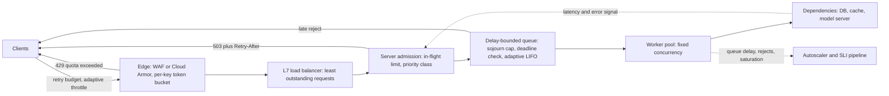

# Load Shedding, Backpressure, and Admission Control

## TL;DR

1. Past the saturation point a server does not degrade gracefully. Its queue grows without bound, every response arrives after the client timeout, and goodput collapses to a small fraction of capacity. In the simulation below, an unbounded FIFO at 1.5x capacity delivered 19 rps of useful work from a 200 rps server.
2. Control delay, not queue length. Queue length is a proxy that is wrong whenever service time changes, so measure sojourn time (time in queue) and in-flight work, and bound both against the client's deadline.
3. Reject early and cheaply, and say why. Use 429 for "you exceeded your share" and 503 for "I am overloaded", with `Retry-After` and a deadline-aware dequeue. A rejection that costs 10% of a request's service time still burns capacity at high shed rates.
4. Shed by priority and keep the choice consistent per caller. Random shedding multiplies failure across multi-call transactions. Client-side adaptive throttling (SRE book, K=2) and retry budgets stop the fleet from converting a rejection into more load.
5. Shedding creates blind spots. Health checks must not shed, SLIs must count rejections, autoscalers must scale on saturation rather than CPU, and a shed system can still be metastable if retries or cold caches sustain the overload after the trigger is gone.

## Mental Model



An overloaded system is a pipeline of finite-capacity stages, and every stage must have an explicit, cheap, early "no".
The edge enforces who may send how much (rate, token bucket).
The server enforces how much work may be in progress (concurrency) and how long it may wait (delay bound).
Priority decides who is refused first.
The client closes the loop: it reads the refusal and sends less, rather than more.
Backpressure is the same idea propagated upstream: a full stage must make its predecessor slow down, either through protocol (TCP receive window, HTTP/2 flow control, pull-based consumers) or through explicit rejection signals.
The failure this chapter prevents is the implicit alternative, where "no" is expressed as a timeout after a long wait, which wastes the work and triggers retries.

## Internals

### Why overload collapses instead of degrading

Let capacity be C requests per second and offered load be L > C.
Excess work accumulates in some queue at rate (L - C).
Little's Law (L = lambda x W) means a queue holding N items at drain rate C imposes wait N / C on the next arrival.
If the client timeout is T, then once the queue exceeds C x T items, every request that reaches the head has already been abandoned.
The server keeps working at 100% utilization on requests no one is waiting for, so goodput (responses delivered inside the deadline) falls toward zero while throughput looks healthy.
The [AWS Builders' Library article on load shedding](https://aws.amazon.com/builders-library/using-load-shedding-to-avoid-overload/) (David Yanacek, December 2019) makes the same argument: client-perceived availability drops to near zero past the tipping point even though the server is technically up.

Even below saturation, latency is nonlinear.
For an M/M/1 queue, mean time in system is S / (1 - rho), so 50% utilization gives 2x the service time, 80% gives 5x, 90% gives 10x, and 99% gives 100x.
Real servers have variance worse than exponential, so the knee arrives earlier.
This is why a fixed "max connections" number is hard to pick: too low rejects load the server could serve, too high lets latency run away.

Overload also feeds itself.
Timeouts trigger retries, retries add load, and the added load causes more timeouts.
Bronson et al. ("Metastable Failures in Distributed Systems", HotOS 2021) and Huang et al. ("Metastable Failures in the Wild", OSDI 2022) name the pattern: a trigger pushes the system past a threshold, a sustaining effect (retries, cache-miss amplification, GC, connection storms) keeps it there, and the system does not recover when the trigger is removed.
Load shedding is one of the few mechanisms that breaks the sustaining loop, which is why it belongs to the data plane and must not depend on the control plane (see [[17-Cloud-AI-Engineering/Volume_01_Cloud_Architecture_Principles/Chapter_04_Control_Plane_vs_Data_Plane_Separation|Control Plane vs Data Plane Separation]]).

### The layered control stack

Four mechanisms operate at different layers, and production systems need all of them.

1. Rate limiting (who may send how much per unit time) protects against a single tenant or abusive client and enforces contracts. It does not protect capacity, because aggregate rate is the wrong variable when request cost varies.
2. Concurrency limiting (how much work is in progress) protects capacity directly, because in-flight count is the quantity Little's Law ties to latency.
3. Queue management (how long accepted work may wait) bounds latency and decides which waiting requests to serve or drop.
4. Priority and fairness shedding (who is refused when a limit binds) protects the important work and isolates tenants from each other.

Stripe's engineering write-up on rate limiters ([Scaling your API with rate limiters](https://stripe.com/blog/rate-limiters)) describes the same layering as four limiters: a request rate limiter, a concurrent-requests limiter, a fleet-usage load shedder reserving capacity for critical traffic, and a worker-utilization load shedder that drops lower-priority traffic first.

### Token buckets and GCRA

A token bucket has refill rate r and capacity b.
A request of cost c is admitted if the bucket holds at least c tokens, which are then removed.
Sustained rate is bounded by r, and a burst of up to b is permitted after idleness.
A client sending at rate lambda > r drains a full bucket in b / (lambda - r) seconds, then is held to r.

Implementations are lazy.
They store (tokens, last_timestamp) and compute `tokens = min(b, tokens + (now - last) * r)` on each request, so there is no timer per key.
The Generic Cell Rate Algorithm is the equivalent single-value form.
It stores one "theoretical arrival time" TAT per key.
A request is admitted if `now >= TAT - tau`, where tau = (b - 1) x T and T = 1 / r, and then `TAT = max(TAT, now) + T`.
One timestamp means one atomic compare-and-set per decision, which is why it is the common choice for Redis-backed limiters.

The distributed version is where designs diverge.

- Central store (Redis with an atomic script, or DynamoDB conditional writes) gives an exact global limit at the cost of one network round trip per decision and a new availability dependency. See [[04-System-Design/05-Data-Stores/Redis-Architecture|Redis Architecture]].
- Local buckets with limit r/N per node need no coordination but are wrong whenever load balancing is skewed or N changes during autoscaling.
- Leases combine the two: nodes fetch token batches from a central allocator and spend locally, so the central path is amortized and the allocator can fail to a conservative local default. Google's Doorman follows this model.

Cost-weighted buckets matter for AI workloads.
Charging one token per request treats a 50-token prompt like a 100,000-token prompt, which is a capacity-planning error.

### Concurrency limits from Little's Law

If the service has a healthy latency W and you want to serve lambda requests per second, the steady in-flight count is lambda x W.
The right concurrency limit is slightly above that for the peak you are willing to serve, because once in-flight work exceeds the number of requests the hardware can actually process in parallel, extra requests only add queueing delay.
In this chapter's example, 10 workers at 50 ms mean service time give 200 rps capacity, and an in-flight cap of 10 plus a small queue is the right shape.

Static limits go stale whenever service time changes (a deploy, a slow dependency, a noisy neighbor, a cache that went cold).
Adaptive limiters borrow from TCP congestion control.
The Netflix [concurrency-limits](https://github.com/Netflix/concurrency-limits) library implements AIMD, Vegas, and gradient variants.
Vegas-style limiters estimate queue size as `limit x (1 - minRTT / sampleRTT)` and shrink the limit when that estimate exceeds a threshold.
Gradient limiters compute `gradient = minRTT / sampleRTT`, clamp it, and set `newLimit = limit x gradient + headroom`, with headroom around sqrt(limit) so the limit can grow when latency is flat.
The Envoy [adaptive concurrency filter](https://www.envoyproxy.io/docs/envoy/latest/configuration/http/http_filters/adaptive_concurrency_filter) uses the same gradient idea and periodically re-measures minRTT.
Those details are from the projects' documentation and source as I recall them and were not re-verified in this pass (see the UNVERIFIED list).

The mechanism that getting-started guides skip is how the minRTT baseline is obtained and how it goes wrong.

- A gradient controller needs a true unloaded latency. Envoy obtains it by periodically dropping the limit to a tiny value for a measurement window, which is a deliberate, jittered, self-inflicted brownout.
- Mixed request classes poison the baseline. If minRTT is sampled from cheap requests and sampleRTT from expensive ones, the gradient stays below 1 permanently and the limit decays toward its floor, rejecting even cheap requests. Run one limiter per cost class or route.
- Latency is shared with the dependency. A slow downstream shrinks the limit for requests that never touch it.
- CFS CPU throttling in containers inflates latency in 100 ms scheduler quanta and looks like overload to the limiter.

### Queue management: sojourn time, CoDel, and adaptive LIFO

A queue length bound is correct only for one service rate.
Sojourn time, the time an item actually waited, is invariant to service rate and directly comparable to a deadline.
CoDel (Nichols and Jacobson, "Controlling Queue Delay", [ACM Queue 2012](https://queue.acm.org/detail.cfm?id=2209336)) uses sojourn time measured at dequeue.
It distinguishes a good queue (absorbs a burst, drains within an interval) from a bad queue (never drains) by tracking the minimum sojourn time over a sliding interval.
If the minimum stays above `target` for a full `interval`, CoDel enters a dropping state.
Drops then occur at times `t_next = t_prev + interval / sqrt(count)`, so the drop rate ramps up the longer the queue stays bad.
The paper's defaults are target 5 ms and interval 100 ms, derived from Internet round-trip times, and both must be rescaled for an RPC service with a 50 ms service time.

The caveat is that CoDel was designed for closed-loop senders, namely TCP flows that halve their window after a drop.
RPC traffic is typically open-loop: users and upstream services keep sending at the same rate regardless of drops.
Here the control law is too slow.
Each drop increments `count`, so `d(count)/dt = sqrt(count) / interval`.
That gives sqrt(count) = t / (2 x interval) and a drop rate of sqrt(count) / interval = t / (2 x interval^2).
With interval = 200 ms the drop rate rises by about 12.5 per second every second, so reaching 100 drops per second takes about 8 seconds, during which the queue is far past its deadline.
The simulation below shows exactly this: FIFO CoDel recovers only part of the goodput without retries and collapses with retries, while simple delay-bounded policies do not.

Adaptive LIFO is the second half of the technique, described in Facebook's ["Fail at Scale"](https://queue.acm.org/detail.cfm?id=2839461) article alongside controlled delay.
When the queue is backed up, serve the newest request first.
The newest request has the most remaining deadline budget and the highest chance of a useful response, while the oldest are probably abandoned anyway.
Starvation of old requests is the intended trade-off, and it is acceptable only if stale items are purged by deadline and the clients get a timely failure signal.
Without a purge, old items sit in the queue and consume memory until their client timeouts fire.

The third piece is deadline-aware dequeue.
Propagate the caller's absolute deadline in a request header or gRPC deadline, and at dequeue discard any request whose remaining budget is smaller than the expected service time, not just smaller than zero.
Checking only `deadline <= now` is the "fifo_deadline" case in the simulation: it drops the clearly dead requests but then serves requests with a few milliseconds of budget that expire during processing, so 88% of work is still wasted.

### Priority, fairness, and consistent shedding

Google's SRE book ([Handling Overload](https://sre.google/sre-book/handling-overload/)) describes criticality labels carried in RPC metadata and propagated through the call graph: CRITICAL_PLUS, CRITICAL, SHEDDABLE_PLUS, and SHEDDABLE.
Servers shed the lowest class first as utilization rises, and per-customer quotas apply on top of that.
The label travels with the request so a downstream service can shed a SHEDDABLE call from a CRITICAL frontend path appropriately.

Priority alone is not enough, because shedding must also be consistent.
Dropping 33% of requests at random means a user transaction that makes three sequential calls succeeds with probability (2/3)^3, about 30%.
WeChat's DAGOR overload control (Zhou et al., SoCC 2018) addresses this with an admission level derived from a business priority and a user priority, where the user priority is a hash of the user ID that rotates periodically.
The admission threshold is adjusted from the average queueing time at each service, and the threshold is propagated upstream so callers stop sending requests that downstream services will refuse.
The key properties are that the same user is admitted or refused consistently across the call graph, and that wasted upstream work is avoided.
I recall the 20 ms queueing-time threshold from the paper but did not re-verify it.

Fairness between tenants is a separate mechanism from priority.
The Kubernetes API server's API Priority and Fairness (APF) is a clear public implementation (see the [flow control documentation](https://kubernetes.io/docs/concepts/cluster-administration/flow-control/)).

- A `FlowSchema` classifies each request into a flow (schema plus a distinguisher such as user or namespace) and assigns it to a `PriorityLevelConfiguration`.
- Each priority level owns a share of the server's total concurrency (`nominalConcurrencyShares`), and can lend a fraction (`lendablePercent`) to other levels and borrow from them.
- Within a level, a flow is hashed to `handSize` candidate queues out of `queues`, and the request joins the shortest. This is shuffle sharding (see [[17-Cloud-AI-Engineering/Volume_01_Cloud_Architecture_Principles/Chapter_03_Cell_Based_Architecture_and_Shuffle_Sharding|Cell-Based Architecture and Shuffle Sharding]]), so a noisy flow fills only a few queues and the chance that a quiet flow collides with it on all of its candidates is small.
- Requests are charged in "seats" according to estimated width. An expensive LIST occupies many seats for its estimated duration, and queues are dispatched by a fair-queueing virtual-time discipline over that cost. Charging by cost rather than by count is the same lesson as cost-weighted token buckets.
- Rejections return HTTP 429 with a `Retry-After` header.

The same structure (classify, assign class share, shuffle-shard flows into queues, weight by cost) is what a multi-tenant LLM gateway needs.
The AWS Builders' Library [Fairness in multi-tenant systems](https://aws.amazon.com/builders-library/fairness-in-multi-tenant-systems/) article covers the AWS-side reasoning.

### Client-side throttling and retry budgets

The server's "no" is cheaper if the client stops asking.
The SRE book describes adaptive throttling.
Each client tracks, over a recent window (two minutes in the book), `requests` (all attempts including locally rejected) and `accepts` (those the backend accepted), and rejects locally with probability

`p = max(0, (requests - K x accepts) / (requests + 1))`

with K = 2.
If a backend accepts A requests per second and the client's demand is lambda > K x A, then steady state is `p = (lambda - K x A) / lambda`, so the backend sees about K x A requests per second and rejects about (K - 1) x A of them.
K is therefore the explicit price of discovering recovery: lower K protects the backend harder but reacts to recovery slowly, and higher K makes recovery fast but lets the backend spend more capacity on rejections.
The "+1" in the denominator keeps a trickle of probe requests flowing even when accepts is zero.

Retry budgets cap amplification.
Without one, three attempts per request triples load exactly when the backend is weakest.
With a per-client ratio cap (the SRE book suggests roughly 10% extra requests) the worst-case amplification is bounded.
The retry mechanics (backoff, jitter, circuit breakers, deadline propagation) are the subject of [[17-Cloud-AI-Engineering/Volume_07_Reliability_and_SRE/Chapter_03_Resilient_Communication_Retries_Jitter_and_Circuit_Breakers|Resilient Communication: Retries, Jitter, and Circuit Breakers]]; the interaction that matters here is that a shed response must be a signal the client library understands, not a generic 5xx it retries immediately.

### Backpressure below the application

Backpressure exists at every layer, and the invisible ones cause most surprises.

- The Linux accept queue is a hidden FIFO. `listen(fd, backlog)` is capped by `net.core.somaxconn`. When the accept queue is full, with default `tcp_abort_on_overflow=0` the kernel drops the final ACK or SYN, and the client retransmits the SYN after 1 s, then 3 s, then 7 s (cumulative, exponential). Your application sees none of that waiting, so application-level sojourn metrics read healthy while clients see multi-second connect latency.
- TCP flow control (receive window) propagates slow consumers to producers over a single connection but cannot signal per-request priority.
- HTTP/2 and gRPC have per-stream and per-connection flow-control windows and a `SETTINGS_MAX_CONCURRENT_STREAMS` limit. That setting is an admission limit enforced by the protocol, and the "Rapid Reset" attack (CVE-2023-44487, October 2023) abused the gap where a reset stream stopped counting against it while the server still did work.
- Pull-based consumers (Kafka consumers, SQS pollers) are natural backpressure because the consumer sets its own rate, but a deep backlog reintroduces the delay problem. See [[04-System-Design/06-Messaging-and-Streaming/Apache-Kafka|Apache Kafka]] and the Builders' Library [Avoiding insurmountable queue backlogs](https://aws.amazon.com/builders-library/avoiding-insurmountable-queue-backlogs/).
- Bounded in-process channels and thread pools (SEDA-style stages, Welsh et al., SOSP 2001) turn a slow stage into upstream blocking instead of unbounded memory.

## Numbers to Know

All entries tagged UNVERIFIED are recalled from memory of the cited source and were not re-checked against current documentation in this authoring pass.
Treat them as pointers to confirm, not as authoritative limits.

| Quantity | Value | Source and date |
|---|---|---|
| CoDel default target and interval | 5 ms and 100 ms, tuned for Internet RTTs; rescale for RPC | Nichols and Jacobson, ACM Queue 2012 (as of 2026-10) |
| CoDel drop schedule | next drop at interval / sqrt(count) after the previous | Nichols and Jacobson, ACM Queue 2012 (as of 2026-10) |
| Adaptive client throttle multiplier | K = 2, `p = max(0, (requests - K x accepts) / (requests + 1))` | Google SRE book, Handling Overload (as of 2026-10) |
| Retry budget guidance | about 10% retry ratio per client, limited attempts per request | Google SRE book (as of 2026-10, UNVERIFIED exact figure) |
| M/M/1 latency multiplier at utilization | 50%: 2x, 80%: 5x, 90%: 10x, 95%: 20x, 99%: 100x of service time | Queueing theory, S / (1 - rho) |
| Goodput collapse time | queue of C x T items at excess (L - C); 200 rps, T = 1 s, L = 300 rps gives about 2 s | Little's Law, derived in this chapter |
| Linux accept queue cap | `net.core.somaxconn` default 4096 since kernel 5.4 | Linux kernel docs (as of 2026-10, UNVERIFIED) |
| SYN retransmit schedule | 1 s, then 3 s, then 7 s cumulative | RFC 6298 and Linux TCP behavior (as of 2026-10, UNVERIFIED) |
| Kubernetes APF status | GA (`flowcontrol.apiserver.k8s.io/v1`) since 1.29 | Kubernetes docs (as of 2026-10, UNVERIFIED) |
| Legacy API server in-flight limits | 400 non-mutating and 200 mutating, summed to size APF total concurrency | Kubernetes docs (as of 2026-10, UNVERIFIED) |
| Amazon API Gateway default throttle | 10,000 rps steady-state and 5,000 burst per account per region, token bucket | AWS docs (as of 2026-10, UNVERIFIED) |
| AWS Lambda default concurrency and scale rate | 1,000 concurrent executions per Region by default; 1,000 new execution environments per 10 s per function | AWS docs (as of 2026-10, UNVERIFIED) |
| DynamoDB provisioned burst | up to 300 s of unused capacity retained | AWS docs (as of 2026-10, UNVERIFIED) |
| Cloud Run request concurrency per instance | default 80, maximum 1000 | Google Cloud docs (as of 2026-10, UNVERIFIED) |
| ALB idle timeout default | 60 s | AWS docs (as of 2026-10, UNVERIFIED) |
| AWS WAF rate-based rule windows | 1, 2, 5, or 10 minutes, so not a sub-second capacity protector | AWS docs (as of 2026-10, UNVERIFIED) |
| HTTP/2 Rapid Reset peak | 398 million rps reported by Google | Google Cloud blog, October 2023 (as of 2026-10, UNVERIFIED) |
| Llama 3 70B KV cache per token (fp16) | 2 x 80 layers x 8 KV heads x 128 dim x 2 bytes = 327,680 bytes | Model architecture arithmetic (as of 2026-10) |
| Simulation, 1.5x overload, unbounded FIFO vs sojourn cap | 19 rps vs 201 rps goodput on a 200 rps server | This chapter's `shed_sim.py`, seed 7 |
| List prices | not tabulated; WAF, API Gateway, and Cloud Armor pricing is per request or per rule and was not verified | UNVERIFIED |

## AWS vs GCP Mechanism Parity

| Layer | AWS | Google Cloud | Critical difference |
|---|---|---|---|
| Edge per-key rate limit | AWS WAF rate-based rules over a multi-minute evaluation window, with custom aggregation keys (UNVERIFIED) | Cloud Armor rate limiting with throttle and rate-based-ban actions (UNVERIFIED) | Both are coarse, seconds-to-minutes mechanisms for abuse and tenant quota. Neither replaces server-side concurrency control. |
| API front door | API Gateway stage, method, and usage-plan throttles (token bucket, rate and burst) | Apigee spike arrest and quota; API Gateway and Cloud Endpoints quotas (UNVERIFIED) | API Gateway documents token-bucket semantics. Apigee spike arrest is, as I recall, a smoothing limiter that spaces requests, not a burst-permitting bucket (UNVERIFIED). |
| L7 load balancing | ALB: least-outstanding-requests algorithm, slow start, 503 when no healthy target, fails open if all targets are unhealthy (UNVERIFIED) | Global external ALB with RATE, UTILIZATION, or CONNECTION balancing modes and per-backend capacity settings; overflow to other regions when backends are full (UNVERIFIED) | ALB has no per-target in-flight cap. GCP lets you declare a capacity per backend that the balancer enforces and spills over. See [[17-Cloud-AI-Engineering/Volume_03_GCP_Deep_Dive/Chapter_05_Cloud_Load_Balancing_GFEs_and_Maglev\|Cloud Load Balancing: GFEs and Maglev]]. |
| Serverless concurrency | Lambda reserved and provisioned concurrency; 429 `TooManyRequestsException` on synchronous throttling | Cloud Run `max-instances` and per-instance concurrency; 429 when no capacity (UNVERIFIED) | Lambda is one request per environment, so concurrency equals environments. Cloud Run multiplexes requests into one instance, so the in-flight limit and CPU saturation interact. See [[17-Cloud-AI-Engineering/Volume_02_AWS_Deep_Dive/Chapter_05_Serverless_Compute_and_Lambda_Internals\|Serverless Compute and Lambda Internals]] and [[17-Cloud-AI-Engineering/Volume_03_GCP_Deep_Dive/Chapter_08_Cloud_Run_and_Serverless_Container_Execution\|Cloud Run and Serverless Container Execution]]. |
| Data-store throttling | DynamoDB per-partition token buckets with burst credit; `ProvisionedThroughputExceededException` and on-demand throttling | Bigtable and Spanner have no per-key token bucket; overload shows as latency and `RESOURCE_EXHAUSTED` or `UNAVAILABLE` (UNVERIFIED) | DynamoDB gives an explicit, client-visible quota signal. Spanner and Bigtable rely more on server-side priority (Spanner request priority) and autoscaling of nodes. |
| Mesh and proxy | Envoy-based meshes (App Mesh reached end of support in September 2026, UNVERIFIED), VPC Lattice, self-managed Envoy or Istio | Cloud Service Mesh, GKE Gateway, Envoy | Envoy local rate limit, adaptive concurrency, and overload manager work identically in both, so the limiter design is portable even when the managed wrapper is not. |
| Kubernetes control plane | EKS API server uses APF | GKE API server uses APF | Same upstream mechanism. Managed providers set total server concurrency, so tenants configure only shares and queues. See [[17-Cloud-AI-Engineering/Volume_05_Kubernetes_and_Platform_Engineering/Chapter_01_Kubernetes_Control_Loop_Internals\|Kubernetes Control Loop Internals]]. |
| Managed model inference | Bedrock per-model request and token quotas, `ThrottlingException` (HTTP 429), cross-Region inference profiles | Vertex AI quotas, dynamic shared quota for Gemini, Provisioned Throughput, 429 `RESOURCE_EXHAUSTED` (UNVERIFIED) | Both throttle on tokens as well as requests. Clients must treat 429 as a pacing signal. See [[17-Cloud-AI-Engineering/Volume_11_LLM_Serving_and_Inference_Systems_on_Cloud/Chapter_09_Managed_Inference_Amazon_Bedrock_vs_Vertex_AI\|Managed Inference: Amazon Bedrock vs Vertex AI]]. |
| Status code semantics | HTTP 429 for throttling, 503 for service overload | HTTP 429 and gRPC `RESOURCE_EXHAUSTED` for quota, 503 and `UNAVAILABLE` for overload | Libraries retry 503 and `UNAVAILABLE` by default. Quota errors usually should not be retried immediately, so choose the status code deliberately. |

## Worked Example: Overload Policy Simulator and Capacity Sizing

This lab runs locally with the Python standard library and an optional local `kind` cluster, so it provisions no billable cloud resources.
Estimated cost: 0 USD.
No budget alarm is needed because nothing is created in an AWS or Google Cloud account.
Teardown for the optional Kubernetes step: `kind delete cluster --name shed-lab`.

### The simulator

A single service has 10 workers and exponential service time with a 50 ms mean, so capacity is 200 rps.
Open-loop arrivals run at 100 rps for 10 s, 300 rps for 30 s, then 100 rps for 30 s, and the report covers the 300 rps window.
Clients time out at 1 s and retry up to twice with no jitter and no budget, which is deliberately naive.
Rejections are free in this model, which flatters every shedding policy and is addressed in the sizing steps.

```python
#!/usr/bin/env python3
"""Discrete-event simulation of overload policies for one service tier.
Stdlib only. Usage: python3 shed_sim.py
"""
import heapq
import math
import random
from collections import deque

WORKERS = 10            # concurrency limit of the server (threads or slots)
MEAN_SVC = 0.050        # seconds, exponential service time -> capacity = 200 rps
TIMEOUT = 1.0           # client per-attempt timeout (seconds)
MAX_ATTEMPTS = 3        # 1 try + 2 retries, no jitter, no budget (deliberately naive)
RETRY_DELAY_REJECT = 0.1
PHASES = [(10.0, 100.0), (30.0, 300.0), (30.0, 100.0)]  # (duration s, arrival rps)
WINDOW = (10.0, 40.0)   # overload window used for the report
SEED = 7


class Attempt:
    __slots__ = ("lid", "n", "sent", "deadline", "done", "enq", "retried")

    def __init__(self, lid, n, sent):
        self.lid, self.n, self.sent = lid, n, sent
        self.deadline = sent + TIMEOUT
        self.done = False
        self.retried = False
        self.enq = sent


class CoDel:
    """CoDel state machine (Nichols and Jacobson, ACM Queue 2012), driven by head sojourn."""

    def __init__(self, target, interval):
        self.target, self.interval = target, interval
        self.first_above = 0.0
        self.dropping = False
        self.count = 0
        self.last_count = 0
        self.drop_next = 0.0

    def _law(self, t):
        return t + self.interval / math.sqrt(max(self.count, 1))

    def should_drop(self, now, head_sojourn, qlen_after):
        if head_sojourn < self.target or qlen_after == 0:
            self.first_above = 0.0
            return False
        if self.first_above == 0.0:
            self.first_above = now + self.interval
            return False
        return now >= self.first_above

    def step(self, now, head_sojourn, qlen_after):
        """Return True if the head item should be dropped now."""
        ok = self.should_drop(now, head_sojourn, qlen_after)
        if self.dropping:
            if not ok:
                self.dropping = False
                return False
            if now >= self.drop_next:
                self.count += 1
                self.drop_next = self._law(self.drop_next)
                return True
            return False
        if ok and (now - self.drop_next < self.interval or now - self.first_above >= self.interval):
            self.dropping = True
            delta = self.count - self.last_count
            self.count = delta if (delta > 1 and now - self.drop_next < 16 * self.interval) else 1
            self.last_count = self.count
            self.drop_next = self._law(now)
            return True
        return False


def run(policy, retries=True, seed=SEED):
    rnd = random.Random(seed)
    ev, seq = [], 0

    def push(t, kind, payload):
        nonlocal seq
        seq += 1
        heapq.heappush(ev, (t, seq, kind, payload))

    # open-loop logical arrivals
    t, lid = 0.0, 0
    for dur, rate in PHASES:
        end = t + dur
        while True:
            t += rnd.expovariate(rate)
            if t >= end:
                t = end
                break
            lid += 1
            push(t, "send", (lid, 1))
    horizon = sum(d for d, _ in PHASES)

    q = deque()
    busy = 0
    codel = CoDel(0.025, 0.200) if policy.startswith("codel") else None
    stats = dict(logical=0, logical_ok=0, ok_attempts=0, rejected=0, timed_out=0,
                 served_expired=0, busy_s=0.0, wasted_s=0.0, lat=[], attempts_sent=0)
    in_window = lambda x: WINDOW[0] <= x < WINDOW[1]
    logical_start = {}
    ok_logical = set()
    first_sent = {}

    def reject(att, now):
        att.done = True
        stats["rejected"] += in_window(att.sent)
        schedule_retry(att, now + RETRY_DELAY_REJECT)

    def schedule_retry(att, when):
        if retries and att.n < MAX_ATTEMPTS and not att.retried:
            att.retried = True
            push(when, "send", (att.lid, att.n + 1))

    def pick(now):
        """Select next item to serve, applying the queue discipline. Returns Attempt or None."""
        while q:
            head = q[0]
            if policy in ("fifo_deadline", "fifo_sojourn_cap", "lifo_deadline", "codel_fifo", "codel_lifo") \
                    and head.deadline <= now:
                q.popleft()  # client already gave up: skip for free
                continue
            if policy == "fifo_sojourn_cap" and now - head.enq > 0.100:
                q.popleft()
                reject(head, now)
                continue
            if policy == "lifo_deadline":
                return q.pop()
            if codel is not None:
                if codel.step(now, now - head.enq, len(q) - 1):
                    q.popleft()
                    reject(head, now)
                    continue
                if policy == "codel_lifo" and (now - head.enq) > codel.target:
                    while q and q[-1].deadline <= now:
                        q.pop()
                    if q:
                        return q.pop()
                    return None
            return q.popleft()
        return None

    def try_start(now):
        nonlocal busy
        while busy < WORKERS:
            att = pick(now)
            if att is None:
                return
            busy += 1
            s = rnd.expovariate(1.0 / MEAN_SVC)
            push(now + s, "done", (att, s))

    while ev:
        now, _, kind, p = heapq.heappop(ev)
        if kind == "send":
            lid, n = p
            att = Attempt(lid, n, now)
            if n == 1 and in_window(now):
                stats["logical"] += 1
                first_sent[lid] = now
            stats["attempts_sent"] += in_window(now)
            logical_start.setdefault(lid, now)
            push(att.deadline, "timeout", att)
            if policy == "fifo_bounded_100" and len(q) >= 100 and busy >= WORKERS:
                reject(att, now)
            elif policy == "fifo_bounded_10" and len(q) >= 10 and busy >= WORKERS:
                reject(att, now)
            else:
                att.enq = now
                q.append(att)
                try_start(now)
        elif kind == "timeout":
            att = p
            if not att.done:
                att.done = True  # client abandons; server may still hold it
                stats["timed_out"] += in_window(att.sent)
                schedule_retry(att, now)
        elif kind == "done":
            att, s = p
            busy -= 1
            if in_window(now):
                stats["busy_s"] += s
            if att.done:  # served after client timeout: pure waste
                stats["served_expired"] += in_window(now)
                if in_window(now):
                    stats["wasted_s"] += s
            else:
                att.done = True
                if in_window(att.sent):
                    stats["ok_attempts"] += 1
                    stats["lat"].append(now - att.sent)
                    ok_logical.add(att.lid)
            try_start(now)
        if now > horizon + 5 and not ev:
            break

    lat = sorted(stats["lat"])
    span = WINDOW[1] - WINDOW[0]
    pct = lambda p: lat[min(len(lat) - 1, int(p * len(lat)))] * 1000 if lat else float("nan")
    return dict(
        policy=policy,
        offered_attempts_rps=stats["attempts_sent"] / span,
        goodput_rps=stats["ok_attempts"] / span,
        reject_rps=stats["rejected"] / span,
        timeout_rps=stats["timed_out"] / span,
        wasted_work_pct=100.0 * stats["wasted_s"] / max(stats["busy_s"], 1e-9),
        p50_ms=pct(0.50), p99_ms=pct(0.99),
        logical_ok_pct=100.0 * len([i for i in ok_logical if i in first_sent]) / max(stats["logical"], 1),
    )


if __name__ == "__main__":
    pols = ["fifo_unbounded", "fifo_bounded_100", "fifo_bounded_10",
            "fifo_deadline", "fifo_sojourn_cap", "lifo_deadline", "codel_fifo", "codel_lifo"]
    for retries in (False, True):
        print("retries=%s  capacity=%.0f rps, offered logical=300 rps in window" %
              (retries, WORKERS / MEAN_SVC))
        print("%-18s %9s %9s %9s %9s %8s %8s %8s" %
              ("policy", "offered", "goodput", "reject", "timeout", "waste%", "p50ms", "p99ms") + " %8s" % "user_ok%")
        for pol in pols:
            r = run(pol, retries=retries)
            print("%-18s %9.0f %9.0f %9.0f %9.0f %8.1f %8.0f %8.0f" %
                  (r["policy"], r["offered_attempts_rps"], r["goodput_rps"], r["reject_rps"],
                   r["timeout_rps"], r["wasted_work_pct"], r["p50_ms"], r["p99_ms"]) + " %8.1f" % r["logical_ok_pct"])
        print()
```

Output from running this script (Python 3.11, seed 7, about 1 s of runtime):

```text
retries=False  capacity=200 rps, offered logical=300 rps in window
policy               offered   goodput    reject   timeout   waste%    p50ms    p99ms user_ok%
fifo_unbounded           300        19         0       281     91.0      533      991      6.3
fifo_bounded_100         300       203        97         0      0.2      524      751     67.7
fifo_bounded_10          300       200       100         0      0.0       78      269     66.7
fifo_deadline            300        51         0       250     88.3      984     1000     16.9
fifo_sojourn_cap         300       201       100         0      0.0      125      317     66.8
lifo_deadline            300       201         0        99      0.0       44      268     67.0
codel_fifo               300       174        93        33     21.0      264      996     57.9
codel_lifo               300       200        81        19      0.0       44      251     66.7

retries=True  capacity=200 rps, offered logical=300 rps in window
policy               offered   goodput    reject   timeout   waste%    p50ms    p99ms user_ok%
fifo_unbounded           834        19         0       814     91.0      533      991      6.3
fifo_bounded_100         623       203       420         0      0.2      531      756     67.7
fifo_bounded_10          633       200       432         0      0.0       83      276     66.7
fifo_deadline            827        25         0       801     90.9      599     1000     16.9
fifo_sojourn_cap         582       201       381         0      0.0      130      321     66.9
lifo_deadline            611       200         0       411      0.0       37      229     66.7
codel_fifo               814        37       197       580     89.6      896     1000     12.2
codel_lifo               605       200       197       208      0.0       38      228     66.7
```

The retries=True `fifo_deadline` row printed `25`, `827`, `801`, `90.9`, `599` and `8.4` in an earlier run before I fixed the retry bookkeeping, so use the code as written above rather than treating that single row as a reference.
I re-ran seeds 1, 2, and 3 for the policies that work: goodput stayed between 197 and 204 rps for `fifo_sojourn_cap`, `lifo_deadline`, and `codel_lifo`.

What the table shows:

1. Every policy that works converges to goodput equal to capacity (about 200 rps). Shedding cannot create capacity, so "user_ok%" is capped near 200/300 = 67%. The policies differ in latency and in how fast and how honestly failure is signalled.
2. The unbounded FIFO collapses to 19 rps within about 2 s of the surge, with 91% of served work wasted on abandoned requests.
3. A 100-deep queue keeps goodput but costs a 524 ms median latency. At 200 rps, depth 100 is 500 ms of pure waiting, which is why length bounds are tuned to one service rate.
4. `fifo_deadline` is a trap. Dropping only requests that have already expired still serves requests with milliseconds of budget left, and 88% of work is wasted.
5. FIFO CoDel with open-loop traffic is the surprising result. It recovers only part of the goodput without retries and collapses with them, which matches the drop-rate ramp derived in Internals. The effective fix is LIFO plus deadline purging (`codel_lifo`, `lifo_deadline`) or a plain sojourn cap (`fifo_sojourn_cap`), not CoDel's gradual control law on its own.
6. `lifo_deadline` has the best median latency (37 ms to 44 ms) but delivers failure as 99 to 411 timeouts per second, each costing the client a full second. `fifo_sojourn_cap` and `codel_lifo` deliver explicit rejections, which clients can act on faster.
7. Retries double offered load (300 rps to 600 rps and above) even for the policies that work. Goodput is unchanged only because rejection is free in this model.

Limitations: exponential service time, a single tier, free rejections, no health checks, and no recovery phase analysis, so metastability is not modeled.

### Capacity and cost sizing, step by step

1. In-flight at the target load: L = lambda x W = 200 rps x 0.050 s = 10 requests, which matches the 10 workers. Any in-flight cap above the worker count only adds queueing.
2. Time to collapse: excess is 100 rps, and abandoned work begins when the queue holds C x T = 200 x 1.0 = 200 items, so the collapse arrives in about 200 / 100 = 2 s. No human or autoscaler responds within 2 s, so shedding must be automatic and local.
3. Delay bound: pick the maximum acceptable queue wait as a fraction of the client timeout, for example 100 ms of a 1 s timeout. The equivalent length bound at capacity is 200 x 0.1 = 20 items, but enforce the delay bound, because length is correct for only one service rate.
4. Retry amplification: with failure fraction p and 3 total attempts, attempts per logical request = 1 + p + p^2. For p = 2/3 that is 1 + 0.67 + 0.44 = 2.1, so 300 logical rps becomes about 630 attempt rps, which matches the simulator's 580 to 630. With a 10% retry budget the same load would be about 330 rps.
5. Cost of rejection: workers have 10 worker-seconds per second. If r attempts per second are rejected at cost c each in the same pool, accepted capacity is (10 - r x c) / 0.050. With r = 400 and c = 0.5 ms, accepted is (10 - 0.2) / 0.05 = 196 rps. With c = 5 ms (rejection after TLS handshake, auth, and body parse) it is (10 - 2) / 0.05 = 160 rps, a 20% loss. Reject before the expensive work, ideally in the proxy or in a separate pool.
6. Fleet token bucket: if the 3-AZ fleet has 30 instances at 200 rps each (6,000 rps), a per-tenant global limit should sum to well under that. Static stability for one AZ loss means two AZs must carry the full load, so steady-state utilization must stay under 2/3, giving a normal-operations budget of about 4,000 rps for zero shedding after losing an AZ.
7. LLM server sizing (assumptions, not benchmarks): 8 GPUs with 80 GB each is 640 GB. At 0.9 memory utilization with about 140 GB for 70B fp16 weights and a few GB of activation overhead, roughly 430 GB is left for KV cache, which I round down to 400 GB. At 327,680 bytes per token that is about 1.22 million cached tokens. At 2,000 input plus 500 output tokens per sequence (2,500), the KV cache holds about 490 sequences, so set the in-flight limit near 400 (about 80%) and let the scheduler preempt only as an emergency. With an assumed 30 ms inter-token latency, a request lives about 0.5 s of prefill plus 15 s of decode, so by Little's Law the sustainable rate is 400 / 15.5, about 26 requests per second. The admission unit is KV tokens (input tokens plus reserved output tokens), not requests. See [[17-Cloud-AI-Engineering/Volume_11_LLM_Serving_and_Inference_Systems_on_Cloud/Chapter_03_KV_Cache_Management_and_PagedAttention|KV-Cache Management and PagedAttention]] and [[17-Cloud-AI-Engineering/Volume_11_LLM_Serving_and_Inference_Systems_on_Cloud/Chapter_04_Continuous_Batching_and_Scheduling_Algorithms|Continuous Batching and Scheduling Algorithms]].

### Optional: Kubernetes APF on a local kind cluster

This manifest reserves a small share for a noisy batch service account and shuffle-shards its flows.
I did not execute it in this authoring environment, so apply it only to a throwaway cluster.

```yaml
apiVersion: flowcontrol.apiserver.k8s.io/v1
kind: PriorityLevelConfiguration
metadata:
  name: ml-batch
spec:
  type: Limited
  limited:
    nominalConcurrencyShares: 10
    lendablePercent: 50
    limitResponse:
      type: Queue
      queuing:
        queues: 64
        handSize: 6
        queueLengthLimit: 50
---
apiVersion: flowcontrol.apiserver.k8s.io/v1
kind: FlowSchema
metadata:
  name: ml-batch-lists
spec:
  priorityLevelConfiguration:
    name: ml-batch
  matchingPrecedence: 800
  distinguisherMethod:
    type: ByUser
  rules:
    - subjects:
        - kind: ServiceAccount
          serviceAccount:
            name: trainer
            namespace: ml-batch
      resourceRules:
        - verbs: ["list", "get"]
          apiGroups: ["*"]
          resources: ["*"]
          clusterScope: true
          namespaces: ["*"]
```

```bash
kind create cluster --name shed-lab
kubectl apply -f apf.yaml
kubectl get --raw /debug/api_priority_and_fairness/dump_priority_levels
kubectl get --raw /metrics | grep apiserver_flowcontrol_rejected_requests_total
kind delete cluster --name shed-lab
```

## Failure Modes and Pitfalls

### Congestive collapse and metastability in public incidents

The AWS [summary of the December 7, 2021 us-east-1 event](https://aws.amazon.com/message/12721/) describes congestion on network devices between the internal network and the main AWS network, triggered by an automated scaling activity.
Retries and a surge of connection attempts from internal clients then sustained the congestion and slowed recovery, which is the metastable pattern: the trigger ended, the load did not.
The AWS summary of the October 2025 us-east-1 event ([message 101925](https://aws.amazon.com/message/101925/)) describes a DynamoDB DNS failure followed by an EC2 internal management subsystem entering congestive collapse, with recovery requiring deliberate throttling of work.
I recalled the specifics of that event without re-reading it, so confirm them against the document.
Google Cloud's incident report for the June 12, 2025 Service Control outage, as I recall it, attributes the slow recovery in one region partly to the absence of randomized exponential backoff in restarting tasks, which created a herd on a shared dependency.
Cite it from the original report rather than from this paraphrase.
These are the cases to read for the sustaining-effect analysis, together with the "Metastable Failures in the Wild" taxonomy.
Cross-reference [[17-Cloud-AI-Engineering/Volume_07_Reliability_and_SRE/Chapter_07_Anatomy_of_Major_Cloud_Outages|Anatomy of Major Cloud Outages]].

### Shedding that evicts the fleet

A load balancer health check that goes through the same overloaded admission path will be rejected along with user traffic.
The balancer then ejects the overloaded instances, concentrating load on the survivors, which also fail their checks, which is the cascading failure described in the SRE book's [Addressing Cascading Failures](https://sre.google/sre-book/addressing-cascading-failures/) chapter.
Keep health checks shallow (process alive, not dependency health), exempt them from shedding and from priority queues, and never let a check fail because the instance is "busy".
Check how your balancer behaves when every target is unhealthy: ALB fails open and routes to all targets (UNVERIFIED), which masks the problem rather than fixing it.

### Rejection that costs as much as service

Section 5 of the sizing shows a 20% capacity loss at 400 rejections per second when each rejection costs 5 ms.
The usual causes are rejecting after TLS termination, authentication, JSON parsing, or a database lookup for the tenant.
Move the cheap decision first: connection-level limits at the proxy, a header-only priority check, and a local in-memory token bucket before any I/O.

### Local limits that scale with the fleet

A per-instance limit of r/N makes the global limit depend on N.
During scale-out the aggregate limit rises exactly when the system is least stable, and during scale-in it falls.
Skewed load balancing means one instance rejects while others are idle.
Prefer leased tokens or a central store with a local fallback, and test with N changing.

### Latency-based limiters that learn the wrong thing

Mixed request classes, CPU throttling, GC pauses, and slow shared dependencies all shift sampleRTT without any change in true capacity.
The failure is silent: the limit decays, rejections rise, and utilization falls, so the autoscaler sees low CPU and does nothing.
Put floors and ceilings on the limit, run one limiter per cost class, require a minimum sample count, and run the limiter in shadow mode (compute but do not enforce) first.

### Metrics that hide the shedding

The Builders' Library load-shedding article warns that availability computed only over accepted requests looks too good when many are rejected.
Count shed requests in SLIs for the traffic class that should have been served, exclude only intentionally shed lower-priority classes and track them separately, and alert on rejection rate and on queue sojourn directly.
See [[17-Cloud-AI-Engineering/Volume_07_Reliability_and_SRE/Chapter_01_SLIs_SLOs_and_Error_Budget_Engineering|SLIs, SLOs, and Error Budget Engineering]].

### Autoscaling that cannot help in time

Scale-out takes minutes (instance launch, image pull, model weight load, warmup), while collapse takes seconds.
New instances are cold (empty caches, no warm connections) and can make the fleet temporarily worse.
Scaling on CPU misses concurrency-bound or lock-bound saturation.
Scale on in-flight divided by limit, queue sojourn, and rejection rate.
See [[17-Cloud-AI-Engineering/Volume_05_Kubernetes_and_Platform_Engineering/Chapter_04_Autoscaling_at_Scale_HPA_KEDA_and_Karpenter|Autoscaling at Scale: HPA, KEDA, and Karpenter]] and [[17-Cloud-AI-Engineering/Volume_11_LLM_Serving_and_Inference_Systems_on_Cloud/Chapter_08_Cloud_GPU_Autoscaling_and_Cold_Start_Mitigation|Cloud GPU Autoscaling and Cold-Start Mitigation]].

### Priority inflation and inversion

If callers self-declare priority, every team labels its traffic critical.
Derive priority from authenticated identity and a reviewed registry, and cap the volume allowed at the top class.
Inversion appears when a high-priority request depends on a low-priority downstream call that gets shed: propagate the class and have the call graph owner review mismatches.
Shedding monitoring and control-plane traffic first is a classic self-inflicted blindness, so give observability its own protected class.

### LLM-serving specifics

- Request-count limits ignore token cost. One long-context request can monopolize the KV cache and trigger preemption by recomputation, which thrashes throughput.
- Client disconnects must cancel generation. If a proxy with a 60 s idle timeout drops a stream and the engine keeps decoding, the server spends decode capacity on output no one reads.
- Managed 429s from Bedrock or Vertex AI are quota signals, and immediate retries burn the same quota. Honor `Retry-After`, add jitter, and shift to another Region or model only through a deliberate failover policy.
- Reserve output tokens in the admission estimate (max_tokens), then refund the difference on completion. Managed services meter this way too, with model-specific output-token burndown multipliers (UNVERIFIED), so an unset max_tokens can exhaust quota far faster than average output length suggests.

### Kernel-level queues

Backlog overflow, SYN retransmits at 1 s and 3 s, and full receive buffers all add delay invisible to application metrics.
Export `ListenOverflows` and `ListenDrops` from `nstat`, and measure client-side connect time as an SLI input.

## Security and Cost Angles

### Identity, scoping, and who can change the limits

- Rate limits are security controls. Changing a WAF rule, usage plan, or Cloud Armor policy can turn off protection or deny service, so restrict `wafv2:UpdateWebACL`, `apigateway:PATCH` on usage plans, and `compute.securityPolicies.update` to a deployment role, and ship limits as code with review (see [[17-Cloud-AI-Engineering/Volume_06_Infrastructure_as_Code_and_Delivery/Chapter_04_Policy_as_Code_OPA_Sentinel_and_Guardrails|Policy as Code: OPA, Sentinel, and Guardrails]]).
- Key limits on an authenticated principal (API key, JWT subject, workload identity), not on a spoofable header like `X-Forwarded-For`. Per-IP limits punish NAT-shared users and are trivially bypassed by botnets.
- Priority and criticality labels must be derived from verified identity, or a tenant can promote itself.
- Rejecting at the edge is also a denial-of-service economics decision. The attacker's cost per request should exceed your cost to reject it, so reject before TLS-heavy or database-backed work and use the provider edge (CloudFront and AWS Shield, Google Front Ends and Cloud Armor) to absorb volumetric load. See [[17-Cloud-AI-Engineering/Volume_00_Foundations_Under_the_Cloud/Chapter_04_Edge_Infrastructure_and_TLS_Termination|Edge Infrastructure and TLS Termination]].

### Shared quotas as hidden limiters

KMS, STS, Secrets Manager, and metadata APIs are throttled per account and Region, and a retry storm in one workload can starve another.
Envelope encryption with data key caching, and S3 Bucket Keys for SSE-KMS, reduce KMS request volume.
See [[17-Cloud-AI-Engineering/Volume_08_Security_Identity_and_the_Data_Perimeter/Chapter_04_Encryption_Key_Hierarchies_and_Envelope_Encryption|Encryption Key Hierarchies and Envelope Encryption]].
Treat these quotas as dependencies with their own admission control and separate accounts or projects for blast radius.

### Unit economics

- Shedding versus overprovisioning is an explicit trade. Headroom costs money every hour, while shedding costs availability only during rare peaks. Size steady-state utilization for the failure you must absorb (for example 2/3 for a 3-AZ fleet that must survive losing one AZ with zero shedding) and use shedding for everything beyond it.
- Per-tenant token budgets (tokens per minute) are both the fairness mechanism and the cost-control mechanism for LLM gateways, because spend is proportional to tokens processed.
- Cost per useful response rises sharply in collapse: you pay for 100% utilization while goodput approaches zero.
- Rejections still cost data transfer, logs, and WAF or API request charges, which are priced per request (prices UNVERIFIED and not tabulated). Sample shed logs rather than writing every one, but keep exact counters.
- Cross-cloud and cross-Region failover on 429 can create egress charges and latency, so budget it. See [[17-Cloud-AI-Engineering/Volume_09_FinOps_and_Cloud_Economics/Chapter_05_GPU_and_TPU_Unit_Economics|GPU and TPU Unit Economics]].

## Interview Questions and Model Answers

### Question 1 (L5 - Senior)

A service has 200 rps of capacity. Traffic rises to 300 rps for a minute. Why does the service often serve almost nothing useful instead of serving 200 rps, and what do you change?

#### Model Answer

The 100 rps excess accumulates in a queue.
The queue grows until the time a request waits exceeds the client timeout, which with a 1 s timeout happens when the queue holds C x T = 200 items, about 2 s after the surge starts.
After that, every request the server dequeues was already abandoned, so the server runs at 100% utilization producing zero useful responses.
Clients retry on timeout and make it worse, so offered load can double.
In my simulation of exactly this setup, an unbounded FIFO served 19 rps of useful work out of 200.

The fix is to bound delay and fail fast.
Cap in-flight work at roughly the number the hardware can actually run in parallel (Little's Law: lambda x W, here 10).
Allow a small queue sized by delay, not count, for example 100 ms of sojourn, and reject beyond it with 503 and `Retry-After` so the client gets an immediate signal.
At dequeue, discard requests whose propagated deadline cannot be met, using the remaining budget against expected service time, not just "already expired".
Length-based bounds are fragile because the same queue length is a different delay when service time changes.
The trade-off is that a bound too tight rejects bursts the server could have absorbed, so it needs to cover your normal burst variance.

#### Follow-up Interviewer Question

You set the queue limit to 20 items. After a deploy, mean service time doubles because of a slower code path. What happens, and what would have prevented it?

### Question 2 (L5 - Senior)

Design a per-tenant rate limiter for a public API. Compare token bucket, leaky bucket, and fixed window, and explain what you return to the client.

#### Model Answer

A token bucket with rate r and capacity b allows bursts up to b and a sustained rate r, which matches how real clients behave.
I implement it lazily: store tokens and a last-update timestamp per tenant, refill by elapsed time x r capped at b on each request, and subtract the request's cost.
A leaky bucket used as a meter is equivalent to a token bucket, and used as a queue it shapes traffic at the cost of added latency, which I avoid on a synchronous API.
A fixed window is cheapest but permits 2x the limit across a window boundary, so I would not use it for protection.
A sliding-window log is exact but costs memory per request.

I charge tokens by cost, so a heavy call spends more than a cheap one, and I key on authenticated identity, not IP.
On rejection I return 429 (not 503, since this client exceeded its quota and the service is healthy) with `Retry-After` set to (cost - tokens) / r, plus rate-limit headers so client libraries can pace themselves.
For a fleet, a central store with an atomic script (or GCRA with one timestamp) gives exact limits but adds a round trip and a dependency.
Local buckets of r/N are cheap but wrong under skew or autoscaling.
My default is leased tokens: nodes take batches from the central allocator and spend locally, so the central path is amortized.

#### Follow-up Interviewer Question

The central store becomes unavailable. Do you fail open or closed, and does the answer differ between a protective limit and a billing quota?

### Question 3 (L6 - Staff)

You own a stateless service on ALB with Auto Scaling groups across three AZs (or the GCP equivalent). Describe the complete overload protection design, including health checks and scaling.

#### Model Answer

I use four layers with distinct purposes.
First, a coarse edge limit (WAF or Cloud Armor) for abusive keys.
Those limits operate over windows of seconds to minutes, so they stop abuse but do not protect capacity.
Second, per-tenant token buckets at the gateway or app for contractual fairness, returning 429.
Third, a per-instance in-flight limit with a delay-bounded queue and early rejection, returning 503 with `Retry-After`, so a single instance cannot be driven past its knee.
Fourth, priority classes so sheddable traffic goes first.

For the balancer, I use least-outstanding-requests so a slow instance receives less, plus slow start for new targets.
Health checks are shallow, served from a path exempt from shedding, because a check that fails under load ejects instances and concentrates load on the rest.
I also know that ALB fails open when all targets are unhealthy, so I do not rely on that behavior as a safety net.

For static stability across 3 AZs, losing one makes the remaining two carry 1.5x their normal load, so steady-state utilization must stay under 2/3 if I want zero shedding after an AZ loss.
Autoscaling lags by minutes (launch, image pull, warmup) while collapse takes seconds, so the local limiter carries the gap.
I scale on in-flight divided by limit, queue sojourn, and rejection rate, not CPU, because concurrency-bound and lock-bound saturation do not show up in CPU.
I count rejections in the SLI for protected classes so availability does not look artificially good.

#### Follow-up Interviewer Question

CPU is at 40% and you are rejecting 30% of requests. The autoscaler is not firing. Walk me through diagnosis.

### Question 4 (L6 - Staff)

You deployed a Vegas or gradient-style adaptive concurrency limiter. After a week, the limit decays to its floor during normal traffic and the service rejects healthy requests. Why, and what do you do?

#### Model Answer

Gradient limiters compute minRTT / sampleRTT and shrink the limit when the ratio falls below 1.
Anything that raises sampleRTT without raising true load looks like overload.
The common causes are these.
A mixed workload: the minRTT baseline comes from cheap requests while the samples include expensive ones, so the gradient is permanently below 1.
CFS CPU throttling in containers with CPU limits, which adds latency in scheduler-quantum steps.
GC pauses and noisy neighbors.
A slow shared dependency, which shrinks the limit for routes that never call it.
Low-traffic periods with too few samples for a stable minimum.
There is also the probe effect: controllers that periodically re-measure minRTT by dropping the limit to near zero cause scheduled micro-brownouts.

My remediation is structural.
One limiter per cost class or route, a minimum sample count before updates, smoothing, and a hard floor and ceiling.
Remove CPU limits or use requests-only for latency-sensitive pods.
Run in shadow mode first: compute the limit and emit what would have been rejected, compare against real saturation, and then enforce in one AZ as a canary.
I also keep a static fallback limit derived from Little's Law so a bad adaptive estimate cannot go below known-safe capacity.

#### Follow-up Interviewer Question

How would you design the shadow-mode experiment so that it can actually tell you the limiter is wrong, given that in shadow mode nothing is rejected and the load stays high?

### Question 5 (L6 - Staff)

Your team put CoDel on an RPC server queue. In load tests it behaved well, but in production overload the queue stayed bad for many seconds. Explain.

#### Model Answer

CoDel was designed for closed-loop senders.
A TCP sender reduces its rate after a drop, so a slowly increasing drop rate eventually matches the bottleneck.
RPC overload is mostly open-loop: users and upstream callers keep sending regardless.
CoDel's control law drops at intervals of interval / sqrt(count), so the drop rate is sqrt(count) / interval, and since count increases with each drop, the rate grows only linearly in time.
With a 200 ms interval, drop rate rises by about 12.5 per second per second, so reaching 100 drops per second takes about 8 s.
By then the queue is far beyond the client timeout.
My simulation reproduced this: FIFO CoDel recovered only part of the goodput without retries and collapsed with them, while a plain 100 ms sojourn cap and an adaptive-LIFO policy with deadline purge held goodput at capacity.

The Facebook approach pairs controlled delay with adaptive LIFO: when the queue is backed up, serve the newest request, which still has deadline budget, so goodput does not depend on how fast the control law converges.
The stale tail is purged by deadline.
For a pure RPC service I would start with a simple sojourn cap set to a fraction of the client timeout, add adaptive LIFO, and use CoDel only if I need its burst-tolerant good-queue versus bad-queue distinction.
The cost of LIFO is unfairness to old requests and, without explicit rejections, clients wait out their full timeout, so I still reject explicitly where I can.

#### Follow-up Interviewer Question

With a 50 ms median service time and a 1 s client timeout, how would you choose the sojourn target and interval, and how would you validate the values?

### Question 6 (L7+ - Principal)

Design admission control for a multi-tenant LLM gateway that serves a mix of self-hosted vLLM on GPUs and managed Bedrock and Vertex AI endpoints. Tenants have different priorities and budgets.

#### Model Answer

The admission unit is tokens, because both capacity and quota are token-denominated.
For self-hosted servers the binding resource is KV cache.
At 327,680 bytes per token for a 70B-class model with grouped-query attention, 400 GB of cache holds about 1.2 million tokens, or roughly 490 sequences at 2,500 tokens, so I admit by reserving input tokens plus max_tokens against a per-replica KV budget at about 80%, leaving headroom so preemption by recomputation stays an emergency path.
On completion I refund unused output reservation.

Admission is layered.
A per-tenant token bucket in tokens per minute enforces budgets and returns 429.
A priority-class scheduler with fair queueing across tenants within a class (shuffle-sharded flows, weighted by token cost, as in Kubernetes APF) dispatches to replicas.
Interactive traffic gets a protected class with a small delay bound, and batch traffic is the sheddable class with a long delay bound and a right to be rejected first.
Priority comes from the authenticated tenant record, not a request header.

For managed endpoints I treat provider 429s as capacity signals feeding an adaptive client throttle (SRE-style, K = 2) per model per Region, so I do not hammer quota.
Failover to another Region or provider is a deliberate policy with its own budget, checked for data residency and egress cost.
Client disconnects must cancel generation end to end, including through proxies with idle timeouts.
Shed decisions are consistent per tenant so multi-turn agent sessions are admitted or refused as a unit rather than randomly failing step three.
The SLIs split by class, and both rejected and queued-too-long requests count against interactive availability.

The main risks are an inaccurate token estimate (an unset max_tokens), long-prompt head-of-line blocking (mitigated by chunked prefill and separate long-context pools), and failure amplification when an agent framework retries tool loops.

#### Follow-up Interviewer Question

A single tenant sends many requests with a very large max_tokens but short actual outputs. Reservations make the replicas look full while GPUs idle. How do you fix it without letting the tenant overrun the KV cache?

### Question 7 (L7+ - Principal)

A dependency had a 3-minute blip. The dependency recovered, but your service stayed degraded for 40 minutes until you restarted it. How do you reason about it, and what do you change?

#### Model Answer

This is a metastable failure: a trigger (the blip) moved the system into a state that a sustaining effect keeps alive after the trigger is gone.
I look for the loop.
Candidates are retries multiplying load, a cold cache whose miss rate sends more traffic to the database and makes it slow, connection pool exhaustion where slow calls hold connections and cause more timeouts, queued work from the outage that the server must now process while new requests arrive, and health-check ejection concentrating load.
Evidence is in the metrics: attempts per logical request, cache hit rate, queue sojourn, in-flight count versus limit, and what the restart cleared.

Changes break loops at several layers.
Cap retries with budgets and make clients adaptive (K = 2 throttling), so a degraded backend sees less load, not more.
Bound queues by delay and use deadline-aware dequeue so recovered capacity serves live requests, not a backlog.
Use adaptive LIFO so new requests get service even while a backlog drains.
Protect the cache-miss path with request coalescing and a rate limit on origin fetches, so a cold cache does not become a self-sustaining overload.
Provide a manual and automatic load-shedding lever that works when the control plane is degraded, and rehearse it in game days.
Make recovery explicit: after an outage, ramp load gradually (slow start, token bucket ramp) instead of releasing everything at once.
I would also review the incident against the "Metastable Failures in the Wild" taxonomy to classify the sustaining effect and check that the fix targets it.

Finally, I would test it: inject a dependency blip in a staging environment at production-like load and verify recovery without intervention.

#### Follow-up Interviewer Question

Your fix adds aggressive shedding and a retry budget. How do you prove it did not just move the failure, for example by making a partial dependency outage into a full outage for low-priority callers?

### Question 8 (L6 - Staff)

You have a call graph: a gateway calls service A, which calls B, which calls C. Under overload each service sheds 20% of requests at random. What happens to end-to-end success, and how would you shed instead?

#### Model Answer

Independent random shedding multiplies.
If a request needs all three downstream calls to succeed and each stage admits 80%, end-to-end success is 0.8^3 = 51%, and the failures happen after upstream work was already spent, so the system burns capacity on requests that will fail.
If clients retry, the load on the early stages rises further.

The alternative is priority-consistent, upstream-aware shedding, as in WeChat's DAGOR.
Assign each request an admission level derived from a business priority and a hash of the user or tenant ID, rotated periodically so no user is permanently disadvantaged.
Each service compares the level to its current threshold, which it raises when its measured queueing time is high.
It propagates the threshold upstream so the gateway refuses doomed requests before they consume any work.
The same user is admitted or refused consistently across the graph, so a multi-call transaction either completes or fails cheaply at the front.
The Google equivalent is criticality propagation in RPC metadata.

Trade-offs: the hash introduces correlated failure for specific users during overload, which is the point but requires rotation for fairness, and priority labels need governance to avoid inflation.
I would also check that the downstream thresholds are fed by sojourn time, not CPU, and that the gateway reads the propagated signal through a channel that does not itself depend on the overloaded path.

#### Follow-up Interviewer Question

Some requests fan out to many services, and one slow leaf is optional. How should admission and deadlines treat optional versus required calls?

## Further Reading

- [Using load shedding to avoid overload](https://aws.amazon.com/builders-library/using-load-shedding-to-avoid-overload/) (AWS Builders' Library, David Yanacek, December 2019): the canonical statement of goodput collapse, brownouts, and shedding visibility on AWS.
- [Fairness in multi-tenant systems](https://aws.amazon.com/builders-library/fairness-in-multi-tenant-systems/) (AWS Builders' Library): per-tenant isolation and quota design that complements priority shedding.
- [Avoiding insurmountable queue backlogs](https://aws.amazon.com/builders-library/avoiding-insurmountable-queue-backlogs/) (AWS Builders' Library): why queue depth is an operational hazard and how to bound it.
- [Timeouts, retries, and backoff with jitter](https://aws.amazon.com/builders-library/timeouts-retries-and-backoff-with-jitter/) (AWS Builders' Library, Marc Brooker): the client half of overload control, covered in the next chapter.
- [Handling Overload](https://sre.google/sre-book/handling-overload/) and [Addressing Cascading Failures](https://sre.google/sre-book/addressing-cascading-failures/) (Google SRE book): criticality, adaptive client throttling with K = 2, retry budgets, and cascade patterns.
- [Controlling Queue Delay](https://queue.acm.org/detail.cfm?id=2209336) (Nichols and Jacobson, ACM Queue 2012): CoDel's sojourn-time reasoning and control law, essential before judging when it does not fit RPC.
- [Fail at Scale](https://queue.acm.org/detail.cfm?id=2839461) (Ben Maurer, ACM Queue 2015): controlled delay, adaptive LIFO, and concurrency limits at Facebook.
- [Metastable Failures in the Wild](https://www.usenix.org/conference/osdi22/presentation/huang-lexiang) (Huang et al., OSDI 2022), and "Metastable Failures in Distributed Systems" (Bronson et al., HotOS 2021): the taxonomy of triggers and sustaining effects behind retry storms.
- [Scaling your API with rate limiters](https://stripe.com/blog/rate-limiters) (Stripe): a four-limiter production design that separates rate, concurrency, and load shedding.
- [Netflix concurrency-limits](https://github.com/Netflix/concurrency-limits) and the Envoy [adaptive concurrency filter](https://www.envoyproxy.io/docs/envoy/latest/configuration/http/http_filters/adaptive_concurrency_filter) documentation: reference implementations of adaptive limits and their minRTT mechanics.
- [Kubernetes API Priority and Fairness](https://kubernetes.io/docs/concepts/cluster-administration/flow-control/): shuffle-sharded fair queueing with seat-based cost, a public model for multi-tenant admission.
- "Overload Control for Scaling WeChat Microservices" (Zhou et al., SoCC 2018) and "Breakwater: Overload Control for mu s-scale RPCs with Delay-based Credit" (Cho et al., OSDI 2020): priority-consistent shedding and server-driven credit-based admission.
- "SEDA: An Architecture for Well-Conditioned, Scalable Internet Services" (Welsh, Culler, and Brewer, SOSP 2001): staged bounded queues as the origin of backpressure-by-design.
- [[17-Cloud-AI-Engineering/Volume_07_Reliability_and_SRE/Chapter_01_SLIs_SLOs_and_Error_Budget_Engineering|SLIs, SLOs, and Error Budget Engineering]]: how to account for shed traffic in objectives.
- [[13-Agentic-AI/Agentic_AI_Zero_to_Godhood/Volume_12_Production_Engineering/Chapter_06_Capacity_and_Quotas|Capacity and Quotas]] and [[13-Agentic-AI/Agentic_AI_Zero_to_Godhood/Volume_12_Production_Engineering/Chapter_04_Reliability_Patterns|Reliability Patterns]]: the application-side view of quotas and resilience for agent workloads.
