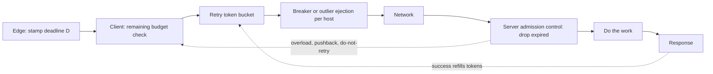
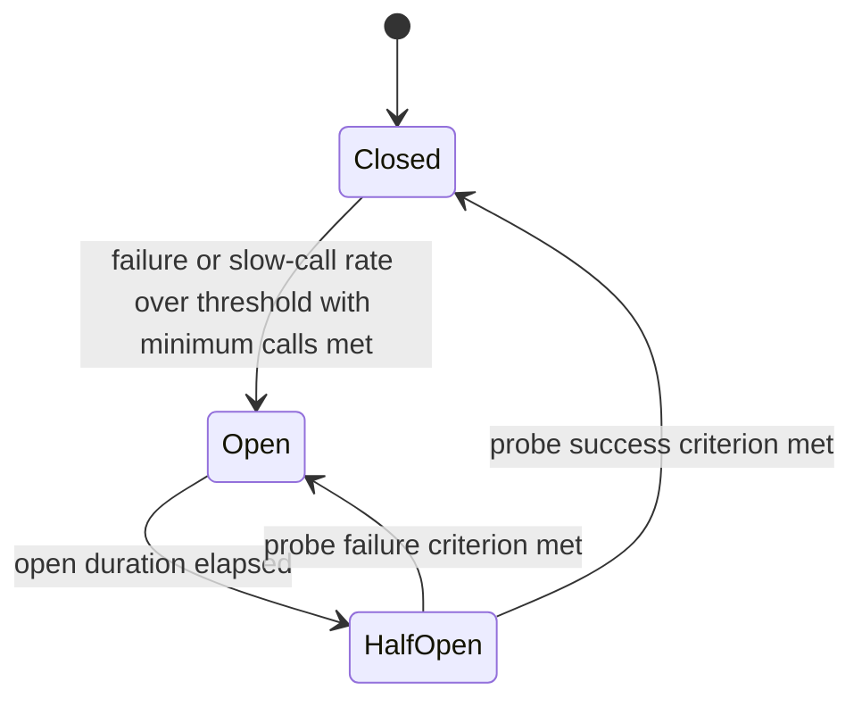

# Resilient Communication: Retries, Jitter, and Circuit Breakers

## TL;DR

A retry converts a transient fault into extra load, and without a global bound it can sustain an overload after the trigger is gone (a metastable failure), so bound retries with a token-bucket retry budget (about 10% of successes), not only a per-request attempt cap.
Backoff spaces retries and jitter decorrelates clients, but jitter cures synchronization and not amplification: in this chapter's lab, full jitter and no jitter both ended at 0.0% goodput after a 2-second spike, while a 10% budget recovered to 100%.
A circuit breaker is a request gate with modal behavior (all traffic or none), so prefer a retry-gating budget by default, partition breakers per host or cell, jitter and grow the open interval, and ramp traffic back in half-open.
A deadline is a shrinking budget that every hop propagates and the server must enforce at dequeue: in the lab, dropping expired work took wasted server effort from 90.4% to 0.0%.
Retry only requests that are safe (idempotent or never delivered), only error classes that are transient, and at one layer, and let downstream tiers signal "do not retry" so a deep failure does not multiply 3 attempts per layer into 3^5 = 243 attempts at the bottom.

## Mental Model



Every hop in a call chain makes two independent decisions: whether to start an attempt (deadline, token bucket, breaker) and how long to wait before the next one (backoff, jitter).
The server side makes the mirror decision: whether the work is still wanted (deadline check at dequeue) and whether to tell the caller to go away (shed, pushback, non-retryable status).
Retries are a positive feedback loop, because failure creates load and load creates failure, while token buckets, deadlines, and shedding are negative feedback.
The design question is always which loop has gain greater than 1 at the system's utilization, and the answer in Internals shows that with 3 attempts and a FIFO queue that threshold is 33% utilization.
This chapter builds on [[17-Cloud-AI-Engineering/Volume_07_Reliability_and_SRE/Chapter_02_Load_Shedding_Backpressure_and_Admission_Control|Load Shedding, Backpressure, and Admission Control]], which covers the server half of the loop.

## Internals

### What is safe to retry

Retry safety has two independent axes: whether the error is transient, and whether repeating the request is safe.
An error class that proves the request never reached application logic is always safe to repeat: TCP connect failure, TLS handshake failure, HTTP/2 REFUSED_STREAM, and gRPC transparent retries where the stream never reached server application code.
Envoy exposes this distinction directly through its `retry_on` conditions, where `connect-failure` and `refused-stream` are safe for any method, while `5xx` and `reset` are only safe for idempotent operations (Envoy docs, as of 2026-10; UNVERIFIED this session).
Google's API design guidance for automatic retries (AIP-194) says clients should retry `UNAVAILABLE` by default with exponential backoff, and treat other codes as retryable only when the method is idempotent ([Google AIP-194](https://google.aip.dev/194), UNVERIFIED this session).
Throttling errors (HTTP 429, `ThrottlingException`, `RESOURCE_EXHAUSTED`, S3 503 `SlowDown`) are transient by definition but are also explicit backpressure, so the correct response is to slow down globally and not merely to retry this request.
Deterministic failures (4xx validation, 403, "daily quota exceeded") must never be retried, since a retry only reproduces the error and burns budget.

Idempotency for mutating calls is carried by a client-generated token that the server uses to deduplicate, as described in the AWS Builders' Library article on making retries safe with idempotent APIs.
The token must be scoped to the authenticated principal, or one tenant can replay or collide with another's key.

### Backoff mathematics

The nominal delay before retry n (n = 0 for the first retry) is `d_n = min(cap, base * 2^n)`.
The attempt at which the cap binds is `ceil(log2(cap / base))`, so base 100 ms and cap 20 s gives `log2(200) = 7.64`, which means the cap binds from the 8th retry onward.
Total nominal wait after k retries before the cap is `base * (2^k - 1)`, so the backoff schedule has a built-in time horizon, and the attempt cap and the deadline decide which one stops the loop first.
The cap sets the floor of steady-state probe load: F clients that all retry forever under full jitter at the cap each sleep a mean of `cap / 2`, so the fleet sends `2F / cap` requests per second to a dead dependency.
With F = 10,000 and cap = 20 s that is 1,000 requests per second (derived), which is enough to prevent a small recovering dependency from ever draining its queue.
Conversely, a cap that is too high turns a 5-second blip into minutes of idle clients, because a client that just drew a 20-second sleep does not notice recovery.

Expected attempts per logical request, when each attempt independently fails with probability q and the limit is A attempts, is `E = (1 - q^A) / (1 - q)`.

| Per-attempt failure q | A = 3 | A = 5 |
|---|---|---|
| 0.1 | 1.11x | 1.11x |
| 0.5 | 1.75x | 1.94x |
| 0.9 | 2.71x | 4.10x |
| 1.0 | 3.00x | 5.00x |

These are derived values, and they understate the problem because q is not independent of load: raising load raises q.
Layering multiplies, so if each of 5 layers makes up to 3 attempts, the bottom tier sees up to 3^5 = 243 attempts for one top-level request, the example used in the AWS Builders' Library article [Timeouts, retries, and backoff with jitter](https://aws.amazon.com/builders-library/timeouts-retries-and-backoff-with-jitter/).

### Jitter variants

Marc Brooker's 2015 AWS Architecture Blog post [Exponential Backoff And Jitter](https://aws.amazon.com/blogs/architecture/exponential-backoff-and-jitter/) defines the variants this chapter uses:

- No jitter: `sleep = min(cap, base * 2^n)`.
- Equal jitter: `t = min(cap, base * 2^n)`, `sleep = t/2 + uniform(0, t/2)`.
- Full jitter: `sleep = uniform(0, min(cap, base * 2^n))`.
- Decorrelated jitter: `sleep = min(cap, uniform(base, prev_sleep * 3))`.

Without jitter, clients that collided once collide again at the same instants, so the load arrives as a comb of impulses at `base * (2^n - 1)` and not as a rate.
In a contention model where N clients start together and the server accepts one call per slot, no jitter costs exactly N(N+1)/2 calls, because round k has N-k+1 survivors that all collide again.
Full jitter turns each retry round into a uniform arrival rate `m_n / d_n`, which is what a queueing system can absorb.
Full jitter has mean delay `d_n / 2`, so it also retries sooner than the nominal schedule on average, which is a deliberate choice: the lower bound of zero is what breaks lockstep.
Equal jitter keeps a floor of `d_n / 2`, which preserves minimum spacing but leaves half the window empty, and it did the worst of the three jittered variants in the 2015 post.
Decorrelated jitter has state (the previous sleep) and a growth factor of about 2 in expectation, and it has no dependence on attempt count, which makes it convenient when the attempt number is not tracked.

My own reimplementation of the contention experiment (listing in the Worked Example, mean of 20 seeds) gave these results:

| Policy | Calls at N=100 | Calls at N=400 |
|---|---|---|
| No jitter | 5,050 | 80,200 |
| Equal | 639 | 3,340 |
| Full | 649 | 3,378 |
| Decorrelated | 579 | 3,846 |

Calls grow quadratically without jitter (matching N(N+1)/2 exactly), and about 6.5N to 8.4N with jitter in this model.
Decorrelated jitter finished earliest in wall time but made more calls than full jitter at N=400, so the choice between them is a trade of latency against server load, and the original post's "full jitter and decorrelated are about equal" should be read as "similar", not "identical".
The model has one slot per unit and a hard cap of 2,000 units, so the absolute finish times depend on those assumptions and only the ordering is portable.

A mechanism worth knowing: some client libraries implement "jitter" as `uniform(0, 2 * delay)` so the mean equals the nominal delay.
Python `google-api-core` is reported to do this in its exponential sleep generator, which preserves average pacing while still decorrelating (UNVERIFIED this session; read the installed source before relying on it).

### Retry budgets: token buckets, not counters

A per-request cap (3 attempts) bounds the worst case per request but not the fleet-wide rate, since every request can use all 3 at once.
A retry budget bounds the aggregate: successes deposit tokens, retries withdraw them, and when the bucket is empty the client fails fast with the original error.
At steady state with deposit ratio rho per success and cost 1 per retry, retries per success are at most rho, so amplification is bounded by `1 + rho`, and during a total outage successes are zero, so after the initial bucket drains the retry rate falls to zero.

Implementations you will meet:

- **AWS SDKs, standard mode:** a client-local retry quota with capacity 500, cost 5 per retry, cost 10 per timeout retry, and a refund of 1 for a first-attempt success; a depleted quota makes the SDK stop retrying and surface the error ([AWS SDKs and Tools reference: retry behavior](https://docs.aws.amazon.com/sdkref/latest/guide/feature-retry-behavior.html), UNVERIFIED this session).
- **gRPC:** `retryThrottling` with `maxTokens` (at most 1000) and `tokenRatio`; the bucket starts full, each failed attempt costs 1, each success adds `tokenRatio`, and retries and hedges are suppressed whenever tokens are at or below `maxTokens / 2`, which gives hysteresis ([gRFC A6](https://github.com/grpc/proposal/blob/master/A6-client-retries.md), UNVERIFIED this session).
- **Envoy:** a `retry_budget` on the cluster circuit breaker, expressed as a percentage of active requests with a `min_retry_concurrency` floor, which is concurrency-based and not rate-based ([Envoy circuit breaking](https://www.envoyproxy.io/docs/envoy/latest/intro/arch_overview/upstream/circuit_breaking), UNVERIFIED this session).
- **Google SRE guidance:** a per-request limit of 3 attempts plus a per-client retry-to-request ratio of about 10% ([SRE book: Handling Overload](https://sre.google/sre-book/handling-overload/), UNVERIFIED this session).

The AWS quota charges timeouts double because a timeout means the server probably did, or is still doing, the work, so the retry is more likely to pile onto an overloaded system.
The quota lives in the client object, which has a consequence that is invisible in getting-started guides: constructing a new SDK client per request or per Lambda invocation gives each call a fresh, full quota, and the throttle never engages.

Separate from retry budgets is client-side adaptive throttling.
Google's SRE book describes a rejection probability of `max(0, (requests - K * accepts) / (requests + 1))` computed over a recent window (about two minutes), where K is typically 2, so a client starts rejecting locally once the backend accepts fewer than 1/K of what is sent (UNVERIFIED this session).
AWS SDK adaptive mode adds a CUBIC-shaped client-side rate limiter driven by throttle responses, with a multiplicative decrease around 0.7 and a cubic recovery curve, and it is documented as assuming one client per throttled resource (parameters and status UNVERIFIED this session).
The sharing hazard is real: one adaptive client used against many tables or models lets one hot partition slow every call through that client.

### Circuit breakers

Michael Nygard's pattern from *Release It!* has three states, shown below.



Resilience4j defaults make the knobs concrete: 50% failure-rate threshold, a count-based sliding window of 100 calls, a minimum of 100 calls before evaluating, a 60-second wait in open, and 10 permitted calls in half-open (Resilience4j docs, UNVERIFIED this session).
Hystrix, which popularized the pattern, has been in maintenance mode since 2018 (UNVERIFIED this session), so new designs use Resilience4j, Envoy, or a mesh.

What the pattern descriptions leave out:

1. **Modality.** A closed breaker sends 100% of traffic and an open breaker sends 0%, so a dependency that is 30% degraded becomes 100% unavailable from the caller's view; Marc Brooker's posts "Will circuit breakers solve my problems?" and "Fixing retries with token buckets and circuit breakers" argue this makes breakers hard to test and can lengthen outages, and prefer a smooth retry token bucket (UNVERIFIED this session on exact titles and dates).
2. **Scope.** A breaker keyed on a whole service opens for all callers and all keys when one shard or one host is bad; key breakers per host, per cell, or per partition, as in [[17-Cloud-AI-Engineering/Volume_01_Cloud_Architecture_Principles/Chapter_03_Cell_Based_Architecture_and_Shuffle_Sharding|Cell-Based Architecture and Shuffle Sharding]].
3. **Half-open statistics.** With k probes and a requirement that all succeed, a dependency that is still failing 30% of calls passes with probability `0.7^k`, so 2.8% for k = 10; with k = 1 it passes 70% of the time and the breaker flaps.
4. **Fleet probe herd.** In half-open each of F instances sends its own probes, so 2,000 instances times 10 probes is 20,000 simultaneous probes aimed at a dependency that is just recovering; jitter the open duration (for example 0.5x to 1.5x), grow it on each consecutive re-open, and ramp admission from a small fraction to 100% over tens of seconds, not step from 0 to full.
5. **Low-traffic blind spots.** A count-based window with a minimum of 100 calls never opens on an instance that sees 5 calls per minute, and a fleet of 1,000 instances divides a 1,000 rps dependency to about 1 rps each, so local statistics are noisy; aggregate in the mesh proxy or use time-based windows.
6. **What counts as failure.** Count timeouts, 5xx, and slow calls, do not count 4xx, and treat 429 as a rate signal, not as a health signal.

Envoy shows the anti-modality design in a mature system.
Outlier detection ejects hosts after consecutive 5xx (default 5), for a base ejection time (default 30 s) multiplied by the number of prior ejections, but caps ejection at 10% of the cluster by default, and the load balancer's panic threshold (default 50% healthy) makes it ignore health status and spread traffic across all hosts when too few are healthy (Envoy docs, UNVERIFIED this session).
Those two caps exist precisely so that a correlated failure cannot make the proxy eject its way into a total outage.
Envoy's default connection-level circuit breaker thresholds are 1024 for connections, pending requests, and requests, and 3 for concurrent retries (UNVERIFIED this session), so the proxy bounds concurrency independent of any health logic.

### Deadlines and propagation

A timeout is a local, per-call duration; a deadline is an absolute point in time for the whole operation, and every hop derives its own timeout from what remains.
The edge stamps `D = now + budget`, and each hop computes `remaining = D - now`, reserves time for its own post-processing, and uses `min(per_try_cap, remaining - reserve)` as the per-attempt timeout.
gRPC sends this as a relative `grpc-timeout` header (at most 8 digits plus a unit letter), recomputed from the local deadline at send time, so no clock synchronization is needed and each hop automatically loses the time it consumed, though not the one-way network transit time (gRPC protocol docs, UNVERIFIED this session).
Propagation is not free in every stack: Go and Java propagate through the context object, while in other runtimes the handler must explicitly derive the outgoing call's deadline from the incoming one (gRPC deadlines guide, UNVERIFIED this session).
Envoy adds `x-envoy-expected-rq-timeout-ms` so downstream services can see what remains (UNVERIFIED this session), and AWS Lambda exposes remaining invocation time through the context object (for example `context.get_remaining_time_in_millis()` in Python).

Three rules turn propagation into protection:

1. **Do not start doomed work.** Before a retry, require `remaining > floor`, where floor is roughly the downstream p50 latency, because a retry that cannot finish in time only adds load.
2. **Check at dequeue.** The server must compare the request deadline to the clock when it removes the request from the queue and discard expired requests at near-zero cost; otherwise a FIFO server spends capacity on responses nobody is waiting for, which is the dominant effect in the lab (90.4% wasted work).
3. **Timeouts must nest.** The caller's timeout must exceed the sum of the callee's attempts, otherwise the callee keeps retrying for a request whose caller has already abandoned it (orphaned work).

Facebook's ACM Queue article "Fail at Scale" pairs this with adaptive LIFO and CoDel-style queue management so that under overload the server prefers requests most likely to still be wanted (UNVERIFIED this session).
The edge must clamp or strip externally supplied deadline headers, covered under Security.

### Hedging

Hedged requests send a second copy after a delay near the p95 latency and cancel the loser, which targets tail latency and not errors.
Dean and Barroso's "The Tail at Scale" (CACM, 2013) reports that hedging after a short delay cut a Bigtable benchmark's 99.9th percentile from 1,800 ms to 74 ms for about 2% extra requests (UNVERIFIED this session on exact figures).
Hedging is a retry with a latency trigger, so it must draw from the same budget, and gRPC's `hedgingPolicy` is subject to the same `retryThrottling` bucket.

### Metastable failure theory and the stability condition

Bronson et al., "Metastable Failures in Distributed Systems" (HotOS 2021), define a metastable failure as a state where a sustaining feedback loop keeps the system degraded after the trigger is removed, and Huang et al., "Metastable Failures in the Wild" (OSDI 2022), find retry policy to be the most common sustaining mechanism in public incidents (exact share UNVERIFIED this session).
A simple stability condition shows why.
Let C be server capacity, lambda the fresh arrival rate, and A the attempts per logical request.
If the server processes requests FIFO and cannot tell that a request has timed out, then once the queue depth exceeds `C * T` (T = client timeout) every request is served after its client gave up, goodput is about 0, and each logical request produces A attempts.
The collapsed state is therefore self-sustaining whenever `lambda * A > C`, which means utilization above `1 / A`: 33% for A = 3, 20% for A = 5.
With a retry budget the amplification after the bucket drains is `1 + rho`, so the collapsed state requires `lambda * (1 + rho) > C`, meaning utilization above `1 / 1.1 = 91%` for rho = 0.1.
Dropping expired requests at dequeue changes the server's capacity spent on doomed requests to about zero, which removes the collapsed fixed point entirely at moderate load.
The conclusion is that attempt caps alone give no protection at normal utilization, while a budget and deadline enforcement each push the collapse threshold toward saturation.

### Queue-redelivery retries are retries too

Asynchronous systems retry on your behalf, and their policies stack with the SDK's.
SQS has no per-message backoff, so consumers implement it with `ChangeMessageVisibility`, and a redrive policy with `maxReceiveCount` sends poison messages to a DLQ.
Lambda asynchronous invocation retries failed events up to 2 times by default, with a maximum event age of 6 hours (Lambda docs, UNVERIFIED this session).
Cloud Pub/Sub subscriptions can use an exponential backoff retry policy (documented defaults of 10 s minimum and 600 s maximum), whereas the default behavior redelivers immediately (UNVERIFIED this session).
Cloud Tasks retry config has `maxDoublings`, after which the interval grows linearly and not exponentially, so a config of `minBackoff` 0.1 s, `maxBackoff` 3600 s, and `maxDoublings` 16 does not behave like a plain doubling schedule (UNVERIFIED this session).
AWS Step Functions `Retry` blocks support `IntervalSeconds`, `BackoffRate`, `MaxAttempts`, `MaxDelaySeconds`, and `JitterStrategy` (`FULL` or `NONE`), and the default is no jitter unless you set it (UNVERIFIED this session).

### Retries in LLM serving

Model APIs add three wrinkles.
First, rate limits are token-denominated, and some providers reserve `max_tokens` against quota at admission, so a retried request with a large `max_tokens` can be throttled by its own reservation; on Bedrock, newer Claude models also apply an output-token burndown multiplier to quota (UNVERIFIED this session).
Second, a streamed response that fails mid-stream cannot be retried transparently: the first attempt already emitted and billed tokens, so the client must either resume with a continuation prompt or discard output, and you need separate time-to-first-token and inter-token idle timeouts, not one total timeout.
Third, replica cold start takes minutes because weights must load, so retries during scale-out hit a fleet that cannot yet absorb them; see [[17-Cloud-AI-Engineering/Volume_11_LLM_Serving_and_Inference_Systems_on_Cloud/Chapter_08_Cloud_GPU_Autoscaling_and_Cold_Start_Mitigation|Cloud GPU Autoscaling and Cold-Start Mitigation]] and [[17-Cloud-AI-Engineering/Volume_11_LLM_Serving_and_Inference_Systems_on_Cloud/Chapter_09_Managed_Inference_Amazon_Bedrock_vs_Vertex_AI|Managed Inference: Amazon Bedrock vs Vertex AI]].
Anthropic's SDKs retry by default with short exponential backoff and honor server hints such as `retry-after` (defaults UNVERIFIED this session), so wrapping them in your own retry loop silently squares the attempt count.

## Numbers to Know

Web research tools were unavailable while this chapter was drafted.
Every row marked UNVERIFIED is from the author's knowledge of the named document and must be re-checked against the live source before this note moves to `status: solid`.
Rows marked "derived" or "lab" are computed here and are reproducible from the listings in the Worked Example.

| Item | Value | Source and status |
|---|---|---|
| AWS SDK standard mode max attempts (total, including first) | 3 | AWS SDKs and Tools reference, as of 2026-10; UNVERIFIED |
| botocore legacy mode max attempts | 5 | botocore docs, as of 2026-10; UNVERIFIED |
| AWS standard mode backoff | exponential with full jitter, 20 s maximum backoff | AWS SDKs and Tools reference, as of 2026-10; UNVERIFIED |
| AWS SDK retry quota | capacity 500, retry cost 5, timeout retry cost 10, success refund 1 | AWS SDKs and Tools reference, as of 2026-10; UNVERIFIED |
| AWS adaptive mode | CUBIC-style client rate limiter, multiplicative decrease about 0.7; experimental in several SDKs | AWS SDKs and Tools reference, as of 2026-10; UNVERIFIED |
| botocore `retries.max_attempts` vs `total_max_attempts` | first counts retries, second counts total attempts | botocore docs, as of 2026-10; UNVERIFIED |
| gRPC retry attempt cap | 5 | gRFC A6, as of 2026-10; UNVERIFIED |
| gRPC retry throttling | `maxTokens` at most 1000; retries stop at or below `maxTokens / 2`; success adds `tokenRatio` | gRFC A6, as of 2026-10; UNVERIFIED |
| gRPC backoff | `uniform(0, min(initialBackoff * multiplier^(n-1), maxBackoff))` | gRFC A6, as of 2026-10; UNVERIFIED |
| Google SRE retry guidance | at most 3 attempts per request; about 10% retry ratio per client; adaptive throttling K = 2 | SRE book, as of 2026-10; UNVERIFIED |
| Envoy default breaker thresholds | 1024 connections, 1024 pending, 1024 requests, 3 retries | Envoy docs, as of 2026-10; UNVERIFIED |
| Envoy default retry backoff | base 25 ms, max 250 ms | Envoy docs, as of 2026-10; UNVERIFIED |
| Envoy outlier detection defaults | 5 consecutive 5xx, 30 s base ejection, 10% max ejection, 10 s interval | Envoy docs, as of 2026-10; UNVERIFIED |
| Envoy panic threshold default | 50% healthy hosts | Envoy docs, as of 2026-10; UNVERIFIED |
| Resilience4j breaker defaults | 50% failure rate, window 100, min calls 100, 60 s open, 10 half-open calls | Resilience4j docs, as of 2026-10; UNVERIFIED |
| `google-api-core` Retry defaults | initial 1 s, max 60 s, multiplier 2, 120 s overall deadline | google-api-core source, as of 2026-10; UNVERIFIED |
| Cloud Tasks retry defaults | 100 attempts, 0.1 s min, 3600 s max, 16 doublings | Cloud Tasks docs, as of 2026-10; UNVERIFIED |
| Lambda async retries | 2 retries, 6 h max event age | Lambda docs, as of 2026-10; UNVERIFIED |
| Pub/Sub retry policy defaults | 10 s minimum, 600 s maximum backoff when enabled | Pub/Sub docs, as of 2026-10; UNVERIFIED |
| Layered retry amplification | 3 attempts x 5 layers = 243x | derived, 2026-10-21 |
| Expected attempts, q = 0.9, A = 3 | 2.71x | derived, 2026-10-21 |
| Fleet probe floor under full jitter at cap | 2F / cap = 1,000 rps for F = 10,000, cap = 20 s | derived, 2026-10-21 |
| Collapse utilization threshold, FIFO, A = 3 | above 33% | derived, 2026-10-21 |
| Collapse utilization threshold, 10% budget | above 91% | derived, 2026-10-21 |
| Contention calls, N = 100, no jitter vs full jitter | 5,050 vs 649 | lab, 2026-10-21 |
| Metastable lab, goodput after spike, 3 retries no budget | 0.0% | lab, 2026-10-21 |
| Metastable lab, goodput with 10% budget | 100.0% | lab, 2026-10-21 |
| Metastable lab, wasted server work, FIFO vs drop-expired | 90.4% vs 0.0% | lab, 2026-10-21 |
| Hedging effect on p99.9 | 1,800 ms to 74 ms for about 2% extra requests | Dean and Barroso, CACM 2013; UNVERIFIED exact figures |
| List prices | none apply; this chapter provisions no billable resources | - |

## AWS vs GCP Mechanism Parity

| Layer | AWS | Google Cloud | Critical difference |
|---|---|---|---|
| Client SDK default | Standard mode: 3 total attempts, exponential full jitter, client-local retry quota (500 tokens) | `google-api-core` and per-library retry settings with initial 1 s, multiplier 2, overall deadline; per-RPC retry-code lists defined in service config | AWS bounds fleet-local retry rate with a quota; Google client libraries bound total time with a deadline, so verify whether a budget exists in your language |
| Retry semantics source | SDK spec shared across languages, with per-service overrides | AIP-194 and gapic service config per method | Google config is per method and per status code; AWS retryable sets are mostly global |
| Wire-level retry | Not a protocol feature; implemented in SDK or proxy | gRPC retry policy, hedging, and `retryThrottling` in service config, deliverable via xDS | gRPC makes the budget part of the channel config |
| Server pushback | HTTP 429 and 503 with `Retry-After` on some services; throttling error codes | gRPC `grpc-retry-pushback-ms` metadata; HTTP `Retry-After` | gRPC pushback can tell clients to stop retrying entirely |
| Client-side adaptive limiting | SDK adaptive mode (experimental in several SDKs) | Google-internal adaptive throttling per SRE book; no standard managed equivalent | Neither cloud turns it on by default |
| Proxy and mesh | ECS Service Connect, VPC Lattice, Istio or Envoy on EKS; App Mesh end of support announced for 2026-09-30 (UNVERIFIED) | Cloud Service Mesh with Envoy or proxyless gRPC | Check which retry defaults your mesh injects, for example Istio's default of 2 retries (UNVERIFIED) |
| Async redelivery | SQS visibility timeout and redrive; Lambda async retries; EventBridge retry window (24 h, 185 attempts, UNVERIFIED) | Pub/Sub retry policy; Cloud Tasks `maxDoublings` | SQS has no native per-message backoff; Pub/Sub and Cloud Tasks do |
| Workflow retries | Step Functions `Retry` with `JitterStrategy` | Cloud Workflows `retry` with backoff parameters | Step Functions jitter is opt-in |
| Throttle signal on model APIs | Bedrock `ThrottlingException` (HTTP 429), `ServiceUnavailableException` (503) | Vertex AI HTTP 429 `RESOURCE_EXHAUSTED` | Both are quota or capacity signals; treat as backpressure, not health |
| Incident lesson | AWS us-east-1, 2021-12-07: client retries on an internal network sustained congestion (UNVERIFIED details) | Google Cloud, 2025-06-12: crash-looping Service Control tasks restarted without randomized backoff and overloaded Spanner (UNVERIFIED details) | Both are recovery-phase herds, not trigger-phase failures |

## Worked Example: Reproducing a Metastable Failure and Fixing It

This lab provisions no cloud resources.
Estimated cost: $0.00.
Budget alarm: not applicable, because nothing billable is created.
Teardown: `rm -rf /tmp/lab`.

### Step 1: capacity and cost arithmetic before running anything

Server capacity is 1,000 rps (10 requests per 10 ms tick), base load is 800 rps (80% utilization), and the trigger is 3x base load (2,400 rps) for 2 seconds.
Excess during the spike is `2400 - 1000 = 1400 rps`, so the backlog after 2 s is `1400 * 2 = 2800` requests.
With no retries the backlog drains at `1000 - 800 = 200 rps`, so recovery takes `2800 / 200 = 14 s`.
Client timeout is 1 s, so any request queued behind more than `C * T = 1000` others is doomed before it reaches the head.
With A = 3 and FIFO service, collapse is self-sustaining when `lambda * A > C`, meaning `800 * 3 = 2400 > 1000`, which holds with a 2.4x margin, so the lab should show non-recovery.
With a 10% budget the bound is `800 * 1.1 = 880 < 1000`, so the lab should show recovery.

### Step 2: the metastable failure lab (pure Python standard library)

```python
# /tmp/lab/metastable_sim.py
"""Retries + wasted work + deadline propagation. Tick = 10 ms."""
import random, collections, math

C, BASE = 10, 8.0
SPIKE_START, SPIKE_END, SPIKE_RATE = 500, 700, 24.0
TIMEOUT, QCAP, T_END = 100, 5000, 6000

def poisson(lam):
    limit, k, p = math.exp(-lam), 0, 1.0
    while True:
        p *= random.random()
        if p <= limit:
            return k
        k += 1

def run(pol, seed=7):
    random.seed(seed)
    q = collections.deque()                      # (deadline, logical_id, attempt)
    timeouts = collections.defaultdict(list)
    retries_at = collections.defaultdict(list)
    state, born = {}, {}
    tokens = 100.0
    nid = sent = served = wasted = ok_win = born_win = 0
    win_lo, win_hi = T_END - 1000, T_END - 100

    def on_fail(lid, attempt, t):
        nonlocal tokens
        if state[lid] != 'open':
            return
        if attempt >= pol["a_max"]:
            state[lid] = 'fail'; return
        if pol["budget"]:
            if tokens < 1.0:
                state[lid] = 'fail'; return
            tokens -= 1.0
        d = 0
        if pol["jitter"]:
            d = int(random.uniform(0, min(200, 10 * 2 ** (attempt - 1))))
        retries_at[t + 1 + d].append((lid, attempt + 1))

    for t in range(T_END):
        lam = SPIKE_RATE if SPIKE_START <= t < SPIKE_END else BASE
        n_new = poisson(lam)
        new = [(nid + i, 1) for i in range(n_new)]
        for lid, _ in new:
            state[lid] = 'open'; born[lid] = t
            if win_lo <= t < win_hi:
                born_win += 1
        nid += n_new
        if pol["budget"]:
            tokens = min(100.0, tokens + pol["budget"] * n_new)
        for lid, attempt in new + retries_at.pop(t, []):
            if state[lid] != 'open':
                continue
            sent += 1
            if len(q) >= QCAP:
                on_fail(lid, attempt, t); continue
            q.append((t + TIMEOUT, lid, attempt))
            timeouts[t + TIMEOUT].append((lid, attempt))
        cap = C
        while cap > 0 and q:
            dl, lid, attempt = q.popleft()
            if pol["drop_expired"] and dl <= t:
                continue
            cap -= 1; served += 1
            if dl <= t:
                wasted += 1
            elif state[lid] == 'open':
                state[lid] = 'ok'
                if win_lo <= born[lid] < win_hi:
                    ok_win += 1
        for lid, attempt in timeouts.pop(t, []):
            on_fail(lid, attempt, t)
    return ok_win / max(1, born_win), wasted / max(1, served), sent / nid

POL = {
 "no_retry":                dict(a_max=1, budget=0,    jitter=False, drop_expired=False),
 "retry3_nojitter":         dict(a_max=3, budget=0,    jitter=False, drop_expired=False),
 "retry3_fulljitter":       dict(a_max=3, budget=0,    jitter=True,  drop_expired=False),
 "retry3_jitter_budget10":  dict(a_max=3, budget=0.10, jitter=True,  drop_expired=False),
 "retry3_jitter_deadline":  dict(a_max=3, budget=0,    jitter=True,  drop_expired=True),
 "budget10_plus_deadline":  dict(a_max=3, budget=0.10, jitter=True,  drop_expired=True),
}
if __name__ == "__main__":
    print("%-26s %9s %9s %9s" % ("policy", "goodput", "wasted", "amplif"))
    for name, p in POL.items():
        rs = [run(p, seed=s) for s in range(5, 10)]
        g = sum(r[0] for r in rs) / 5; w = sum(r[1] for r in rs) / 5; a = sum(r[2] for r in rs) / 5
        print("%-26s %8.1f%% %8.1f%% %8.2fx" % (name, 100 * g, 100 * w, a))
```

Run it with `mkdir -p /tmp/lab && python3 /tmp/lab/metastable_sim.py`.
Goodput is the fraction of logical requests born between 50 s and 59 s that completed successfully, measured long after the 2-second spike ended at 7 s.
The output from my run (mean of 5 seeds):

| Policy | Goodput after recovery window | Wasted server work | Attempts per logical request |
|---|---|---|---|
| No retry | 100.0% | 19.7% | 1.00x |
| 3 attempts, no jitter | 0.0% | 90.4% | 2.75x |
| 3 attempts, full jitter | 0.0% | 90.4% | 2.75x |
| 3 attempts, full jitter, 10% budget | 100.0% | 34.0% | 1.03x |
| 3 attempts, full jitter, drop expired | 100.0% | 0.0% | 1.07x |
| 10% budget plus drop expired | 100.0% | 0.0% | 1.01x |

Three readings matter.
First, a 2-second trigger produced an outage that was still running at 59 seconds, which is the definition of metastable.
Second, jitter changed nothing, because the failure is amplification at sustained overload and not synchronization.
Third, the budget and deadline fixes work by different mechanisms: the budget caps offered load, and deadline enforcement removes the wasted-work fixed point, so combining them gives the lowest amplification and the lowest waste.
This is a toy model with FIFO service, Poisson arrivals, no admission control, and a fixed timeout, so trust the mechanism and the ordering, not the magnitudes.

### Step 3: the jitter contention lab

```python
# /tmp/lab/jitter_sim.py
import heapq, random, sys

def backoff(kind, base, cap, attempt, prev):
    if kind == "none":
        return min(cap, base * 2 ** attempt)
    if kind == "equal":
        t = min(cap, base * 2 ** attempt)
        return t / 2 + random.uniform(0, t / 2)
    if kind == "full":
        return random.uniform(0, min(cap, base * 2 ** attempt))
    if kind == "decorrelated":
        return min(cap, random.uniform(base, max(base, prev * 3)))
    raise ValueError(kind)

def run(kind, n, base=2.0, cap=2000.0, seed=1):
    random.seed(seed)
    pending = [(0.0, i, 0, base) for i in range(n)]
    heapq.heapify(pending)
    taken, calls, finish = set(), 0, 0.0
    while pending:
        t, cid, attempt, prev = heapq.heappop(pending)
        calls += 1
        slot = int(t)
        if slot not in taken:
            taken.add(slot); finish = max(finish, t)
        else:
            d = backoff(kind, base, cap, attempt, prev)
            heapq.heappush(pending, (t + d, cid, attempt + 1, d))
    return calls, finish

if __name__ == "__main__":
    n = int(sys.argv[1]) if len(sys.argv) > 1 else 100
    print("N=%d  mean of 20 seeds" % n)
    print("%-13s %8s %10s" % ("policy", "calls", "finish"))
    for k in ["none", "equal", "full", "decorrelated"]:
        c = [run(k, n, seed=s) for s in range(20)]
        print("%-13s %8.0f %10.0f" % (k, sum(x[0] for x in c) / 20, sum(x[1] for x in c) / 20))
```

Run `python3 /tmp/lab/jitter_sim.py 100` and `python3 /tmp/lab/jitter_sim.py 400`; the numbers are in the Internals table.

### Step 4: production configuration that implements the lesson

Python with boto3, one client created outside the request path so the retry quota is shared:

```python
import boto3
from botocore.config import Config

CFG = Config(
    retries={"mode": "standard", "total_max_attempts": 3},
    connect_timeout=1,
    read_timeout=2,
)
ddb = boto3.client("dynamodb", config=CFG)   # create once, at import time
```

Use `total_max_attempts` and not `max_attempts`, because in botocore's `retries` dictionary `max_attempts` counts retries excluding the first call, while the `AWS_MAX_ATTEMPTS` environment variable counts total attempts (UNVERIFIED this session; test with a stubbed failing endpoint).

gRPC service config with a per-method deadline, jittered retries on `UNAVAILABLE` only, and a shared budget:

```json
{
  "methodConfig": [{
    "name": [{"service": "pkg.Inference"}],
    "timeout": "2.5s",
    "retryPolicy": {
      "maxAttempts": 3,
      "initialBackoff": "0.05s",
      "maxBackoff": "1s",
      "backoffMultiplier": 2,
      "retryableStatusCodes": ["UNAVAILABLE"]
    }
  }],
  "retryThrottling": {"maxTokens": 100, "tokenRatio": 0.1}
}
```

Envoy route and cluster fragment that retries only never-sent failures, caps concurrent retries at 10% of active requests, and bounds per-try time:

```yaml
route:
  retry_policy:
    retry_on: "connect-failure,refused-stream,unavailable"
    num_retries: 2
    per_try_timeout: 0.5s
    retry_back_off: {base_interval: 0.025s, max_interval: 0.25s}
cluster:
  circuit_breakers:
    thresholds:
    - priority: DEFAULT
      retry_budget:
        budget_percent: {value: 10.0}
        min_retry_concurrency: 3
```

All three snippets follow the documented schemas as I know them; validate each against current docs before shipping (UNVERIFIED this session).

### Step 5: verification checklist for a real service

1. Emit `attempts_total / logical_requests_total` as a metric and alert at 1.2x for 5 minutes.
2. Emit `server_wasted_work_ratio` (responses completed after client deadline) and alert above 5%.
3. Inject a 5-second 100% error window with the chaos tooling in [[17-Cloud-AI-Engineering/Volume_07_Reliability_and_SRE/Chapter_05_Chaos_Engineering_and_Game_Days|Chaos Engineering and Game Days]], and require goodput to return to baseline within 2x the fault duration plus the queue drain time.
4. Confirm that SDK clients are singletons by counting client constructions in a load test.

## Failure Modes and Pitfalls

**Retry multiplication across layers.**
SDK, application, framework, mesh sidecar, and queue redelivery each retry, and the attempt counts multiply; Istio injecting a default retry policy (2 retries, UNVERIFIED) under an application that retries 3 times under an SDK that retries 3 times is 3 x 3 x 3 = 27 attempts for one call.
Audit by sending one request to a stubbed always-failing dependency and counting arrivals.

**Doomed work.**
A FIFO server without deadline checks serves responses to clients that left long ago; this was 90.4% of work in the lab.
Detect it with a histogram of `now - deadline` at completion; any mass above zero is wasted capacity.

**Recovery-phase herds.**
Public post-incident reviews repeatedly show the trigger is brief and the amplifier is a retry or restart loop.
The Google Cloud incident of 2025-06-12 began with a malformed policy that crashed Service Control binaries globally, and the report states that recovery in one region was slowed because restarting tasks overloaded the dependent Spanner infrastructure for lack of randomized exponential backoff ([Google Cloud status incident ow5i3PPK96RduMcb1SsW](https://status.cloud.google.com/incidents/ow5i3PPK96RduMcb1SsW); incident ID and duration of roughly three hours UNVERIFIED this session).
The AWS us-east-1 event of 2021-12-07 began when automated scaling on the internal network caused a surge of connection activity, and the AWS summary describes retries and latency feeding more congestion that hindered recovery ([AWS post-event summary](https://aws.amazon.com/message/12721/), URL and details UNVERIFIED this session).
The AWS us-east-1 event of 2025-10-19 to 2025-10-20 began with a DynamoDB DNS record race, and the follow-on phase of EC2 control-plane work backing up after DNS was repaired is a recovery-phase congestion pattern (details UNVERIFIED this session).
The April 2011 EBS event, in which nodes that lost mirrors all searched for new replicas at once and exhausted spare capacity, is the storage version of the same loop (details UNVERIFIED this session).
For more cases see [[17-Cloud-AI-Engineering/Volume_07_Reliability_and_SRE/Chapter_07_Anatomy_of_Major_Cloud_Outages|Anatomy of Major Cloud Outages]].

**Jitter without a budget.**
The lab proves jitter alone does nothing for sustained overload.
Teams that "fixed" a retry storm by adding jitter and saw no improvement had fixed the wrong variable.

**Budget scoped wrong.**
Per-request counters allow 3x amplification fleet-wide, a budget inside a per-request client object resets each call, and a budget shared across unrelated dependencies lets a noisy one starve a healthy one.
Scope budgets per destination and per client process, and create clients once.

**Breaker modality and bad keys.**
A whole-service breaker opens on one bad shard, and a low-volume instance never opens because its window has too few calls.
When a breaker opens on a dependency with no fallback, the caller turns a partial failure into a total one.

**Half-open flapping.**
A single-probe half-open with a 70% pass rate on a still-failing dependency closes the breaker most of the time, which floods it again; use multiple probes, a success-ratio criterion, and a ramp.

**No timeout at all.**
Python `requests` and Go's default `http.Client` have no timeout unless one is set, so a hung dependency holds threads or connections indefinitely and exhausts pools (library behavior, UNVERIFIED this session).
Missing timeouts convert latency into resource exhaustion before any breaker can see an error.

**Timeouts that do not nest.**
When a caller has a 2 s timeout and the callee makes 3 attempts of 1 s, the callee keeps working for 3 s on abandoned requests.

**Retrying non-idempotent calls.**
Retrying a `POST` that charges a card or creates a VM without an idempotency token produces duplicates.
Retrying after a read timeout is the dangerous case because the write may have succeeded.

**Retrying deterministic failures.**
Retrying a 4xx, an authorization failure, or a poison message loops forever without a DLQ, and retrying 401 or 403 at scale can also trip lockouts or KMS and STS request quotas.

**Ignoring server pushback.**
A `Retry-After: 60` honored by 10,000 clients produces a synchronized burst at second 60 unless the client adds jitter to the server-supplied value or the server randomizes it.

**Adaptive-mode client sharing.**
One adaptive client across many resources lets a throttled table slow unrelated calls.

**Mid-stream LLM retries.**
Retrying a stream that failed after 3,000 tokens pays twice and may emit duplicated or inconsistent text; resume deliberately.

**Health-check ejection feedback.**
When overload makes health checks fail, ejecting the "unhealthy" hosts concentrates load on the rest and accelerates collapse; this is why Envoy caps ejection and has a panic threshold.

## Security and Cost Angles

**Deadline headers are a trust boundary.**
An external caller that supplies a 1-hour deadline or a 1-ms deadline can pin server resources or force immediate failure, so the edge must clamp deadlines to a maximum and strip internal timeout headers from untrusted traffic (Envoy sanitizes `x-envoy-*` headers for external requests, UNVERIFIED this session).

**Retry as an amplification vector.**
Authenticated clients with unbounded retries are an inadvertent DoS source, and unauthenticated paths that trigger retries are an attack path; apply per-tenant retry budgets at the gateway so one tenant's retry storm cannot drain shared capacity.

**Idempotency keys are security-relevant.**
Scope keys to `(tenant, principal, operation)`, set a TTL longer than the maximum retry horizon, encrypt the key store with a CMK, and never return a stored response to a different principal.

**Credential and key-service hot spots.**
KMS, STS, and instance metadata have per-account or per-instance request limits, and synchronized credential refresh or data-key fetches without jitter can throttle a whole fleet at once; use envelope encryption with cached data keys so the hot path does not call KMS per request.

**Least-privilege on the retry path.**
Dead-letter queues and replay tooling need their own IAM roles, because a replay role with broad write permissions is an effective privilege escalation.

**Cost levers.**
Every attempt is a billable request on metered APIs, a billable GPU-second on self-hosted inference, and billable bytes on cross-AZ or NAT paths.
Define the unit metric as cost per successful logical request, so a retry-heavy period shows up as a cost-per-success regression and not just as a latency alert.
Cap the amplification factor at 1.1x in steady state, and the cost overhead of retries is bounded at 10% by construction.
Streaming failures bill partial output, so a TTFT timeout that is too tight can multiply token spend on slow-but-healthy requests.
Hedging buys p99 at a roughly proportional request cost, so enable it only on cheap, idempotent, read-heavy paths.

## Interview Questions and Model Answers

### Question 1 (L5 - Senior)

Explain why exponential backoff alone does not stop a retry storm, what jitter changes, and how you would choose between full and decorrelated jitter.

#### Model Answer

Exponential backoff spaces a single client's retries, but clients that failed together stay together, so the fleet's load arrives as impulses at identical offsets.
Each impulse is the full surviving population hitting the server in one instant, which is the worst shape for a queue.
Jitter randomizes each client's delay so the load becomes a rate; with full jitter the retry round n is spread uniformly over `[0, min(cap, base * 2^n)]`.
In a contention simulation with N = 100 clients and one accepted call per slot, no jitter used 5,050 calls (exactly N(N+1)/2) while full jitter used about 650.
Full jitter is the default: it needs the attempt counter, it decorrelates best, and it is what the AWS SDK standard mode and gRPC use.
Decorrelated jitter, `min(cap, uniform(base, 3 * prev))`, needs no attempt counter and finished fastest in my run, but it made more calls than full jitter at N = 400, so it trades server load for client latency.
I would say jitter is necessary and insufficient: it fixes synchronization, and does nothing for sustained overload where the problem is the number of attempts, which needs a budget.

#### Follow-up Interviewer Question

You deployed full jitter and the 5-minute outage still produced 3x traffic on the dependency for the whole outage; what did you miss, and what would you check first?

### Question 2 (L5 - Senior)

A service calls a database through an SDK that retries 3 times, a repository layer that retries 3 times, and a gateway that retries 3 times.
A database blip lasting 2 seconds turns into a 10-minute outage.
Walk through the mechanism and the fix.

#### Model Answer

The three layers multiply to 27 attempts at the database for a request that reaches the bottom while it is failing.
If the database was at 40% utilization, the offered load at full failure is `0.4 * 27 = 10.8` times capacity, so the system is deep in collapse, and because the database serves doomed requests FIFO its goodput is near zero even after the original fault clears.
The fix has four parts.
Retry at exactly one layer, normally the one closest to the failure that knows whether the operation is idempotent.
Turn the other layers' retries off, and have the retrying layer enforce an overall deadline from the caller.
Add a retry token bucket so aggregate retries are about 10% of successes; during a full outage retries then stop on their own.
Add a "do not retry" signal from the data tier (a distinct error code or pushback metadata) so upstream layers fail fast.
To verify, point the stack at a stub that always fails and count arrivals per top-level request; the target is at most 3, and ideally 1 once the bucket is empty.

#### Follow-up Interviewer Question

Which layer would you choose to own retries if the gateway is shared by 40 teams and the repository layer is per-team code, and why?

### Question 3 (L6 - Staff)

Design the timeout, deadline, and retry policy for a chain: edge API (user-facing, 3 s SLO) calls an orchestrator, which calls a retrieval service (p99 150 ms) and a model server (p99 1.8 s).
State numbers and defend them.

#### Model Answer

Start from the 3 s edge deadline and subtract fixed costs: say 100 ms for edge parsing and response, leaving 2.9 s for the orchestrator.
The orchestrator runs retrieval, then the model call; retrieval p99 is 150 ms and the model p99 is 1.8 s, so the nominal path at p99 is about 1.95 s, leaving about 950 ms of slack.
Per-try timeouts: retrieval 300 ms, which is about 2x p99 and about p99.9 territory, so false timeouts are around 0.1%; model server 2.2 s per try for the first attempt.
Retries: one retry at retrieval is affordable (300 ms plus jitter up to 50 ms plus 300 ms is under the slack), but a model-server retry is only allowed if `remaining > model p50` (say 900 ms), which after a 2.2 s first try is false, so effectively no model retry on timeout.
Retry on the model path is allowed only on fast failures (connect failure, 429 with pushback, 503), where little time has been consumed.
Every call carries the remaining deadline, the model server drops requests whose deadline passed while queued, and the edge clamps client-supplied deadlines to 3 s.
Each caller has a token bucket (ratio 0.1, bucket 100), so fleet amplification is bounded at 1.1x.
I would add a hedge on retrieval only: it is read-only, cheap, and idempotent, with delay at its p95 (about 80 ms), drawing from the same bucket.
Then I would test with fault injection at 5x p99 latency on the model tier and check that edge goodput degrades to a bounded fraction without a persistent tail after the fault ends.

#### Follow-up Interviewer Question

The model server is a GPU fleet that autoscales in 4 minutes; what does your policy do during scale-out, and what extra signal would you add?

### Question 4 (L6 - Staff)

A teammate proposes adding a Resilience4j circuit breaker around every outbound call.
Argue for and against, and describe the design you would approve.

#### Model Answer

For: a breaker bounds concurrency to a dying dependency, fails fast, and protects caller threads, and it has value when a cheap fallback exists, such as a cached answer or a degraded response.
Against: it is modal, so a 30% failing dependency becomes 100% unavailable; its statistics are per instance, so low-traffic instances never open and high-traffic ones flap; a service-wide breaker opens for every tenant and shard when one is bad; and it is hard to test because the open path runs rarely.
It also does not bound retry amplification when closed, which is where metastable failures originate.
I would approve this: a retry token bucket on every client as the default control, because it degrades smoothly; breakers only where a fallback exists, keyed per destination host or per cell, with a time-based window, a slow-call criterion, and a minimum-call count tuned to per-instance traffic.
Open duration is jittered 0.5x to 1.5x and grows on consecutive re-opens, half-open uses several probes with a success-ratio criterion, and closing ramps admission over tens of seconds.
Where a mesh is present, I would prefer proxy-level outlier detection with an ejection cap (Envoy's default is 10%) and a panic threshold, because it cannot eject the whole cluster.
Finally, server-side load shedding is the primary protection, and breakers are a secondary client-side courtesy.

#### Follow-up Interviewer Question

How would you test that the breaker's open path works in production without causing an incident?

### Question 5 (L6 - Staff)

You are on call: a 2-second latency spike ended 20 minutes ago, but request volume at the dependency is still 2.5x normal, goodput is under 10%, and CPU is saturated.
Diagnose and mitigate in order.

#### Model Answer

This signature, where the trigger is gone but load and failure persist, is a metastable failure; the sustaining loop is almost certainly retries against a server doing wasted work.
I would confirm with three numbers: attempts per logical request (expect above 2), queue wait time versus client timeout (expect wait above timeout), and the ratio of completed responses that arrive after the client deadline.
Mitigations in order of speed: first shed at the server, rejecting requests quickly above a concurrency or queue limit, which converts slow failures into fast ones and removes queue wait; then drop expired requests at dequeue if the code supports it.
Next, cut client amplification through a dynamic config push, reducing max attempts to 1 or tightening the retry budget, and if clients are not controllable, reduce admitted traffic at the gateway per tenant.
If those fail, add capacity only as a last resort, because the added capacity is consumed by doomed requests in a FIFO queue, and in my lab with 80% base utilization, doubling capacity would help only by pushing the `lambda * A > C` threshold up, which at 3 attempts needs capacity above 2,400 rps against a 1,000 rps baseline.
Afterwards the fixes are permanent: a retry budget, deadline enforcement at dequeue, and an alert on amplification.
In the postmortem I would classify the trigger and the sustaining effect separately, since removing the trigger is not prevention.

#### Follow-up Interviewer Question

You cannot ship a config to the clients because they are external customers; what server-side levers remain, and what are their downsides?

### Question 6 (L7+ - Principal)

Design a retry governance program for a multi-tenant LLM platform that spans AWS Bedrock and Vertex AI backends, with 200 internal client teams.
What standards, mechanisms, and metrics would you establish?

#### Model Answer

The governing principle is that retry behavior is a fleet-level resource allocation problem, so it needs enforced defaults and observability, not documentation.
Standards: one layer retries (the platform client library), with provider SDK retries set to a single attempt to avoid squaring, and the library owns the budget; every request carries a deadline propagated end to end; clients may only retry idempotent or never-sent failures; and 429 and 503 from either backend are treated as backpressure that lowers the per-backend rate, not merely as errors.
Mechanisms: a token bucket per client process per backend with ratio 0.1; a gateway-level per-tenant budget so a single tenant's storm cannot consume shared quota; an explicit pushback contract (`retry-after` honored with added jitter, plus a "do not retry" flag for deterministic failures); separate time-to-first-token and inter-token idle timeouts; no automatic mid-stream retry, with resume handled by an opt-in continuation helper.
Backend specifics: Bedrock and Vertex quotas are token-based and regional, so cross-region failover is a retry with a different quota pool, and it must be gated by the same budget and by priority, with interactive traffic allowed to fail over before batch.
Priority tiers shed batch first.
Metrics: attempts per logical request by team and backend, retry budget exhaustion rate, wasted tokens (output generated after client abandonment), and cost per successful request; alert on amplification above 1.2x and on any team with more than 5% budget exhaustion.
Enforcement: a lint rule banning raw SDK clients in the monorepo, a contract test that runs every service against an always-failing stub and asserts at most 3 arrivals per request, and quarterly game days with injected throttling.
Rollout: ship the library with the budget in shadow mode (measure, do not enforce) for two weeks to calibrate, then enforce, because a budget set too low causes unnecessary user-visible failures.
The trade-off I would state is that budgets deliberately accept more fast failures during partial outages to preserve recovery, and the product teams must agree to that in advance through the SLO.

#### Follow-up Interviewer Question

A product team with a 99.99% availability SLO says the retry budget makes them miss it during a regional capacity event; how do you resolve it without abandoning the budget?

### Question 7 (L7+ - Principal)

Compare client-side adaptive throttling (AWS adaptive mode, Google's accepts-based throttling) with server-side admission control.
When would you rely on each, and what can go wrong with the client-side form at fleet scale?

#### Model Answer

Server-side admission control has ground truth: it knows its queue depth, CPU, and per-tenant priority, and it can reject in microseconds, so it is the primary control and the only one that provides fairness and priority.
Its weakness is that rejection still costs a connection, TLS, parsing, and a response, so at extreme overload the rejection path itself saturates.
Client-side adaptive throttling pushes the rejection to the edge of the caller, saving that cost, and it is convergent if every client runs it, since each reduces its rate when acceptance falls below about 1/K of sent traffic.
Problems at fleet scale: it is purely local, so it cannot enforce fairness, a well-behaved client sharing a throttled channel is slowed along with the bad one (the shared adaptive client hazard), and it reacts only after the signal arrives, so a fleet of thousands of cold clients reaches the dependency before any has learned.
Rate-reduction dynamics can oscillate: multiplicative decrease followed by cubic recovery, synchronized across clients that saw the same throttle, causes sawtooth load unless recovery is jittered.
It also misreads signals: a 429 from a per-tenant quota is not evidence the backend is overloaded, so throttling the whole channel is wrong.
My position: server-side shedding with priorities as the primary mechanism, a retry token bucket on clients as the mandatory secondary mechanism, and adaptive rate limiting only per resource, per tenant, opt-in, where there is a measured need, with its parameters tested under fault injection.

#### Follow-up Interviewer Question

How would you distinguish "backend overloaded" from "my tenant's quota exhausted" in the error signal, and what would each cause the client to do differently?

### Question 8 (L6 - Staff)

Explain how deadline propagation works across a gRPC and Envoy path, what breaks it, and how you would enforce it on a server.

#### Model Answer

The caller sets a deadline on the call, the gRPC client encodes the remaining time into `grpc-timeout` at send time, and the server library reconstructs a local deadline on arrival.
Because the value is relative, clock skew is irrelevant, but one-way network latency is not subtracted, so each hop is slightly optimistic by its transit time; reserve a small margin per hop.
Envoy can add its own timeout and exposes the expected remaining timeout to upstreams through a header, so the effective deadline is the minimum of the application's and the route's.
It breaks when a handler makes outgoing calls with a fresh context or a hard-coded timeout instead of deriving from the incoming deadline, when an intermediary strips the header, and when work moves onto a queue or thread pool that drops the context.
Enforcement on a server has three pieces: check the deadline when dequeuing and drop expired requests without doing work; pass the context into every downstream call and I/O so cancellation propagates; and on cancellation, release resources, since a cancelled request that keeps running is still doomed work.
I would also measure it: the histogram of remaining deadline at arrival tells you which upstream hop is burning the budget, and the count of dropped-expired requests is a direct signal of overload.

#### Follow-up Interviewer Question

A batch job legitimately needs 30 minutes per call; how do you keep deadline discipline without breaking it, and what changes at the edge and in the retry policy?

## Further Reading

- [AWS Builders' Library: Timeouts, retries, and backoff with jitter](https://aws.amazon.com/builders-library/timeouts-retries-and-backoff-with-jitter/) - the primary source for retry layering, timeout selection from latency percentiles, and why retries are a shared-resource problem.
- [AWS Architecture Blog: Exponential Backoff And Jitter](https://aws.amazon.com/blogs/architecture/exponential-backoff-and-jitter/) - the simulation that defines full, equal, and decorrelated jitter and compares their call counts.
- [Google SRE book: Handling Overload](https://sre.google/sre-book/handling-overload/) - client-side adaptive throttling, retry ratios, and criticality-based rejection.
- [Google SRE book: Addressing Cascading Failures](https://sre.google/sre-book/addressing-cascading-failures/) - retry limits, deadline propagation, and the failure patterns that follow from their absence.
- [gRFC A6: Client Retries](https://github.com/grpc/proposal/blob/master/A6-client-retries.md) - the exact semantics of retry policy, hedging, throttling tokens, pushback, and transparent retries.
- [AWS SDKs and Tools reference: Retry behavior](https://docs.aws.amazon.com/sdkref/latest/guide/feature-retry-behavior.html) - standard and adaptive mode definitions and the shared retry-quota design.
- [Envoy circuit breaking and outlier detection documentation](https://www.envoyproxy.io/docs/envoy/latest/intro/arch_overview/upstream/circuit_breaking) - a production anti-modality design, with ejection caps, panic thresholds, and retry budgets.
- Bronson, Aghayev, Charapko, Zhu, "Metastable Failures in Distributed Systems," HotOS 2021, and Huang et al., "Metastable Failures in the Wild," OSDI 2022 - the definition and the incident taxonomy that show why retries sustain outages.
- Dean and Barroso, "The Tail at Scale," CACM 2013 - hedged and tied requests, and why tail latency compounds with fan-out.
- Marc Brooker's blog posts on circuit breakers and retry token buckets (brooker.co.za/blog) - the clearest argument that smooth retry budgets beat modal breakers.
- [Google AIP-194: Automatic retry configuration](https://google.aip.dev/194) - Google's standard for which codes are retryable and with what backoff.
- Nygard, *Release It!* (2nd ed.) - the origin of the circuit breaker, bulkhead, and timeout patterns.
- [[17-Cloud-AI-Engineering/Volume_07_Reliability_and_SRE/Chapter_01_SLIs_SLOs_and_Error_Budget_Engineering|SLIs, SLOs, and Error Budget Engineering]] - how to set the availability targets that retry budgets trade against.
- [[17-Cloud-AI-Engineering/Volume_07_Reliability_and_SRE/Chapter_04_Disaster_Recovery_Tiers_and_RTO_RPO_Engineering|Disaster Recovery Tiers and RTO/RPO Engineering]] - the next chapter, where failover is itself a retry across a larger boundary.
