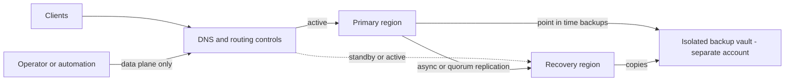

# Disaster Recovery Tiers and RTO/RPO Engineering

## TL;DR

- RTO and RPO are not properties of a tier; they are distributions measured by drills. A tier only sets the cost floor and the mechanism that bounds each tail.
- RPO under asynchronous replication is write rate times replication lag at the failure instant. Lag is a queue and diverges as utilization approaches 1, and incidents push it up exactly when you need it low. RPO of zero requires a quorum commit, which charges every write a cross-region round trip.
- RTO is a sum of six terms: detect, decide, execute, acquire capacity, converge clients, warm caches. In practice decide, capacity, and cold-cache load dominate, not boot time or DNS TTL.
- Multi-region does not buy the availability the independent-failure formula promises. Common-cause failures (global config push, shared pipeline, shared identity, shared bad data) cap the system at roughly `1 - beta * U`, so the second region mostly buys protection against physical regional loss.
- Replication copies damage at line rate. Backups, point-in-time recovery, and immutable vaults in a separate account or provider cover a different failure class than failover does. A failover path or backup that has never been exercised under production-like load should be assumed broken.

## Mental Model



Think of a DR design as three decoupled flows that fail independently.
The first is the data flow, which carries state from primary to recovery site and sets RPO.
The second is the traffic flow, which moves clients from one site to the other and sets the convergence term of RTO.
The third is the capacity and control flow, which brings the recovery site to full serving strength and must work while the primary region's control plane is unreachable.
The backup vault is a fourth flow, deliberately slow and one-way, that protects against logical corruption which the first flow would otherwise copy.
The tiers (backup and restore, pilot light, warm standby, active-active) differ in how much of each flow is pre-provisioned and continuously exercised before the incident.
A tier you do not exercise is a hypothesis, not a capability.

## Internals

### The four tiers, and what actually differs

The AWS Well-Architected DR whitepaper names four strategies: backup and restore, pilot light, warm standby, and multi-site active/active (AWS Well-Architected, Disaster Recovery of Workloads on AWS, as of 2026-10).
The same paper defines RTO as the maximum acceptable window during which the service is unavailable, and RPO as the maximum acceptable time since the last data recovery point (same source, as of 2026-10).
Google's DR planning guidance uses cold, warm, and hot patterns for the same ladder (Google Cloud Architecture Center; UNVERIFIED, wording not re-checked as of 2026-10).

What differs between tiers is which of the following are pre-provisioned and continuously running:

| Tier | Data in recovery site | Compute in recovery site | Traffic path | Dominant RTO term |
|---|---|---|---|---|
| Backup and restore | Point-in-time backups, copied cross-region | None; rebuilt from IaC | Re-pointed after rebuild | Restore throughput and infra rebuild |
| Pilot light | Live replica of stateful tier | Core stateful tier on; app tier off or minimal | Re-pointed on declare | Capacity acquisition and scale-up |
| Warm standby | Live replica | Full stack at reduced scale, serving synthetic or small real traffic | Weighted or health-based | Decision latency and cold-cache amplification |
| Active-active | Multi-writer or quorum | Full stack serving real traffic in all sites | Always split | Surviving-site headroom and client convergence |

The distinction that matters is not "how many instances are running".
It is how much of the failover path is exercised by normal traffic.
In active-active, every component on the failover path carries production load every day, so its failure is discovered in daylight.
In pilot light, the app tier, its configuration, its secrets, its quotas, and its IAM are exercised only during drills.

### RPO is a distribution, and the clock starts early

For asynchronous replication, treat the replication stream as a queue.
Unreplicated data at any instant is, by Little's law, `L = lambda * W`, where `lambda` is the write rate in bytes per second and `W` is the replication lag.
Data lost on an unplanned failover is the unreplicated data at the failure instant, plus anything that was acknowledged by a degraded primary before you stopped trusting it.

The second term is the one that is missed.
Regional failures are frequently gray, not crash-stop.
The primary keeps accepting and acknowledging writes while the replication link is saturated or partially partitioned.
If detection plus decision takes 12 minutes, the loss window is not the steady-state lag.
It is the steady-state lag measured at the last good replication point, plus 12 minutes of acknowledged writes that never left.
The RPO clock starts when replication stops making progress, not when you declare.
This is why decision latency is a term in both RTO and RPO.

Lag itself behaves like an M/M/1 queue.
For a replication pipeline with service rate `mu` and arrival rate `lambda`, with utilization `rho = lambda / mu`, mean sojourn time is `W = 1 / (mu * (1 - rho))`.
At 50 percent utilization lag is `2/mu`; at 90 percent it is `10/mu`; at 99 percent it is `100/mu`.
Replication pipelines that look healthy at p50 therefore have heavy tails whenever a bulk job, a backfill, or a schema migration pushes `lambda` close to `mu`.
Cross-region link degradation lowers `mu` directly, so the tail is correlated with the incident.
Size RPO from the lag p99.9 conditional on an incident, not from the dashboard average.

AWS exposes a version of this trade-off for Aurora PostgreSQL global databases.
Aurora Global Database replicates at the storage layer using dedicated replication infrastructure, with typical lag under one second (AWS docs; UNVERIFIED, not re-checked as of 2026-10).
A parameter named `rds.global_db_rpo` can bound RPO by delaying commits on the primary when secondary lag exceeds the configured threshold (AWS docs; UNVERIFIED, not re-checked as of 2026-10).
That is a deliberate availability-for-durability trade: when the replication path is sick, writes stall instead of silently widening the loss window.
Whether that is acceptable is a product decision, and it must be made before the incident, not during it.

### Consensus-based replication: RPO of zero and what it costs

Quorum systems replicate by committing a write only after a majority of replicas acknowledge it.
Spanner uses Paxos groups with long-lived leaders and leader leases, with a default lease of 10 seconds (Corbett et al., "Spanner: Google's Globally-Distributed Database", OSDI 2012).
DynamoDB uses Multi-Paxos replica groups inside a region (Elhemali et al., "Amazon DynamoDB: A Scalable, Predictably Performant, and Fully Managed NoSQL Database Service", USENIX ATC 2022).
Spanner multi-region configurations place voting replicas across regions so that a region loss leaves a majority, giving RPO of zero (Google Cloud docs; UNVERIFIED, not re-checked as of 2026-10).
See [[17-Cloud-AI-Engineering/Volume_13_Seminal_Papers_and_Case_Studies/Chapter_06_Google_Spanner|Google Spanner]] and [[08-Distinguished-Engineering/02-Distributed-Systems-Internals/Raft-Consensus|Raft Consensus]] for the protocol-level treatment.

The cost is physical.
Light in fiber travels at roughly 200,000 km/s, about 5 microseconds per km one way.
A commit that needs one remote ack across 1,500 km of fiber path pays at least 15 ms round trip, before queuing, serialization, and disk flush.
In a 3-region deployment with majority 2, commit latency is approximately the RTT to the nearest other voting region.
In a 5-replica deployment with majority 3, it is the RTT to the second-nearest.
The failure behavior is also specific: if the leader's region fails, writes stall until a new leader is elected and its lease takes effect, so "RPO 0" comes with a nonzero RTO for writes, on the order of the lease and election timeout.
If two of three voting regions fail, the system is correctly unavailable.
Quorum systems convert data loss into unavailability.

Last-writer-wins replication, as used by default in DynamoDB global tables (multi-Region eventual consistency mode), sits between the two.
Both regions accept writes and converge by timestamp.
The RPO is effectively zero in the sense that no acknowledged write is dropped from the replicating region's log, but concurrent writes to the same item are resolved by discarding one of them.
After a failover, a client that wrote in region A and read in region B sees stale data until replication catches up.
DynamoDB also offers a multi-Region strong consistency mode for global tables (AWS docs; UNVERIFIED, GA status and constraints not re-checked as of 2026-10).

### RTO decomposition

```
RTO = T_detect + T_decide + T_execute + T_capacity + T_converge + T_warm
```

Each term has a mechanism that a getting-started guide omits.

**T_detect.**
A health check with interval `I` and failure threshold `k` detects a hard failure in `k * I` plus, on average, `I / 2` of phase offset.
Route 53 health checks offer 10 second and 30 second intervals (AWS docs; UNVERIFIED, not re-checked as of 2026-10).
With a 10 second interval and threshold 3 that is 30 to 40 seconds for a crash-stop failure.
Gray failures (elevated error rate, slow disk, partial AZ impairment) may never trip a shallow check.
A health check that probes `/healthz` returning 200 from a process that is up but cannot reach its database detects nothing.
Use deep checks that exercise the write path, and use synthetic transactions that cross the same dependencies as customer traffic.

**T_decide.**
In most real incidents this is the largest controllable term.
A human must establish that the primary is not recovering, accept the data loss implied by the unreplicated tail, and authorize the action.
Pre-authorized criteria (for example, "primary write success below 50 percent for 5 minutes, and replication lag known") convert a debate into a checklist.
The cost of a false failover is real (data loss, failback work, split-brain risk), so hysteresis matters; flapping is worse than a slow decision.

**T_execute.**
The failover action must be a data plane operation.
If the runbook needs the control plane of the failing region (console, IAM changes, API calls to a regional endpoint that is down), it is not static-stable.
AWS Route 53 Application Recovery Controller (ARC) was built around this: routing controls are toggled through a highly available data plane cluster with five regional endpoints, and changes require a majority (AWS docs; UNVERIFIED, not re-checked as of 2026-10).
The operator's client must try endpoints until one answers.
Safety rules (assertion and gating) prevent turning off both sites at once.
See [[17-Cloud-AI-Engineering/Volume_01_Cloud_Architecture_Principles/Chapter_02_Regions_Zones_and_Static_Stability|Regions, Zones, and Static Stability]] and [[17-Cloud-AI-Engineering/Volume_01_Cloud_Architecture_Principles/Chapter_04_Control_Plane_vs_Data_Plane_Separation|Control Plane vs Data Plane Separation]].
Credentials matter too: prefer regional STS endpoints and pre-provisioned DR roles, because global control plane dependencies are the ones that fail together.

**T_capacity.**
This is the term the tier diagrams hide.
Pilot light and warm standby scale up in the recovery region at the moment other tenants in the failing region are doing the same.
Instance launch API rate limits, regional capacity for a specific instance family, and quota ceilings all become binding at once.
RTO is bounded below by the p99 of capacity acquisition, not by boot time.
The mechanism for removing this term is to pay for it ahead of time: EC2 On-Demand Capacity Reservations or Google Compute Engine reservations in the recovery region, which are billed whether or not instances run in them (AWS and Google Cloud docs; UNVERIFIED, billing semantics not re-checked as of 2026-10).
Spot is the wrong tool here, because spot capacity is the first to be reclaimed in a regional event.
For GPU fleets this term is dominant, and is covered below.

**T_converge.**
Clients keep talking to the old site after the control change.
DNS TTL is only the first bound.
Recursive resolvers that clamp minimum TTLs, client libraries that resolve once and pin, HTTP/2 and gRPC connections that live for hours, and connection pools that never recycle all extend convergence.
The remedy is to cap connection lifetime on both ends (for example, a maximum connection age of a few minutes enforced by the server or proxy), keep TTLs low on failover records, and use anycast or a global load balancer where failover is a backend health change instead of a DNS change.
Failover storms also trigger retry amplification; see [[17-Cloud-AI-Engineering/Volume_07_Reliability_and_SRE/Chapter_03_Resilient_Communication_Retries_Jitter_and_Circuit_Breakers|Resilient Communication]] and [[17-Cloud-AI-Engineering/Volume_07_Reliability_and_SRE/Chapter_02_Load_Shedding_Backpressure_and_Admission_Control|Load Shedding and Admission Control]].

**T_warm.**
A recovery site with a cold cache does not behave like the primary at the same request rate.
If the warm hit ratio is `h_w` and the cold hit ratio is `h_c`, backend load multiplies by `(1 - h_c) / (1 - h_w)`.
With `h_w = 0.95` and `h_c = 0`, the database sees 20 times the read load for the same client traffic.
The standby database sized at 30 percent of primary capacity for cost fails on first contact.
Mitigations are cache pre-warming from replayed read logs, gradual traffic ramp (weighted records at 5, 25, 50, 100 percent), request coalescing, and admission control that sheds load until hit ratio recovers.
The same mechanism applies to JIT-compiled runtimes, page cache after a database restore, and model weights on a GPU server.

### Backup restore time and lazy hydration

Restore time for the backup tier is not backup size divided by link speed.
It is the minimum over several stages: object store read throughput, instance network and disk throughput, decompression, and database recovery (log replay, index rebuild).
At 50 TB, a sustained 10 Gbps yields about 11 hours, 25 Gbps about 4.4 hours, and 100 Gbps about 1.1 hours (calculation in the worked example).
Volumes restored from block snapshots are typically hydrated lazily from object storage on first access, so first-read latency on untouched blocks is far higher than steady state.
EBS Fast Snapshot Restore removes this for selected snapshots and AZs at additional cost (AWS docs; UNVERIFIED, not re-checked as of 2026-10).
A database that "restored in 20 minutes" may spend hours at degraded performance while blocks hydrate.

### Fencing, split brain, and failback

Promoting a replica while the old primary is merely unreachable produces two writers.
The defense is a fencing token or epoch that the storage layer or the clients check, so that the old primary's writes are rejected after the epoch advances.
Managed systems implement this internally (global database failover detaches the old cluster from the replication topology).
Application-level state (job queues, schedulers, singleton cron workers, leader-elected controllers) is often not covered and is the usual source of duplicate side effects.
Failback is a second failover, with the additional problem of reconciling the old primary's unreplicated writes.
Log them when you discard them.
Unplanned failover in Aurora global databases can promote a secondary with data loss, and the dropped writes must be reconciled by the application owner (AWS docs; UNVERIFIED, not re-checked as of 2026-10).
Prefer planned switchover for failback, which waits for replication to catch up.

### Backups protect against a different failure class

Failover answers "this region is gone".
Backups answer "the data is wrong".
A `DROP TABLE`, a bad migration, a buggy batch job, or ransomware is replicated to the standby in about one replication lag.
Point-in-time recovery plus immutable backups gives a recovery point that predates the corruption.
Immutability requires a control the production account cannot remove: AWS Backup Vault Lock and logically air-gapped vaults, or Google Backup and DR vaults with enforced retention (AWS and Google Cloud docs; UNVERIFIED, not re-checked as of 2026-10).
Place the vault in a separate account or project with separate administrators.
For the highest-value data, keep a copy outside the provider.
A backup you have not restored is not a backup.
AWS Backup restore testing automates scheduled restores (AWS docs; UNVERIFIED, not re-checked as of 2026-10).

### DR for AI workloads

AI platforms add four constraints that classical DR models ignore.

**Training RPO is checkpoint interval.**
A failure destroys on average half an interval of GPU work.
The expected lost cost per failure is `(T / 2) * N_gpus * price_per_gpu_hour`.
The Young/Daly first-order optimum balances checkpoint overhead against lost work: `T_opt = sqrt(2 * delta * M)`, where `delta` is the cost of writing one checkpoint and `M` is mean time between failures (Young, CACM 1974; Daly, Future Generation Computer Systems 2006).
With a 120 second checkpoint cost and a 4 hour cluster MTBF, `T_opt` is about 31 minutes.
Cross-region replication of multi-terabyte checkpoints is a separate RPO: it is bounded by inter-region bandwidth, and replicating every checkpoint may cost more than the lost work.
Replicate every Nth checkpoint, or the latest plus periodic milestones.
See [[17-Cloud-AI-Engineering/Volume_10_AI_Infrastructure_on_Cloud/Chapter_06_High_Throughput_Checkpointing_to_Object_Storage|High-Throughput Checkpointing to Object Storage]].

**GPU capacity is the binding RTO term.**
You cannot assume that a few hundred accelerators of a given type are launchable on demand in a recovery region during a regional event.
Options are reserved capacity held idle (full price, see [[17-Cloud-AI-Engineering/Volume_09_FinOps_and_Cloud_Economics/Chapter_05_GPU_and_TPU_Unit_Economics|GPU and TPU Unit Economics]]), running the recovery site as a lower-priority tenant of the same fleet and preempting it on failover, or accepting a degraded tier with smaller models or quantized weights.
For inference, designing a graceful degradation ladder (route to a smaller model, shorter context limits, queued batch) is cheaper than full-capacity standby.

**Weights and indexes are state.**
Model weights are large immutable artifacts; replicate them to the recovery region's object storage ahead of time, and pre-stage onto local NVMe where cold start matters ([[17-Cloud-AI-Engineering/Volume_11_LLM_Serving_and_Inference_Systems_on_Cloud/Chapter_08_Cloud_GPU_Autoscaling_and_Cold_Start_Mitigation|Cloud GPU Autoscaling and Cold-Start Mitigation]]).
Vector indexes (HNSW or IVF) can take hours to rebuild from source embeddings, so replicate index snapshots or use a store with native cross-region replicas; rebuild is not an RTO plan.

**Managed model APIs.**
Managed inference offers cross-region routing profiles, but quota and availability are per account and per model, and a failover target region must have the quota pre-approved (see [[17-Cloud-AI-Engineering/Volume_11_LLM_Serving_and_Inference_Systems_on_Cloud/Chapter_09_Managed_Inference_Amazon_Bedrock_vs_Vertex_AI|Managed Inference: Bedrock vs Vertex AI]]).

## Numbers to Know

Vendor figures that could not be re-verified in this session are flagged UNVERIFIED in the source column and listed at the end of the chapter.

| Quantity | Value | Source |
|---|---|---|
| AWS-defined DR strategies | Four: backup and restore, pilot light, warm standby, multi-site active/active | AWS Well-Architected DR whitepaper (as of 2026-10) |
| RTO definition | Maximum acceptable duration of service unavailability | AWS Well-Architected DR whitepaper (as of 2026-10) |
| RPO definition | Maximum acceptable time since last recovery point | AWS Well-Architected DR whitepaper (as of 2026-10) |
| S3 Replication Time Control | 99.99 percent of objects replicated within 15 minutes, with replication metrics | AWS S3 docs (UNVERIFIED, not re-checked as of 2026-10) |
| Aurora Global Database typical lag | Under 1 second; storage-layer replication | AWS Aurora docs (UNVERIFIED, not re-checked as of 2026-10) |
| Aurora Global Database secondary regions | Up to 5 | AWS Aurora docs (UNVERIFIED, not re-checked as of 2026-10) |
| DynamoDB point-in-time recovery window | Up to 35 days | AWS DynamoDB docs (UNVERIFIED, not re-checked as of 2026-10) |
| Route 53 health check intervals | 10 s or 30 s | AWS Route 53 docs (UNVERIFIED, not re-checked as of 2026-10) |
| Route 53 ARC cluster endpoints | 5 regional endpoints, majority required | AWS ARC docs (UNVERIFIED, not re-checked as of 2026-10) |
| Spanner leader lease default | 10 s | Spanner paper, OSDI 2012 |
| Spanner multi-region availability SLA | 99.999 percent | Google Cloud Spanner SLA (UNVERIFIED, not re-checked as of 2026-10) |
| Cloud Storage dual-region replication | Default RPO of 1 hour for 100 percent of objects; turbo replication targets 15 minutes | Google Cloud Storage docs (UNVERIFIED, not re-checked as of 2026-10) |
| Signal propagation in fiber | About 5 microseconds per km one way | Physics; about 200,000 km/s |
| Downtime at 99.9 / 99.99 / 99.999 percent | 525.6 / 52.6 / 5.26 minutes per year | Arithmetic on 525,600 minutes per year |
| Restore of 50 TB at 10 / 25 / 100 Gbps effective | 11.1 / 4.4 / 1.1 hours | Worked example script, this chapter |
| Cold-cache multiplier, warm hit 0.95, cold hit 0.0 | 20x backend load | Worked example script, this chapter |
| Young/Daly interval, 120 s checkpoint, 4 h MTBF | 31 min | Worked example script, this chapter |
| Two-region availability, single-region 99.9 percent, beta 0 / 0.05 / 0.10 / 0.30 | 99.9999 / 99.995 / 99.990 / 99.970 percent | Worked example script, this chapter |

Model-derived RTO percentiles from the worked example (minutes, parameters are assumptions in the script, not vendor SLAs):

| Tier | p50 | p95 | p99 |
|---|---|---|---|
| Backup and restore | 258 | 653 | 980 |
| Pilot light | 75 | 158 | 247 |
| Warm standby | 35 | 68 | 94 |
| Active-active | 8 | 17 | 22 |

## AWS vs GCP Mechanism Parity

All rows carry the caveat that vendor-specific specifics were not re-verified in this session (UNVERIFIED as of 2026-10); the mechanism class is what to internalize.

| Concern | AWS | Google Cloud | Critical difference |
|---|---|---|---|
| Object replication | S3 Cross-Region Replication with optional Replication Time Control and replication metrics; asynchronous, versioning required, replicas keep version IDs | Dual-region and multi-region buckets; default asynchronous replication, optional turbo replication for a tighter RPO | AWS replicates between two independent buckets you manage; Google presents one logical bucket across regions, so there is one namespace and failover needs no client reconfiguration |
| Relational async DR | Aurora Global Database, storage-layer replication, planned switchover and unplanned failover with possible data loss | Cloud SQL cross-region replicas and AlloyDB secondary clusters, log-based asynchronous replication | Aurora replicates below the engine; others ship engine-level logs, so lag behavior under write bursts differs |
| Globally consistent database | Aurora DSQL (see [[17-Cloud-AI-Engineering/Volume_02_AWS_Deep_Dive/Chapter_12_Aurora_DSQL_Multi_Region_Active_Active_SQL\|Aurora DSQL]]); DynamoDB global tables strong-consistency mode | Spanner multi-region configurations (see [[17-Cloud-AI-Engineering/Volume_03_GCP_Deep_Dive/Chapter_10_Cloud_Spanner_TrueTime_and_External_Consistency\|Cloud Spanner]]) | Both pay a cross-region commit RTT; Spanner has the longest production track record of RPO 0 across regions |
| Multi-writer eventual | DynamoDB global tables, last-writer-wins by timestamp | Bigtable multi-cluster replication, eventually consistent | Both silently discard one of two concurrent writes to the same key |
| Traffic failover | Route 53 health checks plus ARC routing controls with safety rules, data plane cluster | Global external Application Load Balancer backend failover, Cloud DNS routing policies | ARC gives a deliberate, quorum-backed manual switch; Google global load balancing makes failover an automatic health-driven backend decision with no DNS TTL, with no direct ARC equivalent known to the author (UNVERIFIED) |
| Server-level DR | AWS Elastic Disaster Recovery, continuous block replication into a low-cost staging area | Backup and DR service; no identical continuous block-level equivalent known to the author (UNVERIFIED) | Choose the mechanism by RPO: continuous block replication versus scheduled backups |
| Immutable backups | AWS Backup Vault Lock, logically air-gapped vault | Backup and DR vaults with enforced retention | Both rely on a retention lock the production admin cannot lift; the vault must live in a separate account or project |
| Capacity guarantees | On-Demand Capacity Reservations, EC2 Capacity Blocks for ML | Compute Engine reservations, future reservations for accelerators | Both bill while idle; the reservation is the price of removing T_capacity |
| Encryption keys across regions | KMS multi-Region keys share key material across regions | Cloud KMS keys are bound to a location; multi-region locations exist for some uses | Replicated ciphertext is useless without key access in the recovery region |
| Policy traps | SCPs that deny non-approved regions block DR regions | Organization Policy resource location constraints | Both must be reviewed for the DR region before the incident |

For the cross-provider translation view, see [[17-Cloud-AI-Engineering/Volume_04_AWS_vs_GCP_Translation/Chapter_04_Storage_and_Database_Translation|Storage and Database Translation]].

## Worked Example: Quantifying a Tier and Measuring Real Replication Lag

The goal has two parts.
First, a pure-Python model that turns the tier choice into numbers (no cloud resources, no cost).
Second, a minimal billable lab that measures an actual cross-region replication lag distribution, the empirical input the model needs.

### Step 1: The model

Save as `dr_model.py` and run `python3 dr_model.py`.
The random seed is fixed, so the output below is reproducible.
RTO component parameters are assumptions you must replace with your own drill data.

```python
#!/usr/bin/env python3
"""DR tier model: RTO Monte Carlo, RPO loss, common-cause availability, cold-cache amplification, Young/Daly."""
import math
import random

random.seed(7)
YEAR_MIN = 365 * 24 * 60


def pct(xs, p):
    xs = sorted(xs)
    return xs[min(len(xs) - 1, int(p / 100.0 * len(xs)))]


def lognorm(median, sigma):
    return random.lognormvariate(math.log(median), sigma)


def rto_sample(tier):
    """One sampled RTO in minutes. Parameters are model assumptions, not vendor SLAs."""
    detect = 30 * 3 / 60.0 + random.uniform(0, 0.5)
    decide = lognorm(10, 0.8)
    if tier == "backup_restore":
        execute, capacity, warm = lognorm(180, 0.7), lognorm(15, 1.0), lognorm(30, 0.6)
    elif tier == "pilot_light":
        execute, capacity, warm = lognorm(25, 0.6), lognorm(10, 1.2), lognorm(15, 0.6)
    elif tier == "warm_standby":
        execute, capacity, warm = lognorm(6, 0.5), lognorm(3, 1.0), lognorm(8, 0.6)
    else:
        decide = lognorm(2, 0.6)
        execute, capacity, warm = lognorm(1, 0.5), lognorm(1, 1.0), lognorm(1, 0.5)
    dns = random.uniform(0, 60) / 60.0 + (10.0 if random.random() < 0.05 else 0.0)
    return detect + decide + execute + capacity + warm + dns


def mc_rto(tier, n=20000):
    xs = [rto_sample(tier) for _ in range(n)]
    return pct(xs, 50), pct(xs, 95), pct(xs, 99)


def async_rpo_loss(write_mb_s, lag_s_steady, incident_lag_mult):
    return write_mb_s * lag_s_steady * incident_lag_mult


def availability_beta(U_region, beta):
    common = beta * U_region
    indep = ((1 - beta) * U_region) ** 2
    return 1 - (common + indep)


def cold_cache_multiplier(hit_warm, hit_cold):
    return (1 - hit_cold) / (1 - hit_warm)


def young_daly(ckpt_cost_s, mtbf_s):
    return math.sqrt(2.0 * ckpt_cost_s * mtbf_s)


def restore_minutes(size_tb, effective_gbps):
    return size_tb * 8000.0 / effective_gbps / 60.0


if __name__ == "__main__":
    print("Restore hours, 50 TB at 10/25/100 Gbps:",
          [round(restore_minutes(50, g) / 60, 1) for g in (10, 25, 100)])
    for t in ("backup_restore", "pilot_light", "warm_standby", "active_active"):
        p50, p95, p99 = mc_rto(t)
        print(f"{t:15s} RTO p50={p50:7.1f} p95={p95:7.1f} p99={p99:7.1f} min")
    print("Async loss MB at 40 MB/s, 2 s lag, x1 and x30:",
          async_rpo_loss(40, 2, 1), async_rpo_loss(40, 2, 30))
    U = 1 - 0.999
    for beta in (0.0, 0.05, 0.10, 0.30):
        a = availability_beta(U, beta)
        print(f"beta={beta:4.2f} availability={a*100:.5f}% downtime={(1-a)*YEAR_MIN:6.1f} min/yr")
    print("Cold cache multiplier:", round(cold_cache_multiplier(0.95, 0.0), 1))
    print("Young/Daly minutes:", round(young_daly(120, 4 * 3600) / 60, 1))
    infra = {"backup_restore": 0.03, "pilot_light": 0.15, "warm_standby": 0.45, "active_active": 1.05}
    base, loss_per_hr, events = 2_000_000.0, 400_000.0, 0.5
    for t, frac in infra.items():
        p50, _, _ = mc_rto(t)
        out = events * (p50 / 60.0) * loss_per_hr
        print(f"{t:15s} infra=${base*frac:>10,.0f} outage=${out:>10,.0f} total=${base*frac+out:>11,.0f}")
```

### Step 2: Back-of-the-envelope reading of the output

Assume a service with $2.0M per year of primary-region cost, $400k per hour of outage cost, and 0.5 regional-scale events per year.
These are illustrative inputs, not benchmarks.

1. Standby infrastructure cost fractions of primary cost (3, 15, 45, 105 percent) are model assumptions; replace them with a bill-of-materials from your own design.
2. Expected annual outage cost is `events * RTO_p50_hours * loss_per_hour`: about $863k for backup and restore, $251k for pilot light, $115k for warm standby, and $27k for active-active.
3. Total expected annual cost is lowest for pilot light (about $551k), then backup and restore (about $923k), then warm standby (about $1.01M), then active-active (about $2.13M).
4. The result flips if outage cost rises to several million dollars per hour or if events become more frequent. Compute the break-even instead of arguing about tiers.
5. Use p95 or p99 RTO against a contractual objective, not p50. Pilot light has p50 75 minutes but p99 247 minutes; a 2 hour RTO objective is not met by this tier.
6. The data-loss side: at 40 MB/s sustained writes and 2 seconds of lag, an async failover loses about 80 MB. If the incident multiplies lag by 30, that is 2.4 GB, and the same pipeline that was "RPO 2 seconds" is "RPO 60 seconds".
7. The availability side: at single-region 99.9 percent, a naive independent two-region model gives 99.9999 percent (0.5 minutes per year). With a 10 percent common-cause fraction it is 99.990 percent (53 minutes per year). The common-cause term is 100 times larger than the independent term.

### Step 3: Lab - measure real cross-region replication lag

This lab replicates an S3 bucket from `us-east-1` to `us-west-2` with Replication Time Control, alarms on replication latency, and sets a budget.

**Cost estimate.**
The workload is 50 one-kilobyte objects plus request charges; storage and replication data charges are negligible.
Expect well under one US dollar for a one-hour session, including RTC and inter-region transfer fees (per-GB rates UNVERIFIED, not re-checked as of 2026-10).
Cost Explorer and Budgets data lag actual usage by many hours, so the budget below is a backstop, not a real-time control.
Leave nothing running; the teardown is a single command.

```hcl
terraform {
  required_version = ">= 1.6"
  required_providers {
    aws = { source = "hashicorp/aws", version = "~> 5.0" }
  }
}

provider "aws" {
  region = "us-east-1"
}

provider "aws" {
  alias  = "dr"
  region = "us-west-2"
}

variable "prefix" {
  type        = string
  description = "Globally unique bucket name prefix"
}

variable "alert_email" {
  type = string
}

resource "aws_s3_bucket" "src" {
  bucket        = "${var.prefix}-src"
  force_destroy = true
}

resource "aws_s3_bucket" "dst" {
  provider      = aws.dr
  bucket        = "${var.prefix}-dst"
  force_destroy = true
}

resource "aws_s3_bucket_versioning" "src" {
  bucket = aws_s3_bucket.src.id
  versioning_configuration { status = "Enabled" }
}

resource "aws_s3_bucket_versioning" "dst" {
  provider = aws.dr
  bucket   = aws_s3_bucket.dst.id
  versioning_configuration { status = "Enabled" }
}

data "aws_iam_policy_document" "assume" {
  statement {
    actions = ["sts:AssumeRole"]
    principals {
      type        = "Service"
      identifiers = ["s3.amazonaws.com"]
    }
  }
}

resource "aws_iam_role" "repl" {
  name               = "${var.prefix}-repl"
  assume_role_policy = data.aws_iam_policy_document.assume.json
}

data "aws_iam_policy_document" "repl" {
  statement {
    actions   = ["s3:GetReplicationConfiguration", "s3:ListBucket"]
    resources = [aws_s3_bucket.src.arn]
  }
  statement {
    actions = ["s3:GetObjectVersionForReplication", "s3:GetObjectVersionAcl", "s3:GetObjectVersionTagging"]
    resources = ["${aws_s3_bucket.src.arn}/*"]
  }
  statement {
    actions   = ["s3:ReplicateObject", "s3:ReplicateDelete", "s3:ReplicateTags"]
    resources = ["${aws_s3_bucket.dst.arn}/*"]
  }
}

resource "aws_iam_role_policy" "repl" {
  role   = aws_iam_role.repl.id
  policy = data.aws_iam_policy_document.repl.json
}

resource "aws_s3_bucket_replication_configuration" "this" {
  depends_on = [aws_s3_bucket_versioning.src, aws_s3_bucket_versioning.dst]
  bucket     = aws_s3_bucket.src.id
  role       = aws_iam_role.repl.arn

  rule {
    id       = "all"
    status   = "Enabled"
    priority = 1
    filter {}
    delete_marker_replication { status = "Enabled" }
    destination {
      bucket = aws_s3_bucket.dst.arn
      replication_time {
        status = "Enabled"
        time { minutes = 15 }
      }
      metrics {
        status = "Enabled"
        event_threshold { minutes = 15 }
      }
    }
  }
}

resource "aws_sns_topic" "alerts" {
  name = "${var.prefix}-alerts"
}

resource "aws_sns_topic_subscription" "email" {
  topic_arn = aws_sns_topic.alerts.arn
  protocol  = "email"
  endpoint  = var.alert_email
}

resource "aws_cloudwatch_metric_alarm" "repl_latency" {
  alarm_name          = "${var.prefix}-replication-latency"
  namespace           = "AWS/S3"
  metric_name         = "ReplicationLatency"
  statistic           = "Maximum"
  period              = 300
  evaluation_periods  = 1
  threshold           = 900
  comparison_operator = "GreaterThanThreshold"
  treat_missing_data  = "notBreaching"
  dimensions = {
    SourceBucket      = aws_s3_bucket.src.id
    DestinationBucket = aws_s3_bucket.dst.id
    RuleId            = "all"
  }
  alarm_actions = [aws_sns_topic.alerts.arn]
}

resource "aws_budgets_budget" "lab" {
  name         = "${var.prefix}-lab"
  budget_type  = "COST"
  limit_amount = "5"
  limit_unit   = "USD"
  time_unit    = "MONTHLY"
  notification {
    comparison_operator        = "GREATER_THAN"
    threshold                  = 80
    threshold_type             = "PERCENTAGE"
    notification_type          = "ACTUAL"
    subscriber_email_addresses = [var.alert_email]
  }
}

output "src_bucket" { value = aws_s3_bucket.src.id }
output "dst_bucket" { value = aws_s3_bucket.dst.id }
```

Run the lag probe after `terraform apply`:

```python
import os
import statistics
import time
import uuid

import boto3
from botocore.exceptions import ClientError

SRC = os.environ["SRC_BUCKET"]
DST = os.environ["DST_BUCKET"]
src = boto3.client("s3", region_name="us-east-1")
dst = boto3.client("s3", region_name="us-west-2")


def probe_once(poll=0.25, timeout=1200):
    key = "probe/" + str(uuid.uuid4())
    t0 = time.time()
    vid = src.put_object(Bucket=SRC, Key=key, Body=b"x" * 1024)["VersionId"]
    while True:
        try:
            dst.head_object(Bucket=DST, Key=key, VersionId=vid)
            return time.time() - t0
        except ClientError as e:
            if e.response["Error"]["Code"] not in ("404", "NoSuchKey", "NoSuchVersion"):
                raise
            if time.time() - t0 > timeout:
                raise TimeoutError(key)
            time.sleep(poll)


lags = []
for _ in range(50):
    lags.append(probe_once())
    time.sleep(1.0)
lags.sort()
print("n=%d p50=%.1fs p90=%.1fs max=%.1fs" % (
    len(lags), statistics.median(lags), lags[int(0.9 * len(lags))], lags[-1]))
print("Loss at 200 obj/s if failure hits at max observed lag:", int(200 * lags[-1]), "objects")
```

Interpretation: the probe measures the head of the distribution.
It does not measure the tail under a replication backlog.
To see the queueing effect, run a bulk upload of many thousands of objects while probing, and watch the probe lag climb with backlog.
That is the M/M/1 behavior from the Internals section, observed rather than asserted.

**Teardown.**

```bash
terraform destroy -auto-approve -var prefix="$PREFIX" -var alert_email="$EMAIL"
```

`force_destroy = true` removes all object versions and delete markers so the buckets can be deleted.
Confirm with `aws s3api head-bucket --bucket "$PREFIX-src"` (expect a 404) and `aws s3api head-bucket --bucket "$PREFIX-dst" --region us-west-2`.
The SNS email subscription must be confirmed by clicking a link; unconfirmed subscriptions receive nothing, which is an easy way to build an alarm that never pages.

For the Google Cloud analog, a dual-region bucket with turbo replication is created with a single command such as `gcloud storage buckets create gs://NAME --location=nam4 --rpo=ASYNC_TURBO` (flag name UNVERIFIED, not re-checked as of 2026-10).
It is delete-and-forget with `gcloud storage rm -r gs://NAME`.

## Failure Modes and Pitfalls

### The DR region is blocked by your own guardrails

An SCP or Organization Policy that denies non-approved regions will happily block `RunInstances` or resource creation in the recovery region on the day you need it.
So will a missing quota, a KMS key that exists only in the primary, a VPC endpoint that was never created in the DR VPC, or an AMI that was never copied.
Pilot light and backup and restore are most exposed because these paths are exercised only in drills.
Mitigation: IaC for the recovery site applied continuously (empty or minimal), plus quota and policy diffs between regions as a CI check.

### Capacity is a shared pool

In a regional event, many tenants fail over to the same neighboring region.
Instance launch throttling, family-level capacity shortages, and quota ceilings are correlated.
This was the practical lesson of large us-east-1 events: AWS's October 2025 us-east-1 event began with a DNS automation defect for the DynamoDB regional endpoint and cascaded into EC2 launch and network load balancer health impairments (AWS post-event summary; details UNVERIFIED, not re-checked as of 2026-10).
Design points: never assume you can launch into an impaired region, and never assume a neighbor has infinite headroom.

### Global control plane and global config as common cause

Failures that propagate through a globally replicated configuration or control plane hit every region at once, which is exactly the beta term.
Google Cloud's June 2025 incident involved invalid policy data replicated globally to a central service control component and crashing it in many regions (Google Cloud incident report; details UNVERIFIED, not re-checked as of 2026-10).
The lesson is not that Google is unreliable.
It is that "multi-region" does not mean "independent", and that your deployment pipeline, feature-flag service, certificate rotation, and identity provider are your own global control planes.
See [[17-Cloud-AI-Engineering/Volume_01_Cloud_Architecture_Principles/Chapter_03_Cell_Based_Architecture_and_Shuffle_Sharding|Cell-Based Architecture]] for staging config rollouts by cell, and [[17-Cloud-AI-Engineering/Volume_07_Reliability_and_SRE/Chapter_07_Anatomy_of_Major_Cloud_Outages|Anatomy of Major Cloud Outages]] for additional case studies.

### Physical events that defeat "multi-AZ"

The April 2023 europe-west9 (Paris) incident, in which a water intrusion and fire event took down a zone, and in which customers reported regional effects, is a reminder that a failure domain boundary is a design intent, not a guarantee (Google Cloud incident report; details UNVERIFIED, not re-checked as of 2026-10).
Cross-AZ is not cross-region.
See [[17-Cloud-AI-Engineering/Volume_00_Foundations_Under_the_Cloud/Chapter_06_Physical_Failure_Domains_and_Blast_Radius|Physical Failure Domains and Blast Radius]].

### Restore at scale was never tested at scale

In April 2022 Atlassian deleted a set of customer sites through a faulty maintenance script; backups existed, but the restore process was built for restoring one customer or one large system, not hundreds of tenants selectively, and recovery for some customers took about two weeks (Atlassian post-incident review; numbers UNVERIFIED, not re-checked as of 2026-10).
The mechanism: backup RTO is a function of the restore unit.
Per-tenant restore from a shared multi-tenant backup requires extraction tooling that must itself be tested with realistic concurrency.

### Everything was in one blast radius, including the backups

In May 2024, UniSuper's Google Cloud private cloud subscription was deleted due to a provider-side misconfiguration, and the fund recovered using backups held with another provider (UniSuper and Google Cloud public statements; details UNVERIFIED, not re-checked as of 2026-10).
Replicas in a second region of the same account and provider would not have helped.
Backup isolation must cover account, administrator, and, for crown-jewel data, provider.

### Failover that depends on what failed

Runbooks that need the console, SSO, a wiki, a chat tool, or a CI system hosted in the failing region will not run.
December 2021 us-east-1 impaired the AWS console and several control plane functions while data plane services continued, and customers who relied on control plane actions to fail over struggled (AWS post-event summary; details UNVERIFIED, not re-checked as of 2026-10).
Store runbooks and break-glass credentials outside the region, test them from a clean laptop, and use only data plane operations.

### Replica corruption and split brain

Logical corruption replicates.
Dual-writer windows during promotion cause duplicate job execution, double charges, and diverged counters.
Epoch fencing, idempotency keys on all side effects, and singleton workers gated by the same fenced epoch are the countermeasures.

### Cold failover collapses the standby

The 20x database load amplification from the cold-cache formula is a common standby failure.
Compounding it, clients retry synchronously, so the offered load can exceed the amplified steady-state.
Ramp traffic with weighted routing and apply admission control at the front.

## Security and Cost Angles

### Security

- Put the recovery site and backup vault in separate accounts or projects with distinct administrators and distinct break-glass roles. An attacker who owns production IAM should not be able to delete backups.
- Use immutable retention (Vault Lock or equivalent) with a lock the production org cannot lift, and alarm on any change to retention or vault policy.
- Envelope encryption: replicate ciphertext and make sure the recovery region can unwrap data keys. AWS KMS multi-Region keys carry the same key material and key ID across regions; with single-Region keys you must re-encrypt on replication, which requires permissions on both keys (AWS docs; UNVERIFIED, not re-checked as of 2026-10). See [[17-Cloud-AI-Engineering/Volume_08_Security_Identity_and_the_Data_Perimeter/Chapter_04_Encryption_Key_Hierarchies_and_Envelope_Encryption|Encryption Key Hierarchies and Envelope Encryption]].
- Private boundaries must exist in both regions: VPC endpoints with endpoint policies, VPC Service Controls perimeters that include the recovery project and its replication service accounts, and egress rules that allow replication traffic without opening general egress. See [[17-Cloud-AI-Engineering/Volume_08_Security_Identity_and_the_Data_Perimeter/Chapter_06_Constructing_an_Impenetrable_Data_Perimeter|Constructing an Impenetrable Data Perimeter]].
- Replication roles follow least privilege: read on source versions, replicate on destination prefix, nothing else. The replication role is a high-value target because it can write to the recovery copy.
- Failover credentials: pre-provision roles in the recovery site, prefer federated short-lived credentials via regional endpoints, and exercise them in drills.
- Compliance regimes may restrict which regions hold replicas; verify data residency constraints before choosing a recovery region.

### Cost

- Standby cost is paid every hour for an event that happens a few times per decade. Express DR as insurance: premium (annual standby cost) against expected loss (events x RTO x loss per hour), as in the model above.
- Tier by service criticality. Most platforms are 5 percent tier-0 (identity, payments, core API), 25 percent tier-1, and the rest tier-2 or 3. Applying warm standby to everything is the common over-spend.
- Reservations for the recovery site cost full price while idle. Savings Plans and committed use discounts do not make idle capacity useful, so negotiate them against the primary and keep recovery capacity small, or fund a fleet that serves lower-priority work and can be preempted.
- Cross-region data transfer scales with write volume. Replicate only what you need: compress, filter, replicate every Nth checkpoint, and skip derived data that can be rebuilt within the RTO.
- Replica storage tiers: use lifecycle rules to move old recovery copies to cheaper classes; keep the most recent restore point hot.
- Observability for DR is not free: synthetic transactions and cross-region metrics are small but nonzero.
- Test-run costs belong in the budget. A quarterly drill that scales a pilot light to 100 percent for two hours is cheap compared to discovering the scale-up fails in production.

## Interview Questions and Model Answers

### Question 1 (L5 - Senior)

A product owner says "we need RPO of 5 minutes and RTO of 1 hour" for a stateless API backed by one Aurora database and an S3 bucket. Which DR tier would you propose, and how do you validate it meets the objectives?

#### Model Answer

An RPO of 5 minutes with RTO of 1 hour is not achievable with scheduled backups alone, because the backup interval plus completion time consumes the RPO and restore time at any real size can consume the RTO.
It is comfortably within pilot light or warm standby.
For the data tier I would use a continuously replicated secondary: Aurora Global Database for the database and S3 replication with Replication Time Control for objects.
Typical Aurora replication lag is around a second, but I would not quote that; I would measure the lag distribution under peak write load and during bulk jobs and use the p99.9 as the RPO input.
For the stateless tier, pilot light means the AMIs or container images, launch templates, secrets, and IAM exist in the recovery region and an autoscaling group is defined at zero or minimal size.
For a 1 hour RTO budget, I would break it down: detect 1 minute, decide 10 minutes with pre-authorized criteria, database promotion 5 minutes, scale-up and capacity 10 minutes, DNS or routing convergence 5 minutes, cache warm 10 minutes.
That sums to about 41 minutes at the median, with a tail that must still fit under 60 minutes at p95.
Pilot light's tail is dominated by capacity acquisition and decide time, so I would add a capacity reservation for the minimum serving footprint.
To validate, I run a game day: fail over a production-like environment, record timestamps for each term, and repeat until I have enough samples to quote p95 not p50.
I would also separately test restoration from backups for the corruption case, since replication does not cover it.

#### Follow-up Interviewer Question

Your drill shows an RTO of 38 minutes, but you only ran it once on a quiet Tuesday. What would you change before telling the business you meet a 1 hour RTO?

### Question 2 (L5 - Senior)

Explain how asynchronous cross-region database replication determines RPO. What would you measure and how would you bound data loss?

#### Model Answer

Data loss on an unplanned failover is the set of writes committed on the primary but not yet applied on the secondary at the instant the primary is lost.
By Little's law the unreplicated volume is write rate times replication lag.
So RPO is not a constant; it is the lag at failure time, and lag is the sojourn time of a queue.
As the replication pipeline's utilization approaches 1, lag grows hyperbolically, so bulk jobs and migrations that raise the write rate toward replication capacity widen RPO sharply.
Regional incidents often degrade the cross-region link or the primary's replication path first, so lag at failure is positively correlated with failure.
I would measure lag continuously, alert on both absolute lag and the lag trend, and compute the conditional distribution during past incidents or load tests.
To bound loss I have three levers.
One, an engine feature that stalls commits when lag exceeds a threshold, such as `rds.global_db_rpo` on Aurora PostgreSQL, which converts loss into write unavailability.
Two, capacity: keep replication pipeline utilization well below saturation, and throttle bulk writers.
Three, move to quorum replication if the business requires RPO zero, paying the cross-region commit latency.
Finally I would include gray-failure time: writes acknowledged by a degraded primary between replication stalling and the failover decision are lost too, so detection and decision speed are part of RPO.

#### Follow-up Interviewer Question

The product team says stalling commits when lag exceeds a threshold is unacceptable because it turns a replication problem into an outage of writes. How do you reconcile that with the stated RPO?

### Question 3 (L6 - Staff)

Leadership wants 99.99 percent availability and proposes active-active in two regions, reasoning that two independent 99.9 percent regions yield 99.9999 percent. Challenge the reasoning and propose what actually delivers four nines.

#### Model Answer

The calculation assumes independent failures, and in practice the dominant failure causes are not independent.
A better model splits a single region's unavailability `U` into a common-cause fraction `beta` and an independent remainder.
System unavailability is approximately `beta * U + ((1 - beta) * U)^2`.
At `U = 0.001`, beta of 0.10 gives about `1e-4` of common-cause unavailability, about 53 minutes per year, so you land at roughly 99.99 percent in the best case, 100 times worse than the independent calculation.
What lives in beta: bad deploys that roll to both regions, global configuration or feature-flag pushes, expired certificates, shared identity provider, shared DNS or CDN, a poisoned dataset replicated to both regions, and provider-global control-plane defects.
Active-active also adds its own failure modes, such as conflict resolution bugs and the surviving region being unable to absorb 2x load.
To actually get four nines I would attack beta, not add regions: stage deployments by cell and region with bake time and automatic rollback, make config changes go through the same staged pipeline as code, remove synchronous cross-region dependencies in the request path (static stability), separate the data-corruption path via point-in-time recovery, and set an SLO with an error budget so deploy velocity is throttled by measured reliability.
I would keep the second region for physical regional loss, which it handles well, and be explicit that it buys protection against a different failure class than most of the outage minutes.
I would also measure beta empirically from the last 12 to 24 months of incidents by classifying each as regional-independent or common-cause.

#### Follow-up Interviewer Question

You classify last year's incidents and find that 70 percent were bad deploys. What does your pipeline look like to get that fraction down without slowing releases to a crawl?

### Question 4 (L6 - Staff)

Your quarterly failover drill passed, but during a real regional impairment the pilot-light failover took four times longer than the drill. Postmortem suggests capacity. Explain why and what you change.

#### Model Answer

Drills run in calm conditions where nobody else is launching capacity.
In a real regional event, many tenants fail over to the same neighboring region at the same time.
Instance launch API throttling, family-specific capacity shortages, and per-account quotas become binding together, so the capacity acquisition term has a heavy tail that the drill never sampled.
In RTO terms, `T_capacity` was drawn from the calm distribution, but at incident time it comes from a correlated, much slower one.
Boot time is not the constraint.
I would do four things.
First, convert the minimum serving footprint to reserved capacity in the recovery region (On-Demand Capacity Reservations or Compute Engine reservations), accepting that it bills while idle; size it to the tier-0 footprint, not the whole fleet.
Second, diversify: allow multiple instance families and AZs in the launch template, with the application tested on each, so a single family shortage does not block recovery.
Third, reduce what must launch: pre-warmed pools, smaller containers, pre-pulled images, or standby instances stopped rather than terminated.
Fourth, make the drill honest: run it at a time of day with realistic launch rates, scale to 100 percent of the target, include a game day that injects capacity errors (the next chapter on chaos engineering covers the practice), and track `T_capacity` as a first-class timing in the drill report.
I would also add a degradation ladder so the service can run at 40 percent capacity serving tier-0 flows while the rest scales, which changes the failure from "down" to "degraded".

#### Follow-up Interviewer Question

Finance rejects the capacity reservation because it is idle spend with no revenue. How do you make the case, or what do you offer instead?

### Question 5 (L6 - Staff)

At 14:03 a bad migration drops a production table. You have Aurora Global Database in a second region, S3 replication, and nightly snapshots. Walk through the recovery and what you would have done differently in the design.

#### Model Answer

The secondary region is useless for this event; it replicated the drop within about a second.
Failing over would just move the damage.
Recovery uses point-in-time restore of the primary cluster to a new cluster at 14:02:59 or earlier, then reconcile.
Because writes continued between 14:03 and the time we stopped traffic, I would first stop or quarantine writes to bound further divergence, then restore to a new cluster, extract the dropped table from the restored cluster, and reinsert it into production with a migration that handles rows changed since, rather than swapping the whole cluster and losing 40 minutes of legitimate writes.
If dependent tables changed in ways that reference the dropped rows, I would need application-level reconciliation, which is why I want the application team in the incident.
Restore time depends on size and lazy hydration, so I would expect degraded performance on the restored cluster for a while.
On the design side: define a corruption RPO and RTO separately from availability RPO and RTO; keep point-in-time recovery enabled with a retention window long enough to detect slow-burn corruption; keep immutable backups in a separate account; implement a delayed replica or change log (for example, a stream of logical changes retained for days) so row-level undo is possible without full restore; require migrations to be reviewed, run first in staging against a production-shaped copy, and gated with a pre-migration snapshot; remove DDL privileges from application roles; and run scheduled restore tests, so the 14:03 recovery is a rehearsed runbook and not improvisation.

#### Follow-up Interviewer Question

The table is 8 TB and the restore will take hours. The business wants the product partially working in 30 minutes. What can you do?

### Question 6 (L7+ - Principal)

Design the DR strategy for a global AI platform with three classes of workload: large-scale training, low-latency online inference of a mid-size model, and a RAG service with a vector index and an operational database. Capacity is H100-class GPUs, and finance has capped DR spend at 20 percent of production. Justify your tiering.

#### Model Answer

I would not choose one tier; I would tier by loss function.
Training: the loss is wasted GPU hours, not availability.
RPO is the checkpoint interval; Young and Daly give an optimum around `sqrt(2 * delta * M)`, so with 2 minute checkpoints and a 4 hour fleet MTBF I would checkpoint around every 30 minutes locally and replicate every Nth to another region.
RTO matters little as long as capacity exists to resume; so training gets backup-and-restore-class DR plus a reservation or capacity agreement for resumption in a second region.
No hot standby fleet; that would blow the 20 percent cap by itself.
Online inference: it is stateless apart from weights, so its RPO is zero and its RTO is capacity-bound.
GPUs cannot be assumed launchable in a failing region's neighbor.
I would hold reserved warm capacity for a degraded service level in a second region, sized for the tier-0 share of traffic (say 30 to 40 percent) and routed through a degradation ladder: smaller or quantized model, tighter context limits, queueing for batch traffic, and managed API fallback where contractually allowed.
Weights are replicated ahead of time and pre-staged on local NVMe on the warm fleet to remove cold-start from RTO.
RAG: the operational database and document store use continuous replication, with RPO bounded by measured lag, and the vector index is replicated as snapshots or via a store with native cross-region replicas, since a rebuild takes hours.
Index freshness can be reconstructed from the change log after failover, so the index RPO can be looser than the database RPO if replay is idempotent.
For budgeting: nearly all the 20 percent goes to the reserved inference footprint and replicated data, and I would show finance the model: premium versus expected loss, with sensitivity to event frequency.
Cross-cutting: global config, model registry, and deployment pipeline are common-cause surfaces, so staged rollout applies to model and prompt changes too; the DR drill includes a model-version rollback; and the backup vault is in a separate account.
I would give leadership an explicit table of what degrades and by how much in each failure scenario, so the 20 percent cap is a visible trade-off and not a hidden risk.

#### Follow-up Interviewer Question

An executive asks why you are not just using the managed inference API in another region as the DR plan for the self-hosted fleet. What are the failure modes of that plan, and when would you accept it?

### Question 7 (L7+ - Principal)

A product requires RPO of zero across regions for a ledger. Compare quorum replication with asynchronous replication plus fencing, and describe the operational cost of each, including what happens during a regional failure.

#### Model Answer

Quorum replication (Paxos or Raft across at least three failure domains) gives RPO zero by construction: a write is acknowledged only after a majority durably holds it, so any surviving majority contains every acknowledged write.
The costs are physical and operational.
Commit latency is at least the round trip to the nearest voting replica that completes the majority, so across regions it is bounded by fiber distance: at 5 microseconds per km one way, a 1,500 km path costs at least 15 ms per commit before queuing, and that is a floor for every write, forever.
Throughput of hot rows suffers because lock hold time includes that RTT, so contention-heavy ledgers need schema design that spreads writes (account sharding, batching, avoiding single-row counters).
Region loss behaviors: if the lost region held the leader, writes stall for lease expiry plus election, tens of seconds in Spanner-like systems with a 10 second lease; reads from followers may continue.
If two of three voting sites are lost, the system halts, intentionally.
Asynchronous replication with fencing has local-region commit latency but permits loss of the unreplicated tail, bounded only by lag.
You can add compensation: dual-write an append-only journal to a second durable system synchronously, or ship a write-ahead log to a quorum store in the recovery region and accept the RTT only on that journal.
Failover requires fencing so the old primary cannot accept writes after promotion, and reconciliation of the lost tail, which for a ledger means business-level reconciliation against external counterparties.
The decision criterion is the value of the lost tail versus the latency tax: if one lost transaction triggers regulatory exposure, pay the RTT; if the tail can be reconstructed from upstream sources, async plus reconciliation is cheaper.
I would also place the voting replicas so that the nearest majority is within a metro region pair to keep the floor to a few milliseconds, with a third site as a witness farther away that rarely participates in the fast path.

#### Follow-up Interviewer Question

Your ledger has 70 percent of its volume on 0.1 percent of accounts. How does that change the quorum design, and what do you do about it?

### Question 8 (L6 - Staff)

Should failover be automatic or human-approved? Design the decision system.

#### Model Answer

The answer is a function of the cost of a false positive versus the cost of delay.
Automatic failover is appropriate when the action is cheap and reversible, such as shifting weighted traffic between two fully active sites, or evicting an unhealthy AZ from a load balancer.
It is dangerous when the action is data-affecting and hard to reverse, such as promoting a database with possible data loss.
I would layer it.
Detection is automatic and multi-signal: probes from multiple vantage points, deep checks that exercise the write path, and customer-observed error rates, with hysteresis so flapping does not trigger action.
The decision for reversible traffic shifts is automatic within a bounded step (for example, shift at most 50 percent at a time with a cool-down) and cannot remove the last healthy site, which is what safety rules in a routing-control system encode.
The decision for stateful promotion is human-approved, but with pre-authorized criteria and a prepared command, so the decision latency is minutes instead of an hour of debate.
The data-loss number is surfaced to the approver (current replication lag and last replicated timestamp) so the trade-off is explicit.
All actions go through a data plane path that does not depend on the failing region, and any automation must itself be redundant across regions with leader election or quorum so the system that decides is not the system that failed.
Finally, drills cover the false-positive path: a failover triggered during a transient blip, with a tested failback.
I would measure decision latency and false-failover rate as SLIs of the DR system itself.

#### Follow-up Interviewer Question

Your automation shifted traffic away from a healthy region because the health probe fleet itself lost connectivity. How do you prevent a monitoring failure from becoming a customer-visible failover?

## Further Reading

- [AWS Well-Architected, Disaster Recovery of Workloads on AWS](https://docs.aws.amazon.com/whitepapers/latest/disaster-recovery-workloads-on-aws/disaster-recovery-workloads-on-aws.html) - the canonical tier definitions and RTO/RPO vocabulary used throughout this chapter.
- Corbett et al., "Spanner: Google's Globally-Distributed Database", OSDI 2012 - the reference design for cross-region RPO of zero, leader leases, and the commit latency trade-off.
- Elhemali et al., "Amazon DynamoDB: A Scalable, Predictably Performant, and Fully Managed NoSQL Database Service", USENIX ATC 2022 - how regional replica groups and partitioned control are structured, and why they behave as they do under failure.
- Verbitski et al., "Amazon Aurora: Design Considerations for High Throughput Cloud-Native Relational Databases", SIGMOD 2017 - explains the storage-layer replication that Aurora Global Database builds on.
- Young, "A first order approximation to the optimum checkpoint interval", CACM 1974, and Daly, "A higher order estimate of the optimum checkpoint interval for restart dumps", Future Generation Computer Systems 2006 - the mathematics behind training RPO.
- Amazon Builders' Library, "Static stability using Availability Zones" - the design rule behind keeping failover on the data plane.
- Amazon Builders' Library, "Avoiding fallback in distributed systems" - why fallback paths that are rarely exercised fail when needed, which is the central argument for exercising DR continuously.
- Google SRE Book, chapters on managing incidents and postmortem culture - the human side of the T_decide term and the case-study discipline used above.
- AWS Route 53 Application Recovery Controller documentation - routing controls, safety rules, and the quorum data plane cluster; read it to understand how a failover switch is made static-stable.
- Google Cloud Architecture Center, Disaster recovery planning guide - Google's cold, warm, and hot pattern descriptions and the per-product replication guarantees.
- [[17-Cloud-AI-Engineering/Volume_07_Reliability_and_SRE/Chapter_05_Chaos_Engineering_and_Game_Days|Chaos Engineering and Game Days]] - the next chapter, on turning the drills described here into a repeatable practice.
- [[17-Cloud-AI-Engineering/Volume_07_Reliability_and_SRE/Chapter_01_SLIs_SLOs_and_Error_Budget_Engineering|SLIs, SLOs, and Error Budget Engineering]] - how to express the DR objectives as measurable service-level indicators.
