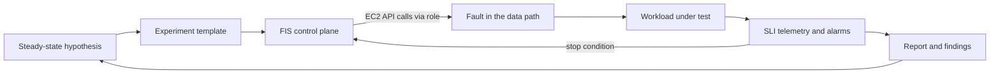

# Chaos Engineering and Game Days

## TL;DR

1. A chaos experiment is a falsifiable test of a steady-state hypothesis with a bounded blast radius. It is not random breakage, and the only valid output is a result you can act on: confirmed, refuted, or "the fault was never injected".
2. AWS FIS network faults are control-plane operations that swap NACL associations on subnets. Injection and rollback both depend on the EC2 API being healthy, and the faults are silent packet drops, not resets. This shapes what the drill proves.
3. A stop condition is only as fast as its alarm. With standard 60 s metrics the abort latency is roughly 2 to 4 minutes (derived estimate), so for short experiments the `duration` parameter is the real blast-radius cap, and the stop condition is a backstop for long ones.
4. Instance-kill tests only exercise fail-stop faults. Production outages are mostly gray failures, retry storms, and capacity exhaustion in the surviving zone, so inject latency, loss, partial connectivity, and "no capacity" errors, and size surviving zones for N/(N-1) load.
5. A game day is an operational exercise: it tests humans, runbooks, dashboards, and escalation paths, not just software. Run the mitigation (zonal shift, failover, drain) as the thing under test, with an abort owner, a scribe, and a written experiment card.

## Mental Model



The fault injector sits in the control plane and the workload sits in the data plane, and the two are connected only by API calls that mutate data-path configuration (NACLs, instance state, route tables, sidecar processes).
Telemetry flows back through an independent path: alarms evaluate user-facing SLIs and feed a stop condition into the injector.
That loop has latency at every hop, so the safety of an experiment is determined by three numbers: how long the fault runs, how long the alarm takes to notice harm, and how long rollback takes.
The hypothesis closes the loop: every finding either hardens the system or corrects the hypothesis, and then the experiment is automated so the property stays true.
See [[17-Cloud-AI-Engineering/Volume_01_Cloud_Architecture_Principles/Chapter_02_Regions_Zones_and_Static_Stability|Regions, Zones, and Static Stability]] for the properties that most drills verify, and [[17-Cloud-AI-Engineering/Volume_07_Reliability_and_SRE/Chapter_01_SLIs_SLOs_and_Error_Budget_Engineering|SLIs, SLOs, and Error Budget Engineering]] for how to choose the steady-state metric.

## Internals

### The experiment object model

An FIS experiment template has five parts: targets, actions, stop conditions, an IAM role, and options.
Per the AWS docs, <cite>stop conditions are CloudWatch alarms that define a threshold at which application performance is not acceptable, and FIS stops the experiment if one fires</cite> (AWS docs, as of 2026-10; [experiment template components](https://docs.aws.amazon.com/fis/latest/userguide/experiment-templates.html)).
Targets are resolved when the experiment starts, either by tag, by filter, or by explicit ARN, with a selection mode such as `ALL` or `COUNT(3)` (AWS docs, as of 2026-10; [example templates](https://docs.aws.amazon.com/fis/latest/userguide/experiment-template-example.html)).
Actions run in sequence or in parallel, and some actions have a built-in recovery step, for example `startInstancesAfterDuration` on `aws:ec2:stop-instances`.
FIS assumes the role you supply and calls service APIs on your behalf, which means every fault is something your own IAM role could have done by hand, and every fault is recorded in CloudTrail under that role.

The control-plane consequence is the part that getting-started guides skip.
FIS does not run on your instances for network faults.
It calls EC2 APIs to change network configuration, and it must call them again to restore it.
If the EC2 control plane is degraded when an experiment ends, rollback is delayed, and the fault outlives its `duration`.
This is the same control-plane versus data-plane split described in [[17-Cloud-AI-Engineering/Volume_01_Cloud_Architecture_Principles/Chapter_04_Control_Plane_vs_Data_Plane_Separation|Control Plane vs Data Plane Separation]], applied to the tester.
The operational rule that follows is to never schedule a drill during a regional event, and to wire a blocking window to your incident system (see Failure Modes).

### Mechanism: the NACL clone-and-swap

`aws:network:disrupt-connectivity` is the workhorse for zonal drills, and its implementation determines what a pass means.
The documented behavior is that it <cite>temporarily clones the original network ACL associated with the target subnet, adds deny rules to the clone (tagged `managedByFIS=true`), and associates the clone with the subnet for the duration of the action</cite>, and at completion FIS deletes the clone and restores the original association (AWS docs, as of 2026-10; [actions reference](https://docs.aws.amazon.com/fis/latest/userguide/fis-actions-reference.html)).
Mechanically this is a `CreateNetworkAcl`, a series of `CreateNetworkAclEntry` calls, and a `ReplaceNetworkAclAssociation` per subnet, then the inverse sequence at the end.

Consequences you can derive from that mechanism:

- **Stateless, per-packet, silent.** Network ACLs are stateless filters evaluated on every packet crossing the subnet boundary (recalled from AWS VPC docs, UNVERIFIED in this revision). A deny entry drops packets with no ICMP unreachable and no TCP reset. Established TCP flows do not close, they stall and retransmit until the application's timeout or the kernel's retransmission limit fires. This is why the AZ Power Interruption scenario is described as forcing timeouts and DNS refreshes (AWS docs, as of 2026-10; [AZ Availability: Power Interruption](https://docs.aws.amazon.com/fis/latest/userguide/az-availability-scenario.html)). A client with a 30 s read timeout and no connect timeout will hold a connection for 30 s per attempt, which is much worse than a connection refused.
- **Subnet boundary only.** Scope `all` <cite>denies all traffic entering and leaving the subnet but allows intra-subnet traffic</cite> (AWS docs, as of 2026-10; [actions reference](https://docs.aws.amazon.com/fis/latest/userguide/fis-actions-reference.html)). If your app and database share a subnet, the drill does not sever that path, so you under-inject. Target every subnet in the AZ, including data and endpoint subnets, or the drill proves less than you think.
- **Not everything is filtered.** NACLs do not filter some VPC infrastructure traffic such as the Amazon-provided DNS resolver and instance metadata (recalled from AWS docs, UNVERIFIED). A "total blackhole" still leaves name resolution and IMDS working, so DNS-based failure behavior is not fully exercised.
- **Entry and subnet limits.** When scope is not `all`, <cite>the maximum number of entries in network ACLs is 20</cite>, and for scope `availability-zone` <cite>the maximum number of subnets that can be targeted in a VPC is 30</cite> (AWS docs, as of 2026-10; [actions reference](https://docs.aws.amazon.com/fis/latest/userguide/fis-actions-reference.html)).
- **Association swap races with IaC.** `ReplaceNetworkAclAssociation` returns a new association ID, so a concurrent Terraform or CloudFormation apply that reads the old association can fight the experiment or fail to converge. Freeze network IaC pipelines during drills (inference from the API semantics).
- **Permissions are network-admin-grade.** The role needs permissions such as `ec2:CreateNetworkAcl`, which is a problem in centralized-network organizations. AWS documents an SCP pattern that allows a dedicated experiment-executor role to make those calls while denying everyone else (AWS Cloud Operations blog, as of 2026-10; [Scaling FIS across your organization](https://aws.amazon.com/blogs/mt/scaling-aws-fault-injection-service-across-your-organization-using-account-controls/)).

Other scopes matter for dependency drills.
The action supports `availability-zone` (deny intra-VPC traffic to and from other AZs), `vpc`, `prefix-list`, `s3`, `dynamodb` (Regional endpoint), and `s3express` (zonal endpoint) (AWS docs, as of 2026-10; [connectivity tutorial](https://docs.aws.amazon.com/fis/latest/userguide/fis-tutorial-disrupt-connectivity.html)).
The `dynamodb` and `s3` scopes let you rehearse "a regional dependency endpoint is unreachable", which is the failure shape of several public incidents, without touching production data.
Related actions in the same family include `aws:network:route-table-disrupt-cross-region-connectivity`, `aws:network:transit-gateway-disrupt-cross-region-connectivity`, and `aws:network:disrupt-vpc-endpoint` (AWS docs, as of 2026-10; [actions reference](https://docs.aws.amazon.com/fis/latest/userguide/fis-actions-reference.html)).

### Agent-based and sidecar faults

Faults that need to run inside a compute unit (CPU stress, packet loss, latency, I/O stress, process kill) are delivered differently.
For ECS task actions FIS uses an SSM agent sidecar container, and as of 2026-09-29 AWS ships a non-root variant of that sidecar image with the fault-injection dependencies pre-installed (AWS docs, as of 2026-10; [FIS document history](https://docs.aws.amazon.com/fis/latest/userguide/doc-history.html)).
The action catalog includes `aws:ecs:task-network-latency`, `aws:ecs:task-network-packet-loss`, `aws:ecs:task-kill-process`, `aws:eks:pod-network-latency`, and `aws:eks:pod-io-stress` (names from the FIS quota list, as of 2026-10; [secondary mirror](https://awsfundamentals.com/limits/fis)).
For EKS pod actions, FIS injects through an ephemeral container added to the target pod using Kubernetes RBAC you grant to a service account (recalled from FIS docs, UNVERIFIED in this revision).
The trade-off is that these faults run with elevated capabilities in your workload's network namespace, so the same hardening review you apply to debug containers applies here.

### Service-side API faults

FIS also has actions that inject errors at the service API layer for calls made by specific IAM roles, such as internal-error, throttle, and unavailable responses scoped to a Region or AZ (recalled from FIS docs, action names `aws:fis:inject-api-internal-error`, `aws:fis:inject-api-throttle-error`, `aws:fis:inject-api-unavailable-error`, UNVERIFIED in this revision).
The scenario library's AZ Power Interruption experiment also includes <cite>no re-scaling of compute in the AZ</cite>, alongside loss of zonal EC2, EKS, and ECS compute, subnet connectivity loss, RDS and ElastiCache failover, and unresponsive EBS volumes (AWS What's New, as of 2023-11; [launch post](https://aws.amazon.com/about-aws/whats-new/2023/11/aws-fault-injection-service-two-requested-scenarios/)).
The "no re-scaling" element is the one most teams never test by hand, and it is the one that kills autoscaling-dependent designs, because it encodes the static-stability rule that recovery must not require new control-plane work.

### Stop conditions and the abort-latency model

A stop condition is a CloudWatch alarm, and an alarm is a delayed, aggregated signal.
For a standard-resolution alarm with `Period=60`, `EvaluationPeriods=2`, and `DatapointsToAlarm=2`, the alarm needs two consecutive breaching one-minute buckets, plus metric publication and evaluation delay.
A reasonable planning figure is 2 to 4 minutes from fault onset to ALARM state (derived estimate, not an AWS SLA), then FIS needs time to stop actions and run rollback.

```text
t_exposure = t_detect + t_abort + t_rollback
t_detect   ~ (datapoints_to_alarm * period) + publish_delay + eval_delay
```

Two design rules fall out of this.
First, if the action `duration` is shorter than `t_detect`, the stop condition cannot save you, and `duration` is the only real blast-radius control. The AZ Power Interruption scenario blocks connectivity for 2 minutes by default (AWS docs, as of 2026-10), which is on the order of the detection latency of a standard alarm.
Second, a stop condition built on a metric that disappears when the system is down is decorative. If error-rate is computed from request counts and traffic collapses to zero, the metric has no datapoints, and the default missing-data handling does not produce ALARM. Set `TreatMissingData=breaching` on the stop alarm so "no data" means "stop", and test the alarm by forcing it into ALARM before trusting it.

### The mitigation under test: zonal shift and autoshift

For single-Region multi-AZ drills the thing you actually want to rehearse is the mitigation.
ARC zonal shift moves traffic away from one AZ for supported resources, and zonal autoshift lets AWS do it automatically: <cite>when AWS internal telemetry detects an AZ impairment that could impact customers, ARC starts shifting traffic for configured resources to healthy AZs</cite> (AWS docs, as of 2026-10; [ARC single-Region recovery](https://aws.amazon.com/application-recovery-controller/single-region-recovery/)).
At launch it supported Application and Network Load Balancers with cross-zone load balancing disabled (AWS What's New, as of 2023-11; [zonal autoshift launch](https://aws.amazon.com/about-aws/whats-new/2023/11/route-53-application-recovery-zonal-autoshift/)).
The cross-zone-disabled requirement is the mechanism, not a footnote: shifting works at the zonal load-balancer-node level (removing the zone from DNS answers and routing), so a cross-zone-enabled load balancer would still forward to the impaired zone's targets (mechanism recalled from ARC docs, UNVERIFIED in this revision).
Practice runs are the built-in game day: <cite>when a resource has a practice run configuration, ARC starts weekly zonal shifts to shift traffic away from an Availability Zone</cite>, to verify the application tolerates losing one AZ (AWS docs, as of 2026-10; [UpdateZonalAutoshiftConfiguration](https://docs.aws.amazon.com/arc-zonal-shift/latest/api/API_UpdateZonalAutoshiftConfiguration.html)).
Because shifting is DNS-mediated, clients holding cached answers or long-lived connections keep sending to the shifted-away zone until TTL expiry or connection turnover, so measure the tail of traffic, not the median.

### Fault selection: why random is not enough

Three results from the literature determine which faults to inject.

- **Lineage-driven fault injection.** Alvaro, Rosen, and Hellerstein (SIGMOD 2015) reason backward from a successful execution's lineage to find the minimal sets of faults that could falsify the success, and only inject those. This matters because blind search explodes: for a request touching 50 independent calls there are C(50,2) = 1,225 two-fault and C(50,3) = 19,600 three-fault combinations (derived), and most are redundant. Netflix applied the approach to production-scale failure testing (Basiri et al., "Automating Failure Testing Research at Internet Scale", SoCC 2016).
- **Gray failure.** Huang et al. (HotOS 2017) define gray failure as differential observability: the component looks healthy to its health checker while applications see it as failed. Instance-stop tests cannot produce this. Latency injection, partial packet loss, and asymmetric partitions can.
- **Metastable failures.** Huang et al. (OSDI 2022, "Metastable Failures in the Wild") show that a transient trigger can push a system into a self-sustaining overload state, typically driven by retry amplification or cache-miss storms, that persists after the trigger is removed. Fault drills must therefore include the recovery phase: run the fault, remove it, and keep measuring for at least several multiples of the longest client timeout. See [[17-Cloud-AI-Engineering/Volume_07_Reliability_and_SRE/Chapter_03_Resilient_Communication_Retries_Jitter_and_Circuit_Breakers|Resilient Communication: Retries, Jitter, and Circuit Breakers]] and [[17-Cloud-AI-Engineering/Volume_07_Reliability_and_SRE/Chapter_02_Load_Shedding_Backpressure_and_Admission_Control|Load Shedding, Backpressure, and Admission Control]].

Also relevant: Yuan et al. (OSDI 2014, "Simple Testing Can Prevent Most Critical Failures") found that many catastrophic failures in distributed data systems came from incorrect handling of non-fatal errors, which is the class that error-path injection finds cheaply.
Facebook's Maelstrom (Veeraraghavan et al., OSDI 2018) is the large-scale analog of a zonal drill: regularly draining whole datacenters of traffic to prove that interdependent services can run without them.

### Blast-radius control by construction

The strongest safety mechanism is architectural, not procedural.
If the system is cell-based, run the drill in one cell, with a canary cohort of real or synthetic traffic, and let the other cells carry the SLO. See [[17-Cloud-AI-Engineering/Volume_01_Cloud_Architecture_Principles/Chapter_03_Cell_Based_Architecture_and_Shuffle_Sharding|Cell-Based Architecture and Shuffle Sharding]].
Without cells, you are limited to the coarse knobs: target count (`COUNT(n)`), percentage, a single AZ, and `duration`.

### What exists on Google Cloud

As of this revision I could not verify a first-party managed fault injection service on Google Cloud equivalent to FIS, so treat that as UNVERIFIED.
The practical toolbox is a composition of primitives:

- **Application-layer faults.** Envoy-based Cloud Load Balancing URL maps and Cloud Service Mesh support request delay and abort fault injection by percentage (recalled from Google Cloud docs, UNVERIFIED). This is the closest analog to FIS API-error injection, and it is the safest way to test client timeout and retry behavior because it is per-route and per-percentage.
- **Platform failover primitives.** `gcloud compute instances simulate-maintenance-event`, Cloud SQL HA failover (`gcloud sql instances failover`), and Memorystore failover are documented ways to trigger the real recovery path (command names recalled, UNVERIFIED in this revision).
- **Kubernetes-level chaos.** Chaos Mesh and LitmusChaos run in GKE and inject pod kill, network, and I/O faults.
- **Network partition.** Because the Google Cloud VPC is global and firewall rules are VPC-scoped, a zonal blackhole is built by targeting network tags or service accounts of one zone's instance group with a high-priority deny rule. GCP firewall rules are stateful, so established connections may survive a newly added deny rule until their tracking entries expire, which is a different failure shape than the NACL drop (behavior recalled from VPC firewall docs, UNVERIFIED in this revision, and it must be tested empirically before you rely on it). See [[17-Cloud-AI-Engineering/Volume_03_GCP_Deep_Dive/Chapter_04_Global_VPC_Andromeda_SDN_and_Network_Tiers|Global VPC, Andromeda SDN, and Network Tiers]].
- **Organizational practice.** Google's DiRT (Disaster Recovery Testing) program and the SRE practices of "Wheel of Misfortune" and disaster role-playing are the process model (Krishnan, "Weathering the Unexpected", ACM Queue 2012; Google SRE book chapter on testing for reliability).

### Game day design

A game day is a scheduled, scoped exercise with named roles and a written experiment card.
The minimum card has: hypothesis with numeric thresholds, blast radius (accounts, AZs, cells, percentage of traffic), abort criteria and who can invoke them, rollback procedure verified independent of the injector, expected detection time, expected mitigation time, comms plan, and the freeze scope (deploys, IaC pipelines, other drills).
Roles are: facilitator (runs the clock), chaos operator (owns the injection and the abort), incident commander (practices the real IC role, see [[17-Cloud-AI-Engineering/Volume_07_Reliability_and_SRE/Chapter_06_Incident_Response_Blameless_Postmortems_and_RCA|Incident Response, Blameless Postmortems, and RCA]]), responders who have not seen the card contents, and a scribe who timestamps detection, diagnosis, mitigation, and recovery.
Use a maturity ramp: tabletop, then staging with production-equivalent config, then production in a single cell or a low-traffic window with a canary cohort, then production AZ-wide at normal traffic, then continuous automated runs.
Two numbers from every drill matter more than pass/fail: time to detect and time to mitigate, measured against the runbook's claim.
The failure the exercise most often finds is not a code bug but a stale runbook, a dashboard hosted in the failed zone, a paging path that depends on the failed component, or an owner who is not reachable.

### Chaos for AI infrastructure

GPU fleets change the arithmetic because capacity is the scarce resource.
Static stability for an inference fleet means holding N/(N-1) capacity across N zones in advance, because replacement accelerators may not be launchable during a zonal event (the "no re-scaling" element of the AZ scenario encodes this). On-demand capacity reservations or equivalent reserved capacity are the usual mechanism.
Inference drills should include a model-load storm: when a zone fails and replicas restart elsewhere, every replica pulls tens to hundreds of gigabytes of weights, and the surviving zone's storage and NIC bandwidth become the bottleneck. See [[17-Cloud-AI-Engineering/Volume_11_LLM_Serving_and_Inference_Systems_on_Cloud/Chapter_08_Cloud_GPU_Autoscaling_and_Cold_Start_Mitigation|Cloud GPU Autoscaling and Cold-Start Mitigation]].
Training drills kill a node mid-step and measure restart goodput: detection, rescheduling, checkpoint load, and warm-up. The classic Young/Daly first-order optimum for checkpoint interval is sqrt(2 * C * MTBF), where C is checkpoint cost.
With C = 60 s and a cluster MTBF of 4 hours, that is sqrt(2 * 60 * 14,400) = about 1,314 s, roughly 22 minutes (derived). A drill is how you measure the real C, the real restart time, and the real MTBF instead of assuming them. See [[17-Cloud-AI-Engineering/Volume_10_AI_Infrastructure_on_Cloud/Chapter_08_Fault_Tolerance_and_Fleet_Resiliency_at_Scale|Fault Tolerance and Fleet Resiliency at Scale]].

## Numbers to Know

| Quantity | Value | Source |
| --- | --- | --- |
| FIS price per action-minute | $0.10, plus $0.10 per action-minute for each additional account | (AWS FIS pricing, as of 2026-10) |
| FIS price in GovCloud (US-East, US-West) | $0.12 per action-minute, plus $0.12 per additional account | (AWS FIS pricing, as of 2026-10) |
| FIS experiment report | $5 per report | (AWS FIS pricing, as of 2026-10) |
| Action-minute rounding | Duration from start to stop, rounded to the nearest minute | (AWS Resilience Hub pricing docs, as of 2026-10) |
| Parallel actions are billed independently | 2 actions x 20 min + 1 action x 10 min = 50 action-minutes = $5 | (AWS FIS pricing example, as of 2026-10) |
| AZ Power Interruption scenario default connectivity block | 2 minutes for all subnets tagged in the AZ | (AWS docs, as of 2026-10) |
| NACL entries when scope is not `all` | Max 20 | (AWS FIS docs, as of 2026-10) |
| Subnets per VPC for scope `availability-zone` | Max 30 | (AWS FIS docs, as of 2026-10) |
| Target subnets for `aws:network:disrupt-connectivity` (quota mirror) | 100, which conflicts with the 30 above for AZ scope, so check Service Quotas | (awsfundamentals mirror of Service Quotas, as of 2026-10, UNVERIFIED) |
| Max experiment duration (quota mirror) | 12 hours | (awsfundamentals mirror of Service Quotas, as of 2026-10, UNVERIFIED) |
| Parallel actions per experiment (quota mirror) | 10 | (awsfundamentals mirror of Service Quotas, as of 2026-10, UNVERIFIED) |
| Target account configurations per template (quota mirror) | 40 | (awsfundamentals mirror of Service Quotas, as of 2026-10, UNVERIFIED) |
| Target pods per `aws:eks:pod-network-latency` (quota mirror) | 1,000 | (awsfundamentals mirror of Service Quotas, as of 2026-10, UNVERIFIED) |
| Report pre-experiment window | Default 20 min, up to 30 min | (AWS FIS docs, as of 2026-10) |
| Report post-experiment window | Up to 2 hours | (AWS FIS docs, as of 2026-10) |
| ARC zonal autoshift practice runs | Weekly, mandatory for autoshift | (AWS docs, as of 2026-10) |
| Surviving-zone load multiplier after losing 1 of N zones | N/(N-1): 1.5x for N=3, 2.0x for N=2, 1.33x for N=4 | (derived) |
| Alarm-based abort latency, standard 60 s metric, 2-of-2 datapoints | Roughly 2 to 4 minutes | (derived estimate, not an SLA) |
| Cost of a 5-minute single-action experiment, one account | 5 x $0.10 = $0.50 | (derived from AWS FIS pricing, as of 2026-10) |
| Cost of the same experiment across 3 accounts | 5 x ($0.10 + 2 x $0.10) = $1.50 | (derived from AWS FIS pricing, as of 2026-10) |

## AWS vs GCP Mechanism Parity

| Dimension | AWS | Google Cloud |
| --- | --- | --- |
| Managed fault injection service | AWS FIS with a scenario library, multi-account experiments, and stop conditions (AWS docs, as of 2026-10) | No first-party equivalent verified in this revision (UNVERIFIED). Compose from load balancer or mesh fault injection, platform failover commands, and Chaos Mesh or LitmusChaos |
| Zonal network blackhole | `aws:network:disrupt-connectivity` clones and swaps the subnet NACL. Stateless, so established flows stall and time out | Deny firewall rule scoped by tag or service account on a global VPC. Stateful firewall, so established flows may persist until tracking entries expire (UNVERIFIED), so verify empirically |
| Blast-radius unit | Subnet, tag, AZ, account, `COUNT(n)` | Network tag, instance group, zone, project, mesh route percentage |
| Request-level faults | FIS API fault injection scoped by IAM role (UNVERIFIED), ECS and EKS network latency and loss via sidecar or ephemeral container | Envoy fault injection (delay, abort) via URL map or Cloud Service Mesh (UNVERIFIED), Istio-style semantics |
| Abort mechanism | CloudWatch alarm stop conditions. Latency bounded by alarm period and datapoints | No built-in equivalent. Build with Cloud Monitoring alert policy triggering a Pub/Sub-driven rollback function, and measure the added latency |
| Mitigation under test | ARC zonal shift and zonal autoshift with weekly practice runs, ALB and NLB with cross-zone disabled (AWS docs, as of 2026-10) | Regional managed instance groups and global load balancing health-based failover. Drain by setting backend capacity scaler to 0 (UNVERIFIED) |
| Stateful failover triggers | FIS RDS and ElastiCache failover actions in the AZ scenario (AWS docs, as of 2023-11) | `gcloud sql instances failover`, Memorystore failover, Spanner and Bigtable are multi-zone by default so the drill is client behavior (UNVERIFIED) |
| Cross-region isolation | Cross-Region: Connectivity scenario covers VPC peering, public endpoints, LB and API gateway endpoints, S3 CRR, and DynamoDB global tables replication (AWS What's New, as of 2023-11) | Compose VPC firewall or hierarchical firewall policy deny between regions, plus load balancer region drain. Cross-region replication fault tests are manual |
| Control-plane dependency of the injector | Injection and rollback use EC2 APIs via the experiment role, so the injector can fail when the control plane is impaired | Firewall and Compute APIs have the same property |
| Organizational model | Management-account SCPs gate who can run network actions. Dedicated executor role | Org policy and custom IAM roles. Add VPC Service Controls boundaries for drill tooling |
| Process framework | AWS Well-Architected Reliability pillar and Resilience Hub | Google DiRT and SRE disaster role-playing |

## Worked Example: AZ Blackhole Drill with a Real Stop Condition

The lab blackholes one AZ's tagged subnets for 5 minutes, with a metric-math stop alarm and a failing-closed empty-target mode.
It assumes an existing multi-AZ service behind an Application Load Balancer, in a non-production account, with the AZ's subnets tagged by the script.

### Step 1: capacity sizing before you inject anything

If the drill fails because the surviving zones are saturated, you have learned that your fleet was not statically stable, which is a valid result but a cheaper one to compute first.
Assume peak 6,000 rps, a per-node SLO-safe capacity of 250 rps, and an illustrative $0.20 per node-hour (illustrative, not a quote).

| AZs (N) | Nodes per AZ | Total | Steady-state utilization at peak | Monthly cost at $0.20/hr x 730 h |
| --- | --- | --- | --- | --- |
| 2 | 24 | 48 | 50.0% | $7,008 |
| 3 | 12 | 36 | 66.7% | $5,256 |
| 4 | 8 | 32 | 75.0% | $4,672 |

The no-AZ-tolerance baseline is 24 nodes ($3,504 per month), so three-AZ static stability costs 12 extra nodes, or $1,752 per month, which is a 50% premium (derived).
The same formula applies to GPU nodes, where the premium is often the dominant cost and is the reason reserved capacity commitments matter.

### Step 2: choose the stop threshold from the noise floor

Assume baseline error rate p0 = 0.05%, 800 rps, and one-minute alarm buckets.
Requests per bucket n = 48,000, expected errors mu = 24, Poisson standard deviation sqrt(24) = 4.9, so the 5-sigma noise ceiling is 24 + 24.5 = 48.5 errors, or 0.101% (derived).
A stop threshold of 1.0% error rate is 10x the noise ceiling, so it will not flap, and it still fires well before an SLO budget is meaningfully spent.
With `DatapointsToAlarm=2` of 2, expect 2 to 4 minutes to ALARM, so the 5-minute `duration` is the primary cap, which is the point of the abort-latency model above.

### Step 3: IAM role and budget alarm

```bash
ACCOUNT=$(aws sts get-caller-identity --query Account --output text)
REGION=us-east-1

cat > /tmp/fis-trust.json <<EOF
{
  "Version": "2012-10-17",
  "Statement": [{
    "Effect": "Allow",
    "Principal": {"Service": "fis.amazonaws.com"},
    "Action": "sts:AssumeRole",
    "Condition": {
      "StringEquals": {"aws:SourceAccount": "${ACCOUNT}"},
      "ArnLike": {"aws:SourceArn": "arn:aws:fis:${REGION}:${ACCOUNT}:experiment/*"}
    }
  }]
}
EOF

aws iam create-role --role-name chaos-drill-fis \
  --assume-role-policy-document file:///tmp/fis-trust.json
# Managed policy name recalled from FIS docs; verify before use.
aws iam attach-role-policy --role-name chaos-drill-fis \
  --policy-arn arn:aws:iam::aws:policy/service-role/AWSFaultInjectionSimulatorNetworkAccess

cat > /tmp/budget.json <<EOF
{"BudgetName":"chaos-lab","BudgetType":"COST","TimeUnit":"MONTHLY",
 "BudgetLimit":{"Amount":"10","Unit":"USD"}}
EOF
cat > /tmp/budget-notify.json <<EOF
[{"Notification":{"NotificationType":"ACTUAL","ComparisonOperator":"GREATER_THAN",
  "Threshold":80,"ThresholdType":"PERCENTAGE"},
  "Subscribers":[{"SubscriptionType":"EMAIL","Address":"oncall@example.com"}]}]
EOF
aws budgets create-budget --account-id "$ACCOUNT" \
  --budget file:///tmp/budget.json \
  --notifications-with-subscribers file:///tmp/budget-notify.json
```

### Step 4: the drill script

```python
#!/usr/bin/env python3
"""AZ blackhole drill: tag subnets, create stop alarm, create and run an FIS template, tear down."""
import argparse
import json
import math
import sys
import time
import uuid

TAG_KEY = "ChaosDrill"
TAG_VAL = "az-blackhole"
ALARM = "chaos-drill-user-error-pct"
TEMPLATE_FILE = "/tmp/az_drill_template_id"


def clients(region):
    import boto3
    return (boto3.client("ec2", region_name=region),
            boto3.client("cloudwatch", region_name=region),
            boto3.client("fis", region_name=region))


def cmd_size(a):
    n = a.azs
    per_az = math.ceil(a.peak_rps / (n - 1) / a.rps_per_node)
    total = per_az * n
    base = math.ceil(a.peak_rps / a.rps_per_node)
    util = a.peak_rps / (total * a.rps_per_node)
    extra = (total - base) * a.node_hour_usd * 730
    print(f"azs={n} nodes_per_az={per_az} total={total} baseline={base}")
    print(f"steady_state_util_at_peak={util:.1%} insurance_usd_per_month={extra:,.0f}")


def cmd_tag(a):
    ec2, _, _ = clients(a.region)
    subnets = ec2.describe_subnets(Filters=[
        {"Name": "vpc-id", "Values": [a.vpc_id]},
        {"Name": "availability-zone-id", "Values": [a.az_id]}])["Subnets"]
    ids = [s["SubnetId"] for s in subnets]
    if not ids:
        sys.exit("no subnets found: refusing to create a drill that injects nothing")
    ec2.create_tags(Resources=ids, Tags=[{"Key": TAG_KEY, "Value": TAG_VAL}])
    print("tagged", ids)


def cmd_alarm(a):
    _, cw, _ = clients(a.region)

    def stat(mid, name):
        return {"Id": mid, "ReturnData": False, "MetricStat": {
            "Metric": {"Namespace": "AWS/ApplicationELB", "MetricName": name,
                       "Dimensions": [{"Name": "LoadBalancer", "Value": a.lb}]},
            "Period": 60, "Stat": "Sum"}}

    cw.put_metric_alarm(
        AlarmName=ALARM,
        Metrics=[
            {"Id": "e1", "Label": "error_pct", "ReturnData": True,
             "Expression": "100*(FILL(m1,0)+FILL(m3,0))/m2"},
            stat("m1", "HTTPCode_ELB_5XX_Count"),
            stat("m2", "RequestCount"),
            stat("m3", "HTTPCode_Target_5XX_Count"),
        ],
        EvaluationPeriods=2, DatapointsToAlarm=2, Threshold=a.threshold_pct,
        ComparisonOperator="GreaterThanThreshold",
        TreatMissingData="breaching")
    print("alarm created:", ALARM)


def cmd_template(a):
    ec2, cw, fis = clients(a.region)
    arn = cw.describe_alarms(AlarmNames=[ALARM])["MetricAlarms"][0]["AlarmArn"]
    resp = fis.create_experiment_template(
        clientToken=str(uuid.uuid4()),
        description="AZ blackhole drill, subnets selected by tag",
        stopConditions=[{"source": "aws:cloudwatch:alarm", "value": arn}],
        targets={"DrillSubnets": {
            "resourceType": "aws:ec2:subnet",
            "resourceTags": {TAG_KEY: TAG_VAL},
            "selectionMode": "ALL"}},
        actions={"Blackhole": {
            "actionId": "aws:network:disrupt-connectivity",
            "parameters": {"scope": "all", "duration": a.duration},
            "targets": {"Subnets": "DrillSubnets"}}},
        roleArn=a.role_arn,
        tags={"purpose": "chaos-drill"},
        experimentOptions={"accountTargeting": "single-account",
                           "emptyTargetResolutionMode": "fail"})
    tid = resp["experimentTemplate"]["id"]
    open(TEMPLATE_FILE, "w").write(tid)
    print("template", tid)


def cmd_run(a):
    _, _, fis = clients(a.region)
    tid = open(TEMPLATE_FILE).read().strip()
    exp = fis.start_experiment(clientToken=str(uuid.uuid4()),
                               experimentTemplateId=tid)["experiment"]["id"]
    print("experiment", exp)
    while True:
        st = fis.get_experiment(id=exp)["experiment"]["state"]
        print(time.strftime("%H:%M:%S"), st["status"], st.get("reason", ""))
        if st["status"] in ("completed", "stopped", "failed", "cancelled"):
            break
        time.sleep(15)


def cmd_teardown(a):
    ec2, cw, fis = clients(a.region)
    try:
        fis.delete_experiment_template(id=open(TEMPLATE_FILE).read().strip())
    except Exception as e:
        print("template:", e)
    cw.delete_alarms(AlarmNames=[ALARM])
    subnets = ec2.describe_subnets(Filters=[
        {"Name": "tag:" + TAG_KEY, "Values": [TAG_VAL]}])["Subnets"]
    ids = [s["SubnetId"] for s in subnets]
    if ids:
        ec2.delete_tags(Resources=ids, Tags=[{"Key": TAG_KEY}])
    print("teardown done; untagged", ids)


def main():
    p = argparse.ArgumentParser()
    p.add_argument("--region", default="us-east-1")
    sub = p.add_subparsers(dest="cmd", required=True)
    s = sub.add_parser("size")
    s.add_argument("--peak-rps", type=float, required=True)
    s.add_argument("--rps-per-node", type=float, required=True)
    s.add_argument("--azs", type=int, default=3)
    s.add_argument("--node-hour-usd", type=float, required=True)
    s.set_defaults(f=cmd_size)
    t = sub.add_parser("tag")
    t.add_argument("--vpc-id", required=True)
    t.add_argument("--az-id", required=True)
    t.set_defaults(f=cmd_tag)
    al = sub.add_parser("alarm")
    al.add_argument("--lb", required=True, help="app/name/id dimension value")
    al.add_argument("--threshold-pct", type=float, default=1.0)
    al.set_defaults(f=cmd_alarm)
    te = sub.add_parser("template")
    te.add_argument("--role-arn", required=True)
    te.add_argument("--duration", default="PT5M")
    te.set_defaults(f=cmd_template)
    sub.add_parser("run").set_defaults(f=cmd_run)
    sub.add_parser("teardown").set_defaults(f=cmd_teardown)
    a = p.parse_args()
    a.f(a)


if __name__ == "__main__":
    main()
```

Three details in the script are deliberate and are the kind of thing a getting-started guide does not tell you.

- **`FILL(m1,0)` in the expression.** Load balancer error counters are published only when non-zero (recalled from CloudWatch ALB docs, UNVERIFIED). Without `FILL`, the healthy state has missing datapoints, and with `TreatMissingData=breaching` the alarm would fire immediately.
- **Two error counters.** When targets in a blackholed AZ stop answering, the load balancer itself generates 5xx responses (`HTTPCode_ELB_5XX_Count`), which do not appear in the target-generated counter. An alarm on only `HTTPCode_Target_5XX_Count` can stay green during the outage (recalled behavior, UNVERIFIED).
- **`emptyTargetResolutionMode` set to `fail`, plus the script's own check.** The scenario library's default is to skip an action if no valid subnets are found (AWS docs, as of 2026-10; [AZ Availability: Power Interruption](https://docs.aws.amazon.com/fis/latest/userguide/az-availability-scenario.html)), which means a mistagged environment produces a green "experiment" that injected nothing. Parameter values for this option are recalled, UNVERIFIED.

### Step 5: run it

```bash
python3 az_drill.py size --peak-rps 6000 --rps-per-node 250 --azs 3 --node-hour-usd 0.20
python3 az_drill.py --region us-east-1 tag --vpc-id vpc-0abc123 --az-id use1-az1
python3 az_drill.py --region us-east-1 alarm --lb app/my-alb/0123456789abcdef
# Force the alarm to ALARM once and confirm it, before trusting it as a stop condition.
aws cloudwatch set-alarm-state --alarm-name chaos-drill-user-error-pct \
  --state-value ALARM --state-reason "pre-flight abort test"
# Wait for it to return to OK on real data, then:
python3 az_drill.py --region us-east-1 template \
  --role-arn arn:aws:iam::${ACCOUNT}:role/chaos-drill-fis
python3 az_drill.py --region us-east-1 run
```

During the 5 minutes, record: time until the load balancer's health checks mark the zone's targets unhealthy, peak error percentage, p99 latency in surviving zones, per-node CPU in surviving zones, connection-pool saturation, and time to full recovery after the NACL is restored.
Keep measuring for at least 10 minutes after the end, to catch metastable behavior.

### Cost estimate

One action for 5 minutes is 5 action-minutes at $0.10, or $0.50 per run in one account (AWS FIS pricing, as of 2026-10).
A weekly run for a year is 52 x $0.50 = $26.
Adding an optional experiment report adds $5 per run (AWS FIS pricing, as of 2026-10).
The alarm and any extra load-balancer capacity used during the drill are small, but the lab assumes you are not provisioning new fleets, so the only incremental billable resources are FIS action-minutes, the CloudWatch alarm, and minimal logging.

### Exact teardown

```bash
# Abort a running experiment (get the id from 'run' output)
aws fis stop-experiment --id EXPERIMENT_ID
# Remove template, alarm, and tags
python3 az_drill.py --region us-east-1 teardown
# Remove role and budget
aws iam detach-role-policy --role-name chaos-drill-fis \
  --policy-arn arn:aws:iam::aws:policy/service-role/AWSFaultInjectionSimulatorNetworkAccess
aws iam delete-role --role-name chaos-drill-fis
aws budgets delete-budget --account-id "$ACCOUNT" --budget-name chaos-lab
# Verify FIS left no cloned ACLs behind
aws ec2 describe-network-acls --filters Name=tag:managedByFIS,Values=true \
  --query 'NetworkAcls[].NetworkAclId'
```

The last command should return an empty list.
If it returns a clone, the experiment did not complete rollback, and the associated subnet may still point at the clone: check `describe-network-acls` associations and restore the original association manually.

## Failure Modes and Pitfalls

### Experiments that injected nothing

Default skip behavior when targets are empty produces false confidence (AWS docs, as of 2026-10).
Every drill report should state how many targets were resolved and which actions actually ran.
Make the pre-flight check part of the automation, not a human step.

### Stop conditions that do not stop anything

Three variants occur in practice.
The alarm is on a metric that goes missing during the outage, so it sits in INSUFFICIENT_DATA.
The alarm measures a regional aggregate that hides a localized failure.
The alarm was never tested, and its threshold or dimension has a typo.
Test the abort path by forcing the alarm state before every new template, as in the lab.

### Detection latency longer than the experiment

For short experiments, `t_detect` exceeds `duration`, so the abort cannot help.
Size duration from your tolerance for user impact, not from what the tool allows.

### Rollback depends on the thing being broken

The injector restores state through the same control plane that may be degraded during a real event.
Maintain a manual rollback runbook that does not depend on FIS, for example the exact `replace-network-acl-association` invocation with the original association IDs recorded before the run.
Tag cloned ACLs so cleanup jobs can find them.

### Non-reversible actions

Actions such as instance termination and some data-layer faults have no restore step.
Classify every action as reversible, self-healing, or irreversible on the experiment card, and require a higher approval tier for the last category.

### Fault models that are too clean

An instance stop is a fail-stop fault, and real failures are mostly partial.
The Gray Failure result applies directly: a load balancer health check can keep reporting healthy while the application sees timeouts.
Add latency and loss faults, asymmetric partitions, and slow-disk faults to the program, not just kills.

### Retry amplification and metastable recovery

A blackholed AZ causes clients to time out and retry into the surviving zones, multiplying their load.
With N=3 the steady surviving-zone load is 1.5x, and a client with 3 retries and no budget can push the effective multiplier far higher during the first timeout window.
The failure persists after the trigger ends if queues and caches stay saturated (Huang et al., OSDI 2022).
The symptom in a drill is that error rate does not return to baseline within a few minutes of rollback.

### Capacity exhaustion in the surviving zone

Auto scaling that launches replacements in the surviving AZs competes with every other customer doing the same thing during a real event, and may see insufficient-capacity errors.
The AZ scenario's "no re-scaling" element exists to force this (AWS What's New, as of 2023-11).
For GPU instance families the probability is higher because the pools are small.

### Hidden zonal dependencies

Common findings are: a shared dashboard or log pipeline in the failed zone, a single-AZ NAT gateway used by all zones, a zonal EFS or EBS-backed state store, a CI runner in the failed AZ, an on-call paging webhook hosted in the failed zone, and a cross-zone-enabled load balancer that keeps sending to the impaired zone and defeats zonal shift.
The AZ Power Interruption scenario also notes that AWS services may take up to a few minutes to update DNS to reflect unavailable private endpoints, so lookups may return inaccessible addresses in the interim (AWS docs, as of 2026-10), which is why clients need connect timeouts and DNS re-resolution, not just retry.

### Drill and IaC collisions

Network IaC applies during a drill can re-associate the original NACL, or leave drift that fails the next `terraform plan`.
Freeze pipelines and use change windows.

### Game day social failure modes

A game day in staging with different config than production proves little.
A facilitator who steps in with hints removes the signal about the runbook.
No scribe means no timeline, so the postmortem argues from memory.
Skipping the follow-up means findings rot: track each finding as a ticket with an owner and a re-test date.
A program that only reports passes has usually stopped looking for failures.

### Public incident reviews relevant to drills

These are summarized from memory of the public post-incident reviews and were not re-verified in this revision, so treat each as UNVERIFIED and read the original.

- **AWS S3 us-east-1, 2017-02-28.** An operator command removed more capacity than intended, and the restart of core subsystems took longer than expected. The lesson for drills is that operator actions need rate limits and minimum-capacity floors, and that recovery paths of large, old subsystems must be exercised (UNVERIFIED).
- **AWS us-east-1, 2025-10-19 and 20.** A race condition in DynamoDB's DNS management produced an empty regional endpoint record and cascaded into dependent services. The lesson is that regional-endpoint unreachability is a drill scenario, and the FIS `dynamodb` scope exists for it (UNVERIFIED).
- **Google Cloud, 2025-06-12.** A global policy-data change propagated without a staged rollout and crash-looped a core API-management component across regions, with long recovery in at least one region from overload (UNVERIFIED).
- **Google Cloud europe-west9, 2023-04.** A water-related incident in a Paris datacenter took a zone fully offline for an extended period, and multi-zone customers with static headroom fared better than those relying on re-scaling (UNVERIFIED).

See [[17-Cloud-AI-Engineering/Volume_07_Reliability_and_SRE/Chapter_07_Anatomy_of_Major_Cloud_Outages|Anatomy of Major Cloud Outages]] for the full treatment.

## Security and Cost Angles

### IAM scoping

The experiment role is a privileged role, since it can create NACLs, stop instances, and fail over databases.
Scope it with a trust policy that has `aws:SourceAccount` and `aws:SourceArn` conditions bound to FIS experiments in the account, as in the lab.
Grant `fis:StartExperiment` to a narrower principal set than `fis:CreateExperimentTemplate`, so authors and operators are different people, and require a second approval for templates that touch production tags.
In organizations that centralize networking, use the SCP pattern in which only a dedicated experiment executor role may create temporary network ACLs (AWS Cloud Operations blog, as of 2026-10).
Experiments that target multiple accounts use per-account roles, and the AWS price scales with the number of target accounts (AWS FIS pricing, as of 2026-10), which also gives a natural budget gate on cross-account drills.

### Key hierarchies and logging

Experiment reports and logs may contain resource identifiers, error messages, and dashboards with business metrics.
Write reports to an S3 bucket with SSE-KMS using a key whose policy limits decrypt to the resilience team, and enable experiment logging to CloudWatch Logs or S3 (recalled from FIS docs, UNVERIFIED).
Reports support a CloudWatch dashboard snapshot with a configurable pre-window (default 20 minutes) and post-window (AWS FIS docs, as of 2026-10), which is the evidence artifact for audits. See [[17-Cloud-AI-Engineering/Volume_08_Security_Identity_and_the_Data_Perimeter/Chapter_07_Compliance_Auditing_and_Non_Repudiation|Compliance, Auditing, and Non-Repudiation]].

### Network boundaries

Run FIS from a management or security-tooling account with PrivateLink or VPC endpoints for the FIS API where available, and keep the drill tooling out of the zone being failed.
The sidecar and ephemeral-container faults run inside workload network namespaces with elevated capabilities, so exclude them from namespaces that handle regulated data unless the drill is explicitly approved.
On Google Cloud, bind the drill automation's service account to a custom role limited to firewall rules with a naming prefix, and include the tool in any VPC Service Controls perimeter review.

### Unit economics

FIS spend is trivially small compared with the cost of the drills' side effects: surviving-zone overprovisioning, engineer time, and avoided-outage value.
The real cost lever is the static-stability premium, N/(N-1): going from 2 to 3 AZs cuts the premium from 100% to 50%, and 4 AZs cuts it to 33% (derived), at the price of more inter-AZ data transfer and operational surface.
Drills tell you whether you can safely run closer to the floor.
For GPU fleets, a measured recovery time lets you decide between holding idle reserved capacity and accepting a longer degraded window, which can be a seven-figure annual decision. See [[17-Cloud-AI-Engineering/Volume_09_FinOps_and_Cloud_Economics/Chapter_05_GPU_and_TPU_Unit_Economics|GPU and TPU Unit Economics]].
Use Budgets alarms on drill accounts, and tag all FIS resources so spend is attributable.

## Interview Questions and Model Answers

### Question 1 (L5 - Senior)

You are asked to run the first chaos experiment on a stateless service behind an ALB in three AZs. Walk through the design.

#### Model Answer

Start with the steady-state hypothesis expressed as an SLI with numbers, for example: success rate stays above 99.9% and p99 latency stays under 400 ms during and after the loss of one AZ's capacity, measured on the user-facing path, not on instance health.
Define the baseline first by observing at least a week of the SLI, so that the threshold is derived from the noise floor.
For a 0.05% baseline error rate at 800 rps, one-minute buckets hold about 24 errors with a Poisson standard deviation near 5, so a stop threshold of 1% is 10x the noise ceiling and will not flap.

Choose a small, reversible fault first, such as stopping a `COUNT(1)` instance with `startInstancesAfterDuration`, then graduate to an AZ-scoped network fault.
Set the blast radius explicitly: one account, one AZ, one cell or a canary cohort, off-peak window, with a freeze on deployments.
Add a stop condition on the user-facing error-rate alarm, using metric math that includes load-balancer-generated 5xx, `FILL` for sparse counters, and `TreatMissingData=breaching`.
Force that alarm to ALARM once before the experiment to prove the abort path.
Confirm that the target set is non-empty before starting, because empty target resolution can silently skip actions.
Cap `duration` from your tolerance for user impact, because with a 60 s two-datapoint alarm the abort latency is about 2 to 4 minutes (derived), so the stop condition cannot protect a 2-minute run.
Record the timeline and keep measuring after the fault ends to detect slow recovery.

The trade-off is realism versus safety: a smaller blast radius makes the first runs safe but under-exercises the shared-capacity and retry-amplification paths that only appear at full-zone scale.

#### Follow-up Interviewer Question

The experiment passes with zero errors. What would make you distrust that result, and what do you check before declaring the service AZ-resilient?

### Question 2 (L5 - Senior)

Why is terminating the instances in an AZ not equivalent to an AZ failure test?

#### Model Answer

Instance termination is a fail-stop fault: connections are reset, health checks fail quickly, and the load balancer drains in seconds.
Real zonal events produce partial and ambiguous failures: packets vanish, latency rises, some dependencies stay reachable while others do not, and DNS answers for zonal endpoints may point at dead IPs for a few minutes.
The FIS network disruption action reproduces the silent-drop shape because it swaps in a NACL clone with deny rules, and NACLs are stateless, so established connections do not reset, they stall until an application timeout.
That surfaces the bugs that matter: missing connect timeouts, retry policies that multiply load, connection pools that fill with dead sockets, and clients that cache DNS beyond the TTL.
An instance kill also does not test control-plane behavior such as "no new capacity can be launched in the zone", which the AZ Power Interruption scenario models explicitly.
Finally, a subnet-scoped NACL does not cut intra-subnet traffic, so the injection fidelity depends on how subnets map to tiers, and you must tag every subnet in the zone for a faithful test.

The limit of even the NACL approach is that it is a clean, total partition; it does not model gray failure, so add latency and packet-loss faults for the ECS or EKS workloads as a second experiment class.

#### Follow-up Interviewer Question

Your service uses a NAT gateway in one AZ for all egress. How does that appear in each test type, and how would you fix it?

### Question 3 (L6 - Staff)

An ARC zonal shift practice run for your ALB-fronted service shows no errors but p99 latency doubles for 20 minutes. Diagnose and decide what to change.

#### Model Answer

No errors with doubled tail latency indicates saturation without failure, so look at the surviving zones.
With three zones and balanced load, shifting away one zone raises surviving per-zone load by N/(N-1) = 1.5x.
If steady-state utilization at peak was already above about 67%, the surviving zones cross the point where queuing delay rises sharply (queueing theory: wait time grows roughly as rho/(1-rho)), which produces exactly this symptom.
Check the specifics: per-AZ CPU and connection counts, per-AZ target counts (a cross-zone-disabled load balancer sends traffic proportional to AZ share, so an uneven target distribution matters), cache hit rate (a cold cache in the receiving zone, if caches are zonal), and autoscaling lag (target tracking reacts on minutes, so any scale-out completes after the 20 minutes of pain).
Check the shift itself: DNS caching and long-lived connections mean traffic drains gradually, so the initial period can overlap with high load in the old zone and the new zone.

Decisions: compute the required nodes per AZ from peak load for N-1 zones, as in the sizing table (36 nodes at 12 per AZ for 6,000 rps with 250 rps per node), and raise the static floor to that number rather than relying on autoscaling, because the principle of static stability is that recovery must not depend on launching new capacity.
Pre-warm caches by routing a small percentage of traffic through each zone continuously.
Cost: the premium is 50% for N=3, so quantify it against the SLO breach cost, and consider N=4 (33% premium) if the region has the zones.
Keep the weekly practice runs so the number is verified against real traffic growth, since headroom erodes as traffic grows.

The alternative of accepting degraded latency is legitimate if the SLO allows it, but it should be an explicit decision with an owner, not a discovery.

#### Follow-up Interviewer Question

Product wants to save money by enabling cross-zone load balancing to even out load. What does that do to zonal shift and to your failure behavior?

### Question 4 (L6 - Staff)

Design a chaos engineering program for 400 services across 120 AWS accounts. What are the governance, safety, and cost mechanisms?

#### Model Answer

Separate three layers: a platform that owns the injector and guardrails, service teams that own hypotheses and experiments, and a central resilience group that owns the scenario library and the scoring.
Platform: a dedicated tooling account runs FIS multi-account experiments, with an executor role in each target account created by StackSets or equivalent. Trust policies are bound to `aws:SourceAccount` and the FIS experiment ARN. An SCP at the OU level allows only that role to perform network ACL manipulation, which is the documented pattern for centralized-network organizations.
Safety: templates are code-reviewed, and each carries a stop condition on a user-facing SLI. A blocking mechanism queries the incident system and refuses to start while a Sev1 or Sev2 is open or a deploy freeze is active. Experiments are tagged and logged to a central bucket with SSE-KMS. Irreversible actions need a higher approval tier.
Scheduling: continuous low-intensity experiments (single-instance kills, API latency) run automatically per service weekly. Zonal and regional drills run quarterly as staffed game days. ARC practice runs provide a weekly AZ-loss check for load-balanced services.
Cost: FIS charges $0.10 per action-minute plus $0.10 per extra account, so a 5-minute single-action run across 3 accounts is $1.50 (derived from pricing). Even 400 services running one such experiment weekly is 400 x 52 x $1.50 = about $31,200 a year if every run was cross-account, so the platform cost is dominated by people time, not FIS.
Measurement: track coverage (services with a verified zonal drill in the last 90 days), findings opened and closed with time-to-fix, mean time to detect and mitigate in drills, and incidents attributed to untested failure modes.
Failure modes of the program itself: experiment-induced incidents (mitigated by the blocking mechanism and cell-scoped blast radius), alert fatigue from drills (route drill alerts to a labeled channel), and teams gaming the pass rate (audit that actions actually ran and targets were non-empty).

The trade-off is autonomy versus consistency: central templates are easier to audit, but teams will under-use them if they cannot parameterize targets and hypotheses.

#### Follow-up Interviewer Question

A team's weekly experiment starts during an unrelated Sev2 and extends the impact. Walk me through what in your design should have prevented it, and what you change now.

### Question 5 (L6 - Staff)

How do you prove that your experiment's stop condition will actually protect production, and where does it fundamentally fail?

#### Model Answer

Prove three properties separately: the alarm can reach ALARM, it does so fast enough, and the abort leads to rollback.
For the first, force the alarm state with `set-alarm-state` before each new template, and run a canary fault in a test cell that deliberately breaches the threshold and confirm that FIS ends the experiment with a stop-condition reason.
Check that the metric exists at all in the failure condition: a success-rate metric computed from request counts has no datapoints when traffic collapses, so set `TreatMissingData=breaching`, and use `FILL` for counters that are only published when non-zero.
For speed, compute `t_detect` from the alarm configuration: two 60 s datapoints plus publication delay is about 2 to 4 minutes (derived), so for a 5-minute action the stop condition may fire at minute 3 and save only 40% of the exposure.
Where it fundamentally fails: when `duration` is shorter than detection latency, when the harm is localized (a cohort or tenant) and invisible in an aggregate alarm, when the action is irreversible, and when rollback depends on a control plane that is itself degraded, since FIS restores the NACL association through EC2 APIs.
Mitigations: use high-resolution metrics where justified, use per-cohort alarms, define the blast radius structurally with cells, record the original association IDs so a human can roll back with a CLI command, and make `duration` the primary control.

The deeper point is that stop conditions are a backstop. The primary safety is a small blast radius, a short duration, and a reversible fault.

#### Follow-up Interviewer Question

You want sub-minute abort. What changes in the metrics pipeline, what does it cost, and what new false-positive risk do you take on?

### Question 6 (L7+ - Principal)

Leadership says: "We do a DR test twice a year, so we do not need continuous chaos engineering." Make the argument for or against, and define the evidence you would use to settle it.

#### Model Answer

The argument against relying on semiannual DR tests is about the half-life of correctness.
Configuration drifts, dependencies change, capacity headroom erodes with traffic growth, certificates and credentials expire, and runbooks go stale, all continuously.
A test that passes in March says nothing about September, and the failure modes of interest are usually latent defects that only manifest under a specific combination, such as a stale endpoint in a failover path (the error-handling result from Yuan et al., OSDI 2014) or retry amplification pushing recovery into a metastable state (Huang et al., OSDI 2022).
Continuous low-intensity experiments and weekly practice runs give a much shorter detection window for regressions in the properties you rely on.

The counter-argument is real: continuous production experiments carry a risk of self-inflicted incidents, require investment in guardrails, and can produce noise that teams learn to ignore.
DR tests also exercise things small experiments do not: full cross-team coordination, data restore at scale, and real RTO and RPO measurement. See [[17-Cloud-AI-Engineering/Volume_07_Reliability_and_SRE/Chapter_04_Disaster_Recovery_Tiers_and_RTO_RPO_Engineering|Disaster Recovery Tiers and RTO/RPO Engineering]].
So the answer is layered: continuous automated checks for properties that are cheap to verify (single-instance loss, zonal shift practice runs, dependency timeouts), quarterly staffed AZ drills, and annual regional or full DR tests, with the Cross-Region: Connectivity scenario used to rehearse regional isolation without a real outage.

Evidence to settle it: (1) the rate of production incidents whose root cause was an untested failure mode, from your postmortems; (2) the age of the last successful verification per critical property, with a maximum age policy, say 90 days; (3) measured detect and mitigate times in drills versus runbook claims; (4) the error-budget burn attributable to recoveries; and (5) a cost comparison: program cost (people plus roughly $0.10 per action-minute, trivial) against the expected loss from the incident classes it would have caught.
If (1) is near zero over several years and (2) is acceptable, the semiannual cadence may be defensible for a low-criticality tier, and the program should be tiered by service criticality rather than uniform.

#### Follow-up Interviewer Question

A regulator asks for evidence that your failover works. What artifacts from your program count as evidence, and how do you keep them tamper-evident?

### Question 7 (L7+ - Principal)

Your platform runs the same service on AWS and GCP. Design a drill strategy that produces comparable results despite different fault-injection primitives.

#### Model Answer

Define the drill by its observable contract, not by the cloud's primitive: "from t0, all traffic between zone Z's compute and everything outside Z is dropped, for D minutes, with the remaining zones carrying peak load", then implement it per cloud and validate the fidelity of each implementation with the same measurements.
On AWS, the implementation is the NACL clone-and-swap on all subnets in the AZ, which drops packets statelessly, so established flows stall.
On GCP, the implementation is a deny firewall rule targeted at the zone's instances, but GCP firewall rules are stateful, so established connections may survive the rule until tracking entries expire (UNVERIFIED), which makes the GCP drill less severe at the start unless you also recycle connections or inject at the application layer with mesh fault injection.
Therefore do not trust a pass until you have measured, on each cloud, a calibration test: a synthetic client with a long-lived TCP connection to a target in the zone, and check whether data flow stops at t0 on both clouds.
Calibrate the severity metrics: time until the first client timeout, fraction of established flows broken at t0 + 5 s, and DNS or health-check convergence time.
Differences that remain are real and must go into the report: GCP's global VPC and global load balancing change what a "zone" is for traffic steering, and AWS's ARC zonal shift has no direct GCP twin, so the mitigation path under test differs.

Organizationally, keep one scenario library and one scoring rubric (detect, mitigate, recover, residual errors), with per-cloud adapters, and treat cloud-specific findings as separate tickets.
Do not attempt dual-cloud simultaneous faults at first, since cross-cloud interconnect and the consensus latency tax produce interactions that make attribution impossible; add them only after single-cloud drills are green. See [[17-Cloud-AI-Engineering/Volume_04_AWS_vs_GCP_Translation/Chapter_07_Multi_Cloud_and_Hybrid_Architecture_Reality|Multi-Cloud and Hybrid Architecture Reality]].

The trade-off is fidelity versus portability: a portable contract hides primitive-specific failure shapes, so supplement it with a small set of cloud-native scenarios (such as the FIS `dynamodb` scope or ARC practice runs) that test the cloud's own mitigations.

#### Follow-up Interviewer Question

Your GCP calibration test shows established flows survive the deny rule for several minutes. Do you change the drill, the application, or neither, and why?

### Question 8 (L7+ - Principal)

You own reliability for an LLM inference platform on GPUs in three zones. Design the zonal drill and say what you expect to find.

#### Model Answer

Hypothesis: with one zone lost at peak, TTFT p99 stays within SLO and no request is dropped, and the fleet returns to full redundancy within a defined RTO.
Capacity: static stability requires N/(N-1) = 1.5x steady-state provisioning across three zones, so each zone runs at about 67% at peak, and that headroom must be held as reserved capacity, because replacement accelerators may not be launchable during a regional or zonal event. Quantify the premium in GPU-hours and compare against the revenue at risk.
Injection: blackhole the zone's subnets (including the subnet used for weights and KV-transfer traffic if disaggregated serving is used), stop the zone's instances, and include the "no re-scaling" element so autoscaling cannot paper over missing headroom.
Observations: per-zone queue depth and KV-cache utilization, since KV cache saturates before compute does and causes preemption and recomputation, which inflates TTFT; admission-control behavior (does the gateway shed low-priority tenants first, see [[17-Cloud-AI-Engineering/Volume_07_Reliability_and_SRE/Chapter_02_Load_Shedding_Backpressure_and_Admission_Control|Load Shedding, Backpressure, and Admission Control]]); and in-flight request handling, since streaming responses on dead connections stall until timeouts.
Expected findings: client timeouts longer than the SLO so users wait on dead streams; retries from the gateway doubling load on the surviving zones; cold-start storms when replicas relaunch and pull model weights simultaneously, saturating object storage or NIC bandwidth, so recovery to full redundancy takes far longer than the loss event (compute: weights of hundreds of gigabytes times dozens of replicas over a limited per-node link gives multi-minute pulls); and prefix caches lost with the zone, causing a long tail of expensive prefills.
Mitigations: connect timeouts and stream idle timeouts tuned to SLO, retry budgets, tenant-priority shedding, weight caching on local NVMe or a regional cache, staggered restart, and a rehearsed manual path to shift traffic regionally if the surviving zones cannot hold.
Cost and trade-off: the 50% premium on GPUs is large, so tier tenants, hold full N-1 headroom only for the premium tier, and accept degraded service for the rest, but make the tiering explicit in the SLA and drill both tiers.

The same method applies to training: kill a node mid-step and measure restart goodput using the Young/Daly interval as the starting point, then replace assumptions about checkpoint cost and MTBF with measured values.

#### Follow-up Interviewer Question

The drill shows recovery to full redundancy takes 40 minutes because of weight pulls. What are your options, what does each cost, and which do you pick for a platform with a 99.9% availability target?

## Further Reading

- [Principles of Chaos Engineering](https://principlesofchaos.org/) - the canonical definition of steady-state hypotheses, real-world events, production experimentation, automation, and blast radius minimization.
- [AWS FIS Actions reference](https://docs.aws.amazon.com/fis/latest/userguide/fis-actions-reference.html) - the authoritative description of the NACL clone-and-swap mechanism, scopes, and limits.
- [AWS FIS scenario: AZ Availability: Power Interruption](https://docs.aws.amazon.com/fis/latest/userguide/az-availability-scenario.html) - how AWS models a zonal power event, including DNS behavior and the default 2-minute connectivity block.
- [AWS FIS scenario: Cross-Region: Connectivity](https://docs.aws.amazon.com/fis/latest/userguide/cross-region-scenario.html) - how to rehearse regional isolation against a DR design.
- [AWS FIS pricing](https://aws.amazon.com/fis/pricing) - action-minute, additional-account, and report pricing.
- [Scaling FIS Across Your Organization Using Account Controls](https://aws.amazon.com/blogs/mt/scaling-aws-fault-injection-service-across-your-organization-using-account-controls/) - the SCP and executor-role pattern for centralized-network organizations.
- [ARC single-Region recovery: zonal shift and autoshift](https://aws.amazon.com/application-recovery-controller/single-region-recovery/) - the mitigation that practice runs rehearse.
- [AWS Builders' Library: Static stability using Availability Zones](https://aws.amazon.com/builders-library/static-stability-using-availability-zones/) - the design principle that zonal drills verify.
- Alvaro, Rosen, Hellerstein, "Lineage-driven Fault Injection", SIGMOD 2015 - principled fault selection by reasoning backward from success.
- Basiri et al., "Automating Failure Testing Research at Internet Scale", SoCC 2016 - production-scale application of lineage-driven fault selection at Netflix.
- Huang et al., "Gray Failure: The Achilles' Heel of Cloud-Scale Systems", HotOS 2017 - why health checks and instance-kill tests miss real failures.
- [Huang et al., "Metastable Failures in the Wild", OSDI 2022](https://www.usenix.org/conference/osdi22/presentation/huang-lexiang) - why drills must measure the recovery phase.
- [Yuan et al., "Simple Testing Can Prevent Most Critical Failures", OSDI 2014](https://www.usenix.org/conference/osdi14/technical-sessions/presentation/yuan) - error-handling bugs as the cheap-to-find majority of catastrophic failures.
- [Veeraraghavan et al., "Maelstrom", OSDI 2018](https://www.usenix.org/conference/osdi18/presentation/veeraraghavan) - datacenter drain drills at Facebook scale.
- Krishnan, "Weathering the Unexpected", ACM Queue 2012 - Google's DiRT program and how large-scale disaster testing is run as an organization.
- [Google SRE book: Testing for Reliability](https://sre.google/sre-book/testing-reliability/) - the testing taxonomy that places fault injection among configuration, stress, and canary tests.
