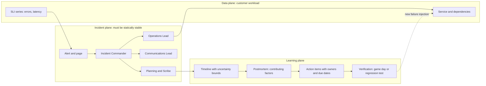

# Incident Response, Blameless Postmortems, and RCA

## TL;DR

1. An incident is a control loop (detect, declare, mitigate, resolve, learn), and the response process is a distributed system with its own failure domains. Its chat, paging, dashboards, VPN, and identity provider must not share fate with the workload they are used to repair.
2. Mitigate before you diagnose. Roll back, shed load, or fail over first, and preserve evidence as part of the mitigation. About 70% of outages follow a change to a live system (Google SRE book, Introduction; UNVERIFIED as of 2026-10), so "revert the last change" is the highest-prior action.
3. Command roles are separated so that one human holds the whole picture while others hold the keyboards. The Incident Commander (IC) decides and does not debug. The Operations Lead acts. The Communications Lead talks to the outside. The Planning/Scribe role records.
4. Blameless means the analysis assumes each actor's decisions were locally reasonable given what they could see. Accountability is moved from "who erred" to "who owns closing which contributing factor by when". "Root cause" is a hypothesis about one causal chain. A postmortem should enumerate contributing factors and the conditions that let each one matter.
5. Measure learning with leading indicators (action-item age, detection coverage, recurrence by contributing-factor fingerprint), not quarterly MTTR. Incident durations are heavy-tailed, so a mean over 30 incidents has a 95% half-width of about 100% (derived in this chapter).

## Mental Model



Think of an incident as three loops running at different speeds over the same system.
The fast loop (seconds to minutes) is the mitigation loop: observe the SLI, hypothesize, act, observe again.
The incident plane exists to keep that loop disciplined, with one decision maker, one channel, and one written record, so the humans do not become a source of load and noise.
The slow loop (days to weeks) is the learning loop: reconstruct what happened, derive contributing factors, and change the system or the process.
It only closes when the change is verified, for example by a game day from [[17-Cloud-AI-Engineering/Volume_07_Reliability_and_SRE/Chapter_05_Chaos_Engineering_and_Game_Days|Chaos Engineering and Game Days]].
The boundary to respect is that the incident plane and learning plane read from the data plane but must keep working when the data plane is down.

## Internals

### Incident command as a protocol, not an org chart

The Google SRE book's incident chapter adapts the Incident Command System used in emergency response.
It separates four responsibilities: command, operations, communications, and planning ([Managing Incidents](https://sre.google/sre-book/managing-incidents/)).
The mechanism that makes this work is the separation of decision rights from execution capacity.
A single engineer who is both diagnosing and coordinating has a working set of perhaps one hypothesis and one dashboard.
The IC's working set is the whole incident: open hypotheses, who is doing what, what has been communicated, and what has been ruled out.
That working set collapses the moment the IC opens a terminal.

Operational rules that distinguish a practiced team from a team that has read the doc:

- **Declaration is cheap and reversible.**
  The cost of declaring a Sev2 that turns out to be a blip is a few minutes of attention.
  The cost of not declaring a Sev1 for 20 minutes is 20 minutes of uncoordinated parallel changes.
  Write the declaration criteria as thresholds on customer-visible SLIs and on burn rate (see [[17-Cloud-AI-Engineering/Volume_07_Reliability_and_SRE/Chapter_01_SLIs_SLOs_and_Error_Budget_Engineering|SLIs, SLOs, and Error Budget Engineering]]), not as judgments about root cause.
- **Handoffs are explicit and acknowledged.**
  The outgoing IC states the current hypothesis list, in-flight changes, and communications state.
  The incoming IC says the words "I am the IC".
  Until then the outgoing IC remains IC.
  An implicit handoff produces either two commanders or none.
- **Recursive delegation.**
  When the Operations Lead's span exceeds roughly five to seven people, they appoint sub-leads (database, network, deploy).
  The IC still talks to one Operations Lead.
- **Single writable change channel.**
  Every production mutation is announced in the incident channel before execution, with the actor's name and the intended effect.
  This is what later makes the timeline reconstructable and what prevents two responders from fighting each other (one scaling up while another rolls back).
- **The IC can overrule.**
  Consensus is a failure mode at 3 a.m.
  The IC makes the call, and disagreement is recorded and reviewed afterward.

### Mitigate first, and preserve evidence as part of mitigating

The SRE book is explicit that restoring service takes priority over finding the cause.
The corollary a getting-started guide omits is that mitigation actions destroy evidence unless you design for it.
Autoscaling groups terminate unhealthy instances, and a rollback overwrites the config you wanted to diff.
A restart clears the heap you wanted to inspect.

Evidence-preserving mitigations:

- **Take suspect nodes out of service without destroying them.**
  On AWS, `aws autoscaling enter-standby --auto-scaling-group-name <asg> --instance-ids <id> --should-decrement-desired-capacity` removes an instance from load balancing and from health-replacement while keeping it running.
  On Google Cloud, `gcloud compute instance-groups managed abandon-instances` removes an instance from a managed instance group without deleting it.
  In Kubernetes, `kubectl cordon` plus label changes that remove the pod from Service selectors does the same without deleting the pod.
- **Capture before you change.**
  Export the live config and feature-flag state, and take a volume snapshot of one affected node.
  Dump the heap or a goroutine/thread profile on one canary node before restarting the fleet.
  These take under a minute each and are commonly assigned to the Planning role while Operations executes the rollback.
- **Pre-register the rollback.**
  The change system should record the previous known-good artifact for every deploy so that "revert" is one command, not a research task.

### Why removing the trigger does not always end the incident

Some incidents persist after the triggering change is reverted.
Bronson et al. ("Metastable Failures in Distributed Systems", HotOS 2021) describe systems that enter a stable bad state sustained by a feedback loop, such as retry amplification, cold caches, or queue backlogs, even after the trigger is gone.
Huang et al. ("Metastable Failures in the Wild", OSDI 2022) analyze real incidents and find that retry policy is a common sustaining effect (see the [OSDI 2022 paper page](https://www.usenix.org/conference/osdi22/presentation/huang-lexiang)).
The IC consequence is concrete.
If error rate does not fall after a rollback and offered load is above recovery capacity, the next action is to reduce load below the recovery threshold and ramp up gradually.
That means shedding, disabling retries, or draining traffic to one cell at a time (see [[17-Cloud-AI-Engineering/Volume_07_Reliability_and_SRE/Chapter_02_Load_Shedding_Backpressure_and_Admission_Control|Load Shedding, Backpressure, and Admission Control]] and [[17-Cloud-AI-Engineering/Volume_07_Reliability_and_SRE/Chapter_03_Resilient_Communication_Retries_Jitter_and_Circuit_Breakers|Resilient Communication]]).
Declaring "mitigated" when the action was taken, rather than when the SLI recovered, is the classic error here.

### Gray failure and why detection lags

Huang et al. ("Gray Failure: The Achilles' Heel of Cloud-Scale Systems", HotOS 2017) define gray failure as differential observability.
The health checker believes the component is healthy while the application experiences it as failing.
Typical mechanisms are a load balancer health check that hits a shallow `/healthz` while the real request path times out on a downstream dependency, or a partial network partition where heartbeats pass but large payloads stall.
The consequence for incident response is that the earliest knowable signal is often a customer-facing SLI, not a component health signal.
Time-to-detect should therefore be measured from SLI changepoint to first alert, not from the first internal error log.

### Timeline assembly is a clock-uncertainty problem

A timeline is built from sources with different notions of time.
Each source has three clocks: the time the event occurred, the time its timestamp was assigned (which can be period-aligned, as with metric alarm evaluations, or human-entered, as with chat), and the time it became queryable.
Treating all records as points on one exact axis produces confident but wrong causal stories, such as "the alarm fired before the deploy" when the alarm timestamp is aligned to a 60-second evaluation period.

Rules for a defensible timeline:

1. **Normalize to UTC at ingestion** and never convert in prose. Mixed local time zones are a recurrent source of off-by-N-hours errors in postmortems.
2. **Attach a skew bound to each source** and refuse to assert order between events from different sources closer than the sum of their bounds. The lab script flags these pairs as `ORDER UNCERTAIN`.
3. **Track visibility lag separately.** CloudTrail delivers events with a lag on the order of minutes (AWS docs; UNVERIFIED as of 2026-10), so the record of the change that caused the incident may not be queryable until well after responders needed it. This is why the change channel rule above matters: chat is the only source with near-zero lag.
4. **Estimate impact onset from the SLI series, not from alerts.** Alerts are delayed by evaluation windows (a 3-of-3 one-minute alarm cannot fire earlier than three minutes after onset). A changepoint method such as CUSUM on per-minute error counts gives an onset estimate with an explicit baseline. The lab script implements this.
5. **Define phase boundaries by observable state:**
   - onset = SLI changepoint;
   - detect = first alert;
   - engage = first human acknowledgement;
   - declare = IC named;
   - mitigate = SLI back inside SLO (not the time the action was taken);
   - resolve = underlying defect fixed and the incident closed.
   Propagation delays (DNS TTL, connection draining, cache expiry, client retry backoff) make mitigate-action and mitigate-effect differ by minutes to tens of minutes.

### Statistics of incident metrics

Incident durations are heavy-tailed.
Google's SRE team has published a critical analysis of MTTR and related metrics ("Incident Metrics in SRE", Davidovic and Beyer; UNVERIFIED as to exact wording and findings as of 2026-10) arguing that the distribution shape makes means unreliable.
The following calculation is derived here rather than quoted.

- Model durations as lognormal with median 45 minutes and sigma 1.5 (illustrative).
- Coefficient of variation: `CV = sqrt(exp(sigma^2) - 1) = sqrt(exp(2.25) - 1) = 2.91`.
- With n = 30 incidents in a quarter, the 95% half-width of the sample mean is about `1.96 * CV / sqrt(30) = 104%` of the true mean.
- A process that did not change at all can show quarter-over-quarter swings of 2x. The lab demo with seed 11 prints means of 85 and 168 minutes for two samples from the identical distribution.
- To detect a true 30% reduction in the mean at 5% significance and 80% power, `n = 2 * (1.96 + 0.84)^2 * CV^2 / 0.3^2 = about 1,480` incidents per arm.
- Comparing medians on a log scale is cheaper: `ln(1/0.7) = 0.357`, so `n = 2 * 7.84 * 1.5^2 / 0.357^2 = about 277` per arm. This is still beyond most organizations' incident count in a year.

The practical conclusion is to report percentiles with bootstrap confidence intervals, and to manage using leading indicators that have far larger sample sizes: alert coverage in game days, fraction of Sev1/Sev2 incidents detected by alarm rather than by customers, runbook usage, and action-item aging.
The SRE book reports a roughly 3x improvement in MTTR for teams with playbooks versus without ([Emergency Response](https://sre.google/sre-book/emergency-response/), as excerpted; the effect is large enough to be visible despite the noise).

### Cognitive bias and the structure of a blameless analysis

The intellectual base is the "new view" of human error from Sidney Dekker (*The Field Guide to Understanding 'Human Error'*) and Richard Cook ([How Complex Systems Fail](https://how.complexsystems.fail/)).
Complex systems run in a degraded mode with latent flaws, and operators' actions at the sharp end are adaptations that usually succeed.
John Allspaw's [Blameless PostMortems and a Just Culture](https://www.etsy.com/codeascraft/blameless-postmortems/) turned this into an engineering practice.
Nancy Leveson's CAST method (the accident-analysis companion to STAMP) models failures as inadequate control actions within a control structure, which avoids the linear-chain assumption of "five whys".

Biases that distort incident analysis, and the structural counter to each:

| Bias | How it appears | Structural counter |
| --- | --- | --- |
| Hindsight / outcome bias | Reviewers know the result and judge the decision as obviously wrong. | Write the timeline of what responders saw and believed at each minute before any analysis. Ask "what made this action look reasonable then?" |
| Anchoring and confirmation | The first hypothesis absorbs all subsequent evidence. | Keep a visible hypothesis log with evidence for and against each entry. Use Heuer's Analysis of Competing Hypotheses: seek evidence that discriminates, not evidence that confirms. Assign a rotating skeptic. |
| Fundamental attribution error | "The engineer was careless." | Ask what the tool, the runbook, the alert, and the approval flow did to make the error easy and the recovery slow. |
| Counterfactual language | "They should have checked X." | Ban "should have" in the document. Rewrite as "the system did not surface X at decision time". |
| Narrative fallacy | A tidy single root cause that fits a story. | List contributing factors and, for each, the condition that made it matter. Show the analysis to someone who was not in the incident. |
| Availability | Last incident's cause is assumed again. | Compare against the fingerprint database of past contributing factors rather than memory. |

Oppenheimer, Ganapathi, and Patterson ("Why Do Internet Services Fail, and What Can Be Done About It?", USITS 2003) found operator error to be a leading cause of failures in the large services they studied.
The lesson from the paper's framing is that operator error is a symptom of interface and process design, and it points to forcing functions as the remedy.

### Action-item tracking as a queueing system

Postmortem action items form a queue with arrival rate lambda (items per quarter) and mean time-in-system W.
By Little's law, the steady-state open count is `L = lambda * W`.
With 12 postmortems per quarter and 5 items each, lambda = 60 per quarter.
If items take a mean of two quarters to close, 120 items are open at any time, and a team that wants to burn that down must either raise throughput or reduce arrivals.
Unbounded arrival with fixed capacity produces a backlog in which the oldest items rot and the review ritual becomes theater.

Mechanisms that keep the queue honest:

- **Classify by effect**: detect, mitigate faster, prevent, and process.
  Prevention items that are forcing functions (automation, safe defaults, rate-limited tools, staged rollout) outrank training or "be more careful" items, which do not change the system.
- **Cap arrivals**: a rule of thumb is at most one to three high-priority items per incident, each tied to a named contributing factor. Everything else goes to a separate idea backlog.
- **Give high-severity items a due-date SLO** and report breaches in the same forum that reports error budget burn.
- **Keep a sparse index of open items** (the lab uses a DynamoDB sparse GSI) so that "overdue" is a cheap query rather than a scan.
- **Close on verification, not on merge.** An item is done when a game day, regression test, or synthetic probe demonstrates that the failure is now detected or contained.
- **Fingerprint contributing factors** (for example "global config push without staged rollout", "retry amplification", "single-region dependency in control tooling") and alert when a fingerprint recurs. Recurrence means a prior action item was ineffective, which is a more serious finding than the new incident.

## Numbers to Know

Research tooling was unavailable during authoring, so every volatile figure below is marked UNVERIFIED and must be re-checked against current official docs before this note reaches `status: solid`.

| Quantity | Value | Source |
| --- | --- | --- |
| CloudTrail event delivery latency | Typically on the order of 5 minutes after the API call | AWS CloudTrail docs; UNVERIFIED as of 2026-10 |
| CloudTrail LookupEvents quota | About 2 requests per second per account per Region; up to 50 events per page; 90-day history of management events | AWS CloudTrail docs; UNVERIFIED as of 2026-10 |
| LookupEvents drain time, 100,000 events | `100,000 / (2 * 50) = 1,000 s`, about 17 minutes at the quota ceiling | Derived from the row above |
| CloudWatch alarm evaluation period | 60 s standard; 10 s or 30 s for high-resolution metrics | AWS CloudWatch docs; UNVERIFIED as of 2026-10 |
| CloudWatch alarm history retention | About 30 days | AWS CloudWatch docs; UNVERIFIED as of 2026-10 |
| Cloud Logging default retention | `_Default` bucket 30 days; `_Required` bucket (admin activity audit logs) 400 days | Google Cloud docs; UNVERIFIED as of 2026-10 |
| Cloud Audit Logs defaults | Admin Activity always on; Data Access off by default for most services | Google Cloud docs; UNVERIFIED as of 2026-10 |
| Cloud Asset Inventory change history | About 5 weeks | Google Cloud docs; UNVERIFIED as of 2026-10 |
| Share of outages following a live-system change | About 70% | Google SRE book, Introduction; UNVERIFIED as of 2026-10 |
| Playbook effect on MTTR | About 3x lower with playbooks | Google SRE book, Emergency Response (stable text, as excerpted in a secondary source) |
| Lognormal MTTR coefficient of variation | 2.91 at sigma = 1.5 | Derived in this chapter |
| Sample mean 95% half-width, n = 30 | About +/-104% | Derived in this chapter |
| Incidents per arm to detect a 30% mean change | About 1,480 (mean) or about 277 (log-median) | Derived in this chapter |
| CloudWatch Logs standard ingestion | About 0.50 USD per GB in us-east-1 | AWS pricing page; UNVERIFIED as of 2026-10 |
| Cloud Logging ingestion | About 0.50 USD per GiB after 50 GiB per project per month free | Google Cloud pricing page; UNVERIFIED as of 2026-10 |
| DynamoDB on-demand writes | About 0.625 USD per million write request units in us-east-1 | AWS pricing page; UNVERIFIED as of 2026-10 |
| AWS Systems Manager Incident Manager | Reported to be closed to new customers from late 2025 | AWS announcement; UNVERIFIED as of 2026-10 |

## AWS vs GCP Mechanism Parity

| Concern | AWS | Google Cloud | Critical difference |
| --- | --- | --- | --- |
| Alert source | CloudWatch alarms (metric and composite), EventBridge rules | Cloud Monitoring alerting policies, which open "incidents" in Monitoring | Alarm state history is the timestamp source for onset-to-detect. CloudWatch alarm state updates align to evaluation periods, so skew is up to the period. |
| Paging and on-call | Third-party (PagerDuty and similar) via SNS or EventBridge; Incident Manager had response plans and escalation (availability changed, UNVERIFIED) | Third-party via notification channels; no first-party on-call product I can verify | Plan for a third-party paging dependency and its own failure domain. |
| Change audit trail | CloudTrail management events (90-day lookup), org trail to S3 for long retention | Cloud Audit Logs: Admin Activity always on, Data Access opt-in; log buckets with retention | Google requires explicit enablement of Data Access logs before the incident. AWS data events (S3 object level, Lambda invoke) are also opt-in and billed. |
| Resource configuration history | AWS Config configuration items and timeline | Cloud Asset Inventory history | Needed to answer "what did this resource look like at 00:38 UTC". Both require prior enablement or retention. |
| Provider health to customers | AWS Health Dashboard, Health API and EventBridge events | Google Cloud Service Health and Personalized Service Health | Per-account, per-project views differ from the public status page. Subscribe machine-readable feeds into the incident channel. |
| Public postmortem artifact | Post-event summaries | Incident reports on the Google Cloud status site | Both are written for customers and omit internal timeline detail. Do not use them as your own timeline. |
| Internal learning process | Correction of Error (COE) documents, publicly described in Well-Architected guidance and conference talks | SRE postmortem culture, publicly documented in the SRE books | COE puts weight on a structured causal analysis and owned corrective actions. The SRE postmortem puts weight on blameless narrative and review. Mechanisms converge on owned, dated action items. |
| Immutable evidence | CloudTrail log file validation, S3 Object Lock in a separate log-archive account | Log bucket retention locks, aggregated sinks to a locked bucket in a separate project | A compromised or failing workload account must not be able to modify its own audit trail. |
| Break-glass access | IAM Identity Center permission sets, role session tags, time-bounded sessions | IAM Conditions with expiry, Privileged Access Manager (UNVERIFIED GA status as of 2026-10) | Test the path under realistic network controls. VPC Service Controls and VPC endpoint policies can block responders. |
| Operational ceilings during an incident | Control-plane API throttles apply per account per Region, including LookupEvents | Per-project API quotas for Logging and Monitoring reads | Responders and automation all hit the same quotas at once. Budget for it. |

Mechanism cross-references: static stability of the incident tooling is covered in [[17-Cloud-AI-Engineering/Volume_01_Cloud_Architecture_Principles/Chapter_02_Regions_Zones_and_Static_Stability|Regions, Zones, and Static Stability]], and control-plane versus data-plane failure behavior in [[17-Cloud-AI-Engineering/Volume_01_Cloud_Architecture_Principles/Chapter_04_Control_Plane_vs_Data_Plane_Separation|Control Plane vs Data Plane Separation]].
Observability details are in [[17-Cloud-AI-Engineering/Volume_02_AWS_Deep_Dive/Chapter_14_Observability_CloudWatch_Metrics_Logs_and_X_Ray|Observability: CloudWatch, Metrics, Logs, and X-Ray]] and [[17-Cloud-AI-Engineering/Volume_03_GCP_Deep_Dive/Chapter_16_Observability_Cloud_Monitoring_Logging_and_Trace|Observability: Cloud Monitoring, Logging, and Trace]].

## Worked Example: Timeline Assembler, Onset Estimator, and Action-Item Ledger

The lab has three parts.
The first is a stdlib Python module that merges events with skew bounds, estimates onset by CUSUM, and computes incident-metric statistics.
The second is an optional `aws` mode that pulls CloudTrail and CloudWatch alarm history for a window.
The third is an OpenTofu/Terraform stack with a DynamoDB action-item ledger that uses a sparse index for open items, plus a budget alarm.
The demo mode and the statistics were executed during authoring.
The `aws` mode and the Terraform were only syntax-checked (`py_compile`) and not run against a live account, because boto3 and cloud credentials were not available in the authoring sandbox.

### Step 1: the analysis module

Save as `incident_lab.py`.

```python
#!/usr/bin/env python3
"""Timeline assembly, onset estimation, and incident-metric statistics.

Modes:
  python3 incident_lab.py demo
  python3 incident_lab.py aws --start 2026-10-20T00:00:00Z --end 2026-10-20T02:00:00Z --region us-east-1
Dependencies: stdlib only for demo; boto3 for the aws mode.
"""
import argparse, json, math, random, statistics
from dataclasses import dataclass
from datetime import datetime, timedelta, timezone

# Planning assumptions, not guarantees. Measure your own p99 and replace them.
# LAG: seconds between event time and the moment a responder can query the event.
# SKEW: worst-case timestamp error in seconds (clock offset, period alignment, human entry).
LAG = {"cloudtrail": 900, "alarm_history": 60, "deploy": 30, "pager": 30, "chat": 5}
SKEW = {"cloudtrail": 2, "alarm_history": 60, "deploy": 2, "pager": 5, "chat": 1}

def parse_ts(s):
    return datetime.fromisoformat(s.replace("Z", "+00:00")).astimezone(timezone.utc)

@dataclass
class Ev:
    ts: datetime
    source: str
    text: str
    @property
    def visible_by(self):
        return self.ts + timedelta(seconds=LAG.get(self.source, 60))

def merge(events):
    """Order by event time. Flag a pair from different sources when the gap is inside
    the sum of their skew bounds, because their true order cannot be asserted."""
    evs = sorted(events, key=lambda e: e.ts)
    rows = []
    for i, e in enumerate(evs):
        prev = evs[i - 1] if i else None
        ambiguous = bool(prev and prev.source != e.source and
                         (e.ts - prev.ts).total_seconds() < SKEW.get(e.source, 60) + SKEW.get(prev.source, 60))
        rows.append((e, ambiguous))
    return rows

def cusum_onset(counts, base_n=15, k=1.0, h=5.0):
    """One-sided CUSUM on per-minute error counts. Returns index of estimated change start.
    Baseline mean and sd come from the first base_n minutes. Poisson-ish noise assumed."""
    base = counts[:base_n]
    mu = statistics.mean(base)
    sd = max(math.sqrt(mu), statistics.pstdev(base), 1.0)
    s, start = 0.0, None
    for i, c in enumerate(counts):
        z = (c - mu) / sd
        s_new = max(0.0, s + z - k)
        if s == 0.0 and s_new > 0.0:
            start = i
        s = s_new
        if s > h:
            return start if start is not None else i
        if s == 0.0:
            start = None
    return None

def bootstrap_ci(xs, stat=statistics.mean, n=5000, alpha=0.05, seed=7):
    rnd = random.Random(seed)
    vals = sorted(stat([rnd.choice(xs) for _ in xs]) for _ in range(n))
    return vals[int(n * alpha / 2)], vals[int(n * (1 - alpha / 2)) - 1]

def little(arrivals_per_quarter, mean_age_quarters):
    return arrivals_per_quarter * mean_age_quarters

def demo():
    rnd = random.Random(11)
    t0 = datetime(2026, 10, 20, 0, 0, tzinfo=timezone.utc)
    counts = [int(rnd.gauss(20, 4)) for _ in range(40)] + [int(rnd.gauss(180, 25)) for _ in range(20)]
    idx = cusum_onset(counts)
    onset = t0 + timedelta(minutes=idx)
    print("true onset 00:40, CUSUM onset", onset.strftime("%H:%M"))
    events = [
        Ev(t0 + timedelta(minutes=38, seconds=20), "deploy", "deploy cfg-4411 begins, 100% region"),
        Ev(onset + timedelta(minutes=3), "alarm_history", "alarm 5xx-rate ALARM (3 of 3 datapoints)"),
        Ev(t0 + timedelta(minutes=44), "pager", "page sent to primary"),
        Ev(t0 + timedelta(minutes=46), "chat", "IC declared Sev1"),
        Ev(t0 + timedelta(minutes=38, seconds=25), "cloudtrail", "UpdateFunctionConfiguration by deploy-role"),
        Ev(t0 + timedelta(minutes=51), "deploy", "rollback cfg-4411 begins"),
        Ev(t0 + timedelta(minutes=57), "alarm_history", "alarm 5xx-rate OK"),
    ]
    for e, amb in merge(events):
        print(e.ts.strftime("%H:%M:%S"), "%-13s" % e.source, e.text, "[ORDER UNCERTAIN]" if amb else "")
    ct = [e for e in events if e.source == "cloudtrail"][0]
    print("cloudtrail record for the change is queryable only after", ct.visible_by.strftime("%H:%M:%S"),
          "- responders cannot see it during the first", LAG["cloudtrail"] // 60, "minutes")
    # MTTR statistics: lognormal durations, sigma 1.5, median 45 min
    mu, sigma = math.log(45), 1.5
    cv = math.sqrt(math.exp(sigma ** 2) - 1)
    print("lognormal CV %.2f, 95%% half-width of mean at n=30: +/-%.0f%%" % (cv, 196 * cv / math.sqrt(30)))
    q1 = [rnd.lognormvariate(mu, sigma) for _ in range(30)]
    q2 = [rnd.lognormvariate(mu, sigma) for _ in range(30)]
    print("same process, two quarters: mean %.0f vs %.0f min" % (statistics.mean(q1), statistics.mean(q2)))
    print("bootstrap 95%% CI q1 mean: %.0f-%.0f" % bootstrap_ci(q1))
    print("Little: 60 actions/quarter, 2 quarters mean age -> %d open" % little(60, 2))

def aws(args):
    import boto3
    start, end = parse_ts(args.start), parse_ts(args.end)
    ct = boto3.client("cloudtrail", region_name=args.region)
    cw = boto3.client("cloudwatch", region_name=args.region)
    events = []
    kw = dict(StartTime=start, EndTime=end, MaxResults=50)
    while True:
        r = ct.lookup_events(**kw)   # quota is about 2 requests/s/account/region; retries are in botocore
        for e in r.get("Events", []):
            events.append(Ev(e["EventTime"].astimezone(timezone.utc), "cloudtrail",
                             "%s %s" % (e["EventName"], e.get("Username", "-"))))
        if "NextToken" not in r:
            break
        kw["NextToken"] = r["NextToken"]
    p = cw.get_paginator("describe_alarm_history")
    for page in p.paginate(StartDate=start, EndDate=end, HistoryItemType="StateUpdate"):
        for h in page["AlarmHistoryItems"]:
            events.append(Ev(h["Timestamp"].astimezone(timezone.utc), "alarm_history",
                             "%s: %s" % (h["AlarmName"], h["HistorySummary"])))
    for e, amb in merge(events):
        print(e.ts.isoformat(), e.source, e.text, "[ORDER UNCERTAIN]" if amb else "")

if __name__ == "__main__":
    ap = argparse.ArgumentParser()
    ap.add_argument("mode", choices=["demo", "aws"])
    ap.add_argument("--start"); ap.add_argument("--end"); ap.add_argument("--region", default="us-east-1")
    a = ap.parse_args()
    demo() if a.mode == "demo" else aws(a)
```

Observed demo output (authoring run, Python 3.11, seed 11):

```text
true onset 00:40, CUSUM onset 00:40
00:38:20 deploy        deploy cfg-4411 begins, 100% region
00:38:25 cloudtrail    UpdateFunctionConfiguration by deploy-role
00:43:00 alarm_history alarm 5xx-rate ALARM (3 of 3 datapoints)
00:44:00 pager         page sent to primary [ORDER UNCERTAIN]
00:46:00 chat          IC declared Sev1
00:51:00 deploy        rollback cfg-4411 begins
00:57:00 alarm_history alarm 5xx-rate OK
cloudtrail record for the change is queryable only after 00:53:25 - responders cannot see it during the first 15 minutes
lognormal CV 2.91, 95% half-width of mean at n=30: +/-104%
same process, two quarters: mean 85 vs 168 min
bootstrap 95% CI q1 mean: 37-143
Little: 60 actions/quarter, 2 quarters mean age -> 120 open
```

Reading the output as an analyst:

- Time to detect is 3 minutes from the estimated onset, which is exactly the evaluation window of a 3-of-3 one-minute alarm. Shortening this requires a different alarm shape, not a faster pager.
- Time from alarm to IC declaration is 3 minutes. Time from declaration to rollback start is 5 minutes. The change was known the whole time (deploy channel), so those 5 minutes are a decision-making delay, not a discovery delay.
- The CloudTrail record of the change would not have been queryable for the first 15 minutes under the planning assumption, which shows why the deploy channel must be the primary source in the first minutes.
- The pager line is flagged because the alarm timestamp has a 60-second skew bound. Order between "alarm" and "page" cannot be asserted from timestamps alone.

### Step 2: the action-item ledger and budget guardrail

Save as `main.tf` (Terraform 1.6+ or OpenTofu; AWS provider 5.x).

```hcl
terraform {
  required_version = ">= 1.6"
  required_providers {
    aws = { source = "hashicorp/aws", version = "~> 5.0" }
  }
}

provider "aws" {
  region = "us-east-1"
}

variable "alert_email" {
  type = string
}

resource "aws_dynamodb_table" "actions" {
  name         = "ir-lab-action-items"
  billing_mode = "PAY_PER_REQUEST"
  hash_key     = "incident_id"
  range_key    = "action_id"

  attribute {
    name = "incident_id"
    type = "S"
  }
  attribute {
    name = "action_id"
    type = "S"
  }
  attribute {
    name = "open_flag"
    type = "S"
  }
  attribute {
    name = "due_date"
    type = "S"
  }

  # Sparse index: only items that still carry open_flag appear here.
  global_secondary_index {
    name            = "open-by-due"
    hash_key        = "open_flag"
    range_key       = "due_date"
    projection_type = "ALL"
  }

  point_in_time_recovery {
    enabled = true
  }
}

resource "aws_budgets_budget" "lab" {
  name         = "ir-lab-monthly"
  budget_type  = "COST"
  limit_amount = "5"
  limit_unit   = "USD"
  time_unit    = "MONTHLY"

  notification {
    comparison_operator        = "GREATER_THAN"
    threshold                  = 80
    threshold_type             = "PERCENTAGE"
    notification_type          = "ACTUAL"
    subscriber_email_addresses = [var.alert_email]
  }
}
```

Run it:

```bash
tofu init && tofu apply -auto-approve -var alert_email=you@example.com

aws dynamodb put-item --table-name ir-lab-action-items --item '{
  "incident_id":{"S":"INC-2026-0042"},"action_id":{"S":"A1"},
  "title":{"S":"Add canary stage to config pipeline"},
  "class":{"S":"prevent"},"due_date":{"S":"2026-11-20"},"open_flag":{"S":"1"}}'

aws dynamodb query --table-name ir-lab-action-items --index-name open-by-due \
  --key-condition-expression "open_flag = :o AND due_date < :d" \
  --expression-attribute-values '{":o":{"S":"1"},":d":{"S":"2026-12-01"}}'

aws dynamodb update-item --table-name ir-lab-action-items \
  --key '{"incident_id":{"S":"INC-2026-0042"},"action_id":{"S":"A1"}}' \
  --update-expression "REMOVE open_flag SET closed_at = :t, verified_by = :v" \
  --expression-attribute-values '{":t":{"S":"2026-11-02T10:00:00Z"},":v":{"S":"gameday-2026-11"}}'
```

Removing `open_flag` deletes the item from the sparse index, so "overdue and open" is a single indexed range query.
At lab scale one hash value is fine.
At thousands of writes per second you would shard the key (`1#00` to `1#0f`) because a single GSI partition key concentrates write load.

### Step 3: back-of-the-envelope capacity and cost

| Item | Calculation | Result |
| --- | --- | --- |
| CloudTrail pull for a 60-minute window with 100,000 management events | `100,000 / (2 req/s * 50 per page)` | About 1,000 s; build the timeline from an org trail in S3 plus Athena when the window is large |
| Visibility gap | 15-minute planning lag vs a 20-minute incident | 75% of the incident is blind to CloudTrail; the deploy channel is mandatory |
| Ledger writes | 100 items, 2 updates each, base table plus GSI (UNVERIFIED rate: 0.625 USD per million writes) | About 600 writes, under 0.001 USD |
| Ledger storage and PITR | Under 1 MB | Effectively 0 USD |
| Budget | First two budgets per account are free (UNVERIFIED as of 2026-10) | 0 USD |
| Lab total | Sum | Well under 0.10 USD for a day |

Teardown (exact):

```bash
tofu destroy -auto-approve -var alert_email=you@example.com
aws dynamodb describe-table --table-name ir-lab-action-items   # expect ResourceNotFoundException
```

For comparison, the human cost of a real incident dwarfs infrastructure cost.
A 3-hour Sev1 with 12 responders at an illustrative 100 USD per loaded hour is 3,600 USD of response labor.
A 2-hour review with 8 attendees plus 12 hours of writing adds about 2,800 USD.
The action-item program must therefore produce changes whose expected avoided loss exceeds that spend.

## Failure Modes and Pitfalls

### The incident plane shares fate with the failing system

- Facebook, October 4, 2021: a configuration change withdrew the BGP routes to its DNS servers, and internal tools and physical access systems that depended on the same network were also affected, so recovery required in-person access. See [Facebook engineering, "More details about the October 4 outage"](https://engineering.fb.com/2021/10/05/networking-traffic/outage-details/).
- AWS, December 7, 2021 (us-east-1): an internal networking event impaired monitoring and operations tooling, and the Service Health Dashboard itself was slow to update because it depended on services in the impacted Region (see [AWS message 12721](https://aws.amazon.com/message/12721/); details as recalled, UNVERIFIED as of 2026-10).
- Counter: keep chat, paging, runbooks, the status page, and an out-of-band access path in a different failure domain, and rehearse using them with the primary region declared dark in a game day. A second communication channel (a phone bridge or SMS tree) is cheap.

### A single operator action with an unbounded blast radius

- AWS S3, February 28, 2017: an authorized playbook command was entered with a larger input than intended and removed more capacity than planned, and recovery was slowed by restart behavior in subsystems that had not been restarted at that scale for a long time. See [AWS message 41926](https://aws.amazon.com/message/41926/).
- AWS's stated remediations included making the tool remove capacity more slowly and add a minimum-capacity safeguard.
- The pattern is that the human action was an input, and the defect was the tool's missing guardrail. This is the canonical example for steering a postmortem away from naming a person.

### Global configuration propagation without staged rollout

- Google Cloud, June 12, 2025: a policy-metadata change in Service Control, which had no feature-flag protection, contained blank fields that triggered a null-pointer crash path. The data replicated globally within seconds, and recovery in the largest region was slower because of a herd effect on a backing datastore. The public report is on the [Google Cloud status site](https://status.cloud.google.com/). Details are recalled and UNVERIFIED as of 2026-10.
- Contributing factors visible in such a report are: no staged propagation of data-plane-affecting config, missing error handling for malformed input, and a restart stampede. A root-cause sentence alone would capture only the first.

### Recovery that re-triggers the failure

- AWS, October 19-20, 2025 (us-east-1): a race condition in DynamoDB's DNS management automation left an empty record for the regional endpoint. Downstream services (EC2 instance launch workflows, network load balancer health checks) then went through their own backlog-driven recovery phases that outlasted the DNS repair. See [AWS message 101925](https://aws.amazon.com/message/101925/). Timeline details are recalled and UNVERIFIED as of 2026-10.
- This is the metastable pattern: the trigger was fixed before the incident was over. A runbook that ends at "trigger reverted" is incomplete.

### Control-plane throttling during the incident

During a regional event every responder and every automated tool calls the same control-plane APIs.
`DescribeInstances`, `LookupEvents`, and Cloud Logging reads can be throttled exactly when you need them.
Counter: pre-compute the data you will need (org-wide trail in S3, log sinks to BigQuery or Athena), use cached dashboards, and give responder automation its own backoff with jitter.

### Process failure modes

- **Role collapse**: the IC starts typing commands. Symptom: the incident channel goes quiet for 10 minutes. Counter: the deputy IC watches for it and calls it out.
- **Premature convergence**: the first plausible hypothesis wins. Counter: hypothesis log and skeptic role.
- **Declaration reluctance**: engineers wait for certainty. Counter: threshold-based declaration, no penalty for stand-downs.
- **Postmortem theater**: the document is excellent and no action closes. Counter: the Little's-law view, caps on arrivals, due-date SLOs, and a quarterly review of recurrences.
- **Passive-voice blame**: "the wrong command was run" is blame with the name removed. Counter: describe the interface, defaults, and checks that existed at that moment.
- **Mixed time zones and missing UTC**: produces fictitious causality. Counter: UTC only, enforced by the template and the script.
- **Insufficient retention**: CloudTrail lookup is 90 days and CloudWatch alarm history is much shorter, so a postmortem written after a long holiday cannot be reconstructed. Counter: org trail to S3 and log sinks with retention that exceeds the review lag by a wide margin.
- **Blind spots from opt-in logs**: Data Access audit logs and data events are not on by default (see Numbers to Know). Counter: enable them for the services and data stores on critical paths before you need them.

## Security and Cost Angles

### Responder access and evidence integrity

- **Least privilege, pre-provisioned.**
  Give responders a read-only investigation role by default and a time-bounded write role (break-glass) that requires a ticket or incident ID in the session tag or condition.
  Every use is alerted on.
  Avoid granting write access ad hoc during an incident, because ad hoc grants are made under pressure and rarely revoked.
- **Immutable audit trail.**
  Deliver an organization CloudTrail with log file validation to an S3 bucket in a separate log-archive account with Object Lock.
  On Google Cloud, route aggregated sinks to a log bucket with a retention lock in a separate project.
  An attacker or a runaway automation in a workload account must not be able to edit the history you will use as evidence.
- **Envelope encryption and key availability.**
  If the log archive is encrypted with a customer-managed KMS key, the key policy must let the responder role decrypt, and the key should not live in the Region that is down.
  Chapter references: [[17-Cloud-AI-Engineering/Volume_08_Security_Identity_and_the_Data_Perimeter/Chapter_04_Encryption_Key_Hierarchies_and_Envelope_Encryption|Encryption Key Hierarchies and Envelope Encryption]] and [[17-Cloud-AI-Engineering/Volume_08_Security_Identity_and_the_Data_Perimeter/Chapter_07_Compliance_Auditing_and_Non_Repudiation|Compliance, Auditing, and Non-Repudiation]].
- **Network perimeters can block responders.**
  VPC endpoint policies, SCP/RCP conditions on source VPC, and VPC Service Controls perimeters are designed to block access from unexpected paths.
  An engineer working from a home network or a degraded VPN may be outside the allowed path.
  Add and test ingress rules or a hardened bastion path for the incident role, and include that test in a game day.
- **Postmortem hygiene.**
  Chat transcripts and timelines contain tokens, customer identifiers, and IP addresses.
  Redact before wide circulation, store with access controls, and involve legal and security for incidents that may be reportable.

### Cost levers

- **Observability retention is the main recurring cost.**
  At about 0.50 USD per GB ingested (UNVERIFIED), a 20 TB/month log estate costs about 10,000 USD per month to ingest before storage and query.
  Sample debug logs, keep audit and change logs at full fidelity (they are small), and route high-volume logs to cheaper storage such as S3 with Athena or BigQuery.
- **Paging cost is human cost.**
  Every false page has a measurable sleep-and-attention cost.
  Multi-window burn-rate alerts (see the SLO chapter) reduce page volume more than any tooling purchase.
- **Unit economics of the process.**
  Estimate the cost of an incident minute as `(revenue per minute * fraction impacted) + (responders * loaded rate per minute) + expected credits`.
  This gives a defensible way to prioritize prevention items and to decide whether faster detection (more synthetic probes) pays for itself.
- **Do not buy a tool to fix a culture problem.**
  The measurable levers are declaration thresholds, the single change channel, pre-staged evidence, and action-item throughput.

See also [[17-Cloud-AI-Engineering/Volume_09_FinOps_and_Cloud_Economics/Chapter_06_FinOps_Organizational_Practices_and_Automation|FinOps Organizational Practices and Automation]].

## Interview Questions and Model Answers

### Question 1 (L5 - Senior)

You are the on-call engineer. Five minutes after a config deploy, the 5xx rate on your service rises from 0.1% to 6%. Walk through your first ten minutes.

#### Model Answer

The first decision is whether this is an incident, and the answer is yes: 6% against a typical availability objective is a fast burn, and the deploy gives a strong candidate cause.
I declare a Sev2 immediately, which costs little if I am wrong, and I open the incident channel and name myself IC for now because I have not yet found anyone else.
I do not start with root cause.
The prior that a change caused the outage is high (about 70% of outages follow a change in the SRE book's experience), so the first mitigation is to halt the rollout and roll back to the last known-good artifact.
Before I roll back, I spend one minute preserving evidence: export the new config and flag state, and capture a profile or heap dump from one affected node, because the rollback will overwrite both.
If the fleet is behind an autoscaling group with health replacement, I put one bad instance in Standby so it is not terminated.
I announce each action in the channel with a timestamp, so that the timeline is reconstructable.
After the rollback I watch the SLI, not the deploy tool's "succeeded" status.
Mitigation is complete when 5xx is back inside the SLO, which may lag the action because of connection draining and client retries.
If the rate does not recover, I suspect a sustaining effect such as retry amplification or a cold cache and move to reducing offered load.
Once stable, I downgrade severity, schedule the postmortem, and make sure the change record shows the failing config for the review.

#### Follow-up Interviewer Question

The rollback is complete but 5xx stays at 4% for another 15 minutes. What are your hypotheses and how do you discriminate between them?

### Question 2 (L5 - Senior)

What does an Incident Commander do, and why should they not debug?

#### Model Answer

The IC's job is to hold the whole picture and make decisions.
That means tracking open hypotheses, who owns each task, what changes are in flight, what has been communicated externally, and when the next update is due.
Debugging requires deep focus on one subsystem, and a person focused on one subsystem cannot also notice that two responders are about to apply conflicting changes.
Role separation gives each person a coherent working set: the Operations Lead executes, the Communications Lead owns the customer and executive channels, and the Planning/Scribe keeps the written record and tracks evidence.
The IC has decision authority, so debates are time-boxed and the IC calls the decision, with dissent recorded for the review.
Handoffs are explicit, with the outgoing IC giving a state summary and the incoming IC acknowledging, because otherwise there may be zero or two commanders.
If the IC is the only person who knows the system, I accept that as a smell and have them name a deputy so they can stay in role.

#### Follow-up Interviewer Question

You are the only senior engineer awake at 3 a.m. and there are only three people in the channel. How do you adapt the roles without losing the benefits?

### Question 3 (L6 - Staff)

A Sev1 occurred after an engineer ran a cleanup command with the wrong arguments and deleted production resources. A director asks you to put the engineer's name in the root cause section and recommend a performance conversation. How do you respond and what do you put in the postmortem?

#### Model Answer

I decline to frame the analysis around the person, and I explain this in operational terms, not as a matter of kindness.
The engineer is the one person who knows exactly what they saw, what they believed, and why the action seemed reasonable.
If naming them is the outcome, every future engineer learns to hide that information, and our detection of near-misses drops to zero.
The analysis should answer why the system allowed a single command to remove more than intended and why recovery took as long as it did.
The S3 outage of February 2017 is a public example where an operator input was the trigger and the remediation was to add rate limits and minimum-capacity checks to the tool.
In the document I write the timeline from the engineer's point of view (what the runbook said, what the CLI printed, what the defaults were, whether there was a dry-run), then list contributing factors.
Typical ones are: no dry-run or confirmation showing the blast radius, no cap on deletion rate, production and staging credentials equally reachable from the same shell, a runbook ambiguous about arguments, and restore procedures untested at this scale.
Each factor gets an action item with an owner and a due date, with priority given to forcing functions such as a tool that refuses to delete more than N resources without a second approver.
Accountability is real but forward-looking: the owners of the tool and the runbook are accountable for closing the items.
If there is evidence of negligence or policy violation, that goes through the HR and security process separately, and it is not the postmortem's job.
I also point out to the director that the director's own question is a signal: if leaders ask for names, the process will produce sanitized reports.

#### Follow-up Interviewer Question

The same class of mistake happens again six months later, by a different engineer. What does that tell you, and what do you change?

### Question 4 (L6 - Staff)

Your VP shows a slide: quarterly MTTR fell from 90 minutes to 62 minutes after you bought a new incident tool. Do you believe it?

#### Model Answer

I would not conclude anything from that slide, and I can quantify why.
Incident durations are heavy-tailed, approximately lognormal in many organizations.
With a plausible sigma of 1.5, the coefficient of variation is about 2.9, so with 30 incidents in a quarter the 95% half-width of the sample mean is roughly 100% of its value.
A 90 to 62 minute move is well inside noise, and one 8-hour outlier moves the quarterly mean more than any process change.
To reliably detect a true 30% reduction in the mean I would need on the order of 1,500 incidents per comparison group.
Even on a log scale, comparing medians, it takes a couple of hundred per group.
What I would do instead is report percentiles with bootstrap intervals and show the full distribution, and measure leading indicators with much larger samples.
Examples are the percentage of Sev1/Sev2 incidents detected by our alarms rather than by customers, time from alarm to IC declaration, game-day detection coverage, runbook hit rate, and action-item aging.
I would also separate phases (detect, engage, mitigate) because a tool can improve one while another regresses, and I would stratify by severity and failure class so that a quarter with no large outage does not look like a win.
If the tool is good, these indicators will show it.

#### Follow-up Interviewer Question

The VP replies that the board wants one number. What single number do you propose and how do you keep it from being gamed?

### Question 5 (L6 - Staff)

Design the incident tooling for a company whose entire production runs in one cloud Region, such that responders can still work during a Region-level control-plane failure.

#### Model Answer

I start from the principle of static stability applied to the incident plane: the tools needed to repair a failure must not need the failing thing to be working.
I inventory the dependencies of the response process: paging, chat, video, the status page, runbooks, dashboards, source control and deploy tooling, identity provider and MFA, VPN, and the cloud console and CLI credentials.
For each, I ask whether it runs in the affected Region or depends on its control plane.
Paging and chat are usually third-party SaaS, which is good, but they must not authenticate through an IdP that runs in the affected Region.
The status page must be hosted outside the Region and updatable with credentials that do not depend on it, because a status page that fails with the incident is a known pattern from public incident reports.
Runbooks and architecture diagrams are replicated as static content to a second cloud account and Region.
Break-glass credentials are stored offline and tested quarterly.
The log archive and metrics are streamed to another Region, so the timeline is available when the primary is dark.
For the data plane, I rely on pre-provisioned capacity because control-plane operations such as launching instances are exactly what degrades.
I validate it all with a game day in which the primary Region is declared unavailable to the tools and responders have to run the incident from the secondary path, because a design that has never been used will have a hidden dependency.
The cost is a small standing spend on cross-Region replication and an exercise cadence, which is trivial against the cost of a blind multi-hour outage.

#### Follow-up Interviewer Question

Your SSO provider is a SaaS that is itself hosted in the failing Region of your cloud provider. What do you do?

### Question 6 (L6 - Staff)

You inherit a postmortem program with 240 open action items, a third of them older than a year, and two incidents last quarter with the same contributing factor. Fix it.

#### Model Answer

First I treat the backlog as a queueing problem.
Little's law says open items equal arrival rate times mean age, so the backlog is a symptom of arrivals exceeding closure throughput for a long time.
I need to reduce arrivals, increase throughput, or both.
I triage the 240 items with the owning teams in one session, classifying each by effect (detect, mitigate, prevent, process) and mapping it to a contributing-factor fingerprint.
Items that are duplicates, obsolete, or that I can show are weak (training reminders, "improve documentation") are closed with a recorded reason.
That is not erasing; it is honest accounting, and I expect to close a third or more.
The remaining items get ranked by expected risk reduction per engineer-week, using the recurrence data: the factor that caused two incidents last quarter moves to the top and its items become the program's top priority.
For go-forward, I cap new items at one to three high-priority per incident, tied to named contributing factors, and push the rest to an ideas backlog.
High-severity items get a due-date SLO and breaches are reviewed in the same forum as error-budget burn, with an automatic link to the service's reliability work in the error budget policy.
I change the definition of done to verification: a game day, regression test, or synthetic probe shows the failure is now detected or contained.
The recurrence itself is the most informative finding, so I review why the earlier action was ineffective before assigning the new one, because it usually means the item addressed a symptom or was closed on merge rather than on verification.
Finally, I make the ledger queryable with a sparse index of open items so that overdue items are visible without anyone running a report.

#### Follow-up Interviewer Question

A team lead pushes back that their roadmap has no capacity for these items. How do you resolve that without escalating every time?

### Question 7 (L7+ - Principal)

A rollback completed 40 minutes ago, yet traffic is still failing, and every restart of a backend tier fails again within minutes. Explain what is likely happening and how you would drive the incident to resolution.

#### Model Answer

This pattern is a metastable failure.
The original trigger is gone, but a sustaining feedback loop keeps the system in a bad stable state.
Common loops are retry amplification (clients multiply offered load as errors rise), cold caches (every request misses and hits the database, which stays overloaded and keeps producing errors), and queue backlogs that exceed recovery capacity.
Each restart fails because the tier comes up into a load far above its capacity and fails its health checks, which removes it from rotation and concentrates load on the remaining instances.
Further investigation of the original trigger will not help right now.
The IC's decision is to bring offered load below the system's recovery capacity and let it rebuild state before ramping up.
Concretely I would: cut external traffic at the edge by rate limiting or a percentage drain, disable or cap client and intermediate retries (using a pre-built kill switch if one exists), prioritize critical traffic classes and shed the rest, pre-warm caches from a replica or by admitting a small fraction of traffic, and bring backends up in controlled waves with health-check grace periods and slow-start.
Then I ramp traffic in steps while watching saturation and error rate, and I only declare mitigation when the SLI is in range with the full load restored, not when errors fall at reduced load.
In the postmortem, the key contributing factors are the amplifiers: unbounded retry budgets, missing load shedding, health checks that eject overloaded instances, and a lack of a tested ramp procedure.
Prevention items are retry budgets and jittered backoff, load shedding at the front door, a documented and rehearsed brownout and ramp procedure, and a game day that injects the trigger and verifies that the system returns to normal without human intervention.
This is the case where "fix the root cause" is the wrong frame, because removing the trigger does not remove the state.

#### Follow-up Interviewer Question

Product leadership refuses to accept shedding 30% of traffic during the ramp because of revenue impact. How do you handle the decision?

### Question 8 (L7+ - Principal)

You are asked to design the company-wide incident learning system for 300 engineering teams across AWS and Google Cloud. What are its components, what metrics do you publish, and what are the main risks?

#### Model Answer

I would design it as a data system with a human process on top, and I start with what I want to learn: which classes of failure recur, which controls work, and where detection and response are slow.
Components:

1. **Uniform severity and declaration criteria** tied to SLIs and burn rate, so that incident counts are comparable across teams.
2. **A standard timeline schema** in UTC, with per-source skew and lag bounds, and onset estimated from the SLI series, so phase durations (detect, engage, declare, mitigate) are measured the same way. Automated assembly from audit logs and the change channel reduces effort and bias.
3. **A postmortem template** that forces contributing factors, a "what made this reasonable" section, and what went well, and that limits action items per incident.
4. **A taxonomy of contributing-factor fingerprints** (for example unstaged global config, retry amplification, shared-fate tooling, single-region dependency, missing guardrail on a tool). Tagging is done by a reviewer, not by the author alone, to reduce bias.
5. **An action-item ledger** with owners, due dates, classes, and verification evidence, with a sparse open-items view.
6. **A verification loop** that feeds failure classes into game-day scenarios, so the learning plane ends in fault injection.
7. **A review forum** that reads recurrence by fingerprint across teams, which is where cross-cutting investments (a staged-rollout platform, a retry library) are justified.

What I publish: recurrence rate by fingerprint, percentage of incidents detected by alarms rather than customers, phase-level percentiles with confidence intervals (not a single MTTR), action-item age distribution and verified-closure rate, and game-day detection coverage.
I deliberately avoid league tables of incident counts per team, because they create an incentive to under-declare, and I avoid MTTR targets for the statistical reasons above.
Main risks are metric gaming, postmortem theater (high document quality, low closure), loss of psychological safety when leaders ask for names, and over-standardization that hides context-specific lessons.
I mitigate them by making the data used for investment decisions rather than evaluation of teams, by auditing a sample of postmortems for blame language and for evidence of verified closure, and by publishing the best postmortems internally as exemplars.
Legal and regulatory needs (customer notification, privilege, retention) are handled by a parallel track so that the learning document stays candid.

#### Follow-up Interviewer Question

Two executives disagree: one wants postmortems published company-wide by default, the other wants them restricted to affected teams. What is your position and what safeguards do you add?

## Further Reading

- [Google SRE book, Managing Incidents](https://sre.google/sre-book/managing-incidents/) - the canonical statement of command, operations, communications, and planning roles and of handoff discipline.
- [Google SRE book, Postmortem Culture: Learning from Failure](https://sre.google/sre-book/postmortem-culture/) - the blameless-review practice and the criteria for when to write one.
- [Google SRE book, Emergency Response](https://sre.google/sre-book/emergency-response/) - the grounding for playbook effects and the human factors of on-call response.
- [Google SRE Workbook, Incident Response and Postmortem Culture](https://sre.google/workbook/incident-response/) - worked examples and operational detail beyond the first book.
- [How Complex Systems Fail (Richard Cook)](https://how.complexsystems.fail/) - eighteen short observations that underpin the "no single root cause" stance.
- [Blameless PostMortems and a Just Culture (John Allspaw)](https://www.etsy.com/codeascraft/blameless-postmortems/) - the practice-oriented origin of blameless reviews in software operations.
- Sidney Dekker, *The Field Guide to Understanding 'Human Error'* - the rigorous treatment of the old view versus the new view and of local rationality.
- Nancy Leveson, *Engineering a Safer World* (STAMP and CAST) - a control-structure alternative to chain-of-events analysis.
- Richards J. Heuer Jr., *Psychology of Intelligence Analysis* - Analysis of Competing Hypotheses as a counter to anchoring and confirmation bias.
- Bronson et al., "Metastable Failures in Distributed Systems" (HotOS 2021), and [Huang et al., "Metastable Failures in the Wild" (OSDI 2022)](https://www.usenix.org/conference/osdi22/presentation/huang-lexiang) - the mechanism and empirical evidence for incidents that outlive their trigger.
- Huang et al., "Gray Failure: The Achilles' Heel of Cloud-Scale Systems" (HotOS 2017) - differential observability as the root of slow detection.
- Oppenheimer, Ganapathi, Patterson, "Why Do Internet Services Fail, and What Can Be Done About It?" (USITS 2003) - the early empirical study on operator error and service failure.
- [AWS message 41926, S3 service disruption, February 2017](https://aws.amazon.com/message/41926/) - a model public post-event summary showing tool guardrail remediation.
- [AWS message 101925, us-east-1 event, October 2025](https://aws.amazon.com/message/101925/) - a recent public analysis of DNS automation failure and backlog-driven recovery.
- [Facebook engineering, outage details, October 2021](https://engineering.fb.com/2021/10/05/networking-traffic/outage-details/) - a public account of out-of-band access and shared-fate tooling.
- [PagerDuty incident response documentation](https://response.pagerduty.com/) - an open, practical implementation of incident command roles and training material.
- Next chapter: [[17-Cloud-AI-Engineering/Volume_07_Reliability_and_SRE/Chapter_07_Anatomy_of_Major_Cloud_Outages|Anatomy of Major Cloud Outages]] - applies this chapter's method to historical AWS and Google Cloud post-incident reports.
