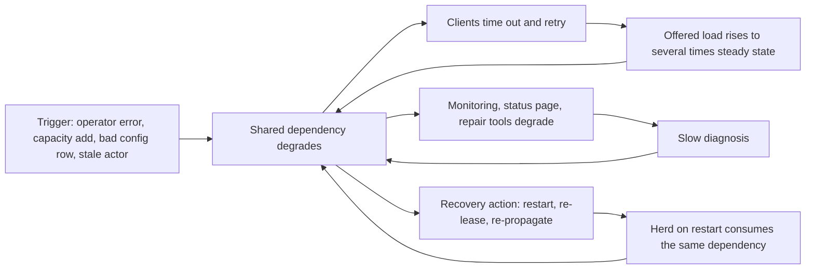

# Anatomy of Major Cloud Outages

## TL;DR

- Large cloud outages are rarely caused by the trigger. They are caused by a sustaining loop (retries, lease renewals, cold caches, health-check flapping) that keeps the system broken after the trigger is gone. The literature calls this a metastable failure.
- The trigger is almost always mundane: a mistyped operator parameter, a capacity addition, a blank field in a policy row, a delayed automation worker. Design for "any single actor can be wrong" rather than "prevent the trigger".
- Recovery paths are the least-exercised code and often share a fault domain with the thing that broke: status pages, monitoring, repair tooling, restart procedures, and the control plane that launches the replacement capacity.
- Data is code. A globally replicated config or policy row reaches every region in seconds and bypasses every staged-deployment control you built for binaries.
- The postmortem metric that matters is not "root cause" but "what made recovery slower than the outage": backlog, restart debt, tooling dependence, and herd effects.

## Mental Model



Read the diagram as three loops that share one node.
The first loop (client retries) converts a short dependency failure into sustained overload, so removing the trigger does not remove the load.
The second loop (observability and tooling on the failing substrate) lengthens detection and mitigation time, because operators lose the telemetry and the levers they need at the moment they need them.
The third loop (recovery work that itself needs the dependency) means the restart procedure creates a second wave of demand: every server re-establishes leases, rebuilds caches, or re-fetches config at once.
A staff-level reading of any public incident report is to ask which of these loops were present, because the structural fix is almost always to break a loop, not to patch the trigger.
See [[17-Cloud-AI-Engineering/Volume_01_Cloud_Architecture_Principles/Chapter_02_Regions_Zones_and_Static_Stability|Regions, Zones, and Static Stability]] for the design principle that removes the recovery-path dependency and [[17-Cloud-AI-Engineering/Volume_07_Reliability_and_SRE/Chapter_02_Load_Shedding_Backpressure_and_Admission_Control|Load Shedding, Backpressure, and Admission Control]] for the controls that break the retry loop.

## Internals

Method note: the primary sources are the AWS Post-Event Summaries and the Google Cloud status-page incident reports.
Everything below is the author's mechanism-level reading of those documents, and statements about internals that the providers did not publish are labeled as inference.
The previous chapter, [[17-Cloud-AI-Engineering/Volume_07_Reliability_and_SRE/Chapter_06_Incident_Response_Blameless_Postmortems_and_RCA|Incident Response, Blameless Postmortems, and RCA]], covers how to run the postmortem process; this chapter is the case library it draws on.

### Case 1: S3 us-east-1, February 2017 (operator input, restart debt)

Source: [AWS summary of the S3 disruption](https://aws.amazon.com/message/41926/) (AWS PES, as of 2026-10).

- Trigger: an authorized operator ran an established playbook command to remove a small number of servers from a billing-related S3 subsystem, and one input parameter was wrong, so a much larger set of servers was removed.
- The removed capacity belonged to two subsystems. The index subsystem holds metadata and location information for every object in the region and serves GET, LIST, PUT, and DELETE. The placement subsystem allocates storage for new objects and depends on the index.
- Both subsystems had to be restarted. AWS reported that these subsystems had not been fully restarted in the largest regions for years, and that safety checks on metadata took far longer than expected.
- Propagation: services that depend on S3 in the region (the S3 console, new EC2 instance launches, EBS volumes restored from snapshots, Lambda) degraded. The status dashboard's admin console itself depended on S3 in that region, so customers could not see accurate status.
- Structural fixes AWS described: make the capacity-removal tool remove capacity more slowly, add a floor so capacity cannot be taken below a minimum, partition the index into smaller cells, and move the dashboard off the affected dependency.

The mechanism a getting-started guide never mentions is restart debt.
Time-to-restart for a metadata service is a function of the metadata volume, which grows with customer data, not with time-to-last-restart.
An RTO that was validated when the fleet was small silently stretches every quarter, and the only way to find out is a periodic cold restart of a production-scale cell.
The cell-based answer in [[17-Cloud-AI-Engineering/Volume_01_Cloud_Architecture_Principles/Chapter_03_Cell_Based_Architecture_and_Shuffle_Sharding|Cell-Based Architecture and Shuffle Sharding]] works because it bounds the metadata per restart unit.

### Case 2: EBS us-east-1, April 2011 (re-mirroring storm)

Source: [AWS summary of the EBS event](https://aws.amazon.com/message/65648/) (AWS PES, as of 2026-10).
Details below are reported from the published summary and should be re-verified against it (UNVERIFIED in the batch report).

- Trigger: a network configuration change during a capacity upgrade shifted traffic onto a lower-capacity network used for replication, isolating many EBS nodes from their replicas.
- Amplifier: nodes that lost replicas all searched for free capacity to re-mirror simultaneously. The re-mirroring demand exceeded spare capacity and left many volumes stuck, which in turn tied up EBS control plane resources.
- Cross-AZ effect: the control plane for the region was shared, so API degradation reached Availability Zones that had no data plane fault.
- Lesson that persists: when replicas are lost, the repair traffic is correlated and proportional to the failure size, so spare capacity must be sized for repair of the largest failure domain, not for average failure.
- Compare with the quorum and repair design in [[17-Cloud-AI-Engineering/Volume_02_AWS_Deep_Dive/Chapter_09_Elastic_Block_Store_and_Network_Storage|Elastic Block Store and Network Storage]].

### Case 3: Kinesis us-east-1, November 2020 (hidden O(N^2) coupling)

Source: [AWS summary of the Kinesis event](https://aws.amazon.com/message/11201/) (AWS PES, as of 2026-10).

- Trigger: AWS added capacity to the Kinesis front-end fleet.
- Mechanism: each front-end server maintains an operating system thread per peer front-end server in order to build its shard-map and membership cache. Fleet-wide, thread count grows with N squared, and per-server thread count grows linearly with N.
- Adding servers pushed per-server thread counts past a system-configured limit, so servers could not build their shard-maps and stopped serving, even though the new capacity was supposed to help.
- Propagation: services that consume Kinesis internally (CloudWatch metrics, Cognito, EventBridge, Auto Scaling, Lambda, and others) degraded. The event lasted on the order of 17 hours end to end.
- Recovery obstacle: restarting front-end servers too quickly stressed the same cache-building path, so servers had to be brought back slowly and in controlled order.
- Structural fixes AWS described: larger servers so the fleet has fewer members, finer-grained alarming on thread consumption, and moving to a cell-based front-end architecture.

The limit that bit them was not in any capacity dashboard.
It was an OS-level resource whose consumption was a function of fleet size, so the very act of scaling out was the trigger.
The generalizable audit is: for every peer-to-peer or all-to-all mesh in your fleet, write down the per-node resource cost as a function of N and the limit that bounds it.

### Case 4: us-east-1 internal network congestion, December 2021 (self-hiding failure)

Source: [AWS summary of the December 7 event](https://aws.amazon.com/message/12721/) (AWS PES, as of 2026-10).

- Trigger: an automated activity to scale capacity of an AWS service hosted on the main AWS network triggered unexpected behavior in a large number of clients inside the internal network.
- Mechanism: a surge of connection activity overwhelmed the networking devices that connect the internal network to the main network, causing congestion, latency, and errors. AWS described client behavior that did not back off appropriately and so sustained the congestion.
- Self-hiding: internal monitoring, internal DNS, and operational tooling traversed the congested path, so operators had impaired visibility and had to diagnose with degraded tools.
- The customer-facing consequence was largely control plane: EC2 API and console operations degraded while many running workloads on the data plane continued.
- Fixes AWS described include network configuration changes to protect the connecting devices and disabling the scaling activity until safeguards existed.

The mechanism to internalize is that the management network and the customer network shared a bottleneck, so the diagnostic signal was throttled by the fault.
This is the dual of static stability: the data plane stayed up because it did not depend on the control plane at request time, but the operators' control plane was the thing that was broken.

### Case 5: Google Cloud IAM and authentication, December 2020 (quota system as single point of failure)

Source: [Google Cloud incident 20013](https://status.cloud.google.com/incident/zall/20013) (Google Cloud status, as of 2026-10).
Mechanism details are recalled from the report and are marked UNVERIFIED in the batch report.

- Trigger: an automated quota-management system reduced the capacity allotted to Google's central user-identity service, so authentication requests to that service were rejected.
- Propagation: services that authenticate users against that backend (consumer and Cloud products) failed. The impact window was under an hour, roughly 47 minutes.
- Lesson: a capacity-governance automation can be a bigger blast-radius amplifier than the fleet it governs, because it writes to every tenant's limits. Quota decreases, like config pushes, need staged rollout, a floor, and an automatic rollback on error rate.

### Case 6: Google Cloud networking, June 2019 (the repair path was the failing path)

Source: [Google Cloud incident 19009](https://status.cloud.google.com/incident/cloud-networking/19009) (Google Cloud status, as of 2026-10).
Details are recalled and marked UNVERIFIED.

- Trigger: a configuration change intended for a small number of servers in one region was applied to a larger set across several neighboring regions, descheduling network control plane jobs.
- Effect: network capacity dropped and egress traffic congested.
- Recovery obstacle: the congestion also degraded the network that engineers needed to reach the systems they were repairing, which lengthened the event to several hours.
- Lesson: the repair path must have its own bandwidth reservation and its own path, and "who can fix it when the network is down" is a design requirement.

### Case 7: DynamoDB us-east-1, October 2025 (stale actor, then congestive collapse)

Source: [AWS summary of the DynamoDB event](https://aws.amazon.com/message/101925/) (AWS PES, as of 2026-10).
Timestamps and component names are recalled from the summary and marked UNVERIFIED for re-check.

- The DNS automation for DynamoDB's regional endpoint has two roles. A DNS Planner produces numbered plans of load balancer IP sets, and several independent DNS Enactors (one per AZ) apply plans to the DNS service.
- Trigger: a latent race condition. One Enactor was delayed while applying an older plan. A second Enactor applied a newer plan and then ran cleanup of older plans. The delayed Enactor then wrote its older plan over the newer one, passing a freshness check it had performed before the delay. The cleanup then deleted that now-live older plan, which removed all IP addresses from the regional endpoint record.
- The empty record left the automation in an inconsistent state that it could not repair on its own, so operators intervened manually. The DNS record was restored at about 02:25 PDT on October 20 after starting at about 23:48 PDT on October 19.
- Second-order failure, which is the part that made it a roughly 15-hour event: EC2's DropletWorkflow Manager (DWFM) maintains a lease on each physical host (a "droplet") used to launch instances. With DynamoDB unavailable, leases lapsed. After DynamoDB recovered, re-establishing leases for the whole fleet took so long that work timed out, creating a congestive collapse in which attempts to renew leases consumed capacity that made further renewals time out. AWS recovered by throttling incoming work and restarting DWFM hosts to clear queues.
- Third-order failure: the Network Manager had a backlog propagating network configuration to new instances, and Network Load Balancer health checks flapped because network state had not propagated, which caused capacity to be removed from service by automated health-check failover.

The mechanism here that no getting-started guide covers is that a precheck followed by a write is not a mutual-exclusion mechanism.
Any delay between the check and the act (GC pause, retry loop, slow endpoint, scheduler stall) lets the world change, and a delayed actor holds a stale belief with full authority.
The fix is a fencing token or a conditional write: the write itself must carry the generation it expects and be rejected by the store if that is not strictly newer.
The runnable replay in the Worked Example reproduces this class.

### Case 8: Google Cloud Service Control, June 2025 (global config row, no feature flag, herd on restart)

Source: [Google Cloud incident report, June 12 2025](https://status.cloud.google.com/incidents/ow5i3PPK96RduMcb1SsW) (Google Cloud status, as of 2026-10).
Details are recalled from the report and marked UNVERIFIED for re-check.

- Service Control is the component that checks API requests against policy (authorization, quota, and similar) for Google Cloud APIs.
- A new quota-policy check had been rolled out weeks earlier without a feature flag, in a code path that no production data had yet exercised.
- Trigger: a policy change containing blank fields was written to the regional Spanner tables that Service Control reads. Those tables replicate globally within seconds, so the bad row reached every region at once and hit an unprotected null pointer, putting binaries into a crash loop worldwide.
- Response: SRE triaged within minutes, and the serving path was disabled with a "red button" within roughly 40 minutes. Most regions recovered within about two hours.
- Herd effect: in us-central1, restarting Service Control tasks all hit the same Spanner infrastructure table at once, without randomized exponential backoff, which slowed recovery there. The overall impact on dependent Google Cloud products ran roughly three hours, with a longer tail for some.
- Fixes Google described: modularize so failing checks fail open rather than crash, make feature flags mandatory for new policy-check code, stage global data replication, and add randomized exponential backoff.

The mechanism is that a staged binary rollout protects you from a bad binary but not from bad data read by a good binary.
Global replication of metadata collapses the blast radius of a data write to "the whole planet" in seconds, which is faster than any human can react.
Treat any globally replicated config table as a deployment pipeline: schema validation, canary regions with a bake time, per-row quarantine, and a consumer that survives malformed input.

### Cross-cutting mechanisms

#### Metastable failures

A metastable failure has a trigger (transient), a sustaining effect (a feedback loop that keeps load above goodput capacity), and a stable bad state that persists after the trigger is removed.
The concept and taxonomy are in Bronson et al., "Metastable Failures in Distributed Systems" (HotOS 2021), and the empirical study of real incidents is Huang et al., "Metastable Failures in the Wild" (OSDI 2022), which found retry policy to be a dominant sustaining effect.
Common sustaining effects are retry amplification, lease and heartbeat renewal storms, cache-miss amplification after a cold start, and health-check-driven capacity removal.
A system in this state shows high offered load, falling goodput, and a queue that does not drain when the trigger ends.
Mitigation is a load-shedding action that breaks the loop (reject, drop expired work, reduce clients), not "add capacity", because added capacity is typically consumed by the loop.
See [[17-Cloud-AI-Engineering/Volume_07_Reliability_and_SRE/Chapter_03_Resilient_Communication_Retries_Jitter_and_Circuit_Breakers|Resilient Communication: Retries, Jitter, and Circuit Breakers]] for the client-side controls.

#### Retry amplification arithmetic

If each of d layers retries up to r times on failure, a single user request can produce up to (1 + r) to the power d attempts at the bottom layer.
With d = 3 and r = 3 that is 4^3 = 64 attempts, so a dependency that is 2 percent over capacity during a blip can see a 64x offered-load spike at its worst moment.
The Builders' Library guidance (Marc Brooker, "Timeouts, retries, and backoff with jitter") is to retry at one layer, cap retries with a budget, and add jitter so retries do not synchronize.

#### Recovery-path dependency

Draw the dependency graph of your recovery tooling, and mark every edge that crosses into the thing being recovered.
Cases 1, 4, and 6 all had an edge from "how operators observe and repair" into the failing substrate.
The invariant: repair tooling must be in a different failure domain from the system it repairs, must be exercised on a schedule, and must not require the control plane of the failed component to authenticate.

#### Gray failure

A gray failure is one where the component looks healthy to its health checker but is degraded for real clients (Huang et al., "Gray Failure: The Achilles' Heel of Cloud-Scale Systems", HotOS 2017).
The Kinesis front-end servers that could not build shard-maps and the NLB flapping in Case 7 are in this family.
Health checks that test only liveness cause automated failover to make things worse, because the check, the action, and the clients disagree about what "healthy" means.

#### Control-plane scale as a latent coupling

Physalia (Brooker et al., NSDI 2020) is the published design of how EBS's control plane was re-architected to bound the blast radius of configuration-state failures to small cells, motivated by exactly the Case 2 class of shared-control-plane events.
Read it with [[17-Cloud-AI-Engineering/Volume_13_Seminal_Papers_and_Case_Studies/Chapter_03_Physalia_EBS_Control_Plane|Physalia: Millions of Distributed Databases (2020 NSDI)]] and [[17-Cloud-AI-Engineering/Volume_01_Cloud_Architecture_Principles/Chapter_04_Control_Plane_vs_Data_Plane_Separation|Control Plane vs Data Plane Separation]].

## Numbers to Know

Re-verification note: the figures below are taken from the primary reports as recorded by the author and are approximate to the nearest reported timestamp.
Re-read the linked source before quoting any of them externally.

| Item | Value | Source |
|---|---|---|
| S3 us-east-1 disruption duration (Feb 2017) | Roughly 4 hours 15 minutes, from about 09:37 to about 13:54 PST | (AWS PES, as of 2026-10) |
| Kinesis us-east-1 event duration (Nov 2020) | About 17 hours, from about 05:15 to about 22:23 PST | (AWS PES, as of 2026-10) |
| us-east-1 network congestion duration (Dec 2021) | Roughly 7 hours, from about 07:30 to about 14:22 PST | (AWS PES, as of 2026-10) |
| DynamoDB DNS empty-record window (Oct 2025) | About 2 hours 37 minutes, 23:48 PDT to 02:25 PDT | (AWS PES, as of 2026-10) |
| DynamoDB event end to end (Oct 2025) | About 15 hours including EC2 and NLB recovery | (AWS PES, as of 2026-10) |
| Google Service Control (Jun 2025) time to disable path | Roughly 40 minutes from onset | (Google Cloud status, as of 2026-10) |
| Google Service Control (Jun 2025) typical region recovery | About 2 hours, longer in us-central1 | (Google Cloud status, as of 2026-10) |
| Google user-identity quota event (Dec 2020) | About 47 minutes | (Google Cloud status, as of 2026-10) |
| Worst-case retry amplification | (1 + r)^d, 64x for d = 3, r = 3 | Arithmetic |
| Monthly downtime budget at 99.9 percent | 43.8 minutes | Arithmetic over a 30.44-day month |
| Monthly downtime budget at 99.99 percent | 4.38 minutes | Arithmetic over a 30.44-day month |
| A 6.9-hour event versus a 99.99 percent monthly budget | About 94 months of budget | Arithmetic: 414 min / 4.38 min |
| Toy model: outage length that tips naive retries into permanent collapse | Between 2 s and 4 s when client timeout is 2 s | This chapter's script, seed 7 |
| Toy model: attempts per operation, naive vs retry budget | 3.66x vs 1.02x | This chapter's script, seed 7 |

Treat durations as lower bounds for your own planning.
Customer-visible impact tails (backlogs, delayed events, replays) typically extend beyond the provider's "resolved" timestamp.

## AWS vs GCP Mechanism Parity

| Dimension | AWS | Google Cloud |
|---|---|---|
| Public incident channel | Post-Event Summaries for major events, plus Health Dashboard and per-account Health events | Incident reports on the Google Cloud status page, with preliminary and final reports |
| Typical report structure | Narrative with timeline, mechanism, and corrective actions | Narrative with summary, impact, root cause, remediation, and prevention sections |
| Global-service control plane | Control planes of several global services (for example IAM, Route 53, CloudFront) are anchored in us-east-1 while data planes are distributed, per the AWS Fault Isolation Boundaries whitepaper | Several control and policy planes are global by design (for example Service Control, IAM), backed by globally replicated storage such as Spanner |
| Blast radius pattern seen in PIRs | Region-scoped events dominate (S3 2017, Kinesis 2020, Dec 2021, DynamoDB 2025 were all us-east-1), with cross-service fan-out through internal dependencies | Global-scope events are visible (Dec 2020, Jun 2025) because the dependency is a global service, with region-scoped events for networking |
| Config and policy data rollout | Cells and staged deployment are documented design goals in the Builders' Library | Staged rollout for binaries, with the 2025 report calling out gaps for globally replicated data |
| Admission and quota systems | Service quotas and throttling per API, per account, per region | Quota system and Service Control as a global admission path |
| Static stability guidance | Builders' Library article on static stability using Availability Zones | SRE book chapter on cascading failures and load shedding |
| Consensus and store under the control plane | Paxos-based replicated stores in DynamoDB and cell-based control planes such as Physalia | Paxos-replicated Spanner under many control and policy planes |
| Recovery lessons repeated across providers | Restart debt, cell partitioning, repair path independence | Fail open versus crash on bad input, feature flags on policy checks, jittered restart |
| Where your design diverges | Region pin: your blast radius is the region plus its global-service control planes | Global pin: your blast radius includes global services even if you deploy in one region |

The practical difference for a platform designer is the shape of the correlated-failure surface.
On AWS the question is "which of my dependencies is us-east-1 control plane, and does my recovery plan call it?".
On Google Cloud the question is "which of my dependencies is a global admission or policy path, and does a regional deployment actually isolate me from it?".
In both cases multi-region data plane redundancy does not help against a global-scope fault, which is why [[17-Cloud-AI-Engineering/Volume_07_Reliability_and_SRE/Chapter_04_Disaster_Recovery_Tiers_and_RTO_RPO_Engineering|Disaster Recovery Tiers and RTO/RPO Engineering]] separates data plane failover from control plane independence.

## Worked Example: Reproducing a Metastable Collapse and a Check-Then-Act Race Locally

This lab provisions no cloud resources.
Estimated cost is 0 USD, so no budget alarm is required.
Teardown: `rm -rf /tmp/lab`.
Both scripts are pure Python 3 standard library.

### Script 1: metastable collapse under retries

```python
#!/usr/bin/env python3
"""Discrete-time model of a metastable failure: a trigger removes server capacity
for 60 s, then capacity returns. Compares naive retries vs. mitigations."""
import collections, heapq, random

DT = 0.1            # tick, seconds
CAP = 1000.0        # server service rate, requests/s
BASE = 600.0        # offered new operations/s (60 percent utilisation)
TIMEOUT = 2.0       # client per-attempt timeout, s
RETRIES = 3         # max retries per operation
OUTAGE = (30.0, 90.0)
HORIZON = 300.0

def run(drop_expired, lifo, backoff, budget, seed=7):
    rnd = random.Random(seed)
    q = collections.deque()          # (op, send_time)
    timers = []                      # (fire_time, kind, op, attempt, send_time)
    done = set(); attempts = {}; tokens = 50.0
    good = collections.Counter(); sent = 0; wasted = 0
    t = 0.0; credit = 0.0; backlog_trace = {}
    op_id = 0
    def send(op, now):
        nonlocal sent
        sent += 1
        q.append((op, now))
        heapq.heappush(timers, (now + TIMEOUT, "to", op, attempts[op], now))
    while t < HORIZON:
        n_new = int(BASE * DT) + (1 if rnd.random() < (BASE * DT) % 1 else 0)
        for _ in range(n_new):
            op_id += 1; attempts[op_id] = 0
            tokens = min(100.0, tokens + 0.1)
            send(op_id, t)
        while timers and timers[0][0] <= t:
            _, kind, op, att, st = heapq.heappop(timers)
            if kind == "to":
                if op in done or att >= RETRIES:
                    continue
                if budget and tokens < 1.0:
                    continue
                if budget:
                    tokens -= 1.0
                attempts[op] += 1
                if backoff:
                    cap = min(TIMEOUT * 4, 0.5 * (2 ** attempts[op]))
                    heapq.heappush(timers, (t + rnd.uniform(0, cap), "rt", op, attempts[op], t))
                else:
                    send(op, t)
            else:
                if op not in done:
                    send(op, t)
        cap_now = 0.0 if OUTAGE[0] <= t < OUTAGE[1] else CAP
        credit += cap_now * DT
        while credit >= 1.0 and q:
            op, st = q.pop() if lifo else q.popleft()
            if drop_expired and t - st > TIMEOUT:
                continue
            credit -= 1.0
            if op not in done and t - st <= TIMEOUT:
                done.add(op); good[int(t)] += 1
            else:
                wasted += 1
        if not q:
            credit = min(credit, 1.0)
        backlog_trace[int(t)] = len(q)
        t += DT
    tail = [good[s] for s in range(150, 300)]
    rec = next((s for s in range(int(OUTAGE[1]), 300)
                if sum(good[x] for x in range(s, s + 10)) >= 0.9 * BASE * 10), None)
    return dict(goodput_tail=sum(tail) / len(tail), backlog_end=backlog_trace[299],
                amplification=sent / op_id, wasted=wasted,
                recover_s=None if rec is None else rec - OUTAGE[1])

variants = [
    ("naive FIFO, immediate retry", dict(drop_expired=False, lifo=False, backoff=False, budget=False)),
    ("+ drop expired at dequeue",   dict(drop_expired=True,  lifo=False, backoff=False, budget=False)),
    ("+ jittered backoff",          dict(drop_expired=True,  lifo=False, backoff=True,  budget=False)),
    ("+ retry budget",              dict(drop_expired=True,  lifo=False, backoff=True,  budget=True)),
    ("+ adaptive LIFO",             dict(drop_expired=True,  lifo=True,  backoff=True,  budget=True)),
]
print("%-32s %10s %10s %7s %9s" % ("variant", "goodput/s", "backlog", "amp", "recover_s"))
for name, kw in variants:
    r = run(**kw)
    print("%-32s %10.0f %10d %7.2f %9s" % (name, r["goodput_tail"], r["backlog_end"], r["amplification"], r["recover_s"]))
```

Observed output on the author's run (Python 3, seed 7):

```text
variant                           goodput/s    backlog     amp recover_s
naive FIFO, immediate retry               0     431036    3.66      None
+ drop expired at dequeue               600          0    1.58       0.0
+ jittered backoff                      600          0    1.57       0.0
+ retry budget                          600          0    1.02       0.0
+ adaptive LIFO                         600          0    1.02       0.0
```

#### Back-of-the-envelope reading

1. The server runs at 60 percent utilization (600 of 1000 requests per second), so in steady state it is healthy with 400 requests per second of headroom.
2. A 60 second outage accumulates a backlog of 600 x 60 = 36,000 requests, ignoring retries.
3. Ideal drain time without retries is backlog / (capacity - arrival) = 36,000 / 400 = 90 seconds.
4. A request at the tail of that backlog waits about 90 seconds, but the client timeout is 2 seconds, so every request served during the drain is already abandoned. The server does 100 percent wasted work.
5. Each timeout produces a retry, so offered load becomes about 600 x 3.66 = 2,200 requests per second, which is above the 1,000 capacity. The queue never drains: goodput is 0 and the backlog is 431,036 at the end, long after the trigger ended.
6. Dropping requests that have already exceeded the client deadline (deadline propagation) removes the wasted work and restores goodput immediately. The remaining levers (backoff, budget) reduce amplification from 1.58x to 1.02x, which matters when the dependency has less than 60 percent utilization headroom.
7. Sweeping the outage length with naive settings shows the tipping point: a 2 second outage recovers, while 4, 6, 10, 20, and 60 second outages all stay collapsed. The threshold is about one client timeout, which is why "short blip" is not a safe category.

### Script 2: check-then-act versus compare-and-set

```python
#!/usr/bin/env python3
"""Deterministic replay of a check-then-act race between two DNS enactors.
Reconstruction of the published failure class, not any provider's code."""

class Store:
    def __init__(self):
        self.plans = {}                 # gen -> tuple of IPs
        self.record = {"gen": 0, "ips": ("10.0.0.1",)}

    def read_gen(self):
        return self.record["gen"]

    def write_unconditional(self, gen):
        self.record = {"gen": gen, "ips": self.plans[gen]}

    def cleanup_unsafe(self, keep_after_gen):
        for g in [g for g in self.plans if g < keep_after_gen]:
            if self.record["gen"] == g:          # live record points at a deleted plan
                self.record = {"gen": g, "ips": ()}
            del self.plans[g]

    def cas_apply(self, gen):
        """Atomic compare-and-set: apply only if strictly newer and non-empty."""
        if gen > self.record["gen"] and self.plans[gen]:
            self.record = {"gen": gen, "ips": self.plans[gen]}
            return True
        return False

    def cleanup_safe(self, keep_after_gen):
        for g in [g for g in self.plans if g < keep_after_gen and g != self.record["gen"]]:
            del self.plans[g]

def replay(safe):
    s = Store()
    s.plans[1] = ("10.0.0.1",)
    s.plans[2] = ("10.0.0.2", "10.0.0.3")
    s.plans[3] = ("10.0.0.4", "10.0.0.5", "10.0.0.6")
    a_check_ok = s.read_gen() < 2       # A passes its freshness check
    a_plan = s.plans[2]                 # A holds its plan in memory while stalled
    if safe:
        s.cas_apply(3); s.cleanup_safe(keep_after_gen=3)
    else:
        s.write_unconditional(3); s.cleanup_unsafe(keep_after_gen=3)
    if safe:
        s.cas_apply(2)                  # rejected: 2 is not newer than 3
    elif a_check_ok:
        s.plans[2] = a_plan
        s.write_unconditional(2)        # stale write wins
    if safe:
        s.cleanup_safe(keep_after_gen=3)
    else:
        s.cleanup_unsafe(keep_after_gen=3)
    return s.record

for label, safe in (("check-then-act", False), ("compare-and-set + invariant", True)):
    r = replay(safe)
    print("%-30s final record gen=%d ips=%s" % (label, r["gen"], r["ips"] or "EMPTY"))
```

Observed output:

```text
check-then-act                 final record gen=2 ips=EMPTY
compare-and-set + invariant    final record gen=3 ips=('10.0.0.4', '10.0.0.5', '10.0.0.6')
```

Three independent defenses are in the safe path, and each alone would have prevented the empty record.
The write is conditional on a strictly newer generation, so a stale actor is rejected by the store rather than trusted.
Cleanup never deletes the plan the live record references.
The store refuses to publish an empty address set, which turns "delete everything" from a normal operation into one that needs a human.

## Failure Modes and Pitfalls

### Patterns drawn from the public reports

- Operator input with unbounded blast radius (S3 2017): the tool trusted the parameter. Controls are rate-limited removal, a minimum-capacity floor enforced in the tool, and a two-person or dry-run step for large removals.
- Capacity addition as the trigger (Kinesis 2020): scale-out crossed an unmonitored per-node limit. Add alarms on OS-level resources (threads, file descriptors, conntrack entries, ephemeral ports) with limit-relative thresholds, and test scale-out in a pre-production cell at target N.
- Replica repair storm (EBS 2011): all affected nodes search for free space at once. Rate-limit re-replication per failure domain and size spare capacity for the largest domain.
- Stale actor wins (DynamoDB DNS 2025): a delayed worker applies an old plan. Use fencing tokens and conditional writes, and treat "empty set" as an invariant violation.
- Lease renewal congestive collapse (DWFM 2025): a recovering fleet re-requests leases at once, work times out, and retries make it worse. Use admission control on renewals, prioritize renewals over new work, and restart in batches.
- Health-check flapping removes healthy capacity (NLB 2025): the checker sees a transient state-propagation lag and the automation acts on it. Bound the fraction of capacity that automation may remove, and fail static when more than a threshold of targets look unhealthy (see [[17-Cloud-AI-Engineering/Volume_01_Cloud_Architecture_Principles/Chapter_02_Regions_Zones_and_Static_Stability|Regions, Zones, and Static Stability]]).
- Global data write crashes global consumers (Service Control 2025): validate on write, canary by region, and make the consumer treat unparseable rows as a per-row failure, not a process crash.
- Herd on restart (Service Control us-central1): all tasks fetch from one backing table simultaneously. Use randomized exponential backoff and startup jitter.
- Governance automation as amplifier (Google identity quota 2020): quota cuts must be staged with a floor and guarded by error-rate rollback.
- Repair path in the failure domain (S3 2017 status console, Dec 2021 monitoring, Google 2019 network): keep tooling and observability on an independent path.

### Pitfalls your own platform likely has

- Synchronized timers: cron at :00, token refresh at a fixed TTL, fixed-interval heartbeats. Add jitter, or use [[17-Cloud-AI-Engineering/Volume_01_Cloud_Architecture_Principles/Chapter_05_Constant_Work_and_Workload_Smoothing|constant work]] patterns that do the same work at all times so recovery is not a different mode.
- Retries at every layer: SDK, sidecar, gateway, and application all retry. Count the layers and compute (1 + r)^d.
- Fallbacks that are untested: the fallback path activates exactly when the primary is failing, so it must carry load it has never carried. See the Builders' Library article "Avoiding fallback in distributed systems".
- Unbounded queues: queues convert a capacity deficit into latency, which becomes timeouts, which become retries.
- Circular dependencies in bootstrap: your DNS depends on the cluster that depends on your DNS. Draw the cold-start graph and prove it is acyclic.
- AI-fleet analogues (analysis, not a reported incident): a training job restart where thousands of nodes simultaneously restore checkpoints from object storage is a herd, as is an inference autoscaler scaling out when many replicas fetch model weights at once. See [[17-Cloud-AI-Engineering/Volume_10_AI_Infrastructure_on_Cloud/Chapter_06_High_Throughput_Checkpointing_to_Object_Storage|High-Throughput Checkpointing to Object Storage]] and [[17-Cloud-AI-Engineering/Volume_11_LLM_Serving_and_Inference_Systems_on_Cloud/Chapter_08_Cloud_GPU_Autoscaling_and_Cold_Start_Mitigation|Cloud GPU Autoscaling and Cold-Start Mitigation]]. Stagger restores, cache locally, and cap concurrent fetches per rack.
- Single-region control plane for GPU fleets: if node replacement, scheduler state, or image pulls depend on one region's APIs, a control plane outage strands running training jobs that could otherwise continue on already-provisioned accelerators.

## Security and Cost Angles

### Security

- Break-glass access must not depend on the failing control plane. Keep break-glass principals outside the affected region and account path, use regional STS endpoints rather than a single global endpoint where available, and test them quarterly. Per the AWS Fault Isolation Boundaries whitepaper, IAM data plane operations such as authentication and authorization are regional while the control plane is anchored in one region (as of 2026-10, re-verify before relying on it).
- Fail-open versus fail-closed is a security decision, not just an availability one. Service Control-style quota checks can reasonably fail open for availability, but authorization checks that fail open convert an outage into a privilege-escalation window. Classify each check explicitly and document it.
- Key hierarchies are recovery dependencies. If the KMS key for your configuration store or checkpoint bucket is only reachable through the affected region, decrypt fails during recovery. Evaluate multi-Region KMS keys on AWS and multi-region Cloud KMS key placement on Google Cloud, and see [[17-Cloud-AI-Engineering/Volume_08_Security_Identity_and_the_Data_Perimeter/Chapter_04_Encryption_Key_Hierarchies_and_Envelope_Encryption|Encryption Key Hierarchies and Envelope Encryption]].
- Private networking boundaries add dependencies. VPC endpoints and VPC Service Controls perimeters that gate access to storage and config must have a documented emergency ingress or egress rule procedure that is itself not blocked by the perimeter.
- Audit trails during incidents: stop-the-bleeding changes (disabling a feature, pushing a red button) are the highest-risk changes in the year, so require them to be logged to an immutable store in a separate account or project.

### Cost

- Expected annual loss model: sum over event classes of (events per year x hours of impact x loss per hour). Compare it to the annualized cost of the mitigation, not to zero.
- Worked illustration with assumed inputs (not provider data): suppose a region-wide multi-hour event class hits you once every 2 years for 7 hours at 200,000 USD per hour of lost revenue. Expected annual loss is 0.5 x 7 x 200,000 = 700,000 USD. A warm-standby second region that costs 400,000 USD per year pays back only if it actually covers that event class, and it does not cover a global-scope fault such as Case 8.
- Mitigations are not free of their own failure rate. Failover automation, DNS TTL games, and cross-region replication each add a failure mode and an operational cost, so budget for game days in [[17-Cloud-AI-Engineering/Volume_07_Reliability_and_SRE/Chapter_05_Chaos_Engineering_and_Game_Days|Chaos Engineering and Game Days]].
- SLA service credits are a small fraction of a monthly bill and do not compensate for lost revenue, so they should not enter the economic case.
- Retry storms have direct cost: failed and throttled requests consume request-billed API calls, inter-AZ traffic, and compute on the client side. A retry budget is also a cost control.
- Underused levers: right-sizing headroom so the system runs at 50 to 60 percent peak utilization is the single cheapest buffer against metastable tipping, and it is a capacity cost you can quantify against the expected loss.

## Interview Questions and Model Answers

### Question 1 (L5 - Senior)

A downstream dependency has a 3 second latency blip and your service goes down for 40 minutes. Walk me through how that can happen and how you fix it.

#### Model Answer

The blip is the trigger and the retries are the sustaining effect.
Suppose clients time out at 2 seconds and retry three times with no backoff, and the dependency runs at 60 percent utilization.
During the blip requests queue, and because the queue is FIFO the requests served after recovery are the oldest, which are already abandoned by their clients, so the dependency spends its capacity on responses nobody reads.
Each timeout also generates a retry, so offered load rises to several times the steady state (3.66x in my local model), above capacity, and the queue never drains.
Goodput is near zero while utilization is near 100 percent, which is the signature of a metastable failure rather than ordinary overload.
Fixes, in order of leverage: propagate deadlines and drop expired requests at dequeue so wasted work is zero, retry at exactly one layer, use exponential backoff with full jitter, cap retries with a token-bucket retry budget (for example 10 percent of first attempts), and shed load with a fast reject when queue delay exceeds the deadline.
Capacity is the last lever, because added capacity gets consumed by the retry loop.

#### Follow-up Interviewer Question

You can only change one thing in the next hour during an active incident of this kind. What do you change, and how do you know it worked?

### Question 2 (L5 - Senior)

The 2017 S3 incident started with an operator running a documented playbook command. What would you change about the tool, and what would you change about the system?

#### Model Answer

Tool changes target the blast radius of one input.
Enforce a minimum-capacity floor inside the tool so no input can drop a subsystem below a safe fraction, remove capacity in slow increments with a health gate between increments, require a dry-run output listing exactly which hosts will be removed, and require a second approval above a threshold.
System changes target the second-order failure: the index and placement subsystems took hours to restart because they had not been fully restarted at that scale in years, and metadata validation time scales with data volume.
So the system fix is to partition into cells so each restart unit is small, and to run scheduled cold restarts of production-scale cells so the measured RTO stays honest as data grows.
The other lesson is the status console depending on the failing service, so customers and operators could not see status.
I would put status and the operator runbook path on infrastructure that has no dependency on the product being repaired.

#### Follow-up Interviewer Question

How would you decide how often to run the cold-restart drill, and what do you do if the drill itself is risky?

### Question 3 (L6 - Staff)

In the October 2025 DynamoDB event, a regional DNS record ended up with no addresses because of a race between automation workers. Design the DNS automation so this class of failure is impossible, not just unlikely.

#### Model Answer

Start from the failure class: a precheck followed by a write is not atomic, so a delayed worker acts on a stale belief with full authority.
I would give every plan a strictly increasing generation number issued by a single planner, and make the record write a conditional write that carries the expected generation and is rejected by the store unless the new generation is strictly greater than the stored one (a fencing token).
Cleanup must be a separate concern with its own invariant: it can never delete the plan referenced by the live record, and deletion of any plan within the last K generations needs a tombstone and a delay so a delayed actor cannot resurrect a deleted plan.
Add a publish-time invariant in the store: a record update that would produce an empty address set, or that removes more than a configured percentage of addresses, is rejected and pages a human.
Independent enactors per AZ are good for availability but they multiply the number of concurrent writers, so the safety must live in the store's conditional write and not in the enactors' cooperation.
Finally, automation must have a manual repair path that works when automation state is inconsistent, because the incident report says the automation could not self-repair.
For verification, this is a design that model checking handles well: specify the planner, enactors, delay, and cleanup in TLA+ or P with arbitrary stalls, and check the invariant that the live record always has a non-empty address set and a monotonically non-decreasing generation.

#### Follow-up Interviewer Question

Your store only supports last-writer-wins and has no conditional write. What do you do?

### Question 4 (L6 - Staff)

After the dependency was fixed, EC2 launches still failed for hours because a component that manages leases on physical hosts could not catch up. How do you diagnose that you are in a congestive collapse rather than ordinary slowness, and how do you recover?

#### Model Answer

The diagnostic is that removing the trigger did not restore goodput.
I would compare offered load, goodput, and queue age: in collapse, offered load is high, goodput is low or falling, and median queue age exceeds the client timeout, so most work is wasted.
A second check is the retry ratio: if attempts per unique operation is well above 1 and growing, retries are the sustaining effect.
Recovery is to cut offered load below the goodput capacity and break the loop.
Concretely: throttle admission of new work so renewals get capacity first (priority lanes: renewals and heartbeats over new launches), drop queued work older than its deadline, and restart workers in batches so they do not all re-establish state simultaneously.
Restarting everything at once is a trap because cold workers need the most work per unit of progress.
Then restore admission gradually with a ramp, watching the goodput to offered-load ratio.
To prevent recurrence, make lease TTLs long relative to dependency outage durations so a short outage does not expire the fleet, add jitter to renewals, and make recovery bounded work, so that re-establishing N leases is O(N) with a rate limit rather than an unbounded burst.
This also ties to static stability: if the fleet can keep running with expired-looking leases for a grace period, the dependency outage never converts into a lease storm.

#### Follow-up Interviewer Question

Longer lease TTLs mean slower detection of a truly dead host. How do you resolve that trade-off?

### Question 5 (L6 - Staff)

A global policy table is read by a request-admission service in every region. Design the rollout and failure handling so that a malformed row cannot take down the world, as happened in the June 2025 Service Control incident.

#### Model Answer

Treat data writes as deployments.
On write, validate against a schema and semantic rules (no blank required fields) in a validation service that the writer cannot bypass, and reject on failure.
On replication, stage by region with a bake time: a canary region receives the row first, and an automated check compares consumer error rate and crash count before the row is released to the next ring.
Replication in seconds is a feature for correctness and a hazard for safety, so allow per-table replication policies and keep fast global replication for tables that are operationally safe to propagate quickly.
On the consumer, never crash on a bad row: wrap per-request policy evaluation so an exception quarantines that row and the request proceeds under a defined default, and use a last-known-good snapshot for the affected key.
Decide fail-open versus fail-closed per check, and write the decision down: quota checks can fail open, authorization must fail closed or fall back to cached decisions with a short expiry.
Any new check ships behind a feature flag defaulting off, and is enabled by ring, so a never-exercised code path is not first exercised by global data.
Finally, make a kill switch that disables the check path, test it as part of game days, and rate-limit restarts with randomized exponential backoff so a recovering fleet does not herd on the backing store.

#### Follow-up Interviewer Question

Fail-open on a policy check is a security risk. How do you convince a security reviewer, and what compensating controls do you propose?

### Question 6 (L6 - Staff)

How would you find the next Kinesis-2020 style limit cliff in a platform you own before it finds you?

#### Model Answer

The Kinesis failure was a resource whose per-node cost grew with fleet size: one thread per peer, so threads per node grow with N and threads fleet-wide with N squared.
I would do a systematic audit, not wait for an incident.
Enumerate every all-to-all or many-to-many pattern (membership gossip, shard-map caches, connection pools to peers, watch streams to a control plane, per-peer health checks) and write the per-node cost as a function of N for threads, file descriptors, memory, sockets, ephemeral ports, and conntrack entries.
Compare each to its configured and kernel limit and compute the maximum fleet size at which it breaks, then require alarms at 60 to 70 percent of that cliff, expressed as fleet size and not as CPU.
Run scale tests at 1.5x target N in an isolated cell and treat the first failure as a finding.
Make capacity changes progressive: add servers in small increments with a bake time and an automatic halt on error rate or resource-limit alarms, because scaling out is a deployment.
Architecturally, prefer cells so N per cell is bounded by design, and prefer fewer larger nodes where the coupling is per-node.

#### Follow-up Interviewer Question

The coupling is in a vendor-managed service you cannot modify. What can you still do?

### Question 7 (L7+ - Principal)

Your company runs its control plane, CI, monitoring, and status page in one cloud region. That region has a multi-hour regional failure of a core storage and database service, and every cell of every service is cold. Walk me through how you would design for and execute recovery, including what you would audit in advance.

#### Model Answer

The core principle is that recovery tooling must live in a different failure domain from the system it recovers, and the cold-start dependency graph must be acyclic and exercised.
In advance I would build an explicit tiering: tier 0 is what is needed to recover everything else (identity for operators, secrets, DNS, artifact and image registry, the deployment system, observability, and the status page), and it must be reachable and operable with no dependency on tier 1 and below, and ideally with no dependency on the failing region's control plane.
Concretely: a second-region or second-account replica of tier 0, break-glass identities that do not authenticate through the failing region's control plane, container images and Terraform state replicated cross-region so a rebuild does not need the failed storage service, and a status page on independent infrastructure that does not use the product's own storage.
I would audit by dependency graph: for each tier-0 component list its runtime and bootstrap dependencies and flag any edge into a lower tier or into the failing region, then fix cycles such as "deploy system needs registry which needs deploy system".
During recovery, the order is tier 0, then data stores in dependency order (metadata before placement, as the S3 case showed), then stateless services, and every restart wave is rate-limited and jittered to avoid herd effects on the data stores, since both the 2025 EC2 lease collapse and the Service Control restart herd show recovery is its own load.
Communication is part of the system: pre-written customer templates and an independent channel, because status tooling in the failure domain went dark in the 2017 and 2021 events.
The metrics I would track are time to restore tier 0, time to first successful cold start of a representative cell, and measured restart time per cell as data grows, with the drill run at least twice a year and after any significant data growth.

#### Follow-up Interviewer Question

Leadership asks you to prove tier 0 is really independent without taking production down. What evidence do you produce?

### Question 8 (L7+ - Principal)

The CEO asks whether the company should go multi-region on its cloud provider in response to these public outages. Make the decision and defend it with numbers.

#### Model Answer

First separate fault classes, because multi-region only addresses some.
Regional data plane faults (a region-scoped storage or network event) are mitigated by a second region.
Global control-plane and policy-plane faults (the June 2025 Service Control event hit many regions at once, and several AWS control planes are anchored in one region) are not mitigated by a second region in the same provider, and may only be mitigated by static stability, reduced dependency on control plane calls at runtime, or a second provider at a large complexity cost.
Operator and configuration faults inside my own company are mitigated by neither.
Second, quantify.
For example, with an assumed 7 hour regional event every 2 years and 200,000 USD per hour of loss, expected annual loss is 700,000 USD, and any mitigation that costs more than that per year and covers only part of it needs a justification other than expected value (regulatory, contractual, or reputational).
At 99.99 percent availability the monthly budget is 4.38 minutes, so one 7 hour event consumes about 96 months of budget, which means the SLO is simply not defensible without a plan for this class of event, and honest SLOs for a single-region design should be stated at the level the architecture can actually deliver.
Third, price the mitigation's own failure rate: failover automation and replication are new failure modes and need game days, so the real cost includes the operational program.
My recommendation would be tiered: do static stability and recovery-path independence first (cheap, covers the incident types in this chapter), do warm-standby multi-region only for the revenue-critical paths where the numbers justify it, and do not go multi-cloud unless a specific regulatory or concentration-risk argument exists.
I would revisit the decision annually with updated incident data.

#### Follow-up Interviewer Question

The board wants an availability number to put in a contract. How do you derive it and how do you handle the correlated failures in it?

## Further Reading

- [AWS Post-Event Summary: Amazon S3 Service Disruption, February 2017](https://aws.amazon.com/message/41926/) - the canonical case of operator-input blast radius and restart debt.
- [AWS Post-Event Summary: Amazon Kinesis event, November 2020](https://aws.amazon.com/message/11201/) - the clearest published example of an O(N^2) resource cliff triggered by scale-out.
- [AWS Post-Event Summary: us-east-1 event, December 2021](https://aws.amazon.com/message/12721/) - self-hiding congestion and the cost of management traffic sharing the failing path.
- [AWS Post-Event Summary: Amazon DynamoDB event, October 2025](https://aws.amazon.com/message/101925/) - stale-actor race on DNS automation followed by lease congestive collapse.
- [AWS Post-Event Summary: EBS event, April 2011](https://aws.amazon.com/message/65648/) - re-mirroring storm and shared control plane across Availability Zones.
- [Google Cloud incident 20013, December 2020](https://status.cloud.google.com/incident/zall/20013) - a quota automation as a global amplifier.
- [Google Cloud incident 19009, June 2019](https://status.cloud.google.com/incident/cloud-networking/19009) - repair tooling sharing the congested network.
- [Google Cloud incident report, June 12 2025](https://status.cloud.google.com/incidents/ow5i3PPK96RduMcb1SsW) - global data replication, missing feature flag, and herd on restart.
- [Bronson et al., Metastable Failures in Distributed Systems, HotOS 2021](https://sigops.org/s/conferences/hotos/2021/papers/hotos21-s11-bronson.pdf) - the definition and taxonomy of triggers and sustaining effects.
- [Huang et al., Metastable Failures in the Wild, OSDI 2022](https://www.usenix.org/conference/osdi22/presentation/huang-lexiang) - empirical study of real incidents showing retry policy as a dominant sustaining effect.
- [Huang et al., Gray Failure: The Achilles' Heel of Cloud-Scale Systems, HotOS 2017](https://www.microsoft.com/en-us/research/publication/gray-failure-achilles-heel-cloud-scale-systems/) - why health checks and clients disagree about health.
- [Brooker et al., Millions of Tiny Databases (Physalia), NSDI 2020](https://www.usenix.org/conference/nsdi20/presentation/brooker) - blast-radius-bounded control plane design motivated by EBS events.
- [Google SRE book: Addressing Cascading Failures](https://sre.google/sre-book/addressing-cascading-failures/) - load shedding, retry budgets, and the vocabulary of cascades.
- [AWS Builders' Library: Timeouts, retries, and backoff with jitter](https://aws.amazon.com/builders-library/timeouts-retries-and-backoff-with-jitter/) - the retry-layer and jitter mechanics used in the lab.
- [AWS Builders' Library: Using load shedding to avoid overload](https://aws.amazon.com/builders-library/using-load-shedding-to-avoid-overload/) - how to reject work early and keep goodput.
- [AWS Builders' Library: Avoiding insurmountable queue backlogs](https://aws.amazon.com/builders-library/avoiding-insurmountable-queue-backlogs/) - why FIFO backlogs outlive their triggers.
- [AWS Builders' Library: Static stability using Availability Zones](https://aws.amazon.com/builders-library/static-stability-using-availability-zones/) - removing runtime control plane dependency.
- [AWS Fault Isolation Boundaries whitepaper](https://docs.aws.amazon.com/whitepapers/latest/aws-fault-isolation-boundaries/abstract-and-introduction.html) - which AWS control planes are global and how data planes are isolated.
- [How Complex Systems Fail (Richard Cook)](https://how.complexsystems.fail/) - the human-factors frame for reading every report in this chapter.
