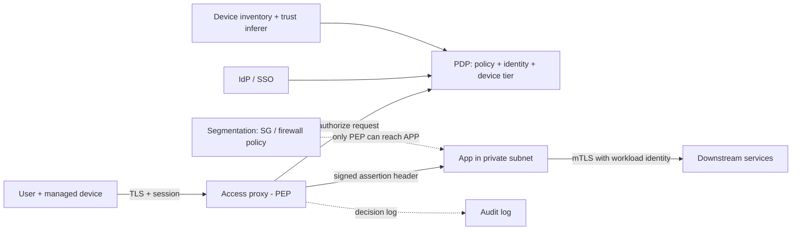

# Zero Trust Architecture in Hyperscale Clouds

## TL;DR

- Zero trust moves the access decision from "which network are you on" to a per-request evaluation of user, device, and request context. The enforcement point is a proxy or policy engine, and the network location carries no authority. Reference: [NIST SP 800-207](https://csrc.nist.gov/pubs/sp/800/207/final) and the BeyondCorp papers.
- The architecture has three parts: a policy enforcement point (PEP) on the data path, a policy decision point (PDP) fed by identity and device-trust data, and a backend that re-verifies a signed assertion. If any of the three is missing, you have a VPN with extra steps.
- The revocation latency of a zero trust system is the maximum over its layers of cache TTL plus propagation delay. It is not the proxy's policy refresh interval. The dominant term is almost always a long-lived flow or an application session cookie, such as a tracked TCP flow or a 24 hour app cookie minted from a 10 minute assertion.
- Micro-segmentation constrains the blast radius when authentication has already failed. Identity-based rules (security group references, service accounts, secure tags) are stronger than address-based rules. Tag mechanisms that are not IAM-governed are spoofable by anyone who can edit the instance.
- The PDP is a hard availability dependency of every request. Design the fail-open versus fail-closed behavior, the bounded staleness of cached decisions, and the break-glass path before the first outage, and do not let the IdP sit behind its own proxy.

## Mental Model



The data path is user to proxy to application, and the application is reachable only from the proxy.
The control path is the proxy asking a decision service, which joins three inputs: who the user is (IdP), what the device is (inventory and trust inference), and what is being asked (resource and request attributes).
The application does not trust the network, so it re-verifies a cryptographically signed assertion from the proxy and checks that it was minted for this application.
East-west traffic uses the same principle with workload identity and mutual TLS, so that a compromised workload cannot pivot freely.
Segmentation is the last line of defense, because the assumption is that some credential, device, or workload will eventually be compromised.

## Internals

### The reference model: PEP, PDP, and trust data

[NIST SP 800-207](https://csrc.nist.gov/pubs/sp/800/207/final) (Aug 2020) formalizes the logical components: a Policy Engine (PE) that grants or denies, a Policy Administrator (PA) that establishes or tears down the session path, and a Policy Enforcement Point (PEP) on the data path.
PE and PA together form the PDP.
The standard describes three approaches: enhanced identity governance, micro-segmentation, and software-defined perimeters.
It also describes several deployment variations: device agent or gateway, enclave gateway, resource portal, and application sandboxing.
Cloud proxies such as Google IAP and AWS Verified Access are "resource portal" or "gateway" variants in which the cloud provider operates the PEP and PDP.
The control plane (PE, PA) and the data plane (PEP) are separate on purpose, which is the same split described in [[17-Cloud-AI-Engineering/Volume_01_Cloud_Architecture_Principles/Chapter_04_Control_Plane_vs_Data_Plane_Separation|Control Plane vs Data Plane Separation]].

### BeyondCorp: what Google actually built

BeyondCorp started after the 2009-2010 intrusions that prompted Google to abandon the privileged-intranet model.
The architecture was published in a series of ;login: articles: Ward and Beyer, "BeyondCorp: A New Approach to Enterprise Security" (Dec 2014); Osborn et al., "BeyondCorp: Design to Deployment at Google" (2016); Escobedo et al., "BeyondCorp: The User Experience" (2017); Peck et al., "Migrating to BeyondCorp" (2017); and "BeyondCorp: Building a Healthy Fleet" (2018).
The component model from the design paper is the one worth memorizing:

| Component | Mechanism | Why it exists |
| --- | --- | --- |
| Device identity | Certificate issued to a managed device and stored in a machine-bound store (hardware-backed where available) | Binds the TLS session to a known inventory record, so a stolen password alone is insufficient |
| Device Inventory Service | Pipeline that ingests configuration, patch, and management signals from many sources into one record per device | Gives the PDP a single, queryable device state |
| Trust Inferer | Computes a trust tier per device from inventory data, continuously | Converts raw posture into a small ordered set that policy can reference |
| User and Group database | Joined with HR and job-function data | Authorization is by role, not by individual |
| Access Control Engine | Evaluates per-request rules combining user, group, device tier, and resource | The PDP |
| Access Proxy | Internet-facing reverse proxy that terminates TLS and enforces the engine's decision | The PEP |
| Unprivileged network | Corporate network that grants no extra reachability | Removes the "inside is trusted" assumption |

(Source: BeyondCorp ;login: papers listed above; component names from memory of the design paper, see batch report.)

Two mechanisms from that paper series do not appear in cloud product getting-started guides.

First, the trust tier is a derived value with a freshness problem.
A device that was healthy at its last scan is still "healthy" in the inventory until the next report arrives.
The Trust Inferer therefore has to treat stale data as a signal in its own right, and policy must define what a stale record maps to.
The decision must degrade toward a lower tier rather than hold the last good value.
If you do not define this, your effective policy is "healthy as of an unbounded time ago".

Second, the migration method was observation first.
The "Migrating to BeyondCorp" paper describes deriving the set of flows that would break from network traffic data and from the access proxy's own decision logs, and driving the migration by working that set down per service before enforcement was turned on.
The general technique is to run the new policy in a shadow mode, log the would-be denies, fix the workflows or the data, and only then enforce.
Both [[17-Cloud-AI-Engineering/Volume_03_GCP_Deep_Dive/Chapter_03_VPC_Service_Controls_Security_Perimeters|VPC Service Controls]] dry-run mode and AWS Config or Cedar policy simulation are descendants of the same idea.

### Identity-aware proxy mechanics

**Google IAP.**
IAP sits at the Google front end for HTTP(S) load-balanced backends, App Engine, and similar targets, and it also offers TCP forwarding for SSH and RDP.
It authenticates the user, checks IAM and any Context-Aware Access levels (Access Context Manager), then forwards the request with identity headers.
The authoritative header is `x-goog-iap-jwt-assertion`, an ES256 JWT.
Per Google's documentation, IAP strips client-supplied `x-goog-*` headers when it is enabled, and signed headers exist as secondary protection in case someone bypasses IAP (Google Cloud docs, as of 2026-10; [signed headers](https://docs.cloud.google.com/iap/docs/signed-headers-howto)).
The JWT audience is bound to the protected resource.
For a Compute Engine backend service it takes the form `/projects/PROJECT_NUMBER/global/backendServices/BACKEND_SERVICE_ID` (same source).
This audience binding is the part most applications skip, and it is what prevents a token minted for application A from being replayed against application B.
A verifier that checks only the signature accepts any JWT IAP has ever signed for any application in any project.

**AWS Verified Access.**
Verified Access (VA) is an OIDC client in front of your endpoint, with an optional device-posture input.
Policies are written in Cedar and are evaluated against trust data from the configured trust providers ([AWS docs, as of 2026-10](https://docs.aws.amazon.com/verified-access/latest/ug/auth-policies.html)).
For OIDC user trust providers, the trust data comes from the provider's UserInfo endpoint ([AWS docs, as of 2026-10](https://docs.aws.amazon.com/verified-access/latest/ug/user-trust.html)).
Access is denied unless a policy permits it explicitly.
The consequence of reading claims from UserInfo is that policy freshness is bounded by what the IdP returns at the time VA queries it.
Whether and when VA refreshes that trust data inside an established session is not something the documentation I could verify settles, so test it with a revoked user before depending on it (UNVERIFIED, see batch report).

**Cedar as the policy engine.**
Cedar (Cutler et al., OOPSLA 2024; "How We Built Cedar", FSE 2024) is a deliberately restricted language: no loops, explicit `permit` and `forbid` effects, `forbid` overrides `permit`, and default deny.
The restriction exists so that policies are analyzable with SMT-based tools and so that evaluation is bounded.
The implementation was built with verification-guided development, using formal models and differential testing against the production evaluator.
The trade-off is expressiveness: anything that needs a join across a large external dataset must be materialized into the request context first.

### Continuous evaluation: where "continuous" actually lives

"Continuous re-authentication" is implemented as several independent clocks, and each is a separate cache:

1. Per-request PDP evaluation at the proxy. This is fresh to the extent the trust data it joins is fresh.
2. The proxy session (cookie) that avoids a full SSO round trip for every request.
3. The assertion lifetime, which for IAP is at most 10 minutes plus twice the 30 second skew allowance (Google Cloud docs, as of 2026-10).
4. Any application session you mint from the assertion.
5. Any long-lived transport flow established under an earlier grant: WebSocket, SSH, database connection, gRPC stream, tracked TCP flow.
6. Cloud credentials the user obtained, such as STS sessions or OAuth access tokens.

The architectural error is to assume (1) bounds everything.
It bounds only the requests that pass through the proxy after the decision changes.

### The new-enemy problem in authorization

Google's Zanzibar paper (Pang et al., USENIX ATC 2019) names a consistency hazard that applies to any zero trust PDP that caches.
The "new enemy problem" has two forms.
In the first, a user is removed from a group and then shown content that was added after the removal, because the ACL check read a stale snapshot.
In the second, a content change and an ACL change are applied in the opposite of the order the user intended.
Zanzibar addresses this with a consistency token ("zookie") returned with content writes, which forces later checks to read an ACL snapshot at least as fresh as that write.
The lesson for a cloud zero trust design is that evaluating a policy against stale entity data is not merely slow revocation.
It can grant access the policy author explicitly intended to forbid.
If your group membership is replicated to the PDP asynchronously, then "remove from group, then rotate the secret" is a race, and the safe order is to rotate the secret after the PDP has acknowledged the membership change.
Related consistency machinery is covered in [[17-Cloud-AI-Engineering/Volume_03_GCP_Deep_Dive/Chapter_10_Cloud_Spanner_TrueTime_and_External_Consistency|Cloud Spanner: TrueTime and External Consistency]].

### Workload identity and east-west zero trust

Google's internal answer for service-to-service is ALTS (Application Layer Transport Security) and the BeyondProd model (2019 whitepaper).
ALTS authenticates services by service identity rather than by host or IP and exposes the authenticated peer identity to the RPC layer, so that authorization decisions are made on "which service is calling" and not "which address".
BeyondProd lists the principles: protection at the network edge, no mutual trust between services, trusted machines running code with known provenance, logical choke points for policy enforcement, simple and automated change rollout, and isolation between workloads.
(Source: Google Cloud ALTS and BeyondProd whitepapers; details from memory, see batch report.)
Cloud equivalents are SPIFFE-style workload certificates from a mesh CA or a private CA, covered in [[17-Cloud-AI-Engineering/Volume_05_Kubernetes_and_Platform_Engineering/Chapter_08_Service_Mesh_Architecture_and_Trade_Offs|Service Mesh Architecture and Trade-Offs]] and [[17-Cloud-AI-Engineering/Volume_08_Security_Identity_and_the_Data_Perimeter/Chapter_02_Workload_Identity_Federation|Workload Identity Federation]].
Amazon VPC Lattice provides a managed alternative: auth policies on a service network evaluated against SigV4-signed requests (UNVERIFIED, not re-read this session).

### Micro-segmentation: how enforcement actually works

**AWS.**
Security groups are stateful and allow-only.
They are enforced at the host's virtual networking layer rather than inside the guest (the Nitro card for VPC, see [[17-Cloud-AI-Engineering/Volume_02_AWS_Deep_Dive/Chapter_04_EC2_Nitro_Architecture_and_Graviton|EC2, Nitro Architecture, and Graviton]]).
A rule can reference another security group, so "app tier may reach database tier" is expressed by membership and does not depend on addresses.
Network ACLs are stateless and per-subnet, and they support explicit deny.
Statefulness is implemented with connection tracking.
That produces the behavior that matters for revocation: removing a security group rule changes the admission of new flows, while an already-tracked flow continues until it ends or idles out.
The documented default idle timeouts are 432000 seconds for established TCP, 30 seconds for UDP, and 180 seconds for UDP streams, and they are configurable per network interface (AWS docs, not re-verified this session, see batch report).
Traffic that is "untracked" because the group allows all traffic in both directions is not subject to connection tracking at all.
The tracking table has a per-instance allowance, and exceeding it is exposed as the ENA driver metric `conntrack_allowance_exceeded` (UNVERIFIED, from memory of the ENA metrics).

**GCP.**
VPC firewall rules and hierarchical firewall policies are programmed into the host-side virtual switch of the Andromeda network stack (see [[17-Cloud-AI-Engineering/Volume_03_GCP_Deep_Dive/Chapter_04_Global_VPC_Andromeda_SDN_and_Network_Tiers|Global VPC, Andromeda SDN, and Network Tiers]]).
Rules can target by network tag, by service account, or by secure tag (a Resource Manager tag bound to a VPC network).
The security difference is the authority needed to change the target.
Network tags are instance metadata that anyone with permission to edit the instance can change, so a tag-targeted rule delegates firewall posture to instance editors.
Service accounts and secure tags are IAM-governed resources with their own permissions.
Prefer them for any rule that expresses a trust boundary (UNVERIFIED in detail for current flags, see batch report).

**Kubernetes.**
Pod-level segmentation is enforced by the CNI: eBPF in Cilium and in GKE Dataplane V2, and the VPC CNI network policy agent on EKS.
See [[17-Cloud-AI-Engineering/Volume_05_Kubernetes_and_Platform_Engineering/Chapter_03_CNI_and_eBPF_with_Cilium|Container Networking Interface and eBPF with Cilium]].
Node metadata services remain a segmentation gap unless you block pod access to them explicitly.
That is the lesson of the 2019 Capital One incident, in which a request forgery flaw reached the instance metadata service and obtained role credentials, and it is the reason IMDSv2 with a hop limit of 1 exists.

## Numbers to Know

| Item | Value | Status and source |
| --- | --- | --- |
| IAP signed-header JWT algorithm | ES256 | Verified (Google Cloud docs, as of 2026-10) - [signed headers](https://docs.cloud.google.com/iap/docs/signed-headers-howto) |
| IAP JWT clock skew allowance | 30 seconds | Verified (Google Cloud docs, as of 2026-10) |
| IAP JWT maximum lifetime | 10 minutes + 2 x skew = 11 minutes | Verified (Google Cloud docs, as of 2026-10) |
| IAP JWT audience, Compute Engine backend | `/projects/PROJECT_NUMBER/global/backendServices/ID` | Verified (Google Cloud docs, as of 2026-10) |
| Verified Access price, per application per hour | $0.27 (US East Ohio example) | Verified ([AWS pricing page](https://www.aws.amazon.com/verified-access/pricing/), as of 2026-10) |
| Verified Access data processing | $0.02 per GB | Verified (AWS pricing page worked example, as of 2026-10) |
| Verified Access volume tier | $0.20 per endpoint-hour above 200 applications | Launch-era figure ([AWS News Blog](https://aws.amazon.com/blogs/aws/aws-verified-access-preview-vpn-less-secure-network-access-to-corporate-applications/), 2022); UNVERIFIED as current |
| IAM Identity Center trust provider group limit | Up to 1,000 groups per user | Verified (AWS docs, as of 2026-10) |
| IAM Identity Center prerequisite | Organization instance, same Region as the trust provider | Verified (AWS docs, as of 2026-10) |
| Chrome Enterprise Premium list price | $6 per user per month | Secondary source only ([Computerworld](https://www.computerworld.com/article/2088368/google-adds-a-premium-option-for-chrome-enterprise.html)); UNVERIFIED against Google pricing page |
| SG tracked TCP established idle timeout | 432000 s (5 days) | UNVERIFIED this session (AWS docs, from memory) |
| SG tracked UDP and UDP stream idle timeouts | 30 s and 180 s | UNVERIFIED this session (AWS docs, from memory) |
| STS role session duration | 900 s to 43200 s, bounded by role setting | UNVERIFIED this session (AWS docs, from memory) |
| RDS IAM auth token lifetime | 15 minutes, applies at connect only | UNVERIFIED this session (AWS docs, from memory) |

Derived numbers used later in this chapter are labeled as assumptions where they are not documented limits.

## AWS vs GCP Mechanism Parity

| Concern | AWS | Google Cloud |
| --- | --- | --- |
| Identity-aware HTTP proxy | Verified Access (endpoint in a VPC, load balancer or network interface target) | Identity-Aware Proxy on load balancers, App Engine, and others |
| Policy language | Cedar, default deny, evaluated on trust data from providers | IAM allow/deny with IAM Conditions (CEL) plus Access Context Manager access levels for device, IP, and geo context |
| Device posture input | Third-party device trust providers integrated with Verified Access | Endpoint Verification and Chrome Enterprise Premium device signals (formerly BeyondCorp Enterprise) |
| Signed identity assertion to backend | Signed user-context header (header name and claims UNVERIFIED) | `x-goog-iap-jwt-assertion`, ES256, audience bound to the resource (verified) |
| Non-HTTP administrative access | SSM Session Manager (agent dials out, IAM-authorized per session); Verified Access TCP support (GA status UNVERIFIED) | IAP TCP forwarding for SSH and RDP, authorized by IAM |
| Where the login session clock lives | IdP session plus IAM Identity Center and STS durations | Google Cloud session control for console and CLI plus IAP session settings (defaults UNVERIFIED) |
| Service-to-service authorization | VPC Lattice auth policies (SigV4), mTLS via a mesh or private CA | Cloud Service Mesh with mesh-issued workload certificates; ALTS internally at Google |
| Segmentation target selector | Security group reference (membership), subnet, NACL | Service account, secure tag, network tag, hierarchical firewall policy |
| Segmentation rule semantics | Allow-only SGs, stateful with connection tracking; NACLs stateless with deny | Allow and deny rules with priorities, stateful, in global or hierarchical policies |
| Perimeter around cloud APIs | VPC endpoint policies, SCPs, RCPs (see [[17-Cloud-AI-Engineering/Volume_08_Security_Identity_and_the_Data_Perimeter/Chapter_06_Constructing_an_Impenetrable_Data_Perimeter\|data perimeter]]) | VPC Service Controls perimeters and ingress/egress rules |
| Session-revocation primitive for cloud credentials | Deny policy conditioned on token issue time ("revoke active sessions") | Disable principal or add IAM deny policy; short-lived access tokens |
| Pricing shape | Per application-hour plus per GB processed (verified) | IAP itself is not separately metered (UNVERIFIED); the load balancer is billed |

The central mechanism difference is where the trust boundary of the proxy's assertion lies.
IAP is a Google-operated front end that mints a Google-signed JWT, and you verify it against Google-published keys.
Verified Access is an AWS-operated endpoint inside your VPC attachment model, and the policy language is yours.
In both cases the backend must still deny anything that did not come through the proxy.

## Worked Example: A Zero Trust Front Door With A Revocation Budget

The lab has three parts.
Part A is a Python verifier for the IAP assertion and a revocation-budget calculator, both of which run offline.
Part B is a Terraform skeleton for an AWS Verified Access endpoint in front of an internal ALB whose security group admits only the endpoint.
Part C is the capacity and cost arithmetic.

### Part A: Verify the assertion correctly, then compute the revocation budget

The verifier below was run in the authoring sandbox with PyJWT 2.14 and `cryptography`.
Its self-test rejects a cross-application replay, an expired token, and a token whose lifetime exceeds the documented IAP bound.

```python
"""Offline-testable verifier for the x-goog-iap-jwt-assertion header.
Production use: fetch the IAP public keys keyed by kid and cache them with a TTL.
"""
import time
import jwt  # PyJWT

SKEW = 30                      # seconds, per IAP signed-header docs
MAX_LIFETIME = 600 + 2 * SKEW  # 10 minutes + 2 * skew, per IAP signed-header docs
ISSUER = "https://cloud.google.com/iap"


def expected_audience(project_number: int, backend_service_id: int) -> str:
    return f"/projects/{project_number}/global/backendServices/{backend_service_id}"


def verify_iap_jwt(token: str, keys_by_kid: dict, audience: str, now: float | None = None) -> dict:
    now = time.time() if now is None else now
    header = jwt.get_unverified_header(token)
    if header.get("alg") != "ES256":          # never let the token pick the algorithm
        raise ValueError("alg must be ES256")
    key = keys_by_kid.get(header.get("kid"))
    if key is None:
        raise ValueError("unknown kid")
    claims = jwt.decode(
        token, key, algorithms=["ES256"], audience=audience, issuer=ISSUER,
        leeway=SKEW, options={"require": ["exp", "iat", "aud", "iss", "sub"]},
    )
    if claims["exp"] - claims["iat"] > MAX_LIFETIME:
        raise ValueError("token lifetime exceeds IAP maximum")
    return claims


def _selftest():
    from cryptography.hazmat.primitives.asymmetric import ec
    priv = ec.generate_private_key(ec.SECP256R1())
    keys = {"k1": priv.public_key()}
    aud_a = expected_audience(111, 1001)
    aud_b = expected_audience(111, 2002)
    t0 = int(time.time())

    def mint(aud, iat=t0, ttl=600):
        return jwt.encode({"iss": ISSUER, "aud": aud, "sub": "accounts.google.com:1",
                           "email": "a@example.com", "iat": iat, "exp": iat + ttl},
                          priv, algorithm="ES256", headers={"kid": "k1"})

    assert verify_iap_jwt(mint(aud_a), keys, aud_a)["email"] == "a@example.com"
    for name, tok, aud in [
        ("cross-app replay (aud mismatch)", mint(aud_b), aud_a),
        ("expired", mint(aud_a, iat=t0 - 3600), aud_a),
        ("lifetime too long", mint(aud_a, ttl=3600), aud_a),
    ]:
        try:
            verify_iap_jwt(tok, keys, aud)
            raise SystemExit(f"FAIL: accepted {name}")
        except Exception as e:
            print("rejected:", name, "->", type(e).__name__)
    print("selftest ok")


if __name__ == "__main__":
    _selftest()
```

Observed output: three `rejected:` lines (`InvalidAudienceError`, `ExpiredSignatureError`, `ValueError`) followed by `selftest ok`.
The issuer string and the key-fetch location come from Google's sample code and are listed in the batch report as not re-verified.

The second script makes the revocation argument quantitative.
The end-to-end bound is the maximum of the layers, because the layers run concurrently and the slowest enforcement point dominates.

```python
"""Worst-case time between 'access revoked in the PDP' and 'last byte an old grant can still move'."""

LAYERS = {
    "IAP JWT cached by backend (10 min + 2*30 s skew)": 600 + 60,
    "Backend authz cache you wrote (TTL)": 300,
    "SG tracked TCP flow, idle timeout 432000 s (5 d), UNVERIFIED this session": 432000,
    "Same flow after NACL deny (stateless, next packet)": 1,
    "App max-connection-age you enforce": 900,
}


def worst_case(layers):
    name = max(layers, key=layers.get)
    return name, layers[name]


if __name__ == "__main__":
    for k, v in sorted(LAYERS.items(), key=lambda kv: -kv[1]):
        print(f"{v:>8d} s  {k}")
    n, v = worst_case(LAYERS)
    print(f"\ndominant layer: {n} = {v} s ({v/3600:.1f} h)")
    mitigated = {k: v for k, v in LAYERS.items() if "SG tracked" not in k}
    n, v = worst_case(mitigated)
    print(f"after capping flow lifetime: {n} = {v} s ({v/60:.1f} min)")
```

Observed output: the dominant layer is the tracked flow at 432000 s (120 hours), and after you cap flow lifetime with an application-enforced maximum connection age the bound becomes 900 s (15 minutes).
The 5 day figure is an idle timeout, so a flow that keeps sending never expires.
The practical remedy is the pair of an application-level maximum connection age and, for emergency revocation, a NACL deny, which is stateless and takes effect on the next packet.

### Part B: Verified Access with a segmented backend (Terraform skeleton)

This file was not applied or validated in the authoring session because no Terraform binary and no cloud account were available.
Run `terraform validate` first and check the Cedar context attribute names against the current Verified Access policy documentation before relying on it.

```hcl
terraform {
  required_providers {
    aws = { source = "hashicorp/aws", version = ">= 5.50" }
  }
}

variable "vpc_id"            { type = string }
variable "subnet_ids"        { type = list(string) }
variable "alb_arn"           { type = string }   # internal ALB, HTTPS listener on 443
variable "alb_sg_id"         { type = string }
variable "app_domain"        { type = string }   # e.g. ml-admin.example.com
variable "acm_cert_arn"      { type = string }   # certificate for app_domain
variable "oidc_issuer"       { type = string }
variable "oidc_authz_ep"     { type = string }
variable "oidc_token_ep"     { type = string }
variable "oidc_userinfo_ep"  { type = string }
variable "oidc_client_id"    { type = string }
variable "oidc_client_secret" {
  type      = string
  sensitive = true
}
variable "alert_email"       { type = string }

resource "aws_verifiedaccess_instance" "this" {}

resource "aws_verifiedaccess_trust_provider" "idp" {
  policy_reference_name    = "idp"
  trust_provider_type      = "user"
  user_trust_provider_type = "oidc"
  oidc_options {
    issuer                 = var.oidc_issuer
    authorization_endpoint = var.oidc_authz_ep
    token_endpoint         = var.oidc_token_ep
    user_info_endpoint     = var.oidc_userinfo_ep
    client_id              = var.oidc_client_id
    client_secret          = var.oidc_client_secret
    scope                  = "openid email groups"
  }
}

resource "aws_verifiedaccess_instance_trust_provider_attachment" "idp" {
  verifiedaccess_instance_id       = aws_verifiedaccess_instance.this.id
  verifiedaccess_trust_provider_id = aws_verifiedaccess_trust_provider.idp.id
}

resource "aws_verifiedaccess_group" "internal" {
  verifiedaccess_instance_id = aws_verifiedaccess_instance.this.id
  # Cedar: default deny; this permits only verified company identities.
  # The context attribute path (context.idp.email) is UNVERIFIED; confirm against current docs.
  policy_document = <<-EOT
    permit(principal, action, resource)
    when { context.idp.email like "*@example.com" };
  EOT
  depends_on = [aws_verifiedaccess_instance_trust_provider_attachment.idp]
}

# Micro-segmentation: the endpoint gets its own SG, and the ALB admits only that SG.
resource "aws_security_group" "ava_endpoint" {
  name_prefix = "ava-endpoint-"
  vpc_id      = var.vpc_id
}

resource "aws_vpc_security_group_egress_rule" "ava_to_alb" {
  security_group_id            = aws_security_group.ava_endpoint.id
  referenced_security_group_id = var.alb_sg_id
  ip_protocol                  = "tcp"
  from_port                    = 443
  to_port                      = 443
}

resource "aws_vpc_security_group_ingress_rule" "alb_from_ava" {
  security_group_id            = var.alb_sg_id
  referenced_security_group_id = aws_security_group.ava_endpoint.id
  ip_protocol                  = "tcp"
  from_port                    = 443
  to_port                      = 443
}

resource "aws_verifiedaccess_endpoint" "app" {
  verified_access_group_id = aws_verifiedaccess_group.internal.id
  endpoint_type            = "load-balancer"
  attachment_type          = "vpc"
  application_domain       = var.app_domain
  domain_certificate_arn   = var.acm_cert_arn
  endpoint_domain_prefix   = "mladmin"
  security_group_ids       = [aws_security_group.ava_endpoint.id]
  load_balancer_options {
    load_balancer_arn = var.alb_arn
    port              = 443
    protocol          = "https"
    subnet_ids        = var.subnet_ids
  }
}

# Budget alarm: lab should cost about 1-2 USD; alert at 80 percent of 10 USD.
resource "aws_budgets_budget" "lab" {
  name         = "zt-lab"
  budget_type  = "COST"
  limit_amount = "10"
  limit_unit   = "USD"
  time_unit    = "MONTHLY"
  notification {
    comparison_operator        = "GREATER_THAN"
    threshold                  = 80
    threshold_type             = "PERCENTAGE"
    notification_type          = "ACTUAL"
    subscriber_email_addresses = [var.alert_email]
  }
}

output "endpoint_domain" { value = aws_verifiedaccess_endpoint.app.endpoint_domain }
```

After apply, create a CNAME from `app_domain` to the `endpoint_domain` output.
Then confirm the two properties that matter.
First, the application is unreachable by any path except the endpoint: from another host in the VPC, `curl https://<alb-dns>` must time out because the ALB security group admits only the endpoint security group.
Second, a user outside the policy receives a denial, and the Verified Access logs record it.

Teardown, run from the same directory:

```bash
terraform destroy -auto-approve
aws ec2 describe-verified-access-endpoints --query 'VerifiedAccessEndpoints[].VerifiedAccessEndpointId'
```

The second command must return an empty list.
If you left the instance running, the endpoint still bills hourly.

### Part C: Capacity and cost arithmetic

Lab cost.
One endpoint at $0.27 per hour for a 4 hour session is 4 x 0.27 = $1.08 (AWS pricing page, as of 2026-10).
Data processing for a smoke test of 1 GB is 1 x $0.02 = $0.02.
An internal ALB adds an hourly charge and LCU charges that I did not verify this session, which I estimate at roughly $0.10 for four hours (UNVERIFIED).
Estimated total: about $1.20, with the $10 budget as a hard tripwire.
The failure to guard against is forgetting the endpoint: 0.27 x 730 hours = $197.10 per month for a single idle endpoint.

Production sizing.
Assume 25 internal applications (training dashboards, notebook gateways, experiment trackers, GPU-cluster admin UIs) and 1.5 TB per month of proxied traffic.
Application-hours: 25 x 730 x $0.27 = $4,927.50 per month.
Data processing: 1,500 GB x $0.02 = $30.00.
Total: $4,957.50 per month, or about $12.39 per user per month for 400 engineers.
The consolidation lever is to put several applications behind one internal gateway and one endpoint: 5 endpoints instead of 25 costs 5 x 730 x 0.27 = $985.50 per month.
The price of that saving is that the proxy policy now has the granularity of the gateway rather than the application, so authorization between the consolidated applications moves into application code and the shared blast radius grows.
Whether that trade is acceptable depends on whether the consolidated applications share a trust tier.

PDP availability budget (illustrative assumptions, not provider SLAs).
Suppose a fail-closed proxy depends serially on an IdP at 99.9%, a device-trust source at 99.9%, and a policy store at 99.99%.
The composite is 0.999 x 0.999 x 0.9999 = 0.99790, which is 0.21% unavailability, or about 18.4 hours per year.
If trust data is cached with bounded staleness, so that the device-trust source is off the per-request critical path, the composite becomes 0.999 x 0.9999 = 0.99890, about 9.6 hours per year.
The price is a revocation delay equal to the staleness bound, so the staleness bound is a product decision about acceptable risk.

## Failure Modes and Pitfalls

**Bypass paths around the proxy.**
IAP and Verified Access protect only traffic that goes through them.
Google's own getting-started guidance states that if an attacker can bypass the load balancer, they can bypass IAP, for example through a firewall rule that is too broad or a backend with a public address ([Google Cloud blog](https://cloud.google.com/blog/products/identity-security/getting-started-with-cloud-identity-aware-proxy)).
The control is a network rule that admits only the proxy, plus assertion verification in the backend.
Test it adversarially: from a host in the same VPC, connect directly to the backend and assert failure.

**Signature-only or header-only verification.**
Applications that read `X-Goog-Authenticated-User-Email` directly are trusting a header that is forgeable on any bypass path (Google documents this for the plain headers).
Applications that verify the signature but not the audience accept an assertion minted for a different protected resource.
The fix is the verifier in Part A: pinned algorithm, pinned issuer, exact audience, bounded lifetime.

**Assertion-to-session laundering.**
Many applications verify the 10 minute assertion once and then issue their own 8 or 24 hour session cookie.
The proxy still revokes new requests immediately, but the application session survives for its own lifetime, which makes the proxy's short assertion lifetime meaningless.
Either re-verify the assertion on every request or cap the application session at your revocation SLO.

**Revocation gap through long-lived flows.**
A security group rule removal does not terminate tracked flows, and a database connection authorized by a 15 minute IAM token lives as long as the connection does (see Part A).
STS sessions cannot be revoked individually.
The documented route is to add a deny policy keyed on the token issue time, which is exactly the "revoke active sessions" action.
Short role sessions for production and a maximum connection age on every long-lived protocol are the preventive controls.

**PDP and IdP as a hard dependency.**
In the Google Cloud incident of 2025-06-12, a policy-data change with unintended blank fields was replicated globally within seconds to the service that performs API policy and quota checks, triggered a null-pointer crash loop, and produced a multi-hour disruption across many products, with a herd effect on recovery in the largest region (Google Cloud incident report; summary from memory, UNVERIFIED).
The reusable lessons are that policy data deserves the same staged rollout as code, that a global-replication path for policy is a global blast radius, and that a PEP crashing on malformed policy is a fail-closed outage.
Compare the cases in [[17-Cloud-AI-Engineering/Volume_07_Reliability_and_SRE/Chapter_07_Anatomy_of_Major_Cloud_Outages|Anatomy of Major Cloud Outages]].
A related trap is circularity: if the IdP, the proxy configuration repository, or the break-glass credentials are themselves behind the proxy, an outage of the proxy locks out the people who could fix it ([[17-Cloud-AI-Engineering/Volume_01_Cloud_Architecture_Principles/Chapter_02_Regions_Zones_and_Static_Stability|Regions, Zones, and Static Stability]]).

**Bearer token theft defeats user and device checks.**
In the October 2023 Okta support-system incident, session tokens captured in files uploaded to a support case were used to hijack customer sessions (Okta disclosures, 2023).
In 2023 the Storm-0558 actor used a stolen signing key to forge tokens that the verifier accepted, as analyzed in the Cyber Safety Review Board report (April 2024).
Both incidents show that a bearer assertion is only as strong as its binding.
Defenses are device-bound credentials (short-lived tokens whose use requires a key held in hardware), strict issuer and audience validation, and a plan for signing-key compromise.

**Posture staleness.**
A device trust tier that is hours old is a prediction, not an observation.
If policy says "tier 3 required" and the inventory pipeline lags, a compromised device inherits the last good tier.
Set a maximum age on posture data and map expired data to the lowest tier.

**Spoofable segmentation selectors.**
GCP network tags let anyone with instance edit rights place a VM into a trusted rule set.
The AWS equivalent is granting `ec2:ModifyInstanceAttribute` or `ec2:ModifyNetworkInterfaceAttribute` broadly, which lets a principal swap the security groups on an instance.
The segmentation boundary is only as strong as the IAM boundary around the selector.

**Connection-tracking exhaustion.**
Heavy east-west fan-out, such as many short-lived RPCs between inference gateways and workers, can exhaust the per-instance connection tracking allowance, and the symptom is dropped new connections with healthy CPU.
Watch the allowance metrics and design chatty paths to use untracked rules or long-lived multiplexed connections.

**Enforcing before observing.**
Turning on strict policy without a shadow period produces an outage and then a policy exception that never goes away.
The BeyondCorp migration approach is to measure first, enforce second.

**Mesh certificate expiry.**
mTLS between workloads fails closed when workload certificates expire.
Expiry is a classic cascading failure when the issuing CA is unavailable for longer than the certificate lifetime, so lifetime should be a multiple of the CA's recovery objective.

## Security and Cost Angles

### IAM scoping

- IAP: grant the HTTPS accessor role on the specific resource, not the project. Programmatic access uses the permission `iap.webServiceVersions.accessViaIap` on the target (Google Cloud docs, as of 2026-10; [programmatic authentication](https://docs.cloud.google.com/iap/docs/authentication-howto)). TCP forwarding has its own tunnel permission (UNVERIFIED name, check the current role list).
- Verified Access: keep the group-level policy as the organization baseline (verified company identity, and device posture where used) and the endpoint-level policy as the per-application restriction, so a new endpoint cannot be created with a weaker policy than the baseline by omission.
- Deny the ability to modify the selectors that segmentation depends on (security group attachment, network tags) for non-network-admin principals. Use IAM deny policies on GCP and SCPs on AWS, as described in [[17-Cloud-AI-Engineering/Volume_02_AWS_Deep_Dive/Chapter_01_IAM_Policy_Evaluation_Engine|IAM Policy Evaluation Engine]] and [[17-Cloud-AI-Engineering/Volume_03_GCP_Deep_Dive/Chapter_02_Cloud_IAM_Roles_Policies_and_Conditions|Cloud IAM: Roles, Policies, and Conditions]].

### Key hierarchy

The zero trust fabric has three signing roots that you must inventory: the proxy's assertion signing keys (provider-managed, you only consume the public keys), the IdP's token signing keys, and the workload CA that issues mTLS certificates.
Treat the workload CA like a KMS root: offline or HSM-backed root, short-lived online intermediates, and certificate lifetimes measured in hours.
Use customer-managed encryption keys where the service offers them for stored trust data and logs (UNVERIFIED for Verified Access specifics).
See [[17-Cloud-AI-Engineering/Volume_08_Security_Identity_and_the_Data_Perimeter/Chapter_04_Encryption_Key_Hierarchies_and_Envelope_Encryption|Encryption Key Hierarchies and Envelope Encryption]].

### Private network boundaries

The zero trust proxy is the only ingress; it does not replace the perimeter around cloud APIs.
A user who passes the proxy and reaches a notebook can still call storage and model APIs with the notebook's credentials, so the API perimeter (VPC endpoint policies and RCPs on AWS, VPC Service Controls on GCP) is the second control.
Apply both, as in [[17-Cloud-AI-Engineering/Volume_08_Security_Identity_and_the_Data_Perimeter/Chapter_06_Constructing_an_Impenetrable_Data_Perimeter|Constructing an Impenetrable Data Perimeter]].

### AI-infrastructure specifics

Training and serving fleets create zero trust surface that ordinary web applications do not: Jupyter and notebook gateways, experiment trackers, Ray and cluster dashboards, inference-engine admin and metrics ports, and SSH to GPU head nodes.
Put the HTTP surfaces behind the proxy and use IAP TCP forwarding or SSM Session Manager (the agent dials out, so no inbound port is open) for shell access.
For the GPU cluster itself, segment the data fabric (collective-communication traffic on EFA or the TPU interconnect) from the management network, as discussed in [[17-Cloud-AI-Engineering/Volume_10_AI_Infrastructure_on_Cloud/Chapter_03_High_Performance_AI_Cluster_Architectures|High-Performance AI Cluster Architectures]].
For agentic workloads that call tools on behalf of users, the confused-deputy risk is that the agent's service identity has more authority than the user who prompted it; see [[17-Cloud-AI-Engineering/Volume_12_AI_Applications_MLOps_and_Data_Platforms/Chapter_08_Cloud_Security_for_AI_Systems_Attacks_and_Defenses|Cloud Security for AI Systems: Attacks and Defenses]].

### Unit economics levers

- Per-endpoint billing means endpoint count is the cost driver (Part C: $4,927.50 versus $985.50 per month for 25 versus 5 endpoints at the verified $0.27 per hour).
- Data processing is $0.02 per GB, so route bulk transfers (model artifacts, datasets, checkpoints) over private data paths and not through the proxy. Only interactive and administrative traffic belongs there.
- Decision-log volume is a hidden cost at per-request evaluation; sample allows and retain all denies if audit policy permits.
- Seat-based tiers (Chrome Enterprise Premium at about $6 per user per month, secondary source) price by population, while Verified Access prices by application count, so the crossover depends on users per application.

## Interview Questions and Model Answers

### Question 1 (L5 - Senior)

Your team puts an internal admin application behind Google IAP. A colleague says the application no longer needs any authentication code. What is wrong with that, and what must the backend verify?

#### Model Answer

IAP authenticates and authorizes requests that pass through it, but the backend is a separate trust domain that must prove a request came through IAP.
There are three reasons the claim fails.
First, bypass paths exist: a permissive firewall rule, a public address, or another workload in the VPC can reach the backend directly, and Google's guidance explicitly says bypassing the load balancer bypasses IAP.
Second, IAP strips client-supplied `x-goog-*` headers only on the path through IAP, so the plain identity headers are forgeable on any other path.
Third, a signature check alone is insufficient: the JWT is bound to a resource through its audience claim, so a token minted for another IAP-protected application is validly signed but must be rejected.
The backend should verify `x-goog-iap-jwt-assertion` with the algorithm pinned to ES256, the issuer pinned, the audience equal to the expected backend-service path, and the lifetime within the documented 10 minutes plus twice the 30 second skew.
In addition, restrict the network path so that only the load balancer ranges can reach the backend, so signed headers are defense in depth and not the only control.

#### Follow-up Interviewer Question

Your service verifies the assertion on login and then issues its own 24 hour cookie. A user is offboarded at 10:00. When can they last act, and how would you change the design?

### Question 2 (L5 - Senior)

You remove a security group rule that allowed a contractor's bastion to reach a production database, and the contractor's open session keeps working. Explain why and how you would make removal take effect immediately.

#### Model Answer

Security groups are stateful, and statefulness is implemented with connection tracking.
A rule governs whether a new flow is admitted, and an already-tracked flow continues until it closes or idles out.
The documented idle timeout for an established TCP flow is 5 days, and a flow that keeps sending never idles, so the contractor's session can outlive the rule (I would confirm the current value in the AWS documentation before quoting it).
Also, if the group allows all traffic in both directions the flow is untracked, which is a separate subtlety.
To make removal immediate there are three options with different costs.
A network ACL deny is stateless and applies to the next packet, so it is the emergency control, at the cost of subnet-wide scope and rule-number management.
An application or database-side session kill (terminating the backend session) works for protocols with a server-side session concept.
The preventive design is to cap flow lifetime in the application (maximum connection age) and to authenticate each new connection with short-lived credentials, so the revocation bound is a number you chose.

#### Follow-up Interviewer Question

The database uses IAM authentication with 15 minute tokens. Does revoking the user's IAM permission close the open connection?

### Question 3 (L6 - Staff)

Design access control for 5,000 engineers reaching production administrative consoles. The security team demands that revoking a user takes effect within 5 minutes everywhere. Walk through what you build and what you refuse to promise.

#### Model Answer

I treat the 5 minute target as a bound on the maximum over all caches in the path, so I enumerate them: proxy session, assertion, application session, long-lived connections, and cloud credentials the user already holds.
For the proxy, per-request policy evaluation gives fresh decisions for new requests, but only as fresh as the trust data it joins, so group membership and device state need a propagation SLO of about 60 seconds, which I would measure end to end with a synthetic revoke.
For the assertion, IAP's 11 minute maximum lifetime exceeds my budget, so I never use the assertion as a session: the backend re-verifies the per-request assertion, which IAP mints only for requests it has just authorized.
Any application session is capped at 5 minutes with silent renewal through the proxy.
For long-lived protocols (WebSocket, SSH, database), I enforce a maximum connection age at or below 5 minutes with re-authentication, and I add an event-driven kill on revoke through a revoke bus, because periodic expiry alone costs an average of 2.5 minutes and a worst case of 5.
For cloud credentials, role sessions for production are short, and revoke triggers a deny keyed on token issue time (AWS) or a disable plus deny policy (GCP), because STS sessions cannot be revoked individually.
What I refuse to promise is "everywhere": third-party SaaS consoles with their own sessions, and any system that does not honor the revoke bus, are listed explicitly with their own bounds.
I also instrument: a continuous canary account is revoked every hour and the time until its last successful action is graphed against the 5 minute SLO.

#### Follow-up Interviewer Question

The IdP says group removal replicates to the proxy within 60 seconds at p99 but you measure 14 minutes at p99.9. What do you do about the tail, and what does it tell you about the SLO?

### Question 4 (L6 - Staff)

You inherit 800 internal web applications behind a corporate VPN and are told to move to zero trust in 12 months with no outage budget. How do you sequence it?

#### Model Answer

I follow the BeyondCorp migration pattern: measure, shadow, then enforce.
First, build the inventory of applications and flows from the VPN gateway and proxy logs, because the documentation will be wrong, and rank applications by traffic, by number of distinct clients, and by data sensitivity.
Second, put the access proxy in front in pass-through mode with the new policy evaluated in shadow, logging would-be denies with the reason (group, device tier, missing posture).
That produces a work queue: devices with no inventory record, service accounts calling from unmanaged hosts, and scripts using shared credentials.
Third, fix the largest classes of would-be denies, usually by enrolling devices and replacing shared credentials with workload identity, until the would-be deny rate on an application is below an agreed threshold.
Fourth, enforce per application, starting with high-traffic low-sensitivity ones to burn in the machinery, and keep a per-application rollback to the VPN path until the application has run clean for a defined period.
Fifth, close the old path: only after the proxy is the sole route do you remove the VPN reachability and add the backend-side assertion check, since otherwise you have two doors.
The trap I avoid is exception accumulation: every exemption has an owner and an expiry date, and the exemption count is a tracked metric.
Cost is part of the plan: with Verified Access at $0.27 per application-hour, 800 endpoints would be about $157,680 per month, so I would consolidate behind shared gateways for low-risk applications and give only sensitive ones a dedicated endpoint.

#### Follow-up Interviewer Question

Your shadow logs show 3% of would-be denies come from a nightly batch system that authenticates as a human's account. What is your plan?

### Question 5 (L6 - Staff)

The proxy's policy service is the dependency of every request. Argue for fail-open versus fail-closed, and explain how you keep the decision from being a coin flip during an incident.

#### Model Answer

Neither extreme is correct for every request class, so I classify.
For administrative and data-plane access to sensitive systems the default is fail-closed, because an outage that silently disables authorization is a worse incident than an outage of access.
For low-sensitivity read-only applications, bounded fail-open on cached decisions is defensible if the staleness is capped.
The mechanism is a decision cache with a maximum staleness S: the proxy serves cached allows for up to S during a PDP outage and then fails closed.
S is the explicit price of availability, since revocations during the outage are not honored for up to S, so S is set per sensitivity tier by the risk owner.
Availability arithmetic supports this: serial dependencies of 99.9%, 99.9%, and 99.99% give about 18.4 hours of unavailability per year, and caching the device-trust leg off the critical path brings it to about 9.6 hours.
Second, I prevent the policy plane from being a global single blast radius: policy changes roll out per cell with canary evaluation, and a malformed policy must make the PEP keep the last known good version, not crash.
Third, I break the circular dependencies: break-glass credentials, the IdP, and the proxy configuration pipeline are not behind the proxy, are exercised quarterly, and are alarmed on use.
The 2025-06-12 Google Cloud incident is the cautionary example of globally replicated policy data triggering a crash loop in an enforcement service (details unverified here).

#### Follow-up Interviewer Question

How would you prove, before the next outage, that your PEP keeps the last known good policy on malformed input rather than crashing?

### Question 6 (L7+ - Principal)

You are the architect for a company running AWS and GCP, with human access, service-to-service traffic, and CI/CD. Define the zero trust trust roots and the failure of each, and say what you would not unify across clouds.

#### Model Answer

I define one identity authority for humans (a single IdP with phishing-resistant authentication) and a separate, workload-identity authority for machines, because the two have different lifetimes, revocation mechanics, and attack paths.
Humans reach applications through each cloud's native proxy (IAP, Verified Access) with the same group claims and device-tier semantics, and the policy intent is expressed once but compiled per cloud (Cedar on AWS, IAM conditions and access levels on GCP) because the evaluation engines differ.
Workloads authenticate with short-lived identities issued by the platform (IRSA or Pod Identity, GKE Workload Identity), federated across clouds by OIDC token exchange, with no long-lived keys.
East-west traffic uses mTLS with workload certificates from a CA hierarchy I control, with an offline root and short-lived intermediates.
Each trust root has a defined compromise story.
IdP signing key compromise forges any user, which Storm-0558 demonstrated at a provider scale, so I want issuer-and-audience pinning at every verifier, per-application audiences, a rotation runbook that has been rehearsed, and anomaly detection on token use from unexpected locations.
Workload CA compromise forges any service, so the CA is a tier-0 asset with HSM-backed keys and a rehearsed re-issuance that fits inside certificate lifetimes.
A proxy-side bug yields bypass for everything behind it, so every backend still verifies the assertion and sits in a segment that admits only the proxy.
What I would not unify: the enforcement points and the policy engines, because a multi-cloud abstraction layer becomes a new tier-0 dependency with its own outage modes and a lowest-common-denominator feature set.
What I would unify is the data: one device inventory, one group model, one audit log schema, and one revocation event bus that both clouds subscribe to.
Cross-cloud consensus on policy is not needed, but cross-cloud agreement on identity and revocation events is.

#### Follow-up Interviewer Question

The revocation bus becomes your tier-0 dependency. How do you design it so that its failure does not either lock everyone out or silently stop revoking?

### Question 7 (L7+ - Principal)

An internal LLM agent platform lets agents call internal tools (ticketing, databases, deployment APIs) on behalf of employees. Apply zero trust principles to it. Where do you expect real vulnerabilities, and what is the revocation model?

#### Model Answer

The core hazard is the confused deputy: the agent runs with a service identity whose authority is a superset of any single user's, and the model's output is untrusted input that selects which tool to call and with which arguments.
Applying zero trust means every tool call is authorized per request against two principals, the user on whose behalf it runs and the agent workload, and the effective permission is the intersection.
Mechanically I use token exchange: the user's assertion is exchanged for a narrowly scoped, audience-bound, short-lived token for one tool, with the agent identity as actor, and the tool's PEP evaluates both.
The agent never holds a standing credential that outlives the user's session, and the tool-side policy includes the data classification of the arguments, not just the endpoint.
Real vulnerabilities concentrate in three places.
Indirect prompt injection makes a retrieved document drive a tool call that the user never intended, which per-call authorization limits but does not prevent, so destructive tools require a step-up confirmation from the human in a separate channel.
Tool servers that trust the agent gateway's network location replicate the original perimeter fallacy.
Long-running agent tasks outlive the user's session, so there must be an explicit policy for what happens when the user is offboarded mid-task, and my answer is that task credentials are bound to the session and are revoked with it.
For revocation, tokens are minutes long, tasks checkpoint and re-acquire, and a revoke event cancels in-flight tool calls at the tool PEP, so the revocation bound is the token lifetime plus the longest non-interruptible tool call.
Segmentation matters as much as identity: agent sandboxes are placed in a segment whose only egress is the tool gateway, so a compromised agent cannot reach metadata services or storage directly.

#### Follow-up Interviewer Question

A deployment tool takes 20 minutes and cannot be cancelled safely mid-flight. How does that change the revocation model, and what would you require of the tool's owners?

## Further Reading

- [NIST SP 800-207, Zero Trust Architecture](https://csrc.nist.gov/pubs/sp/800/207/final) - the canonical PE, PA, and PEP model and the deployment variants; read the tenets and the deployment scenarios sections.
- Ward and Beyer, "BeyondCorp: A New Approach to Enterprise Security", ;login: (Dec 2014) - the original motivation and architecture statement.
- Osborn, Ward, Beyer, and others, "BeyondCorp: Design to Deployment at Google", ;login: (2016) - the component-level design (device inventory, trust inferer, access control engine, access proxy).
- Peck and others, "Migrating to BeyondCorp: Maintaining Productivity While Improving Security", ;login: (2017) - the observe-before-enforce migration method that no product guide describes.
- "BeyondCorp: Building a Healthy Fleet", ;login: (2018) - how device trust data is produced and kept fresh.
- Google Cloud whitepapers "BeyondProd" (2019) and "Application Layer Transport Security" - the workload side of Google's zero trust model, including service identity at the RPC layer.
- Pang and others, "Zanzibar: Google's Consistent, Global Authorization System", USENIX ATC 2019 - the new-enemy problem and consistency tokens for authorization.
- Cutler and others, "Cedar: A New Language for Expressive, Fast, Safe, and Analyzable Authorization", OOPSLA 2024, and "How We Built Cedar: A Verification-Guided Approach", FSE 2024 - why the language is restricted and how it was verified.
- [IAP signed headers documentation](https://docs.cloud.google.com/iap/docs/signed-headers-howto) - the exact verification contract for the assertion header, including the audience and lifetime rules.
- [AWS Verified Access policies](https://docs.aws.amazon.com/verified-access/latest/ug/auth-policies.html) and [trust providers](https://docs.aws.amazon.com/verified-access/latest/ug/user-trust.html) - how Cedar policies meet trust data and what the IdP integration limits are.
- Cyber Safety Review Board, "Review of the Summer 2023 Microsoft Exchange Online Intrusion" (Apr 2024) - a primary analysis of signing-key compromise and token validation failure.
- DOJ criminal complaint and public analyses of the 2019 Capital One breach, plus the AWS IMDSv2 announcement - the canonical case for metadata-service segmentation.
- Okta public disclosures on the October 2023 support-system incident - the session-token theft case for device and context binding.
- [[17-Cloud-AI-Engineering/Volume_08_Security_Identity_and_the_Data_Perimeter/Chapter_02_Workload_Identity_Federation|Workload Identity Federation]] - the next chapter, which covers the machine-identity half of this model.
- [[17-Cloud-AI-Engineering/Volume_07_Reliability_and_SRE/Chapter_03_Resilient_Communication_Retries_Jitter_and_Circuit_Breakers|Resilient Communication: Retries, Jitter, and Circuit Breakers]] - how enforcement points should behave when the decision service is slow or down.
