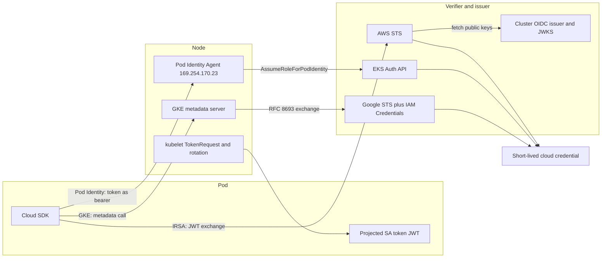

# Workload Identity Federation

## TL;DR

Workload identity federation replaces a stored secret (an IAM user key or a service account JSON key) with a short-lived signed assertion that a verifier checks against a public trust anchor, then exchanges for a cloud credential.
The three Kubernetes mechanisms use three different trust anchors. IRSA verifies a JWT offline against the cluster's public OIDC keys. EKS Pod Identity routes through a node agent plus a regional AWS service. GKE Workload Identity Federation identifies pods by a node-local metadata server.
Identity is bound to strings (cluster, namespace, service account name), not to UIDs, so whoever can create namespaces, service accounts, or pods in a namespace can mint cloud credentials.
Offline verifiers (AWS STS, Google STS) cannot see pod deletion, so a copied token stays exchangeable until `exp`. Online verifiers (the Kubernetes TokenReview API) can see it.
The federation hop is a runtime dependency of every cold start and credential refresh, so size credential TTLs and refresh windows against your identity provider's worst outage, not its SLA.

## Mental Model



A pod never holds a long-lived secret.
The kubelet obtains from the API server a short-lived, audience-scoped JWT that says "I am service account X in namespace Y of cluster Z".
A cloud-side verifier turns that statement into a cloud credential by checking a signature, an issuer, an audience, and a policy that maps the subject to a role.
The three mechanisms differ in where verification happens.
IRSA does it in the global STS control plane using public keys.
Pod Identity does it inside a regional EKS service, with the node's own IAM identity as a second factor.
GKE does it on the node, attributing calls to pods by network source address.
Everything else in this chapter (blast radius, revocation, static stability, interview traps) follows from that choice.

## Internals

### The primitive: a bound, projected service account token

Since the bound-token work in Kubernetes ([KEP-1205](https://github.com/kubernetes/enhancements/tree/master/keps/sig-auth/1205-bound-service-account-tokens)), the kubelet requests tokens through the TokenRequest API instead of mounting a never-expiring Secret.
The token is a JWT signed by the API server's service-account signing key.
Its claims include `iss` (the cluster's issuer URL), `sub` (`system:serviceaccount:<namespace>:<name>`), `aud`, `iat`, `nbf`, `exp`, and a `kubernetes.io` object carrying the namespace, service account name and UID, and the bound pod name and UID.
The kubelet rotates the projected file when it is older than 80 percent of its TTL, or after 24 hours (AWS EKS best practices, as of 2026-10).
On EKS the default token lifetime is 86400 seconds and the API server flag that caps it is not under your control (secondary summary of AWS docs, as of 2026-10).
The audience is what separates the mechanisms.
IRSA tokens use `sts.amazonaws.com`.
Pod Identity tokens use `pods.eks.amazonaws.com` (secondary summary of AWS docs, as of 2026-10).
GKE tokens use an audience derived from the workload pool (UNVERIFIED this session).
Audience scoping is the only reason one stolen token cannot be replayed to a different verifier.

### Online versus offline verification

This is the mechanism most getting-started guides skip.
A verifier can check a service account token in two ways.
An online verifier posts it to the Kubernetes TokenReview API, which re-checks the signature and also checks that the bound pod and service account still exist.
The token dies when the pod is deleted.
An offline verifier fetches the issuer's public keys once, caches them, and checks the signature, `iss`, `aud`, and `exp` without calling the cluster.
It cannot know the pod is gone.
AWS STS `AssumeRoleWithWebIdentity` is an offline verifier.
It is also an unauthenticated API call, so it needs no AWS credentials and is not governed by any identity policy of the caller.
STS resolves the issuer URL registered in your IAM OIDC provider, fetches the OIDC discovery document and the JWKS it points to, and evaluates the role's trust policy, typically on the `:sub` and `:aud` condition keys.
Google STS in an external federation is also an offline verifier, and it can use a JWKS you upload for issuers that are not publicly reachable (UNVERIFIED this session).
IAM OIDC providers need a publicly reachable HTTPS issuer (UNVERIFIED this session).
The consequence is a stolen-token window.
An attacker who reads the token file from a compromised pod, or from node disk as root, can exchange it for credentials until `exp`.
With the EKS default that is up to 24 hours, and pod deletion does not shorten it.
Each exchange yields a session of up to the role's maximum duration.
Revocation therefore has to happen on the cloud side, not the cluster side.
In AWS you attach a deny on `aws:TokenIssueTime` to the role (the console's "revoke active sessions" action does this).
In Google Cloud you remove the provider mapping or the `workloadIdentityUser` binding, and already issued federated access tokens live until their own expiry (UNVERIFIED this session).
Whether EKS Auth performs a live pod-existence check for Pod Identity tokens is not something AWS documents in the sources I could verify, so do not design on the assumption that it does (UNVERIFIED).

### IRSA data path

At pod admission, a mutating webhook (`pod-identity-webhook`, [source](https://github.com/aws/amazon-eks-pod-identity-webhook)) reads the `eks.amazonaws.com/role-arn` annotation on the service account.
It adds `AWS_ROLE_ARN` and `AWS_WEB_IDENTITY_TOKEN_FILE` environment variables and a projected `serviceAccountToken` volume with audience `sts.amazonaws.com`.
The AWS SDK's web identity provider then calls `AssumeRoleWithWebIdentity` with the role ARN, a session name, and the token, and re-reads the token file on each refresh.
The webhook only mutates at admission.
Annotating a service account later changes nothing for running pods, and a webhook outage with an `Ignore` failure policy yields pods that start with no credentials injected.
Check `kubectl get mutatingwebhookconfiguration pod-identity-webhook -o yaml` on your cluster for the policy in force (UNVERIFIED default).
The webhook also supports an `eks.amazonaws.com/token-expiration` annotation to shorten the token TTL (UNVERIFIED this session).
Shortening has a real cost that is derived in the worked example: kubelet TokenRequest load scales inversely with TTL.
Trust is expressed in the role's trust policy, one `Federated` principal per cluster OIDC provider, with `sub` and `aud` conditions.
That puts the whole cluster-to-role mapping into a policy document with a default size limit (2,048 characters, roughly four relationships per role) and into an account-level count of IAM OIDC providers (default 100) (secondary summary of AWS IAM quotas, as of 2026-10).
Each IRSA SDK exchange also consumes STS quota in your account, which is the source of throttling storms at mass restart (secondary summary, as of 2026-10).

### EKS Pod Identity data path

Pod Identity moves the mapping out of IAM and into the EKS control plane.
You create an association: (cluster, namespace, service account) maps to an IAM role.
The role's trust policy trusts the service principal `pods.eks.amazonaws.com` for `sts:AssumeRole` and `sts:TagSession`, with no cluster, namespace, or service account in it (secondary summary of AWS docs, as of 2026-10).
Pods get `AWS_CONTAINER_CREDENTIALS_FULL_URI` pointing at `http://169.254.170.23/v1/credentials` and an authorization token file, so the SDK's container credential provider talks to the node-local agent (secondary summary of AWS docs, as of 2026-10).
The `eks-pod-identity-agent` DaemonSet runs on `hostNetwork` and binds `169.254.170.23` and `fd00:ec2::23` on port 80, with a liveness probe on 2703 (secondary summary, as of 2026-10).
The agent calls the EKS Auth API action `eks-auth:AssumeRoleForPodIdentity` with the pod's token.
The call is signed by the node's IAM role, and that permission is the only one in the managed `AmazonEKSWorkerNodeMinimalPolicy` (secondary summary quoting the AWS User Guide, as of 2026-10).
That makes the exchange two-factor.
The caller must hold the node role and present a valid pod token, and EKS Auth resolves the association itself, so the agent never chooses the role.
Session tags (six of them: cluster, namespace, service account, and pod identifiers) are attached automatically, enabling ABAC in resource policies and permission policies, which IRSA cannot do (secondary summary, as of 2026-10; tag key names UNVERIFIED).
The exchange consumes no STS quota in your account (secondary summary, as of 2026-10).
Cross-account access uses a `targetRoleArn` on the association, announced 2025-06-12.
EKS assumes the pod role in the cluster account, then chains to the target role in the workload account (AWS docs and [Datadog Security Labs](https://securitylabs.datadoghq.com/articles/eks-pod-identity-deep-dive/), as of 2026-10).
IAM role chaining caps the second-hop session at one hour (AWS IAM docs, UNVERIFIED this session).
Authority has also moved.
With IRSA the resource side (the trust policy) says which cluster, namespace, and service account may assume the role.
With Pod Identity the caller side decides: whoever holds `eks:CreatePodIdentityAssociation` plus `iam:PassRole` for the role can attach it to any service account (secondary summary, as of 2026-10).
Treat `iam:PassRole` on privileged roles as the security boundary and enforce it with SCPs.
Associations are eventually consistent with delays of several seconds (AWS EKS docs, as of 2026-10).
Pods created before an association exists get no injection until restarted (UNVERIFIED detail).
The agent is not supported on Fargate or Windows EC2 nodes (AWS EKS docs, as of 2026-10).
Proxy environments must exclude both link-local addresses from `NO_PROXY` or credential fetches fail (secondary summary, as of 2026-10).

### GKE Workload Identity Federation for GKE data path

The cluster gets a workload pool named `PROJECT_ID.svc.id.goog`.
IAM principals are written directly against Kubernetes identity, for example `principal://iam.googleapis.com/projects/PROJECT_NUMBER/locations/global/workloadIdentityPools/PROJECT_ID.svc.id.goog/subject/ns/NAMESPACE/sa/KSA_NAME`, or a `principalSet` over a namespace (Google Cloud docs, UNVERIFIED this session).
You can grant roles to that principal directly on a resource ("direct resource access"), or bind it to an IAM service account through `roles/iam.workloadIdentityUser` and impersonate (UNVERIFIED this session).
Direct access does not work against every Google API, and the supported list changes (UNVERIFIED this session).
On nodes in `GKE_METADATA` mode, requests to the metadata server address are intercepted by a node-local `gke-metadata-server`.
That server identifies the calling pod by its source IP, obtains a service account token for it, and exchanges it with Google STS using RFC 8693 token exchange (UNVERIFIED this session).
The pod therefore holds no credential file at all.
The identity anchor is the node's network attribution.
`hostNetwork` pods cannot be attributed to a pod and fall back to the node's identity.
This is the inverse trust model of Pod Identity, where the bearer token is in the pod and the node role is a second factor.
The GKE model depends on CNI anti-spoofing and on the node being trusted to attribute honestly.

### External federation: signed GetCallerIdentity and RFC 8693

Google Cloud's external workload identity federation is a generic [RFC 8693](https://datatracker.ietf.org/doc/html/rfc8693) token exchange.
The client posts a subject token, its type, and the provider audience (`//iam.googleapis.com/projects/NUM/locations/global/workloadIdentityPools/POOL/providers/PROVIDER`) to Google STS.
Google STS validates it against the provider and returns a federated access token (UNVERIFIED this session).
Optionally the client then calls IAM Credentials `generateAccessToken` to impersonate a service account, which is needed for APIs that reject federated principals.
The AWS provider type has an unusual mechanism.
There is no JWT.
The subject token is a serialized, SigV4-signed `sts:GetCallerIdentity` request that the workload builds with its AWS credentials but never sends to AWS.
Google STS replays that request against AWS STS and trusts the response (account, ARN, user ID) as the assertion (UNVERIFIED this session).
The attribute mapping works on `assertion.arn`, which for an assumed role looks like `arn:aws:sts::ACCOUNT:assumed-role/ROLE/SESSION`.
You must normalize away the session name, or every pod becomes a distinct principal.
The practical consequence is that an AWS workload can reach Google Cloud with zero stored keys, and the Google-side trust is only as strong as the attribute condition that pins the AWS role.
Attribute conditions are CEL expressions evaluated against the assertion.
For multi-tenant issuers such as GitHub Actions, a provider with no condition on repository claims trusts every repository on GitHub that can mint a token for that issuer, so always pin it.

### Credential provider chain precedence and silent fallback

The SDK chooses a credential source by a fixed ordering, not by what you intended.
When a pod has both IRSA environment variables and Pod Identity variables, the web identity provider is evaluated before the container provider, so IRSA wins (UNVERIFIED this session; confirm on your SDK versions before relying on it for migration).
If the container provider fails and the chain falls through (SDK-dependent behavior), the final element is the EC2 instance metadata service, which hands the pod the node role.
That is a silent privilege change from a narrow role to whatever the node can do.
Defenses: require IMDSv2, set the IMDS hop limit to 1 so pod network namespaces cannot reach it (secondary summary, as of 2026-10), keep the node role at minimum (see above), and on GKE keep metadata concealment semantics (that is, `GKE_METADATA` mode) on every pool.

### Foundational lineage

The ancestors are Kerberos ticket-granting (Steiner, Neuman, Schiller, USENIX Winter 1988), Google's Application Layer Transport Security for service-to-service identity ([ALTS](https://cloud.google.com/docs/security/encryption-in-transit/application-layer-transport-security)), SPIFFE/SPIRE short-lived workload identities ([SPIFFE concepts](https://spiffe.io/docs/latest/spiffe-about/spiffe-concepts/)), and the BeyondCorp access model covered in [[17-Cloud-AI-Engineering/Volume_08_Security_Identity_and_the_Data_Perimeter/Chapter_01_Zero_Trust_Architecture_in_Hyperscale_Clouds|Zero Trust Architecture in Hyperscale Clouds]].
Federation is the same idea with a public-key trust anchor in place of a shared KDC.
For the policy engine that consumes these identities, see [[17-Cloud-AI-Engineering/Volume_02_AWS_Deep_Dive/Chapter_01_IAM_Policy_Evaluation_Engine|IAM Policy Evaluation Engine]] and [[17-Cloud-AI-Engineering/Volume_03_GCP_Deep_Dive/Chapter_02_Cloud_IAM_Roles_Policies_and_Conditions|Cloud IAM: Roles, Policies, and Conditions]].
For the Kubernetes side, see [[17-Cloud-AI-Engineering/Volume_02_AWS_Deep_Dive/Chapter_07_Amazon_EKS_Control_Plane_and_Networking|Amazon EKS: Control Plane and Networking]], [[17-Cloud-AI-Engineering/Volume_03_GCP_Deep_Dive/Chapter_07_GKE_Deep_Dive_Standard_vs_Autopilot|GKE Deep Dive]], and [[04-System-Design/07-Infrastructure-and-Orchestration/Kubernetes-Architecture|Kubernetes Architecture]].

## Numbers to Know

Sources: "secondary" means a third-party summary of the AWS documentation that I could read but could not cross-check against the primary page in this session.
Rows marked UNVERIFIED must be re-checked before this note moves to `status: solid`.

| Quantity | Value | Source |
|---|---|---|
| Pod Identity associations per cluster | 5,000, not adjustable in Service Quotas | (AWS EKS docs, as of 2026-10) |
| Pod Identity association propagation | Eventually consistent, delays of several seconds | (AWS EKS docs, as of 2026-10) |
| Pod Identity unsupported compute | Fargate (Linux and Windows) and Windows EC2 | (AWS EKS docs, as of 2026-10) |
| Pod Identity agent endpoints | 169.254.170.23 and fd00:ec2::23, port 80 credentials, 2703 liveness, hostNetwork | (secondary, as of 2026-10) |
| Node role permission for Pod Identity | `eks-auth:AssumeRoleForPodIdentity`, sole permission in `AmazonEKSWorkerNodeMinimalPolicy` | (secondary quoting AWS User Guide, as of 2026-10) |
| Pod Identity role trust principal | `pods.eks.amazonaws.com` with `sts:AssumeRole` and `sts:TagSession` | (secondary, as of 2026-10) |
| Pod Identity automatic session tags | Six | (secondary, as of 2026-10) |
| Cross-account Pod Identity via `targetRoleArn` | Announced 2025-06-12 | (AWS announcement via secondary and Datadog Security Labs, as of 2026-10) |
| Projected token default TTL on EKS | 86400 s, kubelet rotates at 80 percent of TTL or after 24 h | (AWS EKS best practices, as of 2026-10) |
| IAM OIDC providers per account | 100 default | (secondary summary of IAM quotas, as of 2026-10) |
| Default trust policy size | 2,048 characters, about 4 IRSA relationships | (secondary summary of IAM quotas, as of 2026-10) |
| STS quota consumed by exchange | IRSA yes, Pod Identity no (from your account) | (secondary, as of 2026-10) |
| Role chaining max session | 1 hour | (AWS IAM docs, UNVERIFIED this session) |
| botocore credential refresh windows | Advisory 15 min, mandatory 10 min before expiry | (botocore source, UNVERIFIED this session) |
| Google federated and impersonated access token lifetime | 1 hour default | (Google Cloud docs, UNVERIFIED this session) |
| `google.subject` mapped value limit | 127 bytes | (Google Cloud docs, UNVERIFIED this session) |
| Per-call price of STS, EKS Auth, Google STS | No per-call charge | (AWS and Google Cloud pricing pages, UNVERIFIED this session) |

Derived numbers used later (arithmetic, not sourced facts):
kubelet TokenRequest rate per 20,000 pods is 0.29 per second at a 24-hour TTL, 6.9 per second at 1 hour, and 41.7 per second at 10 minutes.
IRSA steady-state STS rate for 20,000 pods with a 3,600-second session refreshed 900 seconds early is about 7.4 calls per second.

## AWS vs GCP Mechanism Parity

All Google Cloud column entries are UNVERIFIED this session and come from prior knowledge of the Google documentation.
AWS entries carry the tags above.

| Dimension | AWS (IRSA) | AWS (EKS Pod Identity) | Google Cloud (WIF for GKE) |
|---|---|---|---|
| Trust anchor | Cluster OIDC issuer, public JWKS, IAM OIDC provider | EKS-managed association plus service principal trust | Workload pool `PROJECT.svc.id.goog` |
| Verification locus | AWS STS, offline | EKS Auth API, regional, node IAM role as co-factor | Node-local metadata server then Google STS |
| Credential delivery to pod | Token file plus SDK exchange | Node agent on link-local address, token as bearer | Metadata server, no file |
| Pod attribution | Possession of JWT | Possession of JWT plus node role | Source IP of the calling pod |
| Identity naming | Role ARN, mapping in trust policy `sub` | Role ARN, mapping in EKS association | Direct `principal://` on resources, or impersonated service account |
| Attribute-based access | None from the exchange | Six session tags usable in policies | `principalSet` over namespace, direct attribute binding |
| Mapping size limits | Trust policy 2,048 chars, 100 OIDC providers | 5,000 associations per cluster | No trust-policy size pressure |
| Cross-account or cross-project | Role in another account trusting the OIDC provider, or manual chain | `targetRoleArn` chaining | Grant the principal in any project |
| Quota burden | Each exchange hits account STS quota | Not on your STS quota | Google STS and IAM Credentials quotas apply |
| Unsupported compute | None (works on Fargate, Windows, anywhere with an OIDC issuer) | Fargate, Windows EC2 | Nodes not in `GKE_METADATA` mode, `hostNetwork` pods |
| Revocation | Deny on `aws:TokenIssueTime`, or edit trust | Delete association, same deny technique | Remove binding, existing access tokens live to expiry |
| External non-Kubernetes workloads | `AssumeRoleWithWebIdentity` for any OIDC issuer, IAM Roles Anywhere for X.509 | Not applicable | Workload identity pools and providers for AWS, OIDC, SAML |

The most important parity gap is how external issuers are mapped.
AWS exposes only a subset of JWT claims as IAM condition keys for a given provider.
Google exposes all claims to an attribute mapping and a CEL condition, which makes fine-grained pinning easier but also easier to get wrong by omission.
AWS has also announced outbound identity federation, so an AWS role can mint an OIDC token for external systems.
I could not verify its name, API, or GA status this session (UNVERIFIED), so check the current AWS docs before designing around it.

## Worked Example: Key-Free Pod to Vertex AI Across Clouds

The lab: a pod on an existing EKS cluster uses Pod Identity to get an AWS role, then uses that role to authenticate to Google Cloud through a workload identity pool with the AWS provider, then lists Vertex AI models.
No static key exists anywhere in the path.

### Step 0: Prerequisites

The EKS cluster already exists (it is not created by this lab), and the agent add-on is installed.

```bash
aws eks create-addon --cluster-name "$CLUSTER" --addon-name eks-pod-identity-agent
aws eks describe-addon --cluster-name "$CLUSTER" --addon-name eks-pod-identity-agent --query addon.status
```

### Step 1: OpenTofu / Terraform (AWS and Google Cloud sides)

```hcl
terraform {
  required_providers {
    aws    = { source = "hashicorp/aws" }
    google = { source = "hashicorp/google" }
  }
}

variable "cluster_name"        { type = string }
variable "bucket_name"         { type = string }
variable "aws_account_id"      { type = string }
variable "gcp_project_id"      { type = string }
variable "namespace"           { default = "payments" }
variable "service_account"     { default = "ledger-writer" }

data "aws_iam_policy_document" "trust" {
  statement {
    actions = ["sts:AssumeRole", "sts:TagSession"]
    principals {
      type        = "Service"
      identifiers = ["pods.eks.amazonaws.com"]
    }
  }
}

resource "aws_iam_role" "pod" {
  name               = "ledger-writer-pod"
  assume_role_policy = data.aws_iam_policy_document.trust.json
  max_session_duration = 3600
}

# ABAC: each namespace may touch only its own prefix (tag key name UNVERIFIED, check docs).
resource "aws_iam_role_policy" "s3" {
  role = aws_iam_role.pod.id
  policy = jsonencode({
    Version = "2012-10-17"
    Statement = [{
      Effect   = "Allow"
      Action   = ["s3:GetObject", "s3:PutObject"]
      Resource = "arn:aws:s3:::${var.bucket_name}/$${aws:PrincipalTag/kubernetes-namespace}/*"
    }]
  })
}

resource "aws_eks_pod_identity_association" "ledger" {
  cluster_name    = var.cluster_name
  namespace       = var.namespace
  service_account = var.service_account
  role_arn        = aws_iam_role.pod.arn
}

data "google_project" "p" { project_id = var.gcp_project_id }

resource "google_iam_workload_identity_pool" "aws" {
  project                   = var.gcp_project_id
  workload_identity_pool_id = "aws-workloads"
}

locals {
  role_expr = "assertion.arn.contains('assumed-role') ? assertion.arn.extract('{account_arn}assumed-role/') + 'assumed-role/' + assertion.arn.extract('assumed-role/{role_name}/') : assertion.arn"
  role_arn_prefix = "arn:aws:sts::${var.aws_account_id}:assumed-role/${aws_iam_role.pod.name}"
}

resource "google_iam_workload_identity_pool_provider" "aws" {
  project                            = var.gcp_project_id
  workload_identity_pool_id          = google_iam_workload_identity_pool.aws.workload_identity_pool_id
  workload_identity_pool_provider_id = "aws-prod"
  attribute_mapping = {
    "google.subject"     = local.role_expr
    "attribute.aws_role" = local.role_expr
  }
  attribute_condition = "attribute.aws_role == '${local.role_arn_prefix}'"
  aws {
    account_id = var.aws_account_id
  }
}

resource "google_service_account" "reader" {
  project    = var.gcp_project_id
  account_id = "ledger-vertex-reader"
}

resource "google_service_account_iam_member" "wif" {
  service_account_id = google_service_account.reader.name
  role               = "roles/iam.workloadIdentityUser"
  member             = "principalSet://iam.googleapis.com/${google_iam_workload_identity_pool.aws.name}/attribute.aws_role/${local.role_arn_prefix}"
}

resource "google_project_iam_member" "vertex" {
  project = var.gcp_project_id
  role    = "roles/aiplatform.user"
  member  = "serviceAccount:${google_service_account.reader.email}"
}

output "audience" {
  value = "//iam.googleapis.com/${google_iam_workload_identity_pool_provider.aws.name}"
}
output "gcp_service_account" { value = google_service_account.reader.email }
```

The condition pins one specific AWS role, not the whole account.
Without it, any role in that AWS account, including a developer sandbox role, could assert its way into the service account.

### Step 2: Python in the pod (no key files)

```python
import os
import boto3
import google.auth.transport.requests as gtr
from google.auth import aws
from google.auth.transport.requests import AuthorizedSession

AUDIENCE = os.environ["WIF_AUDIENCE"]
SA = os.environ["GCP_SA_EMAIL"]
PROJECT = os.environ["GCP_PROJECT"]


class Supplier(aws.AwsSecurityCredentialsSupplier):
    def get_aws_security_credentials(self, context, request):
        c = boto3.Session().get_credentials().get_frozen_credentials()
        return aws.AwsSecurityCredentials(c.access_key, c.secret_key, c.token)

    def get_aws_region(self, context, request):
        return os.environ.get("AWS_REGION", "us-east-1")


creds = aws.Credentials(
    audience=AUDIENCE,
    subject_token_type="urn:ietf:params:aws:token-type:aws4_request",
    token_url="https://sts.googleapis.com/v1/token",
    aws_security_credentials_supplier=Supplier(),
    service_account_impersonation_url=(
        "https://iamcredentials.googleapis.com/v1/projects/-/serviceAccounts/"
        f"{SA}:generateAccessToken"
    ),
    scopes=["https://www.googleapis.com/auth/cloud-platform"],
)
session = AuthorizedSession(creds)
url = f"https://us-central1-aiplatform.googleapis.com/v1/projects/{PROJECT}/locations/us-central1/models"
print(session.get(url, timeout=10).status_code)
```

The supplier interface in `google-auth` is UNVERIFIED this session, so pin and test your library version.
`boto3` resolves Pod Identity through the container credential provider, so the same code works unchanged under IRSA or Pod Identity.

### Step 3: Inspect the token you hold

```python
import base64, json, os, sys
path = os.environ.get("AWS_WEB_IDENTITY_TOKEN_FILE") or os.environ["AWS_CONTAINER_AUTHORIZATION_TOKEN_FILE"]
tok = open(path).read().strip()
seg = tok.split(".")[1]
claims = json.loads(base64.urlsafe_b64decode(seg + "=" * (-len(seg) % 4)))
print({k: claims.get(k) for k in ("iss", "sub", "aud", "iat", "exp")})
print("ttl_seconds:", claims["exp"] - claims["iat"])
print("bound pod:", claims.get("kubernetes.io", {}).get("pod"))
```

This is decode-only, with no signature verification.
Run it to confirm the audience and TTL are what you designed, and never log the token itself.

### Step 4: Capacity and cost arithmetic

Assume 20,000 pods, 3,000 distinct service identities, and 40 clusters across 8 accounts.

1. IRSA STS load, steady state. Sessions last 3,600 seconds and the SDK refreshes about 900 seconds early, so each pod exchanges roughly every 2,700 seconds. 20,000 / 2,700 is about 7.4 calls per second, which is low.
2. IRSA STS load, restart storm. A full rollout of 8,000 pods inside 5 minutes is 8,000 / 300 = 26.7 calls per second, and at 3x retry amplification during throttling it is about 80 per second against one account and region. Compare that with your STS quota in Service Quotas, which I did not verify. Pod Identity removes this load from your quota (secondary, as of 2026-10).
3. Trust policy sizing. At roughly 450 characters per cluster-namespace-service-account relationship (consistent with the roughly 4 per 2,048 characters noted above), a role shared by 40 clusters needs about 18,000 characters, far above the default. Even a raised limit constrains you to a small number of clusters per role. Pod Identity needs zero characters per relationship. Its constraint is 5,000 associations per cluster, and a 3,000-identity fleet across 40 clusters is roughly 75 per cluster on average, far below it.
4. OIDC provider ceiling. 40 clusters need 40 IAM OIDC providers across 8 accounts, about 5 per account, which is comfortable. A single shared-services account hosting 100 or more clusters would hit the default of 100.
5. TokenRequest load versus TTL. The kubelet refreshes at 80 percent of TTL. 20,000 pods at a 24-hour TTL is 20,000 / 69,120 = 0.29 per second. At 1 hour it is 20,000 / 2,880 = 6.9 per second. At 10 minutes it is 20,000 / 480 = 41.7 per second on the API server. Shortening token TTL narrows the stolen-token window but taxes the control plane, and 1 hour is a defensible middle.
6. Cost. IAM, STS, EKS Pod Identity associations, workload identity pools, and Google STS have no per-call charge (UNVERIFIED this session). The lab creates no compute, so incremental cost is effectively zero. If pods reach STS through a NAT gateway, data processing charges apply, so use an STS interface endpoint in production and check the current price pages (not verified here). The EKS cluster you already run is outside this lab's cost.

### Budget alarm snippet

```bash
aws budgets create-budget --account-id "$AWS_ACCOUNT_ID" \
  --budget '{"BudgetName":"wif-lab","BudgetLimit":{"Amount":"5","Unit":"USD"},"TimeUnit":"MONTHLY","BudgetType":"COST"}' \
  --notifications-with-subscribers '[{"Notification":{"NotificationType":"ACTUAL","ComparisonOperator":"GREATER_THAN","Threshold":80,"ThresholdType":"PERCENTAGE"},"Subscribers":[{"SubscriptionType":"EMAIL","Address":"you@example.com"}]}]'
```

### Teardown

```bash
tofu destroy -auto-approve \
  -var cluster_name="$CLUSTER" -var bucket_name="$BUCKET" \
  -var aws_account_id="$AWS_ACCOUNT_ID" -var gcp_project_id="$GCP_PROJECT"
aws budgets delete-budget --account-id "$AWS_ACCOUNT_ID" --budget-name wif-lab
```

Deleted workload identity pools and providers enter a soft-delete state in Google Cloud, with IDs reserved for a period (UNVERIFIED this session).
Do not hard-code `workload_identity_pool_id` values you expect to recreate immediately.

## Failure Modes and Pitfalls

### Overbroad `sub` in trust policies and attribute conditions

IRSA trust policies written with `StringLike` and `system:serviceaccount:*:*`, or with only an `aud` condition, let any service account in the cluster assume the role.
The same flaw on a Google provider with no attribute condition lets every repository or tenant of a multi-tenant issuer, such as GitHub Actions, authenticate.
Always pin `sub` with `StringEquals` (IRSA) or a CEL condition (Google), and pin immutable claims where available, for instance repository ID and owner ID rather than names, because names can be released and re-registered.

### Name-based identity and namespace takeover

Identity binds to (namespace, service account name), not to UIDs.
Anyone who can create a pod in a namespace can run it under any service account in that namespace, because Kubernetes does not authorize service account selection by RBAC.
Someone who can delete and recreate a namespace inherits every cloud binding that references that name.
The namespace is therefore the trust boundary, and the control that matters is who holds namespace-create and pod-create rights.
See [[17-Cloud-AI-Engineering/Volume_05_Kubernetes_and_Platform_Engineering/Chapter_05_Multi_Tenancy_Isolation_and_Resource_Quotas|Multi-Tenancy, Isolation, and Resource Quotas]].

### Stolen token outlives the pod

As derived above, offline verifiers accept a copied token until `exp`, up to 24 hours on EKS by default.
Detection must come from CloudTrail: the same role session exercised from an unexpected source IP, or `AssumeRoleWithWebIdentity` events whose source is not a node or NAT address in your fleet.

### Silent fallback to the node role

A missing webhook injection, a pod started before an association existed, a proxy that blocks `169.254.170.23`, or an agent that is not yet running on a fresh node can leave the SDK without its intended credentials.
If IMDS is reachable from the pod network namespace, the SDK then uses the node role.
Set the IMDS hop limit to 1, require IMDSv2, and keep node roles minimal (secondary, as of 2026-10).
The 2019 Capital One incident, an SSRF that reached a web application firewall instance's metadata credentials, is the canonical public case for why this path matters.

### STS throttling and restart storms

IRSA exchanges use your account's STS quota (secondary, as of 2026-10).
Fleet-wide restarts, an HPA scale-out, or Karpenter bin-packing replacement of many nodes at once produce correlated exchanges.
SDKs retrying throttles without jitter amplify the load, as covered in [[17-Cloud-AI-Engineering/Volume_07_Reliability_and_SRE/Chapter_03_Resilient_Communication_Retries_Jitter_and_Circuit_Breakers|Resilient Communication: Retries, Jitter, and Circuit Breakers]].
Pod Identity removes the quota exposure but adds a regional EKS Auth dependency and a node-local agent dependency.

### Identity-provider outage on the cold-start path

The federation hop sits on every pod start and every credential refresh.
Review public post-incident reports through the lens of identity dependence.
AWS publishes them at the [AWS post-event summaries index](https://aws.amazon.com/premiumsupport/technology/pes/).
Two events to study: the AWS us-east-1 event of 2025-10-20 and the Google Cloud global API incident of 2025-06-12.
Check each report for whether IAM, STS, or sign-in were listed as affected products, because I could not verify that this session (UNVERIFIED).
The design lesson is independent of any single report.
Running processes holding unexpired credentials survive a short identity outage, while new pods, restarted pods, and processes whose credentials expire during the outage do not.
See [[17-Cloud-AI-Engineering/Volume_01_Cloud_Architecture_Principles/Chapter_02_Regions_Zones_and_Static_Stability|Regions, Zones, and Static Stability]] and [[17-Cloud-AI-Engineering/Volume_07_Reliability_and_SRE/Chapter_07_Anatomy_of_Major_Cloud_Outages|Anatomy of Major Cloud Outages]].

### Cross-account chain hits the one-hour cap

Pod Identity `targetRoleArn` chaining yields second-hop sessions capped at one hour (AWS IAM docs, UNVERIFIED this session).
Long-running batch jobs that assumed a 12-hour session behavior must refresh, so verify that their SDK refreshes credentials rather than caching them at start.

### Proxy and hostNetwork gotchas

Pod Identity's link-local addresses must be excluded from HTTP proxies (secondary, as of 2026-10).
On GKE, `hostNetwork` pods cannot be attributed to a pod and use the node's identity (UNVERIFIED this session).
In both clouds, a daemon that must run with `hostNetwork` needs its own explicit identity plan.

### Mapping drift at migration

During IRSA to Pod Identity migration, pods with both mechanisms configured resolve to whichever the SDK chain picks first (UNVERIFIED precedence).
Migrate by removing the annotation, adding the association, restarting, and verifying the effective role via `sts:GetCallerIdentity` from inside a pod, never from the configuration.

## Security and Cost Angles

### IAM permission scoping

For Pod Identity, `iam:PassRole` plus `eks:CreatePodIdentityAssociation` is the privilege-escalation edge (secondary, as of 2026-10).
Restrict both with SCPs and with `iam:PassedToService`-style conditions, and require a permissions boundary on roles that Pod Identity may use.
For IRSA, make the trust policy the narrowest possible: one provider, `StringEquals` on `sub`, and `aud` pinned.
Run Terraform and policy checks per [[17-Cloud-AI-Engineering/Volume_06_Infrastructure_as_Code_and_Delivery/Chapter_04_Policy_as_Code_OPA_Sentinel_and_Guardrails|Policy as Code: OPA, Sentinel, and Guardrails]] to reject wildcard `sub` values before apply.
On Google Cloud, prefer direct principal grants scoped to a specific namespace and service account, restrict who may create providers with the organization policy constraints for workload identity pool providers (constraint names UNVERIFIED this session), and use `iam.workloadIdentityUser` bindings only where impersonation is needed.

### Key hierarchies

Federation identities are the principals in KMS and CMEK policy.
Grant `kms:Decrypt` to the specific role, add `kms:ViaService` and encryption context conditions, and use session tags (Pod Identity) to scope data keys by tenant.
On Google Cloud, grant `roles/cloudkms.cryptoKeyDecrypter` to the federated principal or the impersonated service account on a specific key, not on the key ring.
See [[17-Cloud-AI-Engineering/Volume_08_Security_Identity_and_the_Data_Perimeter/Chapter_04_Encryption_Key_Hierarchies_and_Envelope_Encryption|Encryption Key Hierarchies and Envelope Encryption]].

### Private network boundaries

Route STS through an interface VPC endpoint with an endpoint policy that restricts to your organization.
An EKS Auth interface endpoint exists for the Pod Identity path (UNVERIFIED this session).
On Google Cloud, decide explicitly whether STS and IAM Credentials calls from outside a VPC Service Controls perimeter are allowed, since workloads in other clouds necessarily arrive from outside (UNVERIFIED behavior).
See [[17-Cloud-AI-Engineering/Volume_08_Security_Identity_and_the_Data_Perimeter/Chapter_06_Constructing_an_Impenetrable_Data_Perimeter|Constructing an Impenetrable Data Perimeter]].

### Audit correlation

In AWS, put the pod identity in the role session name or session tags so CloudTrail attributes calls to a pod.
In Google Cloud, audit logs for impersonated calls carry the original federated principal in delegation info (UNVERIFIED field names), which is what lets you attribute a BigQuery read to a namespace and service account.
Joining the two across clouds requires a shared correlation field you control, because neither cloud knows the other's session.

### Unit economics

The federation control plane is effectively free (UNVERIFIED pricing).
The real costs are engineering time spent on trust policy sprawl, NAT data processing for STS traffic without endpoints, API server load from short token TTLs, and the incident cost of the cold-start dependency.
Pod Identity wins on operational cost at fleet scale because it removes per-cluster OIDC providers, trust-policy edits, and STS quota planning.
IRSA wins on portability: it works on Fargate, Windows, EKS Anywhere, and self-managed clusters (secondary, as of 2026-10).

## Interview Questions and Model Answers

### Question 1 (L5 - Senior)

Walk me through exactly what happens, from pod creation to a successful S3 call, when a pod uses IRSA.
What does STS actually verify?

#### Model Answer

At admission, the pod-identity-webhook reads the `eks.amazonaws.com/role-arn` annotation on the pod's service account.
It injects `AWS_ROLE_ARN`, `AWS_WEB_IDENTITY_TOKEN_FILE`, and a projected volume carrying a service account token with audience `sts.amazonaws.com`.
The kubelet calls the TokenRequest API for that token and rewrites the file when it is older than 80 percent of its TTL, so the file always contains a live JWT.
The default TTL on EKS is 86400 seconds (AWS EKS best practices, as of 2026-10).
The SDK's web identity provider calls `AssumeRoleWithWebIdentity` with the role ARN, a session name, and the token.
That call is unauthenticated, so the caller needs no AWS credentials.
STS resolves the token's issuer to the IAM OIDC provider registered in the account, fetches the issuer's discovery document and JWKS, and verifies the signature.
It checks that `iss` matches, that `aud` is among the provider's accepted client IDs, and that `exp` has not passed.
Then it evaluates the role trust policy, whose conditions typically pin `sub` to `system:serviceaccount:<ns>:<name>` and `aud` to `sts.amazonaws.com`.
If all pass, STS returns credentials with a session duration up to the role's maximum, usually one hour, and the SDK refreshes before expiry.
There is no static key, but there is a bearer token that is valid for up to a day.
STS verifies offline, so it checks nothing about whether the pod still exists.

#### Follow-up Interviewer Question

An attacker with root on a node copies a pod's token file and the pod is then deleted.
What can the attacker do, for how long, and what are your two cheapest controls to shrink that window?

### Question 2 (L5 - Senior)

You own 12 EKS clusters in 4 accounts, two of which run Fargate workloads, and the rest EC2 managed node groups.
Choose between IRSA and EKS Pod Identity and defend the choice.

#### Model Answer

There is no single answer, and the mixed fleet forces a split.
Pod Identity does not support Fargate or Windows nodes (AWS EKS docs, as of 2026-10), so Fargate pods stay on IRSA.
For the EC2 clusters I would default to Pod Identity.
It removes the per-cluster OIDC provider, which matters against the default of 100 providers per account.
It removes the IRSA trust policy size pressure of roughly four relationships per default 2,048-character policy.
It also takes exchanges off my account's STS quota, and it adds session tags for ABAC (secondary, as of 2026-10).
The costs are an agent DaemonSet on every node as a new availability dependency and a regional EKS Auth dependency.
They also include a change in where authority lives: the role trust policy no longer names clusters, so `iam:PassRole` and `eks:CreatePodIdentityAssociation` become the control points and need SCPs.
For cross-account access I would use the association's target role, accepting the one-hour cap on the chained session.
I would run both mechanisms side by side with a documented split rather than force uniformity.

#### Follow-up Interviewer Question

You must migrate a live payments service from IRSA to Pod Identity with zero credential errors.
Give me the exact sequence, and tell me how you prove which mechanism a running pod is using.

### Question 3 (L6 - Staff)

You run a multi-tenant EKS cluster where 40 teams each own a namespace.
How do you guarantee team A can never obtain team B's IAM role, assuming A has full rights inside its own namespace?

#### Model Answer

The core fact is that identity is bound to (cluster, namespace, service account) strings and Kubernetes does not authorize which service account a pod may use.
So the namespace is the trust boundary, and everything in my design defends that boundary.
Team A must not be able to create or delete namespaces.
Namespace creation goes through a platform controller that applies a tenant-prefix naming rule, so `team-b-payments` cannot be claimed by anyone else, and namespace deletion is restricted because recreating a deleted name inherits its bindings.
Pod creation in B's namespace is denied to A by RBAC, and a ValidatingAdmissionPolicy rejects `serviceAccountName` values that do not match the namespace's expected service account set.
On the AWS side, for IRSA I use `StringEquals` on `sub`, never wildcards.
For Pod Identity the trust policy does not name the namespace, so I constrain who can create associations with SCPs on `eks:CreatePodIdentityAssociation` and `iam:PassRole`, and make associations a platform-owned Terraform output.
I add ABAC on top: policies use the namespace session tag to scope resource prefixes, so even a mistaken association grants only that namespace's data (secondary, as of 2026-10; tag key names UNVERIFIED).
Finally, I detect drift by alerting on any `CreatePodIdentityAssociation` or trust-policy change not made by the platform pipeline.
The residual risk is a compromised platform controller, which is why its changes are the highest-severity audit events.

#### Follow-up Interviewer Question

Team A is legitimately allowed to create Deployments in its namespace, and a Deployment can reference any service account in that namespace.
How do you stop a developer from reusing the privileged service account that a platform sidecar owns in the same namespace?

### Question 4 (L6 - Staff)

Design key-free CI deployments from GitHub Actions to both AWS and Google Cloud.
Which claims do you pin, and what attack does each pin stop?

#### Model Answer

Both clouds act as offline verifiers of GitHub's OIDC token (issuer `token.actions.githubusercontent.com`), so GitHub's tenancy model is the whole risk: every repository on GitHub can mint a validly signed token for that issuer.
The trust condition is what separates my repository from everyone else's.
On AWS I pin `aud` and `sub`.
I make `sub` specific to repository and environment (for example `repo:org/app:environment:prod`), not a wildcard on branches, because a feature branch or a pull request workflow should not be able to reach prod.
I check which additional claims AWS exposes as condition keys for the provider, since not all JWT claims are available, and use GitHub's `sub` customization to embed immutable repository and owner IDs if needed (UNVERIFIED this session).
On Google Cloud the mapping sees all claims, so I map `repository_id`, `repository_owner_id`, `environment`, and `job_workflow_ref` into attributes and write a CEL attribute condition on them.
Pinning immutable IDs stops a rename or transfer attack where an attacker re-registers a released repository name.
Pinning `job_workflow_ref` stops an arbitrary workflow in my own repository from using the deploy identity: only the protected, reviewed reusable workflow may.
Environments with required reviewers add a human gate that the token itself attests.
Roles get least privilege, a short session duration, and deployment-specific separation, so the plan role is read-only and the apply role is reachable only from the protected environment.

#### Follow-up Interviewer Question

A contributor adds a new workflow file that calls your reusable deploy workflow from a fork-derived branch.
Walk through which of your pins hold and which fail, and what GitHub-side settings you rely on.

### Question 5 (L6 - Staff)

STS in your primary region is degraded for 40 minutes.
What fails, what keeps working, and how should the design have prepared for it?

#### Model Answer

Separate the paths by whether they need a new exchange.
Processes already holding unexpired credentials keep working until expiry.
AWS SDKs begin an advisory refresh about 15 minutes before expiry and treat 10 minutes as mandatory (botocore, UNVERIFIED this session), so with one-hour sessions a process has roughly a 15 to 60 minute cushion depending on its position in the cycle.
A 40-minute outage therefore hits roughly the fraction of processes whose credentials expire inside the outage window, plus every pod that starts or restarts during it.
That second group is the dangerous one: autoscaling, node replacement, deploys, and crash loops all call the identity provider at the worst moment.
I would prepare in four ways.
First, treat federation as a control-plane dependency and keep it off the request path: acquire credentials at startup and refresh in the background, never per request.
Second, freeze deploys and scale-down during identity impairment, and provision headroom so the data plane need not scale up.
Third, use regional endpoints and VPC endpoints so a global endpoint problem does not take down regional workloads, as in the Builders' Library guidance on [static stability](https://aws.amazon.com/builders-library/static-stability-using-availability-zones/).
Fourth, avoid fallback paths that silently change behavior, such as falling back to the node role, per [avoiding fallback](https://aws.amazon.com/builders-library/avoiding-fallback-in-distributed-systems/).
Pod Identity moves some of this to the EKS Auth service and the node agent, which changes the dependency graph but does not remove it.

#### Follow-up Interviewer Question

Someone proposes raising role sessions to 12 hours so the next outage is invisible.
What do you give up, and what would you do instead?

### Question 6 (L7+ - Principal)

Design the identity trust chain for a platform where AWS-hosted training pipelines read data and call Vertex AI in Google Cloud, with no static keys.
Where is the root of trust, what is the blast radius if an AWS account is compromised, and how do you attribute a Google-side read to a specific pod?

#### Model Answer

I have three viable shapes.
The first uses Google's AWS provider type: the pod uses its AWS role, builds a signed `GetCallerIdentity` request, and Google STS replays it against AWS STS to learn the caller (UNVERIFIED this session).
The second uses an OIDC token minted by AWS for external services through its outbound federation capability, whose current status I would verify before committing (UNVERIFIED).
The third uses my own issuer, such as a SPIFFE-based one, giving cloud-neutral identity at the cost of operating a new critical system.
For a first design I would pick the first shape, because it reuses an identity AWS already vouches for.
The root of trust is then the AWS account: Google trusts that STS answers truthfully about who signed, so anyone who can assume the pinned role can reach Google Cloud.
The blast radius is set entirely by the Google attribute condition.
I pin the condition to one specific role ARN, not the account ID, and not a role-name prefix, because anything that can create a matching role name would pass.
I use one provider per AWS account and one pool per environment in dedicated projects, and use organization policy constraints on which AWS accounts and issuers providers may reference (constraint names UNVERIFIED).
I map `google.subject` to a normalized role identity, because mapping the full assumed-role ARN makes every pod a separate principal and can exceed the subject length limit (UNVERIFIED).
For revocation, AWS-side session revocation does not reach Google, so the Google-side kill switch is removing the `workloadIdentityUser` binding or disabling the provider, accepting up to the one-hour lifetime of tokens already issued (UNVERIFIED).
For attribution, Google audit logs identify the federated principal (and the impersonated service account), but that is the role, not the pod.
Pod-level attribution has to be carried by a field I control, such as the AWS role session name or a request label, joined to CloudTrail.
Whether this is acceptable depends on the audit requirement, and if per-pod attribution is mandatory I need a per-service role, not a per-fleet role.

#### Follow-up Interviewer Question

Security wants a single revocation action that cuts a compromised pipeline off from both clouds in under a minute.
What exists today, what has a worst-case lag, and what would you build?

### Question 7 (L7+ - Principal)

Compare what an attacker with root on a single worker node gets under IRSA, EKS Pod Identity, and GKE Workload Identity Federation.
What would you change in the node design for a fleet that runs both regulated and unregulated workloads?

#### Model Answer

Start with the common baseline: root on a node can read every projected token file of pods on that node, because the kubelet writes them to node disk.
Under IRSA the attacker holds JWTs for those pods and can exchange them at STS from anywhere until `exp`, which is up to 24 hours by default.
The exchange needs no AWS credentials, so the node role is irrelevant to the exchange, and the stolen identity is portable.
Under Pod Identity the attacker also has the pod tokens, but the exchange that mints credentials goes through the EKS Auth API with the node's IAM role as a co-factor (secondary, as of 2026-10), which constrains where the exchange can be done from and ties the activity to the node role in CloudTrail.
Whether it can be replayed off-node depends on EKS Auth's checks, which AWS does not document in the sources I could verify (UNVERIFIED), so I assume the portable-token worst case when threat modeling.
Under GKE the pod holds no file credential.
The attacker on the node, however, can reach the node-local metadata server and can obtain tokens for any pod on that node by impersonating its network identity, and a compromise of the metadata server is a compromise of every identity on that node (UNVERIFIED mechanism details).
All three share the same truth: the blast radius equals the set of identities scheduled on the node, plus the node role.
So the design change is scheduling isolation, not a different federation product.
Regulated and unregulated workloads go to separate node pools with taints and tolerations, ideally separate clusters for the highest tier.
The node role is minimal, IMDSv2 is required with hop limit 1 (secondary, as of 2026-10), and short token TTLs are weighed against API server load.
Detection is on the cloud side: alert on the same session used from an unexpected network, since that is the one signal an attacker cannot avoid creating.
For the strictest tier, confidential or dedicated nodes plus one-workload-per-node placement bound the loss to one identity.

#### Follow-up Interviewer Question

A node-level compromise is confirmed at 14:02 and your IRSA tokens have an 86,400-second TTL.
Give the exact response sequence for the next 30 minutes and tell me what you still cannot revoke.

## Further Reading

- [AWS EKS User Guide: EKS Pod Identity](https://docs.aws.amazon.com/eks/latest/userguide/pod-identities.html) - the primary source for limits, unsupported compute, and eventual consistency.
- [AWS EKS Best Practices: Identity and Access Management](https://docs.aws.amazon.com/eks/latest/best-practices/identity-and-access-management.html) - authoritative guidance on token rotation and credential posture for pods.
- [AWS EKS Best Practices: Multi Account Strategy](https://docs.aws.amazon.com/eks/latest/best-practices/multi-account-strategy.html) - explains target role chaining and ABAC across accounts.
- [Datadog Security Labs: EKS Pod Identity deep dive](https://securitylabs.datadoghq.com/articles/eks-pod-identity-deep-dive/) - independent mechanism analysis, including the cross-account change.
- [mozillazg: Security deep dive into EKS Pod Identity](https://mozillazg.com/2023/12/security-deep-dive-into-aws-eks-pod-identity-feature-en.html) - agent internals, link-local routing, and the node role permission.
- [aws/amazon-eks-pod-identity-webhook](https://github.com/aws/amazon-eks-pod-identity-webhook) - the IRSA mutating webhook source, essential for understanding admission-time injection.
- [aws/eks-pod-identity-agent](https://github.com/aws/eks-pod-identity-agent) - the agent implementation, for the real request path.
- [Google Cloud: Workload Identity Federation](https://cloud.google.com/iam/docs/workload-identity-federation) - the pool, provider, attribute mapping, and condition reference.
- [Google Cloud: Workload Identity Federation for GKE](https://cloud.google.com/kubernetes-engine/docs/concepts/workload-identity) - the metadata server model, principal formats, and supported-API caveats.
- [RFC 8693: OAuth 2.0 Token Exchange](https://datatracker.ietf.org/doc/html/rfc8693) - the standard behind Google STS; read it to see what the request fields mean.
- [Kubernetes KEP-1205: Bound Service Account Tokens](https://github.com/kubernetes/enhancements/tree/master/keps/sig-auth/1205-bound-service-account-tokens) - explains the pod binding that only online verifiers can enforce.
- [AWS Builders' Library: Static stability using Availability Zones](https://aws.amazon.com/builders-library/static-stability-using-availability-zones/) - the design principle for keeping identity exchange off the recovery path.
- [AWS Builders' Library: Avoiding fallback in distributed systems](https://aws.amazon.com/builders-library/avoiding-fallback-in-distributed-systems/) - why silent fallback to the node role is an anti-pattern.
- [ALTS whitepaper](https://cloud.google.com/docs/security/encryption-in-transit/application-layer-transport-security) - Google's internal workload identity lineage, which GKE federation descends from.
- [SPIFFE concepts](https://spiffe.io/docs/latest/spiffe-about/spiffe-concepts/) - the cloud-neutral workload identity model for when you outgrow provider-native federation.
- Next chapter: [[17-Cloud-AI-Engineering/Volume_08_Security_Identity_and_the_Data_Perimeter/Chapter_03_Secrets_Management_and_Dynamic_Credentials|Secrets Management and Dynamic Credentials]] - what to do for the credentials that federation cannot replace.
