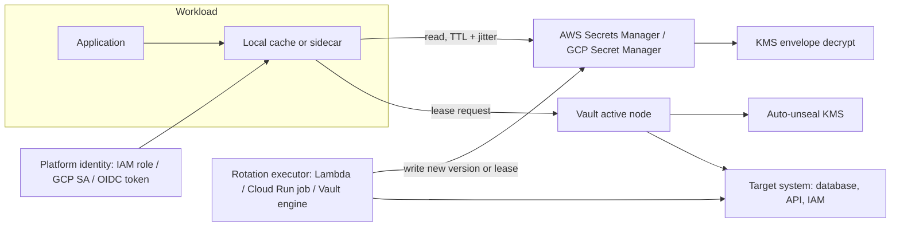

# Secrets Management and Dynamic Credentials

## TL;DR

A secret store is a versioned, encrypted, access-controlled key-value service. The hard part is the credential lifecycle around it: how long the old and new credential are both valid (the overlap window), and how long clients cache (the cache TTL).
Rotation is safe only when cache TTL plus propagation lag is smaller than the overlap window. Single-user rotation has an overlap window near zero, alternating-user rotation has one full rotation interval, and a Vault lease has its TTL.
AWS Secrets Manager runs rotation as a Lambda-driven four-step state machine journaled in version staging labels (`AWSPENDING`, `AWSCURRENT`, `AWSPREVIOUS`). GCP Secret Manager only emits a Pub/Sub notification, so you build and own the executor.
Vault turns credentials into leases. Live leases equal creation rate times TTL (Little's law), every lease is a replicated write on the active node, and lease count, not request rate, is what breaks Vault.
Dynamic credentials do not remove the secret-zero problem. They move it to platform identity (see [[17-Cloud-AI-Engineering/Volume_08_Security_Identity_and_the_Data_Perimeter/Chapter_02_Workload_Identity_Federation|Workload Identity Federation]]), and every fetch is a runtime dependency on a regional control surface that you must cache and jitter around.

## Mental Model



Reads and rotation are separate planes. The read path is a hot data plane: an authenticated, cached, jittered fetch of an immutable version.
The rotation path is a slow control plane: a state machine that mutates a downstream system and then flips a pointer (a label, an alias, or a lease) that the read path resolves.
The pointer flip is what clients observe, and the downstream mutation is what can lock them out. Every design question in this chapter is about the gap between those two events.
The cache sits in the workload on purpose. It is the only component that keeps working when the secret service, its KMS dependency, or the identity provider is degraded (see [[17-Cloud-AI-Engineering/Volume_01_Cloud_Architecture_Principles/Chapter_04_Control_Plane_vs_Data_Plane_Separation|Control Plane vs Data Plane Separation]]).

## Internals

### Object model and storage

AWS Secrets Manager stores a secret as a container for a set of versions.
Each version holds an encrypted payload of up to 65,536 bytes and zero or more staging labels (AWS docs, as of 2026-10).
Labels are mutable pointers over immutable versions, and two versions cannot carry the same label. A version can carry several labels, up to 20 labels across all versions of a secret (AWS docs, as of 2026-10).
Secrets Manager never removes labeled versions. It treats unlabeled versions as deprecated and removes them once there are more than 100, but never one created less than 24 hours ago (AWS docs, as of 2026-10).
Payloads are envelope-encrypted under a KMS key you choose, with the AWS managed key as the default.
KMS is called on your behalf, and the decrypt shows up in CloudTrail with the secret ARN and version ID as encryption context (from memory, UNVERIFIED).
The consequence is that secret read availability is the product of Secrets Manager availability and KMS availability. Key policy errors surface as secret read failures (see [[17-Cloud-AI-Engineering/Volume_08_Security_Identity_and_the_Data_Perimeter/Chapter_04_Encryption_Key_Hierarchies_and_Envelope_Encryption|Encryption Key Hierarchies and Envelope Encryption]]).

GCP Secret Manager uses the same shape with different words.
A secret is a container with a replication policy. Versions are numbered, immutable, and have states (enabled, disabled, destroyed). `latest` is an alias resolved at access time (from memory, UNVERIFIED).
The consequence of integer versions plus an alias is that "which version does my client hold" is a property of when the client resolved the alias, not of when the secret rotated.

### AWS rotation as a journaled state machine

`RotateSecret` invokes your Lambda once per step, with an event carrying `SecretId`, `ClientRequestToken`, and `Step`. The token is the version ID of the in-flight attempt.
The four steps are `createSecret`, `setSecret`, `testSecret`, `finishSecret` (AWS docs, as of 2026-10).
The staging labels are the durable journal. `AWSPENDING` marks a candidate not yet trusted, `AWSCURRENT` marks what readers get by default, and `AWSPREVIOUS` marks the last good value kept for rollback (AWS docs, as of 2026-10).
Three properties make this robust, and none of them appear in getting-started guides.

1. Idempotency is carried by the token. `PutSecretValue` with the same `ClientRequestToken` and the same payload is a no-op, and with a different payload it is rejected (from memory, UNVERIFIED). A retried `createSecret` therefore cannot mint two candidates.
2. The handler must treat label state as the source of truth. The AWS template checks that rotation is enabled, that the token has a stage, and that it is staged `AWSPENDING`, and it returns early if the token is already `AWSCURRENT`. Without that last check a retry of `finishSecret` after a success would raise and leave the schedule in a failed state.
3. A crash between a side effect at the target and the journal write leaves an orphan at the target. The target is the part the journal cannot see. Your `createSecret` or `setSecret` must be able to find and reclaim orphans, because the label journal has no record of them.

The two rotation strategies differ only in what `setSecret` mutates.
Single-user rotation changes the password of the same database user the secret names. In the interval between `setSecret` (the database now rejects the old password) and `finishSecret` (readers get the new one), every new connection using the cached `AWSCURRENT` fails. Secrets Manager's own documentation of the strategy admits the window is small but non-zero (AWS Security Blog and Secrets Manager docs, as of 2026-10).
Alternating-users rotation maintains two database users in one secret. During the first rotation the function clones the first user to create the second (AWS docs, as of 2026-10).
Each rotation changes only the user that is not currently served, so the user clients hold stays valid for a full rotation interval. The overlap window equals the rotation interval.
The cost is that the clone copies grants at clone time. A privilege change you apply later to user A silently does not exist on user B, and the failure appears at the next flip as a permissions error, not an authentication error.

Rotation functions are templates for RDS and Aurora, plus a generic template for anything else (AWS docs, as of 2026-10).
For secrets that are third-party API keys, the AWS guidance is that `testSecret` verifies the pending key against the provider, and that `finishSecret` moves the labels and optionally deletes the old key (AWS docs, as of 2026-10).

### The overlap window inequality

Define these quantities.
- `W` is the time the superseded credential stays valid after the pointer flip.
- `C` is the worst-case client cache TTL, including jitter.
- `P` is the lag from pointer flip to a read observing it.
- `R` is the time a long-lived resource (a connection pool, a signed URL, a streaming session) keeps using the credential it authenticated with.

Rotation is invisible to clients if `C + P < W`, and long-lived resources also need `R < W` or a reconnect path.
Single-user rotation has `W` near zero, so it is correct only for clients that fetch on every connection and retry on auth failure.
Alternating-user rotation has `W` equal to the rotation interval, which dominates any sane `C`.
A Vault lease has `W` equal to the remaining lease TTL when the lease is not revoked, and zero if it is revoked on rotation. Revocation is a policy choice, and it is the reason Vault clients must renew or re-request before expiry, not after.
The client-side fallback that closes the gap when `W` is short is: on an authentication error, invalidate the cache, re-read once (optionally with `AWSPREVIOUS`), and retry with jittered backoff (see [[17-Cloud-AI-Engineering/Volume_07_Reliability_and_SRE/Chapter_03_Resilient_Communication_Retries_Jitter_and_Circuit_Breakers|Resilient Communication: Retries, Jitter, and Circuit Breakers]]).

### GCP: notification, not execution

GCP Secret Manager rotation is a schedule on the secret (a rotation period and a next rotation time) plus Pub/Sub topics. When the time arrives the service publishes a notification and advances the schedule. It does not generate or apply a new credential (from memory, UNVERIFIED).
Pub/Sub delivery is at-least-once, so the executor must be idempotent. A reliable key is "does a version newer than the rotation boundary already exist".
The Secret Manager service agent needs publish rights on the topic, or the notifications silently never arrive. Monitor the absence of rotation events, not only their failure.
The consequence is that GCP gives you the scheduling and eventing, and you own the journal, the orphan reclamation, and the test step.
There is no label journal, so the equivalent of `AWSPENDING` must be modeled, for example as a disabled version that you enable only after testing (UNVERIFIED as a pattern recommendation, mechanism from memory).

Alias resolution is the GCP trap. A `latest` reference consumed as an environment variable is resolved once at instance start, so a rotated value is not seen until the instance is replaced. A volume mount can observe newer values on read (Cloud Run behavior from memory, UNVERIFIED, verify against current Cloud Run docs).

### Vault: leases, the expiration manager, and the write path

Vault's storage is encrypted by a barrier key. The barrier key is protected by a root key, which is protected either by Shamir-split unseal keys (Shamir, "How to Share a Secret", CACM 1979) or by an auto-unseal wrapper in a cloud KMS.
Auto-unseal creates a startup dependency on regional KMS. A running cluster is unaffected by a KMS outage, but a restart during one cannot unseal. This is a static stability question, so keep unseal KMS in the same failure domain assumptions as the cluster (see [[17-Cloud-AI-Engineering/Volume_01_Cloud_Architecture_Principles/Chapter_02_Regions_Zones_and_Static_Stability|Regions, Zones, and Static Stability]]).
Integrated storage uses Raft (Ongaro and Ousterhout, USENIX ATC 2014; see [[08-Distinguished-Engineering/02-Distributed-Systems-Internals/Raft-Consensus|Raft-Consensus]]). Every write commits through a leader and a quorum fsync.

A dynamic secret read, for example `database/creds/app`, is semantically a write.
The engine runs `creation_statements` against the target, and Vault writes a lease record to storage and registers it with the expiration manager (mechanism from memory, UNVERIFIED in detail).
The expiration manager keeps in-memory timers for every lease. After a restart or leadership change it rebuilds them by scanning lease records, so recovery time scales with lease count (from memory, UNVERIFIED).
At expiry or revocation it calls the engine's revoke handler, for example `DROP ROLE`. Failures retry with backoff, and a lease that keeps failing is marked irrevocable and stays in storage until an operator force-revokes it (from memory, UNVERIFIED).

Three consequences matter in capacity planning.
1. Live leases follow Little's law: `L = lambda * W`, where `lambda` is the creation rate and `W` is the TTL (Little, Operations Research, 1961). A batch fleet starting 50 jobs per second with a 15-minute lease holds 45,000 live leases.
2. Standby nodes forward writes to the active node, so dynamic secret issuance is bound by one node's commit path regardless of cluster size. Performance standbys help reads, and lease-creating reads are writes (from memory, UNVERIFIED for current OSS and Enterprise behavior).
3. Revocation is a second load, correlated in time. Leases created in a deploy wave expire in the same minute, so the target database sees a burst of `DROP ROLE` exactly when the next wave is being created. Jitter TTLs, or stagger deploys.

The target database is the other half of the cost. Each Vault-created PostgreSQL role is a row in shared catalogs, and high churn produces catalog bloat and lock contention in `CREATE ROLE` and `DROP ROLE`. Measure role churn per hour on the database, not only Vault throughput (engineering inference, UNVERIFIED as a measured number).

### Dynamic credential taxonomy

| Class | Mechanism | Revocable before expiry | Typical blast radius |
|---|---|---|---|
| Cloud-native short-lived | AWS STS sessions, GCP IAM Credentials API tokens | Not individually; AWS supports denying by token issue time through a policy | Role or service account scope |
| Static secret with rotation | Secrets Manager or Secret Manager plus executor | Yes, by rotating | One credential, plus cache window |
| Vault dynamic | Vault engine creates a user or key per lease | Yes, by revoking the lease | One lease |

For AWS STS the revocation story is a deny policy conditioned on `aws:TokenIssueTime`, which is how the IAM console "revoke active sessions" action works (from memory, UNVERIFIED). It revokes every session of the role issued before a time, not one session.
This is why per-workload roles beat shared roles for incident response.

### Delivery paths and their trade-offs

| Path | Freshness | Failure mode |
|---|---|---|
| SDK call with in-process cache | TTL-bound | Cold-start burst on the secret API, plus a hard dependency at boot |
| Env var injected at start | Fixed for process life | Rotation needs a restart, and env is visible in crash dumps and to child processes |
| Mounted file via CSI driver or agent | Poll interval | Mount refresh lag, and the app must re-read the file |
| Local sidecar or agent | Agent-managed | Another process to run, but it centralizes cache, retry, and renewal |

For Kubernetes see [[04-System-Design/07-Infrastructure-and-Orchestration/Kubernetes-Architecture|Kubernetes-Architecture]]. Kubernetes `Secret` objects are base64 in etcd, and envelope encryption in the API server must be enabled separately.

## Numbers to Know

| Quantity | Value | Source |
|---|---|---|
| Secrets Manager `GetSecretValue` rate | 10,000 requests per second per Region | AWS What's New, 2025-03 (as of 2026-10) |
| Secrets Manager `DescribeSecret` rate | 40,000 requests per second per Region | AWS What's New, 2025-03 (as of 2026-10) |
| `BatchGetSecretValue` rate | 100 requests per second | AWS quotas, via third-party mirror (as of 2026-10) |
| Combined `PutSecretValue`, `UpdateSecret`, `UpdateSecretVersionStage` and replication calls | 50 per second per Region | AWS quotas (as of 2026-10) |
| Max secret payload | 65,536 bytes | AWS quotas (as of 2026-10) |
| Secrets per Region per account | 500,000 | AWS quotas (as of 2026-10) |
| Staging labels across all versions of one secret | 20 | AWS quotas (as of 2026-10) |
| Unlabeled version cleanup | Removed when more than 100, never if under 24 hours old | AWS quotas (as of 2026-10) |
| Update cadence that outruns cleanup | More often than once per 10 minutes | AWS quotas (as of 2026-10) |
| Secrets Manager price | $0.40 per secret per month (prorated hourly), $0.05 per 10,000 API calls | AWS pricing page as reported by secondary sources (as of 2026-10) |
| Secrets Manager secret deletion recovery window | 7 to 30 days, default 30 | UNVERIFIED, from memory |
| IAM access keys per user | 2 | UNVERIFIED, from memory |
| GCP Secret Manager payload limit | 64 KiB | UNVERIFIED, from memory |
| GCP Secret Manager access quota | 90,000 access requests per minute per project | UNVERIFIED, from memory |
| GCP Secret Manager price | $0.06 per active version per location per month, $0.03 per 10,000 access operations | UNVERIFIED, from memory |
| GCP Secret Manager minimum rotation period | 1 hour | UNVERIFIED, from memory |
| Vault default lease TTL | 32 days (768h) | UNVERIFIED, from memory |
| Vault license | Business Source License since August 2023; HashiCorp acquired by IBM, closed early 2025 | UNVERIFIED, from memory |
| Derived: 4,000 pods, 3 secrets each, 5 minute TTL | 40 requests per second, about 103.7M calls and $518 per 30 days | Computed below |
| Derived: same fleet, 1 hour TTL | 3.3 requests per second, about 8.6M calls and $43 per 30 days | Computed below |

## AWS vs GCP Mechanism Parity

| Dimension | AWS Secrets Manager | GCP Secret Manager |
|---|---|---|
| Version model | Immutable versions, mutable staging labels, `AWSCURRENT` default | Immutable numbered versions with states, `latest` alias (UNVERIFIED) |
| Rotation executor | Managed schedule invokes your Lambda per step; RDS and Aurora templates provided | Schedule plus Pub/Sub notification only; you build the executor (UNVERIFIED) |
| Rotation journal | Labels `AWSPENDING`, `AWSCURRENT`, `AWSPREVIOUS` | None; model pending state yourself (for example a disabled version) |
| Idempotency primitive | `ClientRequestToken` equals version ID | Your own key; Pub/Sub is at-least-once |
| Read throughput | 10,000 rps `GetSecretValue` per Region (AWS, as of 2026-10) | 90,000 per minute per project, about 1,500 rps (UNVERIFIED) |
| Replication | Replicas in other Regions with per-Region KMS key; rotation happens in the primary (UNVERIFIED in detail) | Automatic or user-managed replication policy, plus regional secrets (UNVERIFIED) |
| Encryption | KMS, default AWS managed key; customer managed key required to share cross-account (UNVERIFIED) | Google-managed default, CMEK optional (UNVERIFIED) |
| Access control | Identity policy plus resource policy plus KMS key policy; `secretsmanager:VersionStage` condition key | IAM role `secretmanager.secretAccessor` plus IAM Conditions; grant per secret, not per project |
| Private path | Interface VPC endpoint with endpoint policy | Private Service Connect or Private Google Access, plus VPC Service Controls perimeter |
| Short-lived alternative | STS sessions, minimum 900 seconds (UNVERIFIED) | IAM Credentials API access tokens, default 1 hour (UNVERIFIED) |
| Delete semantics | Scheduled deletion with recovery window; name stays reserved during it (UNVERIFIED) | Version destroy, optionally delayed (UNVERIFIED) |
| Audit | CloudTrail management events for reads and writes | Admin Activity logs; secret access is a Data Access log that must be enabled (UNVERIFIED) |

| Dimension | Native stores | HashiCorp Vault |
|---|---|---|
| Unit of issuance | A stored static value, rotated | A lease on a generated credential |
| Revoke granularity | Rotate the whole secret | Revoke one lease |
| Failure domain | Regional managed service | Your cluster, your Raft quorum, your unseal KMS |
| Scaling limit | API rate and KMS | Live lease count and active-node write commits |
| Operational cost | Near zero | Upgrades, backup of Raft snapshots, seal and DR design |
| Licensing and fork risk | Not applicable | BUSL; community fork OpenBao exists (UNVERIFIED) |

## Worked Example: IAM access key rotation with a two-slot Lambda

This lab rotates the access key of a legacy integration IAM user.
IAM allows two active keys per user (UNVERIFIED), which is the alternating-users strategy for free. The new key is created while the old one stays valid, and the old key is deleted only at the next rotation, so the overlap window equals the rotation interval.
The seed secret holds an empty placeholder so that no key material enters Terraform state.

### Cost estimate and guardrails

- One secret: $0.40 per month, prorated hourly (AWS pricing page via secondary sources, as of 2026-10). A lab of a few hours costs about $0.01.
- API calls: under 100 for the lab, about $0.0005 at $0.05 per 10,000.
- Lambda: well inside any free allowance for a handful of invocations (UNVERIFIED).
- The budget below alarms at 80 percent of $5.

### `main.tf`

```hcl
terraform {
  required_version = ">= 1.6"
  required_providers {
    aws     = { source = "hashicorp/aws", version = "~> 5.0" }
    archive = { source = "hashicorp/archive", version = "~> 2.4" }
  }
}

variable "region" {
  type    = string
  default = "us-east-1"
}

variable "alert_email" {
  type = string
}

provider "aws" {
  region = var.region
}

data "aws_caller_identity" "me" {}

resource "aws_iam_user" "svc" {
  name          = "lab-legacy-integration"
  force_destroy = true
}

resource "aws_secretsmanager_secret" "key" {
  name                    = "lab/legacy-integration/access-key"
  recovery_window_in_days = 0
}

resource "aws_secretsmanager_secret_version" "seed" {
  secret_id = aws_secretsmanager_secret.key.id
  secret_string = jsonencode({
    user              = aws_iam_user.svc.name
    access_key_id     = ""
    secret_access_key = ""
  })
  lifecycle {
    ignore_changes = [secret_string, version_stages]
  }
}

data "aws_iam_policy_document" "assume" {
  statement {
    actions = ["sts:AssumeRole"]
    principals {
      type        = "Service"
      identifiers = ["lambda.amazonaws.com"]
    }
  }
}

resource "aws_iam_role" "rot" {
  name               = "lab-key-rotator"
  assume_role_policy = data.aws_iam_policy_document.assume.json
}

data "aws_iam_policy_document" "rot" {
  statement {
    actions = [
      "secretsmanager:DescribeSecret",
      "secretsmanager:GetSecretValue",
      "secretsmanager:PutSecretValue",
      "secretsmanager:UpdateSecretVersionStage",
    ]
    resources = [aws_secretsmanager_secret.key.arn]
  }
  statement {
    actions   = ["iam:ListAccessKeys", "iam:CreateAccessKey", "iam:DeleteAccessKey"]
    resources = [aws_iam_user.svc.arn]
  }
}

resource "aws_iam_role_policy" "rot" {
  role   = aws_iam_role.rot.id
  policy = data.aws_iam_policy_document.rot.json
}

resource "aws_iam_role_policy_attachment" "logs" {
  role       = aws_iam_role.rot.name
  policy_arn = "arn:aws:iam::aws:policy/service-role/AWSLambdaBasicExecutionRole"
}

data "archive_file" "zip" {
  type        = "zip"
  source_file = "${path.module}/rotation.py"
  output_path = "${path.module}/rotation.zip"
}

resource "aws_lambda_function" "rot" {
  function_name    = "lab-key-rotator"
  role             = aws_iam_role.rot.arn
  runtime          = "python3.12"
  handler          = "rotation.handler"
  filename         = data.archive_file.zip.output_path
  source_code_hash = data.archive_file.zip.output_base64sha256
  timeout          = 90
}

resource "aws_lambda_permission" "sm" {
  statement_id   = "AllowSecretsManagerInvoke"
  action         = "lambda:InvokeFunction"
  function_name  = aws_lambda_function.rot.function_name
  principal      = "secretsmanager.amazonaws.com"
  source_account = data.aws_caller_identity.me.account_id
}

resource "aws_secretsmanager_secret_rotation" "key" {
  secret_id           = aws_secretsmanager_secret.key.id
  rotation_lambda_arn = aws_lambda_function.rot.arn
  rotation_rules {
    automatically_after_days = 30
  }
  depends_on = [aws_lambda_permission.sm, aws_secretsmanager_secret_version.seed]
}

resource "aws_budgets_budget" "lab" {
  name         = "lab-secrets-rotation"
  budget_type  = "COST"
  limit_amount = "5"
  limit_unit   = "USD"
  time_unit    = "MONTHLY"
  notification {
    comparison_operator        = "GREATER_THAN"
    threshold                  = 80
    threshold_type             = "PERCENTAGE"
    notification_type          = "ACTUAL"
    subscriber_email_addresses = [var.alert_email]
  }
}
```

### `rotation.py`

```python
import json
import logging
import time

import boto3
from botocore.exceptions import ClientError

log = logging.getLogger()
log.setLevel(logging.INFO)
sm = boto3.client("secretsmanager")
iam = boto3.client("iam")


def get_value(arn, stage, token=None):
    kw = {"SecretId": arn, "VersionStage": stage}
    if token:
        kw["VersionId"] = token
    return json.loads(sm.get_secret_value(**kw)["SecretString"])


def handler(event, context):
    arn, token, step = event["SecretId"], event["ClientRequestToken"], event["Step"]
    meta = sm.describe_secret(SecretId=arn)
    if not meta.get("RotationEnabled"):
        raise ValueError("rotation is not enabled for %s" % arn)
    stages = meta["VersionIdsToStages"]
    if token not in stages:
        raise ValueError("version %s has no stage for rotation" % token)
    if "AWSCURRENT" in stages[token]:
        log.info("version %s already current; nothing to do", token)
        return
    if "AWSPENDING" not in stages[token]:
        raise ValueError("version %s is not staged AWSPENDING" % token)
    steps = {
        "createSecret": create_secret,
        "setSecret": set_secret,
        "testSecret": test_secret,
        "finishSecret": finish_secret,
    }
    steps[step](arn, token)


def create_secret(arn, token):
    current = get_value(arn, "AWSCURRENT")
    try:
        sm.get_secret_value(SecretId=arn, VersionId=token, VersionStage="AWSPENDING")
        return  # candidate already journaled by an earlier attempt
    except ClientError as e:
        if e.response["Error"]["Code"] != "ResourceNotFoundException":
            raise
    user = current["user"]
    # Reclaim orphans and the superseded slot: anything that is not the current key.
    for k in iam.list_access_keys(UserName=user)["AccessKeyMetadata"]:
        if k["AccessKeyId"] != current.get("access_key_id"):
            iam.delete_access_key(UserName=user, AccessKeyId=k["AccessKeyId"])
    new = iam.create_access_key(UserName=user)["AccessKey"]
    sm.put_secret_value(
        SecretId=arn,
        ClientRequestToken=token,
        SecretString=json.dumps({
            "user": user,
            "access_key_id": new["AccessKeyId"],
            "secret_access_key": new["SecretAccessKey"],
        }),
        VersionStages=["AWSPENDING"],
    )


def set_secret(arn, token):
    # The key is already live at IAM; the old key stays valid until the next rotation.
    return


def test_secret(arn, token):
    pending = get_value(arn, "AWSPENDING", token)
    sts = boto3.client(
        "sts",
        aws_access_key_id=pending["access_key_id"],
        aws_secret_access_key=pending["secret_access_key"],
    )
    for attempt in range(6):  # new IAM keys can take seconds to propagate
        try:
            sts.get_caller_identity()
            return
        except ClientError:
            time.sleep(min(2 ** attempt, 16))
    raise RuntimeError("pending key never became usable")


def finish_secret(arn, token):
    meta = sm.describe_secret(SecretId=arn)
    current = next(v for v, s in meta["VersionIdsToStages"].items() if "AWSCURRENT" in s)
    if current == token:
        return
    sm.update_secret_version_stage(
        SecretId=arn,
        VersionStage="AWSCURRENT",
        MoveToVersionId=token,
        RemoveFromVersionId=current,
    )
    try:
        sm.update_secret_version_stage(
            SecretId=arn, VersionStage="AWSPENDING", RemoveFromVersionId=token
        )
    except ClientError:
        pass  # already removed by the service
```

### Run and observe

```bash
terraform init && terraform apply -var alert_email=you@example.com
SID=lab/legacy-integration/access-key
for i in 1 2 3; do
  aws secretsmanager rotate-secret --secret-id "$SID"
  sleep 45
  aws secretsmanager describe-secret --secret-id "$SID" --query VersionIdsToStages
  aws iam list-access-keys --user-name lab-legacy-integration --query 'AccessKeyMetadata[].AccessKeyId'
done
```

Expected behavior: after rotation 1 there is one key, after rotation 2 there are two keys and the older one is `AWSPREVIOUS`, and after rotation 3 the first key is deleted inside `createSecret` before the third is created. At no point is the key a client got from `AWSCURRENT` invalid before the next rotation.
The rotation after `rotate-secret` can take longer than 45 seconds when `testSecret` retries, so re-run the `describe-secret` if labels have not moved.

### Capacity and cost arithmetic for a fleet reading this secret

Assume 4,000 pods (for example inference replicas that need a provider key) each reading 3 secrets.

1. Steady state with a 5 minute cache TTL: `4,000 * 3 / 300 s = 40 requests per second`.
2. Monthly calls: `40 * 2,592,000 s = 103,680,000`, which is `10,368` blocks of 10,000, or `10,368 * $0.05 = $518.40` (AWS pricing as reported, as of 2026-10).
3. With a 1 hour TTL: `12,000 / 3,600 = 3.33 requests per second`, `8,640,000` calls, `$43.20`.
4. Cold-start burst: all 4,000 pods restart within 30 seconds, `12,000 / 30 = 400 requests per second`, which is 4 percent of the 10,000 rps quota (AWS, as of 2026-10). The quota is not the constraint, the shared KMS and the identity token endpoint behind it usually are.
5. Stored secret cost for 300 secrets: `300 * $0.40 = $120` per month. Packing related values into one JSON secret under 65,536 bytes cuts that line item without touching the read bill.
6. Vault comparison for the same fleet: one database credential per pod with a 1 hour TTL renewed at half TTL gives `L = 4,000` live leases, about `4,000 * 3 / 3,600 = 3.3` lease writes per second at steady state, and a 60 second deploy wave produces about 67 creates per second plus a matching revoke wave an hour later. Size the target database for that role churn.

### GCP counterpart (notification only)

```bash
PROJECT=my-project
gcloud pubsub topics create secret-rotation --project=$PROJECT
gcloud secrets create lab-api-key --replication-policy=automatic \
  --topics=projects/$PROJECT/topics/secret-rotation \
  --rotation-period=2592000s \
  --next-rotation-time=2026-11-21T00:00:00Z --project=$PROJECT
# The Secret Manager service agent must be able to publish to the topic.
PN=$(gcloud projects describe $PROJECT --format='value(projectNumber)')
gcloud pubsub topics add-iam-policy-binding secret-rotation \
  --member=serviceAccount:service-$PN@gcp-sa-secretmanager.iam.gserviceaccount.com \
  --role=roles/pubsub.publisher --project=$PROJECT
# Teardown
gcloud secrets delete lab-api-key --quiet --project=$PROJECT
gcloud pubsub topics delete secret-rotation --quiet --project=$PROJECT
```

Flag names and the service agent name come from memory and are listed as UNVERIFIED; check `gcloud secrets create --help` before use.
The Pub/Sub consumer must dedupe because delivery is at-least-once.

```python
from datetime import datetime, timedelta, timezone
from google.cloud import secretmanager

def rotate(secret_name, new_value_bytes):
    c = secretmanager.SecretManagerServiceClient()
    cutoff = datetime.now(timezone.utc) - timedelta(minutes=10)
    for v in c.list_secret_versions(request={"parent": secret_name}):
        if v.create_time >= cutoff:
            return  # a duplicate notification; a fresh version already exists
    c.add_secret_version(request={"parent": secret_name,
                                  "payload": {"data": new_value_bytes}})
```

### Teardown

```bash
terraform destroy -auto-approve -var alert_email=you@example.com
aws secretsmanager list-secrets --filters Key=name,Values=lab/ --query 'SecretList[].Name'
aws iam list-users --query "Users[?UserName=='lab-legacy-integration']"
```

`recovery_window_in_days = 0` makes destroy delete immediately, and `force_destroy = true` removes the access keys the Lambda created outside Terraform state.
Both list commands should return empty.

## Failure Modes and Pitfalls

### Single-user rotation lockout and pool poisoning

Mechanism: `setSecret` changes the live password, but the label flips only at `finishSecret`. New connections built from the cached `AWSCURRENT` fail until the cache refreshes (`W` near zero).
Pools make it worse, because an application that cached a connection string at startup keeps producing failures until restart.
Mitigation: alternating-users rotation, fetch-per-connect with retry on authentication error, and a cache TTL shorter than the interval between rotation and the next client refresh.

### Orphans at the target

A rotation Lambda that creates a key or a user and then times out leaves state at the target that the label journal does not record. The IAM two-key limit turns this into a hard stop: with two keys already present, the next `CreateAccessKey` fails and every later rotation fails with it. The lab code reclaims orphans at the top of `createSecret` for this reason.

### Version churn and cost

Updating a secret more often than every 10 minutes creates versions faster than cleanup removes them, because cleanup only removes unlabeled versions beyond 100 and never under 24 hours old (AWS docs, as of 2026-10).
Custom labels stop cleanup entirely, since labeled versions are never removed (AWS docs, as of 2026-10), so a deploy pipeline that labels every release leaks versions.

### Reachability of the rotation function

A Lambda placed in a VPC to reach a private database has no route to the Secrets Manager API unless there is an interface endpoint or NAT. Every step then times out and the secret shows rotation failures with no database error.
Put the function in the same VPC as the database and add a Secrets Manager interface endpoint with a policy restricting the secret ARNs.

### Cross-account and key policy

A secret encrypted with the AWS managed key cannot be read by another account, because that key's policy cannot be changed (from memory, UNVERIFIED). Use a customer managed key for any secret shared across accounts.
Deleting or disabling the KMS key makes every secret under it unreadable, with an error that looks like an application outage.

### Names stay reserved after delete

Without `recovery_window_in_days = 0`, a Terraform destroy followed by apply collides with the scheduled-deletion name and fails (from memory, UNVERIFIED).

### Thundering herd at boot

A fleet restart makes every instance read every secret at the same time. Without jittered retries the throttling responses synchronize the retries. Add full jitter and a per-process cache, and bound the boot dependency with a stale-on-error local copy (see [[17-Cloud-AI-Engineering/Volume_01_Cloud_Architecture_Principles/Chapter_05_Constant_Work_and_Workload_Smoothing|Constant Work and Workload Smoothing]]).
GPU fleets amplify this: 2,000 nodes starting a training job simultaneously each fetch registry, tracker, and dataset credentials in the same second.

### `latest` resolved too early

On GCP, a `latest` alias consumed as an environment variable never changes for the life of the process. The rotation succeeds, the old version is later disabled by policy, and the application fails hours later at its first reconnect.

### Pub/Sub duplicates and silent no-delivery

At-least-once rotation events cause double rotation if the executor is not idempotent. A missing publisher grant causes zero events, which looks like a healthy quiet system until the credential expires.

### Vault lease explosion and irrevocable leases

Dynamic secrets with short TTLs and high creation rates drive live lease count up, slowing restarts and leadership changes (lease restore scales with count). Failed revocations accumulate as irrevocable leases and keep real accounts alive at the target (from memory, UNVERIFIED).
Watch lease count and irrevocable lease count, and alert on both.

### Vault dependency circles

If Vault's own database credentials, TLS certificates, or unseal key come from a service that itself needs Vault, a full outage becomes unrecoverable without a break-glass path. Keep a documented, tested out-of-band bootstrap.

### Public incidents

- The Codecov bash uploader compromise (2021) exfiltrated environment variables from customer CI, which shows why long-lived secrets in env vars have a blast radius equal to every build that ran. Codecov's own postmortem describes it (reference by name; URL not verified).
- The CircleCI incident of December 2022 to January 2023 led the vendor to tell customers to rotate every secret stored in the platform. The lesson is that rotation tooling and revocation drills are worth building before the incident, because the recovery cost scales with secret count (reference by name; URL not verified).
- The AWS us-east-1 event of 2025-10-19 and 2025-10-20 (DynamoDB DNS) showed that a regional control surface failure propagates to every service that resolves credentials or configuration at start. Whether Secrets Manager reads were among the impacted operations is UNVERIFIED, but the design lesson holds: processes that need a secret at boot should hold a stale-on-error local copy (see [[17-Cloud-AI-Engineering/Volume_07_Reliability_and_SRE/Chapter_07_Anatomy_of_Major_Cloud_Outages|Anatomy of Major Cloud Outages]]).

## Security and Cost Angles

### IAM scoping

- Grant read access per secret ARN, never `secretsmanager:*` on `*`. On GCP bind `roles/secretmanager.secretAccessor` on the individual secret, not the project.
- Restrict labels with the `secretsmanager:VersionStage` condition key, so a consumer can read `AWSCURRENT` but not `AWSPENDING` (AWS docs, as of 2026-10).
- Separate three identities: the consumer (read `AWSCURRENT`), the rotator (describe, get, put, update stage on one secret plus the minimum target-system actions), and the administrator (create, delete, change resource policy).
- Use a resource policy with `aws:PrincipalOrgID` and `aws:SourceVpce` so a stolen credential used outside the VPC endpoint is denied, and an endpoint policy to bound which secrets the VPC can read.

### Key hierarchy

Secret payloads are data keys wrapped by a KMS key (see [[17-Cloud-AI-Engineering/Volume_08_Security_Identity_and_the_Data_Perimeter/Chapter_04_Encryption_Key_Hierarchies_and_Envelope_Encryption|Encryption Key Hierarchies and Envelope Encryption]]).
Use one customer managed key per sensitivity class and not per secret, since KMS request rates and per-key policies are the real constraints. Scope `kms:Decrypt` with `kms:ViaService` and the encryption context so the key is usable only through the secret service.
For Vault, the auto-unseal key is the root of trust for the whole cluster. Give it a key policy that allows only the Vault node role, and alarm on any other principal using it.

### Network boundaries

- AWS: interface VPC endpoint for Secrets Manager with an endpoint policy, plus the data perimeter conditions described in [[17-Cloud-AI-Engineering/Volume_08_Security_Identity_and_the_Data_Perimeter/Chapter_06_Constructing_an_Impenetrable_Data_Perimeter|Constructing an Impenetrable Data Perimeter]].
- GCP: put `secretmanager.googleapis.com` inside a VPC Service Controls perimeter, with ingress and egress rules only for the CI identities that need them (see [[17-Cloud-AI-Engineering/Volume_03_GCP_Deep_Dive/Chapter_03_VPC_Service_Controls_Security_Perimeters|VPC Service Controls: Security Perimeters]]).

### Prefer no secret at all

The cheapest secret is the one that does not exist. Use roles, workload identity, and short-lived tokens first (see [[17-Cloud-AI-Engineering/Volume_08_Security_Identity_and_the_Data_Perimeter/Chapter_02_Workload_Identity_Federation|Workload Identity Federation]]).
Reserve stored secrets for third-party credentials that cannot federate, such as external model provider API keys, SaaS tokens, and legacy databases.
For AI agents, give each tool call the narrowest credential available, because a prompt-injected agent can read its own environment. Do not put long-lived provider keys in the environment of any process that executes model-generated code (see [[17-Cloud-AI-Engineering/Volume_12_AI_Applications_MLOps_and_Data_Platforms/Chapter_08_Cloud_Security_for_AI_Systems_Attacks_and_Defenses|Cloud Security for AI Systems: Attacks and Defenses]]).

### Detection

Alert on reads of `AWSPREVIOUS`, on reads from principals not seen in 30 days, on rotation failure, and on rotation silence (no rotation event within 1.5 times the interval).
On GCP, secret access is a Data Access audit log and is not on by default (UNVERIFIED), so enable it for the secret service in production projects.

### Unit economics levers

1. Raise cache TTL: it cut the example fleet's read bill from $518 to $43 per month, a 12x reduction.
2. Pack related values into one JSON secret under 65,536 bytes to reduce the per-secret charge.
3. Use SSM Parameter Store for non-rotating configuration, since it has a standard tier priced differently (AWS docs, as of 2026-10; confirm current pricing).
4. Do not run Vault for fewer than a handful of credential classes. A 3 to 5 node Raft cluster, snapshots, upgrades, and an on-call rotation cost more than tens of thousands of secrets at $0.40.
5. On GCP, destroy old versions, since active versions are billed per location (UNVERIFIED).

## Interview Questions and Model Answers

### Question 1 (L5 - Senior)

Your service on EKS reads a database password from Secrets Manager. The security team enables 30-day single-user rotation, and the next rotation causes five minutes of authentication errors. Explain the cause and fix it.

#### Model Answer

The cause is the overlap window. In single-user rotation, `setSecret` changes the database password in place, and `finishSecret` flips `AWSCURRENT` afterwards, so any client that still holds the old value is rejected from the moment the database changes. Clients with a cache TTL of `C` see failures for up to `C + P`, where `P` is the lag between the flip and a read observing it.
Connection pools extend this, because a pool that built its connection string at startup keeps retrying the old password until restart.
The fix has three layers.
1. Switch to alternating-users rotation, so the user clients hold stays valid for a full interval (`W` equals the interval) and the database mutation never touches the served user.
2. Make clients tolerant: on an authentication error, invalidate the cache, re-read once, and retry with jittered backoff, and build pool connections from a credential provider instead of a startup string.
3. Cap the cache TTL well below the rotation interval so a stale value cannot outlive the overlap.
The trade-off of alternating users is the clone: the second user is created by copying grants at clone time, so privilege changes made later to one user are not reflected on the other.
Add a post-rotation check that compares grants on both users.

#### Follow-up Interviewer Question

Alternating-user rotation needs a master credential to create and alter the second user. Where does that credential live, who can read it, and how do you prevent the rotator from becoming the most valuable target in the account?

### Question 2 (L5 - Senior)

When would you choose a mounted secret file over an environment variable, and over a direct SDK call?

#### Model Answer

Environment variables are fixed for the life of the process, appear in crash dumps and `/proc`, and leak to child processes. They fit only credentials whose rotation always coincides with a restart.
A mounted file refreshed by a CSI driver or agent decouples rotation from restart, but the application must re-read the file (or watch it), and the refresh interval adds to `P` in the overlap inequality.
A direct SDK call with an in-process cache gives the application full control of retry and fallback, but couples boot to the secret API and the key service.
My default for rotated credentials is a cache with stale-on-error plus jittered refresh at about half the TTL, behind a small interface so the delivery mechanism can change.
For a 4,000 pod fleet the choice also affects load: a 5 minute refresh produces 40 requests per second, and a one hour refresh produces 3.3, which is also a 12x difference in the API bill.

#### Follow-up Interviewer Question

The pod needs the secret to start its first request. The secret API is returning 5xx for the pod's Region. How does your design behave, and what do you persist locally to stay available?

### Question 3 (L6 - Staff)

A rotation Lambda times out after creating a new IAM access key but before writing it to Secrets Manager. Walk through the state of the system, what the next scheduled rotation does, and how you would redesign for idempotency.

#### Model Answer

State: the target (IAM) has an extra key that no secret version references. The journal shows an `AWSPENDING` version for the token with no value, or no pending version at all, and `AWSCURRENT` is unchanged, so readers are unaffected. The failure is invisible to clients and visible only as a failed rotation metric.
If the user is already at the two-key limit, every subsequent `CreateAccessKey` fails, so rotation is stuck until someone deletes a key by hand.
The redesign has four rules.
1. Let the label journal be the source of truth for what is current and key idempotency on `ClientRequestToken`, so a retried step for the same attempt is safe. A `PutSecretValue` with the same token and payload is a no-op, and with a different payload it is rejected.
2. Reclaim orphans at the start of the first side-effecting step by deleting any target credential that is not the one named in `AWSCURRENT`, which is the self-healing step in the lab code. This is safe only because the old slot's grace period is one rotation interval, and a human has not pinned it.
3. Write the side effect and the journal entry as close together as possible and in the order that leaves a recoverable state. Here the order is create key, then put pending, and the orphan is recoverable, whereas the reverse order would leave a pending version pointing at a key that does not exist.
4. Alarm on rotation failure and on rotation silence, and set the Lambda timeout above the sum of `testSecret` retries, so timeouts are not the normal path.
Also consider the dedicated-principal issue: the rotator needs only `iam:*AccessKey` on that one user ARN, and its role should not be able to touch other users.

#### Follow-up Interviewer Question

The credential is not an IAM key but a third-party API key whose provider allows only one active key and has no API to create a second. What does rotation look like, and what is the unavoidable cost?

### Question 4 (L6 - Staff)

Design the rotation pipeline on GCP, where Secret Manager only publishes a notification. What must you build, and what guarantees can you actually offer?

#### Model Answer

Secret Manager gives a schedule and an event. I build the executor, the journal, the test, and the dead-letter handling.
The executor is a Cloud Run service or function subscribed to the topic. Because Pub/Sub is at-least-once, the handler first derives an idempotency key (for example the secret name plus the rotation boundary) and exits if a version newer than the boundary already exists.
For the journal, I create the new value as a version that no consumer reads (disabled, or tracked by a label or an alias that consumers do not use), apply it to the target, run a test using the new credential, and only then enable the version and update the alias that consumers read. This gives the same `AWSPENDING` to `AWSCURRENT` semantics that AWS provides natively.
Guarantees: no zero-downtime flip unless the target supports two live credentials (the overlap window `W`), so I choose targets and strategies for that property, and I write retries as a dead-letter topic with an alarm.
Observability: alert on rotation failure and on silence, since a missing publisher grant produces no events at all.
Consumers need to resolve aliases at the right time. A Cloud Run `latest` reference in an environment variable resolves at instance start, so rotation does not reach running instances (UNVERIFIED, verify), and I would use file mounts or an in-process client with a TTL.

#### Follow-up Interviewer Question

Your executor and the secret live in different projects inside a VPC Service Controls perimeter. Which cross-perimeter flows break rotation, and how do you test that before the first scheduled run?

### Question 5 (L6 - Staff)

Vault in production is slow after a large deploy. Lease count is 8 million. How do you diagnose and fix it, and would you have prevented it at design time?

#### Model Answer

First establish whether the problem is lease volume or request volume. Live leases equal creation rate times TTL (Little's law), and 8 million leases at a one hour TTL implies about 2,200 creates per second sustained, or a long TTL with a lower rate. Check which engine and which roles account for the leases, since one chatty role usually dominates.
Mechanism: each lease is a replicated storage write, the expiration manager holds an in-memory timer per lease, and restarts and leadership changes re-scan lease records, so recovery time scales with count (from memory, UNVERIFIED). Standby nodes forward writes to the active node, so adding nodes does not raise issuance capacity. Expiry waves also create revoke bursts that hit the target database at the same time as the next creation wave.
Immediate actions: stop the source of churn (a crash-looping deployment requesting credentials per start), revoke by prefix to remove leases for dead workloads, force-revoke irrevocable leases after confirming the target is clean, and stagger rollout.
Design prevention: share a credential per workload instance and renew instead of re-requesting per request, issue credentials through a sidecar or agent, use TTLs sized by Little's law with a budget (for example, a cap of 100,000 live leases per cluster), use batch tokens where the lease record is not needed, and avoid dynamic credentials for workloads that start thousands of short jobs per minute, where cloud-native short-lived credentials (STS or IAM Credentials) carry no lease state.
Capacity ceilings come from the active node's commit path and the target's role churn, so I load-test both before launch.

#### Follow-up Interviewer Question

Leadership asks whether to migrate to a managed secret store or the OpenBao fork given the license change. What criteria would you use and what would you not do?

### Question 6 (L7+ - Principal)

A CI token leaked in a public repo for 40 minutes and was used. Describe the first hour of response and the design that would have bounded the exposure to minutes without human action.

#### Model Answer

First hour, in order: revoke at the source (disable the token or key), establish the blast radius from the identity and not from the secret (what roles, what accounts, what data), and identify sessions derived from it. For AWS STS sessions you cannot revoke one session, but you can attach a deny conditioned on `aws:TokenIssueTime` before a timestamp to the role, which invalidates all earlier sessions of that role (from memory, UNVERIFIED). That works cleanly only if the role is per-workload, because a shared role makes the revocation an outage.
Then review audit logs for use of the token, rotate dependents that the token could read (anything fetched by that principal), and write the timeline.
Design for bounded exposure rests on four properties.
1. No static credential in CI: federate the pipeline identity through OIDC to a role with a short session, so the leaked artifact expires on its own (see [[17-Cloud-AI-Engineering/Volume_08_Security_Identity_and_the_Data_Perimeter/Chapter_02_Workload_Identity_Federation|Workload Identity Federation]]).
2. Where a static secret is unavoidable, rotation is routine and automated, so a leak costs at most the rotation interval, and the 40 minutes of exposure is covered by an automatic revoke triggered from secret scanning.
3. Network and identity conditions on the credential (source VPC endpoint, source IP, perimeter) so the secret is useless off-platform.
4. Blast radius: one role per pipeline and per environment, scoped by resource, and no role that can read secrets it does not need.
The economic argument: the cost of automation is paid once, and the cost of the incident scales with the number of long-lived secrets (the lesson of the CircleCI response, where customers had to rotate everything).
The metric I would track is the p99 age of every static credential in the estate, with a target well below the incident response time of the on-call.

#### Follow-up Interviewer Question

The team says rotating is too risky because 30 percent of consumers have never survived a rotation. How do you make rotation safe enough to run weekly without a big-bang migration?

### Question 7 (L7+ - Principal)

You are asked to set the company-wide secrets strategy across AWS and GCP for the next three years, including an AI platform with agents, model provider keys, and thousands of GPU jobs. What are the principles, and where do you refuse to build?

#### Model Answer

Principles in order of preference.
1. Eliminate: use platform identity and federation for everything inside the clouds, and cross-cloud with workload identity federation, so no static credential exists for those paths.
2. Short-lived over rotated: cloud-native session tokens and signed requests, with lifetimes matched to job length.
3. Rotated over static: for third-party credentials that cannot federate, use the native store plus an idempotent executor, with the overlap inequality verified by a game day on each secret class.
4. Dynamic issuance via Vault only where the per-credential revocation or the database-user-per-session audit trail is a real requirement and where lease volume has been sized by Little's law.
Where I refuse to build: a company-wide Vault as the default store for secrets that STS or workload identity can replace, a custom rotation framework when the native executor fits, and any design where a secret service is a hard boot dependency for the control plane of the secret service itself.
Platform standards: a uniform client library with cache, jitter, stale-on-error, and `AWSPREVIOUS`-style fallback; a per-secret ownership record; age and access metrics; secret scanning in CI with automatic revocation; per-workload roles so revocation is surgical.
AI-specific: model provider keys live behind a gateway that holds them and issues per-tenant scoped tokens, agents get per-tool-call credentials with minute-scale TTLs, and no long-lived key enters a process that runs model-generated code.
Failure design: each secret service is a regional dependency, so critical paths hold a stale-on-error copy, cross-region replication is tested, and unseal and bootstrap paths are drilled twice a year.
Cost: the dominant cost is operational toil, not the $0.40 per secret, so measure engineer hours per rotation and the incident count per credential class.

#### Follow-up Interviewer Question

An acquisition brings a Vault cluster with 3 million leases and a custom auth plugin. Do you consolidate, federate, or leave it, and what is your decision rule?

## Further Reading

- [AWS Secrets Manager: What is in a secret](https://docs.aws.amazon.com/secretsmanager/latest/userguide/whats-in-a-secret.html) - the version and staging label semantics that rotation is built on.
- [AWS Secrets Manager quotas](https://docs.aws.amazon.com/secretsmanager/latest/userguide/reference_limits.html) - hard limits, the version cleanup rules, and the 10-minute churn guidance.
- [AWS Secrets Manager rotation function templates](https://docs.aws.amazon.com/secretsmanager/latest/userguide/reference_available-rotation-templates.html) - the reference implementation of the four-step state machine and the single-user versus alternating-users strategies.
- [AWS Secrets Manager increases API requests per second limits](https://aws.amazon.com/about-aws/whats-new/2025/03/aws-secrets-manager-increases-api-requests-seconds/) - the current read throughput ceilings.
- [AWS Security Blog: single-user rotation using RDS admin credentials](https://aws.amazon.com/blogs/security/how-to-implement-single-user-secret-rotation-using-amazon-rds-admin-credentials/) - the practical trade-offs between the two strategies.
- [Google Cloud Secret Manager documentation](https://cloud.google.com/secret-manager/docs) - versions, aliases, rotation scheduling, and replication (URL not fetched in this pass).
- [Google Cloud Secret Manager quotas](https://cloud.google.com/secret-manager/quotas) - access request quotas and payload limits to verify the UNVERIFIED figures here (URL not fetched in this pass).
- [Vault lease concepts](https://developer.hashicorp.com/vault/docs/concepts/lease) - lease, renewal, and revocation semantics (URL not fetched in this pass).
- [Vault architecture internals](https://developer.hashicorp.com/vault/docs/internals/architecture) - barrier, seal, and storage layering (URL not fetched in this pass).
- Shamir, "How to Share a Secret", Communications of the ACM, 1979 - the threshold scheme behind Vault's unseal keys.
- Ongaro and Ousterhout, "In Search of an Understandable Consensus Algorithm", USENIX ATC 2014 - the replication protocol under Vault integrated storage, and the reason every lease is a quorum write.
- Little, "A Proof for the Queuing Formula L = lambda W", Operations Research, 1961 - the one-line law for sizing live leases.
- [Amazon Builders' Library: Timeouts, retries, and backoff with jitter](https://aws.amazon.com/builders-library/timeouts-retries-and-backoff-with-jitter/) - how to build the client side of the overlap-window fallback without causing a retry storm.
- [Amazon Builders' Library: Static stability using Availability Zones](https://aws.amazon.com/builders-library/static-stability-using-availability-zones/) - why a secret fetch at boot should have a stale-on-error local copy.
- [[04-System-Design/05-Data-Stores/Apache-ZooKeeper|Apache-ZooKeeper]] - the other common coordination service that teams mistakenly use to store secrets, with its ACL and plaintext limits.
