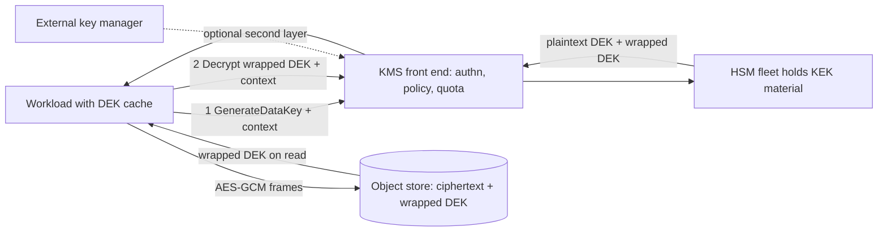

# Encryption Key Hierarchies and Envelope Encryption

## TL;DR

1. Envelope encryption moves bulk bytes through a locally held data encryption key (DEK) and sends only 32-byte keys to a key encryption key (KEK) held behind an HSM-backed KMS. Key-service request rate, not cipher throughput, is the scaling limit.
2. The KMS call sits on the hot path of every cold read. AWS KMS quota is shared per account, per Region, and per key type, per one-second interval (AWS docs, as of 2026-10). Caching DEKs buys availability and throughput, and it costs you revocation latency.
3. AES-GCM sets the real design constraints: 96-bit nonces, about 2^32 random-nonce messages per key, about 64 GiB per invocation, and no key commitment. A DEK per object, framed streaming, and an explicit commitment tag are the standard fixes.
4. Authorization lives in the key policy, grants, and the encryption context (AAD), not in the cipher. Deleting a key is irreversible crypto-shredding, and BYOK adds little security. HYOK converts your proxy's availability into your data's availability.
5. The cryptographic boundary is the set of principals who can call Decrypt, PutKeyPolicy, or CreateGrant, plus the memory of every process holding a plaintext DEK. It is not the bucket or the disk.

## Mental Model



Bulk data never crosses the key service boundary, so the data path scales with the storage network, not with the HSM.
The only thing that does cross is a small wrapped key.
Each cold read, new process, or cache miss turns one data read into one authenticated, quota-metered, audited KMS request.
That makes the KMS front end a dependency of the data plane.
Every property of the design follows from that coupling: per-object DEKs shrink the blast radius of any one key, caches protect availability, and the cache TTL becomes your revocation latency.
The same coupling puts the trust boundary at "who can unwrap", which is an authorization question and not an encryption question.

## Internals

### The hierarchy and where each layer lives

A generic production hierarchy has four layers.
A root of trust sits in hardware or a quorum-controlled domain.
A customer-visible KEK sits under it.
Per-object or per-chunk DEKs sit under the KEK.
Data sits under the DEKs.
Google's default-at-rest design makes the layering explicit.
Data is split into chunks, and each chunk gets its own DEK.
DEKs are wrapped by a KEK held in Keystore.
Keystore keys are wrapped by an internal KMS master key.
That master key is wrapped by a Root KMS master key, which is held in RAM on dedicated machines and distributed peer to peer (Google, [Encryption at rest in Google Cloud](https://cloud.google.com/docs/security/encryption/default-encryption), as of 2026-10).
The point of the depth is that each layer turns a large set of keys into a small set of secrets, so the most sensitive material is also the rarest and the least often touched.

AWS KMS documents a similar structure in its cryptographic details paper.
Key material lives in a fleet of HSMs.
Plaintext key material exists only in volatile HSM memory.
Administrative operations on the fleet require quorum-signed commands, so no single operator can extract keys (AWS, [AWS KMS Cryptographic Details](https://docs.aws.amazon.com/kms/latest/cryptographic-details/intro.html), as of 2026-10).
Customers see KMS keys as regional resources.
Their material is replicated across HSMs inside the Region, and a KMS key cannot be exported from KMS in plaintext.

### Control plane versus data plane inside a KMS

Key creation, policy edits, grants, rotation, import, and deletion are control-plane operations.
They are low volume and change durable state.
Encrypt, Decrypt, GenerateDataKey, and the HMAC operations are data-plane operations.
They authenticate the caller, evaluate key policy, IAM, and grants, check the encryption context, and call into an HSM.
The two planes have different quotas, and they are eventually consistent with each other.
Policy and grant changes propagate asynchronously.
AWS provides grant tokens so a caller can use a freshly created grant before it has propagated everywhere (AWS docs, recalled, UNVERIFIED this session).
Do not build revocation guarantees on "the policy edit is instant".
See [[17-Cloud-AI-Engineering/Volume_01_Cloud_Architecture_Principles/Chapter_04_Control_Plane_vs_Data_Plane_Separation|Control Plane vs Data Plane Separation]] for the general pattern.

### The wrapped key is a self-describing, authenticated blob

A symmetric KMS ciphertext blob carries enough metadata for KMS to find the right KMS key and the right key-material version.
That is why Decrypt of a symmetric blob works without naming the key, and why a rotated key still decrypts old ciphertexts.
The encryption context is bound into the wrap as additional authenticated data (AAD).
A wrong context fails cryptographically inside the HSM path and is not merely rejected by policy.
The context is not secret.
It appears in CloudTrail, so use it for binding (tenant, purpose, object class) and never for confidential values.
Google Cloud KMS exposes the same primitive as `additionalAuthenticatedData` on Encrypt and Decrypt (Google Cloud docs, recalled, UNVERIFIED this session).

### AES-GCM budgets: the mechanism your DEK design must respect

Every envelope scheme eventually reaches AES-GCM, and GCM has three hard budgets (NIST, [SP 800-38D](https://csrc.nist.gov/pubs/sp/800/38/d/final)).

1. **Nonce uniqueness.** A repeated (key, nonce) pair leaks the XOR of the two plaintexts and the GHASH authentication subkey, which allows forgeries (Bock et al., "Nonce-Disrespecting Adversaries", WOOT 2016). With random 96-bit nonces, the collision probability for n messages is about n^2 / 2^97. At n = 2^32 that is 2^-33. At n = 2^40 it is about 2^-17 (computed here). NIST therefore caps random-nonce invocations at 2^32 per key.
2. **Per-invocation length.** One GCM invocation can protect at most 2^39 - 256 bits, which is about 64 GiB. A single-call encryption of a 100 GiB checkpoint shard is not a valid use of GCM.
3. **Non-committing.** AES-GCM, like most AEADs, lets an adversary craft one ciphertext that authenticates under two different keys. These are the "invisible salamanders" results (Dodis et al., CRYPTO 2018) and the partitioning-oracle attacks (Len et al., USENIX Security 2021). Albertini et al. (USENIX Security 2022) show how to abuse such ciphertexts and how to fix them. This matters wherever the attacker controls the ciphertext and the system tries more than one key, such as multi-recipient wraps, multi-key keyrings, or key-ID-free blobs. The AWS Encryption SDK made key-committing algorithm suites its default in v2.0 (AWS docs, recalled, UNVERIFIED this session).

Design consequences:

- **Per-object DEK.** A fresh DEK per object resets the nonce budget and bounds the blast radius of a leaked DEK to one object.
- **Framed streaming.** Encrypt in frames (1 MiB in the lab below), with a nonce derived from the frame counter. Put the frame index and a "final frame" bit in the AAD. This defeats reordering and silent truncation. A bare chunked GCM stream detects neither.
- **Counter nonces are safe only with a unique key.** If you cache a DEK and reuse it across files, deterministic counter nonces collide at frame 0 of every file. Derive the actual encryption key as HKDF(DEK, salt) with a per-file random salt (RFC 5869). That keeps the encryption key unique per file even when the DEK is reused.
- **HKDF gives you commitment for free.** Derive 64 bytes from HKDF-SHA512. Use the first 32 as the AES key and store the second 32 in the header as a commitment tag. The decryptor recomputes and compares it before decrypting. This is the same idea as the commitment in the SDK's committing suites. It makes the header a binding commitment to one key.

### Data key caching and the revocation semantics nobody documents clearly

Disabling or scheduling deletion of a KEK does not touch DEKs already unwrapped in process memory.
Revocation latency is therefore max(cache TTL, process lifetime, grant or policy propagation delay).
S3 Bucket Keys and the Encryption SDK's caching cryptographic materials manager are both caches of this kind.
AWS recommends SDK data key caching when you are hitting the GenerateDataKey quota (AWS docs, as of 2026-10).
Bucket Keys cut requests against the shared quota (third-party analysis, as of 2026-09).
The costs are subtler than the docs suggest.
With a bucket-level key, per-object KMS audit events and per-object encryption-context granularity are lost.
The context becomes the bucket ARN instead of the object ARN (AWS docs, recalled, UNVERIFIED this session).
A cache also widens the memory-disclosure surface.
A plaintext DEK sitting in a long-lived process is what a crash dump or core file will contain.
Microsoft's Storm-0558 signing-key compromise is the canonical example of key material leaking through a crash dump (CISA Cyber Safety Review Board, Review of the Summer 2023 Exchange Online Intrusion, 2024-03).
See [[17-Cloud-AI-Engineering/Volume_02_AWS_Deep_Dive/Chapter_09_Elastic_Block_Store_and_Network_Storage|Elastic Block Store and Network Storage]] for the equivalent host-side behavior on EBS volumes.
The point to carry from EBS is that an attached volume may keep working after key disablement until the volume is next attached, and that behavior is a cache effect (AWS docs, recalled, UNVERIFIED this session).

### Grants, services, and who actually calls KMS

Many AWS services use your key through grants created on your behalf.
This is why an unretired grant can outlive the workload it was made for.
It is also why key policy conditions such as `kms:ViaService`, `kms:CallerAccount`, and `kms:GrantIsForAWSResource` are the right tools to scope service access to the key.
On GCP, the service agent of the consuming service needs `cloudkms.cryptoKeyEncrypterDecrypter` on the key.
IAM is the only policy language there, plus IAM conditions, deny policies, and VPC Service Controls.

### Hardware roots and who holds the KEK

| Tier | Where KEK material lives | Who operates the HSM | Notes |
|---|---|---|---|
| Provider-owned keys (S3 SSE-S3, Google default encryption) | Provider internal KMS | Provider | No customer policy surface, no per-key audit |
| Customer managed key, software or standard HSM-backed | Provider multi-tenant HSM fleet | Provider | Customer controls policy, rotation, deletion |
| Dedicated HSM-backed (CloudHSM key store, Cloud HSM) | Single-tenant or provider HSM cluster | Customer or provider | Customer-visible HSM cluster, higher cost, lower quota headroom |
| External key manager (AWS XKS, Cloud EKM) | Your HSM or key manager outside the cloud | You | Availability depends on your proxy and network path |

AWS XKS and Cloud EKM both work by sending wrap and unwrap requests to a proxy you operate.
AWS documents that XKS layers key material held in KMS HSMs with your external key, so the ciphertext needs both (AWS docs, recalled, UNVERIFIED this session).
Cloud EKM supports internet and VPC-attached paths and pairs with Key Access Justifications (Google Cloud docs, recalled, UNVERIFIED this session).
The control you gain is a kill switch you own.
The cost is that every cold decrypt now has your proxy and your network in its critical path.

### BYOK mechanics

BYOK means you generate key material outside the cloud and import it.
On AWS, you call GetParametersForImport to receive a wrapping public key and an import token.
Both expire after a short window, which I recall as 24 hours (AWS docs, recalled, UNVERIFIED this session).
You wrap your key material under that public key and call ImportKeyMaterial, optionally with an expiry.
Imported material has no automatic rotation.
If it expires or is deleted, the KMS key stays but is unusable until you re-import the same material.
That makes you the durability layer for the key, so escrow is mandatory.
Google Cloud uses import jobs with RSA or hybrid RSA-AES wrapping keys, and I recall a short job expiry (Google Cloud docs, recalled, UNVERIFIED this session).

The security value of BYOK is narrow.
It supports regulatory provenance and cross-cloud portability, and it lets you delete and re-import material.
It does not reduce provider trust for data in use, because the cloud HSM still holds the working copy.
The weak link becomes your own generation environment.

### Attested key release

For data-in-use protection, bind the Decrypt permission to a measured environment.
AWS KMS supports condition keys on the recipient attestation of a Nitro Enclave, such as `kms:RecipientAttestation:ImageSha384` and PCR-based keys.
When Decrypt or GenerateDataKey is called with a Recipient, KMS returns the result encrypted to the public key in the enclave's attestation document (`CiphertextForRecipient`), so the parent instance never sees plaintext (AWS docs, recalled, UNVERIFIED this session).
See [[17-Cloud-AI-Engineering/Volume_02_AWS_Deep_Dive/Chapter_15_Security_and_Cryptography_KMS_and_Nitro_Enclaves|Security and Cryptography: KMS and Nitro Enclaves]].
Google's counterpart is Confidential Space with workload identity federation conditions on attestation claims (Google Cloud docs, recalled, UNVERIFIED this session).
See [[17-Cloud-AI-Engineering/Volume_03_GCP_Deep_Dive/Chapter_15_Security_and_Confidential_Computing_Cloud_KMS|Security and Confidential Computing: Cloud KMS]].

### Failure domains

KMS keys are regional.
Multi-Region keys replicate the same key material under related key IDs, and each Region serves Decrypt locally.
That is the static-stability property you want, because DR does not call a remote Region on the data path (see [[17-Cloud-AI-Engineering/Volume_01_Cloud_Architecture_Principles/Chapter_02_Regions_Zones_and_Static_Stability|Regions, Zones, and Static Stability]] and AWS Builders' Library, [Static stability using Availability Zones](https://aws.amazon.com/builders-library/static-stability-using-availability-zones/)).
A wrapped DEK is decryptable only where its KEK exists.
Replicating ciphertext to a DR Region without the KEK is the most common silent DR defect.

## Numbers to Know

Rows marked UNVERIFIED are recalled from official documentation and were not re-fetched on 2026-10-21.

| Item | Value | Source and date | Status |
|---|---|---|---|
| Symmetric crypto quota scope | One shared quota per account, per Region, per key type, per one-second interval, across Decrypt, Encrypt, GenerateDataKey, GenerateDataKeyWithoutPlaintext, GenerateMac, GenerateRandom, ReEncrypt, VerifyMac | AWS docs, as of 2026-10 | Verified |
| Symmetric default in large Regions | 100,000 req/s in us-east-1, us-west-2, eu-west-1 (raised from 50,000) | AWS What's New, 2024-07-22 | Verified at announcement; check Service Quotas |
| RSA and ECC default | 1,000 req/s in all Regions (raised from 500) | AWS What's New, 2024-07-22 | Verified at announcement |
| Symmetric default elsewhere | 10,000 req/s in most Regions, 20,000 in some | Third-party summary of AWS quotas, as of 2026-09 | UNVERIFIED against AWS table |
| Quota adjustability | All KMS request quotas adjustable except the CloudHSM key store quota | AWS docs, as of 2026-10 | Verified |
| Quota alarm | Request rates visible via Service Quotas and CloudWatch alarms | AWS docs, as of 2026-10 | Verified |
| Direct Encrypt payload | 4,096 bytes | AWS docs, recalled | UNVERIFIED |
| AWS KMS price | $1 per KMS key per month, $0.03 per 10,000 requests | AWS pricing, recalled | UNVERIFIED |
| Cloud KMS price | Per key-version monthly fee that varies by protection level, plus per-operation fee | Google pricing, recalled | UNVERIFIED, no figures stated |
| Cloud KMS quota model | Per-project, per-location, per-minute, separate per protection level | Google Cloud docs, recalled | UNVERIFIED, no figures stated |
| AWS key deletion window | 7 to 30 days pending deletion | AWS docs, recalled | UNVERIFIED |
| Cloud KMS version destruction | Scheduled destroy delay, default 24 hours; key rings and keys are never deleted | Google Cloud docs, recalled | UNVERIFIED |
| Automatic rotation | AWS configurable period, 90 to 2,560 days; GCP schedule per key | Provider docs, recalled | UNVERIFIED |
| AES-GCM IV and length limits | 96-bit IV recommended; max 2^39 - 256 bits per invocation (about 64 GiB); 2^32 random-IV invocations per key | NIST SP 800-38D (standard, 2007) | Verified (standard) |
| Random-nonce collision bound | n^2 / 2^97: 2^-57 at 2^20 messages, 2^-33 at 2^32, 2^-17 at 2^40 | Computed in this chapter | Derived |
| Throttle arithmetic | 100 GiB/s of 8 MiB objects is 12,800 GET/s, which is 1.28x a 10,000 req/s quota | Computed in this chapter | Derived |
| KMS request cost of that load (no cache) | 46.08M requests per hour, about $138 per hour at the assumed $0.03 per 10,000 | Computed from the unverified price | Derived, price UNVERIFIED |
| Serial availability, cold decrypt via external key manager | 99.99% x 99.9% is 99.89%, about 47.5 minutes per month | Computed in this chapter, assumed inputs | Derived |
| FIPS status of KMS and Cloud HSM | HSM validations at FIPS 140-2 or 140-3 Level 3 | Provider docs, recalled | UNVERIFIED, check current CMVP certificates |

## AWS vs GCP Mechanism Parity

| Dimension | AWS | Google Cloud |
|---|---|---|
| Customer key service | AWS KMS, regional KMS keys | Cloud KMS, key rings with keys and key versions in a location |
| Protection levels | KMS (HSM fleet), CloudHSM key store, external key store (XKS) | SOFTWARE, HSM, EXTERNAL, EXTERNAL_VPC (Google Cloud docs, recalled, UNVERIFIED) |
| DEK generation | GenerateDataKey creates the DEK inside the HSM path and returns plaintext plus wrapped copy | No GenerateDataKey equivalent; the client generates the DEK and calls Encrypt, typically through Tink KmsEnvelopeAead (recalled, UNVERIFIED) |
| AAD | EncryptionContext key-value map, logged in CloudTrail | additionalAuthenticatedData bytes, handled by the caller |
| Authorization | Key policy is required and root of trust, plus IAM, grants, and condition keys | IAM on key ring or key, conditions, deny policies, VPC Service Controls |
| Quota model | Shared per account, per Region, per key type, per second (verified above) | Per project, per location, per minute, separate per protection level (UNVERIFIED) |
| Rotation | Key ID constant; new backing material, old versions retained for decrypt | New key versions; primary version used for encrypt, older versions decrypt |
| Deletion | Pending deletion window, then permanent | Version destroy after delay; the key and ring stay as names forever (UNVERIFIED) |
| Multi-Region | Multi-Region keys with replicated material, local decrypt | Multi-region and global key locations |
| Default at rest | Provider-owned keys; SSE-S3 for new S3 objects | Always on with Keystore hierarchy (verified from whitepaper) |
| External control | XKS proxy, double-layer wrap (UNVERIFIED) | Cloud EKM and Key Access Justifications |
| Attestation-bound release | Nitro Enclaves recipient attestation condition keys | Confidential Space with attestation claims |
| Audit | CloudTrail management and data events for KMS | Cloud Audit Logs; data-access logging for crypto operations needs enabling (UNVERIFIED) |

The key operational difference is the unit of throttling.
AWS meters bursts per second against one shared quota.
GCP meters per minute per location and protection level.
A fan-out of 20,000 parallel cold starts can therefore throttle on one cloud and sail through on the other, depending on key type and region.
Size from first principles in each cloud and check the quota page before launch.
See also [[17-Cloud-AI-Engineering/Volume_04_AWS_vs_GCP_Translation/Chapter_03_Identity_Security_and_Governance_Translation|Identity, Security, and Governance Translation]].

## Worked Example: Committing Envelope Encryption, a Scoped KMS Key, and Quota Sizing

### Step 1: back-of-the-envelope sizing

Assume a training fleet reads its dataset at 100 GiB/s aggregate.
Objects are 8 MiB in an SSE-KMS bucket without Bucket Keys.

- GET rate is 100 x 1024 / 8 = 12,800 per second.
- Each GET triggers one Decrypt, so that is 12,800 KMS req/s against a 10,000 req/s default quota, or 1.28x. In a 100,000 req/s Region it is 12.8% of quota, and it still starves every other workload sharing the account.
- Cost is 12,800 x 3,600 = 46.08M requests per hour. At an assumed $0.03 per 10,000 that is about $138 per hour, or about $101k per 730-hour month.
- The shared quota means a dataset loader can throttle an unrelated service's login path.

Mitigation order:

1. Bucket Keys, so KMS calls scale with key refreshes and not with GETs.
2. Move the training dataset to a bucket and key separate from production, preferably in a separate account, so the quota blast radius is contained.
3. Raise the quota only after (1) and (2).

Checkpoints are cheaper.
A 70B-parameter run with bf16 weights, fp32 master weights, and Adam moments needs 14 bytes per parameter, about 0.98 TB per checkpoint.
At 1 GiB shards that is about 913 GenerateDataKey calls per save, which is trivial.
At 1 MiB frames there are about 934,600 frames, far below the 2^32 frame counter.
See [[17-Cloud-AI-Engineering/Volume_10_AI_Infrastructure_on_Cloud/Chapter_06_High_Throughput_Checkpointing_to_Object_Storage|High-Throughput Checkpointing to Object Storage]].

Multi-tenant key economics, at the assumed $1 per key per month:

| Design | Keys | Annual key fee |
|---|---|---|
| Per-tenant KEK, 5,000 tenants | 5,000 | $60,000 |
| Shared KEK, per-tenant DEK, wrapped DEK stored per tenant | 1 | $12 |

### Step 2: the key and its guardrails (OpenTofu or Terraform)

```hcl
terraform {
  required_providers {
    aws = { source = "hashicorp/aws", version = "~> 5.0" }
  }
}

variable "region"      { default = "us-east-1" }
variable "alert_email" {}

provider "aws" { region = var.region }

data "aws_caller_identity" "me" {}

resource "aws_kms_key" "lab" {
  description             = "lab envelope KEK"
  deletion_window_in_days = 7
  enable_key_rotation     = true
  rotation_period_in_days = 365 # needs a recent 5.x provider

  policy = jsonencode({
    Version = "2012-10-17"
    Statement = [
      {
        Sid       = "AccountDelegation"
        Effect    = "Allow"
        Principal = { AWS = "arn:aws:iam::${data.aws_caller_identity.me.account_id}:root" }
        Action    = "kms:*"
        Resource  = "*"
      },
      {
        Sid       = "RequireTenantContext"
        Effect    = "Deny"
        Principal = { AWS = "*" }
        Action    = ["kms:Encrypt", "kms:Decrypt", "kms:ReEncrypt*", "kms:GenerateDataKey*"]
        Resource  = "*"
        Condition = { Null = { "kms:EncryptionContext:tenant" = "true" } }
      }
    ]
  })
}

resource "aws_kms_alias" "lab" {
  name          = "alias/lab-envelope"
  target_key_id = aws_kms_key.lab.key_id
}

resource "aws_budgets_budget" "lab" {
  name         = "kms-lab"
  budget_type  = "COST"
  limit_amount = "5"
  limit_unit   = "USD"
  time_unit    = "MONTHLY"

  notification {
    comparison_operator        = "GREATER_THAN"
    threshold                  = 80
    threshold_type             = "PERCENTAGE"
    notification_type          = "ACTUAL"
    subscriber_email_addresses = [var.alert_email]
  }
}

output "key_id" { value = aws_kms_key.lab.key_id }
```

The first statement delegates to IAM, which is the standard pattern and the reason IAM policies can grant KMS access at all.
The Deny statement forces every cryptographic call to carry a `tenant` context key.
It is a cheap, enforceable guardrail against context-free usage.

### Step 3: the envelope library (Python, `cryptography` and `boto3`)

The script below frames the stream in 1 MiB frames and binds the frame index and final-frame flag into the AAD.
It derives a per-file encryption key and commitment tag with HKDF-SHA512 and verifies the commitment before decrypting.
The `selftest` mode uses a local stub and needs no cloud account.

```python
#!/usr/bin/env python3
"""Committing, framed envelope encryption with AWS KMS (boto3) or a local stub.

Usage:
  python3 envelope.py selftest
  python3 envelope.py encrypt --key-id alias/lab-envelope --tenant acme IN OUT
  python3 envelope.py decrypt --tenant acme IN OUT
"""
import argparse, hashlib, hmac, io, json, os, struct, sys
from cryptography.hazmat.primitives import hashes
from cryptography.hazmat.primitives.ciphers.aead import AESGCM
from cryptography.hazmat.primitives.kdf.hkdf import HKDF

MAGIC = b"ENV1"
FRAME = 1 << 20          # 1 MiB plaintext per frame
MAX_FRAMES = 1 << 32     # frame counter is 32 bits, nonce is 4 zero bytes + 8-byte counter


class KmsStub:
    """Local stand-in with the same two calls we use. Wraps DEKs with a process-local AES key."""
    def __init__(self):
        self.kek = AESGCM.generate_key(256)

    def generate_data_key(self, key_id, context):
        dek = os.urandom(32)
        n = os.urandom(12)
        blob = n + AESGCM(self.kek).encrypt(n, dek, json.dumps(context, sort_keys=True).encode())
        return dek, blob

    def decrypt(self, blob, context):
        n, ct = blob[:12], blob[12:]
        return AESGCM(self.kek).decrypt(n, ct, json.dumps(context, sort_keys=True).encode())


class KmsAws:
    def __init__(self):
        import boto3
        self.c = boto3.client("kms")

    def generate_data_key(self, key_id, context):
        r = self.c.generate_data_key(KeyId=key_id, KeySpec="AES_256", EncryptionContext=context)
        return r["Plaintext"], r["CiphertextBlob"]

    def decrypt(self, blob, context):
        # Omit KeyId for symmetric keys: the key id is embedded in the ciphertext blob.
        # Pass it explicitly in production to refuse blobs wrapped under an unexpected key.
        return self.c.decrypt(CiphertextBlob=blob, EncryptionContext=context)["Plaintext"]


def derive(dek, salt):
    okm = HKDF(algorithm=hashes.SHA512(), length=64, salt=salt, info=b"env1-enc-commit").derive(dek)
    return okm[:32], okm[32:]          # encryption key, commitment tag


def nonce(i):
    return b"\x00\x00\x00\x00" + struct.pack(">Q", i)


def aad(header_digest, i, last):
    return header_digest + struct.pack(">QB", i, 1 if last else 0)


def encrypt(kms, key_id, tenant, src, dst):
    ctx = {"tenant": tenant, "purpose": "env1"}
    dek, blob = kms.generate_data_key(key_id, ctx)
    salt = os.urandom(32)
    ek, commit = derive(dek, salt)
    del dek
    hdr = MAGIC + struct.pack(">H", len(blob)) + blob + salt + commit
    dst.write(hdr)
    hd = hashlib.sha256(hdr).digest()
    aes = AESGCM(ek)
    i = 0
    cur = src.read(FRAME)
    while True:
        nxt = src.read(FRAME)
        last = not nxt
        if i >= MAX_FRAMES:
            raise RuntimeError("frame counter exhausted for this DEK")
        ct = aes.encrypt(nonce(i), cur, aad(hd, i, last))
        dst.write(struct.pack(">I", len(ct)) + ct)
        i += 1
        if last:
            break
        cur = nxt


def decrypt(kms, tenant, src, dst):
    ctx = {"tenant": tenant, "purpose": "env1"}
    magic = src.read(4)
    if magic != MAGIC:
        raise ValueError("bad magic")
    (n,) = struct.unpack(">H", src.read(2))
    blob = src.read(n)
    salt = src.read(32)
    commit = src.read(32)
    hdr = magic + struct.pack(">H", n) + blob + salt + commit
    dek = kms.decrypt(blob, ctx)
    ek, expect = derive(dek, salt)
    if not hmac.compare_digest(commit, expect):
        raise ValueError("key commitment mismatch")
    hd = hashlib.sha256(hdr).digest()
    aes = AESGCM(ek)
    i = 0
    while True:
        raw = src.read(4)
        if not raw:
            raise ValueError("truncated stream: no final frame")
        (ln,) = struct.unpack(">I", raw)
        ct = src.read(ln)
        last = not src.peek(1) if hasattr(src, "peek") else None
        if last is None:
            raise ValueError("source must be a buffered binary stream")
        dst.write(aes.decrypt(nonce(i), ct, aad(hd, i, last)))
        i += 1
        if last:
            break


def selftest():
    kms = KmsStub()
    data = os.urandom(3 * FRAME + 123)
    out = io.BytesIO()
    encrypt(kms, "stub", "acme", io.BytesIO(data), out)
    blob = out.getvalue()
    back = io.BytesIO()
    decrypt(kms, "acme", io.BufferedReader(io.BytesIO(blob)), back)
    assert back.getvalue() == data
    for name, bad in (
        ("wrong tenant", lambda: decrypt(kms, "evil", io.BufferedReader(io.BytesIO(blob)), io.BytesIO())),
        ("truncated", lambda: decrypt(kms, "acme", io.BufferedReader(io.BytesIO(blob[: len(blob) - (FRAME + 20)])), io.BytesIO())),
    ):
        try:
            bad()
        except Exception as e:
            print("rejected", name, type(e).__name__)
        else:
            raise SystemExit("FAIL: accepted " + name)
    flipped = bytearray(blob); flipped[-5] ^= 1
    try:
        decrypt(kms, "acme", io.BufferedReader(io.BytesIO(bytes(flipped))), io.BytesIO())
    except Exception as e:
        print("rejected bitflip", type(e).__name__)
    else:
        raise SystemExit("FAIL: accepted bitflip")
    print("selftest ok, bytes", len(data), "->", len(blob))


def main():
    p = argparse.ArgumentParser()
    p.add_argument("mode", choices=["selftest", "encrypt", "decrypt"])
    p.add_argument("--key-id")
    p.add_argument("--tenant")
    p.add_argument("src", nargs="?")
    p.add_argument("dst", nargs="?")
    a = p.parse_args()
    if a.mode == "selftest":
        return selftest()
    kms = KmsAws()
    with open(a.src, "rb") as s, open(a.dst, "wb") as d:
        if a.mode == "encrypt":
            encrypt(kms, a.key_id, a.tenant, s, d)
        else:
            decrypt(kms, a.tenant, s, d)


if __name__ == "__main__":
    main()
```

The selftest output on the reference run was `rejected wrong tenant InvalidTag`, `rejected truncated InvalidTag`, `rejected bitflip InvalidTag`, and `selftest ok, bytes 3145851 -> 3146061`.
Two caveats.
First, this streaming decryptor releases each frame's plaintext after that frame verifies, but before the final frame has verified.
A consumer that must be atomic should write to a temporary file and rename it after the last frame succeeds.
Second, the 4-zero-byte nonce prefix is safe only because the HKDF salt makes the AES key unique per file.

### Step 4: run it

```bash
tofu init && tofu apply -var alert_email=you@example.com
head -c 50000000 /dev/urandom > /tmp/in.bin
python3 envelope.py encrypt --key-id alias/lab-envelope --tenant acme /tmp/in.bin /tmp/ct.bin
python3 envelope.py decrypt --tenant acme /tmp/ct.bin /tmp/out.bin && cmp /tmp/in.bin /tmp/out.bin
python3 envelope.py decrypt --tenant evil /tmp/ct.bin /tmp/bad.bin   # expect InvalidCiphertextException
```

The GCP analogue has no GenerateDataKey.
Generate the 32-byte DEK locally with `os.urandom`, then wrap it with `gcloud kms encrypt --location=us-central1 --keyring=lab-ring --key=lab-key --plaintext-file=dek.bin --ciphertext-file=dek.wrapped --additional-authenticated-data-file=aad.bin`.
Create the ring and key with `gcloud kms keyrings create lab-ring --location=us-central1` and `gcloud kms keys create lab-key --keyring=lab-ring --location=us-central1 --purpose=encryption --rotation-period=90d --next-rotation-time=<RFC3339 timestamp>`.
Create the budget with `gcloud billing budgets create --billing-account=<ID> --display-name=kms-lab --budget-amount=5USD --threshold-rule=percent=0.8`.

### Step 5: cost estimate

The upper bound for the AWS lab is one KMS key-month at the assumed $1, plus a few hundred requests at about $0.03 per 10,000, so well under $1.10.
Prices are UNVERIFIED this session.
The budget at $5 monthly with an 80% actual-spend alert caps surprise exposure.

### Step 6: exact teardown

```bash
tofu destroy -var alert_email=you@example.com
aws kms describe-key --key-id "$(tofu output -raw key_id)" --query KeyMetadata.KeyState
```

The expected state is `PendingDeletion`, with a 7-day window.
To undo before the window ends, run `aws kms cancel-key-deletion --key-id <id>`.
Run the `describe-key` check before the destroy output is removed, or save the key ID first.
For the GCP lab, destroy the version with `gcloud kms keys versions destroy 1 --key=lab-key --keyring=lab-ring --location=us-central1`.
The key and ring names remain reserved indefinitely.

## Failure Modes and Pitfalls

### Shared-quota throttling cascades

Because the quota is shared across every client in the account, one chatty workload can throttle an unrelated one.
Typical offenders are a dataset loader, a cold-start fan-out, or a stream ingest tier encrypting small records (third-party analysis, as of 2026-09).
SDK retries amplify the problem when many clients back off in lockstep, so use full jitter ([[17-Cloud-AI-Engineering/Volume_07_Reliability_and_SRE/Chapter_03_Resilient_Communication_Retries_Jitter_and_Circuit_Breakers|Resilient Communication: Retries, Jitter, and Circuit Breakers]]).
Alarm at a fraction of quota using Service Quotas metrics and CloudWatch (AWS docs, as of 2026-10).
Isolate bulk workloads in separate accounts.

### Hot-path dependency cascades

Two recent public postmortems show what happens when a shared control or metadata service sits in the request path of many products.
I cite them as analogies, because neither was a KMS root cause.
The Google Cloud incident of 2025-06-12 was triggered by Service Control, and policy data propagated globally and crashed binaries.
The AWS us-east-1 incident of 2025-10-20 started with a DynamoDB DNS automation race and propagated into dependent services.
Details of both are recalled, UNVERIFIED this session, so check the primary reports.
The design lesson is the same one KMS imposes.
Anything that must call a shared service on every cold read needs a bounded-staleness cache and a graceful degradation path.

### Key deletion, disablement, and ransomware by key

Scheduling deletion or removing the policy grants that let you decrypt is a cryptographic erase.
An attacker with `kms:ScheduleKeyDeletion` or `kms:PutKeyPolicy` can destroy the data without touching it.
The same effect follows from re-encrypting objects under an attacker-held key.
The reported "Codefinger" campaign used compromised credentials to rewrite S3 objects with attacker-held SSE-C keys, and AWS later changed SSE-C defaults for new buckets (recalled, UNVERIFIED this session).
Controls: SCP and key-policy denies on destructive KMS actions except for a break-glass role, CloudTrail or EventBridge alarms on `ScheduleKeyDeletion` and `DisableKey`, Object Lock and backups in a separate account under separate keys, and a restriction on SSE-C where you do not use it.

### Nonce reuse after DEK caching

A team caches a DEK for efficiency and keeps deterministic counter nonces that restart at zero per file.
The first frame of every file then reuses (key, nonce) and leaks plaintext XORs and the authentication subkey.
Fix it by deriving a per-file key (as in the lab) or by using random nonces with an invocation counter.

### Context drift

Putting a mutable value such as an object name in the encryption context means a rename or copy breaks decrypt.
Putting a secret in it leaks the value into logs.
Use stable identifiers: tenant, data class, purpose, and a UUID.

### DR without keys

Replicating ciphertext without the KEK produces a DR copy nobody can read.
Use Multi-Region keys or an explicit KEK per Region, and test restore with the DR keys on a schedule.

### HYOK outages

If the XKS or EKM proxy fails, cold decrypts fail once caches expire.
There is a cliff at the longest cache TTL, and you will see it at that time and not at the failure time.
The serial availability of 99.89% in the numbers table is a ceiling for cold paths.
Game-day the proxy ([[17-Cloud-AI-Engineering/Volume_07_Reliability_and_SRE/Chapter_05_Chaos_Engineering_and_Game_Days|Chaos Engineering and Game Days]]).

### Imported key material loss

BYOK material that expires or is deleted from the cloud makes every dependent ciphertext unreadable until you re-import the exact same bytes.
Keep two independent, tested escrow copies.

### Grant sprawl

Grants created by services or by your code accumulate and are not removed by deleting the workload.
Retire grants with RetireGrant or RevokeGrant, and audit with ListGrants.
There is also a per-key grant cap (recalled, UNVERIFIED).

### Public-key-style failures in the signing analogy

Storm-0558 combined a key leaving its protected environment through a crash dump with validation code that accepted a consumer-scope key for enterprise-scope tokens (CISA CSRB, 2024-03).
The generalization is to scope keys by purpose and tenant, validate scope on every use, and keep keys out of dumps.

## Security and Cost Angles

### IAM and key-policy scoping

- Separate administrators from users. The principal who can use `kms:Decrypt` should not hold `kms:PutKeyPolicy`, `kms:ScheduleKeyDeletion`, or `kms:CreateGrant`.
- Pin service use with `kms:ViaService` and `kms:CallerAccount`. Constrain grants with `kms:GrantIsForAWSResource`.
- Require the encryption context in the key policy, as in the lab. Use `kms:EncryptionContext:<key>` conditions to bind principal to tenant.
- For cross-account access, both the key policy and the caller's IAM policy must allow it. Add an organization condition with `aws:PrincipalOrgID` on the key policy so a stolen key ID cannot be used from outside the org. See [[17-Cloud-AI-Engineering/Volume_02_AWS_Deep_Dive/Chapter_01_IAM_Policy_Evaluation_Engine|IAM Policy Evaluation Engine]].
- On GCP, bind `roles/cloudkms.cryptoKeyEncrypterDecrypter` to specific service agents on specific keys, not to the project. Use deny policies for destructive permissions. See [[17-Cloud-AI-Engineering/Volume_03_GCP_Deep_Dive/Chapter_02_Cloud_IAM_Roles_Policies_and_Conditions|Cloud IAM: Roles, Policies, and Conditions]].

### Key hierarchy design

Create one KEK per data classification, environment, and owning service.
Do not create one per object.
Create per-tenant KEKs only when you must offer tenant-controlled revocation, because each key adds a policy to maintain per Region and the quota stays shared anyway (third-party analysis, as of 2026-09).
Use per-tenant DEKs wrapped by a shared KEK for crypto-shredding granularity, and delete the tenant's wrapped DEKs and any cached copies.
Rotate KEKs on a schedule.
Rotation changes what encrypts new wraps and does not re-encrypt old DEKs.
Re-wrap old DEKs (ReEncrypt, or Decrypt then Encrypt) only if your policy says old key versions must be retired.
See [[17-Cloud-AI-Engineering/Volume_02_AWS_Deep_Dive/Chapter_08_S3_Deep_Dive_Consistency_and_ShardStore|S3 Deep Dive]] and [[17-Cloud-AI-Engineering/Volume_03_GCP_Deep_Dive/Chapter_09_Cloud_Storage_and_Colossus_Filesystem|Cloud Storage and Colossus]] for the storage side.

### Private network boundaries

- AWS: use a KMS interface VPC endpoint with an endpoint policy restricting `kms:*` actions to your organization's keys and principals, and combine with SCP data-perimeter conditions.
- GCP: put `cloudkms.googleapis.com` inside a VPC Service Controls perimeter with ingress and egress rules, and use Private Google Access or Private Service Connect.
- For external key managers, put the proxy on private connectivity and treat its certificate and DNS as part of the key's trust boundary.
- See [[17-Cloud-AI-Engineering/Volume_08_Security_Identity_and_the_Data_Perimeter/Chapter_06_Constructing_an_Impenetrable_Data_Perimeter|Constructing an Impenetrable Data Perimeter]] and [[17-Cloud-AI-Engineering/Volume_03_GCP_Deep_Dive/Chapter_03_VPC_Service_Controls_Security_Perimeters|VPC Service Controls: Security Perimeters]].

### Unit economics levers

1. **Request volume.** This dominates cost at scale ($138 per hour in the sizing example, price UNVERIFIED). Use Bucket Keys, SDK caching, and per-object DEKs with local caches sized to your revocation SLA.
2. **Key count.** At the assumed $1 per month, 5,000 per-tenant keys cost $60k per year, versus $12 for one shared KEK.
3. **Protection level.** HSM-backed and external keys cost more and have lower throughput. Use them for the root KEKs where policy requires it, not for every dataset.
4. **Audit volume.** Caches cut CloudTrail volume and KMS log cost, at the price of audit granularity. Decide this on purpose.
5. **Deletion discipline.** Keys in pending deletion should not be billed (UNVERIFIED), but a disabled key still incurs the monthly fee.

Cross-chapter context: [[17-Cloud-AI-Engineering/Volume_08_Security_Identity_and_the_Data_Perimeter/Chapter_03_Secrets_Management_and_Dynamic_Credentials|Secrets Management and Dynamic Credentials]] covers how credentials to KMS are obtained.
[[17-Cloud-AI-Engineering/Volume_08_Security_Identity_and_the_Data_Perimeter/Chapter_07_Compliance_Auditing_and_Non_Repudiation|Compliance, Auditing, and Non-Repudiation]] covers how key-usage logs become evidence.

## Interview Questions and Model Answers

### Question 1 (L5 - Senior)

Explain envelope encryption. Why not call KMS Encrypt on a 1 GB file, and what happens to old data when you rotate the KEK?

#### Model Answer

The KMS direct Encrypt API accepts only a small payload, 4,096 bytes on AWS (UNVERIFIED), so large data must be encrypted locally.
Envelope encryption generates a DEK, encrypts the data locally with an AEAD such as AES-256-GCM, wraps the DEK under the KEK in KMS, and stores the wrapped DEK next to the ciphertext.
Reads call Decrypt on the wrapped DEK (or hit a cache), then decrypt locally.
The benefits are scale, because the HSM only sees 32-byte keys.
They also include blast radius, because a leaked DEK exposes one object.
Finally the KEK never leaves KMS, so policy, audit, and deletion happen in one place.
The cost is that every cold read becomes a metered, authenticated KMS request, and a KMS outage becomes a data-plane outage unless you cache.
On rotation, automatic rotation changes the backing material used for new wraps.
Old wrapped DEKs remain decryptable because the blob identifies its key version.
Rotation does not re-encrypt data or re-wrap DEKs.
If you must retire an old KEK version, you have to re-wrap DEKs in bulk, which is a metered batch job.

#### Follow-up Interviewer Question

You rotated yearly for five years, and now audit says the oldest key version must be retired. What is your plan and what does it cost for 2 billion objects?

### Question 2 (L5 - Senior)

A training job reading from an SSE-KMS bucket starts failing with ThrottlingException at scale. Diagnose and fix it.

#### Model Answer

The shared symmetric crypto quota is per account, per Region, and per key type, per second (AWS docs, as of 2026-10).
Each S3 GET on an SSE-KMS object without Bucket Keys triggers a Decrypt.
At 100 GiB/s and 8 MiB objects that is 12,800 requests per second, which exceeds a 10,000 per second default and threatens a 100,000 per second one when other workloads share it.
First confirm using the Service Quotas usage metrics.
Then enable S3 Bucket Keys so KMS calls scale with bucket-key refreshes.
Move the training dataset to a dedicated bucket, key, and account so it cannot starve production.
Add full-jitter retries.
Only then request a quota increase.
Also note the cost: 46M requests per hour is about $138 per hour at $0.03 per 10,000 (price UNVERIFIED).

#### Follow-up Interviewer Question

What do you lose by enabling Bucket Keys, and which compliance requirement could make that unacceptable?

### Question 3 (L6 - Staff)

Design the key hierarchy for a multi-tenant SaaS with 5,000 tenants. Some tenants require cryptographic erasure on offboarding within 24 hours.

#### Model Answer

Per-tenant KEKs give the cleanest shred.
You schedule deletion of one key, but you pay 5,000 key fees per Region, maintain 5,000 policies, and AWS imposes a 7-day minimum pending window (UNVERIFIED), which violates a 24-hour SLA unless you disable the key first.
Disabling is reversible, so it is not a true erase.
A better pattern is a shared KEK per Region with per-tenant DEKs.
Each tenant has a tenant-key record, a DEK wrapped under the shared KEK with context `{tenant, purpose}`.
Offboarding deletes the wrapped tenant DEK from the database and every backup that contains it, and purges caches.
Data encrypted under that DEK is then unrecoverable, within the time it takes you to delete from all copies.
For tenants who contractually require their own KEK, offer a premium tier with a per-tenant key or BYOK/XKS, with an explicit availability trade-off.
Key points a bar raiser looks for: AAD-bound tenant context so a mis-routed wrapped DEK fails, a key-commitment tag so one blob cannot decrypt under two tenants' keys, backups as the real erase problem, and quota isolation for noisy tenants.
Shred latency is bounded by the cache TTL plus backup retention, so state that number explicitly.

#### Follow-up Interviewer Question

The tenant's wrapped DEK exists in 35 days of daily backups. How do you meet a 24-hour erase SLA without rewriting backups?

### Question 4 (L6 - Staff)

During an incident, a security engineer wants to disable the KMS key to "instantly revoke" access. What actually happens, and how do you make revocation deterministic?

#### Model Answer

Disabling blocks new Decrypt and GenerateDataKey calls, but it does not reach plaintext DEKs already in memory.
Revocation latency is max(cache TTL, process lifetime, policy or grant propagation).
Services differ.
S3 with Bucket Keys continues until the bucket key refreshes.
Encryption SDK caches continue until TTL or message or byte limits expire.
EBS-attached volumes may keep working until the next attach (UNVERIFIED).
Policy and grant edits are eventually consistent.
Therefore "disable" is containment, not an atomic cut.
To make it deterministic: set cache TTLs equal to the revocation SLA (for example 5 minutes), cap bytes and messages per cached DEK, use short-lived workload identity so compromised callers lose the ability to unwrap new DEKs, and put an explicit kill-switch that also restarts or drains processes holding keys.
For the compromised-principal case, revoke the principal's sessions with a deny on the role in IAM and SCP, not only the key.
Practice this in a game day and measure time to last successful decrypt.

#### Follow-up Interviewer Question

How do you measure "time to last successful decrypt" in production without breaking customers?

### Question 5 (L6 - Staff)

A team caches one DEK for 10 days and encrypts 3 billion records with random 96-bit AES-GCM nonces. Evaluate the design and propose a fix.

#### Model Answer

Collision probability for n random nonces is about n^2 / 2^97.
At n = 3 x 10^9 (about 2^31.5) that is about 2^-34, under NIST's 2^-32 target but with little headroom (NIST SP 800-38D caps at 2^32 invocations per key).
Any growth, retry duplication, or counting each frame as an invocation breaks the margin.
At 2^40 invocations it is about 2^-17.
A single repeat leaks the XOR of two plaintexts and the GHASH key, which enables forgeries.
It also fails operationally: a 10-day cache widens the revocation window and the memory-disclosure window.
The fix is to derive a per-record or per-batch key with HKDF from the cached DEK and a random salt stored with the record, or to use a per-batch DEK with a counter limit.
That multiplies the nonce space by the number of derived keys.
If you cannot guarantee uniqueness, AES-GCM-SIV (RFC 8452) tolerates nonce reuse with a bounded loss (it leaks only equality of identical plaintexts), at lower throughput.
Add a commitment tag if ciphertexts can be tried against multiple keys.

#### Follow-up Interviewer Question

You choose HKDF-derived per-record keys. What is the CPU cost, and where does the commitment tag live so that a key rotation does not invalidate it?

### Question 6 (L7+ - Principal)

A regulated bank on AWS and GCP demands HYOK with a 99.99% availability target. Design it and tell the CISO what it does and does not protect.

#### Model Answer

HYOK here means AWS XKS and Cloud EKM against an HSM cluster the bank operates.
The external key manager is a serial dependency on every cold decrypt.
With KMS at 99.99% and the proxy at 99.9%, the cold-path ceiling is 99.89%, about 47.5 minutes per month (computed).
So the 99.99% target cannot be met on cold paths, and you meet it by design on warm paths.
Design: two or more proxy and HSM sites in separate failure domains per cloud Region, active-active, with health-checked failover and private connectivity.
Add a DEK cache whose TTL equals the bank's accepted revocation window.
Pre-warm the cache before maintenance.
Keep the HSM cluster size ahead of burst: every cold-start fan-out becomes proxy QPS, so apply the same quota math as for KMS.
Add a runbook for the cliff: when the proxy is down, caches hide the failure until TTL, so alert on proxy health independently of read errors.
Add a second, independent control: attested key release (Nitro Enclaves or Confidential Space), so Decrypt succeeds only for measured workloads.
What it protects: the bank can cut off new unwraps instantly, no provider-only path exists to unwrap new DEKs, and there is a clear audit boundary.
What it does not protect: data in use, because plaintext DEKs and data are in provider-hosted memory while processed.
It does not protect against legal compulsion of the workload host, or against a bug in the wrap path.
Cache means cutoff is not instantaneous.
Be honest that HYOK reduces trust in the provider's key custody and increases your operational risk, and make the CISO sign that trade-off.

#### Follow-up Interviewer Question

The bank's HSM vendor has a firmware bug that corrupts 0.01% of wraps. How do you detect it before data is stored under those wraps, and how do you recover?

### Question 7 (L7+ - Principal)

Design cryptographic boundary defense against a compromised administrator credential that tries to destroy or re-key all of an organization's data.

#### Model Answer

Model the attacker as holding a privileged role.
Their cheapest moves are `ScheduleKeyDeletion`, `DisableKey`, `PutKeyPolicy`, `CreateGrant` to an external principal, re-encrypting objects under attacker-held keys, and deleting backups.
Controls come in layers.
Separation of duties: key administrators cannot use keys, key users cannot administer them, and neither can alter organization-level guardrails.
Preventive guardrails at the organization layer: SCPs that deny destructive KMS actions except to a break-glass role that requires an out-of-band approval, and a deny on `kms:CreateGrant` to principals outside the organization via `aws:PrincipalOrgID`.
The same applies to SSE-C where unused.
Detective controls: EventBridge rules on the destructive actions with paging, and anomaly detection on KMS request rates, since mass re-encryption looks like a spike (and shares the quota, so it may self-throttle).
Recovery controls: backups in a separate account under separate KEKs and Object Lock in compliance mode, so the same credential cannot reach both.
Treat the deletion pending window as an incident clock and rehearse cancelling it.
Google equivalent: IAM deny policies and Org Policy, key-version destroy delays, VPC Service Controls perimeters, and a separate project for backup keys.
Verify by red-team: grant the attacker a role and measure how far it gets.
Name the residual risk: the break-glass path and the cloud provider's own control plane.

#### Follow-up Interviewer Question

The attacker never touches KMS. They write objects with `PutObject` and SSE-C using their own key. Which controls apply and where are the gaps?

### Question 8 (L7+ - Principal)

KMS is degraded in your primary Region for two hours. What stays up, what fails, and what do you change so the next event is a non-event?

#### Model Answer

What stays up: processes holding cached DEKs and their local data, up to the cache TTL; workloads that never needed a new unwrap; and any data replicated with Multi-Region keys that decrypts locally in the DR Region.
What fails: cold starts, new objects needing GenerateDataKey, autoscaling out (every new instance needs unwraps), service-level integrations such as encrypted volume attaches, and anything retrying into the degraded service.
Retry storms make recovery slower.
Changes: apply static stability so the steady-state path does not call KMS (per-process caches with bounded TTL and size, pre-fetched DEKs for known working sets, pre-warmed capacity so scale-out is not needed during the event), use Multi-Region keys with tested failover for the data tier, cap retries with jitter and circuit breakers, and shed non-critical writes.
Decide per class: for read-mostly data prefer cache hits and serve stale-but-valid; for write paths consider queuing plaintext-free work or fail closed.
Test with a fault-injection experiment that drops KMS calls for 30 minutes and measure error budget burn.
State the trade: longer caches mean better availability and worse revocation.
Record that choice per data class in a design document.

#### Follow-up Interviewer Question

Product wants zero failed writes during a KMS outage. What are the security consequences of pre-generating a pool of wrapped DEKs, and how do you bound them?

## Further Reading

- [AWS KMS Cryptographic Details](https://docs.aws.amazon.com/kms/latest/cryptographic-details/intro.html) - the primary description of HSM domains, quorum control, and the key hierarchy.
- [Encryption at rest in Google Cloud](https://cloud.google.com/docs/security/encryption/default-encryption) - the chunk, DEK, KEK, Keystore, Root KMS hierarchy.
- [AWS KMS request quotas](https://docs.aws.amazon.com/kms/latest/developerguide/requests-per-second.html) - the shared-quota semantics you must size against.
- [AWS KMS default quota increase announcement, 2024-07](https://aws.amazon.com/about-aws/whats-new/2024/07/aws-kms-increases-default-service-quotas-cryptographic-operations) - dated evidence for current symmetric and asymmetric defaults.
- [NIST SP 800-38D](https://csrc.nist.gov/pubs/sp/800/38/d/final) - the GCM IV, length, and invocation limits that bound every DEK design.
- [NIST SP 800-57 Part 1 Rev. 5](https://csrc.nist.gov/pubs/sp/800/57/pt1/r5/final) - cryptoperiods and key-management lifecycle requirements.
- [RFC 5869 (HKDF)](https://www.rfc-editor.org/rfc/rfc5869) - the extract-and-expand construction used for per-file keys and commitment.
- [RFC 8452 (AES-GCM-SIV)](https://www.rfc-editor.org/rfc/rfc8452) - the nonce-misuse-resistant alternative and its limits.
- Dodis, Grubbs, Ristenpart, Woodage, "Fast Message Franking: From Invisible Salamanders to Encryptment" (CRYPTO 2018) - why GCM ciphertexts can decrypt under two keys.
- Len, Grubbs, Ristenpart, "Partitioning Oracle Attacks" (USENIX Security 2021) - the practical exploit of non-committing AEAD under multi-key trial decryption.
- Albertini, Duong, Gueron, Kolbl, Luykx, Schmieg, "How to Abuse and Fix Authenticated Encryption Without Key Commitment" (USENIX Security 2022) - the case for explicit commitment in envelope formats.
- Bock, Zauner, Devlin, Somorovsky, Jovanovic, "Nonce-Disrespecting Adversaries" (WOOT 2016) - real-world GCM nonce-reuse forgeries.
- [AWS Encryption SDK developer guide](https://docs.aws.amazon.com/encryption-sdk/latest/developer-guide/introduction.html) - the reference implementation of framing, committing suites, and caching CMMs.
- [Tink](https://developers.google.com/tink) - Google's envelope AEAD patterns for the case where the KMS has no GenerateDataKey.
- [Static stability using Availability Zones](https://aws.amazon.com/builders-library/static-stability-using-availability-zones/) - the design principle behind DEK caches and local decrypt in the DR Region.
- CISA Cyber Safety Review Board, "Review of the Summer 2023 Microsoft Exchange Online Intrusion" (2024-03) - the canonical key-custody and key-scope failure.
- [[17-Cloud-AI-Engineering/Volume_08_Security_Identity_and_the_Data_Perimeter/Chapter_03_Secrets_Management_and_Dynamic_Credentials|Secrets Management and Dynamic Credentials]] - the previous chapter, on how workloads obtain credentials to call KMS.
- [[17-Cloud-AI-Engineering/Volume_08_Security_Identity_and_the_Data_Perimeter/Chapter_05_Software_Supply_Chain_Security_SLSA_and_Sigstore|Software Supply Chain Security: SLSA and Sigstore]] - the next chapter, on signing keys and keyless trust.
