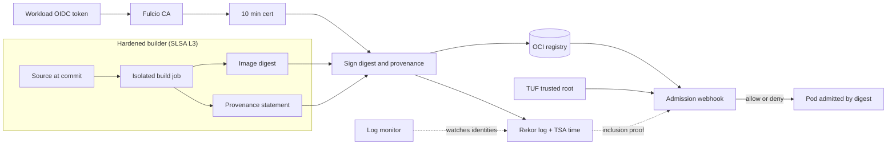

# Software Supply Chain Security: SLSA and Sigstore

## TL;DR

1. A signature proves only that a key or identity vouched for a specific manifest digest. It says nothing about whether the build was sound, the source was reviewed, or the dependencies were clean. SLSA provenance is the structured claim that answers those questions, and a signature on the provenance makes it trustworthy.
2. SLSA Build L1 is provenance that exists. L2 is signed provenance from a hosted builder. L3 is a hardened builder in which user-defined build steps cannot reach the signing material or forge provenance. The levels measure how hard it is to forge the evidence, not how good the software is.
3. Keyless Sigstore replaces long-lived keys with a roughly 10-minute Fulcio certificate bound to an OIDC identity. Verification therefore depends on trusted time (a Rekor v1 signed entry timestamp or an RFC 3161 timestamp for Rekor v2), not on the wall clock at verify time.
4. A transparency log gives detection, not prevention. Without monitors that watch your identities and witnesses that prevent split views, the log is decoration.
5. Enforcement lives in admission control, and that is where the operational risk is. `failurePolicy`, bootstrap deadlocks, subresource coverage (ephemeral containers), tag-to-digest mutation, and trust-root freshness cause more outages than attackers do. Roll out in audit mode, enforce by digest, and fail closed only after you have made the verifier statically stable.

## Mental Model



The build produces two artifacts: an image identified by a content digest, and a statement about how it was built.
A short-lived credential proves who signed both.
The registry stores the bytes, and the transparency log makes the act of signing publicly auditable.
Consumers never trust the registry or the log operator.
They trust a small root (the TUF-distributed trusted root, or your own KMS public key) and re-derive every claim: the certificate chain, the identity, the signing time, the log inclusion, and the policy match.
The decoupling is deliberate.
Signing, storage, logging, and enforcement are four independent systems, so compromising any one of them (the registry in particular) must not let an attacker forge a passing artifact.

## Internals

### What each artifact actually claims

An image in an OCI registry is a manifest that names config and layer blobs by SHA-256 digest.
The manifest digest is a Merkle-style commitment to every byte of the image.
When the container runtime pulls by digest, it recomputes and checks each layer, so verifying the manifest digest is enough to cover a 20 GB GPU image.
Signature verification is therefore a constant-size operation and does not hash layers.
This matters for [[17-Cloud-AI-Engineering/Volume_11_LLM_Serving_and_Inference_Systems_on_Cloud/Chapter_08_Cloud_GPU_Autoscaling_and_Cold_Start_Mitigation|GPU cold-start mitigation]], because signing and verifying do not scale with image size.

A signature over a tag is meaningless, because tags are mutable pointers.
Always sign `repo@sha256:...` and enforce by digest.

### SLSA Build track

The [SLSA v1.0 levels page](https://slsa.dev/spec/v1.0/levels) defines three build levels (slsa.dev, as of 2026-10):

| Level | Requirement | Focus |
| --- | --- | --- |
| Build L1 | Provenance showing how the package was built | Mistakes, documentation |
| Build L2 | Signed provenance, generated by a hosted build platform | Tampering after the build |
| Build L3 | Hardened build platform | Tampering during the build |

The [v1.2 build track page](https://slsa.dev/spec/v1.2/build-track-basics) adds an explicit Build L0 (no requirements) and notes that the Source Track was reintroduced in 1.2 (slsa.dev, as of 2026-10).
Secondary sources date v1.1 to April 2025 and v1.2 to November 2025, with Source Track levels L1 to L4.

The mechanism behind L3 is what matters.
L2 only requires that the platform, not the tenant, generates and signs provenance.
L3 adds two isolation properties.
First, runs must be isolated from one another so one build cannot influence another, for example through a poisoned cache.
Second, the signing secret material must be inaccessible to user-defined build steps.
In practice the platform signs provenance in a separate trust domain from the user's `run:` steps.

On GitHub Actions, the common L3 pattern is a reusable workflow.
The OIDC token for the signing job carries the `job_workflow_ref` claim, which Fulcio copies into the certificate as Build Signer URI (`1.3.6.1.4.1.57264.1.9`).
The caller cannot change what runs inside the reusable workflow, so the verifier pins that URI and its ref.
Fulcio's other CI extensions include Source Repository URI (`.1.12`), Source Repository Digest (`.1.13`), and Source Repository Ref (`.1.14`) (Fulcio OID directory via [community write-up](https://oneuptime.com/blog/post/2026-08-25-verify-fulcio-github-workflow-build-signer-oids/view), as of 2026-10).
The issuer is recorded in `.1.8` (Issuer V2), and the older `.1.1` extension is deprecated (same source).
The consequence is that the identity you verify is "this workflow file at this ref, run for this repository", not "someone with a token".

### Provenance anatomy: in-toto and DSSE

SLSA provenance is an in-toto Statement.
It lists `subject` entries (name plus digest) and carries a predicate.
The v1 provenance predicate has a `buildDefinition` and `runDetails`.
`buildDefinition` holds `buildType`, `externalParameters`, `internalParameters`, and `resolvedDependencies`.
`runDetails` holds `builder.id` and metadata.
The statement is wrapped in a DSSE envelope.
DSSE signs a pre-authentication encoding that binds the payload type and length to the payload bytes, which prevents an attacker from re-presenting a signed payload under a different interpretation.

The field that gets forgotten at verification time is `externalParameters`.
Those are the inputs an attacker could influence, such as the workflow inputs, the ref, and the entry point.
A consumer policy that checks only "a valid signature exists from the builder" accepts a legitimate, signed build of an attacker-chosen ref.
The policy must pin `builder.id`, the source repository URI, the ref or branch, and the entry point, and it must confirm that the provenance `subject` digest equals the digest being admitted.

### Sigstore data plane and control plane

| Component | Role | Plane |
| --- | --- | --- |
| OIDC issuer (GitHub, Google, cloud IdP) | Authenticates the workload and issues a short-lived token | Control |
| Fulcio | CA that binds the authenticated identity to an ephemeral public key | Control |
| Certificate transparency log for Fulcio | Issues an SCT embedded in the certificate | Control, audit |
| Rekor | Append-only log of signing events | Audit |
| RFC 3161 timestamp authority | Signed time evidence | Verification input |
| TUF repository | Distributes TrustedRoot and SigningConfig | Trust distribution |
| Cosign and admission verifier | Sign and verify | Data |

The flow is as follows.
The client generates an ephemeral keypair and obtains an OIDC token with audience `sigstore`.
It proves possession of the private key to Fulcio, and Fulcio returns an X.509 code-signing certificate valid for 10 minutes ([Fulcio README](https://github.com/007vedant/fulcio), as of 2026-10).
The client signs the artifact, discards the private key, and uploads the signature and certificate to the log.
The [Sigstore CCS 2022 paper](https://dl.acm.org/doi/10.1145/3548606.3560596) ("Sigstore: Software Signing for Everybody") describes this design.
There is no private key to steal after the fact, because the key exists for minutes.
The cost is that every verification must answer "was this signing event within the certificate window", and that question is the one the next section addresses.

TUF distributes the trust anchors.
Per the [rekor-tiles README](https://github.com/sigstore/rekor-tiles), clients pull the current Rekor v2 shard URL from the TUF-distributed SigningConfig and fetch active and inactive shard public keys from the TrustedRoot (Sigstore, as of 2026-10).
TUF itself (Samuel et al., "Survivable Key Compromise in Software Update Systems", CCS 2010) provides threshold-signed root metadata, role separation, and expiry.
Expiry is a failure mode covered below.

### Mechanism 1: trusted time for 10-minute certificates

A signature made on Monday is verified on Thursday.
The certificate expired three days ago.
Verification still succeeds, because the verifier does not ask whether the certificate is valid now.
It asks whether the signature was created while the certificate was valid.
That requires time evidence that the signer cannot forge.

- Rekor v1 supplies a signed entry timestamp (SET) and an `integratedTime`, signed by the log key. The verifier checks that the integrated time falls within the certificate's validity window.
- Rekor v2 deliberately drops this. Per the [community outage write-up](https://oneuptime.com/blog/post/2026-08-11-rekor-cosign-verification-transparency-log-outage/view), Rekor v2 returns an inclusion proof and signed checkpoint, and trusted time comes from an RFC 3161 timestamp (as of 2026-10). A v2 bundle without a TSA timestamp has no trusted time and cannot be verified, and downstream tooling now fails closed in that case ([NVIDIA AICR notes](https://docs.nvidia.com/aicr/contributor-guide/rekor-v-2-signing), as of 2026-10).

The practical consequence is that the "signed with Rekor v2" claim in a pipeline is incomplete unless the signing config also includes a timestamp authority.
The `/tmp/lab/tlog_verify.py` artifact in the worked example demonstrates the difference between the wrong check (wall-clock now) and the right one (trusted signing time).

### Mechanism 2: transparency log structure, tiles, witnesses, and monitors

A transparency log is a Merkle tree over entries, following the RFC 6962 and [RFC 9162](https://www.rfc-editor.org/rfc/rfc9162) constructions.
The log publishes a signed checkpoint containing the tree size and root hash.
An inclusion proof for entry `i` is the sibling hashes along the path to the root, so it is `ceil(log2 N)` hashes.
At one billion entries that is about 30 hashes and 960 bytes, which is small enough to ship inside a bundle and verify offline.
A consistency proof shows that a newer checkpoint extends an older one without rewriting history.

Rekor v2 changes the storage layer, not the math.
It replaces Trillian with Trillian-Tessera and uses a tile-based layout ([Sigstore blog, 2025-04-17](https://blog.sigstore.dev/rekor-v2-alpha/)).
Tiles are immutable static files, so reads are cacheable at a CDN or object store, and the serving cost drops because there is no per-query database.
The same post lists integrating witnessing directly into Rekor as a planned security improvement ("To be implemented" at alpha time), and I could not confirm that it had shipped by 2026-10, so treat it as UNVERIFIED.
Russ Cox's ["Transparent Logs for Skeptical Clients"](https://research.swtch.com/tlog) is the best explanation of why clients, not servers, must do the verification work.

Two properties are routinely misunderstood.
First, a log does not stop a bad signature from being created.
It makes the signature discoverable, but only if someone is looking.
A monitor must watch for unexpected certificates issued to your OIDC identities, such as a workflow identity signing at 03:00 when you never release at 03:00.
Second, a single log operator can serve different views to different clients (a split view).
Witnesses countersign checkpoints and make that detectable.

### Mechanism 3: where signatures live in an OCI registry

Cosign originally stored a signature as a separate image at the tag `sha256-<digest>.sig` in the same repository.
The newer Sigstore bundle format packages the certificate, signature, log proof, and timestamp into one JSON bundle and attaches it using the OCI referrers mechanism, with a fallback tag scheme when the registry lacks the referrers API.
You can see this in the wild: a signed image with no `.sig` tag is signed in the new format, and the sibling fallback tag is named `sha256-<digest>` without a suffix ([GitHub issue, 2026-10](https://github.com/Danathar/aurora-zfs-simple/issues/393)).

Cosign v3 made the bundle format the default.
Per the [release notes](https://github.com/sigstore/cosign/releases), v3.1.x signs in the bundle format by default but can sign the old way with `--new-bundle-format=false`, and its verify commands try to detect the format (as of 2026-10).
The v3.0.1 notes add that the `--bundle` flag, which names the output file, moved from optional to required (newreleases.io mirror, as of 2026-10).
Two public reports show the sharp edge.
With the new format on, `--output-signature` and `--output-certificate` are ignored, which broke release pipelines that consumed detached files ([example PR](https://github.com/fstubner/netscli/pull/393), 2026-09).
In another case, the verifier in the nightly check was cosign 3, which verified the new format by default, so the check stayed green while hosts running an older verifier could not find a `.sig` tag.
The lesson is to test the verifier your consumers actually run, not the one your producer ships.

### Admission control mechanics

The Kubernetes API server calls validating and mutating admission webhooks synchronously on create and update of matched resources.
Four mechanical facts drive almost every production incident:

1. Webhook timeout defaults to 10 seconds, and `failurePolicy` decides what happens on timeout or error (Kubernetes admission docs, UNVERIFIED this pass). With `Fail`, a dead verifier blocks all matched pod creation, including its own replacement pods. With `Ignore`, a dead verifier admits everything.
2. Admission sees the request, not the world. Already-running pods are not re-verified, so a policy tightened today does nothing for pods admitted yesterday. This is why GKE Binary Authorization offers continuous validation (UNVERIFIED this pass).
3. Webhook `rules` are per resource and subresource. Ephemeral containers are added through the `pods/ephemeralcontainers` subresource, so a policy that matches only `pods` can miss images introduced by `kubectl debug` (Kubernetes API behavior, UNVERIFIED this pass).
4. A tag is resolved at pull time, not at verification time. If the webhook verifies `app:v1` and the kubelet later pulls `app:v1`, the tag may have moved in between. The fix is for the mutating phase to rewrite the tag to the verified digest, which Kyverno calls `mutateDigest` and the Sigstore policy-controller also does (UNVERIFIED this pass). Pair it with immutable tags in the registry.

The bootstrap deadlock is the classic.
The verifier's own pods must be admitted before the verifier runs.
With `failurePolicy: Fail`, a cold-start of the control plane after a full outage can deadlock, because the webhook backend is unavailable and so cannot admit its own replicas.
Mitigate with `namespaceSelector` exclusions for the verifier namespace and `kube-system`, a separately signed and locally cached bootstrap path, and at least three replicas spread across zones.
See [[17-Cloud-AI-Engineering/Volume_05_Kubernetes_and_Platform_Engineering/Chapter_01_Kubernetes_Control_Loop_Internals|Kubernetes Control Loop Internals]] for how a deployment controller will hammer a failing webhook with retries.

### AWS and GCP specifics

On AWS, the first-party signing path is AWS Signer with Notation-format signatures, and ECR has recently added managed signing; both are UNVERIFIED in this pass, so confirm GA status in the current docs before relying on them.
Amazon EKS does not ship a built-in image-signature admission gate that I could verify, so enforcement is usually Kyverno, or Gatekeeper with Ratify, or the Sigstore policy-controller.
See [[17-Cloud-AI-Engineering/Volume_02_AWS_Deep_Dive/Chapter_07_Amazon_EKS_Control_Plane_and_Networking|Amazon EKS: Control Plane and Networking]].

On GCP, Binary Authorization is the built-in admission mechanism for GKE and Cloud Run.
Attestors hold public keys (typically Cloud KMS asymmetric keys), attestations live as Artifact Analysis occurrences, policies are per cluster, and there are dry-run and break-glass modes (UNVERIFIED this pass).
Cloud Build can emit SLSA provenance for container builds, and Google's documentation makes an L3 claim for it (UNVERIFIED this pass; check the current level before using it as a compliance statement).
See [[17-Cloud-AI-Engineering/Volume_03_GCP_Deep_Dive/Chapter_07_GKE_Deep_Dive_Standard_vs_Autopilot|GKE Deep Dive]].

## Numbers to Know

| Item | Value | Source and date |
| --- | --- | --- |
| Fulcio certificate lifetime | 10 minutes | [Fulcio README](https://github.com/007vedant/fulcio) (as of 2026-10) |
| SLSA Build track levels | L0 to L3 (L0 added explicitly in v1.2) | [slsa.dev v1.2](https://slsa.dev/spec/v1.2/build-track-basics) (as of 2026-10) |
| SLSA Source track levels | L1 to L4, introduced in v1.2 | Secondary summary, [Chainloop docs](https://docs.chainloop.dev/reference/slsa-provenance) (as of 2026-10) |
| SLSA v1.1 and v1.2 approval | April 2025 and November 2025 | Secondary, [DEV Community deep dive](https://dev.to/kanywst/slsa-deep-dive-securing-the-supply-chain-using-verifiable-levels-klk) (as of 2026-10) |
| Rekor v2 GA | 2025-10-10, client support in Cosign v2.6.0 and Go, Python, Java clients | [Sigstore blog](https://blog.sigstore.dev/rekor-v2-ga/) (as of 2026-10) |
| Rekor v2 public instance availability SLO | 99.5% (about 3.65 hours per 730-hour month of allowed unavailability, derived) | [rekor-tiles README](https://github.com/sigstore/rekor-tiles) (as of 2026-10) |
| Rekor v2 shard rotation | New log instance roughly every 6 months, URL changes | rekor-tiles README (as of 2026-10) |
| Rekor v1 freeze notice | Announced one year in advance | Sigstore blog 2025-10-10 (as of 2026-10) |
| Rekor v2 trusted time | No inline SET or integrated time, needs RFC 3161 TSA | Community write-ups (as of 2026-10) |
| Cosign v3 default | New bundle format on, `--bundle` required for output | [Cosign releases](https://github.com/sigstore/cosign/releases) (as of 2026-10) |
| Inclusion proof size | 20 hashes (640 B) at 1e6 entries, 30 hashes (960 B) at 1e9, derived by `tlog_verify.py` | RFC 9162 math, computed locally (as of 2026-10) |
| Admission webhook timeout | Default 10 s, allowed range 1 to 30 s | Kubernetes docs (UNVERIFIED this pass) |
| KMS asymmetric sign cost | Per-request charge plus monthly key fee | UNVERIFIED, check [AWS KMS pricing](https://aws.amazon.com/kms/pricing/) and Cloud KMS pricing |

Two derived numbers are worth memorizing.
A 99.5% SLO on the log means a CI release job that hard-depends on it will fail to sign for up to roughly 3.65 hours a month, so give release pipelines a retry-with-backoff budget and a documented fallback.
Verification of an existing bundle needs no network call to Rekor, because the proof travels in the bundle, so the runtime deploy path can be statically stable against a log outage if the trusted root is cached and fresh.

## AWS vs GCP Mechanism Parity

| Dimension | AWS | Google Cloud |
| --- | --- | --- |
| CI workload identity | GitHub or other OIDC provider federated into an IAM role via `AssumeRoleWithWebIdentity`, scoped by `sub` condition. See [[17-Cloud-AI-Engineering/Volume_08_Security_Identity_and_the_Data_Perimeter/Chapter_02_Workload_Identity_Federation\|Workload Identity Federation]] | Workload Identity Federation pool and provider with attribute conditions |
| Sigstore keyless | Works against public Fulcio and Rekor from any cloud. No first-party Sigstore CA | Same. Google engineers contribute heavily, but the public-good instance is a community service with a 99.5% Rekor v2 SLO |
| Key-based signing | KMS asymmetric key, `ECC_NIST_P256` or RSA, referenced as `awskms:///alias/name` in Cosign | Cloud KMS asymmetric key, referenced as `gcpkms://...` in Cosign |
| Managed signing | AWS Signer with Notation, and ECR managed signing (UNVERIFIED, confirm GA) | Binary Authorization attestors with Cloud KMS keys and Artifact Analysis notes (UNVERIFIED) |
| Signature format | Notation (JWS or COSE) or Cosign bundle | Binary Authorization attestations, or Cosign signatures verified through policy (UNVERIFIED) |
| Build provenance | No first-party SLSA L3 builder claim verified. Typically GitHub artifact attestations or `slsa-github-generator` | Cloud Build provenance with a documented SLSA level (UNVERIFIED, confirm current level) |
| Admission enforcement | No built-in on EKS. Kyverno, Gatekeeper plus Ratify, or policy-controller | Binary Authorization built into GKE, with dry-run, break-glass, and continuous validation (UNVERIFIED) |
| Registry immutability | ECR `IMMUTABLE` tag setting | Artifact Registry tag immutability (UNVERIFIED) |
| Network boundary | VPC endpoints for ECR and KMS, with endpoint policies. See [[17-Cloud-AI-Engineering/Volume_08_Security_Identity_and_the_Data_Perimeter/Chapter_06_Constructing_an_Impenetrable_Data_Perimeter\|data perimeter]] | VPC Service Controls around Artifact Registry and Cloud KMS |
| Failure of the verifier | You own webhook HA and `failurePolicy` | Managed control, but policy misconfiguration still blocks rollouts (break-glass exists) |

The critical difference is ownership of the enforcement plane.
On GKE you buy it and accept its policy model.
On EKS you assemble it, so you own HA, trust-root refresh, and upgrade skew of the verifier.
Neither cloud makes keyless Sigstore private by default.
Public Rekor entries expose repository paths and signer identities, which is a data-governance decision (see Security and Cost Angles).

## Worked Example: KMS-Backed Image Signing, an Offline Log Proof Check, and Admission Sizing

The lab provisions an immutable-tag ECR repository, a KMS signing key, and a budget alarm.
It signs an image by digest with a KMS key (no Sigstore network dependency), and then runs two offline Python artifacts: a Merkle inclusion verifier with a trusted-time check, and an admission sizing model.

### Cost estimate

- One ECR repository with a tiny image: well under 1 USD for a day of storage (UNVERIFIED price basis, check [ECR pricing](https://aws.amazon.com/ecr/pricing/)).
- One asymmetric KMS key: a monthly key fee prorated, plus a handful of sign requests (UNVERIFIED, check KMS pricing). The 7-day deletion window is the minimum, so confirm in billing that a key pending deletion no longer accrues the fee (UNVERIFIED).
- Budget: a 5 USD monthly budget with an 80 percent email alarm. Expected lab spend is a few USD at most, so treat 5 USD as a ceiling that should never trip.

### Terraform

```hcl
terraform {
  required_providers {
    aws = { source = "hashicorp/aws", version = "~> 5.0" }
  }
}

variable "region" {
  type    = string
  default = "us-east-1"
}

variable "alert_email" {
  type = string
}

provider "aws" {
  region = var.region
}

resource "aws_ecr_repository" "app" {
  name                 = "supplychain-lab/app"
  image_tag_mutability = "IMMUTABLE"
  force_delete         = true

  image_scanning_configuration {
    scan_on_push = true
  }
}

resource "aws_kms_key" "signing" {
  description              = "supplychain-lab cosign signing key"
  key_usage                = "SIGN_VERIFY"
  customer_master_key_spec = "ECC_NIST_P256"
  deletion_window_in_days  = 7
}

resource "aws_kms_alias" "signing" {
  name          = "alias/supplychain-lab-cosign"
  target_key_id = aws_kms_key.signing.key_id
}

resource "aws_budgets_budget" "lab" {
  name         = "supplychain-lab"
  budget_type  = "COST"
  limit_amount = "5"
  limit_unit   = "USD"
  time_unit    = "MONTHLY"

  notification {
    comparison_operator        = "GREATER_THAN"
    threshold                  = 80
    threshold_type             = "PERCENTAGE"
    notification_type          = "ACTUAL"
    subscriber_email_addresses = [var.alert_email]
  }
}

output "repo_url" {
  value = aws_ecr_repository.app.repository_url
}
```

### Sign and verify by digest

```bash
set -euo pipefail
tofu init && tofu apply -var alert_email=you@example.com
REPO=$(tofu output -raw repo_url)
aws ecr get-login-password | docker login --username AWS --password-stdin "${REPO%%/*}"

printf 'FROM public.ecr.aws/docker/library/alpine:3.20\nRUN echo lab > /lab.txt\n' > Dockerfile
docker build -t "$REPO:lab-1" . && docker push "$REPO:lab-1"
DIGEST=$(aws ecr describe-images --repository-name supplychain-lab/app \
  --query 'imageDetails[0].imageDigest' --output text)

# Key-based flow. In cosign 2.x, --tlog-upload=false keeps metadata out of the public log.
# Flag behavior under cosign 3 is UNVERIFIED; pin cosign 2.6.x for this lab or read the v3 notes.
cosign sign --key awskms:///alias/supplychain-lab-cosign --tlog-upload=false "$REPO@$DIGEST"
cosign verify --key awskms:///alias/supplychain-lab-cosign --insecure-ignore-tlog=true "$REPO@$DIGEST"
```

The sign and verify calls use the digest, never the tag.
The `IMMUTABLE` setting means `lab-1` cannot be repointed, which closes the tag-move window described under Internals.

### Admission policy sketch (Kyverno, UNVERIFIED field names for your installed version)

```yaml
apiVersion: kyverno.io/v1
kind: ClusterPolicy
metadata:
  name: verify-signed-images
spec:
  validationFailureAction: Audit   # flip to Enforce only after the audit report is clean
  webhookTimeoutSeconds: 10
  failurePolicy: Fail
  rules:
    - name: keyless-github
      match:
        any:
          - resources:
              kinds: [Pod]
      verifyImages:
        - imageReferences: ["*.dkr.ecr.*.amazonaws.com/supplychain-lab/*"]
          mutateDigest: true
          verifyDigest: true
          required: true
          attestors:
            - entries:
                - keyless:
                    issuer: https://token.actions.githubusercontent.com
                    subject: https://github.com/ORG/REPO/.github/workflows/release.yml@refs/heads/main
```

Production notes: exclude the policy engine's own namespace, include `pods/ephemeralcontainers` in webhook rules where the engine supports it, and run at least three replicas across zones.

### Offline log proof and trusted-time check

Run the verifier from the lab directory:

```bash
python3 tlog_verify.py
```

It builds a 1,000-entry RFC 9162 tree, generates the inclusion path for entry 637, and verifies it.
Observed output in the sandbox (Python 3.11):

```text
tree_size=1000 proof_hashes=10 proof_bytes=320
inclusion ok: True
tampered leaf rejected: True
wrong index rejected: True
wall-clock check (wrong): False
trusted-time check (right): True
N=1e+09 inclusion proof ~30 hashes ~960 bytes
```

The core is the standard RFC 9162 verification loop:

```python
def verify_inclusion(leaf_hash, index, tree_size, proof, root) -> bool:
    if index >= tree_size:
        return False
    fn, sn, r = index, tree_size - 1, leaf_hash
    for p in proof:
        if sn == 0:
            return False
        if fn & 1 or fn == sn:
            r = h_node(p, r)
            if not fn & 1:
                while not fn & 1 and fn != 0:
                    fn >>= 1
                    sn >>= 1
        else:
            r = h_node(r, p)
        fn >>= 1
        sn >>= 1
    return sn == 0 and r == root
```

The two last lines of the demo show why trusted time matters.
A signature made at 12:02 UTC on 2026-10-18 under a certificate valid from 12:00 to 12:10 fails a check against the current clock (2026-10-21) and passes a check against the timestamp authority's time.

### Admission sizing

The model assumes a burst of 400 pod creations per second (a node-drain storm), 60 unique digests, a 250 ms p99 miss latency for registry plus bundle verify, and a 2 ms cache hit.
All of these are assumptions to be replaced by measurement.
Output from `admission_sizing.py`:

```text
miss_rate=0.0050 avg_latency_ms=3.24
steady burst concurrency=1.30 -> replicas=1 (use >=3 for HA)
cold cache, no single-flight concurrency=100 -> replicas=7
timeout headroom: p99 miss 250 ms vs 10 s timeout = 40x
```

The warm-cache result says one replica could carry the load, but three are needed for availability.
The cold-cache result says that without a shared cache or single-flight deduplication, 400 requests per second of cache misses demand 100 concurrent verifications.
A webhook restart in the middle of a storm is therefore the dangerous moment, and it is exactly when `failurePolicy: Fail` converts verifier slowness into an outage.
Single-flight per digest, a cache TTL measured in minutes, and a readiness gate that waits for cache warmup address it.

### Teardown

```bash
tofu destroy -auto-approve -var alert_email=you@example.com
aws kms list-aliases --query "Aliases[?AliasName=='alias/supplychain-lab-cosign']"   # expect empty
aws ecr describe-repositories --repository-names supplychain-lab/app || echo "repo gone"
```

`force_delete = true` removes the repository with images.
The KMS key enters its 7-day pending deletion window, which is the minimum.

## Failure Modes and Pitfalls

### Signing the tag, verifying the tag

A pipeline signs `app:prod`, the verifier checks `app:prod`, and the registry allows tag mutation.
The attacker with push rights moves the tag after verification and before pull.
Defense: sign and enforce by digest, mutate tags to digests at admission, and set repository tag immutability.
The March 2025 compromise of the `tj-actions/changed-files` GitHub Action (CVE-2025-30066) worked by repointing existing version tags to a malicious commit, so every consumer pinned to a tag ran attacker code.
Pinning actions by commit SHA is the same principle applied to CI inputs (incident details from public advisories, UNVERIFIED this pass).

### Format migration breaks the verification chain

The Cosign v3 default change is the freshest example.
Producers upgraded and began emitting the bundle format, consumers on older verifiers could not find `.sig` tags, and release steps that expected detached files failed outright ([PR #393](https://github.com/fstubner/netscli/pull/393), [issue #393](https://github.com/Danathar/aurora-zfs-simple/issues/393), 2026-09 and 2026-10).
A compliance job that ran with the same cosign version as the signer reported green while real consumers could not verify.
Pin tool versions explicitly, run a canary verification with the oldest verifier in your fleet, and treat a format change as a breaking API change.

### Rekor v2 without a timestamp authority

A pipeline switches to Rekor v2 and verification quietly depends on an inline timestamp that no longer exists.
Bundles fail verification, or worse, a permissive verifier skips the time check.
Defense: require a TSA in the signing config and fail closed when a v2 bundle lacks a timestamp.

### TUF trust-root staleness and rotation

Admission verifiers refresh the TUF trusted root periodically.
A long-lived or air-gapped cluster that cannot reach the TUF mirror will eventually hold expired metadata, or will miss a rotation, such as a new Rekor v2 shard key (the community instance rotates shards about every 6 months per the rekor-tiles README).
Verification then fails for correct signatures, and under `failurePolicy: Fail` that blocks deployments.
Defense: mirror the TUF repository internally, alert on metadata expiry horizon, and test root rotation in staging.

### Admission as an availability dependency

Typical patterns, in order of how often they bite:
- `failurePolicy: Fail` with a single-replica verifier that restarts during a rollout storm. Pod creation stalls, controllers retry, and the retry load deepens the stall.
- The verifier namespace is not excluded, so a control-plane restart deadlocks as described under Internals.
- Registry rate limiting or throttling during a mass rollout makes the cache-miss path slow. Verification latency approaches the 10-second webhook timeout, which turns a degradation into denials.
- The policy matches `pods` but not `pods/ephemeralcontainers`, so debug containers bypass it.
- Policy applies to new pods only, so a tightened rule leaves existing workloads unverified without continuous validation.
For the general pattern of a cascading dependency failure, see [[17-Cloud-AI-Engineering/Volume_07_Reliability_and_SRE/Chapter_07_Anatomy_of_Major_Cloud_Outages|Anatomy of Major Cloud Outages]].

### The signature is valid and the artifact is malicious

SolarWinds (2020) is the reference case.
The attacker compromised the build environment and injected code during the build, so the legitimate pipeline produced a legitimately signed trojan.
That is the threat SLSA Build L3 addresses, with isolation between the user-defined build steps and the signer.
Codecov (2021, a modified bash uploader) and the xz-utils backdoor (CVE-2024-3094, a social-engineering compromise of a maintainer path) show the adjacent gaps: artifact distribution integrity and source-level trust, which is what the Source Track is meant to cover.
A signature proves provenance of the bytes, not benign intent (incident descriptions from public reporting, UNVERIFIED this pass).

### Public log metadata leakage

Entries in public Rekor expose signer identities and artifact digests, and certificates embed repository and workflow paths.
For internal or regulated software that is an information leak.
Options are a private Sigstore deployment, KMS-key signing with no public log, or accepting the exposure for open-source artifacts.

### Stale trust after identity compromise

Fulcio certificates are short-lived, so there is no revocation list.
If a CI identity is compromised, signatures created during the compromise window remain cryptographically valid forever.
You must respond at the policy layer with a deny rule for the identity within a time window, and you need a monitor that can enumerate what that identity signed.
Question 6 below works through this case.

## Security and Cost Angles

### IAM and key custody

- Separate roles: a build role that can push to ECR and call `kms:Sign` on one key, and a deploy role that can only pull. Scope the federated build role with a `sub` condition that pins repository and branch or environment, not just the issuer. See [[17-Cloud-AI-Engineering/Volume_08_Security_Identity_and_the_Data_Perimeter/Chapter_02_Workload_Identity_Federation|Workload Identity Federation]].
- The KMS signing key policy must separate key administrators from key users, so the team that can sign cannot also rewrite the policy. See [[17-Cloud-AI-Engineering/Volume_02_AWS_Deep_Dive/Chapter_15_Security_and_Cryptography_KMS_and_Nitro_Enclaves|KMS and Nitro Enclaves]] and [[17-Cloud-AI-Engineering/Volume_03_GCP_Deep_Dive/Chapter_15_Security_and_Confidential_Computing_Cloud_KMS|Cloud KMS]].
- Signing uses an asymmetric key, so there is no data-encryption-key hierarchy and no envelope. The key never leaves the HSM-backed service, and `kms:Sign` calls are in CloudTrail, which gives you an audit trail even with no transparency log. For the hierarchy concepts that do apply to registry encryption at rest, see [[17-Cloud-AI-Engineering/Volume_08_Security_Identity_and_the_Data_Perimeter/Chapter_04_Encryption_Key_Hierarchies_and_Envelope_Encryption|Encryption Key Hierarchies and Envelope Encryption]].
- Registry write access is the real perimeter. If anyone can push to the production repository, signing at CI is advisory. Restrict pushes to the build role and keep the registry behind VPC endpoints or VPC Service Controls ([[17-Cloud-AI-Engineering/Volume_08_Security_Identity_and_the_Data_Perimeter/Chapter_06_Constructing_an_Impenetrable_Data_Perimeter|next chapter]]).

### Choosing a trust model

| Model | Pros | Cons |
| --- | --- | --- |
| Keyless, public-good Sigstore | No key custody, public auditability, free | Depends on a community service with a 99.5% SLO, leaks metadata, identity-policy discipline required |
| Keyless, private Sigstore | Private metadata, your SLO | You run Fulcio, a log, a CT log, a TSA, and a TUF root with key ceremonies |
| KMS-backed key signing | Simple, cloud-native, offline verification, audit in CloudTrail | Key rotation and revocation are yours, no per-run identity binding |

### Unit economics

- Signing cost per image is negligible: one KMS sign call plus a small registry write (prices UNVERIFIED this pass).
- Verification cost is dominated by latency on the admission path and registry calls on a cache miss, not by a per-request fee. Cache by digest and use single-flight.
- Rekor v2 is designed to be cheaper to run because tiles are static files (Sigstore blog, as of 2026-10), which matters mainly if you operate a private instance.
- The biggest cost lever is policy-exception handling. Every blocked deploy that needs a human to unblock it costs more than the infrastructure. Run audit mode for at least one full release cycle, and keep exception paths time-boxed and logged.
- For AI workloads, model weights are artifacts too. Signing weights as OCI artifacts or with a model-signing tool extends the same chain to the model layer, and the tooling maturity for this is UNVERIFIED in this pass. See [[17-Cloud-AI-Engineering/Volume_12_AI_Applications_MLOps_and_Data_Platforms/Chapter_08_Cloud_Security_for_AI_Systems_Attacks_and_Defenses|Cloud Security for AI Systems]].

## Interview Questions and Model Answers

### Question 1 (L5 - Senior)

A teammate says: "We sign every image with Cosign, so a compromised registry cannot hurt us." Is that right?

#### Model Answer

It is partly right and the limits matter.
A valid signature over a manifest digest means the signer's key or identity vouched for exactly those bytes.
If the verifier checks that signature against a trusted key or identity, a registry attacker who swaps blobs or manifests cannot produce a passing artifact, because the digest would change and the signature would no longer match.
That is the real protection.

The gaps are four.
First, the signature is only as meaningful as the identity policy: "signed by anyone with a Sigstore certificate" is not a policy, while "signed by this workflow at this ref" is.
Second, if the verifier checks a tag and not a digest, an attacker with push rights moves the tag between verification and pull.
Third, if verification is not enforced at admission, the signature is just metadata nobody reads.
Fourth, the signature says nothing about whether the build itself was compromised, which is what provenance and SLSA address.
An attacker who owns the CI system gets a legitimate signature on malicious bytes.

So I would say: signing defends against registry and transit tampering, enforcement by digest at admission makes it effective, and provenance plus a hardened builder is what addresses a compromised pipeline.

#### Follow-up Interviewer Question

Your registry supports mutable tags and you cannot change that this quarter. What do you do so the verification result and the image that runs are guaranteed to be the same bytes?

### Question 2 (L5 - Senior)

Explain the difference between SLSA Build L2 and L3 in terms of an attack each prevents.

#### Model Answer

L2 requires signed provenance generated by a hosted build platform rather than by the developer's laptop or a script in the repository.
That prevents an attacker from tampering with an artifact after the build and presenting hand-made provenance, because the consumer trusts the platform's signature.
It does not stop a malicious build step from running inside the platform and reaching the signing material.

L3 requires a hardened platform: builds are isolated from each other, and the signing secret is not accessible to user-defined build steps.
That prevents a tenant's build script from extracting the signing credential and forging provenance for something it did not build, or from poisoning a shared cache used by a later build.
The slsa.dev wording is that L3 means forging provenance or evading verification requires exploiting a vulnerability beyond what most adversaries can do.

Concretely on GitHub Actions, the L3 pattern is a reusable workflow that signs in a separate job whose OIDC token carries the reusable workflow's reference.
The verifier pins that Build Signer URI, so a caller who modifies their own workflow cannot change what the signing job does.
L3 is about the integrity of the evidence, not the quality of the software.

#### Follow-up Interviewer Question

Your team's workflow runs `curl | bash` inside the build job and the signing is done by a later step in the same job. What SLSA level does that pipeline actually reach, and why?

### Question 3 (L6 - Staff)

A keyless signature was created three days ago with a 10-minute Fulcio certificate. Walk me through how a verifier legitimately accepts it today, and what changes when the log is Rekor v2.

#### Model Answer

The verifier does not ask whether the certificate is valid now, because it has expired.
It asks whether the signature was created inside the certificate's validity window, and it needs time evidence the signer cannot fabricate.

The steps are these.
Validate the certificate chain to the Fulcio root from the TUF-distributed trusted root.
Check the embedded SCT against the CT log keys, so the issuance was logged.
Check the certificate extensions against policy: the OIDC issuer (Issuer V2) and the SAN or Build Signer URI, source repository, and ref.
Verify the signature over the artifact digest with the certificate's public key.
Then establish signing time.

With Rekor v1, the log returns a signed entry timestamp that binds the entry to an `integratedTime` signed by the log key.
The verifier checks that time is inside the 10-minute window and checks the Merkle inclusion proof against a signed checkpoint.
With Rekor v2 there is no SET and no integrated time, and the API has no entry lookup, so the proof must travel in the bundle.
The bundle carries an inclusion proof and checkpoint, which prove the entry is in the log, but not when the signature was made.
Time comes from an RFC 3161 timestamp countersigned by a TSA whose certificate is in the trusted root.
If the bundle has no TSA timestamp, there is no trusted time, and a correct verifier fails closed.

Operationally, that means the signing config must include a TSA, the verifier must trust the TSA certificate, and everything needed is inside the bundle, so verification works offline during a log outage.
The risk is a permissive verifier that skips the time check, which accepts a signature produced by anyone who ever obtained a certificate for that identity, including after the fact if the key were retained.

#### Follow-up Interviewer Question

The public Rekor v2 shard rotates about every six months. A cluster that cannot reach the TUF mirror for four months then receives signatures logged to the new shard. What happens, and how do you design so it does not become an outage?

### Question 4 (L6 - Staff)

Design signature enforcement for 300 EKS clusters running 40,000 pods, with a 15-minute RTO on cluster failure. What decisions determine whether this protects you or becomes your biggest availability risk?

#### Model Answer

The decisions that matter are about failure semantics, not about the cryptography.

Rollout: start with audit mode and collect policy reports for a full release cycle, including batch jobs, CronJobs, and operators that spawn pods. Enforce per namespace in stages, with clusters grouped into cells so a bad policy hits a small blast radius first.

Failure policy: for production, `Fail` is the correct security posture and the dangerous availability posture. To make it safe, run at least three verifier replicas spread across zones, give them a PodDisruptionBudget, exclude the verifier namespace and `kube-system` from the webhook to break the bootstrap deadlock, and set a readiness gate that waits for cache warmup. Keep a documented break-glass path that is audited, time-boxed, and does not require the verifier.

Latency and load: verification costs a registry round trip plus a bundle fetch on a miss, so cache by digest with single-flight deduplication. My sizing model shows a warm cache needs about one replica of capacity at 400 pods per second, but a cold cache with no single-flight needs roughly 100 concurrent verifications. The restart-during-storm case drives the design. During a regional recovery, thousands of pods hit the admission path at once, so the RTO depends on that cold path.

Coverage: match `pods/ephemeralcontainers` as well as pods, mutate tags to digests, enable continuous validation or a periodic scan, because admission does not reevaluate running workloads.

Trust root: mirror TUF internally, alert on metadata expiry, and test rotation. Verify with bundles so there is no runtime dependency on the public log.

Verification of the verifier: a synthetic canary that tries to admit an unsigned pod and a signed pod every minute, with alerts on both false allow and false deny.

#### Follow-up Interviewer Question

During an incident, the on-call proposes flipping `failurePolicy` to `Ignore` cluster-wide to restore deployments. Under what conditions do you approve that, and what do you do to bound the exposure?

### Question 5 (L6 - Staff)

A vendor gives you SLSA L3 provenance for their release. What exactly do you verify before you let it run, and what is still not covered?

#### Model Answer

Verify the signature and chain first, then the semantic content, because the semantic checks are where most real policies are weak.

Cryptographic: DSSE envelope signature, certificate chain to the trusted root, trusted signing time, and log inclusion.
Subject match: the provenance `subject` digest must equal the digest of the artifact I am about to deploy, otherwise a valid provenance for a different artifact is replayed.
Builder identity: `builder.id` and the certificate's Build Signer URI must match a builder I trust, pinned to a version or digest. A signature from "a builder" is not enough.
External parameters: these are the inputs an attacker can influence. Pin the source repository, the ref (a protected release branch or tag), the workflow entry point, and reject unexpected parameters. This is the check teams skip, and without it a legitimate signed build of an attacker-chosen ref passes.
Resolved dependencies: if available, check the source commit and any pinned dependency digests.

Not covered: L3 says nothing about whether the source commit was reviewed (the Source Track L2 to L4 territory), whether dependencies are vulnerable or malicious, whether the build was hermetic or reproducible, or whether the software is correct.
It also does not protect against a compromised maintainer legitimately releasing bad code, as in xz.
So I treat provenance as an input to policy alongside vulnerability scanning, SBOM review, and source-control attestations.

#### Follow-up Interviewer Question

The vendor says the build is L3 but `externalParameters` includes a free-form `entryPoint` string. What do you require, and how would you enforce it automatically rather than by review?

### Question 6 (L7+ - Principal)

Your security team reports that a CI identity used for releases was compromised for six hours last week. Fulcio certificates are short-lived. Explain what you can and cannot do, and design the response and the long-term fix.

#### Model Answer

Short-lived certificates do not give revocation.
They reduce the window for key theft but not the window for identity abuse.
During those six hours the attacker could request new certificates as the compromised identity, and every signature produced remains cryptographically valid forever.
There is no CRL to flip.

So the response is at the policy and evidence layers.

Scope: query the transparency log or a monitor for every entry whose certificate carries that identity during the window, bounded by trusted time. Rekor v1 offers search by identity, but Rekor v2 removed entry lookup and search APIs, so you rely on a monitor that tails the tiles and indexes certificates. If you never ran a monitor, you cannot enumerate the damage from the log alone, and that gap is the first lesson.

Containment: add a deny rule to the admission policy for that identity within the time window (not a blanket identity deny, which would block legitimate releases outside it). Identify which digests were signed in the window and compare them with expected pipeline runs from CI audit logs. Block those digests and trigger a continuous validation sweep to find running workloads that use them.

Eradication: rotate the OIDC trust, tighten the cloud role `sub` condition and the workflow protections, and replay the build for legitimate artifacts to produce fresh signatures.

Long-term: run monitors for every production identity with alerting on off-schedule signing, require a second signal for release (provenance whose source ref is a protected branch with required review, so a stolen token alone cannot produce an acceptable externalParameters), consider a transparency policy that requires inclusion plus trusted time, and use environment-scoped OIDC subjects, so the signing token is only issued to a protected environment with approval.
I would also revisit the trust model: for the highest-value artifacts, a KMS key with a tightly scoped signer role and CloudTrail audit has simpler revocation (disable the key), at the cost of per-run identity binding.

#### Follow-up Interviewer Question

Legal wants to know whether any customer received an artifact signed during the window. Your monitor was deployed only two days ago. What evidence do you have, what do you lack, and what do you commit to the customers?

### Question 7 (L7+ - Principal)

You are the architect for a company running on both AWS and GCP, with a mandate to sign and verify all container images and model artifacts. Choose between public-good keyless Sigstore, a private Sigstore, and KMS-backed keys. Defend the choice and name the trust-root design.

#### Model Answer

I would not pick one model for everything. I would tier by artifact criticality and data sensitivity.

Public-good keyless is appropriate for open-source artifacts you publish, because public auditability is the point and the metadata exposure is acceptable.
Its risks are an availability SLO of 99.5% for the Rekor v2 public instance (about 3.65 hours a month of permitted unavailability), policy discipline on identities, and rotation of shards and trust roots.
Signing jobs need retries and a fallback, while verification should be bundle-based and offline.

For internal production images, I would run KMS-backed signing with a key per environment per cloud, such as AWS KMS `ECC_NIST_P256` and Cloud KMS asymmetric keys, with key policies that separate administration from signing.
That gives simple revocation (disable the key), no dependency on external services at signing time, and CloudTrail and Cloud Audit Logs as the audit trail.
The cost is that identity binding is only as good as who can call Sign, which I enforce by restricting the signer role to the CI OIDC subject on a protected branch and environment.

A private Sigstore deployment (Fulcio, a log, a CT log, a TSA, and a TUF root) makes sense only when the organization needs per-run identity, a private audit trail, and has the team to run it.
The hidden cost is root custody: TUF root key ceremonies with threshold signing, offline root keys, and rotation procedures that are exercised, not just documented.
If I cannot staff that, a private Sigstore is worse than KMS keys.

Cross-cloud trust design: one policy language and verifier (for example the same admission engine on EKS and GKE, or Binary Authorization on GKE with equivalent policy), a trust root that lists both clouds' public keys and any Fulcio roots, provenance requirements that are cloud-independent (builder identity, source ref, subject digest), and a single monitor that watches both signing planes.
I would keep builds on one hardened builder for both clouds, rather than a different builder per cloud, so there is one provenance schema to verify.

For model artifacts, I would sign the manifest of weights and config as an OCI artifact or with a model-signing tool (maturity UNVERIFIED in this pass), because the weights are the highest-value and largest artifacts, and verification of a manifest digest does not scale with size.

The decisions I would write into the design doc: failure semantics per tier (fail closed for production, audit for experimentation), the break-glass process, who owns the trust root, the rotation drills and their cadence, and the metric that tells me the system works (percentage of running workloads covered by a verified digest, measured by continuous validation, not by admission logs).

#### Follow-up Interviewer Question

Six months in, a product team says verification adds 8 seconds to cold starts of their 40 GB GPU inference pods and wants an exemption. How do you determine where the 8 seconds go, and what do you offer them besides an exemption?

## Further Reading

- [SLSA specification v1.0 levels](https://slsa.dev/spec/v1.0/levels) and [v1.2 build track](https://slsa.dev/spec/v1.2/build-track-basics): the normative definition of what each level does and does not claim.
- [Sigstore: Software Signing for Everybody (CCS 2022)](https://dl.acm.org/doi/10.1145/3548606.3560596): the design rationale for keyless signing, Fulcio, and Rekor.
- [Rekor v2 GA announcement](https://blog.sigstore.dev/rekor-v2-ga/) and the [rekor-tiles repository](https://github.com/sigstore/rekor-tiles): the current log design, shard rotation, and client requirements.
- [RFC 9162, Certificate Transparency Version 2.0](https://www.rfc-editor.org/rfc/rfc9162): the inclusion and consistency proof algorithms that the lab implements.
- [Russ Cox, Transparent Logs for Skeptical Clients](https://research.swtch.com/tlog): the clearest explanation of why clients must verify logs and what tiles are for.
- [C2SP tlog-tiles](https://c2sp.org/tlog-tiles): the tile layout specification behind Tessera-based logs.
- [Cosign releases](https://github.com/sigstore/cosign/releases): the authoritative source for the v3 bundle format changes and flag behavior.
- [Life of a Sigstore signature (Chainguard)](https://www.chainguard.dev/unchained/life-of-a-sigstore-signature): a certificate-level walkthrough of what Fulcio issues.
- [DSSE specification](https://github.com/secure-systems-lab/dsse): why the pre-authentication encoding exists and what it prevents.
- [TUF: Survivable Key Compromise in Software Update Systems (CCS 2010)](https://dl.acm.org/doi/10.1145/1866307.1866315): the root-of-trust distribution model underneath Sigstore.
- [[17-Cloud-AI-Engineering/Volume_08_Security_Identity_and_the_Data_Perimeter/Chapter_02_Workload_Identity_Federation|Workload Identity Federation]]: the OIDC exchange that makes keyless signing possible.
- [[17-Cloud-AI-Engineering/Volume_06_Infrastructure_as_Code_and_Delivery/Chapter_04_Policy_as_Code_OPA_Sentinel_and_Guardrails|Policy as Code]]: how to express and test the admission policy as code.
- [[17-Cloud-AI-Engineering/Volume_05_Kubernetes_and_Platform_Engineering/Chapter_07_GitOps_Delivery_Argo_CD_and_Flux|GitOps Delivery]]: where digest pinning and signature verification meet reconciliation.
- [[17-Cloud-AI-Engineering/Volume_08_Security_Identity_and_the_Data_Perimeter/Chapter_07_Compliance_Auditing_and_Non_Repudiation|Compliance, Auditing, and Non-Repudiation]]: mapping signing and log evidence to audit requirements.
