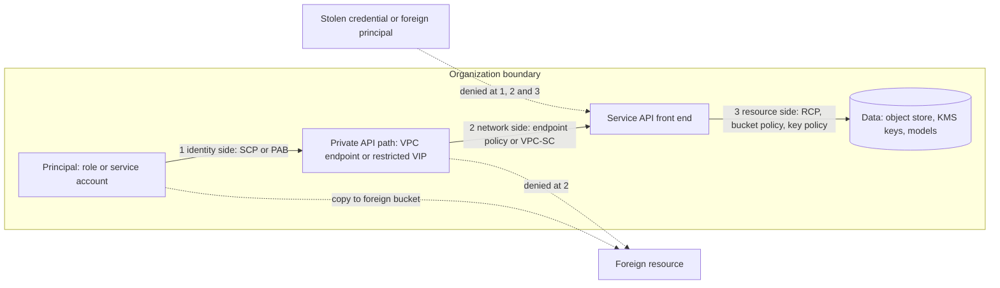

# Constructing an Impenetrable Data Perimeter

## TL;DR

- A data perimeter is three independent invariants enforced at three layers: only trusted identities touch your data, your identities touch only trusted resources, and both happen only from expected networks. The same request must satisfy all three, so a single misconfigured IAM policy cannot open a path on its own.
- On AWS the layers are SCPs (your principals), RCPs and bucket/key policies (your resources), and VPC endpoint policies (the network path). On Google Cloud the main layer is VPC Service Controls (VPC-SC), which enforces at the Google API front end, backed by Organization Policy and IAM deny.
- Perimeters are written as Deny statements that are the negation of the allowed paths. Every exemption you add (AWS service principals, forward access sessions, third parties, break-glass roles) is another AND clause, so most outages come from missing exemptions rather than from bad intent.
- A perimeter governs API calls, not packets. A VM with a NAT route and a trusted credential can still send bytes to the internet, so the network perimeter is only real when private API paths exist and general egress is closed.
- Roll out in observation mode first (VPC-SC dry-run, CloudTrail analysis plus Access Analyzer on AWS), keep a tested break-glass path, and treat the central policy plane as a shared fail-closed dependency with its own blast radius.

## Mental Model



Think of the perimeter as three questions asked on every API call, each answered by a different component that cannot be edited by the team that owns the workload.
Question one is who is calling, and the answer is enforced by organization-wide policy on the principal side and by resource-side policy on the data side.
Question two is where the call came from, and the answer depends on whether the request arrived through a private endpoint you control or through an arbitrary internet path.
Question three is what the call touches, and the answer stops a legitimate, fully authorized insider from writing into a bucket, queue, snapshot, or model registry owned by someone else.
The three decouple on purpose: any single layer can be wrong and the other two still deny.
The cost of that decoupling is operational: you maintain three policy sets with different expressiveness, size limits, and propagation delays, and a legitimate new workflow must be admitted at all three.

## Internals

### The threat model the perimeter actually addresses

Four exfiltration or intrusion paths matter, and each needs a different control.

1. A credential is stolen and replayed from outside your network. The control is a network perimeter on the principal (SCP with `aws:SourceVpc` or `aws:SourceIp`) and on the resource (bucket policy or RCP with the same keys).
2. A trusted principal, legitimately or not, writes data to a resource you do not own, for example `aws s3 cp` to an attacker bucket, sharing an EBS snapshot, or putting a message on a foreign queue. The control is a resource perimeter: `aws:ResourceOrgID` in SCPs and endpoint policies.
3. An untrusted principal reads data because someone wrote a permissive resource policy. The control is an identity perimeter on the resource side: RCP or bucket policy with `aws:PrincipalOrgID`.
4. A workload opens a TCP connection to the internet and ships data without using any cloud API. No cloud IAM construct stops this. It needs egress firewalls, DNS control, and no default route, as covered in [[17-Cloud-AI-Engineering/Volume_02_AWS_Deep_Dive/Chapter_03_VPC_Networking_Internals|VPC Networking Internals]] and [[17-Cloud-AI-Engineering/Volume_03_GCP_Deep_Dive/Chapter_04_Global_VPC_Andromeda_SDN_and_Network_Tiers|Global VPC, Andromeda SDN, and Network Tiers]].

The Capital One breach (public record: OCC and DOJ filings, 2019 to 2020) is the canonical path 1 case.
An SSRF flaw in a WAF-fronted application exposed temporary role credentials from the instance metadata service, and the attacker replayed them from outside the VPC to list and sync S3 buckets.
Roughly 100 million US and 6 million Canadian individuals were affected, and the OCC assessed an $80 million penalty in 2020.
A network perimeter that rejected role-session credentials used outside the expected VPC or CIDR would have turned a credential leak into a failed API call.
Identity policy was "correct" in the sense that the role was authorized to list and read; the missing layer was a condition on where the call came from.

### AWS: where each control sits in the authorization decision

An AWS request is authenticated and then authorized by IAM against a request context assembled by the service front end.
The effective result is the intersection of every applicable boundary, plus a union of grants.
The evaluation order, simplified from [[17-Cloud-AI-Engineering/Volume_02_AWS_Deep_Dive/Chapter_01_IAM_Policy_Evaluation_Engine|IAM Policy Evaluation Engine]], is:

1. Any explicit Deny in any applicable policy ends evaluation with a deny.
2. The organization guardrails must allow: SCPs on the calling principal's account path, and RCPs on the resource's account path.
3. The VPC endpoint policy, if the request arrived through an endpoint, must allow.
4. For same-account access, an identity policy or resource policy grant is sufficient. For cross-account access, both the identity side and the resource side must allow.
5. Permission boundaries and session policies further intersect the identity side.

Three properties of this model drive perimeter design.

First, SCPs only constrain principals in your member accounts, and they never apply to the management account or to service-linked roles.
An SCP therefore cannot stop an outside principal from reading a bucket whose policy is too permissive.
Resource control policies, launched in November 2024, close that gap: an RCP attaches to resources in your accounts and applies regardless of who the caller is, including principals outside your organization.
RCPs are Deny-only guardrails like SCPs, they do not apply to resources in the management account, and they were launched for a limited set of services (S3, STS, KMS, SQS, and Secrets Manager at launch; later additions UNVERIFIED as of 2026-10).

Second, the VPC endpoint policy is evaluated as an additional gate and never grants anything.
Its default is "Allow all", so an endpoint with no policy provides a private path but no perimeter.
Not every endpoint service supports endpoint policies, and for those that do not, the endpoint is effectively full access.

Third, policy evaluation is a regional, eventually consistent data plane.
Treat SCP, RCP, and endpoint-policy changes as taking effect "within minutes" rather than atomically, and never design a runbook that assumes instant enforcement or instant rollback.
See [[17-Cloud-AI-Engineering/Volume_01_Cloud_Architecture_Principles/Chapter_04_Control_Plane_vs_Data_Plane_Separation|Control Plane vs Data Plane Separation]] for why the policy store and the enforcement point are decoupled.

The AWS data perimeter whitepaper (AWS, "Building a Data Perimeter on AWS") organizes the controls as a 3x3 matrix.
The rows are identity, resource, and network objectives.
The columns are the three enforcement points.

| Objective | On your principals (SCP) | On your resources (RCP or bucket/key policy) | On the network path (endpoint policy) |
|---|---|---|---|
| Only trusted identities | not applicable | `aws:PrincipalOrgID` | `aws:PrincipalOrgID` |
| Only trusted resources | `aws:ResourceOrgID` | not applicable | `aws:ResourceOrgID` |
| Only expected networks | `aws:SourceIp`, `aws:SourceVpc` | `aws:SourceIp`, `aws:SourceVpc`, `aws:SourceVpce` | the endpoint itself |

### Non-obvious mechanism 1: absent keys and the AND-of-exemptions structure

A perimeter Deny statement is the logical negation of "the request took an allowed path".
IAM combines multiple condition operators in one statement with AND.
So a Deny with three condition clauses means "deny when clause A AND clause B AND clause C hold", and each exemption (service principals, service-initiated calls, break-glass) is a clause that must evaluate true for the Deny to apply.

The subtle part is what happens when a key is not in the request context.
A positive operator (`Bool`, `StringEquals`) on an absent key evaluates false.
A negated operator (`StringNotEquals`, `NotIpAddress`) on an absent key evaluates true.
The `IfExists` suffix makes any operator evaluate true when the key is absent.

That matters for three keys that are routinely absent:

| Key | Present when | Absent when |
|---|---|---|
| `aws:SourceVpc`, `aws:SourceVpce` | the request came through a VPC endpoint (gateway or interface) | the request came via NAT, internet gateway, or from an AWS service's own network |
| `aws:PrincipalIsAWSService` | the request was signed by AWS credentials: `true` for a service principal calling directly, `false` for IAM identities | the request is anonymous |
| `aws:PrincipalOrgID` | the principal belongs to an organization | the principal is a service principal, an anonymous caller, or an account outside any organization |

Consider the exemption `"BoolIfExists": {"aws:PrincipalIsAWSService": "false"}` inside a Deny.
For an IAM role the key is `false`, the clause matches, and the rest of the Deny applies.
For `cloudtrail.amazonaws.com` delivering logs the key is `true`, the clause does not match, and the Deny is skipped, which is what you want.
For an anonymous request the key is absent, and `IfExists` makes the clause true, so the Deny applies and public access is blocked.
Without `IfExists`, a plain `Bool` clause would silently exempt anonymous callers, which is the exact opposite of the intent.
This one suffix is the difference between a perimeter that blocks public buckets and one that quietly allows them.

The other side of the coin is `aws:ResourceOrgID`.
It is absent for actions that have no resource-level support (for example `s3:ListAllMyBuckets` with `Resource: "*"`) and for resources owned by AWS rather than by an organization member.
A Deny of the form "not in my org, if exists" therefore fires on those actions and resources, so resource-perimeter statements must scope `Action` to resource-level actions and must carve out AWS-owned resources explicitly.

### Non-obvious mechanism 2: forward access sessions versus service-assumed roles

Network-perimeter denies keyed on `aws:SourceVpc` break AWS service features in two distinct ways, and the exemption for one does not cover the other.

When a service calls another service on your behalf using your caller's identity, it uses a forward access session (FAS).
The resulting request has `aws:ViaAWSService` set to `true`, and `aws:CalledVia` records the chain of services.
The `aws:ViaAWSService: false` exemption clause handles this case.

When a service assumes a role in your account and then calls S3 with that role (SageMaker training jobs pulling data, Bedrock batch inference reading input from S3, Glue jobs, Athena with a workgroup role), the call is made by the assumed-role session from AWS service infrastructure.
The principal looks like your role, `aws:PrincipalIsAWSService` is `false`, `aws:ViaAWSService` is not `true`, and there is no VPC context.
Source IP is an AWS-owned address.
Your network-perimeter SCP sees "an IAM role calling S3 from an unknown network" and denies it.

The whitepaper's answer is an explicit, tag-based exception: principals carrying a perimeter-exemption tag (the AWS `data-perimeter-policy-examples` repository uses keys in a `dp:exclude:*` namespace; exact key names UNVERIFIED as of 2026-10) are exempted from the network clause.
The exemption must be paired with a control that stops anyone with `iam:TagRole` from granting themselves the tag, an ABAC privilege-escalation path.
The standard fix is an SCP that denies `iam:TagRole`, `iam:UntagRole`, and `iam:CreateRole` with tags on perimeter tag keys unless the caller is the perimeter-admin role, expressed with `aws:TagKeys` and `aws:PrincipalArn` conditions.
Pair exempted service roles with confused-deputy keys (`aws:SourceAccount`, `aws:SourceArn`, `aws:SourceOrgID`) in their trust policies so the exemption is useless to a different caller.

### Non-obvious mechanism 3: binding credentials to the instance that owns them

The network perimeter on role sessions is only as good as the keys available.
For EC2 instance-profile credentials specifically, AWS added condition keys `aws:EC2InstanceSourceVPC` and `aws:EC2InstanceSourcePrivateIPv4` (launched November 2022, AWS docs; GA status UNVERIFIED as of 2026-10).
These record the VPC and private IP of the instance that the credentials were issued to, which lets a policy deny use of those credentials from anywhere else even when the attacker routes through a different VPC endpoint inside the org.
The pattern is a Deny when `aws:EC2InstanceSourceVPC` differs from `aws:SourceVpc`, guarded by `Null` checks so that non-EC2 principals are unaffected.
This is the control that would directly have made the Capital One credentials unusable off-instance.

### Non-obvious mechanism 4: how a gateway endpoint actually works, and what that implies

An S3 gateway endpoint is not an ENI.
It is a route-table target: the VPC route table gets an entry for the AWS-managed prefix list of S3 regional addresses, pointing at the endpoint, and the VPC data plane forwards matching packets to S3 without NAT or an internet gateway.
S3 then identifies the endpoint from the VPC mapping and populates `aws:SourceVpc` and `aws:SourceVpce` in the request context.
The practical consequences are:

- `aws:SourceIp` is not meaningful for requests that traverse a gateway endpoint, because the S3 service sees a private VPC address. Use `aws:VpcSourceIp`, which is only present for endpoint traffic.
- Gateway endpoints are regional and non-transitive. They do not serve on-premises clients over Direct Connect, peered VPCs, or Transit Gateway attachments, which need an interface endpoint for S3 instead.
- A gateway endpoint carries no hourly or per-GB charge (AWS pricing, UNVERIFIED as of 2026-10), which makes it both a security control and a large cost lever compared with NAT.
- Interface endpoints (PrivateLink) are ENIs in your subnets backed by the Hyperplane flow-tracking data plane, with private DNS that overrides the public service name inside the VPC. If private DNS is disabled, clients resolve the public address, traffic leaves via NAT, `aws:SourceVpce` is absent, and any network-perimeter Deny fires. See the AWS re:Invent talk on VPC internals and Hyperplane (talk ID UNVERIFIED) and the Reachability Analyzer paper (Backes et al., "Reachability Analysis for AWS-based Networks", CAV 2019).

### Non-obvious mechanism 5: endpoint policies and AWS-owned buckets

Several AWS features fetch artifacts from S3 buckets that AWS owns, using your instance's credentials, through your S3 gateway endpoint.
The documented example is ECR: image layers are served from an AWS-owned S3 bucket, and pulling through an interface ECR endpoint in a private subnet still touches S3 via the gateway endpoint, so the endpoint policy must allow the regional layer bucket (`prod-<region>-starport-layer-bucket` per ECR docs, UNVERIFIED as of 2026-10).
Operating-system package repositories, CloudFormation custom resource response buckets, and agent download buckets follow the same pattern.
An endpoint policy that enforces `aws:ResourceOrgID` blocks all of them, because AWS-owned buckets carry no organization of yours.
The failure presents as "image pull hangs" or "yum times out" in a subnet with no NAT, which is why first-time perimeter rollouts hit it within hours.
The structural fix is a `NotResource` carve-out on the resource-perimeter Deny, listing exactly the AWS-owned bucket ARNs you need, and nothing else.

### Non-obvious mechanism 6: policy size is a design constraint, not a footnote

SCPs and RCPs are each limited to 5,120 characters per policy (AWS Organizations docs, UNVERIFIED as of 2026-10), and historically only five SCPs could be attached to any one root, OU, or account (a raise to ten is something I recall but could not verify; UNVERIFIED).
A full network-perimeter statement with a service list, CIDR list, VPC list, exemption clauses, and tag exceptions routinely consumes 800 to 1,200 characters.
You therefore split perimeters across multiple policies by objective, push resource-side conditions into RCPs and endpoint policies (endpoint policies allow up to 20,480 characters, UNVERIFIED as of 2026-10), and keep exceptions in tags rather than in enumerated ARNs.
Tag-based exceptions trade policy size for a new attack surface in the tagging API, which is why the tag-the-tagger SCP above is mandatory rather than optional.
Always minify JSON before measuring, because the exact whitespace accounting is a detail I could not verify (UNVERIFIED).

### Google Cloud: VPC Service Controls enforce at the API layer

VPC-SC does not filter packets.
It is an authorization layer on the Google API front end.
When a request reaches a service that is listed as restricted in a perimeter, the platform evaluates the request against the perimeter configuration of every project involved, using the caller identity, the originating network or project, any access levels, and the target resource.
This is a distinct decision from IAM: a call can be fully IAM-authorized and still be rejected with a VPC-SC violation, and an IAM deny or missing grant still rejects a call that VPC-SC would allow.
The enforcement point is shared infrastructure in the API request path.
I cannot verify which exact internal component evaluates perimeters, so treat claims about "Service Control" as the policy-check layer for API requests as context rather than as a statement about VPC-SC specifically.

A perimeter has these elements:

- Resources: the projects (and, in newer configurations, other resource types; UNVERIFIED as of 2026-10) inside the boundary.
- Restricted services: the APIs whose resources are protected. A service not on the list, or not supported by VPC-SC at all, remains unprotected even for projects inside the perimeter.
- VPC accessible services: an optional allow-list of which APIs a VPC network inside the perimeter may reach, usually set to `RESTRICTED-SERVICES`.
- Access levels, defined in Access Context Manager: conditions on public IP ranges, device posture, geography, and identities. Private RFC 1918 ranges cannot be used in access levels because the originating address of internal traffic is not visible, so internal traffic is admitted by project or VPC-network source in ingress rules instead.
- Ingress rules and egress rules: explicit, attribute-based exceptions. A rule specifies `from` (identity or identity type, and sources such as access level or project) and `to` (target projects or resources, and operations per service with method or permission selectors).

The evaluation matrix is symmetric and two-sided.
Traffic inside a perimeter is allowed.
A call from outside into a perimeter needs a matching ingress rule or access level.
A call from inside to a resource outside needs a matching egress rule.
A call that touches resources in two perimeters, such as a copy from a bucket in perimeter A to a bucket in perimeter B, needs an egress rule on the source side and an ingress rule on the destination side, and the violation can come from either leg.
Perimeter bridges are the legacy way to connect perimeters; Google's current guidance is to use ingress and egress rules because bridges are coarse (UNVERIFIED as of 2026-10).

### Non-obvious mechanism 7: dry-run is a separate config, and propagation is slow

Every perimeter holds two configurations: the enforced `status` and a dry-run `spec`.
The dry-run spec is evaluated in parallel with the enforced config on every request.
A request that the dry-run spec would block but the enforced config allows succeeds, and the platform writes an audit entry flagged as dry-run, in the policy audit log (`cloudaudit.googleapis.com%2Fpolicy`, UNVERIFIED), with a `vpcServiceControlsUniqueId` that the VPC-SC Troubleshooter can resolve into the specific rule that failed.
This gives you the observability that AWS SCPs and RCPs lack: a real-traffic shadow evaluation before enforcement.
Two operational facts matter: perimeter changes take on the order of minutes (documented as up to 30 minutes, UNVERIFIED as of 2026-10) to propagate everywhere, and dry-run violation logs from busy projects can be very high volume, so route them to a dedicated log bucket or BigQuery dataset with a retention cap before you turn dry-run on.

### Non-obvious mechanism 8: the private API path on Google Cloud

For VPC-SC to see traffic from a VPC as originating inside the perimeter, clients must reach Google APIs over a private path that preserves network context.
The two classical VIPs are `restricted.googleapis.com` (199.36.153.4/30), which serves only VPC-SC-supported APIs, and `private.googleapis.com` (199.36.153.8/30), which serves all APIs (Google Cloud docs, UNVERIFIED as of 2026-10).
You publish a private Cloud DNS zone that maps `*.googleapis.com` as a CNAME to `restricted.googleapis.com`, and route the /30 through the VPC (the default internet gateway route's next hop is used for these Google-internal addresses).
Private Service Connect for Google APIs provides the same function with a consumer-controlled IP address and a `vpc-sc` bundle (UNVERIFIED as of 2026-10).
For on-premises clients over Cloud Interconnect or HA VPN, you advertise the VIP over BGP and resolve to it with DNS forwarding, so the on-premises traffic is attributed to the VPC network it enters through.
This is the Google counterpart of the AWS interface endpoint with private DNS, and it fails in the same way: break the DNS override and requests go out over the public path where the perimeter treats them as external.

### Identity-side guardrails on Google Cloud

VPC-SC is only the network and resource layer.
The identity perimeter uses Organization Policy and IAM:

- `constraints/iam.allowedPolicyMemberDomains` (domain-restricted sharing) stops IAM bindings to principals outside your Cloud Identity or Workspace domains.
- `constraints/storage.publicAccessPrevention` and `constraints/storage.uniformBucketLevelAccess` remove public ACL paths.
- `constraints/iam.disableServiceAccountKeyCreation` removes the long-lived credential that makes stolen-credential replay possible, as in [[17-Cloud-AI-Engineering/Volume_08_Security_Identity_and_the_Data_Perimeter/Chapter_02_Workload_Identity_Federation|Workload Identity Federation]].
- `constraints/gcp.restrictNonCmekServices` and `constraints/gcp.restrictCmekCryptoKeyProjects` force customer-managed keys from approved projects.
- IAM deny policies and Principal Access Boundary policies (GA status UNVERIFIED as of 2026-10) bound which resources a principal can ever be granted access to, which is the closest analogue to the AWS resource perimeter on the SCP side.

See [[17-Cloud-AI-Engineering/Volume_03_GCP_Deep_Dive/Chapter_01_Resource_Hierarchy_and_Organization_Policies|Resource Hierarchy and Organization Policies]], [[17-Cloud-AI-Engineering/Volume_03_GCP_Deep_Dive/Chapter_02_Cloud_IAM_Roles_Policies_and_Conditions|Cloud IAM]], and [[17-Cloud-AI-Engineering/Volume_03_GCP_Deep_Dive/Chapter_03_VPC_Service_Controls_Security_Perimeters|VPC Service Controls]] for the baseline.

### Why you can reason about these policies formally

AWS builds Access Analyzer and the Reachability Analyzer on SMT-based automated reasoning.
The Zelkova engine translates IAM policies and their condition semantics into satisfiability queries (Backes et al., "Semantic-based Automated Reasoning for AWS Access Policies using SMT", FMCAD 2018).
This is how Access Analyzer decides that a bucket is "public" or "externally shared" in the presence of `aws:PrincipalOrgID` conditions, and how custom policy checks such as `CheckNoNewAccess` and `CheckAccessNotGranted` work (IAM Access Analyzer docs, UNVERIFIED as of 2026-10).
For perimeter engineering the takeaway is operational: policy diffs can be checked in CI with a solver rather than by reviewer eyeballs, and the cost of a false negative in a deny perimeter is an outage rather than a breach, so you want that check before merge.
For the identity foundations on the Google side, BeyondCorp (Ward and Beyer, ";login:", 2014) and Zanzibar (Pang et al., USENIX ATC 2019) describe the "authorize every request against identity and context" model that VPC-SC access levels descend from.

## Numbers to Know

Every row below is a figure I recalled from official documentation but could not re-verify during this authoring session.
Each is therefore marked UNVERIFIED and must be re-checked against the cited source before the note moves to `status: solid`.

| Item | Value | Source and date |
|---|---|---|
| SCP maximum document size | 5,120 characters | AWS Organizations docs, UNVERIFIED as of 2026-10 |
| RCP maximum document size | 5,120 characters | AWS Organizations docs, UNVERIFIED as of 2026-10 |
| SCPs attachable per root, OU, or account | 5 historically; a raise to 10 is possible | AWS Organizations docs, UNVERIFIED as of 2026-10 |
| RCPs attachable per root, OU, or account | 5 | AWS Organizations docs, UNVERIFIED as of 2026-10 |
| RCP launch service coverage | S3, STS, KMS, SQS, Secrets Manager | AWS launch post (Nov 2024), UNVERIFIED as of 2026-10 for later additions |
| VPC endpoint policy maximum size | 20,480 characters | AWS PrivateLink docs, UNVERIFIED as of 2026-10 |
| S3 bucket policy maximum size | 20 KB | S3 docs, UNVERIFIED as of 2026-10 |
| KMS key policy maximum size | 32 KB | KMS docs, UNVERIFIED as of 2026-10 |
| S3 gateway endpoint charge | no hourly or data charge | AWS VPC pricing, UNVERIFIED as of 2026-10 |
| Interface endpoint price, us-east-1 | $0.01 per AZ-hour plus $0.01 per GB processed (first PB) | AWS PrivateLink pricing, UNVERIFIED as of 2026-10 |
| NAT gateway price, us-east-1 | $0.045 per hour plus $0.045 per GB processed | AWS VPC pricing, UNVERIFIED as of 2026-10 |
| NAT gateway throughput ceiling | up to 100 Gbps; 55,000 simultaneous connections per unique destination tuple | AWS NAT docs, UNVERIFIED as of 2026-10 |
| Interface endpoint bandwidth | 10 Gbps per AZ baseline, scales to 100 Gbps | AWS PrivateLink docs, UNVERIFIED as of 2026-10 |
| VPC-SC perimeter change propagation | up to about 30 minutes | Google Cloud VPC-SC docs, UNVERIFIED as of 2026-10 |
| IAM policy change propagation (GCP) | typically minutes; documented worst case of several minutes | Google Cloud IAM docs, UNVERIFIED as of 2026-10 |
| restricted.googleapis.com VIP | 199.36.153.4/30 | Google Cloud docs, UNVERIFIED as of 2026-10 |
| private.googleapis.com VIP | 199.36.153.8/30 | Google Cloud docs, UNVERIFIED as of 2026-10 |
| S3 Bucket Keys KMS request reduction | up to 99% | S3 docs, UNVERIFIED as of 2026-10 |
| VPC-SC and Access Context Manager direct charge | no separate charge I know of | Google Cloud pricing, UNVERIFIED as of 2026-10 |

## AWS vs GCP Mechanism Parity

| Dimension | AWS | Google Cloud | Critical difference |
|---|---|---|---|
| Enforcement point | IAM authorization in each service's regional data plane, with context keys per request | API front end evaluates VPC-SC against project perimeters | AWS expresses the perimeter as conditions inside IAM policy language. GCP expresses it as a separate object that sits outside IAM |
| Identity perimeter on your principals | SCP (identity and resource conditions), permission boundaries | Organization Policy domain restriction, IAM deny, Principal Access Boundary (GA status UNVERIFIED) | AWS SCPs are an arbitrary condition language. GCP gives curated constraints plus deny and boundary policies |
| Identity perimeter on your resources | RCP, bucket and key policies with `aws:PrincipalOrgID` | VPC-SC ingress rules, resource-level IAM with domain restriction | RCP covers a limited service list. VPC-SC covers every supported API in a restricted-service list |
| Resource perimeter (stop writes to foreign resources) | SCP or endpoint policy with `aws:ResourceOrgID` | VPC-SC egress rules, which deny by default | GCP's default is deny and you add egress rules. AWS requires you to write the deny |
| Network perimeter | `aws:SourceVpc`, `aws:SourceVpce`, `aws:SourceIp` conditions plus endpoint policies | VPC-SC access levels (public IP only), ingress rules by VPC network or project source | GCP cannot express private CIDRs in access levels. AWS cannot see packet source IP for endpoint traffic and must use endpoint IDs |
| Private API path | Gateway endpoint (route table) for S3 and DynamoDB, interface endpoint (ENI plus private DNS) for the rest | restricted VIP or PSC for Google APIs, with DNS CNAME override | Both fail the same way when DNS is wrong |
| Observation before enforcement | None native for SCP and RCP. Use CloudTrail denies, Access Analyzer policy generation, and Reachability checks | Per-perimeter dry-run spec with audit logs and a unique violation ID | GCP has a first-class shadow mode. AWS needs process discipline |
| Exception model | Tag-based exemptions and `aws:PrincipalIsAWSService`, `aws:ViaAWSService` clauses | Ingress and egress rules with identity type, method selectors, and access levels | AWS exceptions live in policy text. GCP exceptions are structured and queryable |
| Propagation and consistency | Eventually consistent IAM. Minutes | Up to around 30 minutes for perimeters. IAM also eventually consistent | Plan rollbacks around the slower figure |
| Error diagnosis | AccessDenied text names the policy type that denied (SCP, RCP, endpoint policy) | Audit log with violation reason and `vpcServiceControlsUniqueId`, resolvable by Troubleshooter | GCP's tool maps a denial to the exact rule. AWS's message identifies the layer only |
| Scope of protection | Per action and per resource condition. A service with no support is invisible to the control | Per restricted service per project. A service not listed or not supported is unprotected | Both leave unsupported services uncovered. Inventory them |
| Blast radius of the control plane | Organizations policy plane. Management account is exempt from SCP | Access Policy (one per organization, plus scoped policies on folders or projects) | A single organization-level policy is one blast radius. Use scoped policies and OU or folder canaries |
| AI-service surface | Bedrock runtime and agent endpoints through interface endpoints (policy support UNVERIFIED). SageMaker network isolation and VPC mode | Vertex AI supported by VPC-SC (verify per feature) | Managed AI services that call back into your S3 or GCS with a service role bypass the network clause. See mechanism 2 |

## Worked Example: A Layered Perimeter in One Account, Plus a VPC-SC Dry-Run

This lab builds the AWS network and resource layers in one account and a dry-run VPC-SC perimeter on one Google project, then proves both with tests.
It assumes an AWS Organization (to obtain `o-...`) and a Google organization with permission to create Access Context Manager policies.
The SCP and RCP are created through CLI commands you run against your management account, because attaching guardrails is intentionally outside the workload account's Terraform.

### Step 0: Capacity and cost reasoning first

Assume a training fleet reads a 20 TB dataset per epoch (20,000 GB), with 30 epochs per month.

1. Without a gateway endpoint, S3 traffic from private subnets goes through NAT. Data processing: 20,000 GB x 30 x $0.045 = $27,000 per month (NAT pricing, UNVERIFIED as of 2026-10).
2. With a gateway endpoint, the same traffic costs $0 in processing charges (UNVERIFIED as of 2026-10). The perimeter is cheaper than the leak path it replaces.
3. Throughput: 16 nodes each reading at 25 Gbps need 400 Gbps aggregate. A NAT gateway tops out around 100 Gbps (UNVERIFIED), so NAT is also the throughput bottleneck. Check current gateway-endpoint throughput guidance before relying on it as unbounded.
4. Interface endpoints for the control plane: assume eight services (STS, KMS, ECR API, ECR DKR, CloudWatch Logs, Secrets Manager, Bedrock runtime, SSM) across 3 AZs. 8 x 3 x 730 h x $0.01 = $175.20 per month per VPC, plus about 2 TB of API traffic at $0.01 per GB = $20.48. Total about $196 per month per VPC (UNVERIFIED pricing).
5. Break-even on endpoint consolidation: a hub VPC with shared endpoints saves the per-VPC hourly charge but adds Transit Gateway data processing at about $0.02 per GB (UNVERIFIED). With more than about 10 spoke VPCs and low API traffic, the hub wins. With heavy API traffic, per-VPC endpoints win. See [[17-Cloud-AI-Engineering/Volume_09_FinOps_and_Cloud_Economics/Chapter_04_Network_Egress_Economics_and_Optimization|Network Egress Economics and Optimization]].
6. Lab cost: VPC, route table, S3 gateway endpoint, and an empty bucket are free or pennies. Expected lab cost is under $1 for a one-day run, and the budget alarm below caps surprises at $5.

### Step 1: AWS workload account (OpenTofu or Terraform)

```hcl
terraform {
  required_version = ">= 1.6"
  required_providers {
    aws = { source = "hashicorp/aws", version = "~> 5.60" }
  }
}

variable "region"               { default = "us-east-1" }
variable "org_id"               { type = string } # for example o-abc123def4
variable "break_glass_role_arn" { type = string }
variable "alert_email"          { type = string }

provider "aws" { region = var.region }

data "aws_caller_identity" "me" {}

locals {
  name = "dp-lab-${data.aws_caller_identity.me.account_id}-${var.region}"
}

resource "aws_vpc" "lab" {
  cidr_block           = "10.42.0.0/24"
  enable_dns_support   = true
  enable_dns_hostnames = true
  tags                 = { Name = local.name }
}

resource "aws_subnet" "private" {
  vpc_id            = aws_vpc.lab.id
  cidr_block        = "10.42.0.0/26"
  availability_zone = "${var.region}a"
  tags              = { Name = "${local.name}-private" }
}

resource "aws_route_table" "private" {
  vpc_id = aws_vpc.lab.id
}

resource "aws_route_table_association" "private" {
  subnet_id      = aws_subnet.private.id
  route_table_id = aws_route_table.private.id
}

# Endpoint policy: allow-all base, then Deny statements that negate "trusted identity" and "trusted resource".
data "aws_iam_policy_document" "endpoint" {
  statement {
    sid       = "BaseAllow"
    effect    = "Allow"
    actions   = ["*"]
    resources = ["*"]
    principals {
      type        = "*"
      identifiers = ["*"]
    }
  }

  statement {
    sid       = "DenyUntrustedIdentities"
    effect    = "Deny"
    actions   = ["*"]
    resources = ["*"]
    principals {
      type        = "*"
      identifiers = ["*"]
    }
    condition {
      test     = "StringNotEqualsIfExists"
      variable = "aws:PrincipalOrgID"
      values   = [var.org_id]
    }
    condition {
      test     = "BoolIfExists"
      variable = "aws:PrincipalIsAWSService"
      values   = ["false"]
    }
  }

  statement {
    sid    = "DenyUntrustedResources"
    effect = "Deny"
    actions = [
      "s3:GetObject", "s3:GetObjectVersion", "s3:PutObject", "s3:DeleteObject",
      "s3:AbortMultipartUpload", "s3:ListBucket", "s3:ListBucketMultipartUploads",
      "s3:ListMultipartUploadParts", "s3:GetBucketLocation",
    ]
    not_resources = [
      "arn:aws:s3:::prod-${var.region}-starport-layer-bucket/*", # ECR layer bucket, see ECR docs
    ]
    principals {
      type        = "*"
      identifiers = ["*"]
    }
    condition {
      test     = "StringNotEqualsIfExists"
      variable = "aws:ResourceOrgID"
      values   = [var.org_id]
    }
  }
}

resource "aws_vpc_endpoint" "s3" {
  vpc_id            = aws_vpc.lab.id
  service_name      = "com.amazonaws.${var.region}.s3"
  vpc_endpoint_type = "Gateway"
  route_table_ids   = [aws_route_table.private.id]
  policy            = data.aws_iam_policy_document.endpoint.json
}

resource "aws_s3_bucket" "data" {
  bucket        = local.name
  force_destroy = true
}

resource "aws_s3_bucket_public_access_block" "data" {
  bucket                  = aws_s3_bucket.data.id
  block_public_acls       = true
  block_public_policy     = true
  ignore_public_acls      = true
  restrict_public_buckets = true
}

# Object-level actions only, so Terraform's own bucket-level API calls are never locked out.
data "aws_iam_policy_document" "bucket" {
  statement {
    sid       = "DenyOutsideEndpoint"
    effect    = "Deny"
    actions   = ["s3:GetObject", "s3:PutObject", "s3:DeleteObject"]
    resources = ["${aws_s3_bucket.data.arn}/*"]
    principals {
      type        = "*"
      identifiers = ["*"]
    }
    condition {
      test     = "StringNotEqualsIfExists"
      variable = "aws:SourceVpce"
      values   = [aws_vpc_endpoint.s3.id]
    }
    condition {
      test     = "BoolIfExists"
      variable = "aws:PrincipalIsAWSService"
      values   = ["false"]
    }
    condition {
      test     = "BoolIfExists"
      variable = "aws:ViaAWSService"
      values   = ["false"]
    }
    condition {
      test     = "ArnNotLikeIfExists"
      variable = "aws:PrincipalArn"
      values   = [var.break_glass_role_arn]
    }
  }

  statement {
    sid       = "DenyForeignPrincipals"
    effect    = "Deny"
    actions   = ["s3:*"]
    resources = [aws_s3_bucket.data.arn, "${aws_s3_bucket.data.arn}/*"]
    principals {
      type        = "*"
      identifiers = ["*"]
    }
    condition {
      test     = "StringNotEqualsIfExists"
      variable = "aws:PrincipalOrgID"
      values   = [var.org_id]
    }
    condition {
      test     = "BoolIfExists"
      variable = "aws:PrincipalIsAWSService"
      values   = ["false"]
    }
  }

  statement {
    sid       = "DenyInsecureTransport"
    effect    = "Deny"
    actions   = ["s3:*"]
    resources = [aws_s3_bucket.data.arn, "${aws_s3_bucket.data.arn}/*"]
    principals {
      type        = "*"
      identifiers = ["*"]
    }
    condition {
      test     = "Bool"
      variable = "aws:SecureTransport"
      values   = ["false"]
    }
  }
}

resource "aws_s3_bucket_policy" "data" {
  bucket     = aws_s3_bucket.data.id
  policy     = data.aws_iam_policy_document.bucket.json
  depends_on = [aws_s3_bucket_public_access_block.data]
}

resource "aws_budgets_budget" "lab" {
  name         = "${local.name}-budget"
  budget_type  = "COST"
  limit_amount = "5"
  limit_unit   = "USD"
  time_unit    = "MONTHLY"
  notification {
    comparison_operator        = "GREATER_THAN"
    threshold                  = 80
    threshold_type             = "PERCENTAGE"
    notification_type          = "ACTUAL"
    subscriber_email_addresses = [var.alert_email]
  }
}

output "bucket_policy_json" { value = data.aws_iam_policy_document.bucket.json }
output "vpce_id"            { value = aws_vpc_endpoint.s3.id }
output "bucket"             { value = aws_s3_bucket.data.id }
```

Note that the bucket policy denies only object actions on the network clause.
A bucket-wide `Deny s3:*` keyed on `aws:SourceVpce` would block the Terraform provider's own `GetBucketPolicy` and `PutBucketPolicy` calls on the next refresh, leaving the stack unmanageable from outside the VPC.

### Step 2: Organization guardrails (run in the management account)

The RCP enforces the identity perimeter on resources.
The SCP enforces the network and resource perimeters on principals, with a tag-based exemption for service roles that AWS services assume.

```bash
cat > rcp.json <<'EOF'
{"Version":"2012-10-17","Statement":[{"Sid":"EnforceOrgIdentities","Effect":"Deny","Principal":"*","Action":["s3:*","sqs:*","kms:*","secretsmanager:*","sts:*"],"Resource":"*","Condition":{"StringNotEqualsIfExists":{"aws:PrincipalOrgID":"o-EXAMPLE"},"BoolIfExists":{"aws:PrincipalIsAWSService":"false"}}}]}
EOF

cat > scp.json <<'EOF'
{"Version":"2012-10-17","Statement":[{"Sid":"EnforceNetworkPerimeter","Effect":"Deny","Action":["s3:*","kms:*","sqs:*","secretsmanager:*"],"Resource":"*","Condition":{"StringNotEqualsIfExists":{"aws:SourceVpc":["vpc-REPLACE"],"aws:PrincipalTag/dp:exclude:network":"true"},"NotIpAddressIfExists":{"aws:SourceIp":["203.0.113.0/24"]},"BoolIfExists":{"aws:PrincipalIsAWSService":"false","aws:ViaAWSService":"false"}}},{"Sid":"EnforceResourcePerimeter","Effect":"Deny","Action":["s3:GetObject","s3:PutObject","s3:DeleteObject","sqs:SendMessage"],"Resource":"*","Condition":{"StringNotEqualsIfExists":{"aws:ResourceOrgID":"o-EXAMPLE","aws:PrincipalTag/dp:exclude:resource":"true"}}}]}
EOF

python3 size_check.py rcp.json scp.json
aws organizations enable-policy-type --root-id r-EXAMPLE --policy-type RESOURCE_CONTROL_POLICY
aws organizations create-policy --name dp-rcp --type RESOURCE_CONTROL_POLICY --description "identity perimeter" --content file://rcp.json
aws organizations create-policy --name dp-scp --type SERVICE_CONTROL_POLICY --description "network and resource perimeter" --content file://scp.json
# Attach to a canary OU first, never to the root.
aws organizations attach-policy --policy-id p-RCPID --target-id ou-CANARY
aws organizations attach-policy --policy-id p-SCPID --target-id ou-CANARY
```

Before attaching the RCP, remember its effect on third parties: any SaaS vendor that assumes a role in your accounts is a principal outside your organization, and `sts:*` in this RCP will deny it.
Add the vendor account IDs as a `StringNotEqualsIfExists` clause on `aws:PrincipalAccount`, or the vendor integration breaks the moment the RCP propagates.

### Step 3: Size check and policy smoke test (Python, boto3)

```python
# size_check.py (usage: python3 size_check.py rcp.json scp.json)
import json, sys

LIMIT = 5120
for path in sys.argv[1:]:
    doc = json.load(open(path))
    compact = json.dumps(doc, separators=(",", ":"))
    status = "OK" if len(compact) <= LIMIT else "TOO LARGE"
    print(f"{path}: {len(compact)} / {LIMIT} characters minified - {status}")
    if len(compact) > LIMIT:
        sys.exit(1)
```

```python
# simulate.py (usage: python3 simulate.py bucket_policy.json BUCKET VPCE_ID ORG_ID BREAK_GLASS_ARN)
import json, sys, boto3

pol_file, bucket, vpce, org, bg = sys.argv[1:6]
resource_policy = open(pol_file).read()
iam = boto3.client("iam")
me = boto3.client("sts").get_caller_identity()["Arn"]
identity_allow = json.dumps({"Version": "2012-10-17", "Statement": [
    {"Effect": "Allow", "Action": "s3:*", "Resource": "*"}]})

def ctx(name, value, typ="string"):
    return {"ContextKeyName": name, "ContextKeyValues": [value], "ContextKeyType": typ}

cases = {
    "from-endpoint":   ([ctx("aws:SourceVpce", vpce), ctx("aws:PrincipalOrgID", org),
                         ctx("aws:PrincipalIsAWSService", "false", "boolean"),
                         ctx("aws:ViaAWSService", "false", "boolean"),
                         ctx("aws:SecureTransport", "true", "boolean")], "allowed"),
    "from-internet":   ([ctx("aws:PrincipalOrgID", org),
                         ctx("aws:PrincipalIsAWSService", "false", "boolean"),
                         ctx("aws:ViaAWSService", "false", "boolean"),
                         ctx("aws:SecureTransport", "true", "boolean")], "explicitDeny"),
    "foreign-org":     ([ctx("aws:SourceVpce", vpce), ctx("aws:PrincipalOrgID", "o-other"),
                         ctx("aws:PrincipalIsAWSService", "false", "boolean"),
                         ctx("aws:ViaAWSService", "false", "boolean"),
                         ctx("aws:SecureTransport", "true", "boolean")], "explicitDeny"),
    "plain-http":      ([ctx("aws:SourceVpce", vpce), ctx("aws:PrincipalOrgID", org),
                         ctx("aws:PrincipalIsAWSService", "false", "boolean"),
                         ctx("aws:ViaAWSService", "false", "boolean"),
                         ctx("aws:SecureTransport", "false", "boolean")], "explicitDeny"),
}

failed = False
for name, (entries, expected) in cases.items():
    r = iam.simulate_custom_policy(
        PolicyInputList=[identity_allow],
        ActionNames=["s3:GetObject"],
        ResourceArns=[f"arn:aws:s3:::{bucket}/k"],
        ResourcePolicy=resource_policy,
        CallerArn=me,
        ContextEntries=entries,
    )
    got = r["EvaluationResults"][0]["EvalDecision"]
    ok = got == expected
    failed |= not ok
    print(f"{name}: expected={expected} got={got} {'PASS' if ok else 'FAIL'}")
sys.exit(1 if failed else 0)
```

The simulator evaluates identity and resource policies with the context you supply.
It does not model SCPs, RCPs, or endpoint policies, and it warns about missing context values, so treat it as a regression smoke test for the resource-policy layer and not as proof that the whole perimeter holds.

### Step 4: Live canary (proves the resource perimeter with a real API call)

Run this from inside the VPC, using a role in the canary OU, against a bucket you own in an account outside the organization.
The expected outcome is a deny, and success must page someone.

```python
# canary.py
import sys, boto3
from botocore.exceptions import ClientError

foreign_bucket = sys.argv[1]
try:
    boto3.client("s3").put_object(Bucket=foreign_bucket, Key="perimeter-canary", Body=b"x")
except ClientError as e:
    code = e.response["Error"]["Code"]
    print("DENIED as expected:", code, e.response["Error"]["Message"][:200])
    sys.exit(0)
print("PERIMETER BREACH: write to foreign bucket succeeded")
sys.exit(2)
```

### Step 5: Google Cloud dry-run perimeter (OpenTofu or Terraform)

```hcl
terraform {
  required_providers {
    google = { source = "hashicorp/google", version = "~> 6.0" }
  }
}

variable "org_id"          { type = string }
variable "project_number"  { type = string }
variable "ci_service_acct" { type = string } # for example ci@proj.iam.gserviceaccount.com

resource "google_access_context_manager_access_policy" "scoped" {
  parent = "organizations/${var.org_id}"
  title  = "dp-lab-scoped"
  scopes = ["projects/${var.project_number}"]
}

resource "google_access_context_manager_service_perimeter" "lab" {
  parent         = "accessPolicies/${google_access_context_manager_access_policy.scoped.name}"
  name           = "accessPolicies/${google_access_context_manager_access_policy.scoped.name}/servicePerimeters/dp_lab"
  title          = "dp_lab"
  perimeter_type = "PERIMETER_TYPE_REGULAR"

  use_explicit_dry_run_spec = true

  spec {
    resources           = ["projects/${var.project_number}"]
    restricted_services = ["storage.googleapis.com", "aiplatform.googleapis.com", "bigquery.googleapis.com"]

    vpc_accessible_services {
      enable_restriction = true
      allowed_services   = ["RESTRICTED-SERVICES"]
    }

    ingress_policies {
      ingress_from {
        identities = ["serviceAccount:${var.ci_service_acct}"]
        sources { access_level = "*" }
      }
      ingress_to {
        resources = ["*"]
        operations {
          service_name = "storage.googleapis.com"
          method_selectors { method = "*" }
        }
      }
    }
  }
}
```

Observe violations for a few days, then query and resolve them.

```bash
gcloud logging read \
  'logName:"cloudaudit.googleapis.com%2Fpolicy" AND protoPayload.metadata.dryRun=true' \
  --project="$PROJECT_ID" --freshness=1d --limit=50 \
  --format='value(protoPayload.metadata.vpcServiceControlsUniqueId,protoPayload.authenticationInfo.principalEmail,protoPayload.serviceName,protoPayload.methodName)'
```

When the violation stream is empty or fully explained by rules, promote the dry-run spec to enforced (copy `spec` to a `status` block in the Terraform and apply, or use the dry-run enforce command in `gcloud access-context-manager perimeters dry-run`).
The log filter field names and the dry-run enforce command spelling are UNVERIFIED as of 2026-10.

DNS for the private path, so that VPC clients reach the restricted VIP:

```hcl
resource "google_dns_managed_zone" "googleapis" {
  name       = "googleapis-restricted"
  dns_name   = "googleapis.com."
  visibility = "private"
  private_visibility_config {
    networks { network_url = var.vpc_self_link }
  }
}

resource "google_dns_record_set" "wildcard" {
  managed_zone = google_dns_managed_zone.googleapis.name
  name         = "*.googleapis.com."
  type         = "CNAME"
  ttl          = 300
  rrdatas      = ["restricted.googleapis.com."]
}

resource "google_dns_record_set" "restricted" {
  managed_zone = google_dns_managed_zone.googleapis.name
  name         = "restricted.googleapis.com."
  type         = "A"
  ttl          = 300
  rrdatas      = ["199.36.153.4", "199.36.153.5", "199.36.153.6", "199.36.153.7"]
}
```

Add `variable "vpc_self_link" { type = string }` to the same file.

### Budget alarm for the Google side and exact teardown

```bash
gcloud billing budgets create \
  --billing-account="$BILLING_ACCOUNT" \
  --display-name="dp-lab-budget" \
  --budget-amount=5USD \
  --threshold-rule=percent=0.8
```

Teardown, in this order so that the perimeter is gone before the project resources it protects:

```bash
# Google side
tofu destroy -auto-approve          # run in the GCP lab directory
gcloud billing budgets delete "$BUDGET_ID" --billing-account="$BILLING_ACCOUNT"

# AWS side
aws organizations detach-policy --policy-id p-SCPID --target-id ou-CANARY
aws organizations detach-policy --policy-id p-RCPID --target-id ou-CANARY
aws organizations delete-policy --policy-id p-SCPID
aws organizations delete-policy --policy-id p-RCPID
tofu destroy -auto-approve          # run in the AWS lab directory
```

Detach the guardrails before destroying the workload stack.
Otherwise, a leftover RCP or SCP can deny the teardown's own API calls and leave orphaned resources.

## Failure Modes and Pitfalls

### Stolen credentials replayed from outside (Capital One, 2019)

The pattern is an application SSRF yielding instance-role credentials, followed by use from an external IP.
Controls that break the chain are IMDSv2 with a hop limit of one, `aws:EC2InstanceSourceVPC` binding, an SCP network perimeter keyed on `aws:SourceVpc`, and least-privilege on the role itself.
The lesson for perimeter design is that identity policy was the only gate and it answered "may this role read S3?" without asking "from where?".

### Central policy plane failure (Google Cloud, June 2025)

Google's public incident report for 12 June 2025 describes a null-pointer crash in the Service Control component, triggered by a quota-policy change with blank fields that replicated globally in seconds without a feature flag, producing widespread API errors for a period of hours (Google Cloud status incident history, details UNVERIFIED as of 2026-10).
The incident report does not say VPC-SC evaluation failed.
It matters for perimeter design because it demonstrates the structural risk: a policy plane that sits on every API request path and fails closed turns a bad config push into a global outage.
See also [[17-Cloud-AI-Engineering/Volume_07_Reliability_and_SRE/Chapter_07_Anatomy_of_Major_Cloud_Outages|Anatomy of Major Cloud Outages]].
The perimeter has the same property in your own organization: a bad SCP attached at the root is a simultaneous change to every account.
Mitigations are canary OUs or scoped access policies, staged rollout by blast radius, changes expressed as reviewed diffs with automated checks, and an out-of-band revert path.

### Self-lockout

An explicit Deny that no principal can satisfy locks everyone out, including administrators.
On S3, a bucket policy that denies all principals can be repaired by the account root user, and since 2024 AWS lets you do this without root credentials through centralized root access, via `sts:AssumeRoot` with the `S3UnlockBucketPolicy` task policy (AWS IAM docs, UNVERIFIED as of 2026-10).
SCPs do not apply to the management account, so detaching a bad SCP is always possible from there, but only if you retained access to that account.
Design the break-glass path before the perimeter and test it quarterly: a named role exempted by `aws:PrincipalArn`, hardware-MFA protected, with alerts on every use, and an equivalent Google access level or ingress rule for a break-glass group.

### AWS-owned buckets and endpoint policies

A resource-perimeter endpoint policy with no `NotResource` carve-out breaks ECR image pulls, OS package updates, agent downloads, and CloudFormation custom resources in no-NAT subnets.
Symptom: pulls hang, then time out after minutes.
Detection: VPC Flow Logs show S3 prefix-list traffic, CloudTrail S3 data events show `AccessDenied` with an endpoint-policy cause.
Repair: add the specific AWS-owned bucket ARN to the carve-out, and prefer a named list over a wildcard.

### Service roles and the missing network context

SageMaker training, Bedrock batch inference, Glue, and Athena run as your role from AWS infrastructure, with no VPC context and no `aws:ViaAWSService=true`.
A network-perimeter SCP without the tag-based exemption denies them, and the failure appears as a job-level "access denied reading input" rather than anything that names the perimeter.
The same applies to Bedrock cross-region inference profiles when an SCP denies `aws:RequestedRegion` outside a home region: the destination regions must be allowed for inference to work (Bedrock docs, UNVERIFIED as of 2026-10).

### RCPs and third parties

An RCP that denies principals outside the organization also denies Datadog-style vendor roles, partner log-delivery accounts, and cross-organization data sharing, and also denies public static-site buckets.
Inventory external principals from CloudTrail `AssumeRole` events and Access Analyzer external-access findings before enabling the RCP, and add exemptions by `aws:PrincipalAccount` or a resource tag.

### DNS and the private path

Disabling private DNS on an interface endpoint, a custom resolver that bypasses the VPC resolver, or a missing CNAME for `*.googleapis.com` sends API traffic out the public path.
On AWS that means `aws:SourceVpce` is absent and the bucket Deny fires.
On Google it means the request is treated as external and hits VPC-SC ingress rules.
Cross-region S3 from a VPC with only a regional gateway endpoint also falls out to the NAT path.
On-premises, peered-VPC, and Transit Gateway clients cannot use another VPC's gateway endpoint at all.

### Endpoint identity churn

A bucket policy that pins `aws:SourceVpce` to specific endpoint IDs fails when an endpoint is recreated, for example by Terraform replacement.
Manage the endpoint and bucket policy in the same stack, or use `aws:SourceVpc` plus a CIDR condition where tighter endpoint pinning is not required.

### Propagation windows during incidents

Guardrail changes propagate over minutes on AWS and up to tens of minutes on VPC-SC (UNVERIFIED).
During an incident, an emergency "loosen the perimeter" change does not take effect immediately, and a half-propagated change produces confusing partial behavior.
Runbooks must state the expected delay, and the first mitigation should be the break-glass exemption, not an edit to the guardrail.

### Unsupported services and the "protected" illusion

A VPC-SC perimeter protects only restricted and supported services, and an SCP condition only protects services you name in `Action`.
A new service launched last quarter is unprotected until someone adds it.
Maintain an inventory of services in use, diff it against perimeter coverage monthly, and consider `NotAction`-style denies only after rehearsing the breakage.

### Perimeter without egress control

VPC-SC and endpoint policies do not stop a compromised workload from opening a TCP session to an attacker host.
Combine them with no default internet route, egress firewalls or a proxy with allow-listed domains, and DNS firewalling.
Otherwise the claim "no data leaves" is true only for API calls.

### AI-specific leakage paths

Training jobs that download weights or datasets from public hubs at start-up reintroduce an internet dependency and a supply chain risk, as covered in [[17-Cloud-AI-Engineering/Volume_08_Security_Identity_and_the_Data_Perimeter/Chapter_05_Software_Supply_Chain_Security_SLSA_and_Sigstore|Software Supply Chain Security]].
Mirror artifacts into an in-perimeter bucket and block the public path.
Model invocation logs, prompt caches, and evaluation datasets often land in S3 or GCS buckets with looser policies than the training data; apply the same perimeter tier to them.
See [[17-Cloud-AI-Engineering/Volume_12_AI_Applications_MLOps_and_Data_Platforms/Chapter_08_Cloud_Security_for_AI_Systems_Attacks_and_Defenses|Cloud Security for AI Systems]] for the application-layer side.

## Security and Cost Angles

### IAM scoping for the perimeter itself

The perimeter is only as strong as the set of identities allowed to change it.
Define a single perimeter-admin role per cloud, held in the management or security account (or in a delegated administrator account for Organizations policies, UNVERIFIED as of 2026-10), and deny `organizations:AttachPolicy`, `organizations:DetachPolicy`, `organizations:UpdatePolicy`, and `ec2:ModifyVpcEndpoint` to everyone else through an SCP guarded by `aws:PrincipalArn`.
On Google Cloud, restrict `accesscontextmanager.*` and `orgpolicy.*` permissions to a dedicated group and require approval through change management.
Protect the exemption tags from tampering with the tag-the-tagger SCP described in Internals.

### Encryption as a second perimeter

Envelope encryption with customer-managed keys gives a second, independent chokepoint.
If a bucket policy fails open, an object still cannot be decrypted unless the caller can use the KMS key, and the key policy plus a KMS interface-endpoint policy (with `aws:PrincipalOrgID` and `kms:ViaService` conditions) is a separate layer.
Use `kms:CallerAccount`, `aws:PrincipalOrgID`, and grants to scope key use, and keep key administrators distinct from key users, as in [[17-Cloud-AI-Engineering/Volume_08_Security_Identity_and_the_Data_Perimeter/Chapter_04_Encryption_Key_Hierarchies_and_Envelope_Encryption|Encryption Key Hierarchies and Envelope Encryption]].
Enable S3 Bucket Keys to cut KMS request volume by up to 99% (UNVERIFIED), which matters because KMS has per-key request rate quotas that a 400 Gbps training fleet can hit.
On Google Cloud, CMEK keys must live in an approved project that is itself inside the perimeter or reachable by an ingress rule, and `constraints/gcp.restrictCmekCryptoKeyProjects` enforces which projects may hold them.

### Private network boundaries

Use a gateway endpoint for S3 and DynamoDB in every VPC, and interface endpoints only for services you actually call.
Attach endpoint policies to every endpoint that supports them, because an endpoint without a policy is a private path with no control.
On Google Cloud, route all `*.googleapis.com` to the restricted VIP or a PSC `vpc-sc` endpoint, and set VPC accessible services to the restricted list so a compromised workload cannot reach unsupported APIs.

### Unit economics

- Gateway endpoint versus NAT for bulk S3 reads is the largest lever: in the sizing above, about $27,000 per month of NAT processing disappears, and the security control is the cost control.
- Interface endpoints cost about $22 per service per month in a 3-AZ VPC (3 x 730 x $0.01, UNVERIFIED pricing). Count them before copy-pasting a "one endpoint per service" module into 40 VPCs.
- Shared hub endpoints trade hourly charges for Transit Gateway data charges and a larger blast radius, as the sizing above shows.
- VPC-SC dry-run logging can generate large audit-log volume. Set retention, route to a dedicated bucket, and exclude known-good traffic with a log exclusion once explained.
- Access Analyzer unused-access and external-access analyzers have their own pricing (UNVERIFIED), so enable them per account selectively rather than blanket.
- Policy-as-code CI runs (see [[17-Cloud-AI-Engineering/Volume_06_Infrastructure_as_Code_and_Delivery/Chapter_04_Policy_as_Code_OPA_Sentinel_and_Guardrails|Policy as Code]]) are far cheaper than one hour of perimeter-induced outage on a training cluster that costs thousands of dollars per hour.

Auditing and evidence for the perimeter, including CloudTrail and Cloud Audit Logs integrity, continue in [[17-Cloud-AI-Engineering/Volume_08_Security_Identity_and_the_Data_Perimeter/Chapter_07_Compliance_Auditing_and_Non_Repudiation|Compliance, Auditing, and Non-Repudiation]].

## Interview Questions and Model Answers

### Question 1 (L5 - Senior)

You have an SCP, an RCP, an S3 bucket policy, and a VPC endpoint policy. A teammate says one of them is redundant. Explain what each one uniquely does.

#### Model Answer

Each answers a different question about a different object, and removing any one opens a specific path.
An SCP constrains only principals in your member accounts, so it is the only layer that can stop your own role from writing to a bucket in someone else's account.
That is the resource perimeter, using `aws:ResourceOrgID`.
An SCP cannot stop an outside principal from reading your bucket, because it does not apply to them.
An RCP attaches to your resources and applies to every caller, including outsiders, so it is the organization-wide guard against a permissive bucket policy: it denies anything not from your organization.
The RCP covers only a limited list of services, so for everything else the individual resource policy has to do the work.
The bucket policy is the per-resource, owner-controlled layer that carries resource-specific conditions such as `aws:SourceVpce` and TLS requirements, and it is what protects the bucket in an account where the guardrails are not attached yet.
The endpoint policy is the only layer that sees the network path.
It restricts what is reachable through that endpoint regardless of what any identity policy says, which is what stops a legitimately authorized process from copying data to a foreign bucket through the VPC.
All of them can be written as Deny, so evaluation is an AND of constraints, and the cost of layering is policy-size limits, propagation delay, and more places for an exemption to be missed.
None of the four stops a TCP connection to the internet, so network egress control is still needed.

#### Follow-up Interviewer Question

You attach an endpoint policy to the S3 gateway endpoint that denies any bucket not in your organization. A week later, engineers report that container image pulls hang in private subnets with no NAT. What happened and how do you fix it without weakening the perimeter?

### Question 2 (L5 - Senior)

Why does `BoolIfExists` appear in nearly every perimeter Deny, and what breaks if you replace it with `Bool`?

#### Model Answer

Condition operators on an absent key behave differently.
A positive operator like `Bool` evaluates false when the key is missing, while `IfExists` makes the clause evaluate true when the key is missing.
In a Deny, a clause evaluating true is what lets the Deny apply.
`aws:PrincipalIsAWSService` is `true` for AWS service principals, `false` for IAM identities, and absent for anonymous requests.
The perimeter wants to exempt service principals, deny IAM identities that break the rule, and also deny anonymous requests.
With `BoolIfExists: false`, services skip the Deny, IAM identities hit it, and anonymous callers hit it because the missing key counts as a match.
With plain `Bool: false`, anonymous callers do not match the clause, so the Deny is skipped and public access is silently allowed.
That is a security hole with no visible symptom.
The related trap is `aws:ResourceOrgID`, which is absent for actions without resource-level support and for AWS-owned resources, so an "if exists" deny on it must be scoped to resource-level actions or it breaks unrelated calls such as `ListAllMyBuckets`.

#### Follow-up Interviewer Question

How would you test that a new perimeter statement denies anonymous access without exposing a bucket to the internet?

### Question 3 (L6 - Staff)

Design the data perimeter for an AWS organization that trains models on SageMaker and serves them through Bedrock, with about 200 accounts, third-party vendors that assume roles in your accounts, and a security team that wants the guardrails enforced within a quarter. Walk through rollout, exemptions, and what you refuse to promise.

#### Model Answer

Start with the objectives and the exemption inventory, not the policy text.
For identity, deploy an RCP covering S3, STS, KMS, SQS, and Secrets Manager that denies principals outside the organization unless they are service principals, with explicit `aws:PrincipalAccount` exemptions for vendors that I derive from 90 days of CloudTrail `AssumeRole` and Access Analyzer external-access findings.
Public buckets that are intentional need a resource-tag exemption, and I would rather move them to CloudFront with OAC, which is a service principal and passes the exemption automatically.
For the resource perimeter, an SCP with `aws:ResourceOrgID` on resource-level write actions such as `s3:PutObject` and `sqs:SendMessage`.
For the network perimeter, endpoint policies on the S3 gateway endpoint and the interface endpoints for STS, KMS, ECR, Logs, and Bedrock, plus an SCP with `aws:SourceVpc` and a CIDR list for the corporate egress.
The hard part is service roles: SageMaker training, Bedrock batch inference, and Glue use my role from AWS infrastructure with no VPC context, and `aws:ViaAWSService` is not true because this is role assumption rather than a forward access session.
So the network SCP gets a tag-based exemption for those roles, paired with confused-deputy keys in their trust policies and an SCP that only the perimeter-admin role can set the exemption tag.
Rollout is by blast radius: a canary OU of sandbox accounts for two weeks, then non-production OUs, then production accounts in waves of roughly 10 percent, with CloudTrail `AccessDenied` messages that name an SCP or RCP as the alarm signal.
SCPs and RCPs have no dry-run, so my substitute is Access Analyzer policy checks in CI and a negative-test canary in each wave.
Size is the other constraint: with 5,120 characters per policy I split by objective and keep exceptions in tags, not ARN lists.
What I refuse to promise is that the perimeter stops network exfiltration, because API conditions do not control a TCP session through NAT, and that rollout is quick, because the long pole is exemption discovery, not writing JSON.

#### Follow-up Interviewer Question

Midway through wave three, a Bedrock batch job fails with a generic S3 access error and nothing in the job logs mentions the perimeter. Walk me through finding the policy that denied it and the least permissive fix.

### Question 4 (L6 - Staff)

You need to put a production Vertex AI and Cloud Storage environment under VPC Service Controls without an outage. How do you do it, and what do you expect to go wrong?

#### Model Answer

I never go straight to enforced mode.
First, inventory: which projects hold the data, which services they use, and which of those are supported and restricted by VPC-SC, because an unsupported service is invisible to the perimeter.
Second, create the perimeter with a dry-run spec only, in a scoped access policy limited to a folder or project so a mistake does not touch other teams, and route dry-run violation logs to a dedicated log bucket with capped retention because busy projects produce high volume.
Third, fix the private path: a private DNS zone that maps `*.googleapis.com` to the restricted VIP (or a PSC endpoint with the `vpc-sc` bundle), so VPC traffic keeps its network context.
Fourth, mine the violations by `vpcServiceControlsUniqueId`, resolve each with the Troubleshooter, and decide per violation whether it is a legitimate flow that needs an ingress or egress rule, or a flow that should be killed.
Typical findings are CI systems outside the perimeter calling Cloud Storage, cross-project BigQuery or Cloud Storage copies that need an egress rule on the source side and an ingress rule on the destination side, Cloud Build and Artifact Registry in a project outside the boundary, and on-premises clients on private ranges that cannot be expressed in access levels and must be admitted by source project or network.
Fifth, enforce on a Tuesday morning with the break-glass ingress rule tested, and expect propagation to take as long as about 30 minutes, so I schedule a hold before declaring success.
What goes wrong is rules written too broadly to get to green: an ingress rule with any identity and any method defeats the point, so I review rules by identity type, service, and method selectors in code review.

#### Follow-up Interviewer Question

After enforcement, a nightly pipeline in another perimeter starts failing with a violation that cites an egress problem, but you already added an egress rule on the source side. Where do you look next?

### Question 5 (L6 - Staff)

A security engineer proposes a Deny on `aws:SourceVpce` for the whole bucket instead of only object actions, "to be thorough". What breaks, and what is your counter-proposal?

#### Model Answer

A bucket-wide Deny covers management APIs such as `GetBucketPolicy`, `PutBucketPolicy`, `GetBucketTagging`, and `PutBucketLifecycleConfiguration`.
Those calls come from CI runners, Terraform, and the console, none of which sit behind the VPC endpoint, so the next `terraform plan` fails with AccessDenied, and so does the repair of the policy itself.
The service principals that deliver logs to the bucket (CloudTrail, ELB, S3 server access logging) are exempt only if I wrote the `aws:PrincipalIsAWSService` clause, and a missed one silently stops audit log delivery, which is worse than a visible failure.
My counter-proposal is two tiers.
Object-level data-plane actions get the network Deny, with exemptions for service principals, forward access sessions, and a named break-glass role.
Management actions get a separate, narrower control: only the CI and perimeter-admin roles may change policy, enforced by an SCP on `s3:PutBucketPolicy` and friends with `aws:PrincipalArn`.
If the policy is locked and no one can fix it, root recovery is available, either root user or `sts:AssumeRoot` with the S3 unlock task policy where centralized root access is enabled, but I document it and alert on it.
That keeps the perimeter on data movement and the guardrails on policy mutation, and it avoids a design in which the control that protects the data also protects its own bugs.

#### Follow-up Interviewer Question

How do you detect, within minutes, that a bucket policy change has silently stopped CloudTrail or ELB log delivery to that bucket?

### Question 6 (L7+ - Principal)

Your perimeter is itself a centralized control plane that every account depends on. Make the case that it is a reliability risk, and design the safeguards.

#### Model Answer

A perimeter is a fail-closed policy set evaluated on every API call, so its failure mode is not "data leaks" but "everything stops".
Three realities make it a shared dependency.
Guardrails attached at the organization root apply to all accounts at nearly the same instant, with eventually consistent propagation that makes partial application visible.
There is no native dry-run for SCPs and RCPs, so the first real-traffic evaluation is the production one.
The management account is exempt from SCPs, which is both the recovery path and a single-point-of-control risk.
The public record supports the concern in structure: Google's June 2025 incident report describes a global policy-layer crash from a blank-field config replicated everywhere in seconds without a feature flag (UNVERIFIED details), and AWS's own Builders' Library guidance on static stability and cell-based design says control-plane changes should be incremental and region- or cell-scoped.
Safeguards are the same as for any global config: stage by blast radius, with a canary OU and then waves, gated on automated checks.
CI runs a solver-backed analysis, using Access Analyzer custom policy checks against a corpus of recorded legitimate requests, so a policy change that would deny known-good flows is blocked before merge.
Synthetic canaries run in each wave, one positive (a legitimate call must succeed) and one negative (an exfil call must fail), and they alert on both.
Revert is rehearsed and fast: a detach command that a separate on-call role can run, with the expectation that propagation takes minutes, so the first lever in an incident is a break-glass exemption already in the policy rather than an edit.
On the Google side, use scoped access policies per folder and dry-run for every change, because a single organization-wide access policy is one blast radius.
Finally, treat perimeter changes like database schema migrations: backward compatible, reversible, and never batched with unrelated work.

#### Follow-up Interviewer Question

Your CI solver says a policy change is safe, but production denies a legitimate flow after rollout. What classes of gap in the analysis would explain that, and how would you close them?

### Question 7 (L7+ - Principal)

Your company runs training on AWS and serving on Google Cloud, and needs to move 500 TB of curated data between them every month. Both sides have strict perimeters. Design the transfer path so that neither perimeter is weakened, and say what you would measure to know the design holds.

#### Model Answer

The mistake is to punch a hole in each perimeter for the pipeline's identity.
The better design is an airlock: a dedicated transfer account on AWS and a dedicated transfer project on Google Cloud, each outside the production perimeters but strictly one-way and heavily instrumented, with no human access.
On the AWS side, production exports into a bucket in the transfer account over a gateway endpoint, and the resource-perimeter SCP admits that single account explicitly by an `aws:ResourceAccount` allowance rather than relaxing `aws:ResourceOrgID` for everyone.
Data moves across clouds over private connectivity, such as a dedicated Interconnect or Direct Connect pairing through a colocation provider, since internet egress would cost about $0.09 per GB at list (UNVERIFIED), or roughly $45,000 per month for 500 TB, and the dedicated link has a flat cost that amortizes at that volume.
See [[17-Cloud-AI-Engineering/Volume_04_AWS_vs_GCP_Translation/Chapter_07_Multi_Cloud_and_Hybrid_Architecture_Reality|Multi-Cloud and Hybrid Architecture Reality]] for the break-even math.
Identity crossing uses workload identity federation with short-lived tokens, never exported keys, as in [[17-Cloud-AI-Engineering/Volume_08_Security_Identity_and_the_Data_Perimeter/Chapter_02_Workload_Identity_Federation|Workload Identity Federation]].
On the Google side, production's VPC-SC perimeter admits the transfer project through one ingress rule scoped to a single identity, one service (`storage.googleapis.com`), and one destination bucket, with method selectors limited to object reads.
Content validation (schema checks, manifests with hashes, malware and PII scans) runs in the airlock, which is where an attacker's poisoned data would be caught.
To know it holds, I measure rule drift (the number of ingress and egress rules and exempted principals, trended and alerted on), the negative canaries on both sides (foreign-bucket writes must fail), the volume transferred versus the manifest (an unexplained delta is an exfil signal), and the count of principals with the exemption tag.
The honest trade-off is operational: two extra accounts, a manifest process that slows ad hoc transfers, and the availability coupling of a shared link, in return for keeping every production perimeter at its tight default.

#### Follow-up Interviewer Question

An engineer asks for a one-time exemption to copy a 2 TB evaluation set directly from production S3 to a production GCS bucket. What is your decision process, and what do you require for it to be safe?

### Question 8 (L7+ - Principal)

Prove, or at least convince me, that your perimeter holds. What can static analysis establish, what can it not, and how do you close the rest?

#### Model Answer

Static analysis can establish properties of the policy documents under a model of IAM semantics.
Solver-based tools such as Zelkova behind Access Analyzer encode condition operators and key semantics and can answer questions like "can any principal outside the organization read this bucket" or "does this policy change grant new access", and they scale to whole organizations.
It cannot establish the properties that depend on the environment.
Missing-key behavior in a specific service is a model assumption, and each service's context population has quirks.
Service-assumed roles produce contexts that differ from what an engineer expects.
Unsupported services are outside the model entirely.
Propagation windows and eventual consistency mean the deployed state may lag the verified state.
Network egress outside the API path is not in IAM at all.
Residual risk is closed with dynamic checks.
Continuous negative canaries attempt the exfiltration paths I care about on a schedule (foreign-bucket write, snapshot share, queue publish, cross-org STS assume, public-read) and treat success as an incident.
Positive canaries confirm that legitimate flows pass, so a perimeter that denies everything does not read as secure.
Periodic red-team exercises try the paths that the canaries do not, specifically credential replay from an external IP, SSRF against metadata endpoints, and abuse of exempt roles.
Config drift detection verifies that attached policies match the repository.
Finally, I keep a coverage ledger of services in use versus services protected, because the most common real gap is a service nobody added.
I would say "the perimeter holds for these enumerated paths under these assumptions, verified continuously", never "impenetrable", and I would put the assumptions in the design document so they can be challenged.

#### Follow-up Interviewer Question

Your negative canary has been green for six months. How do you know it is still testing what you think it tests?

## Further Reading

- [AWS whitepaper "Building a Data Perimeter on AWS"](https://docs.aws.amazon.com/whitepapers/latest/building-a-data-perimeter-on-aws/building-a-data-perimeter-on-aws.html) - the canonical identity, resource, and network objective matrix, with the condition-key exemption patterns used here.
- [AWS data-perimeter-policy-examples repository](https://github.com/aws-samples/data-perimeter-policy-examples) - reference SCP, RCP, and endpoint policy JSON, including the tag-based exemption pattern (verify tag key names against the current repository).
- [AWS Organizations docs on SCPs and RCPs](https://docs.aws.amazon.com/organizations/latest/userguide/orgs_manage_policies.html) - authoritative size limits, attachment limits, and supported-service list for RCPs.
- [AWS IAM policy evaluation logic](https://docs.aws.amazon.com/IAM/latest/UserGuide/reference_policies_evaluation-logic.html) - the formal order of evaluation and the absent-key semantics that drive perimeter bugs.
- [AWS Builders' Library](https://aws.amazon.com/builders-library/) - static stability, cell-based design, and safe deployment guidance that apply to rolling out organization-wide guardrails.
- Backes et al., "Semantic-based Automated Reasoning for AWS Access Policies using SMT", FMCAD 2018 - how Zelkova turns policies into satisfiability queries.
- Backes et al., "Reachability Analysis for AWS-based Networks", CAV 2019 - the formal basis for network reachability reasoning on AWS.
- [Google Cloud VPC Service Controls documentation](https://cloud.google.com/vpc-service-controls/docs/overview) - perimeter, ingress and egress rule, dry-run, and supported-products references.
- [Google Cloud Organization Policy constraints reference](https://cloud.google.com/resource-manager/docs/organization-policy/org-policy-constraints) - the identity-side guardrails that complement VPC-SC.
- [Google Cloud Service Health incident history](https://status.cloud.google.com/summary) - the public report for the June 2025 Service Control incident, the case study for central policy plane failure.
- Ward and Beyer, "BeyondCorp: A New Approach to Enterprise Security", ;login: 2014 - the identity-plus-context model behind access levels.
- Pang et al., "Zanzibar: Google's Consistent, Global Authorization System", USENIX ATC 2019 - authorization at global scale, useful for reasoning about propagation and consistency of policy planes.
- US DOJ and OCC public filings on the 2019 Capital One breach - the primary account of a credential-replay failure that a network perimeter would have contained.
- [[17-Cloud-AI-Engineering/Volume_08_Security_Identity_and_the_Data_Perimeter/Chapter_07_Compliance_Auditing_and_Non_Repudiation|Compliance, Auditing, and Non-Repudiation]] - the next chapter, on turning perimeter enforcement into auditable evidence.
