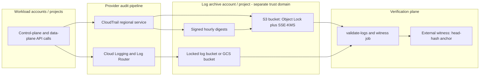

# Compliance, Auditing, and Non-Repudiation

## TL;DR

- An audit record is evidence only if three things hold: it is complete (the population of events is provable), it is immutable (the log store refuses deletion even from root), and it is verifiable (a third party can detect tampering without trusting the party who stored it).
- CloudTrail log file validation is a signed hash chain over hourly digests. It detects modification and deletion of delivered files. It does not detect tail truncation, unreferenced injected files, events never recorded, or a compromised trust anchor.
- Cloud Audit Logs has no documented per-entry signature or hash chain (UNVERIFIED). Its tamper resistance comes from the access-control boundary around the log bucket, retention locks, and separation of the archive project. Closing the gap on either cloud means adding your own anchor to an external witness.
- SOC 2, FedRAMP, and HIPAA do not ask for cryptography. They ask for specific properties: sampled populations that are complete and accurate (SOC 2), AU-family controls plus a retention horizon (FedRAMP), and audit controls plus six-year documentation retention (HIPAA). Map each requirement to a mechanism, then to a recurring machine-collected evidence artifact.
- The audit pipeline is a production system with its own SLOs. A disabled KMS key, a stopped trail, a sink with a broken writer identity, or a Data Access config that was never enabled all fail silently, and you find out during the incident.

## Mental Model



Think of audit as four decoupled planes with different owners.
The generation plane is the provider: the service stamps the event, so the actor cannot forge or omit it.
The custody plane is a separate account or project that the workload's administrators cannot write to or delete from, even in compliance mode of an object lock.
The verification plane is a job that continuously proves the custody plane still matches what the provider signed.
The witness plane stores a small commitment (a hash of the newest digest) somewhere the first three planes' administrators cannot reach.
Each plane exists because the one before it has a specific blind spot.
Compliance frameworks then consume the output of the verification plane as evidence.
They never read the raw logs themselves.

## Internals

### What an auditor actually consumes

A SOC 2 Type 2 examination tests that a control operated effectively over a period.
The auditor draws a sample from a population and tests each sample item.
The population is information produced by the entity (IPE), so the auditor must also test its completeness and accuracy.
This is the real reason immutable, queryable audit logs matter for SOC 2.
"Show me every IAM policy change in the last 9 months" has to be answerable from a system the auditor can believe is complete.
The Trust Services Criteria do not mandate a log retention duration.
The mechanism they test is that you detect and evaluate security events (the CC7 family), manage access (CC6), and control changes (CC8), and that you can produce evidence for each.

FedRAMP is more prescriptive.
Rev5 baselines are derived from NIST SP 800-53 Rev5 (UNVERIFIED).
The audit and accountability (AU) family covers event selection (AU-2), record content (AU-3), review (AU-6), time stamps (AU-8), protection of audit information (AU-9), non-repudiation (AU-10), retention (AU-11), and generation (AU-12).
Federal retention is driven by OMB M-21-31, which sets 12 months of active storage plus 18 months of cold storage (UNVERIFIED as to the exact FedRAMP parameter value).
AU-10 non-repudiation is a High-baseline control in NIST's baselines (UNVERIFIED).
Most Moderate systems satisfy the intent through AU-9 protections and identity binding rather than a dedicated signing mechanism.

HIPAA is the loosest on mechanism and strictest on scope.
The Security Rule requires audit controls (45 CFR 164.312(b)), information system activity review (164.308(a)(1)(ii)(D)), and integrity mechanisms (164.312(c)).
It requires retention of required documentation for six years (164.316(b)(2)(i)).
Many covered entities apply the six years to audit logs as policy.
The rule does not prescribe a log retention number itself.
The HIPAA Security Rule NPRM published in January 2025 proposed removing the required/addressable distinction.
Its finalization status as of 2026-10 is UNVERIFIED, so treat the current text as the operative standard until you confirm.

### Control-to-mechanism mapping

| Requirement | What it demands | AWS mechanism | GCP mechanism |
|---|---|---|---|
| SOC 2 CC7.2 / CC7.3 | Detect and evaluate anomalous events | CloudTrail, CloudTrail Insights, GuardDuty | Cloud Audit Logs, Event Threat Detection in Security Command Center |
| SOC 2 CC6.1 / CC8.1 | Access and change evidence | CloudTrail management events, AWS Config history | Admin Activity logs, Cloud Asset Inventory history |
| FedRAMP AU-2 / AU-12 | Generate defined auditable events | Org trail plus advanced event selectors | Org-level `auditConfigs` in the IAM policy |
| FedRAMP AU-8 | Authoritative time stamps | Amazon Time Sync Service on instances; service-side `eventTime` | Google NTP with leap smear; service-side `timestamp` |
| FedRAMP AU-9 | Protect audit information from modification and deletion | Separate log archive account, S3 Object Lock, SCPs, KMS key policy | Aggregated sink to a separate project, bucket retention lock, IAM Deny, CMEK |
| FedRAMP AU-9(3) / AU-10 | Cryptographic protection, non-repudiation | CloudTrail digest signing plus your own witness | No documented native equivalent (UNVERIFIED); build an external witness |
| FedRAMP AU-11 / HIPAA 164.316(b)(2) | Retention horizon | S3 lifecycle plus Object Lock retention | Log bucket retention plus Bucket Lock |
| HIPAA 164.312(b) | Record and examine activity in systems containing ePHI | Data events on PHI buckets and tables, Bedrock invocation logging | Data Access logs, Vertex AI request-response logging (UNVERIFIED) |

### CloudTrail data path

Every AWS API call is processed by the owning service, which emits an event to CloudTrail.
The `eventTime` is stamped by the service and not by the caller.
This is the property that makes the record useful against a malicious caller.
Events are batched per region into gzipped JSON log files and delivered to your S3 bucket under `AWSLogs/<account>/CloudTrail/<region>/yyyy/mm/dd/`.
Delivery is typically within about five minutes of the call (AWS docs, UNVERIFIED this session).
Treat delivery as at-least-once and deduplicate on `eventID` (UNVERIFIED).
Management events are on by default.
Data events (S3 object-level, Lambda invoke, DynamoDB item-level and similar) are opt-in and billed per event.

When log file validation is enabled, CloudTrail also delivers digest files to the same bucket, in a separate folder so that you can apply different access policies (AWS CloudTrail FAQ, as of 2026-10).
CloudTrail delivers digest files on an hourly basis (AWS CloudTrail FAQ, as of 2026-10).
Delivery starts in about an hour after you enable validation (AWS docs, as of 2026-10).
Validation is enabled by default for trails created in the console (AWS docs, as of 2026-10).

### Digest anatomy and the chain

Each hourly digest is a JSON document with these fields (recalled, UNVERIFIED this session): the account, `digestStartTime` and `digestEndTime`, its own bucket and key, the oldest and newest event times, a `logFiles` array of `{s3Bucket, s3Object, hashValue, hashAlgorithm}`, the previous digest's bucket, key, hash and signature, the public-key fingerprint, and the signature algorithm.
The hash algorithm is SHA-256 and the signature is RSA over SHA-256 (UNVERIFIED).
CloudTrail digest files are signed with RSA digital signatures (AWS docs, as of 2026-10).
The data signing string is built from the digest end time, the digest's S3 path, the hash of the digest file, and the previous digest's signature (AWS docs, as of 2026-10; exact field order and canonicalization UNVERIFIED).
That last input is the mechanism most guides skip.

Because each signature covers the previous signature, and each digest also embeds the previous digest's hash, the digests form a hash chain.
Altering any historical digest invalidates every later signature, and the attacker cannot recompute them without the signing key.
Public keys are retrieved with the `ListPublicKeys` API for a time range, and the digest's fingerprint selects the matching key (AWS docs, as of 2026-10).
Keys are regional (UNVERIFIED), so a multi-region trail validates against per-region keys.

### How validate-logs walks the chain

The `validate-logs` command starts with the most recent digest in the requested range (AWS docs, as of 2026-10).
It first checks that the digest was downloaded from the location it claims, so that `p1 == digestS3Bucket + '/' + digestS3Object` (AWS docs, as of 2026-10).
That defeats an attacker who copies a valid digest to a different path.
If the signature is valid, it checks the hash of each log file the digest references, then steps backward through previous digests until the start time or the end of the chain (AWS docs, as of 2026-10).
A missing or invalid digest makes the covered time range unvalidatable rather than silently skipped.
The cost is linear in the number of digests.
One digest per hour is 8,760 per region-year.
Validating six years across one region is about 52,560 sequential digest verifications, plus one hash per referenced log file.
At an assumed 50 ms per fetch and verify, that is roughly 44 minutes serial, so parallelize by month for audits.

### What the chain does not prove

Six gaps matter in practice.

1. **Tail truncation.** The chain proves the digests that exist are consistent with each other. If someone deletes the newest N digests and their log files, the remaining chain is still valid and `validate-logs` run with the default end time validates a shorter history. Defend by alarming on head freshness and by anchoring the head hash externally.
2. **Unreferenced files.** `validate-logs` checks only log files that are referenced in their corresponding digest files, and no other files in the bucket (AWS docs, as of 2026-10). An attacker with `s3:PutObject` can drop a forged log file into the right prefix. Validation passes. An analyst running Athena over `AWSLogs/*` reads the forgery. Defend with a bucket policy that denies writes from anything but the CloudTrail service principal, and by querying only files enumerated by digests for forensic work.
3. **Events never recorded.** A stopped trail, a data event not selected, or an API that is not logged leaves no record to tamper with. Cryptography is irrelevant to completeness.
4. **Trust anchor.** The signing private key belongs to AWS. The chain proves your bucket matches what AWS signed. It cannot prove to a skeptical third party that AWS or someone with access to the signing key did not backdate or re-sign. Anchoring the head hash to something outside both your trust domain and AWS gives a bounded, independent timestamp.
5. **Clock.** `eventTime` is service-side and good to about a second. Ordering across services by timestamp alone is unreliable for sub-second causality.
6. **Semantics.** The record says what the service believed happened. It does not prove that the human behind a role session was who the identity provider said.

### Hash chain versus Merkle tree

A hash chain is the right size for hourly batches and is exactly what CloudTrail ships.
Its weakness is that proving "event E was in the log as of time T" requires walking from the head to E, which is O(n).
Tamper-evident logging research (Schneier and Kelsey, 1999) used chained MACs with forward-secure keys.
Crosby and Wallach (USENIX Security 2009) used history trees (Merkle trees over an append-only log) to give O(log n) membership and consistency proofs.
Certificate Transparency (RFC 6962, RFC 9162) standardized the same idea with signed tree heads and independent monitors who gossip heads, which closes the equivocation gap that a single-signer chain leaves open.
Sigstore's Rekor (see [[17-Cloud-AI-Engineering/Volume_08_Security_Identity_and_the_Data_Perimeter/Chapter_05_Software_Supply_Chain_Security_SLSA_and_Sigstore|Software Supply Chain Security: SLSA and Sigstore]]) is a public instance of the same design.
If you need per-event proofs for AI agent actions, build on this family and do not extend CloudTrail's chain.

### The witness pattern

Because each digest embeds the previous digest's hash and signature, the SHA-256 of the head digest object commits to the whole history behind it.
Publishing that single 32-byte hash to a system the AWS account's administrators and the log archive's administrators cannot rewrite turns tail truncation into a detectable event.
Good witnesses include an RFC 3161 time-stamping authority, an Object Lock bucket in a separately administered organization, a Rekor-style transparency log, or a hash written to the other cloud's locked bucket.
The witness does not replace AWS's signature.
It bounds how far back an attacker with control of all your cloud accounts could ever rewrite.

### Immutability layer

S3 Object Lock operates on object versions, so the bucket must be versioned.
Governance mode protects against deletion except by principals with `s3:BypassGovernanceRetention`.
Compliance mode cannot be shortened or removed by any principal, including the account root, until the retain-until date.
Cohasset Associates has assessed S3 Object Lock against SEC 17a-4(f) and related rules (UNVERIFIED as to current assessment date).
An unversioned `DeleteObject` on a locked bucket only adds a delete marker.
The protected version remains.
Lifecycle rules cannot expire a version before its retention.
Retention applies across storage classes, so you can tier locked logs to a colder class.

Google Cloud Storage Bucket Lock sets a bucket-level retention period.
Once locked, the policy cannot be removed and the period can only be extended.
The maximum retention is 100 years (3,155,760,000 seconds; UNVERIFIED).
Cloud Logging log buckets support a similar retention lock.
A locked bucket prevents deletion of any entry until it is older than the retention period (UNVERIFIED).

Both are irreversible by design.
That is the point, and it is also the operational cost: a mistake in the retention period is a mistake you pay storage for until it expires.

### Cloud Audit Logs path

Google Cloud emits four audit log types (Google Cloud docs, UNVERIFIED this session).
Admin Activity covers configuration changes, is always on, and cannot be disabled.
System Event covers Google-initiated administrative actions and is always on.
Data Access covers reads of configuration and reads and writes of user data, is off by default for most services (BigQuery being the exception), and is billed as log volume.
Policy Denied records denials by security policy (VPC Service Controls and similar).

Admin Activity, System Event, and Access Transparency entries land in the `_Required` bucket.
It has a fixed 400-day retention and cannot be altered or excluded (UNVERIFIED).
Everything else lands in `_Default`, which defaults to 30 days and is configurable.
The Log Router evaluates sinks as entries are ingested.
Sink destinations are log buckets, Cloud Storage, BigQuery, Pub/Sub, or another project.
Delivery to Cloud Storage is batched (hourly files; UNVERIFIED), while Pub/Sub and BigQuery are near real time.
An aggregated sink at the organization or folder with `includeChildren` captures every descendant project, including projects created later.
Data Access logging is configured through `auditConfigs` in the IAM policy at the organization, folder, or project level, with `DATA_READ`, `DATA_WRITE`, and `ADMIN_READ` log types and optional exempted members.

Access Transparency logs actions by Google personnel on your content.
Access Approval gates those actions behind your explicit approval.
Key Access Justifications gates key use through External Key Manager.
AWS has no direct equivalent product that gates provider-personnel access (UNVERIFIED).
Its stance is architectural: Nitro is designed with no operator access path to customer instance memory.

### Time

FedRAMP AU-8 and every forensic timeline depend on clocks.
AWS exposes the Amazon Time Sync Service at the link-local address 169.254.169.123, and Google exposes NTP at `metadata.google.internal`, both with leap-second smearing (UNVERIFIED).
Audit event timestamps are stamped by the provider's service, so your instance clock drift does not corrupt `eventTime`.
It does corrupt your application's own logs when you join them to cloud audit events.
Join on request IDs and `eventID` or `insertId`, not on timestamp windows.

### AI-specific audit surfaces

Model invocation is a data-plane operation, so default management-event logging says little about prompts.
Amazon Bedrock model invocation logging is opt-in and delivers prompts and completions to S3 or CloudWatch Logs (UNVERIFIED as to which Bedrock runtime actions CloudTrail records by default).
Vertex AI offers request-response logging for endpoints into BigQuery (UNVERIFIED), and Data Access audit logs for `aiplatform.googleapis.com`.
These stores contain whatever users typed, including PHI.
They are in HIPAA scope, need the same encryption and retention controls as any ePHI store, and collide with minimum-necessary and deletion obligations.
See [[17-Cloud-AI-Engineering/Volume_12_AI_Applications_MLOps_and_Data_Platforms/Chapter_07_AI_Safety_Guardrails_and_Governance|AI Safety, Guardrails, and Governance]] for the audit trail design on the application side.

## Numbers to Know

Rows marked V were verified against AWS documentation on 2026-10-21.
Rows marked U are recalled values that I could not re-verify in this session and are listed in the batch report.
Re-check every U row against the cited source before you quote it.

| Item | Value | Status | Source and date |
|---|---|---|---|
| CloudTrail digest delivery cadence | Hourly | V | AWS CloudTrail FAQ, as of 2026-10 |
| First digest after enabling validation | About 1 hour | V | AWS CloudTrail docs, as of 2026-10 |
| Validation default on console-created trails | Enabled | V | AWS CloudTrail docs, as of 2026-10 |
| Digests per region-year | 8,760 (derived from hourly cadence) | V | Derived, as of 2026-10 |
| validate-logs coverage | Only log files referenced by digests | V | AWS CloudTrail docs, as of 2026-10 |
| Typical CloudTrail event delivery latency | About 5 minutes | U | AWS docs, as of 2026-10 |
| Event history (console and LookupEvents) | 90 days of management events | U | AWS docs, as of 2026-10 |
| LookupEvents rate | About 2 requests per second per account per region | U | AWS docs, as of 2026-10 |
| CloudTrail data events price | $0.10 per 100,000 events | U | AWS pricing, as of 2026-10 |
| CloudTrail management events price | First copy free; additional copies $2.00 per 100,000 | U | AWS pricing, as of 2026-10 |
| CloudTrail Lake maximum retention | 3,653 days (about 10 years) | U | AWS docs, as of 2026-10 |
| Cloud Logging `_Required` retention | 400 days, fixed | U | Google Cloud docs, as of 2026-10 |
| Cloud Logging `_Default` retention | 30 days, configurable | U | Google Cloud docs, as of 2026-10 |
| Cloud Logging ingestion price | $0.50 per GiB | U | Google Cloud pricing, as of 2026-10 |
| Cloud Logging storage beyond free retention | $0.01 per GiB per month | U | Google Cloud pricing, as of 2026-10 |
| Admin Activity audit log cost | No charge | U | Google Cloud pricing, as of 2026-10 |
| GCS Bucket Lock maximum retention | 100 years | U | Google Cloud docs, as of 2026-10 |
| KMS key deletion waiting period | 7 to 30 days on AWS | U | AWS KMS docs, as of 2026-10 |
| Federal audit log retention | 12 months active plus 18 months cold | U | OMB M-21-31 |
| HIPAA documentation retention | 6 years | U | 45 CFR 164.316(b)(2)(i) |
| SOC 2 Type 2 observation window | Commonly 3 to 12 months | U | AICPA practice, as of 2026-10 |

## AWS vs GCP Mechanism Parity

| Dimension | AWS | Google Cloud |
|---|---|---|
| Control-plane audit source | CloudTrail management events (on by default) | Admin Activity and System Event logs (always on) |
| Data-plane audit | CloudTrail data events, opt-in per resource type, billed per event | Data Access logs, opt-in via `auditConfigs` (BigQuery on by default), billed per GiB ingested |
| Event denied by policy | Logged as an error event with `errorCode` | Policy Denied log type |
| Org-wide enforcement | Organization trail, member accounts cannot modify it | Aggregated sink with `includeChildren`, org-level `auditConfigs` |
| Who can disable | Anyone with `cloudtrail:StopLogging` unless blocked by SCP; org trail cannot be stopped from member accounts | Admin Activity cannot be disabled; Data Access and sinks can be changed by `logging.*` and IAM admins unless denied |
| Management account exemption | SCPs do not apply to the organization management account | Org-level IAM Deny policies apply to all principals |
| Immutable store | S3 Object Lock, governance or compliance mode, on versioned bucket | Bucket Lock on GCS; log bucket retention lock |
| Native cryptographic tamper evidence | Signed hourly digest chain with SHA-256 and RSA | None documented (UNVERIFIED) |
| Provider-operator access visibility | No direct equivalent product (UNVERIFIED) | Access Transparency and Access Approval |
| Delivery to custody store | Batched log files, about 5 minutes (UNVERIFIED) | Router at ingestion; GCS in batches, Pub/Sub and BigQuery near real time |
| Query | Athena on S3, CloudTrail Lake (SQL, managed retention) | Log Analytics, BigQuery sink |
| Encryption | SSE-KMS, CloudTrail enforces encryption context `aws:cloudtrail:arn` (UNVERIFIED) | CMEK on log buckets, GCS CMEK |
| Billing model | Per event | Per GiB of uncompressed ingestion, then storage |
| Compliance artifacts | AWS Artifact (SOC reports, FedRAMP packages, BAA) | Compliance Reports Manager, BAA in the contract terms |
| FedRAMP High environments | GovCloud (US) regions | Assured Workloads FedRAMP High control package |
| Continuous evidence | AWS Config conformance packs, Audit Manager, Security Hub | Security Command Center compliance, Assured Workloads monitoring |
| Retired or at-risk building blocks | Amazon QLDB reached end of support on 2025-07-31 (UNVERIFIED) | Not applicable |

The most important asymmetry is cryptographic.
AWS gives you verifiable tamper evidence you can run yourself, anchored in an AWS-held key.
Google gives you a harder access boundary around the store (fixed `_Required` bucket, retention locks) and visibility into provider staff, but no per-entry proof.
A mixed-evidence design is stronger than either alone: the archive on one cloud, the witness on the other.
See [[17-Cloud-AI-Engineering/Volume_04_AWS_vs_GCP_Translation/Chapter_03_Identity_Security_and_Governance_Translation|Identity, Security, and Governance Translation]] for the identity-side parity.

## Worked Example: Immutable Audit Trail, Chain Verification, and External Witness

### Scenario and sizing

A health-tech platform processes ePHI and trains models on it.
It has one PHI data bucket receiving 200 million S3 data events per month (reads and writes by data loaders and services).
All figures below use the unverified list prices from the Numbers table and must be re-checked before you commit.
The lab provisions only a one-account, one-day version of the archive.

**Event cost.**
200,000,000 events / 100,000 = 2,000 units x $0.10 = $200 per month for data events.
Management events add $0 for the first copy.
A second trail in the same account is billed at $2.00 per 100,000 management events.

**Storage.**
Assume about 250 bytes per event after CloudTrail gzip (assumption, measure your own).
200,000,000 x 250 B = 50 GB per month.
Six-year HIPAA horizon is 72 months, so 3.6 TB at the end.
At S3 Standard $0.023 per GB-month (UNVERIFIED), the cumulative six-year cost is 50 x 0.023 x (72 x 73 / 2) = 1.15 x 2,628, about $3,022.
Tiering after 90 days to a cold class around $0.0036 per GB-month cuts the cold portion by about 6x.

**GCP equivalent.**
Assume 1.2 KiB per audit entry, billed uncompressed.
200,000,000 x 1.2 KiB is about 229 GiB per month.
At $0.50 per GiB, ingestion is about $114 per month.
Storing that in a log bucket beyond 30 days at $0.01 per GiB-month reaches about $165 per month after 72 months (229 GiB x 72 = 16.5 TiB).
Per-event pricing on AWS and per-byte pricing on GCP cross over based on event size, so measure your median entry size before choosing.

**ML data-loader warning.**
A training job reading 10,000 objects per second generates 10,000 x 86,400 = 864,000,000 data events per day.
That is 8,640 units x $0.10 = $864 per day.
Use advanced event selectors to scope data events to the PHI bucket only, or exclude the high-volume training-corpus bucket and rely on bucket-level controls plus S3 server access logs.

**Lab cost.**
One KMS key (about $1 per month, prorated), a single multi-region trail (first management copy free if no other trail exists), a few MB of S3.
Expect under $2 for a day.
The budget alarm caps surprise at $10.

### Terraform: archive bucket, key, trail, budget

This lab uses governance mode with a one-day default retention so that teardown is possible.
Never apply compliance mode in a lab.
Compliance retention cannot be undone and the storage stays billable until it expires.

```hcl
terraform {
  required_version = ">= 1.6"
  required_providers {
    aws = { source = "hashicorp/aws", version = "~> 5.0" }
  }
}

variable "region"      { default = "us-east-1" }
variable "alert_email" { type = string }

provider "aws" { region = var.region }

data "aws_caller_identity" "me" {}

locals {
  acct       = data.aws_caller_identity.me.account_id
  trail_name = "audit-lab-trail"
  trail_arn  = "arn:aws:cloudtrail:${var.region}:${local.acct}:trail/${local.trail_name}"
  bucket     = "audit-lab-${local.acct}-${var.region}"
}

resource "aws_kms_key" "trail" {
  description             = "audit-lab trail key"
  deletion_window_in_days = 7
  enable_key_rotation     = true
  policy = jsonencode({
    Version = "2012-10-17"
    Statement = [
      {
        Sid       = "AccountAdmin"
        Effect    = "Allow"
        Principal = { AWS = "arn:aws:iam::${local.acct}:root" }
        Action    = "kms:*"
        Resource  = "*"
      },
      {
        Sid       = "CloudTrailEncrypt"
        Effect    = "Allow"
        Principal = { Service = "cloudtrail.amazonaws.com" }
        Action    = "kms:GenerateDataKey*"
        Resource  = "*"
        Condition = {
          StringEquals = { "aws:SourceArn" = local.trail_arn }
          StringLike   = { "kms:EncryptionContext:aws:cloudtrail:arn" = "arn:aws:cloudtrail:*:${local.acct}:trail/*" }
        }
      },
      {
        Sid       = "CloudTrailDescribe"
        Effect    = "Allow"
        Principal = { Service = "cloudtrail.amazonaws.com" }
        Action    = "kms:DescribeKey"
        Resource  = "*"
      }
    ]
  })
}

resource "aws_s3_bucket" "logs" {
  bucket              = local.bucket
  object_lock_enabled = true
  force_destroy       = false
}

resource "aws_s3_bucket_versioning" "logs" {
  bucket = aws_s3_bucket.logs.id
  versioning_configuration { status = "Enabled" }
}

resource "aws_s3_bucket_object_lock_configuration" "logs" {
  bucket     = aws_s3_bucket.logs.id
  depends_on = [aws_s3_bucket_versioning.logs]
  rule {
    default_retention {
      mode = "GOVERNANCE"
      days = 1
    }
  }
}

resource "aws_s3_bucket_public_access_block" "logs" {
  bucket                  = aws_s3_bucket.logs.id
  block_public_acls       = true
  block_public_policy     = true
  ignore_public_acls      = true
  restrict_public_buckets = true
}

resource "aws_s3_bucket_policy" "logs" {
  bucket = aws_s3_bucket.logs.id
  policy = jsonencode({
    Version = "2012-10-17"
    Statement = [
      {
        Sid       = "CloudTrailAclCheck"
        Effect    = "Allow"
        Principal = { Service = "cloudtrail.amazonaws.com" }
        Action    = "s3:GetBucketAcl"
        Resource  = aws_s3_bucket.logs.arn
        Condition = { StringEquals = { "aws:SourceArn" = local.trail_arn } }
      },
      {
        Sid       = "CloudTrailWrite"
        Effect    = "Allow"
        Principal = { Service = "cloudtrail.amazonaws.com" }
        Action    = "s3:PutObject"
        Resource  = "${aws_s3_bucket.logs.arn}/AWSLogs/${local.acct}/*"
        Condition = {
          StringEquals = {
            "s3:x-amz-acl" = "bucket-owner-full-control"
            "aws:SourceArn" = local.trail_arn
          }
        }
      },
      {
        Sid       = "DenyForgedLogInjection"
        Effect    = "Deny"
        Principal = "*"
        Action    = "s3:PutObject"
        Resource  = "${aws_s3_bucket.logs.arn}/AWSLogs/*"
        Condition = { StringNotEquals = { "aws:PrincipalServiceName" = "cloudtrail.amazonaws.com" } }
      },
      {
        Sid       = "DenyInsecureTransport"
        Effect    = "Deny"
        Principal = "*"
        Action    = "s3:*"
        Resource  = [aws_s3_bucket.logs.arn, "${aws_s3_bucket.logs.arn}/*"]
        Condition = { Bool = { "aws:SecureTransport" = "false" } }
      }
    ]
  })
}

resource "aws_cloudtrail" "lab" {
  name                          = local.trail_name
  s3_bucket_name                = aws_s3_bucket.logs.id
  is_multi_region_trail         = true
  include_global_service_events = true
  enable_log_file_validation    = true
  kms_key_id                    = aws_kms_key.trail.arn
  depends_on                    = [aws_s3_bucket_policy.logs]
}

resource "aws_budgets_budget" "lab" {
  name         = "audit-lab"
  budget_type  = "COST"
  limit_amount = "10"
  limit_unit   = "USD"
  time_unit    = "MONTHLY"
  notification {
    comparison_operator        = "GREATER_THAN"
    threshold                  = 80
    threshold_type             = "PERCENTAGE"
    notification_type          = "ACTUAL"
    subscriber_email_addresses = [var.alert_email]
  }
}

output "trail_arn" { value = local.trail_arn }
output "bucket"    { value = aws_s3_bucket.logs.id }
```

The `DenyForgedLogInjection` statement is the mitigation for the unreferenced-file gap.
Test that CloudTrail still delivers after applying it, because the exact behavior of `aws:PrincipalServiceName` for service-delivered writes was not re-verified here (UNVERIFIED).

### Verify the chain with the CLI

Wait at least an hour after `terraform apply`, then:

```bash
TRAIL_ARN=$(terraform output -raw trail_arn)
aws cloudtrail validate-logs \
  --trail-arn "$TRAIL_ARN" \
  --start-time "$(date -u -d '-3 hours' +%Y-%m-%dT%H:%M:%SZ 2>/dev/null || date -u -v-3H +%Y-%m-%dT%H:%M:%SZ)" \
  --verbose
```

Then prove the detection works.
Download one log file referenced by a digest, edit a byte, and upload it back as a new object version (governance mode still lets writers add versions).
Re-run `validate-logs` and confirm it reports the file as invalid.
That one exercise teaches more than any documentation page.

### Python: continuity, freshness, and witness anchor

The CLI proves signatures.
This script covers what the CLI cannot: head freshness (tail truncation) and an external anchor.

```python
#!/usr/bin/env python3
"""Check digest continuity and freshness, and anchor the head hash to a witness bucket."""
import argparse, gzip, hashlib, json, sys
import datetime as dt
import boto3

def day_prefixes(base, hours):
    now = dt.datetime.now(dt.timezone.utc)
    days = {(now - dt.timedelta(hours=h)).date() for h in range(0, hours + 1, 6)}
    return [f"{base}{d:%Y/%m/%d}/" for d in sorted(days)]

def main():
    ap = argparse.ArgumentParser()
    ap.add_argument("--bucket", required=True)
    ap.add_argument("--account", required=True)
    ap.add_argument("--region", required=True)
    ap.add_argument("--hours", type=int, default=24)
    ap.add_argument("--max-age-minutes", type=int, default=150)
    ap.add_argument("--witness-bucket")
    ap.add_argument("--witness-profile")
    a = ap.parse_args()

    s3 = boto3.client("s3")
    base = f"AWSLogs/{a.account}/CloudTrail-Digest/{a.region}/"
    cutoff = dt.datetime.now(dt.timezone.utc) - dt.timedelta(hours=a.hours)
    objs = []
    for pfx in day_prefixes(base, a.hours):
        for page in s3.get_paginator("list_objects_v2").paginate(Bucket=a.bucket, Prefix=pfx):
            objs += [o for o in page.get("Contents", []) if o["LastModified"] >= cutoff]
    objs.sort(key=lambda o: o["LastModified"])
    if not objs:
        print("FAIL: no digests in window"); sys.exit(2)

    problems, prev_key = [], None
    for o in objs:
        raw = s3.get_object(Bucket=a.bucket, Key=o["Key"])["Body"].read()
        d = json.loads(gzip.decompress(raw))
        if prev_key and d.get("previousDigestS3Object") != prev_key:
            problems.append(f"chain break at {o['Key']}: previous={d.get('previousDigestS3Object')}")
        prev_key = o["Key"]
        head_raw, head_doc = raw, d

    age = dt.datetime.now(dt.timezone.utc) - objs[-1]["LastModified"]
    if age > dt.timedelta(minutes=a.max_age_minutes):
        problems.append(f"head digest is stale: age={age}")

    anchor = {
        "account": a.account, "region": a.region, "head_key": prev_key,
        "head_sha256": hashlib.sha256(head_raw).hexdigest(),
        "digest_end_time": head_doc.get("digestEndTime"),
        "checked_at": dt.datetime.now(dt.timezone.utc).isoformat(),
    }
    print(json.dumps(anchor, indent=2))

    if a.witness_bucket and not problems:
        sess = boto3.Session(profile_name=a.witness_profile) if a.witness_profile else boto3.Session()
        sess.client("s3").put_object(
            Bucket=a.witness_bucket,
            Key=f"witness/{a.account}/{a.region}/{anchor['digest_end_time']}.json",
            Body=json.dumps(anchor).encode(),
        )
    for p in problems:
        print("FAIL:", p)
    sys.exit(1 if problems else 0)

main()
```

Run it hourly from a scheduler in a different account, and alarm when the job itself stops reporting.
A missing heartbeat is as important as a failed check.
Retrieval is cheap: about 24 GETs per day per region for digests, plus one GET per anchor.

### Hardening snippet: SCP for the audit estate

Apply at the organization root or on the OU containing workload accounts.
Remember that SCPs do not constrain the organization management account, so keep that account free of workloads.

```json
{
  "Version": "2012-10-17",
  "Statement": [{
    "Sid": "ProtectAuditPipeline",
    "Effect": "Deny",
    "Action": [
      "cloudtrail:StopLogging", "cloudtrail:DeleteTrail", "cloudtrail:UpdateTrail",
      "cloudtrail:PutEventSelectors", "cloudtrail:PutInsightSelectors",
      "kms:ScheduleKeyDeletion", "kms:DisableKey",
      "s3:PutBucketObjectLockConfiguration"
    ],
    "Resource": "*",
    "Condition": { "ArnNotLike": { "aws:PrincipalArn": "arn:aws:iam::*:role/AuditBreakGlass" } }
  }]
}
```

### GCP equivalent at project scope

```bash
PROJECT=my-audit-lab
BUCKET=${PROJECT}-audit-archive
gcloud config set project "$PROJECT"

# Do not lock the retention policy in a lab; locking is irreversible.
gcloud storage buckets create "gs://$BUCKET" --location=us-central1 \
  --uniform-bucket-level-access --retention-period=1d

gcloud logging sinks create audit-archive "storage.googleapis.com/$BUCKET" \
  --log-filter='logName:"cloudaudit.googleapis.com"'

WRITER=$(gcloud logging sinks describe audit-archive --format='value(writerIdentity)')
gcloud storage buckets add-iam-policy-binding "gs://$BUCKET" \
  --member="$WRITER" --role=roles/storage.objectCreator

# Enable Data Access logs: add this block to the project IAM policy, then set-iam-policy.
# auditConfigs:
# - service: allServices
#   auditLogConfigs:
#   - logType: ADMIN_READ
#   - logType: DATA_READ
#   - logType: DATA_WRITE
gcloud projects get-iam-policy "$PROJECT" --format=yaml > policy.yaml
# edit policy.yaml, then:
# gcloud projects set-iam-policy "$PROJECT" policy.yaml

BILLING_ACCOUNT=000000-000000-000000   # replace
gcloud billing budgets create --billing-account="$BILLING_ACCOUNT" \
  --display-name=audit-lab --budget-amount=10USD --threshold-rule=percent=0.8
```

Enabling `allServices` Data Access logs on a busy project is the GCP version of the data-loader cost trap above.
Use it only on a throwaway project.

### Teardown

The AWS bucket is versioned with governance retention, so `terraform destroy` fails on a non-empty bucket.
Empty it with bypass first:

```python
#!/usr/bin/env python3
import sys, boto3
bucket = sys.argv[1]
s3 = boto3.client("s3")
for page in s3.get_paginator("list_object_versions").paginate(Bucket=bucket):
    items = [{"Key": v["Key"], "VersionId": v["VersionId"]}
             for v in page.get("Versions", []) + page.get("DeleteMarkers", [])]
    if items:
        s3.delete_objects(Bucket=bucket, Delete={"Objects": items}, BypassGovernanceRetention=True)
print("emptied", bucket)
```

```bash
python3 empty_bucket.py "$(terraform output -raw bucket)"
terraform destroy -auto-approve
# KMS key enters its 7-day deletion window; it cannot be deleted sooner.

# GCP: the 1-day retention must elapse before objects can be deleted.
gcloud logging sinks delete audit-archive --quiet
gcloud storage rm -r "gs://$BUCKET"          # run after 24 hours
```

## Failure Modes and Pitfalls

### The pipeline fails silently

- A trail with `StopLogging` called, a KMS key disabled or with a broken key policy, or a bucket policy edited so the CloudTrail service principal loses `PutObject`: all leave you with no new logs and no error in your application.
- Do not assume undelivered events are replayed after you fix the key (UNVERIFIED). Treat any delivery outage as a permanent gap and document it for the auditor.
- Alarm on head-digest age, on CloudTrail delivery errors, and on a synthetic canary: a scheduled harmless API call whose event you expect to find every hour.
- On GCP, a sink whose writer identity lost `storage.objectCreator` fails while the source log bucket still holds the data only for its own retention. An `_Default` exclusion filter silently drops entries that never reach any sink.

### Logging that was never enabled

You cannot retroactively collect Data Access logs or S3 data events.
The public analysis of the 2023 Storm-0558 intrusion (US Cyber Safety Review Board report, 2024) is the canonical illustration from another vendor.
Detection depended on a premium audit log (mail item access) that only some customers had enabled or licensed, and a customer found the intrusion through it.
The lesson transfers directly: decide event selection before the incident, and treat "paid logging tier" as a security design input.

### Same trust domain for logs and workloads

The 2014 Code Spaces incident is the standard public example.
An attacker who gained control-panel access deleted production data and the backups held in the same account, and the company ceased operating.
The same pattern applies to logs.
If the workload account's admin can delete the log bucket, an attacker who becomes that admin will do so.

### SCPs and the management account

SCPs do not apply to the organization management account.
A trail whose protection depends on an SCP is unprotected against anyone using that account.
Keep it empty of workloads and use delegated administration for CloudTrail where available (UNVERIFIED).

### Object Lock misconfiguration

- Applying compliance mode with a long default retention to the wrong bucket is permanent. You pay for the bytes until the retain-until date, and account root cannot undo it.
- Governance mode is only as strong as `s3:BypassGovernanceRetention`. Grant it to nobody in the production archive.
- Locking an unversioned expectation: applications that "overwrite" an object create new versions, and old versions accumulate under retention.

### Unlocked evidence considered immutable

A GCS retention policy that has not been locked can be removed by anyone with the right IAM role.
Many teams set the period, believe they are done, and never run the irreversible lock step.
Verify with `gcloud storage buckets describe` that the policy shows as locked in production.

### PHI in the audit trail itself

- S3 object keys, BigQuery query text in audit entries, Bedrock and Vertex prompts, and resource names can contain PHI.
- That makes the log archive an ePHI system requiring the same BAA coverage, encryption, access controls, and six-year retention reasoning as the primary store.
- It also collides with deletion requests. Design the keys and prompt logging so that deletion is possible by crypto-shredding, not by editing immutable objects.

### Cost explosions from data events

The data-loader scenario above (864 million events per day, about $864 per day) is a real pattern for training clusters.
On GCP, enabling `allServices` Data Access logs doubles as a log-volume incident.
Scope event selectors by resource and by read or write, and review Cost Explorer or billing export weekly during rollout.

### Compliance boundary drift

FedRAMP authorization covers a specific boundary of services in specific regions.
Using a new service, a preview feature, or a foundation model not on the in-scope list moves you outside the authorization.
The Customer Responsibility Matrix and the provider's in-scope service lists are the sources of truth.
Check them before an architect picks a managed AI endpoint.

### Evidence quality failures in SOC 2

- Screenshots as evidence, with no query or population definition.
- A control changed mid-period without documented effective dates.
- A log source that does not cover the whole period because it was onboarded in month 4.
- Information produced by the entity (a report generated by an internal script) with no completeness and accuracy testing. The auditor will ask how you know the report includes every row.

### Unlogged or under-logged APIs

Public security research catalogs APIs that are not logged by CloudTrail or that log truncated detail (for example, the community catalog at hackingthe.cloud).
Treat the provider's event reference as the authority for what appears, and test the specific actions your threat model relies on.
Do not assume a comprehensive record.

### Ordering assumptions

Two events a few hundred milliseconds apart in different services cannot be ordered reliably by timestamp.
Use request IDs, `eventID`, `insertId`, and causal fields, and state precision limits in your incident procedure.

### Non-repudiation theater

Signed logs do not prove who a human was.
If a shared role is assumed by many people, the log says the role did it.
Pair audit with per-person federated sessions and source identity propagation (see [[17-Cloud-AI-Engineering/Volume_08_Security_Identity_and_the_Data_Perimeter/Chapter_02_Workload_Identity_Federation|Workload Identity Federation]]).

## Security and Cost Angles

### IAM scoping

- Separate four duties: log writers (provider service principals only), custodians (can configure retention but cannot read), readers (read-only, time-boxed), and verifiers (read digests and write witness records).
- On AWS, readers get `s3:GetObject` and `kms:Decrypt` on the archive key only through a dedicated role. Nobody gets `s3:DeleteObjectVersion` or `s3:BypassGovernanceRetention` in production.
- On GCP, Data Access logs are visible only to principals with the private log viewer role (`roles/logging.privateLogViewer`), so grant that sparingly. Use IAM Deny policies on `logging.sinks.delete`, `logging.buckets.delete`, and bucket deletion in the archive project (supported permission set UNVERIFIED).
- Cross-reference the policy engine behavior in [[17-Cloud-AI-Engineering/Volume_02_AWS_Deep_Dive/Chapter_01_IAM_Policy_Evaluation_Engine|IAM Policy Evaluation Engine]] and [[17-Cloud-AI-Engineering/Volume_03_GCP_Deep_Dive/Chapter_02_Cloud_IAM_Roles_Policies_and_Conditions|Cloud IAM: Roles, Policies, and Conditions]].

### Key hierarchy

- Encrypt the archive with a customer managed key whose administrators cannot decrypt and whose decryptors cannot administer.
- The CloudTrail encryption context condition ties key use to trails in your account, which blocks use of your key by a trail in another account.
- A disabled or scheduled-for-deletion key makes the archive unreadable and breaks delivery. Alarm on `ScheduleKeyDeletion` and `DisableKey`, and block them in the SCP above.
- On GCP, put CMEK on log buckets and the archive bucket, and consider External Key Manager with Key Access Justifications if the compliance regime demands provider-independent key custody.
- Full treatment is in [[17-Cloud-AI-Engineering/Volume_08_Security_Identity_and_the_Data_Perimeter/Chapter_04_Encryption_Key_Hierarchies_and_Envelope_Encryption|Encryption Key Hierarchies and Envelope Encryption]].

### Network boundaries

- Reach the archive through an S3 gateway endpoint with an endpoint policy restricted to the archive bucket, and constrain the bucket to the organization with `aws:PrincipalOrgID`.
- On GCP, include `logging.googleapis.com` and `storage.googleapis.com` in the VPC Service Controls perimeter around the archive project, with explicit ingress rules for the sink writer identity and the verifier.
- See [[17-Cloud-AI-Engineering/Volume_08_Security_Identity_and_the_Data_Perimeter/Chapter_06_Constructing_an_Impenetrable_Data_Perimeter|Constructing an Impenetrable Data Perimeter]] and [[17-Cloud-AI-Engineering/Volume_03_GCP_Deep_Dive/Chapter_03_VPC_Service_Controls_Security_Perimeters|VPC Service Controls: Security Perimeters]].

### Unit economics levers

- Scope data events with advanced event selectors by resource ARN and read-write type. This is the single largest lever.
- Tier archived logs to a colder storage class under the same retention. Locks apply across classes.
- Choose per-event versus per-GiB billing deliberately: small, frequent events favor GCP's per-byte model less than AWS's per-event model, and large entries favor the reverse. Measure median entry size.
- Keep hot query data (30 to 90 days) in a query store and everything else in the object archive. Rehydrate only for audits.
- CloudTrail Lake charges for managed ingestion and retention and removes the Athena partition upkeep. It pays off when many analysts query, and not for a compliance-only archive (UNVERIFIED pricing; run the numbers).
- Retention is the multiplier: choose the shortest retention that satisfies the strictest applicable regime, and document which rule drove the number.
- Budget alarms on the logging estate are not optional; see [[17-Cloud-AI-Engineering/Volume_09_FinOps_and_Cloud_Economics/Chapter_01_Cloud_Billing_Models_and_Unit_Cost_Allocation|Cloud Billing Models and Unit Cost Allocation]].

## Interview Questions and Model Answers

### Question 1 (L5 - Senior)

An auditor asks you to prove that your CloudTrail logs were not tampered with. You say "we have log file validation on". What exactly does that prove, and what does it not?

#### Model Answer

Log file validation turns the S3 bucket's log files into a signed hash chain.
CloudTrail delivers a digest every hour listing SHA-256 hashes of the log files it delivered, and it signs the digest with an RSA key held by AWS.
Each digest's signature covers the previous digest's signature, so the digests are chained.
`validate-logs` starts at the newest digest, checks that the digest was fetched from the S3 location it claims, verifies the signature, hashes each referenced log file, then walks backward.
That detects modification or deletion of log files, of digest files, or of both, and it reports unvalidatable ranges rather than skipping them.

It does not prove several things.
It checks only log files referenced by digests, so a forged file dropped into the prefix passes validation.
It does not detect truncation at the tail, because a valid older chain looks the same as a complete one unless you check head freshness.
It does not prove completeness, because a stopped trail or an unselected data event produces no record.
It also rests on a key AWS holds, so it is evidence relative to AWS, not independent of it.

For the audit I would show the validation run, the SCP preventing `StopLogging`, the bucket policy denying non-CloudTrail writes, Object Lock configuration, and an hourly freshness check.
I would state the limits plainly in the evidence package.

#### Follow-up Interviewer Question

You find a log file in the prefix that no digest references. Walk me through what you do with it and what it tells you.

### Question 2 (L5 - Senior)

You are standing up audit logging on GCP for a HIPAA workload on BigQuery and Cloud Storage. Which log types do you need, where do they land, and what do you set for retention?

#### Model Answer

Admin Activity and System Event logs are always on and land in the `_Required` bucket with fixed 400-day retention.
That covers configuration change evidence but nothing about who read PHI.
For HIPAA 164.312(b) I need Data Access logs for BigQuery (already on by default), Cloud Storage, and any service holding ePHI, enabled through `auditConfigs` at the organization or folder so that new projects inherit it.
I enable DATA_READ and DATA_WRITE only for services that touch ePHI to control volume.

Because the six-year documentation retention exceeds what log buckets hold by default, I create an aggregated sink at the organization with `includeChildren` into a dedicated archive project.
The destination is a Cloud Storage bucket with CMEK and a retention policy that I lock once validated, plus a BigQuery dataset for the last 90 days of investigation queries.
The sink's writer identity gets only object-creator on the bucket.
IAM Deny prevents deletion of sinks and the archive bucket outside a break-glass role.

I also note that BigQuery audit entries contain query text and resource names, so the archive is itself an ePHI store under the BAA, with the same encryption and access controls, and that the retention decision records which rule drove six years.

#### Follow-up Interviewer Question

Six months in, security asks for Data Access logs on a service you did not enable. What can you recover, and how do you prevent this next time?

### Question 3 (L6 - Staff)

Design the audit log architecture so that a fully compromised workload-account administrator cannot erase evidence of their own actions. Include what still fails.

#### Model Answer

The principle is a separate trust domain with write-only flow into it.
An organization trail in a dedicated log archive account delivers to a versioned S3 bucket with Object Lock.
The bucket policy allows `PutObject` only from the CloudTrail service principal scoped by `aws:SourceArn`, and denies everyone else under `AWSLogs/`.
That blocks forged-file injection, which `validate-logs` would not catch.
Workload account admins have no principal in the archive account at all.
An SCP denies `StopLogging`, `UpdateTrail`, `PutEventSelectors`, and `DeleteTrail`, with a break-glass exemption.
The KMS key lives in the archive account with administrators and decryptors separated.

For retention I use compliance mode in production because governance mode is only as strong as whoever holds the bypass permission.
Compliance mode makes mistakes permanent, so I stage it: governance and a one-day retention in a pilot, then compliance with a retention derived from the strictest regime.
I keep a small default and lock stricter retention onto the specific prefixes that need it.

What still fails:
the organization management account is outside SCPs, so I keep it workload-free and monitor its activity separately;
an attacker with control of the management account or the OU structure can detach the SCP or remove the trail;
a compromised archive-account admin can still add noise or cause cost;
tail truncation is limited by Object Lock but not by `validate-logs`, so I add the freshness job and an external witness of the head digest hash.
I would call out explicitly that prevention depends on the management account, and that detection of its misuse is what the witness and an out-of-band alert provide.

Cost is the other trade-off.
Compliance-mode retention is a financial commitment, and I tier to colder classes under the lock.

#### Follow-up Interviewer Question

Legal now says a specific customer's data must be erased within 30 days, but your logs under compliance lock contain their identifiers. What do you do?

### Question 4 (L6 - Staff)

A SOC 2 Type 2 auditor selects 25 samples from "all production IAM changes in the past 9 months" and asks how you know the population is complete. Walk me through what you produce and what could embarrass you.

#### Model Answer

The population is information produced by the entity, so the auditor tests the report's completeness and accuracy, not only the 25 samples.
I produce the population from the system of record: CloudTrail management events for IAM, queried from the immutable archive (or CloudTrail Lake) with the query text, run timestamp, and time range saved as the evidence.
Completeness argument: the organization trail covers all accounts and regions, a conformance rule shows the trail was never stopped in the period, the digest chain validates over the whole range, and the head freshness job has no gaps.
Accuracy argument: events are stamped by the service, and I reconcile counts against a second source such as AWS Config configuration items for the IAM resources.
Each sampled change links to the change ticket and approval, which is the actual control being tested.

Embarrassments I check for first:
an account that joined the organization mid-period without the trail;
a region the trail did not cover before it was made multi-region;
IAM changes made through a path not recorded as I assumed;
a control that changed in month 5 with no documented effective date;
queries over files not referenced by digests;
service-linked or federated sessions where the identity in the log cannot be tied to a person;
and screenshots in place of reproducible queries.

I run this dry in month 3 and fix the gaps while the observation window is still open, because a Type 2 gap cannot be fixed retroactively.

#### Follow-up Interviewer Question

The auditor finds a two-day gap in your digests six months ago. Nobody noticed. What is your response, and what changes?

### Question 5 (L6 - Staff)

Your FedRAMP High product team wants to use a managed foundation model endpoint on each cloud. How do you decide if it is allowed, and what audit evidence do you need that you do not have today?

#### Model Answer

I start with the authorization boundary, not the feature list.
Is the specific service, model, and region in the provider's FedRAMP High in-scope list for the environment we use (GovCloud on AWS, an Assured Workloads folder on Google Cloud)?
Preview features and newly launched models are commonly outside scope even when the parent service is inside, so I check the in-scope pages and ask the provider for the customer responsibility matrix, which tells me which AU controls are inherited and which are mine.
If it is not in scope, the answer is a self-hosted model on in-scope compute, or waiting, not a risk acceptance by the engineering team.

For evidence, the AU-2 and AU-12 questions are: what events will exist for model invocation, and who owns them?
Management-plane calls are logged by default.
Prompts and completions are not, unless I enable Bedrock invocation logging or Vertex request-response logging, which makes those stores in scope for AU-9 and AU-11.
I need to confirm which runtime actions appear in CloudTrail and which Data Access types apply (UNVERIFIED for both today).
I add application-level audit records binding user identity, model ID, and prompt hash, stored in the same archive with the same retention.
I avoid storing full prompts when a hash plus a pointer to a controlled store suffices, which shrinks the sensitive surface.

#### Follow-up Interviewer Question

The product owner says the AU-10 non-repudiation requirement is satisfied because the provider signs the logs. Do you agree?

### Question 6 (L7+ - Principal)

Design a non-repudiable audit trail for autonomous AI agent actions (tool calls that move money or change records) across AWS and GCP. A regulator must be able to verify, without trusting you or either cloud, that a specific action was recorded before a stated time and that nothing was removed.

#### Model Answer

The requirement rules out relying on CloudTrail digests alone, because the trust anchor is a cloud-held key and the chain gives no efficient proofs about a single event.
I build an application-level append-only log with a Merkle tree, in the Certificate Transparency and Crosby-Wallach tradition.
Each agent action produces a record: agent identity, human principal on whose authority it acted, tool, canonicalized arguments hash, policy decision, and the cloud request IDs of any downstream calls.
Records are batched into a tree.
A signer in an HSM (CloudHSM or Cloud HSM, key never exported) signs a tree head containing size, root hash, and timestamp.
The log serves inclusion proofs (O(log n)) and consistency proofs between tree heads, so anyone can verify that an old head is a prefix of a newer one.

Independence comes from witnessing.
I publish each signed tree head to at least three places that do not share administrators: an RFC 3161 time-stamping authority, an Object Lock bucket in each cloud under separate organizations, and a third-party transparency log or monitor that checks consistency.
The regulator verifies the TSA token for "before time T", the inclusion proof for "this action is in the tree", and consistency across heads for "nothing removed".
Cloud-native logs complement it: CloudTrail digests and Cloud Audit Logs prove what the cloud saw, and I store their request IDs in the records to cross-link.

Trade-offs.
Signing every record costs latency, so I sign tree heads on an interval, which creates a window where an action is recorded but not yet committed. For money-moving actions I require a synchronous commit (the tool call waits for a signed head including it), and for low-risk actions I accept a 1-minute window.
Availability: if the log is down, high-risk tools fail closed.
Key custody: signer key compromise lets an attacker sign a fork, so the witnesses and monitors, which detect equivocation, are the real control. Rotate keys and publish the rotation in the log.
Privacy: logs hold hashes and pointers, not payloads, so erasure requests can be satisfied by deleting the payload store.
Cost is dominated by operating the witnesses, not storage.

I would reuse Rekor or Trillian rather than write the tree code, and I would keep per-event proof generation off the hot path.

#### Follow-up Interviewer Question

Your signer is compromised for six hours before detection. What can the attacker do, what can they not do, and how do you restore trust?

### Question 7 (L7+ - Principal)

The audit pipeline is a production dependency of every compliance claim you make. How do you define its SLOs, find silent failures, and test that it works during a regional control-plane outage?

#### Model Answer

I treat audit as a product with consumers: the auditor, the security responder, and the regulator.
SLIs follow what each consumer needs: completeness (fraction of expected canary events present in the archive within a deadline), freshness (age of the head digest, or the newest event time per source), integrity (rate of successful end-to-end verification runs), and recoverability (time to retrieve and decrypt a given month).
SLO examples: 99.9 percent of canary events archived within 15 minutes, head digest never older than 150 minutes, a full chain verification passing weekly.

Silent failures come from five places, so each gets a detector:
a stopped or reconfigured trail (config rule plus an EventBridge rule on the change events, alerting out-of-band);
a KMS key or bucket policy regression (delivery error metrics, plus the canary);
a sink writer identity or quota failure on GCP (sink error metrics and a canary entry per project);
a coverage regression as accounts and projects are created (an inventory diff of org accounts against trail and sink coverage);
and a verification job that silently stopped (heartbeat to an independent system with a dead-man alert).

The audit pipeline should be statically stable.
Delivery is by the provider to a regional bucket, so a control-plane outage in the archive region should not stop log writes, but retrieval and verification will degrade.
I run a game day: block the archive KMS key in a staging org and confirm the alarm path, simulate loss of the primary region by running verification from a second region against a replicated archive, and restore a month of logs under a stopwatch.
Replication of the archive to a second region (with Object Lock replicated) carries a cost, so I replicate the compliance-required prefixes only.

Dependencies deserve scrutiny.
Public incident reports show that identity and logging services share fate with control planes, so I avoid placing the alerting path inside the same provider and region as the thing it watches.

#### Follow-up Interviewer Question

Finance asks you to cut audit costs by half. What do you give up, in what order, and what is your red line?

## Further Reading

- [CloudTrail log file integrity validation - enabling](https://docs.aws.amazon.com/awscloudtrail/latest/userguide/cloudtrail-log-file-validation-enabling.html) - the operational baseline for digest delivery and default behavior.
- [Validating CloudTrail log file integrity with the AWS CLI](https://docs.aws.amazon.com/awscloudtrail/latest/userguide/cloudtrail-log-file-validation-cli.html) - the exact algorithm `validate-logs` follows, including the location check and the referenced-files-only limit.
- [Custom implementations of CloudTrail log file integrity validation](https://docs.aws.amazon.com/awscloudtrail/latest/userguide/cloudtrail-log-file-custom-validation.html) - how digests are signed, key selection by fingerprint, and the data signing string you need to write your own verifier.
- [Cloud Audit Logs overview](https://cloud.google.com/logging/docs/audit) - the four audit log types, default states, and `auditConfigs`.
- [Log Router and sinks overview](https://cloud.google.com/logging/docs/routing/overview) - the sink evaluation model and destination semantics.
- [Cloud Storage Bucket Lock](https://cloud.google.com/storage/docs/bucket-lock) - the irreversible retention policy mechanics.
- [NIST SP 800-53 Rev. 5](https://csrc.nist.gov/pubs/sp/800/53/r5/upd1/final) - the AU family text that FedRAMP baselines inherit.
- [NIST SP 800-92 Guide to Computer Security Log Management](https://csrc.nist.gov/pubs/sp/800/92/final) - the vendor-neutral model for log generation, transport, storage, and analysis.
- [OMB M-21-31](https://www.whitehouse.gov/wp-content/uploads/2021/08/M-21-31-Improving-the-Federal-Governments-Investigative-and-Remediation-Capabilities-Related-to-Cybersecurity-Incidents.pdf) - the source of the federal log retention tiers.
- [45 CFR 164.312 (HIPAA technical safeguards)](https://www.ecfr.gov/current/title-45/subtitle-A/subchapter-C/part-164/subpart-C/section-164.312) - the primary text for audit controls and integrity.
- Schneier and Kelsey, "Secure Audit Logs to Support Computer Forensics" (ACM TISSEC, 1999) - the origin of forward-secure chained audit logs.
- Crosby and Wallach, "Efficient Data Structures for Tamper-Evident Logging" (USENIX Security 2009) - history trees and the case for logarithmic membership and consistency proofs.
- [RFC 6962](https://www.rfc-editor.org/rfc/rfc6962) and [RFC 9162](https://www.rfc-editor.org/rfc/rfc9162) - Certificate Transparency, the deployed model for signed tree heads, monitors, and gossip.
- [RFC 3161](https://www.rfc-editor.org/rfc/rfc3161) - trusted time-stamp protocol for witnessing a head hash.
- Related chapters: [[17-Cloud-AI-Engineering/Volume_02_AWS_Deep_Dive/Chapter_15_Security_and_Cryptography_KMS_and_Nitro_Enclaves|Security and Cryptography: KMS and Nitro Enclaves]], [[17-Cloud-AI-Engineering/Volume_03_GCP_Deep_Dive/Chapter_16_Observability_Cloud_Monitoring_Logging_and_Trace|Observability: Cloud Monitoring, Logging, and Trace]], [[17-Cloud-AI-Engineering/Volume_07_Reliability_and_SRE/Chapter_07_Anatomy_of_Major_Cloud_Outages|Anatomy of Major Cloud Outages]], and [[04-System-Design/05-Data-Stores/Amazon-S3-and-Object-Storage|Amazon S3 and Object Storage]].
