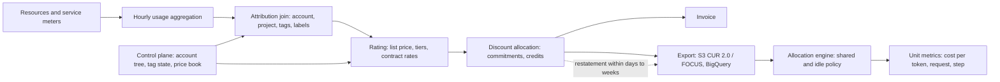

# Cloud Billing Models and Unit Cost Allocation

## TL;DR

- A bill is the output of a pipeline (meter, aggregate, attribute, rate, allocate discounts, invoice), and each stage has its own latency and restatement rules. Cost data is a time-varying, restatable dataset, not an append-only ledger.
- Tags and labels are join keys applied at attribution time, not properties of the resource. AWS requires activation in the management account, and backfill reaches at most 12 months. The account or project boundary is the only allocation key that is always present.
- "Cost" is not one number. Unblended, amortized, net, and list cost differ by who pays for commitments, credits, and negotiated discounts. Pick the semantic per audience and compute it explicitly, because AWS expresses discounts as extra line items and GCP expresses them as nested `credits` rows.
- Per-pod allocation on accelerator nodes is wrong if you weight CPU and RAM only. Weight by the price components of the node (the GCE Core, RAM, and GPU SKU lines) and bill the greater of request and usage. Idle capacity gets a named owner.
- A unit metric is a fully loaded numerator divided by a goodput denominator at an SLO, for example dollars per 1M output tokens. Detection latency multiplied by burn rate is your exposure, so runaway-spend guardrails must use control-plane signals and quotas, not billing exports.

## Mental Model



The usage meters and the rating engine form the data plane. The account hierarchy, tag and label state, price book, and commitment ledger form the control plane that the data plane joins against.
You never see the pipeline directly. You see its exports, and each export is a derived, eventually consistent projection that can be restated after the fact.
Your own allocation engine sits downstream of that projection and adds its own policy decisions about shared and idle cost.
The practical consequence is that every number on a dashboard carries three timestamps: when the usage happened, which billing period it belongs to, and when the export row was last written.
Treat those three as separate columns in every model you build, and reconcile on invoice month, not on dashboard date.

## Internals

### Reference pipeline (inferred from public behavior)

Neither AWS nor Google publishes the internal architecture of its billing pipeline.
The model below is inferred from documented export semantics and observable behavior, so treat the stage boundaries as a reasoning aid rather than a description of internal services.

1. Meters emit usage records per resource per time bucket. EC2 and Compute Engine instance-seconds, S3 and Cloud Storage byte-hours, request counts, and GPU-hours are metered by different subsystems with different latencies.
2. Records are aggregated into hourly line items. Hourly is the finest granularity AWS exposes in CUR 2.0 and the granularity at which commitments are evaluated (see below).
3. Each line item is joined with control-plane state: the owning account or project, the resource ID, and the tags or labels attached at that time.
4. The rating stage applies list price, volume tiers, and negotiated rates.
5. The discount stage applies commitments, credits, and promotions.
6. Exports and invoices are produced from the result, and late-arriving usage or corrections restate previously exported periods.

Because stage 3 is a join against control-plane state, anything not present in that state at join time is unrecoverable from the line item itself.
This is the mechanism behind the rule that tagging is not retroactive.
AWS offers a bounded repair path (backfill), and no tool repairs a resource that was never tagged.

### Control plane, data plane, and failure domains

The Data Exports and Cost Explorer APIs are control-plane surfaces.
As I recall, they are served from the us-east-1 endpoint regardless of where your workloads run (UNVERIFIED).
If that holds, any automation that queries them in the middle of an incident has an implicit dependency on that region.
This matters for guardrails: a "stop the spend" automation that reads cost data from a control-plane API violates the static-stability rule in [[17-Cloud-AI-Engineering/Volume_01_Cloud_Architecture_Principles/Chapter_02_Regions_Zones_and_Static_Stability|Regions, Zones, and Static Stability]] and the separation argument in [[17-Cloud-AI-Engineering/Volume_01_Cloud_Architecture_Principles/Chapter_04_Control_Plane_vs_Data_Plane_Separation|Control Plane vs Data Plane Separation]].
Guardrails should read data-plane signals (instance counts, accelerator-hours from metrics, quota consumption) and act through quotas and reservations, with billing data used only for after-the-fact reconciliation.

The partitioning keys of the exports are the billing period and the billing account (AWS payer or management account, GCP Cloud Billing account).
AWS delivers one partition per billing period, and its manifest is updated on each refresh (AWS docs, as of 2026-10).
There is no consensus protocol exposed to you.
The effective consistency model is "eventually consistent, last refresh wins", so a downstream loader must be idempotent with respect to a partition being rewritten.

### Time dimensions and restatement

Three clocks matter.

- Usage time: when the resource consumed capacity. AWS `line_item_usage_start_date`, GCP `usage_start_time`.
- Billing period: which invoice the charge lands on. AWS `bill_billing_period_start_date`, GCP `invoice.month`.
- Export time: when the row was last written. GCP exposes `export_time`. For AWS you infer it from the manifest and object timestamps.

AWS refreshes CUR 2.0 at least once a day, keeps refreshing the current billing period partition until the period ends, and may still update the previous period within the first two weeks after it ends ([AWS Data Exports delivery docs](https://docs.aws.amazon.com/cur/latest/userguide/dataexports-export-delivery.html), as of 2026-10).
The first delivery after creating an export can take up to 24 hours (AWS Data Exports user guide, as of 2026-10).
An export can be configured to overwrite existing files on each refresh or to create new files (AWS docs, as of 2026-10).

Mechanism implications:

- Incremental loaders keyed on "new file appeared" will miss overwrites, and loaders that union every versioned file will double count. The correct pattern is to treat the (billing period, export) partition as the unit of replacement. Detect change from the manifest, then replace that partition atomically downstream.
- A dashboard that reports month-to-date cost on day 3 of the next month is reading a partition that can still move.
- Any alert or chargeback process should define a "close" rule, for example finalize chargeback on day 15 plus a reconciliation tolerance, and handle later restatements as explicit adjustments in the next period.

GCP boundaries are subtler. Invoice months and billing-day boundaries are, as I recall, aligned to Pacific Time while `usage_start_time` is a UTC timestamp (UNVERIFIED).
If that holds, a UTC daily rollup will not reconcile to the invoice on the first and last day of a month, so reconcile on `invoice.month`, never on calendar-month truncation of `usage_start_time`.

### The AWS cost semantics stack

AWS exposes several cost columns because a single "cost" cannot serve finance, engineering, and procurement at once.

| Semantic | Meaning | Who it is for |
|---|---|---|
| Unblended | The rate as charged on the line, before smoothing across the consolidated family | Invoice reconciliation |
| Blended | Average rate across the consolidated billing family for tiered or reserved usage | Legacy smoothing, avoid for new work |
| Amortized | Upfront and recurring commitment fees spread over the term and attached to the usage they covered, with unused commitment shown separately | Engineering showback, unit economics |
| Net unblended or net amortized | The above after discounts such as private pricing or EDP-style percentage discounts | Margin and true-cost modeling |

Blended cost exists because tiered pricing and commitment benefits are computed at the consolidated-billing level, so otherwise-identical usage in two linked accounts can land at different unblended rates depending on where in the tier it fell (UNVERIFIED as to exact ordering behavior).
For this reason, never use unblended cost to compare two teams' efficiency.

#### Where commitments live in the line items

A Savings Plan or Reserved Instance does not discount individual rows.
In the CUR it appears as several line item types (names from the CUR data dictionary as I recall them, UNVERIFIED for CUR 2.0 naming):

- `SavingsPlanCoveredUsage` rows show the usage covered by the plan.
- `SavingsPlanNegation` rows are negative offsets that zero out the on-demand charge.
- `SavingsPlanRecurringFee` and `SavingsPlanUpfrontFee` rows carry the commitment charge itself.
- `DiscountedUsage` and `RIFee` play the same roles for Reserved Instances.
- Effective-cost columns (for example `savings_plan_savings_plan_effective_cost` and `reservation_effective_cost`) hold the amortized value per covered row.

Summing `line_item_unblended_cost` over these rows therefore gives the cash view, not the engineering view.
Amortized cost requires a `CASE` expression over `line_item_line_item_type`, which the worked example provides.
The unused portion of a Savings Plan is the difference between total commitment and used commitment on the recurring-fee row.
That unused portion is a portfolio cost and belongs to whoever owns commitment risk, not to the last team that happened to run workloads.

Commitments are denominated per hour, and an unused hour does not carry forward.
A diurnal workload therefore has a structural coverage ceiling below its monthly average utilization, and a monthly dashboard hides the waste that an hourly export exposes.
The next chapter, [[17-Cloud-AI-Engineering/Volume_09_FinOps_and_Cloud_Economics/Chapter_02_Commitment_Discounts_Savings_Plans_vs_CUDs|Commitment Discounts: Savings Plans vs CUDs]], derives the break-even math.
This chapter only requires that your allocation model keeps the commitment ledger separate from tenant usage.

### Attribution: accounts, projects, tags, and labels

Attribution has two tiers with very different reliability.

1. Structural keys: the AWS account ID and the GCP project ID. Every line item has one. They cannot be forgotten, they are free, and they survive resource deletion. This is why landing-zone design ([[17-Cloud-AI-Engineering/Volume_01_Cloud_Architecture_Principles/Chapter_06_Multi_Account_and_Multi_Project_Landing_Zones|Multi-Account and Multi-Project Landing Zones]]) is the first cost-allocation decision.
2. Resource metadata keys: AWS cost allocation tags and GCP labels. They are mutable, optional, and subject to drift.

AWS specifics:

- A tag key must be activated as a cost allocation tag from the management account (or a standalone account) before it appears in billing data (AWS billing docs, as of 2026-10).
- Third-party summaries of the AWS docs give up to 24 hours for a key to become activatable and up to 24 more to take effect. Verify against the primary doc before relying on the exact figures (UNVERIFIED).
- You can request a backfill of up to 12 months. The tag must have been historically assigned to the resource, you can run one backfill request per 24 hours, and a new request cannot start while one is in progress ([AWS backfill docs](https://docs.aws.amazon.com/awsaccountbilling/latest/aboutv2/cost-allocation-backfill.html), as of 2026-10).
- Tags live in a `resource_tags` map in CUR 2.0, whereas legacy CUR flattened each tag into a column. The key normalization differs between the two, so always discover keys with `map_keys` instead of hardcoding them.

The attribution join happens per usage record.
A retag affects subsequent records and not earlier ones, except via backfill.
It follows that the "tag coverage" metric should be computed per day as the fraction of cost carrying the required key, not as the fraction of resources tagged.
Resource-count coverage routinely reads 95 percent while cost coverage reads 70 percent, because the untagged 5 percent are often the largest accelerator nodes.

Some charges cannot carry user tags: taxes, support fees, some data-transfer lines, and marketplace charges are typical examples (UNVERIFIED for the exact list per service).
Plan an explicit residual bucket and a documented policy for spreading it.

GCP specifics:

- Labels are exported on each row in `labels`, `system_labels`, and `project.labels`.
- Labels attach to usage from the point they are applied forward (UNVERIFIED), which mirrors the AWS non-retroactivity rule.
- Enforcement of mandatory labels is weaker than on AWS. You mostly enforce by policy-as-code at plan time ([[17-Cloud-AI-Engineering/Volume_06_Infrastructure_as_Code_and_Delivery/Chapter_04_Policy_as_Code_OPA_Sentinel_and_Guardrails|Policy as Code: OPA, Sentinel, and Guardrails]]) and with periodic detection.

### GCP export: tables, nested credits, and the fan-out bug

Cloud Billing export to BigQuery has three tables as I recall (UNVERIFIED for current naming and availability):

- Standard usage cost: SKU-level cost per project, with labels.
- Detailed usage cost: adds resource-level identifiers (`resource.name`, `resource.global_name`).
- Pricing: list and tiered prices, and contracted prices where applicable, so you can compute effective rates.

Enablement is a console step on the billing account.
I could not verify a public API or CLI to enable it, so assume it is not manageable by Terraform until you check (UNVERIFIED).
The destination dataset location is fixed at creation in practice, so choose the multi-region or region before enabling.
Data is exported only from the time of enablement forward (UNVERIFIED for any backfill offering).
Enable it on day zero of a new billing account, because history you did not export is gone.

The schema is a nested, repeated model of the kind described in the Dremel paper (Melnik et al., VLDB 2010; see [[17-Cloud-AI-Engineering/Volume_13_Seminal_Papers_and_Case_Studies/Chapter_10_Dremel_Interactive_Analysis|Dremel: Interactive Analysis of Web-Scale Datasets]]).
Discounts are stored as a repeated `credits` field on each cost row, with entries for categories such as sustained-use, committed-use, promotions, and free tier (UNVERIFIED for the current enum).
Credit amounts are negative.
Net cost for a row is therefore `cost + SUM(credits.amount)`.

The fan-out bug: `FROM t, UNNEST(t.credits)` is an inner join against the repeated field.
It drops rows that have no credits, and it repeats `cost` once per credit entry for rows that have several.
Both errors are silent and both bias the result.
The fix is to aggregate credits in a scalar subquery per row, as the worked example shows.

Compared with AWS, GCP attaches discounts to the row that consumed them, so per-project net cost is a direct sum.
AWS exposes commitment benefits through separate lines and effective-cost columns, so the same computation needs the `CASE` expression.
In both clouds the allocation of commitment benefit to consumers is the provider's algorithm, not your policy, so your showback should re-derive an internal rate if you need to override it.

On a VM, the GCE export splits cost into per-resource SKUs such as instance core and instance RAM (and accelerator SKUs where applicable).
That split is the empirical price ratio between CPU and memory for that machine family and region.
You can use it directly as allocation weights, which the next section depends on.
AWS bills one instance price, so weights must be assumed (AWS split cost allocation data for ECS and EKS uses a fixed CPU-to-memory weighting, which I recall as 9:1, UNVERIFIED) or derived from your own price model.

### Container and accelerator allocation

Kubernetes allocation answers one question: given node cost per hour, how much belongs to each pod or tenant?
The standard answer has three decisions.

1. Weights: how node cost splits across resource dimensions.
2. Basis: bill on request, usage, or the greater of the two.
3. Idle: who owns the remainder.

Basis. Billing the greater of request and usage matches the reservation model in Borg, where a task reserves capacity and unused reserved capacity is still unavailable to others until reclaimed (Verma et al., "Large-scale cluster management at Google with Borg", EuroSys 2015; see [[17-Cloud-AI-Engineering/Volume_13_Seminal_Papers_and_Case_Studies/Chapter_07_Google_Borg_and_Omega|Google Borg and Omega]]).
Billing on usage alone subsidizes over-requesters. Billing on request alone punishes right-sized tenants whose neighbors over-request.

Weights. This is where generic tools fail on accelerator fleets.
If a node's price is 85 percent GPU, a CPU-and-memory-only weighting such as 9:1 distributes only the CPU and RAM request to tenants, so a pod that holds four GPUs with a small CPU request is almost free, and a CPU-only batch pod is charged for the GPU-dominated node price.
The worked example quantifies this: the CPU-only batch tenant is overcharged roughly 14 times, and the GPU tenants are undercharged by roughly 60 to 65 percent.
The principle behind the right fix is the dominant-resource idea from Dominant Resource Fairness (Ghodsi et al., NSDI 2011): the scarce, expensive dimension should drive the share.
Cost-weighted allocation is the monetary version of that rule. Compute weights from the price components, not from a default ratio.

GPU specifics:

- Whole-device allocation through the default device plugin makes GPU cost a function of device count times time held, which is exact.
- Time-slicing and MIG partitions make shares fractional and need a policy: allocate by slice count (MIG) or by declared share (time-slicing) and document the unit.
- Gang-scheduled jobs that hold GPUs while waiting for the rest of the gang (see [[17-Cloud-AI-Engineering/Volume_14_Staff_Plus_Interview_Arena/Chapter_02_Design_Distributed_GPU_Cluster_Scheduler|System Design: Distributed GPU Cluster Scheduler]]) burn billable time without progress. Report the held-but-not-computing time as a separate metric from tenant cost, so tenants are not charged for scheduler inefficiency they cannot control.

### Shared and idle cost policies

Shared costs (NAT, transit, logging, KMS, control planes, observability) and idle capacity need explicit rules.
There are three defensible policies, and you should choose one per cost pool and write it down.

| Policy | Mechanism | Trade-off |
|---|---|---|
| Proportional to direct cost | Spread the pool by each tenant's share of direct spend | Simple and predictable, but punishes growth and hides who causes the cost |
| Driver-based | Spread by a usage driver such as bytes through NAT, log GB ingested, or requests | Aligns incentive with cause, needs metering of the driver |
| Retained by platform | Keep idle and headroom as a platform cost center | Prevents tenants from being charged for capacity the platform chose to hold for SLO, but hides waste if the platform number is not reported |

Shapley-value allocation is the principled option when tenants jointly cause a cost (the cost of a shared cluster sized for the peak of the union).
It is rarely worth its computational cost in practice, and the driver-based policy with a reserved-headroom line captures most of the benefit.

### Unit metrics

A unit metric is a ratio of cost to a business or service quantity, with both sides precisely defined.

- Numerator: fully loaded cost. Include amortized commitments, storage, network egress and cross-AZ transfer, observability, the platform share, and support, and name any component you exclude.
- Denominator: delivered work at the quality you promise. For LLM serving that means goodput tokens at the latency SLO, not tokens counted at the gateway. See [[17-Cloud-AI-Engineering/Volume_07_Reliability_and_SRE/Chapter_01_SLIs_SLOs_and_Error_Budget_Engineering|SLIs, SLOs, and Error Budget Engineering]].

Common definitions:

| Workload | Metric | Formula |
|---|---|---|
| LLM serving | Cost per 1M output tokens | `C_hr * (1 + loading) / (goodput_tok_s * 3600 / 1e6)` |
| LLM serving | Cost per 1M input tokens | Same shape, with prefill throughput as denominator and cache-hit tokens counted separately |
| Training | Cost per useful GPU-hour | `price_hr / (MFU * goodput_fraction)` |
| Batch inference | Cost per 1,000 items at deadline | Total job cost divided by items completed on time |
| Platform | Cost per active tenant or per 1,000 requests | Allocated platform cost divided by driver |

Input and output tokens need separate metrics because prefill is compute-bound and decode is memory-bandwidth-bound, so their cost per token differs materially (see [[17-Cloud-AI-Engineering/Volume_11_LLM_Serving_and_Inference_Systems_on_Cloud/Chapter_01_LLM_Inference_Mechanics_Prefill_vs_Decode|LLM Inference Mechanics: Prefill vs Decode Phases]]).
For the full cost model, see [[17-Cloud-AI-Engineering/Volume_11_LLM_Serving_and_Inference_Systems_on_Cloud/Chapter_11_End_to_End_Latency_Throughput_and_Cost_Modeling|End-to-End Latency, Throughput, and Cost Modeling]] and [[17-Cloud-AI-Engineering/Volume_09_FinOps_and_Cloud_Economics/Chapter_05_GPU_and_TPU_Unit_Economics|GPU and TPU Unit Economics]].

Three traps:

1. Average cost versus marginal cost. GPU capacity is a step function: the next 1,000 tokens per second costs zero until the node is full, then costs a whole node. Average unit cost falls with utilization, so a unit metric reported without utilization is uninterpretable.
2. Mix shift. Aggregate cost per token can fall while every tenant's cost per token rises, if cheap, high-volume traffic grows faster than expensive traffic. Always publish the metric per cohort (model, tenant tier, context-length bucket).
3. Goodhart on the denominator. Counting retried or cancelled requests, or speculative tokens that were rejected, inflates the denominator and flatters the metric.

### Normalizing with FOCUS

The FinOps Open Cost and Usage Specification (FOCUS) defines a vendor-neutral column set so AWS and GCP data can share one model.
AWS Data Exports offers FOCUS 1.2 and FOCUS 1.0 tables with AWS-specific columns (AWS docs, as of 2026-10).
I could not verify whether a GCP-native FOCUS export is generally available (UNVERIFIED), so plan to normalize GCP in a BigQuery view.
The columns that carry the cost-semantics decisions are `BilledCost` (invoice view), `EffectiveCost` (amortized view), `ListCost`, and `ContractedCost`.
Map them deliberately. AWS amortized cost approximates `EffectiveCost`, and for GCP `cost + SUM(credits)` is the closest equivalent to the net view.
Document the mapping and test it against the invoice each month.

## Numbers to Know

| Quantity | Value | Source |
|---|---|---|
| AWS CUR 2.0 refresh cadence | At least once a day; current billing-period partition refreshed until period end | AWS docs, as of 2026-10 |
| Prior-period restatement window | May update the previous billing period within the first two weeks after it ends | AWS docs, as of 2026-10 |
| First delivery after creating an export | Up to 24 hours | AWS Data Exports user guide, as of 2026-10 |
| Console refresh option for billing exports | Daily, refreshed up to one time per day | AWS docs, as of 2026-10 |
| AWS FOCUS tables | FOCUS 1.2 and FOCUS 1.0, each with AWS columns | AWS docs, as of 2026-10 |
| Cost allocation tag backfill | Up to 12 months, one request per 24 hours, none concurrent, tag must have been assigned historically | AWS docs, as of 2026-10 |
| Tag activation latency | Up to 24 hours to become activatable plus up to 24 hours to take effect | Third-party summary of AWS docs, UNVERIFIED against primary |
| AWS tags per resource, key and value length | 50 user tags, 128-char key, 256-char value | UNVERIFIED |
| GCP labels per resource, key and value length | 64 labels, 63-char key and value | UNVERIFIED |
| Instance billing granularity | Per second with a 60-second minimum on EC2 Linux and on Compute Engine | UNVERIFIED |
| Cost Explorer API price | USD 0.01 per paginated request | UNVERIFIED |
| AWS Budgets evaluation cadence | Up to about three times per day | UNVERIFIED |
| Derived: export size for 5,000 resources | 5,000 x 730 h x 2.5 line items = 9.1M rows per month, about 1.4 GB Parquet at 150 B per row | Derived, assumption stated |
| Derived: runaway exposure | burn rate x detection latency, for example USD 4,000/h x 24 h = USD 96,000 | Derived, illustrative price |

The only prices in the chapter are illustrative parameters, not list prices.
Verify current list prices from the AWS and Google Cloud pricing pages before using any figure in a decision.

## AWS vs GCP Mechanism Parity

| Dimension | AWS | GCP |
|---|---|---|
| Billing entity | Payer (management) account in an Organization, consolidated billing across linked accounts | Cloud Billing account that projects link to, independent of the resource hierarchy |
| Structural allocation key | Account ID on every line item | Project ID on every row |
| Detailed export | CUR 2.0 via Data Exports to S3, Parquet or CSV | Detailed usage cost table in BigQuery |
| Export refresh | At least daily, previous period may be restated for about two weeks | Continuous load into BigQuery, `export_time` per row (cadence UNVERIFIED) |
| Normalized schema | FOCUS 1.2 or 1.0 with AWS columns | Build FOCUS view in BigQuery (native FOCUS export UNVERIFIED) |
| Tag and label model | Tags, plus activation step, map column in CUR 2.0 | Labels, `system_labels`, and `project.labels` on each row |
| Retroactivity | Backfill up to 12 months | Forward only (UNVERIFIED) |
| Discount representation | Separate line item types and effective-cost columns, needs `CASE` for amortized view | Negative `credits` entries nested on each row |
| Commitment evaluation | Hourly commitment rate, benefit applied across linked accounts by the provider | Resource-based and spend-based commitments, credits per row (details in the next chapter) |
| Container allocation | Split cost allocation data for ECS and EKS, fixed CPU-memory weighting (UNVERIFIED) | GKE cost allocation plus Core and RAM SKU split in export (UNVERIFIED for GKE feature specifics) |
| Price book | Price List API, plus private pricing in the export | Pricing export table |
| Budgets | AWS Budgets with alerts and actions, multiple evaluations per day | Cloud Billing budgets with Pub/Sub notifications |
| Consistency model | Eventually consistent derived export, overwrite or versioned delivery | Append-style rows with adjustments (UNVERIFIED), partitioned BigQuery tables |
| Major pitfall | Double counting versioned exports, missing the amortization `CASE` | Credits fan-out, Pacific-time invoice boundary, missed day-zero export enablement |

Neither provider offers a transactional view of cost, and neither guarantees a maximum restatement window beyond what its documentation states.
Design for restatement in both.

## Worked Example: A Cost Data Foundation and an Accelerator Allocator

Goal: stand up billing exports and budget alarms on both clouds, then allocate a shared GPU node to three tenants and compute a unit cost.
Everything billable here is small; the only potentially material cost is the data you scan and store.

### Capacity and cost estimate

All unit prices below are assumptions (UNVERIFIED); replace them with current list prices.

1. Export volume: 5,000 resources x 730 hours x 2.5 line items per resource-hour = 9.1M rows per month. At 150 bytes per row in Parquet, that is about 1.4 GB per month.
2. Storage: 24 months retained = about 33 GB. At an assumed USD 0.023 per GB-month for S3 standard, that is about USD 0.76 per month.
3. Query cost: a monthly Athena query that reads about 15 percent of columns scans about 0.2 GB. At an assumed USD 5 per TB scanned, that is about USD 0.001 per query. Dashboards that run hundreds of times a day still stay in the single-digit dollars per month if tables are partitioned by billing period.
4. BigQuery: assume the same row count and a few GB of logical storage. Storage is a few cents per month, and on-demand query cost depends on bytes billed, so always filter on the partition column.
5. Budget alarms are free on both clouds for the first few budgets (AWS charges per budget beyond a free allotment, UNVERIFIED).

Exposure example for why budgets are not enough: 100 accelerator nodes at an assumed USD 40 per node-hour burn USD 4,000 per hour.
If cost data and budget evaluation lag by up to 24 hours, the worst-case exposure before an alert is USD 96,000.
At an 8-hour evaluation interval it is USD 32,000.
The remedy is a quota and capacity guardrail, not a smaller budget threshold.

### Step 1 - AWS: bucket policy, export, and budget

The Data Exports API shape below was written from memory and must be checked with `aws bcm-data-exports create-export help` before use (UNVERIFIED).

```bash
export ACCT=$(aws sts get-caller-identity --query Account --output text)
export BUCKET=finops-lab-cur-$ACCT
aws s3api create-bucket --bucket "$BUCKET" --region us-east-1
aws s3api put-public-access-block --bucket "$BUCKET" \
  --public-access-block-configuration BlockPublicAcls=true,IgnorePublicAcls=true,BlockPublicPolicy=true,RestrictPublicBuckets=true

cat > policy.json <<EOF
{
  "Version": "2012-10-17",
  "Statement": [
    {
      "Sid": "AllowBillingDelivery",
      "Effect": "Allow",
      "Principal": {"Service": ["billingreports.amazonaws.com", "bcm-data-exports.amazonaws.com"]},
      "Action": ["s3:GetBucketAcl", "s3:GetBucketPolicy", "s3:PutObject"],
      "Resource": ["arn:aws:s3:::$BUCKET", "arn:aws:s3:::$BUCKET/*"],
      "Condition": {
        "StringEquals": {"aws:SourceAccount": "$ACCT"},
        "ArnLike": {"aws:SourceArn": ["arn:aws:cur:us-east-1:$ACCT:definition/*", "arn:aws:bcm-data-exports:us-east-1:$ACCT:export/*"]}
      }
    }
  ]
}
EOF
aws s3api put-bucket-policy --bucket "$BUCKET" --policy file://policy.json

cat > export.json <<EOF
{
  "Export": {
    "Name": "finops-lab-cur2",
    "DataQuery": {
      "QueryStatement": "SELECT * FROM COST_AND_USAGE_REPORT",
      "TableConfigurations": {
        "COST_AND_USAGE_REPORT": {
          "TIME_GRANULARITY": "HOURLY",
          "INCLUDE_RESOURCES": "TRUE",
          "INCLUDE_MANUAL_DISCOUNT_COMPATIBILITY": "FALSE",
          "INCLUDE_SPLIT_COST_ALLOCATION_DATA": "FALSE"
        }
      }
    },
    "DestinationConfigurations": {
      "S3Destination": {
        "S3Bucket": "$BUCKET", "S3Prefix": "cur2", "S3Region": "us-east-1",
        "S3OutputConfigurations": {"OutputType": "CUSTOM", "Format": "PARQUET", "Compression": "PARQUET", "Overwrite": "OVERWRITE_REPORT"}
      }
    },
    "RefreshCadence": {"Frequency": "SYNCHRONOUS"}
  }
}
EOF
aws bcm-data-exports create-export --region us-east-1 --cli-input-json file://export.json

cat > budget.json <<EOF
{"BudgetName": "finops-lab", "BudgetLimit": {"Amount": "50", "Unit": "USD"}, "TimeUnit": "MONTHLY", "BudgetType": "COST"}
EOF
cat > notif.json <<EOF
[
  {"Notification": {"NotificationType": "ACTUAL", "ComparisonOperator": "GREATER_THAN", "Threshold": 80, "ThresholdType": "PERCENTAGE"},
   "Subscribers": [{"SubscriptionType": "EMAIL", "Address": "you@example.com"}]},
  {"Notification": {"NotificationType": "FORECASTED", "ComparisonOperator": "GREATER_THAN", "Threshold": 100, "ThresholdType": "PERCENTAGE"},
   "Subscribers": [{"SubscriptionType": "EMAIL", "Address": "you@example.com"}]}
]
EOF
aws budgets create-budget --account-id "$ACCT" --budget file://budget.json --notifications-with-subscribers file://notif.json
```

The export uses `OVERWRITE_REPORT` so the downstream partition is replaced rather than versioned, which removes the double-counting failure mode.
Activate your cost allocation tag keys in the management account separately, then request a backfill if the tags existed earlier.

### Step 2 - GCP: dataset and budget

Enabling the export is a console action on the billing account (Billing, then Billing export, then BigQuery export). I could not verify an API to automate it (UNVERIFIED).

```bash
export PROJECT=my-finops-project
export BA=000000-AAAAAA-BBBBBB
bq --location=US mk --dataset --description "Cloud Billing export" "$PROJECT:billing_export"

gcloud billing budgets create --billing-account="$BA" \
  --display-name=finops-lab \
  --budget-amount=50USD \
  --threshold-rule=percent=0.5 \
  --threshold-rule=percent=0.9 \
  --threshold-rule=percent=1.0,basis=forecasted-spend \
  --filter-projects="projects/$PROJECT"
```

Budgets alert and optionally notify Pub/Sub. They do not cap spend.

### Step 3 - Queries

AWS amortized cost by team tag in Athena. The reservation and Savings Plan column names follow the CUR data dictionary as I recall it and must be validated against your table (UNVERIFIED for CUR 2.0).

```sql
-- Discover tag keys first: SELECT DISTINCT map_keys(resource_tags) FROM cur2 LIMIT 100;
SELECT
  bill_billing_period_start_date AS period,
  line_item_usage_account_id AS account,
  COALESCE(element_at(resource_tags, 'user_team'), 'UNTAGGED') AS team,
  SUM(
    CASE
      WHEN line_item_line_item_type = 'SavingsPlanCoveredUsage' THEN savings_plan_savings_plan_effective_cost
      WHEN line_item_line_item_type = 'SavingsPlanRecurringFee' THEN savings_plan_total_commitment_to_date - savings_plan_used_commitment
      WHEN line_item_line_item_type IN ('SavingsPlanNegation', 'SavingsPlanUpfrontFee') THEN 0
      WHEN line_item_line_item_type = 'DiscountedUsage' THEN reservation_effective_cost
      WHEN line_item_line_item_type = 'RIFee' THEN reservation_unused_amortized_upfront_fee_for_billing_period + reservation_unused_recurring_fee
      WHEN line_item_line_item_type = 'Fee' AND reservation_reservation_a_r_n <> '' THEN 0
      ELSE line_item_unblended_cost
    END) AS amortized_cost
FROM cur2
WHERE bill_billing_period_start_date >= DATE '2026-09-01'
GROUP BY 1, 2, 3
ORDER BY amortized_cost DESC;
```

The `SavingsPlanRecurringFee` and `RIFee` branches yield the unused commitment.
Route those rows to a `commitment-owner` bucket instead of a team to keep tenant cost clean.

GCP net cost by label, with correct credit handling:

```sql
SELECT
  (SELECT value FROM UNNEST(labels) WHERE key = 'team') AS team,
  invoice.month AS invoice_month,
  SUM(cost) AS gross_cost,
  SUM(IFNULL((SELECT SUM(c.amount) FROM UNNEST(credits) AS c), 0)) AS credits_total,
  SUM(cost) + SUM(IFNULL((SELECT SUM(c.amount) FROM UNNEST(credits) AS c), 0)) AS net_cost
FROM `my-finops-project.billing_export.gcp_billing_export_resource_v1_XXXXXX_XXXXXX_XXXXXX`
WHERE usage_start_time >= TIMESTAMP('2026-09-01')
GROUP BY team, invoice_month
ORDER BY net_cost DESC;
```

The wrong pattern, `FROM t, UNNEST(t.credits) AS c`, drops uncredited rows and multiplies cost by the number of credit entries.

Restatement-safe rebuild for the trailing window, run daily:

```sql
BEGIN TRANSACTION;
DELETE FROM `my-finops-project.finops.fact_cost`
WHERE usage_date >= DATE_SUB(CURRENT_DATE(), INTERVAL 45 DAY);
INSERT INTO `my-finops-project.finops.fact_cost` (usage_date, project_id, team, sku, net_cost, max_export_time)
SELECT DATE(usage_start_time), project.id,
       (SELECT value FROM UNNEST(labels) WHERE key = 'team'),
       sku.description,
       cost + IFNULL((SELECT SUM(c.amount) FROM UNNEST(credits) AS c), 0),
       export_time
FROM `my-finops-project.billing_export.gcp_billing_export_resource_v1_XXXXXX_XXXXXX_XXXXXX`
WHERE DATE(usage_start_time) >= DATE_SUB(CURRENT_DATE(), INTERVAL 45 DAY);
COMMIT TRANSACTION;
```

The 45-day window is a policy choice that exceeds AWS's documented two-week restatement window, with margin for billing-system adjustments.

### Step 4 - Accelerator allocator and unit metric

This script runs offline with no cloud access.
The node price of USD 40 per hour is an illustrative assumption. Replace the weights with ratios derived from the Core, RAM, and GPU SKU lines in your own export.

```python
#!/usr/bin/env python3
"""Container cost allocation with resource-weighted pricing, request-vs-usage max, and explicit idle."""
from dataclasses import dataclass

NODE_COST_HR = 40.00   # illustrative assumption, not a list price
HOURS = 24.0
NODES = 1
GPUS, VCPUS, RAM_GIB = 8, 192, 2048

W_SKU = {"gpu": 0.85, "cpu": 0.10, "ram": 0.05}
W_NAIVE = {"gpu": 0.00, "cpu": 0.90, "ram": 0.10}
CAP = {"gpu": GPUS, "cpu": VCPUS, "ram": RAM_GIB}

@dataclass
class Pod:
    tenant: str
    gpu: float
    cpu_req: float
    cpu_used: float
    ram_req: float
    ram_used: float
    hours: float

PODS = [
    Pod("search",    gpu=4, cpu_req=16, cpu_used=9,  ram_req=128, ram_used=100, hours=24),
    Pod("chat",      gpu=2, cpu_req=8,  cpu_used=6,  ram_req=64,  ram_used=60,  hours=24),
    Pod("batch-etl", gpu=0, cpu_req=96, cpu_used=40, ram_req=512, ram_used=300, hours=12),
]

def allocate(weights):
    node_cost = NODE_COST_HR * HOURS * NODES
    price = {r: (node_cost * w) / (CAP[r] * HOURS * NODES) if w else 0.0 for r, w in weights.items()}
    out = {}
    for p in PODS:
        out[p.tenant] = (price["gpu"] * p.gpu * p.hours
                         + price["cpu"] * max(p.cpu_req, p.cpu_used) * p.hours
                         + price["ram"] * max(p.ram_req, p.ram_used) * p.hours)
    return node_cost, out, node_cost - sum(out.values())

for name, w in (("sku-weighted", W_SKU), ("cpu:ram 9:1 only", W_NAIVE)):
    node_cost, per, idle = allocate(w)
    print(f"--- {name}: node cost/day = {node_cost:.2f}, idle = {idle:.2f} ({idle/node_cost:.1%})")
    for t, c in per.items():
        print(f"    {t:10s} direct = {c:8.2f}  loaded = {c * node_cost / (node_cost - idle):8.2f}")

def cost_per_million(cost_per_hr, goodput_tok_s, overhead=0.0):
    return cost_per_hr * (1 + overhead) / (goodput_tok_s * 3600 / 1e6)

CAP_TOK_S = 12000.0
for util in (1.0, 0.55, 0.30):
    print(f"util {util:4.0%}: ${cost_per_million(NODE_COST_HR, CAP_TOK_S * util, 0.15):.3f} per 1M output tokens")
```

Output from running the script:

```text
--- sku-weighted: node cost/day = 960.00, idle = 301.50 (31.4%)
    search     direct =   419.00  loaded =   610.84
    chat       direct =   209.50  loaded =   305.42
    batch-etl  direct =    30.00  loaded =    43.74
--- cpu:ram 9:1 only: node cost/day = 960.00, idle = 615.00 (64.1%)
    search     direct =    78.00  loaded =   217.04
    chat       direct =    39.00  loaded =   108.52
    batch-etl  direct =   228.00  loaded =   634.43
util 100%: $1.065 per 1M output tokens
util  55%: $1.936 per 1M output tokens
util  30%: $3.549 per 1M output tokens
```

Reading the result:

- Under SKU-weighted pricing, the GPU price is 960 x 0.85 / (8 x 24) = USD 4.25 per GPU-hour, so `search` pays 4 x 24 x 4.25 = USD 408 for GPUs plus USD 11 for CPU and RAM.
- Under the CPU-and-RAM-only weighting, `batch-etl` is charged USD 634 loaded instead of USD 44, a 14.5x overcharge, while `search` is undercharged by about 64 percent. A tenant looking at that report would conclude that moving the CPU-only ETL job off the shared node is urgent and that GPU use is nearly free.
- Idle is 31.4 percent of node cost in the correct model. The 64.1 percent in the naive model is mostly an artifact of ignoring the GPU price, which makes the platform look wasteful.
- Unit cost moves by a factor of 3.3 between 100 percent and 30 percent utilization (USD 1.065 to USD 3.549 per 1M output tokens). A single "cost per token" number without utilization and goodput definition is meaningless.

### Teardown

```bash
aws bcm-data-exports list-exports --region us-east-1   # copy the ExportArn
aws bcm-data-exports delete-export --region us-east-1 --export-arn "$EXPORT_ARN"
aws budgets delete-budget --account-id "$ACCT" --budget-name finops-lab
aws s3 rm "s3://$BUCKET" --recursive
aws s3api delete-bucket --bucket "$BUCKET" --region us-east-1

gcloud billing budgets list --billing-account="$BA"      # copy the budget id
gcloud billing budgets delete "$BUDGET_ID" --billing-account="$BA"
bq rm -r -f -d "$PROJECT:billing_export"
```

Disable the BigQuery billing export in the console before deleting the dataset, or the export will fail against a missing destination.

## Failure Modes and Pitfalls

I could not verify a public post-incident review that concerns a hyperscaler's billing pipeline, so none is cited here.
The patterns below follow from the documented export semantics and from common operational experience.
For incidents that change spend through retry storms and failover traffic, see [[17-Cloud-AI-Engineering/Volume_07_Reliability_and_SRE/Chapter_07_Anatomy_of_Major_Cloud_Outages|Anatomy of Major Cloud Outages]].

1. **Tag activation gap.** Teams tag in week 1, the key is activated in week 3, and the first two weeks are untagged in every report. Mitigation: pre-activate the keys, request backfill (one request per 24 hours, 12 months maximum), and report tagged-cost coverage per day.
2. **Double counting from versioned exports.** Querying every versioned file of a billing period triples cost. Mitigation: use overwrite delivery, or select only the manifest's latest execution, and add a reconciliation test that compares your monthly total to the invoice within a tolerance.
3. **Credit fan-out on GCP.** An inner `UNNEST` on `credits` silently drops and duplicates rows. Mitigation: aggregate credits in a scalar subquery, and add a test asserting that `SUM(cost)` from the fact table equals `SUM(cost)` from the raw export for the same window.
4. **Window mismatch against the invoice.** UTC calendar dashboards disagree with invoice totals on month boundaries. Mitigation: join on `invoice.month` (GCP) or the billing period column (AWS), and treat the Pacific-time boundary as UNVERIFIED until you confirm it against your own invoice.
5. **Commitment waste charged to the wrong team.** If unused Savings Plan or CUD value follows the account that bought it, a team that buys capacity is punished for the portfolio's slack. Mitigation: a `commitment-owner` bucket and a published coverage SLO.
6. **Mispriced accelerators.** CPU:RAM-only allocators distort tenant bills by an order of magnitude on GPU nodes, as the worked example shows. Mitigation: derive weights from SKU lines and re-derive them when instance generations change.
7. **Idle with no owner.** Allocating idle pro rata to tenants removes the incentive for the platform to improve packing, and retaining it centrally with no reporting hides the problem. Mitigation: report idle as a first-class line, with a utilization target and an owner.
8. **Detection latency exposure.** A runaway job (a retry storm, an autoscaler loop, an unbounded training launcher) accrues cost at the speed of the data plane and is reported at the speed of the billing pipeline. Mitigation: quota ceilings, capacity reservations as intentional caps, and data-plane alarms on accelerator-hours.
9. **Control-plane dependency in the guardrail.** An automation that reads Cost Explorer to decide whether to scale down fails exactly when you need it. Mitigation: use local metrics and pre-provisioned limits.
10. **Export lost with its project.** If the BigQuery dataset or S3 bucket is deleted or the owning project is closed, the export history is gone, and GCP history cannot be recovered. Mitigation: dedicated, locked-down billing-data project or account with deletion protection and replicated snapshots.
11. **Denominator gaming.** Teams count retried, cancelled, or speculatively rejected tokens, and the metric improves while the economics worsen. Mitigation: define the denominator at the engine with SLO-compliant completions only, and audit it against client-side counts.
12. **Mix-shift blindness.** The global unit cost improves because a cheap cohort grew. Mitigation: publish per-cohort metrics and a mix-adjusted index.

## Security and Cost Angles

### Access and encryption

- Billing data discloses negotiated discounts, commitment portfolios, and which projects run which accelerators. Treat it as confidential data, not as an open internal dashboard source.
- AWS: scope the export bucket policy to the billing service principals with `aws:SourceAccount` and `aws:SourceArn` conditions, as in Step 1, to prevent a confused-deputy write from another account. Grant read access through a role used by the query engine, not through IAM users.
- Verify SSE-KMS support for your specific export type before mandating a customer-managed key on the export bucket (UNVERIFIED), and review the key hierarchy in [[17-Cloud-AI-Engineering/Volume_08_Security_Identity_and_the_Data_Perimeter/Chapter_04_Encryption_Key_Hierarchies_and_Envelope_Encryption|Encryption Key Hierarchies and Envelope Encryption]].
- GCP: grant dataset-level read to a small group, and expose tenant views through authorized views or row-level security keyed on `project.id`, so each tenant sees only its own rows. Restrict the pricing table, because it can contain contract rates.
- Put the cost data store inside the perimeter described in [[17-Cloud-AI-Engineering/Volume_08_Security_Identity_and_the_Data_Perimeter/Chapter_06_Constructing_an_Impenetrable_Data_Perimeter|Constructing an Impenetrable Data Perimeter]], and test that the export delivery path still works after the perimeter is applied (UNVERIFIED for GCP VPC Service Controls specifics).

### Unit-economics levers

- Make the platform the commitment owner, and charge tenants an internal blended rate so individual teams cannot arbitrage the portfolio.
- Use hourly granularity only for commitment analysis. Daily granularity cuts rows by up to 24x for everything else.
- Partition by billing period, prune columns, and use Parquet to keep scan cost near zero.
- Reduce the biggest unit-cost driver first. For GPU serving that is utilization (batching and packing), then precision and model choice, then discount structure, then price. See [[17-Cloud-AI-Engineering/Volume_09_FinOps_and_Cloud_Economics/Chapter_03_Spot_Economics_and_Interruption_Handling|Spot Economics and Interruption Handling]] and [[17-Cloud-AI-Engineering/Volume_09_FinOps_and_Cloud_Economics/Chapter_04_Network_Egress_Economics_and_Optimization|Network Egress Economics and Optimization]] for the other levers.
- Automate anomaly detection and showback as in [[17-Cloud-AI-Engineering/Volume_09_FinOps_and_Cloud_Economics/Chapter_06_FinOps_Organizational_Practices_and_Automation|FinOps Organizational Practices and Automation]]. For application-level cost controls, see [[13-Agentic-AI/Agentic_AI_Zero_to_Godhood/Volume_12_Production_Engineering/Chapter_03_Cost_Engineering|Cost Engineering]].

## Interview Questions and Model Answers

### Question 1 (L5 - Senior)

Finance reports that last month's AWS bill was USD 412,000, but your engineering dashboard shows USD 389,000. How do you find the gap?

#### Model Answer

The gap is almost always one of five things, and I check them in order of how mechanically they arise.

First, cost semantics. Finance reads the invoice, which is unblended cost plus tax, support, and fees. The dashboard probably shows amortized cost, which spreads upfront commitment fees across the term. Those two differ legitimately, and I would reconcile through a bridge: unblended, minus upfront fee timing, plus tax and support, equals invoice.
Second, line item types the dashboard filters out. Tax, support, marketplace, refunds, and credits are commonly excluded from engineering views.
Third, time. The CUR partition for the billing period may have been refreshed after the dashboard job last ran. AWS refreshes at least daily and can restate the prior period for about two weeks after it ends, so a dashboard that snapshots on day 2 of the month will be stale (AWS docs, as of 2026-10).
Fourth, duplicated or missing files: a versioned export unioned twice inflates the dashboard, while a partially loaded partition deflates it.
Fifth, scope: linked accounts excluded from the query, or the dashboard reading a single payer when there are two.

I would build the bridge as a query grouped by `line_item_line_item_type` and compare it to the invoice summary, which turns a "disagreement" into a labeled list of deltas.
The deliverable is a standing monthly reconciliation with a tolerance, for example 0.1 percent, and an alert when it is exceeded.

#### Follow-up Interviewer Question

The bridge closes to within USD 300, but the residual changes every month in sign and magnitude. What do you suspect and how do you test it?

### Question 2 (L5 - Senior)

Design a tagging strategy for 60 teams that will still produce usable cost allocation in 12 months.

#### Model Answer

I would not make tags the primary key. The account or project is present on every line item and cannot be forgotten, so the landing zone gives each team or workload at least one account or project per environment, and tags carry only the finer dimensions.
The mandatory tag set is small (team, service, environment, cost center), with controlled vocabularies rather than free text, because `Team` and `team` and `team-a` fragment reports.
Enforcement happens in three layers. First, at plan time through policy-as-code on infrastructure definitions ([[17-Cloud-AI-Engineering/Volume_06_Infrastructure_as_Code_and_Delivery/Chapter_04_Policy_as_Code_OPA_Sentinel_and_Guardrails|Policy as Code: OPA, Sentinel, and Guardrails]]). Second, at runtime through organization-level tag or label policy where the platform supports it. Third, by detection: a daily job reports the share of cost with each required key.
The coverage metric must be cost-weighted. Resource-count coverage overstates quality because the big accelerator nodes are often the untagged ones.
Operationally, activate AWS cost allocation tag keys before the first deploy, because activation is not retroactive except through the 12-month backfill, and a key can take a day or two to take effect.
I would also publish an explicit residual policy for costs that cannot carry tags (taxes, support, some transfer), so the untagged bucket is a managed number rather than a mystery.

#### Follow-up Interviewer Question

A team refuses to tag because their pipeline creates resources through a managed service that does not propagate tags. What do you do?

### Question 3 (L6 - Staff)

You run a shared 64-GPU Kubernetes cluster for six tenants. How do you allocate cost, and what goes wrong with the default approach?

#### Model Answer

I start from the node price and decompose it into resource components, then bill each tenant on the greater of requested and used amount per component, with a named owner for the remainder.
The default approach in many cost tools weights CPU and memory only, using a fixed ratio. On GPU nodes that is wrong by an order of magnitude, because most of the node price is the accelerator. A CPU-heavy ETL pod gets billed for the GPU price it never touches, and GPU tenants look nearly free. My worked numbers on an 8-GPU node show a 14.5x overcharge for the CPU-only tenant.
So weights come from price components. On GCE I can read the Core, RAM, and GPU SKU lines from the detailed export and compute the ratio empirically. On AWS the instance has one price, so I calibrate weights from a price model, such as comparing the instance with and without an accelerator at equal CPU and memory, and I document the assumption.
For the basis, requests rather than usage, because a reservation denies capacity to others; this follows the Borg reservation model. For the greater-of rule, a tenant that bursts above its request pays for the burst.
Fractional GPUs need a stated unit: whole devices through the default plugin, slice count for MIG, declared share for time-slicing. Gang-scheduled jobs that hold devices while waiting for the full gang create held-but-idle time, which I report as a scheduler inefficiency metric instead of billing it to the tenant.
For idle, I split it into two lines. Headroom the platform deliberately keeps for SLO or burst is a platform cost, reported with a target. Unintended idle is waste, allocated to the platform until packing improves, so the platform team owns the improvement.
The incentive check is whether each tenant's marginal bill moves when it reduces its footprint, and whether the platform's bill moves when packing improves.

#### Follow-up Interviewer Question

Two tenants disagree: one says idle should be shared pro rata, the other says idle belongs to whoever requested the largest slice. What principle decides, and what does the DRF paper say about it?

### Question 4 (L6 - Staff)

Define the primary unit metric for an LLM inference platform and explain how you would keep it honest.

#### Model Answer

The primary metric is fully loaded cost per 1M output tokens at the latency SLO, with a separate metric for input tokens, because prefill is compute-bound and decode is memory-bandwidth-bound and their cost per token differs.
The numerator is node cost per hour on an amortized basis, plus loading for storage, network (including cross-AZ and egress), observability, the platform share, and support. The loading is a named percentage that is revisited quarterly, not a hidden constant.
The denominator is goodput: tokens from requests that completed within the SLO, counted at the engine, excluding retries, cancellations, and rejected speculative tokens, and with cache-hit tokens reported separately.
Honesty comes from four controls. First, always publish utilization next to the metric, since average cost falls as utilization rises and the metric is otherwise uninterpretable (in my model it ranges from USD 1.07 to USD 3.55 for the same hardware as utilization falls from 100 to 30 percent). Second, cohort the metric by model, context-length bucket, and tenant tier, so mix shift cannot hide a regression. Third, track marginal cost next to average cost, because capacity is a step function: the next token costs nothing until the node fills, then a whole node. Fourth, reconcile the sum of attributed cost with the invoice monthly.
I would then use the metric for decisions: batch size and quantization changes are evaluated by their effect on cost per goodput token at fixed quality, and commitments are sized from the utilization distribution rather than the average.

#### Follow-up Interviewer Question

Product wants a single price per token to compare you against a third-party API. Which hidden costs do you need to disclose, and which do you refuse to hide?

### Question 5 (L6 - Staff)

Build the cost data platform that ingests AWS CUR 2.0 and a GCP BigQuery export into one model. What are the hard parts?

#### Model Answer

The hard parts are restatement, semantics, and identity, not volume.
For restatement, both sources are eventually consistent projections. AWS refreshes at least daily and may update the prior period for about two weeks. So I model a bitemporal fact table keyed by usage time and load time, rebuild a trailing window (I use 45 days) idempotently on each run, and run a nightly invoice reconciliation. Loaders detect change from the manifest on AWS and from `export_time` on GCP.
For semantics, I map both to FOCUS-style columns, and I make the cost-semantic columns explicit: billed, effective, list, and contracted. AWS effective cost needs the line-item-type `CASE` expression. GCP effective cost is `cost + SUM(credits)` with credits aggregated per row to avoid the fan-out. Each mapping gets a test against an invoice.
For identity, I resolve a canonical owner from account or project first, then tags or labels, then a rules table for residuals, and I version the rules, so a historical report can be reproduced after an ownership change.
Other decisions: store raw exports immutably in a separate bucket or dataset and derive everything from them, which allows a rebuild; partition by billing period; expose tenant data through row-level views; and treat schema evolution as expected, because CUR columns appear and disappear and tag maps change.
The operational SLOs are freshness (hours since last successful load per source), completeness (rows loaded versus manifest row counts), and accuracy (reconciliation delta to invoice).

#### Follow-up Interviewer Question

A provider restates a closed month by 1.5 percent after your chargeback has been published. Walk through the policy and the data model.

### Question 6 (L7+ - Principal)

Forty teams share a pool of Savings Plans and committed-use discounts, and utilization of the commitment is 82 percent. How should the cost of unused commitment be allocated, and who should own the coverage target?

#### Model Answer

The 18 percent unused is a portfolio risk cost, and the allocation question is really a question about who should bear risk and who controls it.
Teams do not control it individually. They control their own usage, but coverage depends on the aggregate hourly shape. If I charge unused commitment to the team that bought it, I create an incentive never to buy. If I charge it pro rata to all teams, I tax efficient teams for the others' variance. If I charge it to the last consumer, I make costs depend on scheduling noise.
My answer is a central owner (the FinOps function or platform) who holds the commitment portfolio like an insurer. Teams pay an internal rate for covered usage that is somewhat above the effective rate and below on-demand, and the spread funds the unused portion. The owner's performance metric is the portfolio's effective savings rate versus on-demand, with a coverage target set by the break-even analysis in the next chapter.
The mechanism requires hourly data, because commitments are evaluated per hour and cannot be banked. A monthly utilization number hides that diurnal workloads have a structural coverage ceiling.
I would also distinguish structural unused (a diurnal trough that cannot be filled) from avoidable unused (a team migrated off an instance family). Avoidable unused is escalated to the migrating team through the engineering roadmap, because it is a decision cost.
For fairness checks I would compare the internal rate against what each team would have paid on its own, if it could buy commitments, as a test that the pooling is a net benefit to everyone. If it is not, the pool is subsidizing someone and the rate needs redesign.
The risk of this scheme is moral hazard on the owner's side, so the portfolio's utilization, savings rate, and spread are published to every team.

#### Follow-up Interviewer Question

Accelerator capacity is bought as reservations or capacity blocks, not Savings Plans, and demand is lumpy because of training runs. How does your insurer model change?

### Question 7 (L7+ - Principal)

A training launcher bug started 200 extra accelerator nodes on Friday evening and nobody noticed until Monday. Design the system so this cannot cost more than a bounded amount, and explain why budgets were insufficient.

#### Model Answer

Budgets failed because of detection latency. Billing data lags the data plane, budget evaluation runs a few times a day, and notifications go to humans who are asleep. Exposure equals burn rate times time to action. At an assumed USD 40 per node-hour, 200 nodes burn USD 8,000 per hour, so a 60-hour weekend costs USD 480,000, and even a 24-hour latency costs USD 192,000.
The design principle is to put the bound where the spend is created, in the data plane, not where it is reported.
Layer 1, quotas and reservations. Set service quotas on the accelerator instance families to the approved fleet size per account or project, so the launcher cannot exceed them. Capacity reservations double as intentional caps for committed fleets. Quota increase becomes a reviewed change.
Layer 2, data-plane alarms. Alarm on accelerator-hours or node count from local metrics, with thresholds relative to the approved baseline and with a short evaluation period. These do not depend on cost APIs.
Layer 3, automated containment. A pre-authorized, narrowly scoped automation can scale down non-production node groups or pause launchers when an alarm fires. For production, it pages and requires acknowledgement, because killing production for cost is its own incident. The automation runs in the same region and does not depend on us-east-1 control-plane billing APIs.
Layer 4, billing-side detection. Budgets and anomaly detection remain as a backstop and for learning, with an expectation that they detect in hours and not minutes.
Layer 5, structural. Separate accounts or projects for experiments with low quota, and tag-based expiry on ephemeral resources.
The trade-off is false positives: a hard quota will block a legitimate scale-up. I would size quota to the 95th percentile plan plus headroom and keep a fast quota-increase path with an on-call approver.
For measurement, I would track time-to-detect and maximum-exposure per account as an operational SLO, the way we track availability.

#### Follow-up Interviewer Question

The launcher was in a loop because of a retry on capacity errors during a regional capacity shortage. How does the capacity failure interact with your quota design, and what does the retry policy need to change?

### Question 8 (L7+ - Principal)

Leadership wants to compare the cost per million tokens of serving the same model on AWS and GCP and move the workload to the cheaper one. What would you do before trusting the comparison?

#### Model Answer

I would refuse to compare list prices or raw per-hour rates, and I would build a normalized model first.
Normalize the numerator. Both sides need the same cost loading: amortized commitments at effective rates, storage for weights and caches, network (cross-AZ, load-balancer processing, internet egress, inter-region), observability, support, and the engineering cost of operating different stacks. AWS and GCP differ in how discounts appear (separate line items versus nested credits), so I compute effective cost on both from the raw export, and I verify with an invoice.
Normalize the denominator. Same model, same precision and quantization, same engine version, same context-length and concurrency mix, and goodput at the same latency SLO, measured under production-like traffic. Hardware generations differ, so the comparison is per-goodput-token, not per-GPU-hour.
Normalize risk. Capacity availability and quota are part of the cost: if one provider cannot deliver reservations in the needed region and timeframe, the paper price is irrelevant. The commitment structure also differs, and lock-in duration affects optionality.
Account for the transition cost: migration engineering, a dual-running period, data egress to move artifacts, and the loss of existing commitments that become stranded.
Then sensitivity: ranges for utilization, discount level, and traffic mix, to see whether the ranking is stable. If the difference is within the noise (say under 10 percent), the decision should be made on reliability, capacity access, and team expertise, not cost.
I would present it with the assumptions and unknowns explicit, including which claims are verified against pricing pages and which are not, because a decision to move a platform on an unverified number is a risk.

#### Follow-up Interviewer Question

The comparison shows 14 percent cheaper on GCP at equal goodput, but the cheaper option needs a 3-year commitment that exceeds your demand forecast horizon. How do you value that?

## Further Reading

- [FOCUS specification, FinOps Foundation](https://focus.finops.org/) - the vendor-neutral column model and cost-semantic definitions that let you normalize AWS and GCP exports.
- [AWS Data Exports delivery documentation](https://docs.aws.amazon.com/cur/latest/userguide/dataexports-export-delivery.html) - authoritative description of refresh cadence, overwrite versus versioned delivery, and prior-period updates.
- [AWS backfill of cost allocation tags](https://docs.aws.amazon.com/awsaccountbilling/latest/aboutv2/cost-allocation-backfill.html) - the constraints on repairing tag history.
- [Google Cloud Billing export to BigQuery documentation](https://cloud.google.com/billing/docs/how-to/export-data-bigquery) - table definitions, schema fields, and enablement behavior.
- [Well-Architected Labs, Cost Optimization](https://wellarchitectedlabs.com/cost/) - the CUR query patterns, including the amortized-cost `CASE` expressions.
- Verma et al., "Large-scale cluster management at Google with Borg", EuroSys 2015 - reservation versus usage and resource reclamation, the basis for request-based allocation. See [[17-Cloud-AI-Engineering/Volume_13_Seminal_Papers_and_Case_Studies/Chapter_07_Google_Borg_and_Omega|Google Borg and Omega]].
- Ghodsi et al., "Dominant Resource Fairness: Fair Allocation of Multiple Resource Types", NSDI 2011 - why the scarce resource should drive multi-resource shares, which motivates SKU-weighted pricing.
- Melnik et al., "Dremel: Interactive Analysis of Web-Scale Datasets", VLDB 2010 - the nested, repeated data model behind BigQuery's `credits` field and the fan-out hazard. See [[17-Cloud-AI-Engineering/Volume_13_Seminal_Papers_and_Case_Studies/Chapter_10_Dremel_Interactive_Analysis|Dremel: Interactive Analysis of Web-Scale Datasets]].
- [[17-Cloud-AI-Engineering/Volume_09_FinOps_and_Cloud_Economics/Chapter_02_Commitment_Discounts_Savings_Plans_vs_CUDs|Commitment Discounts: Savings Plans vs CUDs]] - the next chapter, covering the break-even and coverage math that this chapter's allocation model depends on.
- [[17-Cloud-AI-Engineering/Volume_11_LLM_Serving_and_Inference_Systems_on_Cloud/Chapter_11_End_to_End_Latency_Throughput_and_Cost_Modeling|End-to-End Latency, Throughput, and Cost Modeling]] - the full inference cost model that feeds the unit metrics defined here.
