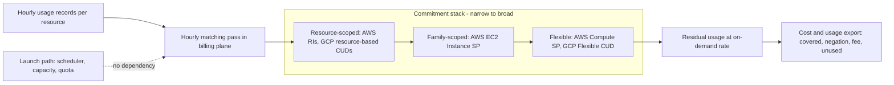

# Commitment Discounts: Savings Plans vs CUDs

## TL;DR

1. A commitment is a billing-plane financial instrument, not a data-plane resource. It is matched to usage after the fact, hour by hour, and it never changes whether or where an instance launches.
2. The marginal rule is: commit a slice of hourly demand only if that slice is busy more than (1 - d) of the hours, where d is the discount. The optimal commitment level is therefore the d-quantile of hourly demand (P28 for a 28% discount), and the optimal average utilization is below 100%.
3. Dollar-denominated commitments (AWS Savings Plans, GCP Flexible CUDs) buy flexibility but carry price-decline risk. A mid-term price cut turns committed dollars into unused dollars. Unit-denominated commitments (GCP resource-based CUDs) carry shape, family, and region risk instead.
4. Neither AWS Savings Plans nor GCP CUDs reserve capacity. GPU fleets need a capacity instrument (On-Demand Capacity Reservations, Capacity Blocks, GCP reservations, future reservations) bought separately, with the commitment layered on top for price.
5. Ladder purchases, size to a trimmed demand quantile rather than the recommendation default, buy the 3-year term only for slices with at least (1 - d3)/(1 - d1) expected survival, and measure marginal utilization instead of average utilization.

Evidence note: web verification was unavailable while this chapter was written.
Every volatile figure below (discount percentages, windows, prices, product scope) is therefore tagged UNVERIFIED and is recalled from AWS and Google Cloud documentation, not re-checked against it.
The mechanisms and formulas are derived and do not depend on those figures.

## Mental Model



Think of a commitment as a take-or-pay contract written against a price list, not against machines.
The launch path (quota, placement, capacity) runs first and knows nothing about discounts.
Later, a batch matcher walks the hourly usage records, assigns each record to the narrowest commitment that fits, and rates the record at the discounted rate until the commitment's hourly budget is exhausted.
Whatever the commitment cannot absorb in that hour is lost, because there is no carry-over, and whatever usage exceeds it is billed on demand.
Your economic problem is therefore a newsvendor problem on an hourly demand curve, where the "inventory" is a dollar-per-hour commitment that spoils every hour.
The capacity problem is a different system with a different instrument.

## Internals

### Where commitments live: the billing plane

Commitments have no replication topology, consensus group, or placement rule, because they are not stored with the workload.
They are rows in the billing system keyed by payer account (AWS) or Cloud Billing account (GCP).
The failure domain is the payer or billing account, and the practical blast radius is financial.
The only distributed-systems property that matters is that the matching pass is a retrospective batch job over metered usage.
This has three consequences:

- Cost Explorer coverage and utilization data lag real usage by up to about a day (AWS docs, recalled, UNVERIFIED as of 2026-10), so any control loop built on them has a day of latency.
- A launch cannot "consume" a commitment, so there is no race and no admission control.
- A control-plane or capacity event in a region does not stop the commitment from billing.

### AWS matching semantics

A Savings Plan is a commitment in dollars per hour, expressed at the discounted Savings Plan rate, for a 1 or 3 year term, with All Upfront, Partial Upfront, or No Upfront payment (AWS docs, recalled, UNVERIFIED as of 2026-10).
AWS currently sells four plan types: Compute, EC2 Instance, SageMaker, and Database ([CloudZero summary of the AWS lineup](https://www.cloudzero.com/blog/aws-savings-plans/), third-party, as of 2026-10).
Compute Savings Plans apply to EC2 regardless of family, size, region, OS, or tenancy, and also to Fargate and Lambda (same source).
EC2 Instance Savings Plans are scoped to one instance family in one region and are flexible across size, OS, and tenancy within it (AWS docs, recalled, UNVERIFIED).

The application order, from the Savings Plans user guide as I recall it (UNVERIFIED as of 2026-10), is:

1. Reserved Instances are applied first.
2. EC2 Instance Savings Plans are applied next.
3. Compute Savings Plans are applied last.
4. Within a plan type, each hour's eligible usage is ranked by savings percentage, and the highest percentage is covered first.
5. Usage owned by the account that bought the plan is considered first, then other accounts in the organization when sharing is enabled.

The "highest percentage first" rule matters. Your plan is consumed by the usage that benefits most, which is usually not the usage you had in mind when you bought it.
Examples are an older-generation or Windows instance whose Savings Plan rate has a deep discount, or a Graviton fleet owned by another account.
This breaks any chargeback model that assumes a plan "belongs" to the team that requested it.

The cost and usage report encodes this explicitly.
The line item types are `SavingsPlanCoveredUsage`, `SavingsPlanNegation`, `SavingsPlanRecurringFee`, and `SavingsPlanUpfrontFee`.
The reservation-style columns on the recurring fee carry total, used, and unused commitment for the hour.
Unused dollars are the difference between the recurring commitment and the used commitment.
That difference is the only place wasted commitment is visible in the data, and it must be allocated by policy because no resource owns it.
See [[17-Cloud-AI-Engineering/Volume_09_FinOps_and_Cloud_Economics/Chapter_01_Cloud_Billing_Models_and_Unit_Cost_Allocation|Cloud Billing Models and Unit Cost Allocation]] for amortized versus blended views.

Operationally, AWS exposes these controls:

- Purchases can be queued for a future time, and a queued purchase can be deleted before it fires (AWS docs, recalled, UNVERIFIED as of 2026-10).
- Returns are limited to a short window after purchase and only within the same calendar month (AWS docs, recalled, UNVERIFIED as of 2026-10).
- Savings Plans cannot be cancelled or exchanged, unlike Convertible Reserved Instances.
- The Savings Plans API endpoint lives in us-east-1.

### GCP matching semantics

GCP sells two structurally different instruments.

Resource-based CUDs commit to quantities in a region: vCPUs, GB of memory, GPUs, and local SSD (Google Cloud docs, recalled, UNVERIFIED as of 2026-10).
vCPU and memory commitments are tied to a machine family, are purchased separately from each other, and are billed monthly for the whole term whether or not the resources run.
A commitment is scoped to the purchasing project unless CUD sharing is enabled on the billing account, in which case it can apply across projects (UNVERIFIED current scoping controls).

Flexible CUDs are spend-based: you commit a dollar amount per hour, and the discount applies across eligible machine families, regions, and projects on the billing account (Google Cloud docs, recalled, UNVERIFIED as of 2026-10).
They exclude GPUs and local SSD (UNVERIFIED current exclusions list).

Google has been migrating spend-based CUDs to a revised billing model during 2025 and 2026 (UNVERIFIED details).
Check your own billing export for which accounting you actually see.
In the classic model the standard export shows a commitment-fee line plus credits of type `COMMITTED_USAGE_DISCOUNT` (resource-based) or `COMMITTED_USAGE_DISCOUNT_DOLLAR_BASE` (spend-based).
Sustained use credits have type `SUSTAINED_USAGE_DISCOUNT`.
These enumerations are in the billing export schema documentation (recalled, UNVERIFIED).

Two GCP interactions are rarely stated plainly:

- Resource-based CUDs are matched before Flexible CUDs, and resource-covered usage does not earn sustained use discounts (UNVERIFIED stacking details).
- If a CUD percentage is quoted against list price, the incremental benefit over sustained use discounts on SUD-eligible families is smaller than the headline.
  For example, with a 20% sustained use discount at full-month utilization and a 28% CUD discount, the incremental discount is 1 - 0.72/0.80 = 10%.
  Treat this as a model to check against the current docs, because the stacking rules are the volatile part.

### Commitment versus capacity

The commitment prices capacity but does not hold it.
AWS On-Demand Capacity Reservations hold capacity in an AZ and bill at on-demand rates, whether or not an instance is running in them.
Compute and EC2 Instance Savings Plans can discount that reservation charge (AWS docs, recalled, UNVERIFIED as of 2026-10).
GCP reservations behave the same way, and CUDs can discount reserved resources.
Reservation consumption on GCP is controlled by reservation affinity (any, specific, or none).
For accelerators, the scarce resource is the reservation or block, not the discount.
See [[17-Cloud-AI-Engineering/Volume_10_AI_Infrastructure_on_Cloud/Chapter_03_High_Performance_AI_Cluster_Architectures|High-Performance AI Cluster Architectures]] and [[17-Cloud-AI-Engineering/Volume_10_AI_Infrastructure_on_Cloud/Chapter_08_Fault_Tolerance_and_Fleet_Resiliency_at_Scale|Fault Tolerance and Fleet Resiliency at Scale]] for the capacity side.

### The optimization model

Let D(t) be hourly demand expressed in on-demand dollars per hour, with CDF F, and let d be the discount.
A commitment of H discounted dollars per hour covers H/(1 - d) of on-demand-equivalent demand, so write the committed level as x = H/(1 - d).

Marginal analysis of the slice [x, x + dx]:

- The slice costs (1 - d) dx every hour, whether it is used or not.
- The slice avoids dx of on-demand spend only in hours where D(t) > x.
- Buy the slice if and only if P(D > x) > 1 - d.

This yields the following results.

1. Pointwise breakeven: a committed slice must be busy more than (1 - d) of the hours, which is 72% for d = 0.28 and 54% for d = 0.46.
2. Optimal level: x* = F^-1(d), the d-quantile of hourly demand. This is the newsvendor critical fractile from inventory theory (Arrow, Harris, Marschak, "Optimal Inventory Policy", Econometrica, 1951).
3. At the optimum the marginal commitment dollar has utilization exactly (1 - d), while average utilization sits above it (96.3% in the lab below for d = 0.28).
4. A deeper discount moves the optimum toward the median, which is why 3-year commitments are sized higher than 1-year ones at the same demand curve.
5. 3-year versus rolling 1-year: a 3-year slice beats renewing 1-year slices only if the average probability the slice is still needed in years 2 and 3 is at least (1 - d3)/(1 - d1). With 28% and 46% that threshold is 0.54/0.72 = 75%.
6. Upfront payment is a loan to the provider. If All Upfront saves a fraction s over No Upfront on a 1-year term, you prepay on average half a year early, so the implied annual return is about s/0.5. A 3% saving is about 6% per year, so compare it with your cost of capital.
7. Dollar commitments are exposed to price declines. If the provider cuts unit prices and rates by c, a dollar commitment covers 1/(1 - c) times as many units, so for fixed unit demand a fraction of the commitment goes unused. Unit commitments keep their unit coverage and simply get cheaper.

The demand curve you feed this model should be a forecast, not the recommendation lookback.
Autopilot-style resource usage studies and VM workload predictability studies (Rzadca et al., "Autopilot", EuroSys 2020; Cortez et al., "Resource Central", SOSP 2017) show that a stable long-lived baseline exists, but that the shape of the tail is the hard part.
Borg's lesson (Verma et al., EuroSys 2015) is that utilization comes from stacking workload classes with different priorities.
The commitment layer is the financial analogue: cover the long-lived production floor, and let batch and interruptible work ride on cheaper or flexible layers (see [[17-Cloud-AI-Engineering/Volume_09_FinOps_and_Cloud_Economics/Chapter_03_Spot_Economics_and_Interruption_Handling|Spot Economics and Interruption Handling]]).

## Numbers to Know

| Item | Value | Source and date |
|---|---|---|
| AWS Savings Plan types | Compute, EC2 Instance, SageMaker, Database | [CloudZero summary](https://www.cloudzero.com/blog/aws-savings-plans/), third-party, as of 2026-10 |
| AWS Savings Plan terms and payment | 1 or 3 years; All, Partial, or No Upfront | AWS docs, recalled, UNVERIFIED, as of 2026-10 |
| AWS headline maximum discount | EC2 Instance up to 72%; Compute up to 66% | 72% per the CloudZero summary above; 66% from AWS pricing page recall, UNVERIFIED, as of 2026-10 |
| AWS Compute SP scope | EC2, Fargate, Lambda | CloudZero summary above, as of 2026-10 |
| AWS application order | RI, then EC2 Instance SP, then Compute SP; highest savings percentage first within type | AWS user guide, recalled, UNVERIFIED, as of 2026-10 |
| AWS return rule | Short window after purchase, same calendar month only | AWS docs, recalled, UNVERIFIED, as of 2026-10 |
| AWS recommendation lookbacks | 7, 30, or 60 days | Cost Explorer API reference, recalled, UNVERIFIED, as of 2026-10 |
| Cost Explorer API cost | About $0.01 per request | AWS pricing, recalled, UNVERIFIED, as of 2026-10 |
| GCP Flexible CUD discount | 28% for 1 year, 46% for 3 years | Google Cloud docs, recalled, UNVERIFIED, as of 2026-10, may differ under the revised spend-based model |
| GCP resource-based CUD discount | About 37% (1 year) and 55% (3 year) general purpose; up to about 70% for 3-year memory-optimized | Google Cloud docs, recalled, UNVERIFIED, as of 2026-10 |
| GCP CUD billing | Monthly for the full term; no upfront option; no cancellation | Google Cloud docs, recalled, UNVERIFIED, as of 2026-10 |
| GCP sustained use discount | Up to about 30% on N1, about 20% on N2/N2D/C2-class, none on E2 | Google Cloud docs, recalled, UNVERIFIED, as of 2026-10 |
| Pointwise breakeven utilization | 1 - d (72% at d = 0.28; 54% at d = 0.46) | Derived in Internals |
| Optimal commitment level | d-quantile of hourly demand | Derived in Internals |
| Lab result, d = 0.28 | Optimal level P28, utilization 96.3%, coverage 81.5%, saving 20.5% | Lab script output, synthetic demand |
| Lab result, d = 0.46 | Optimal level P46, utilization 92.5%, coverage 88.4%, saving 36.8% | Lab script output, synthetic demand |
| Lab stress, demand x0.5 | 1-year saving -21.9%; 3-year saving -3.2% | Lab script output, synthetic demand |
| Lab stress, 40% unit price cut | Dollar commit utilization 75.5% after cut | Lab script output, synthetic demand |

Pricing for specific instance types is deliberately absent.
GPU list prices have moved sharply (AWS announced large P4 and P5 reductions in mid-2025, UNVERIFIED), and any figure I printed would be stale.
Pull current rates with the AWS Price List API or the Cloud Billing Catalog API at purchase time.

## AWS vs GCP Mechanism Parity

| Dimension | AWS | GCP |
|---|---|---|
| Commitment unit | Dollars per hour at the discounted rate | Resource-based: vCPU, GB, GPU, local SSD per region. Flexible: dollars per hour |
| Discount scope | Compute SP: any EC2 family, region, OS; Fargate; Lambda. EC2 Instance SP: one family in one region | Resource-based: region and machine family for vCPU and memory. Flexible: across eligible families, regions, projects |
| Matching time | Hourly, retrospective, in the billing plane | Retrospective in the billing plane; reservations additionally hold capacity in the data plane |
| Application order | RI, EC2 Instance SP, Compute SP; highest savings percent first (UNVERIFIED) | Resource-based, then Flexible (UNVERIFIED); SUD only on uncovered SUD-eligible usage |
| Payment options | All, Partial, No Upfront | Monthly billing only (UNVERIFIED) |
| Cancellation or exchange | None for Savings Plans; short return window; Convertible RIs are exchangeable | None once purchased (UNVERIFIED); you can add more |
| Capacity guarantee | None; use On-Demand Capacity Reservations or Capacity Blocks | None; use reservations or future reservations |
| Sharing | Organization-wide by default; sharing can be disabled per account (UNVERIFIED) | Project scope by default for resource-based; billing-account sharing is a setting (UNVERIFIED) |
| GPUs and accelerators | GPU and Trainium instances are EC2 usage and are generally eligible (UNVERIFIED for Capacity Blocks: believed not eligible) | Flexible CUD excludes GPUs; GPUs use resource-based commitments; TPU CUDs exist (UNVERIFIED) |
| Serverless and containers | Compute SP covers Lambda and Fargate | Flexible CUD covers GKE Autopilot and Cloud Run (UNVERIFIED current scope) |
| Spot or preemptible usage | Not covered by Savings Plans | Not covered by CUDs (UNVERIFIED) |
| Price-decline risk | Dollar commitments lose when rates fall | Flexible CUD same; resource-based CUD benefits from falling unit price |
| Export visibility | CUR line item types and used/unused commitment columns | Export `credits` array with CUD credit types, plus commitment fee SKUs |
| Purchase API | `savingsplans` CLI and API, us-east-1 | `gcloud compute commitments` for resource-based; Cloud Billing console or API for spend-based (UNVERIFIED) |

The key architectural difference is the denominator.
AWS Savings Plans and GCP Flexible CUDs protect you from shape changes and expose you to price declines.
GCP resource-based CUDs protect you from price declines and expose you to shape, family, and region changes.
For GPUs, where unit prices fall quickly and generations turn over every 12 to 24 months, neither is comfortable for 3 years.

## Worked Example: Sizing a Commitment Without Buying One

This lab models demand offline, pulls read-only recommendation data, and sets up the alarms you would need after a real purchase.
It never buys a non-cancellable commitment.
The optional queued-purchase step buys nothing because it is deleted before it fires.

### Step 1: Run the sizing model

```python
#!/usr/bin/env python3
"""Commitment sizing model: critical-fractile rule vs brute force, plus price-cut stranding.
Requires numpy only. No cloud calls. All prices are normalized, ILLUSTRATIVE units (OD $/hr)."""
import numpy as np

HOURS = 8760
rng = np.random.default_rng(7)

def synth_demand():
    t = np.arange(HOURS)
    hod = t % 24
    dow = (t // 24) % 7
    diurnal = 18 * np.clip(np.sin((hod - 6) / 24 * 2 * np.pi), -0.4, 1.0)
    weekend = np.where(dow >= 5, -12, 0)
    growth = 20 * t / HOURS
    noise = rng.lognormal(0, 0.10, HOURS)
    d = (55 + diurnal + weekend + growth) * noise
    for start in (1500, 4200, 7000):
        d[start:start + 72] += 35
    return d

def cost_commit(d, h_disc, disc):
    """h_disc: commitment in discounted $/hr (Savings Plan style).
    Covered OD-equivalent per hour = h_disc / (1 - disc). Commit billed every hour."""
    cover = h_disc / (1.0 - disc)
    covered = np.minimum(d, cover)
    uncovered = d - covered
    commit_fee = h_disc * np.ones_like(d)
    total = commit_fee + uncovered
    used = covered * (1.0 - disc)
    return total.sum(), used.sum() / commit_fee.sum(), covered.sum() / d.sum()

def report(d, disc, label):
    od = d.sum()
    rows = []
    for q in range(0, 101, 5):
        x = np.percentile(d, q)
        h = x * (1.0 - disc)
        tot, util, cov = cost_commit(d, h, disc)
        rows.append((q, x, util, cov, 1 - tot / od))
    grid = np.linspace(d.min() * 0.5, np.percentile(d, 99), 800)
    costs = [cost_commit(d, x * (1 - disc), disc)[0] for x in grid]
    xb = grid[int(np.argmin(costs))]
    xq = np.percentile(d, disc * 100)
    print(f"--- {label}: discount={disc:.2f}")
    print(f"critical-fractile level  = P{disc*100:.0f} of hourly demand = {xq:7.2f} OD$/hr")
    print(f"brute-force optimum level = {xb:7.2f} OD$/hr")
    tot, util, cov = cost_commit(d, xb * (1 - disc), disc)
    print(f"at optimum: utilization={util*100:5.1f}%  coverage={cov*100:5.1f}%  saving vs all-OD={(1-tot/od)*100:5.1f}%")
    print("pctile  level  util%  cov%  saving%")
    for q, x, u, c, s in rows[::2]:
        print(f"P{q:<5d} {x:6.1f} {u*100:6.1f} {c*100:5.1f} {s*100:7.1f}")

def price_cut(d, disc, cut=0.40, at=HOURS // 2):
    """Same instance-hours demand; OD price and SP/CUD rates both fall by `cut` at hour `at`."""
    p = np.where(np.arange(HOURS) < at, 1.0, 1.0 - cut)
    d_od = d * p
    x = np.percentile(d, disc * 100)
    h = x * (1 - disc)
    cover = h / (1 - disc)
    covered = np.minimum(d_od, cover)
    total_dollar = (h + d_od - covered).sum()
    util_post = (covered[at:] * (1 - disc)).sum() / (h * (HOURS - at))
    covered_u = np.minimum(d, x) * p
    total_unit = (x * (1 - disc) * p + d_od - covered_u).sum()
    od = d_od.sum()
    print(f"--- price cut {cut*100:.0f}% at midyear, discount={disc:.2f}")
    print(f"all-OD cost (new prices after cut) = {od:10.0f}")
    print(f"dollar-denominated commit          = {total_dollar:10.0f}  saving {(1-total_dollar/od)*100:5.1f}%  post-cut utilization {util_post*100:5.1f}%")
    print(f"unit-denominated commit            = {total_unit:10.0f}  saving {(1-total_unit/od)*100:5.1f}%  utilization of committed units unchanged by the cut")

if __name__ == "__main__":
    d = synth_demand()
    print(f"mean demand={d.mean():.1f} OD$/hr  p50={np.percentile(d,50):.1f}  p95={np.percentile(d,95):.1f}  min={d.min():.1f}")
    report(d, 0.28, "1-yr flexible-style commitment")
    report(d, 0.46, "3-yr flexible-style commitment")
    price_cut(d, 0.28)
```

The discounts 0.28 and 0.46 are the recalled Flexible CUD percentages (UNVERIFIED) and are used here only as parameters.

### Step 2: Back-of-the-envelope capacity and cost calculation

The synthetic fleet averages 65.3 on-demand dollars per hour, so annual on-demand spend is 65.3 x 8760, about 572 thousand units of currency.
The numbers below are from the script run with seed 7.

- 1-year, d = 0.28:
  - The optimal level is P28 = 55.24 on-demand dollars per hour.
  - The hourly commitment is H = 55.24 x 0.72 = 39.77 discounted dollars per hour, or about 348 thousand per year in fees.
  - Coverage is 81.5%, utilization is 96.3%, and the saving versus all on-demand is 20.5%, about 117 thousand.
- 3-year, d = 0.46:
  - The optimal level is P46 = 62.38.
  - H = 62.38 x 0.54 = 33.68 per hour, about 295 thousand per year.
  - Coverage is 88.4%, utilization is 92.5%, and the saving is 36.8%, about 210 thousand per year.
- Asymmetry, holding the 1-year commitment fixed:
  - If demand falls by half, the saving is -21.9%.
  - If demand grows 30%, the saving is still +17.9%.
  - Over-commitment is penalized far more than under-commitment.
- 3-year stress, holding the commitment fixed: demand at 0.7 of forecast still saves 25.4%, but demand at 0.5 of forecast saves -3.2%.
- Survival test for 3-year versus rolling 1-year: the 3-year slice wins only above 75% average survival.
  Apply it only to the portion of the baseline you would stake a product line on, and use the 1-year term for the rest.
- Dollar versus unit under a 40% price cut at midyear, d = 0.28: the dollar commitment saves 13.7% with post-cut utilization of 75.5%, while the unit commitment saves 20.4%.

### Step 3: Read-only AWS recommendation and coverage queries

Cost estimate: roughly 10 Cost Explorer API calls at about $0.01 each, so about $0.10 (AWS pricing, recalled, UNVERIFIED, as of 2026-10).

```bash
export AWS_REGION=us-east-1
aws ce get-savings-plans-purchase-recommendation \
  --savings-plans-type COMPUTE_SP \
  --term-in-years ONE_YEAR \
  --payment-option NO_UPFRONT \
  --lookback-period-in-days THIRTY_DAYS \
  --account-scope PAYER \
  --query 'SavingsPlansPurchaseRecommendation.SavingsPlansPurchaseRecommendationSummary.{commit:HourlyCommitmentToPurchase,savePct:EstimatedSavingsPercentage,util:EstimatedAverageUtilization,odSpend:CurrentOnDemandSpend}'

aws ce get-savings-plans-coverage \
  --time-period Start=2026-09-01,End=2026-10-01 --granularity DAILY \
  --query 'SavingsPlansCoverages[].Coverage.CoveragePercentage' --output text

aws ce get-savings-plans-utilization \
  --time-period Start=2026-09-01,End=2026-10-01 --granularity MONTHLY
```

Compare the recommended hourly commitment with your own quantile of hourly demand.
The recommendation extrapolates the lookback window and does not know about your roadmap.
A 60-day lookback that includes a backfill burst will overstate the baseline.

### Step 4: Budget alarms

Create a cost budget for the lab itself.
Budget pricing is UNVERIFIED; expect cents per day at most.

```bash
ACCT=$(aws sts get-caller-identity --query Account --output text)

cat > /tmp/lab-budget.json <<'EOF'
{"BudgetName":"commit-lab-cost","BudgetType":"COST","TimeUnit":"MONTHLY",
 "BudgetLimit":{"Amount":"5","Unit":"USD"}}
EOF
cat > /tmp/lab-notify.json <<'EOF'
[{"Notification":{"NotificationType":"ACTUAL","ComparisonOperator":"GREATER_THAN",
  "Threshold":80,"ThresholdType":"PERCENTAGE"},
  "Subscribers":[{"SubscriptionType":"EMAIL","Address":"finops@example.com"}]}]
EOF
aws budgets create-budget --account-id "$ACCT" \
  --budget file:///tmp/lab-budget.json \
  --notifications-with-subscribers file:///tmp/lab-notify.json
```

After a real purchase, add a utilization floor.
The schema details for this budget type are UNVERIFIED, so check the Budgets API reference before use.

```bash
cat > /tmp/sp-util.json <<'EOF'
{"BudgetName":"sp-utilization-floor","BudgetType":"SAVINGS_PLANS_UTILIZATION",
 "TimeUnit":"DAILY","BudgetLimit":{"Amount":"100","Unit":"PERCENTAGE"}}
EOF
cat > /tmp/sp-util-notify.json <<'EOF'
[{"Notification":{"NotificationType":"ACTUAL","ComparisonOperator":"LESS_THAN",
  "Threshold":95,"ThresholdType":"PERCENTAGE"},
  "Subscribers":[{"SubscriptionType":"EMAIL","Address":"finops@example.com"}]}]
EOF
aws budgets create-budget --account-id "$ACCT" \
  --budget file:///tmp/sp-util.json \
  --notifications-with-subscribers file:///tmp/sp-util-notify.json
```

Note that a floor of 95% is the wrong target for an optimally sized commitment, which runs at 92% to 96% by design.
Set the alarm a few points below the modeled utilization so that it signals a regime change and not noise.

### Step 5: Optional queued purchase that is deleted before it fires

Use this only to exercise the purchase and rollback path in a sandbox payer account.
The offering search parameters and result field names are recalled and UNVERIFIED.

```bash
OFFER=$(aws savingsplans describe-savings-plans-offerings \
  --plan-types Compute --payment-options "No Upfront" \
  --durations 31536000 --currencies USD --region us-east-1 \
  --query 'searchResults[0].offeringId' --output text)

SP=$(aws savingsplans create-savings-plan \
  --savings-plan-offering-id "$OFFER" --commitment 1.0 \
  --purchase-time 2027-10-01T00:00:00Z --region us-east-1 \
  --query savingsPlanId --output text)
echo "queued: $SP"
```

### Step 6: GCP read-only visibility

BigQuery query cost for a small billing export is negligible, and the free monthly query tier covers it (BigQuery pricing, recalled, UNVERIFIED as of 2026-10).

```bash
gcloud compute commitments list \
  --format="table(name,region,plan,status,endTimestamp)"
gcloud compute reservations list \
  --format="table(name,zone,specificReservation.count,status)"

bq query --use_legacy_sql=false '
SELECT
  FORMAT_DATE("%Y-%m", DATE(usage_start_time)) AS month,
  SUM(cost) AS gross_cost,
  SUM((SELECT IFNULL(SUM(c.amount),0) FROM UNNEST(credits) c
       WHERE c.type IN ("COMMITTED_USAGE_DISCOUNT","COMMITTED_USAGE_DISCOUNT_DOLLAR_BASE"))) AS cud_credits,
  SUM(IF(LOWER(sku.description) LIKE "commitment%", cost, 0)) AS commitment_fees
FROM `PROJECT.DATASET.gcp_billing_export_v1_BILLING_ACCOUNT_ID`
WHERE service.description = "Compute Engine"
  AND usage_start_time >= TIMESTAMP("2026-07-01")
GROUP BY month ORDER BY month'
```

Credits are negative amounts.
Compare fees and credits to see whether the commitment is covering usage.
Whether the commitment-fee SKU naming and credit types match this query depends on the revised spend-based billing model (UNVERIFIED), so inspect a sample of rows first.

### Teardown

```bash
aws budgets delete-budget --account-id "$ACCT" --budget-name commit-lab-cost
aws budgets delete-budget --account-id "$ACCT" --budget-name sp-utilization-floor 2>/dev/null || true
aws savingsplans delete-queued-savings-plan --savings-plan-id "$SP" --region us-east-1 2>/dev/null || true
rm -f /tmp/lab-budget.json /tmp/lab-notify.json /tmp/sp-util.json /tmp/sp-util-notify.json
```

No GCP resources are created, so there is no GCP teardown.
The commitment itself cannot be torn down once it has fired, which is the point of the chapter.

## Failure Modes and Pitfalls

### Price-decline stranding on dollar commitments

A dollar commitment is a bet that unit prices will not fall faster than your demand grows.
In the lab, a 40% price cut at midyear drops utilization of the committed dollars to 75.5%, and the saving falls from 20.4% to 13.7%.
GPU instance prices have dropped materially in recent cycles (AWS announced large P4 and P5 reductions in 2025, UNVERIFIED), so for accelerators a 3-year dollar commitment is a short position on your own vendor.
Mitigations are 1-year terms for accelerator spend, ladders, and sizing at the P(d) quantile of a demand curve that already reflects the expected price path.

### Family and region lock-in

An EC2 Instance Savings Plan on a P4-class family does not follow you to the next generation.
A GCP resource-based commitment for N2 vCPUs in one region does not cover C3 or another region.
Generation migration is the dominant source of stranded commitments in accelerator fleets.
Prefer the flexible instruments for any compute you plan to migrate within the term.

### Commitments are not capacity

A commitment bills every hour regardless of whether you can launch.
The AWS post-event summary for the October 2025 us-east-1 incident describes a DNS race condition in DynamoDB endpoint automation, followed by impaired EC2 launches ([AWS PES, October 2025](https://aws.amazon.com/message/101925/)).
During such an event, customers pay commitments on capacity they cannot use, and any credit comes from separate SLA claims, not from the commitment mechanism.
Capacity assurance comes from reservations, multi-AZ and multi-region static stability, and quota headroom.
See [[17-Cloud-AI-Engineering/Volume_01_Cloud_Architecture_Principles/Chapter_02_Regions_Zones_and_Static_Stability|Regions, Zones, and Static Stability]].
I know of no public cloud-provider post-incident review that is specifically about commitment accounting, and I have not invented one.

### Purchase-day contamination

Recommendations are computed from a lookback window.
A 60-day window containing a month-end backfill, a load test, or a one-time training run inflates the baseline, and the buyer over-commits for a year.
Trim bursts, use your own quantile, and compare against the service recommendation as a sanity check.

### Expiry cliffs

If you buy all plans in one month, they all expire in one month.
Savings Plans do not renew automatically as far as I recall (UNVERIFIED), so expiry silently reverts the covered spend to on-demand rates.
Ladder purchases monthly or quarterly so that renewal is a routine process.

### Ordering surprises and cross-account leakage

AWS applies the highest-savings usage first and the owner account first, then other accounts when sharing is enabled.
A plan bought for one team can end up covering another team's usage, and the first team sees on-demand charges.
On GCP, a resource-based commitment scoped to one project can sit idle while a sibling project pays on-demand, unless sharing is enabled (UNVERIFIED scoping controls).
Allocate unused commitment by policy, for example pro rata by eligible spend, and publish the policy before the first purchase.

### Eligible-base erosion

Moving workloads to Spot, to managed services outside the commitment's scope, or to a marketplace product shrinks the eligible on-demand base while the commitment stays fixed.
Coverage percentage can look healthy while the effective savings shrink.
Coordinate commitment purchases with the Spot and serverless roadmaps (see [[17-Cloud-AI-Engineering/Volume_09_FinOps_and_Cloud_Economics/Chapter_03_Spot_Economics_and_Interruption_Handling|Spot Economics and Interruption Handling]]).

### Metric blind spots

Coverage is measured against eligible spend only.
If GPU spend flows through products that are not eligible (for example Capacity Blocks, which I believe are not Savings Plan eligible, UNVERIFIED, or managed model APIs), a 95% coverage figure describes a small part of the bill.
Report coverage as a share of total compute spend as well.

### Currency and contract interactions

Enterprise discount arrangements and private pricing change the baseline rate to which the discount is applied.
I have not verified how these stack with Savings Plans or CUDs in current terms, so confirm with your account team before sizing against list prices (UNVERIFIED).

## Security and Cost Angles

### IAM scoping

Purchasing a commitment is an irreversible financial action, so treat it like a production deploy with a four-eyes rule.
On AWS, restrict `savingsplans:CreateSavingsPlan` to a single FinOps role.
SCPs do not apply to the organization's management account, so if purchases happen there you must enforce this with IAM policy and with account hygiene (do not run workloads or give broad roles in the management account).

```json
{
  "Version": "2012-10-17",
  "Statement": [{
    "Sid": "DenyCommitPurchaseExceptFinOps",
    "Effect": "Deny",
    "Action": ["savingsplans:CreateSavingsPlan"],
    "Resource": "*",
    "Condition": {"ArnNotLike": {"aws:PrincipalArn": "arn:aws:iam::*:role/FinOpsCommitPurchaser"}}
  }]
}
```

Allow read access for analysts through `ce:GetSavingsPlans*` and the `savingsplans:Describe*` actions, and keep them separate from the purchase role.
On GCP, the `compute.commitments.create` permission governs resource-based commitments.
Spend-based commitments are controlled through Cloud Billing roles (UNVERIFIED which role).
Build a custom role with only the permissions needed rather than granting Compute Admin or Billing Administrator broadly.
See [[17-Cloud-AI-Engineering/Volume_06_Infrastructure_as_Code_and_Delivery/Chapter_04_Policy_as_Code_OPA_Sentinel_and_Guardrails|Policy as Code: OPA, Sentinel, and Guardrails]] for pre-merge enforcement.

### Audit and detection

Alert on purchase events.
On AWS, an EventBridge rule on CloudTrail events with event source `savingsplans.amazonaws.com` and event name `CreateSavingsPlan` pages the FinOps channel, and because the service is global with a us-east-1 endpoint, the rule belongs in us-east-1.
On GCP, alert on the Cloud Audit Logs entry for the commitment insert method (the method name is recalled and UNVERIFIED, so confirm it from a real log entry).

### Data protection of billing data

The cost and usage report and the billing export reveal account structure, workload growth, and unit prices.
Encrypt the destination buckets and datasets with customer-managed keys, restrict readers to FinOps and security roles, and place them in the data perimeter described in [[17-Cloud-AI-Engineering/Volume_08_Security_Identity_and_the_Data_Perimeter/Chapter_06_Constructing_an_Impenetrable_Data_Perimeter|Constructing an Impenetrable Data Perimeter]].

### Unit-economics levers

The levers below are listed in the order to apply them:

1. Right-size and migrate first, then commit. Committing before a Graviton or generation migration locks in the wrong shape.
2. Flatten the demand curve. Moving batch into troughs raises the low quantiles, which raises the commitment level you can safely buy at the same risk.
3. Layer instruments. The long-lived floor goes on the commitment, the interruptible tail goes on Spot, and the residual peak stays on demand.
4. Ladder terms. Use 1-year plans for the uncertain slice, and 3-year plans only above the survival threshold (1 - d3)/(1 - d1).
5. Treat upfront payment as a financing decision, and compare the implied rate (s/0.5 for 1 year) with your cost of capital.
6. Keep the capacity instrument separate. Pay for guaranteed accelerator capacity deliberately, and discount it with a commitment only when the generation lifetime justifies it. See [[17-Cloud-AI-Engineering/Volume_09_FinOps_and_Cloud_Economics/Chapter_05_GPU_and_TPU_Unit_Economics|GPU and TPU Unit Economics]].

## Interview Questions and Model Answers

### Question 1 (L5 - Senior)

A team runs a mixed EC2 fleet across three families and two regions, plus Fargate. Which Savings Plan do you buy, and how does AWS decide which usage the plan covers?

#### Model Answer

Buy Compute Savings Plans for the shared baseline.
They cover any EC2 family, size, region, OS, and tenancy, and also Fargate and Lambda, so they survive the team's likely migrations.
An EC2 Instance Savings Plan has a deeper discount but is pinned to one family in one region, so I would buy it only for a family I expect to keep for the full term, and I would size it to that family's own floor.
The commitment is in dollars per hour at the discounted rate, and it is evaluated hourly with no carry-over.
In each hour the billing system applies reservations first, then EC2 Instance plans, then Compute plans, and within a type it covers the usage with the highest savings percentage first, until the hourly dollars run out.
Whatever remains is billed on demand.
Two practical points follow.
The plan can end up covering the highest-discount usage anywhere in the organization, not the usage of the team that bought it.
Matching also happens in billing after the fact, so it has no effect on whether an instance launches.

#### Follow-up Interviewer Question

The team then migrates half the fleet to Graviton. What happens to the plan's coverage and utilization, and what would you have done differently before buying?

### Question 2 (L5 - Senior)

A teammate says the goal is 100% Savings Plan utilization. Is that right? Derive the breakeven.

#### Model Answer

No. Utilization of 100% means the commitment is below the lowest hour of demand, which leaves most of the savings on the table.
With discount d, every committed dollar of discounted rate costs (1 - d) of on-demand-equivalent spend each hour and avoids 1 of on-demand spend only when used.
A slice of demand pays for itself only if it is busy more than (1 - d) of hours.
At d = 0.28 the threshold is 72%, and at 0.46 it is 54%.
So the optimal commitment level is the d-quantile of hourly demand, where the marginal slice is exactly at breakeven.
My model of a realistic diurnal, weekly, and bursty fleet gives an optimal average utilization of about 96% at d = 0.28 and 92.5% at d = 0.46, with coverage of 81% to 88%.
The right alarm is therefore a deviation from modeled utilization, not a fixed 100%.

#### Follow-up Interviewer Question

Your demand distribution is estimated from 30 days of data. How do you account for the uncertainty in that estimate, given that over-commitment costs more than under-commitment?

### Question 3 (L6 - Staff)

You run a 2,000 accelerator training and inference fleet on AWS. Finance wants a 3-year, all-upfront plan to hit a discount target. How do you respond?

#### Model Answer

I would split the problem into capacity, price, and generation risk.
Capacity first: no Savings Plan holds capacity, so the fleet's guaranteed supply comes from capacity reservations or Capacity Blocks, and those are bought on their own terms.
Price second: a dollar commitment on accelerators is exposed to price declines.
If rates fall by c, a fixed dollar commitment covers 1/(1 - c) times as many units, so for fixed unit demand, utilization of the commitment drops.
In my model a 40% cut turned a correctly sized commitment from 96% to 75.5% utilization.
Accelerator prices have fallen sharply in recent cycles (UNVERIFIED specifics), so I treat a 3-year dollar commitment as a short position on the vendor's price list.
Generation third: an instance-family-scoped plan strands when the fleet moves to the next generation.
My proposal is a ladder of 1-year Compute Savings Plans sized to the P(d) quantile of the forecast floor, covering only the long-lived inference baseline, with training bursts on reservations, Blocks, and Spot.
The 3-year term is used only for the slice where expected survival exceeds (1 - d3)/(1 - d1), about 75% at illustrative discounts.
All-upfront is a financing decision: if it saves 3%, the implied return is about 6% a year, so I would compare that with our cost of capital.

#### Follow-up Interviewer Question

Finance pushes back that the 1-year ladder leaves a few points of discount on the table. How do you quantify what the ladder costs relative to the 3-year plan, and what evidence would change your mind?

### Question 4 (L6 - Staff)

Show how you allocate Savings Plan benefit and waste to teams in a 60-account organization, and explain why showback often disagrees with the invoice.

#### Model Answer

The invoice reflects hourly matching that the teams cannot see.
Plans are applied owner-account first, then to other accounts, covering the highest savings percentage first.
So a team can see on-demand charges while its own plan covers someone else.
The cost and usage report separates covered usage, the negation of on-demand charges, the recurring or upfront fee, and the used and unused commitment amounts.
I would show teams amortized cost, with covered usage at the effective plan rate, so a commitment benefit follows the usage that consumed it.
Unused commitment has no owning resource, so I would put it in a shared pool and allocate it by a published rule, such as pro rata by eligible spend, so the incentive is to keep the baseline stable and not to dodge coverage.
Purchases happen in one dedicated payer-level process, so no team can strand dollars by buying its own plan.
See the unit-allocation chapter for the amortization views.

#### Follow-up Interviewer Question

A team argues that pro rata allocation of unused commitment punishes them for another team's migration. What allocation would be incentive-compatible, and what does it cost you?

### Question 5 (L6 - Staff)

On GCP you run GKE Autopilot, standard GKE with N2 nodes, and A3 GPU nodes. Which instruments do you use?

#### Model Answer

I treat each class separately.
For Autopilot and for general-purpose nodes whose shape may change, Flexible CUDs are the default because they cover a dollar amount across eligible families, regions, and projects, so a node-pool migration does not strand them (current scope UNVERIFIED).
For stable standard-node floors I would add resource-based commitments sized to vCPU and memory separately, since they are bought as separate resources and a shape mismatch leaves one side covered and the other billed on demand.
Resource-based commitments are matched before flexible ones, so size them conservatively to avoid stealing coverage you wanted for the flexible layer.
For N2, the incremental discount over sustained use discounts is smaller than the headline: with 20% sustained use and a 28% CUD, the increment is 1 - 0.72/0.80 = 10%, so the breakeven is more demanding than the headline suggests (stacking rules UNVERIFIED).
GPUs sit outside Flexible CUDs, so they use resource-based accelerator commitments plus reservations.
I would hold those to short terms because of generation risk.
Before purchase, I would check the billing export for the credit types actually emitted, because Google has been revising spend-based CUD accounting.

#### Follow-up Interviewer Question

Resource-based CUD sharing is off by default in one of your billing accounts. What is the failure you expect to see in the export, and how do you detect it?

### Question 6 (L7+ - Principal)

You own a 40M dollar annual compute bill split across AWS and GCP, growing 25% a year with significant uncertainty. Design the commitment program, including governance and exit risk.

#### Model Answer

I start from the demand distribution and the discount ladder.
For each cloud and each workload class, I build a forecast of hourly demand with scenario bands for growth, migration, and price changes.
The commitment level is the d-quantile of the lower scenario, not of the base case, because the loss is asymmetric: in my model, halving demand turns a 1-year commitment's +20.5% into -21.9%, while 30% growth still saves 17.9%.
Terms are laddered.
One-year flexible commitments cover the floor, with purchases staggered monthly or quarterly to avoid expiry cliffs.
The 3-year term is limited to slices with at least (1 - d3)/(1 - d1) survival, and only on instruments that survive generation and region moves.
Dollar-based and unit-based instruments are mixed deliberately to hedge price declines against shape changes.
Capacity is a separate program with its own budget and owner, because commitments do not hold supply.
Governance has four parts.
Purchases go through one role with dual approval and an event alert on every purchase.
Unused commitment is allocated by a published rule.
Metrics are marginal utilization and the share of total compute spend covered, reviewed monthly, and the alarm is a deviation from the modeled utilization, not from 100%.
A purchase is blocked when it would push total locked spend beyond a fixed fraction of the forecast floor.
For exit risk, I would cap locked spend per cloud so that a credible migration scenario (moving a workload to the other cloud) never strands more than a set number of months of savings.
I would not let commitment discounts decide architecture.
Switching costs, egress, and data gravity dominate the discount in most migrations (see [[17-Cloud-AI-Engineering/Volume_09_FinOps_and_Cloud_Economics/Chapter_04_Network_Egress_Economics_and_Optimization|Network Egress Economics and Optimization]]).
Any enterprise-level discount or private pricing changes the baseline the discount applies to, so I would confirm those terms contractually before sizing (UNVERIFIED how they stack today).

#### Follow-up Interviewer Question

A cloud account team offers a deeper discount in exchange for a larger spend commitment across all services. Under what conditions do you take it, and how do you model the downside?

### Question 7 (L7+ - Principal)

The CFO shows 99% utilization and 62% coverage, calls it "efficient", and asks whether you should commit more. What is your answer?

#### Model Answer

Average utilization of 99% with 62% coverage points to under-commitment.
The marginal slice at the optimum is exactly at breakeven utilization of (1 - d), and the average sits above it because the lower slices are busier.
At d = 0.28 a well-sized commitment ran near 96% utilization and 81% coverage in my model.
So 99% suggests the next slices are still well above the 72% breakeven, and the missing savings are the on-demand charges on slices busier than 72%.
I would not simply raise the commitment to hit a coverage target, though.
I would estimate the busy-fraction curve for the slices above the current level from the hourly data, identify the level where the fraction crosses (1 - d), and size toward that level on the lower scenario of the forecast.
I would also check what is in the denominator: if the eligible base excludes products you are moving spend into, such as Spot or managed services, then 62% coverage may be right and the base is shrinking.
The metrics to report are marginal utilization of the last committed dollar, coverage of total compute spend, and the scenario-weighted loss if demand falls 30%.

#### Follow-up Interviewer Question

The data shows weekday demand 40% above weekend demand. Would you shape the workload, buy a smaller commitment, or buy more and give away weekend capacity internally? Show the trade-off.

## Further Reading

- [AWS Savings Plans User Guide](https://docs.aws.amazon.com/savingsplans/latest/userguide/what-is-savings-plans.html): the authoritative source for plan types, application order, return rules, and purchase and queueing behavior.
- [Google Cloud committed use discounts overview](https://cloud.google.com/docs/cuds): the authoritative source for resource-based versus spend-based CUDs, eligible products, and the current billing model.
- [AWS post-event summary, October 2025 us-east-1](https://aws.amazon.com/message/101925/): shows why a commitment does not protect against loss of launch capability.
- Arrow, Harris, Marschak, "Optimal Inventory Policy", Econometrica, 1951: the origin of the critical-fractile result used for commitment sizing.
- Verma et al., "Large-scale cluster management at Google with Borg", EuroSys 2015: workload-class stacking and utilization, the operational analogue of layered commitments.
- Cortez et al., "Resource Central", SOSP 2017: evidence on how predictable cloud VM workloads are, which bounds how much you can trust a forecast.
- Rzadca et al., "Autopilot: workload autoscaling at Google", EuroSys 2020: resource slack and right-sizing, the step that should precede any commitment.
- [[17-Cloud-AI-Engineering/Volume_09_FinOps_and_Cloud_Economics/Chapter_01_Cloud_Billing_Models_and_Unit_Cost_Allocation|Cloud Billing Models and Unit Cost Allocation]]: the amortization and allocation views needed to show commitment benefit and waste.
- [[17-Cloud-AI-Engineering/Volume_09_FinOps_and_Cloud_Economics/Chapter_03_Spot_Economics_and_Interruption_Handling|Spot Economics and Interruption Handling]]: the next layer in the stack, and the main source of eligible-base erosion.
- [[17-Cloud-AI-Engineering/Volume_09_FinOps_and_Cloud_Economics/Chapter_05_GPU_and_TPU_Unit_Economics|GPU and TPU Unit Economics]]: how accelerator price and generation risk change the commit-or-rent decision.
