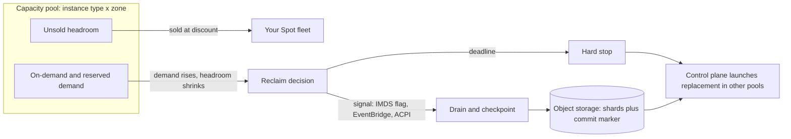

# Spot Economics and Interruption Handling

## TL;DR

Spot and preemptible capacity is the unsold headroom of a per-pool capacity buffer (instance type x zone), so an interruption is a capacity-reclaim event and interruptions in one pool are correlated.
The signal budget is 120 s on AWS, and on Google Cloud it is 30 s by default (optionally a 120 s notice plus up to 30 s of shutdown), so any drain or checkpoint step longer than that budget is decorative.
For synchronous gang jobs the fleet interruption rate scales linearly with node count, the optimal checkpoint interval is about sqrt(2 * C * MTBI), and the restart term R/MTBI usually dominates the waste, so cut restart time before you tune checkpoint frequency.
Size serving fleets with N/(P-1) per pool across P independent pools, put an on-demand or committed floor under the load you cannot lose, and never depend on launching capacity at the moment of failure.
Effective Spot cost is `spot_ratio / (1 - waste)`; the discount is real only while waste stays small, and it collapses when MTBI approaches your restart time.

## Mental Model



A Spot instance is a lease on capacity that the provider has already built, is already paying to power, and could not otherwise sell.
The provider reclaims it when the same pool is needed by customers who pay full price or hold commitments.
Data flows in two decoupled paths.
The signal path is local and cheap: a link-local metadata flag or an ACPI event reaches the guest, and you have a fixed number of seconds to make state durable.
The recovery path is global and slow: the control plane must find capacity in some other pool, boot, load weights or data, and rejoin the job.
Every design decision in this chapter is about keeping the first path inside its deadline and keeping the second path from becoming correlated with the failure that triggered it.
This is the Borg idea of priority preemption of low-tier work, sold as a product (see [[17-Cloud-AI-Engineering/Volume_13_Seminal_Papers_and_Case_Studies/Chapter_07_Google_Borg_and_Omega|Google Borg and Omega]]).

## Internals

### Spot capacity is a residual, not a market you can read

Providers provision for peak On-Demand and committed demand.
The headroom between provisioned capacity and current sold capacity in each pool is what Spot sells.
A pool is the unit of fungibility: same instance type, same Availability Zone, and for AWS the same platform and tenancy.
Interruption risk is a property of the pool's headroom trajectory, not of your instance.
Two consequences follow.
First, interruptions arrive in waves when the pool's headroom is consumed, so inter-arrival times are far from independent.
Second, your own On-Demand scale-up in the same pool competes with your own Spot fleet for the same headroom, which is why Spot-heavy fleets that also autoscale On-Demand can interrupt themselves.

### Price mechanisms: auction history versus posted prices

Early EC2 Spot (2009 to 2017) was presented as a bid-based market in which a uniform clearing price applied to all running instances, and instances with a bid below the price were terminated.
Academic reverse-engineering ("Deconstructing Amazon EC2 Spot Instance Pricing", Agmon Ben-Yehuda et al.) found the price series was frequently better explained by a hidden dynamic reserve price than by a true bid-clearing auction.
Since late 2017 AWS uses a smoothed price that changes gradually with long-term supply and demand, and the "bid" is only a maximum price that defaults to the On-Demand price.
Interruptions are therefore driven by capacity, not by price crossing your bid.
Setting a max price below On-Demand mostly adds a second, pointless way to be interrupted.
Google Cloud has no auction at all: Spot VM prices are posted, dynamic, and change at most once every 30 days with discounts of 60-91 percent (Google Cloud GPU pricing page, as of 2026-10).
The consequence for forecasting is that price volatility is almost irrelevant on both clouds; availability volatility is the risk, and neither cloud gives you a price signal that predicts it.

### Allocation strategies are the real "auction algorithm"

When you ask for N units across many pools, the fleet allocator decides which pools receive them.
The AWS strategies for EC2 Fleet, Spot Fleet, and Auto Scaling mixed-instances groups are lowest-price, diversified, capacity-optimized, capacity-optimized-prioritized, and price-capacity-optimized (AWS docs, as of 2026-10; strategy names not re-verified in this pass, UNVERIFIED).
Mechanically they differ in what they optimize.
Lowest-price concentrates the fleet in the cheapest pools, and the cheapest pools are often cheap because nobody else can use them or because they are thin, so you buy correlated risk at the lowest price.
Capacity-optimized uses the provider's internal view of pool depth to choose pools least likely to be reclaimed.
Price-capacity-optimized first filters to the deepest pools and then takes the cheapest of those, and it is the strategy AWS recommends for most workloads (AWS docs, as of 2026-10; UNVERIFIED in this pass).
The allocator runs again at every replacement, so a "maintain" fleet re-draws pools each time capacity is lost.
The practical rule is to give the allocator many pools: 10 or more instance types across all zones in the region, expressed by attribute-based selection or an explicit override list.
Restricting to one family and one zone for "consistency" removes the only lever you have.

### The AWS signal path

The AWS interruption notice arrives two minutes before the interruption (AWS docs, as of 2026-10).
It is delivered in two ways.
In the guest, `GET /latest/meta-data/spot/instance-action` on the link-local metadata endpoint returns 404 until a notice exists and then returns a JSON document with the action (terminate, stop, or hibernate) and a timestamp.
Out of band, EventBridge emits an "EC2 Spot Instance Interruption Warning" event that a controller can consume without touching the instance.
A separate earlier signal, the EC2 instance rebalance recommendation, tells you a Spot instance is at elevated risk of interruption; it carries no guaranteed lead time and may arrive together with the two-minute notice (AWS docs, as of 2026-10).
Treat the two-minute notice as best effort, because AWS documents that an instance can be reclaimed before the warning becomes visible.
You can rehearse the path with AWS Fault Injection Service, which issues the notice and then interrupts the instance two minutes later (AWS docs, as of 2026-10).
Nothing is pushed into your process; the metadata service is a pull interface, so your effective budget is `120 s - detection latency - drain time`.

### The Google Cloud signal path

Compute Engine signals preemption by setting the `preempted` value in the VM's default metadata to TRUE (Google Cloud docs, as of 2026-10).
The time between that metadata flip and the ACPI G2 Soft Off signal is the preemption notice duration.
It is 0 seconds by default, which means no dedicated delay and the metadata flip coincides with the start of the shutdown period.
It can be set to 120 seconds at VM creation with `--preemption-notice-duration`; this was Preview from 2026-04-16 and Generally Available from 2026-09-30 (Compute Engine release notes, as of 2026-10).
After the G2 signal the shutdown period is best effort and up to 30 seconds, during which any configured shutdown script runs; if the VM has not stopped, an ACPI G3 Mechanical Off follows and the VM transitions to TERMINATED (Google Cloud docs, as of 2026-10).
So the documented maximum guest-visible budget is roughly 150 s with the 120 s notice (120 s notice plus up to 30 s shutdown) and roughly 30 s without it (derived from the documented sequence).
Two constraints matter for AI fleets.
TPU Spot VMs cannot use the 120-second notice, cannot be restarted, and must be recreated after preemption (Google Cloud TPU docs, as of 2026-10).
Spot VMs have no runtime cap, unlike preemptible VMs, which carry the older 24 hour limit (UNVERIFIED for Compute Engine in this pass; the TPU docs confirm Spot has no runtime limit).
If you adopt the 120 s notice, you must handle preemption in your workload by watching the metadata flag, because a shutdown script runs only in the later best-effort window.

### Deadline accounting is the mechanism guides skip

Every container-level grace setting is bounded by the node-level signal.
A Kubernetes pod with `terminationGracePeriodSeconds: 300` on a Spot node that dies at 30 s has an effective grace of about 30 s minus kubelet reaction time.
The kubelet only learns about the shutdown through the systemd inhibitor lock path (graceful node shutdown) or through a node-termination controller that cordons and drains on the notice.
On AWS the common implementations are the AWS Node Termination Handler (IMDS mode or queue-processor mode) and Karpenter's interruption queue fed by EventBridge via SQS (not re-verified in this pass).
A pod disruption budget does nothing here, because PDBs gate voluntary evictions through the Eviction API and a reclaimed host is an involuntary disruption.
The correct model is a deadline budget: `T_notice - T_detect - T_cordon - T_stop_accepting - T_flush >= 0`, and each term must be measured, not assumed.
One AWS-specific trap sits in the detection term.
The metadata service requires an IMDSv2 session token obtained with a PUT, and the PUT response hop limit defaults to 1, so a poller running in a container on a bridge network cannot fetch the token.
Either run the poller with host networking or set the instance hop limit to 2 in the launch template, as the lab below does.

### Correlation and why N independent nodes is the wrong model

For a synchronous gang job on N nodes, any single node loss kills the step, so the job's mean time between interruptions is `MTBI = 1 / (N * lambda)`.
With independent interruptions at a per-node monthly probability p, `lambda = -ln(1 - p) / 720` per hour.
The AWS Spot Instance Advisor reports interruption frequency in buckets of under 5, 5-10, 10-15, 15-20, and over 20 percent (AWS docs, as of 2026-10; bucket edges UNVERIFIED in this pass).
Using the bucket edges 5 and 15 percent, a 64-node job sees an MTBI of 219 h and 69 h respectively, and a 256-node job sees 55 h and 17 h (derived).
Those are best cases, because real reclaim is wave-shaped: a pool event removes many of your nodes within minutes, and the replacements come from a pool that just demonstrated scarcity.
Plan with an observed MTBI from your own fleet and treat the Advisor number as a prior, not a measurement.

### Checkpoint interval and the real waste equation

The Young (1974) first-order and Daly (2006) higher-order results give the optimal checkpoint interval as `T_opt ~ sqrt(2 * C * MTBI)`, where C is the cost the job pays per checkpoint.
For asynchronous checkpointing, C is the training stall to snapshot device memory into pinned host memory, not the time to write to object storage.
A recovery point exists only when the background write and commit complete, so the lost-work term is `T/2 + W`, where W is the durable-write lag.
Total waste as a fraction of wall-clock time is therefore approximately:

```
waste = C/T + (T/2 + W)/MTBI + R/MTBI
```

R is restart time: capacity acquisition, boot, image pull, weight and optimizer load, and communicator re-initialization, during which all N-1 surviving nodes are idle and billed.
At the optimum, the C and T terms contribute `sqrt(2C/MTBI)`, a number that shrinks as the square root of MTBI, while `R/MTBI` shrinks only linearly and is independent of anything you do to the checkpoint code.
That is why a 1-hour restart (no capacity available) at a 6-hour MTBI costs 23 percent waste while a 10-minute restart costs 9 percent (derived, see the worked example).
The lever with the most return is R: warm spare nodes, pre-baked images, node-local weight caches, and elastic resharding so that the job continues on N-1 nodes instead of idling.
The research line on this problem includes Varuna (EuroSys 2022) and Bamboo (NSDI 2023) for training on preemptible instances, Check-N-Run (NSDI 2022) for differential checkpointing, and Gemini (SOSP 2023) for in-memory checkpoints in peer CPU memory.
See [[17-Cloud-AI-Engineering/Volume_10_AI_Infrastructure_on_Cloud/Chapter_06_High_Throughput_Checkpointing_to_Object_Storage|High-Throughput Checkpointing to Object Storage]] for the write path and [[17-Cloud-AI-Engineering/Volume_10_AI_Infrastructure_on_Cloud/Chapter_08_Fault_Tolerance_and_Fleet_Resiliency_at_Scale|Fault Tolerance and Fleet Resiliency at Scale]] for node evacuation.

### Checkpoint commit protocol

An interrupted node can leave a half-written checkpoint, and a reclaimed-then-replaced rank can race a stale writer.
The safe pattern is two-phase: every rank writes its shard under `ckpt/<job>/<epoch>/<step>/`, then rank 0 writes a small `COMMIT` object containing the shard manifest and checksums only after a barrier confirms all shards are durable.
Readers choose the highest step that has a `COMMIT` object and verify the manifest.
Both S3 and Cloud Storage provide strong read-after-write consistency for new objects, so the marker pattern is sound without a metadata database.
Include a monotonically increasing job epoch in the path so a zombie writer from a prior incarnation cannot overwrite a newer step.

### Control plane versus data plane

The signal path is data plane: link-local, no dependency on regional APIs.
The replacement path is control plane: `RunInstances`, fleet reconciliation, quota checks, and image pulls.
A Spot design that needs the control plane to succeed at the instant of failure is not statically stable.
The principle from [[17-Cloud-AI-Engineering/Volume_01_Cloud_Architecture_Principles/Chapter_02_Regions_Zones_and_Static_Stability|Regions, Zones, and Static Stability]] applies directly: pre-provision enough surplus that losing a pool needs no launch to stay inside the SLO.
Replacement latency for model servers is dominated by weight load, which is the subject of [[17-Cloud-AI-Engineering/Volume_11_LLM_Serving_and_Inference_Systems_on_Cloud/Chapter_08_Cloud_GPU_Autoscaling_and_Cold_Start_Mitigation|Cloud GPU Autoscaling and Cold-Start Mitigation]].

## Numbers to Know

| Quantity | Value | Source |
|---|---|---|
| AWS Spot interruption notice lead time | 2 minutes before interruption | (AWS docs, as of 2026-10) |
| AWS FIS Spot interruption test | Notice issued, instance interrupted 2 minutes later | (AWS docs, as of 2026-10) |
| AWS notice delivery | IMDS `spot/instance-action` (404 until set) and EventBridge warning event | (AWS docs, as of 2026-10) |
| AWS rebalance recommendation | Elevated-risk signal, no guaranteed lead time | (AWS docs, as of 2026-10) |
| AWS Spot discount ceiling | "up to 90 percent" vs On-Demand | (AWS docs, as of 2026-10; UNVERIFIED in this pass) |
| AWS Spot Advisor interruption buckets | <5, 5-10, 10-15, 15-20, >20 percent per month | (AWS Spot Instance Advisor, as of 2026-10; UNVERIFIED in this pass) |
| GCP default preemption notice duration | 0 s (metadata flip coincides with ACPI G2) | (Google Cloud docs, as of 2026-10) |
| GCP optional preemption notice duration | 120 s; Preview 2026-04-16, GA 2026-09-30 | (Compute Engine release notes, as of 2026-10) |
| GCP shutdown period after G2 | Best effort, up to 30 s, then ACPI G3 | (Google Cloud docs, as of 2026-10) |
| GCP maximum guest budget | ~30 s default; ~150 s with 120 s notice | (derived from Google Cloud docs, as of 2026-10) |
| GCP Spot discount and repricing | 60-91 percent off On-Demand; price changes at most once per 30 days | (Google Cloud GPU pricing, as of 2026-10) |
| GCP TPU Spot | No 120 s notice, cannot restart, no runtime limit | (Google Cloud TPU docs, as of 2026-10) |
| Gang MTBI, 64 nodes, p=5 / 15 percent per month | 219 h / 69 h | (derived, independence assumed) |
| Gang MTBI, 256 nodes, p=5 / 15 percent per month | 55 h / 17 h | (derived, independence assumed) |
| Waste at MTBI 6 h, C=30 s, W=240 s, R=600 s | 9.2 percent; effective cost 0.385x OD at a 0.35 ratio | (derived, as of 2026-10) |
| Waste at MTBI 6 h, R=3600 s | 23.0 percent; effective cost 0.455x OD | (derived, as of 2026-10) |
| Waste at MTBI 2 h, R=3600 s | 62.5 percent; effective cost 0.93x OD | (derived, as of 2026-10) |
| Pool over-provision factor for single-pool-loss tolerance | P/(P-1): 2.0 (P=2), 1.5 (P=3), 1.33 (P=4), 1.2 (P=6) | (derived) |

Absolute list prices are deliberately omitted because they change; the lab fetches live Spot prices from `describe-spot-price-history` and the ratios above are normalized to On-Demand = 1.00.
The derived waste rows assume a 0.35 Spot-to-On-Demand price ratio, which is an illustrative assumption and not a quoted price.

## AWS vs GCP Mechanism Parity

| Dimension | AWS EC2 Spot | Google Cloud Spot VMs |
|---|---|---|
| Capacity model | Residual of per-pool capacity (type x AZ) | Excess Compute Engine capacity, per zone and machine type |
| Price mechanism | Smoothed market-derived price, max price defaults to On-Demand | Posted price, changes at most once per 30 days |
| Interruption trigger | Capacity reclaim | Capacity reclaim |
| Early-warning signal | Rebalance recommendation (no guaranteed lead) | Availability and preemption-rate visibility added in 2026 (details UNVERIFIED) |
| Hard notice | 2 minutes, IMDS and EventBridge | Metadata `preempted=TRUE`, then ACPI G2 after 0 s or 120 s |
| Time to guest stop after notice | 120 s | Up to 30 s after G2; total up to ~150 s with 120 s notice |
| Guaranteed to run handler | No; notice can be late | Shutdown script is best effort |
| Max runtime | None | None for Spot (preemptible had 24 h, UNVERIFIED) |
| After interruption | Terminate, stop, or hibernate (request-dependent) | Stop or delete (termination action) ; TPU Spot must be recreated |
| Placement control | Allocation strategy plus many overrides | Per-zone choice; managed instance groups and GKE node pools |
| Fleet managers | EC2 Fleet, Spot Fleet, ASG mixed instances, Karpenter | MIGs with Spot, GKE Spot node pools, node auto-provisioning |
| Capacity forecasting | Spot placement score API, Spot Advisor, price history | Availability signals in console and docs (UNVERIFIED details) |
| Commitment interaction | Savings Plans do not discount Spot (UNVERIFIED in this pass) | CUDs do not apply to Spot (UNVERIFIED in this pass) |
| SLA | None | None; Google documents no availability guarantee |
| Critical difference | Longer, more uniform budget lets you do in-process drain | Default budget is 30 s, so you need periodic checkpoints or the 120 s option |

The architectural difference that matters most is the default budget.
A design that relies on a "save on notice" step is plausible on AWS for a few GB of state and implausible on Google Cloud at default settings.
Portable designs checkpoint periodically and treat the notice as an opportunity to flush the last increment and stop accepting traffic.
For the commitment layer under the Spot layer see [[17-Cloud-AI-Engineering/Volume_09_FinOps_and_Cloud_Economics/Chapter_02_Commitment_Discounts_Savings_Plans_vs_CUDs|Commitment Discounts: Savings Plans vs CUDs]].

## Worked Example: Sizing Spot for a Gang Job and a Serving Fleet, and a Live Interruption Lab

### Step 1: Capacity and cost model (runs offline, no cloud resources)

```python
import math

def lam_per_hour(p_month):
    return -math.log(1.0 - p_month) / 720.0

def gang_waste(nodes, p_month=None, c_stall_s=30.0, w_write_s=240.0,
               r_restart_s=600.0, mtbi_h=None):
    if mtbi_h is None:
        mtbi_h = 1.0 / (nodes * lam_per_hour(p_month))
    mtbi_s = mtbi_h * 3600.0
    t_opt = math.sqrt(2.0 * c_stall_s * mtbi_s)
    waste = c_stall_s / t_opt + (t_opt / 2.0 + w_write_s) / mtbi_s + r_restart_s / mtbi_s
    return mtbi_h, t_opt, waste

def effective_ratio(spot_ratio, waste):
    return spot_ratio / (1.0 - waste) if waste < 1.0 else float("inf")

def serving_cost(required, pools, spot_ratio, od_floor=0):
    spot_need = required - od_floor
    spot_nodes = spot_need * pools / (pools - 1.0)
    return od_floor + spot_nodes * spot_ratio

if __name__ == "__main__":
    r = 0.35
    print("nodes p_month MTBI_h T_opt_min waste eff_ratio")
    for n in (8, 64, 256):
        for p in (0.05, 0.15):
            m, t, w = gang_waste(n, p)
            print(n, p, round(m, 1), round(t / 60, 1), round(w, 3), round(effective_ratio(r, w), 3))
    print("stress: MTBI_h restart_s waste eff_ratio")
    for m_h, rs in ((6, 600), (6, 3600), (2, 3600)):
        m, t, w = gang_waste(0, mtbi_h=m_h, r_restart_s=rs)
        print(m_h, rs, round(w, 3), round(effective_ratio(r, w), 3))
    print("serving, 100 nodes required, cost in On-Demand node units")
    for floor in (0, 20, 40):
        print("od_floor", floor, [round(serving_cost(100, p, r, floor), 1) for p in (3, 4, 6)])
```

Back-of-the-envelope reading of the output:

- A 256-node gang at a 15 percent per-node monthly rate has an MTBI of 17.3 h, an optimal interval near 32 minutes, and 4.5 percent waste, so effective cost is 0.366x On-Demand at a 0.35 ratio.
- The same gang with a 1-hour capacity drought on every restart and a 6 h MTBI is at 23 percent waste, or 0.455x.
- At a 2 h MTBI and a 1-hour restart, waste is 62.5 percent and Spot costs 0.93x On-Demand, which is effectively no savings plus operational risk.
- The Spot decision rule is `spot_ratio / (1 - waste) < commitment_ratio`, with the commitment ratio taken from your Savings Plan or CUD coverage.
- For a 100-node serving requirement with no floor, P=4 pools costs 46.7 On-Demand-node units and P=6 costs 42.0 (versus 100 for pure On-Demand), and adding a 20-node On-Demand floor raises these to 57.3 and 53.6.
- With independent 5 to 15 percent monthly rates, the expected number of nodes lost from a 100-node fleet during a 10-minute replacement window is only 0.001 to 0.004, so the P/(P-1) term is buying protection against correlated pool waves and capacity droughts, not against random node loss.

### Step 2: Lab - EC2 Fleet with price-capacity-optimized and capacity rebalance

Prerequisites: an AMI ID, two or more subnets in different zones, and the Spot service-linked role (`aws iam create-service-linked-role --aws-service-name spot.amazonaws.com`, which errors harmlessly if it exists).
Cost estimate: the script prints a one-hour cost estimate from live Spot price history; for 2 small instances over 1 hour the estimate is a few cents at typical Spot prices, and the script computes it rather than relying on a stated list price.
Parameter names below follow the EC2 `CreateFleet` API (not re-verified in this pass, see the report).

```python
import os, time, datetime, boto3

region = os.environ.get("AWS_REGION", "us-east-1")
ami = os.environ["AMI_ID"]
subnets = os.environ["SUBNET_IDS"].split(",")
types = os.environ.get("INSTANCE_TYPES", "m7i.large,m6i.large,m7a.large,m6a.large,c7i.large").split(",")
target = int(os.environ.get("TARGET", "2"))
hours = float(os.environ.get("HOURS", "1"))
name = "spot-lab-" + str(int(time.time()))

ec2 = boto3.client("ec2", region_name=region)

ec2.create_launch_template(
    LaunchTemplateName=name,
    LaunchTemplateData={
        "ImageId": ami,
        "MetadataOptions": {"HttpTokens": "required", "HttpPutResponseHopLimit": 2},
    },
)

overrides = [{"InstanceType": t, "SubnetId": s} for t in types for s in subnets]
resp = ec2.create_fleet(
    Type="maintain",
    SpotOptions={
        "AllocationStrategy": "price-capacity-optimized",
        "InstanceInterruptionBehavior": "terminate",
        "MaintenanceStrategies": {
            "CapacityRebalance": {
                "ReplacementStrategy": "launch-before-terminate",
                "TerminationDelay": 120,
            }
        },
    },
    TargetCapacitySpecification={"TotalTargetCapacity": target, "DefaultTargetCapacityType": "spot"},
    LaunchTemplateConfigs=[{
        "LaunchTemplateSpecification": {"LaunchTemplateName": name, "Version": "$Latest"},
        "Overrides": overrides,
    }],
    TagSpecifications=[{"ResourceType": "instance", "Tags": [{"Key": "lab", "Value": name}]}],
    TerminateInstancesWithExpiration=True,
    ValidUntil=datetime.datetime.utcnow() + datetime.timedelta(hours=hours + 1),
)
print("FLEET_ID", resp["FleetId"], "TEMPLATE", name)

hist = ec2.describe_spot_price_history(
    InstanceTypes=types, ProductDescriptions=["Linux/UNIX"],
    StartTime=datetime.datetime.utcnow() - datetime.timedelta(minutes=30))
latest = {}
for h in hist["SpotPriceHistory"]:
    k = (h["InstanceType"], h["AvailabilityZone"])
    if k not in latest or h["Timestamp"] > latest[k]["Timestamp"]:
        latest[k] = h
worst = max(float(v["SpotPrice"]) for v in latest.values())
print("worst-case hourly price per instance: %.4f USD" % worst)
print("estimated cost for %d instances x %.1f h (worst pool): %.2f USD" % (target, hours, worst * target * hours))
```

Budget alarm (daily cap, alert at 80 percent of actual spend):

```bash
ACCOUNT=$(aws sts get-caller-identity --query Account --output text)
aws budgets create-budget --account-id "$ACCOUNT" \
  --budget '{"BudgetName":"spot-lab","BudgetLimit":{"Amount":"5","Unit":"USD"},"TimeUnit":"DAILY","BudgetType":"COST"}' \
  --notifications-with-subscribers '[{"Notification":{"NotificationType":"ACTUAL","ComparisonOperator":"GREATER_THAN","Threshold":80,"ThresholdType":"PERCENTAGE"},"Subscribers":[{"SubscriptionType":"EMAIL","Address":"you@example.com"}]}]'
```

Exact teardown (substitute the printed IDs):

```bash
aws ec2 delete-fleets --fleet-ids "$FLEET_ID" --terminate-instances
aws ec2 delete-launch-template --launch-template-name "$TEMPLATE"
aws budgets delete-budget --account-id "$ACCOUNT" --budget-name spot-lab
```

To rehearse an interruption, run an AWS FIS experiment with the Spot interruption action against one lab instance, and watch the notice reach the handler below and the `launch-before-terminate` replacement come up.

### Step 3: Interruption handler for both clouds (standard library only)

```python
import json, os, subprocess, time, urllib.request, urllib.error

AWS = "http://169.254.169.254/latest"
GCE = "http://metadata.google.internal/computeMetadata/v1/instance/preempted"
CKPT_CMD = os.environ.get("CKPT_CMD", "touch /tmp/drain-requested")
CKPT_TIMEOUT_S = int(os.environ.get("CKPT_TIMEOUT_S", "60"))

def http(url, method="GET", headers=None, timeout=1.0):
    req = urllib.request.Request(url, method=method, headers=headers or {})
    return urllib.request.urlopen(req, timeout=timeout).read().decode()

class Aws:
    def __init__(self):
        self.tok, self.exp = None, 0
    def token(self):
        if time.time() > self.exp:
            self.tok = http(AWS + "/api/token", "PUT",
                            {"X-aws-ec2-metadata-token-ttl-seconds": "300"})
            self.exp = time.time() + 240
        return self.tok
    def poll(self):
        h = {"X-aws-ec2-metadata-token": self.token()}
        try:
            return json.loads(http(AWS + "/meta-data/spot/instance-action", headers=h))
        except urllib.error.HTTPError as e:
            if e.code == 404:
                return None
            raise

def gce_poll():
    return http(GCE, headers={"Metadata-Flavor": "Google"}).strip() == "TRUE"

def detect_provider():
    try:
        http(GCE, headers={"Metadata-Flavor": "Google"}); return "gce"
    except Exception:
        return "aws"

def main():
    prov = detect_provider()
    aws = Aws() if prov == "aws" else None
    while True:
        try:
            hit = gce_poll() if prov == "gce" else aws.poll()
        except Exception as e:
            print("poll error", e); hit = None
        if hit:
            print("INTERRUPTION NOTICE", hit)
            subprocess.run(CKPT_CMD, shell=True, timeout=CKPT_TIMEOUT_S)
            return
        time.sleep(2)

if __name__ == "__main__":
    main()
```

The poll interval of 2 seconds spends under 2 percent of the AWS window on detection latency; a 60-second interval would burn half of it.
On Google Cloud with the default 0 s notice, detection and shutdown start together, so this handler is only a partial flush and the periodic checkpoint is what you will actually recover from.
Set `CKPT_TIMEOUT_S` below the budget (for example 90 on AWS, 20 on Google Cloud default) so the handler cannot outlive the host.

## Failure Modes and Pitfalls

### Concentration from lowest-price allocation

The failure is a fleet of 200 nodes in two cheap pools that are reclaimed in the same hour.
The mitigation is price-capacity-optimized, 10 or more pools, and a deliberate cap on per-pool share (no pool above `1/(P-1)` of required capacity).
The trap is that cost dashboards reward the concentrated fleet right up to the day it fails.

### Replacement storms and insufficient capacity

When a pool is reclaimed, every orchestrator in the region retries into the same alternatives, producing InsufficientInstanceCapacity responses and API throttling.
Use jittered, bounded retries as in [[17-Cloud-AI-Engineering/Volume_07_Reliability_and_SRE/Chapter_03_Resilient_Communication_Retries_Jitter_and_Circuit_Breakers|Resilient Communication: Retries, Jitter, and Circuit Breakers]], widen the override list on each failed attempt, and fall back to an On-Demand or reserved pool with a deadline-aware policy.
The "Can't Be Late" result (NSDI 2024, SkyPilot group) formalizes that policy: run on Spot while slack remains, and switch to On-Demand when remaining slack equals remaining work plus restart overhead.

### Control-plane impairment during the failure you are recovering from

The October 2025 AWS us-east-1 event, documented in AWS's public post-event summary for the DynamoDB disruption, included a period in which new EC2 launches were impaired while internal systems recovered (details UNVERIFIED in this pass).
A Spot-only fleet that relies on launching replacements is exposed to this class of event, because reclaim and control-plane degradation can coincide.
The mitigation is static stability: hold surplus capacity so no launch is needed to remain in SLO, as laid out in the AWS Builders' Library article on static stability using Availability Zones.

### Hard-kill semantics and lost state

Instance-store NVMe is gone after interruption on both clouds, and unflushed page cache disappears with it.
For AWS "stop" or "hibernate" behavior, EBS volumes persist but RAM does not unless hibernation succeeds, and hibernation has instance type and encryption prerequisites.
Do not keep coordinators (etcd, ZooKeeper, the Ray head, the Kubernetes control plane add-ons, the job scheduler) on Spot unless the quorum survives the loss of an entire pool.
See [[04-System-Design/05-Data-Stores/Apache-ZooKeeper|Apache ZooKeeper]] for the quorum arithmetic.

### Signal-path misconfiguration

- IMDSv2 hop limit 1 blocks containerized pollers, so the handler never sees the notice.
- Handlers that wait on a process that blocks, for example a `docker stop` with a 300 s timeout, exceed the host's deadline and are killed mid-flush.
- On GKE or any systemd host the ACPI G2 path depends on the guest honoring the signal; custom images with a disabled power button handler turn a 30 s shutdown into a hard cut.
- TPU Spot VMs on Google Cloud cannot be restarted and cannot use the 120 s notice, so automation that restarts a "stopped" TPU will wait forever.

### Checkpoint pipeline failures

- Checkpoints are written but the commit marker is not, so recovery silently loads an older step and the job loses hours of work without raising an error.
- A KMS request throttle during a synchronized checkpoint burst from thousands of ranks stalls the write; enable S3 Bucket Keys or the equivalent, and stagger shard writes.
- Checkpoint retention without lifecycle rules costs more per month than the Spot discount saves on small jobs.
- The recovery point is the last durable commit, not the last snapshot, so alerting should track "age of last committed checkpoint" and not "last checkpoint started".

### Quotas

Spot capacity on AWS is governed by vCPU-based quotas grouped by instance family category, with GPU and accelerated families in separate categories whose defaults are often low or zero (specific quota names and defaults UNVERIFIED in this pass).
Quota requests for GPU Spot take days; file them before the project starts, per region, and test that the quota covers `P` pools at full fleet size, since a fleet spread across many types draws on the same quota bucket.

### Deceptive savings

Teams report a "70 percent Spot discount" using the list ratio, but the cost per useful unit of work includes idle gang time, repeated warmups, double-running during `launch-before-terminate` rebalancing, and engineering time for handlers and tests.
Track cost per training step or cost per million served tokens, not instance hours.

## Security and Cost Angles

### IAM

- The fleet creator needs `ec2:CreateFleet`, `ec2:RunInstances`, `ec2:CreateTags`, `ec2:DescribeSpotPriceHistory`, and `iam:PassRole` only for instance profiles actually used; scope `iam:PassRole` to the specific role ARN with a `iam:PassedToService` condition of `ec2.amazonaws.com`.
- The Spot service-linked role (`spot.amazonaws.com`) is created once per account and should be pre-created by the landing zone rather than by the first engineer who hits the error.
- The instance role should allow only checkpoint-prefix `s3:PutObject` and `s3:GetObject` on `ckpt/<job>/*`, with no `s3:DeleteObject`, so a compromised worker cannot erase recovery points.
- On Google Cloud, use a dedicated service account with `roles/storage.objectUser` on the checkpoint bucket and bind it to the VM or node pool, not a project-wide editor.

### Encryption and network boundaries

- Checkpoints use envelope encryption through SSE-KMS or Cloud KMS CMEK; with EBS encryption under a customer managed key, Auto Scaling launches can fail with a client error unless the key policy grants the Auto Scaling service-linked role (a long-standing launch failure mode, not re-verified in this pass).
- Use an S3 gateway endpoint for checkpoint traffic to avoid NAT gateway data processing charges, and Private Google Access for Cloud Storage from instances without external IPs.
- Keep checkpoint buckets in the same region as the fleet; cross-region checkpoint replication belongs to the DR design, not the hot path, and cross-region transfer pricing is covered in [[17-Cloud-AI-Engineering/Volume_09_FinOps_and_Cloud_Economics/Chapter_04_Network_Egress_Economics_and_Optimization|Network Egress Economics and Optimization]].

### Unit economics levers

- Optimize `effective_ratio = spot_ratio / (1 - waste)`; reducing R from 3600 s to 600 s is worth more than any tuning of C once MTBI is under a day.
- Layer capacity: commitments for the steady floor, Spot for elastic and fault-tolerant load, On-Demand for the tail you cannot interrupt (see [[17-Cloud-AI-Engineering/Volume_09_FinOps_and_Cloud_Economics/Chapter_05_GPU_and_TPU_Unit_Economics|GPU and TPU Unit Economics]]).
- Use async checkpointing to drive C toward the snapshot-to-host cost, and checkpoint compression or differential checkpoints to reduce W and storage cost.
- Diversify across instance sizes and generations, because many AI stacks run unchanged on adjacent GPU instance types if the container image and drivers are pinned correctly.
- Alert on interruption rate per pool, replacement latency, and age of last committed checkpoint, and review them against the budget from [[17-Cloud-AI-Engineering/Volume_09_FinOps_and_Cloud_Economics/Chapter_06_FinOps_Organizational_Practices_and_Automation|FinOps Organizational Practices and Automation]].

## Interview Questions and Model Answers

### Question 1 (L5 - Senior)

You run a batch inference job on AWS Spot and the workers are being interrupted mid-item. Describe exactly what happens during an interruption and how you build a worker that does not lose work.

#### Model Answer

EC2 issues the notice two minutes before interruption, visible in the instance metadata at `spot/instance-action` (404 until set) and as an EventBridge warning event.
The notice is best effort, so correctness must not depend on it.
The worker design is therefore at-least-once with idempotent output.
Work items come from a queue with a visibility timeout longer than the item processing time, outputs go to a deterministic key such as `out/<item_id>`, and a retried item overwrites with identical content.
A background poller using IMDSv2 checks every 2 seconds and, on notice, stops pulling new items, finishes or abandons the in-flight item based on remaining time, and releases the queue message so it is redelivered immediately rather than after the visibility timeout.
I would set the hop limit to 2 so a containerized poller can get the token.
The deadline budget is 120 s minus detection minus drain, and I would cap per-item work so a typical item completes inside about 60 s, or checkpoint partial progress in the item.
The fleet should be a maintain fleet with price-capacity-optimized and capacity rebalance on so replacements start from the rebalance recommendation.

#### Follow-up Interviewer Question

An item takes 25 minutes and cannot be split.
What changes about the economics and the design?

### Question 2 (L5 - Senior)

A teammate proposes the lowest-price allocation strategy on two instance types in one zone because it has the best current price. Argue for or against.

#### Model Answer

Against.
Spot risk is determined by pool headroom, and the cheapest pools are frequently the ones with the least headroom or the weakest demand for a reason.
Lowest-price concentrates the fleet in the few cheapest pools, which converts independent-looking nodes into a single correlated failure unit, and the allocator repeats the choice at each replacement so it keeps picking the same pools.
Price-capacity-optimized first filters to deep pools and then picks the cheapest among them, giving most of the price benefit with much lower reclaim exposure.
The other half of the fix is breadth: 10 or more instance types across all zones, so there are at least 20 to 30 pools.
I would show the cost of correlation with the `serving_cost` model: moving from P=2 to P=6 pools reduces the overprovision from 2.0x to 1.2x, so concentration is not even cheaper once you size for failure.
The price delta between the cheapest pool and a deeper pool is typically smaller than the over-provision needed to survive losing the cheap pool.

#### Follow-up Interviewer Question

How do you validate the capacity assumption before launching a 500-node fleet, given the Spot Advisor is a historical average?

### Question 3 (L6 - Staff)

You are training a 128-node model on Spot GPUs. Choose a checkpoint interval, estimate the waste, and tell me at what point you would abandon Spot.

#### Model Answer

The job is a synchronous gang, so the fleet MTBI is `1/(N * lambda)`.
At a per-node monthly interruption probability of 15 percent, N=128 gives about 34 h MTBI under independence, and I would not trust that figure, so I would measure interruptions in a two-day pilot at scale and plan with the observed number.
Take C = 30 s stall for async snapshot, W = 240 s durable lag, R = 600 s restart.
Then `T_opt = sqrt(2 * 30 * MTBI)`; at 6 h MTBI that is about 19 minutes, and waste is about 9 percent, giving effective cost 0.385x at a 0.35 price ratio.
The sensitivity that matters is R: if capacity droughts push R to an hour, waste is 23 percent at 6 h and 62 percent at 2 h, and Spot is near parity with On-Demand at 0.93x.
So the abandonment rule is `spot_ratio / (1 - waste) >= commitment_ratio`, evaluated on observed MTBI and observed R.
Before abandoning, I would reduce R with warm spares and pre-staged images, and consider elastic training that continues on N-1 nodes (Varuna and Bamboo style) so survivors do not idle.
A hybrid is often best: a reserved or committed core of nodes plus Spot nodes that can leave without stopping the job, if the framework supports resharding.
I also require the two-phase commit marker and an alert on age of last committed checkpoint, because silent fallback to an old step is the real cost risk.

#### Follow-up Interviewer Question

Your framework cannot resize the job.
How do you decide between a hot spare pool of Spot nodes and a small On-Demand spare pool?

### Question 4 (L6 - Staff)

Design a 99.9 percent availability LLM serving tier at 100 nodes of steady demand where 60 percent of capacity runs on Spot.
Show the capacity math and what happens at reclaim.

#### Model Answer

The unit of failure is the pool, not the node, so I size for losing the largest pool.
With 40 nodes as an On-Demand or committed floor and 60 nodes of required Spot capacity across P=6 pools, each pool holds `60/(P-1) = 12` nodes, so 72 Spot nodes total and the loss of any pool leaves exactly 60 plus the floor.
Normalized cost at a 0.35 ratio is `40 + 72 * 0.35 = 65.2` units versus 100 for On-Demand, a 35 percent saving, with no launch required to survive a pool event.
Random single-node loss is negligible by comparison: at 15 percent per month, expected loss in a 10 minute replacement window is about 0.004 nodes per 100.
The real risks are waves and replacement latency, so replacement starts at the rebalance recommendation, weights come from a node-local cache or pre-baked image, and I measure replacement time because it sets how long I am at reduced margin.
At the notice, the node fails readiness so the load balancer stops new requests, in-flight streams get up to roughly 90 s on AWS to finish, and on Google Cloud at default settings I would use the 120 s notice option (GA 2026-09-30) or lower the drain to under 25 s.
Streams that exceed the window are retried by the client with a resume token, accepting a KV-cache recompute cost; see [[17-Cloud-AI-Engineering/Volume_11_LLM_Serving_and_Inference_Systems_on_Cloud/Chapter_03_KV_Cache_Management_and_PagedAttention|KV-Cache Management and PagedAttention]].
Add admission control so that a capacity shortfall sheds the lowest priority tier rather than degrading all (see [[17-Cloud-AI-Engineering/Volume_07_Reliability_and_SRE/Chapter_02_Load_Shedding_Backpressure_and_Admission_Control|Load Shedding, Backpressure, and Admission Control]]).

#### Follow-up Interviewer Question

Product asks for 80 percent Spot to hit a savings target.
What do you tell them, quantitatively?

### Question 5 (L6 - Staff)

Your EKS and GKE Spot node pools lose pods ungracefully even though every deployment has a PDB and a 300 s grace period.
Explain why and fix it.

#### Model Answer

A reclaimed host is an involuntary disruption, so the PDB, which gates the Eviction API, never gets a vote.
The `terminationGracePeriodSeconds` is also irrelevant beyond the host deadline: on Google Cloud at default settings the guest has up to 30 s after the ACPI signal, and on AWS roughly 120 s minus detection.
The kubelet only starts draining if it is told: graceful node shutdown through systemd inhibitor locks reacts to the ACPI event, and on AWS a node termination controller (the Node Termination Handler or Karpenter's interruption queue) must cordon and drain on the notice or the rebalance recommendation.
Fixes: enable the interruption path on each platform, set `shutdownGracePeriod` to fit under the host budget, reduce pod grace to match, make preStop hooks bounded, and move long-running state off the node.
For GKE consider the 120 s notice duration on Spot VMs, noting that workloads must detect preemption through the metadata flag, and that TPU Spot cannot use it.
Finally, spread each workload across pools with topology spread constraints so one reclaim wave cannot take all replicas.
Verify with an actual interruption test (AWS FIS on AWS, a controlled preempt via simulated maintenance or deletion on Google Cloud) and measure the time from notice to pod readiness loss.

#### Follow-up Interviewer Question

Karpenter consolidates a stable Spot node into a cheaper Spot node, causing churn.
How do you decide whether spot-to-spot consolidation is worth enabling?

### Question 6 (L7+ - Principal)

Propose a cross-cloud Spot strategy that uses AWS and Google Cloud capacity for a 3-week training run to cut cost by half.
Where does it fail?

#### Model Answer

The appeal is decorrelation: two providers have independent capacity pools, and a broker in the SkyPilot style (NSDI 2023) can chase availability.
The failure modes are all in the state.
Checkpoints must be portable (framework-native sharded format, not instance-specific), and they must be reachable from the other cloud without paying egress on every checkpoint.
A 2 TB checkpoint every 30 minutes cross-cloud is 96 TB per day, which at typical internet egress pricing will exceed the Spot savings; the economics are in the next chapter.
The sane design is to keep the checkpoint bucket in one cloud, accept that the other cloud pays egress only on restore, and migrate only on long outages (a deadline-aware policy as in "Can't Be Late") rather than chasing small price differences.
Operationally you add two sets of quotas, two identity federations, two interruption semantics (120 s versus 30 s default, TPU versus GPU mismatch), and two network fabrics with different collective performance, so a mixed job is not realistic and the unit of migration is the whole job.
My recommendation would be to diversify within a cloud first (pools, sizes, regions), use the second cloud as a failover for the whole job, and quantify the second cloud's value with a pilot that measures observed MTBI and R in both.
If the training is long enough that capacity droughts dominate, buying a short capacity reservation for the critical phases is usually cheaper than building the cross-cloud machine.

#### Follow-up Interviewer Question

What data would you need to see to approve the cross-cloud project, and what result would kill it?

### Question 7 (L7+ - Principal)

After a regional control-plane degradation, your Spot-heavy platform lost 40 percent of capacity and could not launch replacements for hours.
Write the post-incident recommendations.

#### Model Answer

The root issue is that the recovery path depended on the control plane of the region that was degraded, so correlated reclaim and control-plane unavailability produced an outage, a pattern I would reference against the AWS Builders' Library static-stability guidance and AWS's public post-event summaries (see [[17-Cloud-AI-Engineering/Volume_07_Reliability_and_SRE/Chapter_07_Anatomy_of_Major_Cloud_Outages|Anatomy of Major Cloud Outages]]).
Recommendations in priority order.
First, change the capacity policy to survive pool loss without launches: P pools at N/(P-1), a committed floor for the tier that must not shed, and an explicit statement of which tiers shed under which conditions.
Second, remove launch dependency from the hot path: warm spares, pre-baked images and node-local weights, so replacement does not depend on image registries, KMS, or the control plane in the same region.
Third, add a regional or cross-region failover tier that is exercised monthly in game days, because untested failover has no value (see [[17-Cloud-AI-Engineering/Volume_07_Reliability_and_SRE/Chapter_05_Chaos_Engineering_and_Game_Days|Chaos Engineering and Game Days]]).
Fourth, instrument for the early indicators: rebalance-recommendation rate per pool, InsufficientInstanceCapacity rate, replacement latency, and a burn-rate alert against the SLO.
Fifth, treat the incident's economic lesson honestly: the extra 20 to 40 percent of surplus and the committed floor reduce the savings from 65 percent to about 35 to 45 percent, which is the true cost of the availability target, and that number goes in the design doc.
Last, remove coordinators from Spot and check that quotas allow the surge.

#### Follow-up Interviewer Question

The CFO asks you to justify keeping the surplus when the incident happens once every two years.
How do you frame the decision?

## Further Reading

- [AWS EC2 Spot Instances user guide](https://docs.aws.amazon.com/AWSEC2/latest/UserGuide/using-spot-instances.html) - the primary reference for notices, rebalance recommendations, allocation strategies, and interruption behavior.
- [Initiate a Spot Instance interruption with AWS FIS](https://docs.aws.amazon.com/AWSEC2/latest/UserGuide/initiate-a-spot-instance-interruption.html) - how to rehearse the two-minute path before production needs it.
- [Compute Engine Spot VMs](https://docs.cloud.google.com/compute/docs/instances/spot) - the authoritative description of the preemption sequence, notice duration, and shutdown period.
- [Create and use Spot VMs](https://docs.cloud.google.com/compute/docs/instances/create-use-spot) - the `--preemption-notice-duration` flag and shutdown script requirements.
- [Compute Engine release notes](https://docs.cloud.google.com/compute/docs/release-notes) - the dated record of the 120 s notice moving from Preview to GA and of new availability signals.
- [Manage TPU Spot VMs](https://docs.cloud.google.com/tpu/docs/spot) - TPU-specific restrictions on notice duration and restart.
- [Google Cloud GPU pricing](https://cloud.google.com/products/compute/gpus-pricing) - Spot discount range and repricing cadence for GPU capacity.
- Young (1974, CACM) and Daly (2006, Future Generation Computer Systems) on optimum checkpoint intervals - the derivation behind the interval and waste formulas used here.
- Agmon Ben-Yehuda et al., "Deconstructing Amazon EC2 Spot Instance Pricing" - the evidence that the early Spot price was not a pure bid auction.
- Thorpe et al., "Bamboo" (NSDI 2023), Athlur et al., "Varuna" (EuroSys 2022), Wang et al., "Gemini" (SOSP 2023), and Eisenman et al., "Check-N-Run" (NSDI 2022) - the main lines of work on training through preemptions and fast checkpoints.
- Wu et al., "Can't Be Late" (NSDI 2024) and Yang et al., "SkyPilot" (NSDI 2023) - deadline-aware Spot policies and intercloud brokering.
- Verma et al., "Large-scale cluster management at Google with Borg" (EuroSys 2015) - the priority and preemption model that Spot products commercialize.
- AWS Builders' Library, "Static stability using Availability Zones" - the design principle that keeps recovery from depending on the control plane.
- [[17-Cloud-AI-Engineering/Volume_09_FinOps_and_Cloud_Economics/Chapter_02_Commitment_Discounts_Savings_Plans_vs_CUDs|Commitment Discounts: Savings Plans vs CUDs]] - the commitment layer you place under the Spot layer.
- [[17-Cloud-AI-Engineering/Volume_05_Kubernetes_and_Platform_Engineering/Chapter_04_Autoscaling_at_Scale_HPA_KEDA_and_Karpenter|Autoscaling at Scale: HPA, KEDA, and Karpenter]] - interruption-aware node provisioning on Kubernetes.
