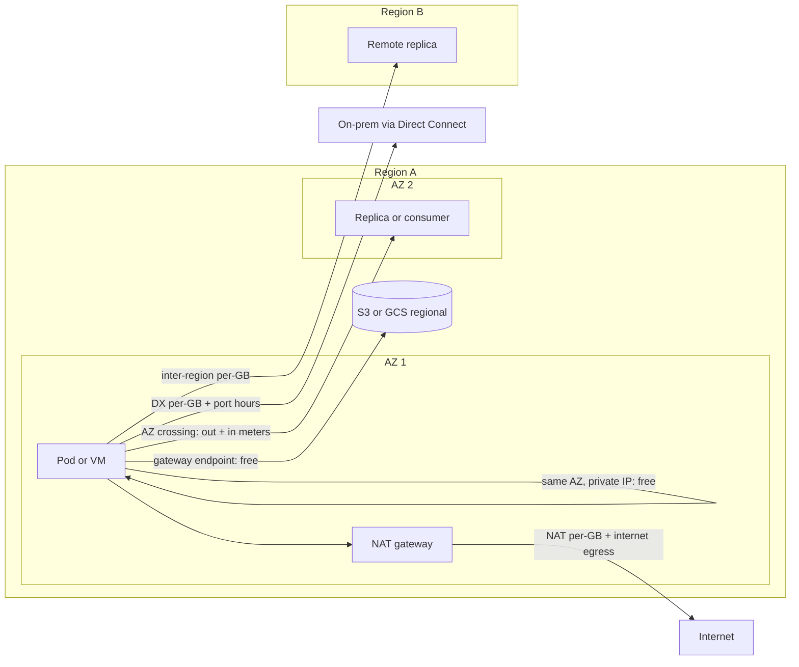

# Network Egress Economics and Optimization

## TL;DR

- Data transfer is billed at the metering point that owns the byte, not at the link that carries it. A single AZ crossing on AWS is billed twice, once as sender "out" and once as receiver "in", so the real cost is about $0.02 per GB crossed, not $0.01.
- Cost per GB rises with distance and lack of control: same-AZ private IP is free, inter-AZ is cheap, inter-region is about 2x inter-AZ, and internet egress is 4.5x to 9x inter-AZ. Bytes that never leave an AZ are the only free bytes.
- Per-GB processing fees stack. A flow through a NAT gateway pays NAT processing plus the underlying transfer charge, and a Transit Gateway or Interface Endpoint adds another per-GB meter.
- Chatty replicated systems turn east-west traffic into the dominant network bill. With Kafka at RF=3 across 3 AZs and 3 consumer groups, one ingested GB causes about 4.67 AZ crossings, which costs more than a GB sent to the internet.
- Direct Connect is a fixed-fee plus cheaper-per-GB trade. It pays off only above a computable monthly volume, and it does nothing for ingress, which is already free.

## Mental Model



Think of the bill as a set of meters bolted onto the physical topology.
Inside one AZ the traffic rides the datacenter Clos fabric and is not metered.
Crossing an AZ boundary uses metro fiber between buildings, and the provider meters both ends.
Crossing a region boundary uses the provider's backbone, which has the same metering structure at a higher rate.
Leaving the provider uses peering and transit, which has the highest rate and the steepest volume discounts.
Optimization is the act of moving each flow to the cheapest meter that still preserves the availability property you need, and never trading away failure-domain separation to save network dollars.
See [[17-Cloud-AI-Engineering/Volume_00_Foundations_Under_the_Cloud/Chapter_02_Datacenter_Networking_Fabrics|Datacenter Networking Fabrics]] for the fabric that makes same-AZ traffic nearly free to the provider.

## Internals

### Where the meter sits

AWS meters inter-AZ and inter-region transfer at the network interface of the instance or service endpoint that emits or receives the bytes.
The AWS pricing summary quoted by third parties describes inter-AZ traffic as 

$0.01 per GB in each direction

, so a flow from AZ-a to AZ-b generates a $0.01 charge on the sender's "out" line and a $0.01 charge on the receiver's "in" line (CloudZero summary of AWS pricing, as of 2026-10).
If the two endpoints live in different accounts, each account pays its own half.
That asymmetry is invisible in a single-account cost view and is a frequent source of "who owns this cost" disputes in shared-services models.

Three consequences follow from metering at the ENI and not at the physical link:

1. The private/public address choice matters. Traffic between two instances in the same AZ over private IPs is free, but the same flow addressed via a public or Elastic IP is generally charged at the regional rate in each direction even when both endpoints are in one AZ (AWS EC2 pricing page, behavior not re-verified in this session, UNVERIFIED). Hairpinning through a public DNS name that resolves to an Elastic IP is the classic way to pay for intra-AZ traffic.
2. Billing counts bytes the provider metering point sees. Compression, protocol overhead, and retransmits at the application or TLS layer change the bill linearly. Compressing before the byte hits the ENI is the highest-leverage, lowest-risk lever.
3. AZ names are per-account aliases. `us-east-1a` in account X and account Y can map to different physical AZs, while the AZ ID (for example `use1-az1`) is stable. Any cross-account design that tries to keep traffic in one AZ (PrivateLink consumers and providers, shared RAM subnets) must compare AZ IDs, not names, or it will silently cross AZs.

### Stacked per-GB meters

A NAT gateway carries two independent charges.
The VPC pricing page states the hourly charge is $0.045 per hour in the example region and the data processing charge is $0.045 per GB, and that the standard EC2 data transfer charge applies on top (AWS VPC pricing, as of 2026-10).
The worked example on that page sends 1 GB from an instance in a private subnet to S3 through NAT and bills the processing fee on it, even though S3 in the same region would have been free through a gateway endpoint.
Because processing is metered on bytes traversing the gateway, a download that is free of internet egress charges, such as pulling a 1 TB model from a public hub, still costs about $45 in NAT processing at $0.045 per GB.
If the NAT gateway sits in a different AZ than the instance, the instance-to-NAT hop also crosses an AZ and adds the inter-AZ meters.

Interface VPC endpoints (PrivateLink) charge an hourly fee per endpoint network interface plus a per-GB processing fee, reported at $0.01 per hour per ENI and $0.01 per GB (secondary source, as of 2026-10, UNVERIFIED against the AWS pricing page this session).
A Transit Gateway adds an attachment-hour fee and a per-GB data processing fee on every byte that crosses it (rates UNVERIFIED this session).
The general rule is that every managed hop that terminates and re-originates a flow adds a meter, so path length in "managed boxes" is a cost variable as much as a latency variable.

### Replication and routing multiply bytes

Egress cost is rarely about user-facing bytes.
It is about fan-out inside your own system.
Two mechanisms dominate.

**Uniform endpoint selection.**
Kubernetes `kube-proxy` selects a Service endpoint uniformly at random by default.
With N equal-sized zones and uniformly distributed backends, a fraction (N-1)/N of east-west bytes crosses a zone boundary: 2/3 with three zones.
Zone-aware routing (EndpointSlice hints and the Service `trafficDistribution` field, with exact version and GA status UNVERIFIED this session) steers to same-zone endpoints and falls back when a zone has too few endpoints.
The trade-off is load skew: if one zone has more clients than backends, same-zone preference overloads its backends, so the control loop disables hints when it predicts imbalance.
See [[17-Cloud-AI-Engineering/Volume_05_Kubernetes_and_Platform_Engineering/Chapter_02_Advanced_Scheduling_and_Topology_Aware_Placement|Advanced Scheduling and Topology-Aware Placement]].

**Leader-based replication.**
In Kafka, a producer writes to the partition leader, the leader's followers fetch from it, and consumers by default fetch from the leader.
With RF=3 and replicas spread across 3 AZs, each ingested byte causes:

- 2/3 of a crossing from the producer to a leader in a different AZ (leaders are spread evenly).
- 2 full crossings for replication, because the two followers are in the two other AZs.
- 2/3 of a crossing per consumer group when consumers fetch from the leader.

KIP-392 ("fetch from closest replica", Kafka 2.4) lets a consumer fetch from a follower in its own AZ via `broker.rack`, `client.rack`, and the `RackAwareReplicaSelector` replica selector, which removes the consumer term.
The producer and replication terms remain, because the replication term is the cost of AZ-level durability and cannot be removed without giving up the failure-domain property.
See [[04-System-Design/06-Messaging-and-Streaming/Apache-Kafka|Apache Kafka]] and [[17-Cloud-AI-Engineering/Volume_02_AWS_Deep_Dive/Chapter_13_Messaging_and_Streaming_SQS_SNS_EventBridge_and_MSK|Messaging and Streaming: SQS, SNS, EventBridge, and MSK]].

### Direct Connect economics

Direct Connect replaces the per-GB internet rate with a lower per-GB rate plus a fixed port charge.
The AWS pricing example bills data transfer out at an illustrative $0.02 per GB for a US location, and states that data transferred into AWS over Direct Connect is $0.00 per GB regardless of volume and location (AWS Direct Connect pricing, as of 2026-10).
Port-hour rates in the same material include $0.30 per hour for a 1 Gbps dedicated port and $2.25 per hour for a 10 Gbps dedicated port, with 730 hours per month used in the calculations (AWS Direct Connect pricing, as of 2026-10).
The DTO rate depends on the Direct Connect location's pricing region and the source region of the data, so an Asia Pacific (Tokyo) source to a US location is reported at about $0.0491 per GB, and South America to a US location at $0.15 per GB (CloudZero summary, as of 2026-10).
You pay the carrier circuit, cross-connect, and colo costs separately, and none of those appear on the AWS bill.

Because ingress is already free over the internet, Direct Connect never saves money on on-prem to cloud training data loads.
It saves money on cloud to on-prem egress, and it buys predictable latency, jitter, and throughput.
Breakeven is `fixed / (internet_rate - dx_rate)`, worked below.

### Why the prices have this shape

Same-AZ traffic uses the Clos fabric the provider already built for the AZ, and marginal cost is near zero.
Inter-AZ traffic uses metro fiber that is scarce relative to in-building capacity.
Inter-region and internet traffic use long-haul backbone and transit, where tiered volume discounts reflect the provider's own transit contracts.
Google describes the equivalent substrate in the Jupiter and Andromeda papers, which show how host-based virtualization and a centrally controlled Clos make intra-datacenter bandwidth abundant ("Andromeda: Performance, Isolation, and Velocity at Scale in Cloud Network Virtualization", NSDI 2018; "Jupiter Evolving", SIGCOMM 2022).
Pricing is therefore a steering signal first and a cost recovery mechanism second, and the margin between inter-region price and internet price is large enough that overlay approaches have been published to exploit it (Skyplane, NSDI 2023; Cloudcast, NSDI 2024).

## Numbers to Know

| Item | Value | Source |
|---|---|---|
| AWS internet egress, first 10 TB per month | $0.09 per GB | CloudZero summary of EC2 pricing (as of 2026-10) |
| AWS internet egress tiers | $0.085 next 40 TB, $0.07 next 100 TB, $0.05 next 150 TB | CloudZero summary of EC2 pricing (as of 2026-10) |
| AWS free internet egress | 100 GB per month aggregated | CloudZero summary (as of 2026-10) |
| AWS inter-AZ | $0.01 per GB each direction, so $0.02 per GB crossed | CloudZero summary (as of 2026-10) |
| AWS inter-region (typical US pair) | $0.02 per GB | CloudZero summary (as of 2026-10) |
| AWS data into AWS from internet | $0.00 | CloudZero and AWS Direct Connect pricing (as of 2026-10) |
| EC2 to S3 same region | $0.00 transfer | Cloudoptimo summary (as of 2026-10) |
| NAT gateway hourly | $0.045 per hour per gateway (example region) | AWS VPC pricing (as of 2026-10) |
| NAT gateway processing | $0.045 per GB | AWS VPC pricing (as of 2026-10) |
| Interface endpoint | $0.01 per hour per ENI plus $0.01 per GB | Secondary source (as of 2026-10), UNVERIFIED |
| Direct Connect DTO, US location | $0.02 per GB | AWS Direct Connect pricing (as of 2026-10) |
| Direct Connect DTO, Tokyo to US location | $0.0491 per GB | CloudZero summary (as of 2026-10) |
| Direct Connect 1 Gbps dedicated port | $0.30 per hour, about $219 per month | AWS Direct Connect pricing and CloudZero (as of 2026-10) |
| Direct Connect 1 Gbps hosted port | $0.33 per hour | CloudZero (as of 2026-10) |
| Direct Connect 10 Gbps dedicated port | $2.25 per hour, $1,642.50 per month | AWS Direct Connect pricing (as of 2026-10) |
| Direct Connect port-hours example | 2 locations x 2 ports x 10G x 730 h = $6,570 per month | AWS Direct Connect pricing (as of 2026-10) |
| GCP Premium Tier internet egress, first tier | about $0.12 per GiB | Google Cloud docs, not re-verified in this session (UNVERIFIED) |
| GCP inter-zone, same region | about $0.01 per GiB | Google Cloud docs, not re-verified in this session (UNVERIFIED) |
| GCP Interconnect egress | about $0.02 per GiB | Google Cloud docs, not re-verified in this session (UNVERIFIED) |
| GCP Cloud NAT processing | about $0.045 per GiB | Google Cloud docs, not re-verified in this session (UNVERIFIED) |

Derived constants used in this chapter:

| Derived value | Formula | Result |
|---|---|---|
| Month in hours | 730 | 730 h |
| 10 Gbps port, 100 percent utilization | 10 Gbit/s x 730 x 3600 / 8 | about 3,285 TB per month |
| Effective $/GB at full 10G utilization | 0.02 + 1,642.50 / 3,285,000 | about $0.0205 |
| Breakeven, 2 x 1G ports | 438 / (0.09 - 0.02) | about 6.3 TB per month |
| Breakeven, 2 x 10G ports | 3,285 / (0.09 - 0.02) | about 46.9 TB per month |

## AWS vs GCP Mechanism Parity

All GCP rows in this table are structural and from prior knowledge of the product docs.
Any GCP number is UNVERIFIED in this session and must be rechecked against the [Google Cloud VPC pricing page](https://cloud.google.com/vpc/network-pricing) before use.

| Dimension | AWS | GCP |
|---|---|---|
| Metering point | ENI or service endpoint; inter-AZ billed on both sender out and receiver in (CloudZero summary, as of 2026-10) | Metered on egress from the sender; ingress generally free (UNVERIFIED) |
| Inter-AZ rate | $0.01 per GB each way, effective $0.02 | Inter-zone same-region egress, about $0.01 per GiB (UNVERIFIED) |
| Same-zone private traffic | Free over private IP | Free over internal IP (UNVERIFIED) |
| Public IP hairpin inside one AZ | Billed at regional rates (UNVERIFIED this session) | Billed as external traffic when using external IP (UNVERIFIED) |
| Internet egress tiers | Volume tiers by month and destination region, 100 GB free | Premium Tier (Google backbone, cold-potato) and Standard Tier (hot-potato) with separate rate cards (UNVERIFIED) |
| Object store to compute, same region | Free | Free within same location (UNVERIFIED) |
| NAT | NAT gateway: hourly plus $0.045 per GB, per AZ (AWS VPC pricing, as of 2026-10) | Cloud NAT: per-VM-hour plus per-GiB processing (UNVERIFIED); regional and not AZ-pinned |
| Private path to managed APIs | Gateway endpoints for S3 and DynamoDB (no hourly or per-GB fee); interface endpoints for most other services | Private Google Access and Private Service Connect |
| Dedicated link | Direct Connect: port hours plus DTO per GB; inbound free (AWS Direct Connect pricing, as of 2026-10) | Dedicated, Partner, and Cross-Cloud Interconnect with per-GiB egress (UNVERIFIED) |
| VPC scope | Regional VPC; cross-region needs peering or Transit Gateway with per-GB meters | Global VPC; cross-region traffic inside one VPC avoids a gateway meter but still pays inter-region egress |
| Cross-account AZ alignment | AZ ID versus AZ name mapping is per account | Zone names are global and consistent across projects (UNVERIFIED) |
| Link to hardware | Nitro cards meter and shape at the host | Andromeda host-based virtualization meters at the VM |

The structural difference that changes design: AWS lets you cut the bill by removing a managed hop (NAT, TGW, interface endpoint), while GCP's global VPC removes whole classes of gateway fees but not the physical inter-region rate.
For cross-cloud network design see [[17-Cloud-AI-Engineering/Volume_04_AWS_vs_GCP_Translation/Chapter_02_Networking_and_Load_Balancing_Translation|Networking and Load Balancing Translation]] and [[17-Cloud-AI-Engineering/Volume_04_AWS_vs_GCP_Translation/Chapter_07_Multi_Cloud_and_Hybrid_Architecture_Reality|Multi-Cloud and Hybrid Architecture Reality]].

## Worked Example: Egress Audit and Cost Model

### Step 1 - Capacity and cost arithmetic

Use these AWS rates: $0.02 per GB crossed between AZs, $0.02 per GB inter-region, $0.045 per GB NAT processing, $0.09 per GB internet (first tier), $0.02 per GB Direct Connect DTO (rates sourced in Numbers to Know, as of 2026-10).

**Kafka at 100 MB/s ingest.**
Ingest per 30-day month is 100 MB/s x 86,400 x 30 = 259,200 GB.
Without follower fetching: 2/3 + 2 + 3 x 2/3 = 4.67 crossings per ingested GB, so 259,200 x 4.67 x $0.02 = $24,192 per month.
With KIP-392 follower fetching: 2/3 + 2 = 2.67 crossings, so $13,824 per month.
The $10,368 per month saving costs nothing but configuration, and costs consumers up to one replication round trip of extra end-to-end latency.
For comparison, 4.67 crossings at $0.02 is $0.093 per ingested GB, more than the $0.09 internet egress rate.

**Kubernetes east-west traffic.**
500 TB per month with uniform endpoint selection across three zones crosses 2/3 of bytes: 500,000 x 2/3 x $0.02 = $6,667 per month.
Zone-aware routing drives this toward zero when backends are balanced.

**Checkpoint replication across regions.**
A 5 TB checkpoint replicated every 30 minutes for 30 days is 5,000 GB x 48 x 30 x $0.02 = $144,000 per month.
Replicating every 4 hours is $18,000 per month.
Replicating every checkpoint is an RPO decision priced at $126,000 per month of difference, and should be argued explicitly.

**Weight fan-out.**
140 GB of weights pulled cross-region by each of 500 nodes costs 140 x 500 x $0.02 = $1,400.
One cross-region pull to a regional cache, then intra-region fan-out over private IPs in the same AZ, costs 140 x $0.02 = $2.80 plus cache storage.

**Direct Connect breakeven.**
Two 1 Gbps dedicated ports cost 2 x $0.30 x 730 = $438 per month.
Savings per GB over the first internet tier are $0.09 - $0.02 = $0.07, so breakeven is 438 / 0.07 = about 6.3 TB per month.
Two 10 Gbps ports cost $3,285 per month and break even at about 46.9 TB per month.
Above 10 TB per month the internet blended rate falls, so recompute with the actual tier, and add carrier and cross-connect costs.

### Step 2 - Runnable model

Save as `egress_model.py`.
It makes no cloud API calls and provisions nothing.

```python
#!/usr/bin/env python3
"""Offline egress cost model. No cloud calls, no billable resources. ASCII only."""
from dataclasses import dataclass

INTER_AZ_PER_DIRECTION = 0.01
INTER_REGION = 0.02
INTERNET_TIERS = [(10_000, 0.09), (40_000, 0.085), (100_000, 0.07), (float("inf"), 0.05)]
FREE_INTERNET_GB = 100
NAT_PROCESSING = 0.045
DX_DTO_US = 0.02
HOURS = 730

def internet_cost(gb):
    left = max(0.0, gb - FREE_INTERNET_GB)
    total = 0.0
    for size, rate in INTERNET_TIERS:
        take = min(left, size)
        total += take * rate
        left -= take
        if left <= 0:
            break
    return total

def crossing_cost(gb_crossing):
    """One AZ crossing is billed twice: sender out plus receiver in."""
    return gb_crossing * 2 * INTER_AZ_PER_DIRECTION

@dataclass
class KafkaShape:
    ingest_gb_month: float
    rf: int = 3
    azs: int = 3
    consumer_groups: int = 3
    follower_fetch: bool = False

    def crossings_per_ingested_gb(self):
        producer = (self.azs - 1) / self.azs
        replication = self.rf - 1
        consumers = 0.0 if self.follower_fetch else self.consumer_groups * (self.azs - 1) / self.azs
        return producer + replication + consumers

    def monthly_cost(self):
        return crossing_cost(self.ingest_gb_month * self.crossings_per_ingested_gb())

def k8s_random_endpoint_cost(gb_month, azs=3):
    return crossing_cost(gb_month * (azs - 1) / azs)

def dx_breakeven_gb(port_rate_hr, ports, internet_rate=0.09, dx_rate=DX_DTO_US):
    fixed = port_rate_hr * HOURS * ports
    return fixed / (internet_rate - dx_rate), fixed

def checkpoint_replication(tb_per_ckpt, ckpts_per_day, days=30, rate=INTER_REGION):
    return tb_per_ckpt * 1000 * ckpts_per_day * days * rate

def weight_fanout(model_gb, nodes, cross_region_each=True):
    return model_gb * (nodes if cross_region_each else 1) * INTER_REGION

if __name__ == "__main__":
    ingest = 100 * 3600 * 24 * 30 / 1000.0
    for ff in (False, True):
        k = KafkaShape(ingest_gb_month=ingest, follower_fetch=ff)
        print("kafka follower_fetch=%s crossings/GB=%.2f monthly=$%.0f" %
              (ff, k.crossings_per_ingested_gb(), k.monthly_cost()))
    print("internet 50 TB: $%.0f" % internet_cost(50_000))
    print("k8s 500 TB east-west random: $%.0f" % k8s_random_endpoint_cost(500_000))
    for name, rate in (("1G", 0.30), ("10G", 2.25)):
        gb, fixed = dx_breakeven_gb(rate, ports=2)
        print("DX %s x2 fixed=$%.0f breakeven=%.1f TB/month" % (name, fixed, gb / 1000))
    print("ckpt 5TB every 30 min: $%.0f" % checkpoint_replication(5, 48))
    print("ckpt 5TB every 4 h: $%.0f" % checkpoint_replication(5, 6))
    print("weights cross-region each: $%.0f, single pull: $%.2f" %
          (weight_fanout(140, 500), weight_fanout(140, 500, False)))
    print("NAT 200 TB/month: $%.0f" % (200_000 * NAT_PROCESSING))
```

Running it prints the figures used above: $24,192 and $13,824 for Kafka, $6,667 for Kubernetes, 6.3 and 46.9 TB breakevens, $144,000 and $18,000 for checkpoints, $1,400 versus $2.80 for weights, and $9,000 for 200 TB through NAT.

### Step 3 - Attribute real spend

Use the Cost and Usage Report in Athena.
The usage-type substrings below are from prior knowledge and should be checked against your own CUR before relying on them (UNVERIFIED).

```sql
SELECT line_item_usage_type,
       line_item_resource_id,
       SUM(line_item_usage_amount) AS gb,
       SUM(line_item_unblended_cost) AS usd
FROM cur_table
WHERE line_item_product_code IN ('AmazonEC2', 'AWSDataTransfer')
  AND (line_item_usage_type LIKE '%DataTransfer-Regional-Bytes%'
       OR line_item_usage_type LIKE '%NatGateway-Bytes%'
       OR line_item_usage_type LIKE '%-AWS-Out-Bytes%'
       OR line_item_usage_type LIKE '%DataTransfer-Out-Bytes%')
  AND line_item_usage_start_date >= DATE '2026-10-01'
GROUP BY 1, 2
ORDER BY usd DESC
LIMIT 50;
```

The CUR tells you which resource and how many dollars, but not which peer.
Enable VPC Flow Logs on the NAT gateway ENI and on top-talker ENIs with the custom fields for source, destination, bytes, and AZ ID to attribute a bill line to a peer (field names UNVERIFIED this session).

### Step 4 - Free fix: S3 gateway endpoint plus budget guardrail

Cost estimate: gateway endpoints for S3 have no hourly or per-GB charge, and an AWS Budget is free for the first budgets in an account (budget pricing UNVERIFIED this session), so the expected cost of this lab is $0.
The `UsageTypeGroup` filter values below must be checked against the Cost Explorer filter list in your account (UNVERIFIED).

```hcl
terraform {
  required_providers {
    aws = { source = "hashicorp/aws", version = "~> 5.0" }
  }
}

variable "region"          { default = "us-east-1" }
variable "vpc_id"          { type = string }
variable "route_table_ids" { type = list(string) }
variable "alert_email"     { type = string }

provider "aws" { region = var.region }

resource "aws_vpc_endpoint" "s3" {
  vpc_id            = var.vpc_id
  service_name      = "com.amazonaws.${var.region}.s3"
  vpc_endpoint_type = "Gateway"
  route_table_ids   = var.route_table_ids
}

resource "aws_budgets_budget" "egress_guardrail" {
  name         = "egress-guardrail"
  budget_type  = "COST"
  limit_amount = "500"
  limit_unit   = "USD"
  time_unit    = "MONTHLY"

  cost_filter {
    name   = "UsageTypeGroup"
    values = ["EC2: Data Transfer - Inter AZ", "EC2: Data Transfer - Internet (Out)"]
  }

  notification {
    comparison_operator        = "GREATER_THAN"
    threshold                  = 80
    threshold_type             = "PERCENTAGE"
    notification_type          = "FORECASTED"
    subscriber_email_addresses = [var.alert_email]
  }
}
```

Teardown, exact command:

```bash
terraform destroy -auto-approve -var "vpc_id=$VPC_ID" -var 'route_table_ids=["rtb-0123456789abcdef0"]' -var "alert_email=$ALERT_EMAIL"
```

Verification: after apply, run `aws ec2 describe-route-tables --route-table-ids <id>` and confirm a route whose destination is the S3 managed prefix list points at the endpoint, then confirm NAT `BytesOutToDestination` for the S3 flow drops to zero in CloudWatch.

## Failure Modes and Pitfalls

### Cost failure modes

**NAT as default egress for AWS APIs.**
Container image pulls from ECR, S3 object reads, and DynamoDB calls routed through NAT pay $0.045 per GB for traffic that would be free via a gateway endpoint.
A 500-node scale-out pulling a 10 GB image through NAT moves 5 TB and pays about $225 in processing per event.
Autoscaling flaps turn this into a recurring cost, and the cost correlates with incidents, so the bill spikes exactly when everyone is busy.

**Cross-AZ NAT or endpoint placement.**
A single NAT gateway shared by three AZs saves $0.045 per hour per gateway but makes two thirds of egress cross an AZ first.
Per-AZ NAT is also what you want for static stability, so the correct trade is one NAT per AZ and routing each subnet to its own AZ's gateway.
See [[17-Cloud-AI-Engineering/Volume_01_Cloud_Architecture_Principles/Chapter_02_Regions_Zones_and_Static_Stability|Regions, Zones, and Static Stability]].

**Public-address hairpin.**
Services that resolve each other via public DNS names pay regional charges for traffic that stays in an AZ (UNVERIFIED this session, see Internals).

**Replication topology amplification.**
Kafka, Cassandra, Elasticsearch, and any quorum store at RF=3 across three AZs produce at least 2 crossings per written byte by construction.
Cassandra and Elasticsearch add coordinator-to-replica hops, and Elasticsearch shard relocation after a node loss re-copies shards across AZs at the moment you are least able to absorb it.
See [[04-System-Design/05-Data-Stores/Apache-Cassandra|Apache Cassandra]] and [[04-System-Design/05-Data-Stores/Elasticsearch-and-Apache-Solr|Elasticsearch and Apache Solr]].

**Cross-region training data and checkpoints.**
GPU capacity is often available in a region that does not hold the dataset.
Each epoch streamed cross-region costs the full dataset size times $0.02 per GB, which equals the one-time cost of copying it, so any job with more than about one epoch should copy.
Synchronous cross-region checkpoint replication at high frequency is the largest single line item in many training budgets, as the $144,000 per month example shows.

**Failover re-seed.**
A regional failover or a rebuilt replica can trigger a full inter-region copy.
Disaster recovery plans that were costed on steady-state delta traffic omit the first full copy and every re-copy.

### Availability failure modes created by optimization

**Zone-affinity hot spots.**
Same-zone routing makes each zone a closed loop.
If one zone has 50 percent of clients and 33 percent of backends, those backends saturate while others idle.
Controllers that disable hints under predicted imbalance protect you, but only if endpoints are evenly spread, which requires topology spread constraints.

**Removing cross-AZ capacity to save money.**
Static stability requires that each AZ can absorb a failed neighbor's load without a control-plane action.
Spreading replicas across AZs is deliberately paid for through inter-AZ fees.
Do not attribute that fee to waste.
The AWS public event summary for the December 7, 2021 us-east-1 event is the relevant public analysis of how retry and client behavior amplify an internal network congestion event, and is a reminder that capacity decisions in one failure domain interact with traffic behavior in others (details UNVERIFIED this session).
I did not locate a public post-incident review whose root cause was egress billing itself; egress cost incidents are typically published as customer postmortems and not as provider PIRs.

**Direct Connect as a single point of failure.**
A single port or a single location removes provider-side redundancy that the internet path had.
The resiliency design (two locations, two devices) is what pushes the fixed cost to the $438 and $3,285 per month figures used in the breakeven.

**Quota and limit interactions.**
NAT gateways have per-gateway bandwidth and port-allocation limits, and exceeding them shows up as connection errors and `ErrorPortAllocation` metrics (limits UNVERIFIED this session), so a cost fix of "route everything through one NAT" also becomes a reliability bug.

## Security and Cost Angles

### Security

- A gateway endpoint policy restricts which buckets and principals the endpoint can reach. It is both an exfiltration control and a cost control, because it prevents accidental use of the endpoint to reach other accounts' buckets. See [[17-Cloud-AI-Engineering/Volume_08_Security_Identity_and_the_Data_Perimeter/Chapter_06_Constructing_an_Impenetrable_Data_Perimeter|Constructing an Impenetrable Data Perimeter]].
- Replace the NAT-to-internet path for AWS APIs with private paths, and let only a small, audited egress VPC reach the internet. On GCP use Private Google Access and VPC Service Controls to the same effect. See [[17-Cloud-AI-Engineering/Volume_03_GCP_Deep_Dive/Chapter_03_VPC_Service_Controls_Security_Perimeters|VPC Service Controls: Security Perimeters]].
- Egress is the exfiltration channel. A budget alarm on internet-out bytes is a weak but real detection signal, because exfiltration looks like a spike in the `DataTransfer-Out-Bytes` line.
- Encrypting traffic does not change the billed bytes meaningfully, but TLS termination placement matters for where compression can happen. Compress before encrypting, since ciphertext does not compress.
- Direct Connect is not encrypted by default. MACsec on supported ports or IPsec over a VIF are the options, and either one affects the effective payload per packet (feature availability UNVERIFIED this session).
- Customer-managed keys for replicated buckets add KMS request charges in the destination region. Price this next to the transfer fee for cross-region replication of encrypted objects. See [[17-Cloud-AI-Engineering/Volume_08_Security_Identity_and_the_Data_Perimeter/Chapter_04_Encryption_Key_Hierarchies_and_Envelope_Encryption|Encryption Key Hierarchies and Envelope Encryption]].

### Cost levers, in order of return on effort

1. **Co-locate.** Put compute in the region and AZ of the data. Free same-region object reads make this the biggest single lever for AI jobs.
2. **Remove managed hops.** Gateway endpoints instead of NAT for S3 and DynamoDB, per-AZ NAT for the rest, and IPv6 egress where supported to avoid NAT entirely (egress-only gateway pricing UNVERIFIED this session).
3. **Compress at the source.** Producer-side zstd or lz4 on Kafka cuts replication, producer, and consumer terms together, because brokers store and forward the producer's compressed batch. Compression ratios are workload dependent, so measure.
4. **Zone-aware routing and follower fetch.** Typically 30 to 60 percent of east-west cost in the Kafka example (43 percent in the model above), with a latency and skew trade-off.
5. **Cache and fan out locally.** One cross-region pull plus a regional cache beats N pulls, as in the weight fan-out example.
6. **CDN in front of internet egress.** CloudFront is reported at $0.085 per GB for the first 10 TB per month in North America with a larger free allowance than EC2, and origin fetches from AWS origins are free (CloudZero and Cloudoptimo summaries, as of 2026-10, origin-fetch rule UNVERIFIED this session).
7. **Dedicated links.** Only after the previous six, and only above the computed breakeven.
8. **Commercial terms.** Private pricing agreements and committed spend often discount transfer lines, and both major providers announced waivers of egress fees for customers fully leaving the platform (announcements in early 2024, UNVERIFIED this session).

### Unit economics

Express network cost as dollars per unit of work: per million tokens served, per training epoch, per thousand requests.
A model-serving gateway that sends 4 KB responses at 20 million requests a day produces 80 GB per day, so about $7.20 per day at $0.09 per GB, which is noise.
A training cluster that checkpoints 5 TB every 30 minutes across regions is $4,800 per day.
Spend engineering effort where the exponent is.
The next chapter, [[17-Cloud-AI-Engineering/Volume_09_FinOps_and_Cloud_Economics/Chapter_05_GPU_and_TPU_Unit_Economics|GPU and TPU Unit Economics]], places these network line items next to accelerator-hour costs.
The previous chapter, [[17-Cloud-AI-Engineering/Volume_09_FinOps_and_Cloud_Economics/Chapter_03_Spot_Economics_and_Interruption_Handling|Spot Economics and Interruption Handling]], matters here because checkpoint-on-interruption designs create the egress spikes discussed above.

## Interview Questions and Model Answers

### Question 1 (L5 - Senior)

A teammate says "inter-AZ traffic is a penny per GB, so it does not matter".
Show why that is wrong and how you would find the real number for a service.

#### Model Answer

AWS bills AZ crossings on both ends.
The sender is charged $0.01 per GB out and the receiver $0.01 per GB in (CloudZero summary of AWS pricing, as of 2026-10), so the effective rate is $0.02 per GB crossed.
That already doubles the figure in the teammate's head.
The second error is volume. Quorum systems cross AZs by construction. With RF=3 across 3 AZs, a written byte causes at least two crossings for replication, which is $0.04 per written GB before reads.
For a 100 MB/s write stream, that replication floor alone is 259,200 GB x 2 x $0.02 = $10,368 per month.
To find the real number, I query the Cost and Usage Report for the regional-bytes usage type grouped by resource ID, then use VPC Flow Logs with AZ ID fields to see which peer pairs generate it.
Name-to-ID mapping matters. I compare AZ IDs, not AZ names, when reasoning across accounts.
I would also check for public-IP or Elastic-IP addressing between same-AZ peers, since that path is billed regionally even when it never leaves the AZ (UNVERIFIED in this session, so I would confirm it in the CUR first).

#### Follow-up Interviewer Question

The two endpoints are in different accounts. Who pays, and how does that change a shared-services chargeback model?

### Question 2 (L5 - Senior)

The NAT gateway line item rose 6x in a week with no traffic growth.
Walk through the diagnosis and the fix.

#### Model Answer

NAT has two meters: an hourly fee of $0.045 and processing of $0.045 per GB (AWS VPC pricing, as of 2026-10).
Hourly cost is flat, so a 6x jump is processing, meaning bytes.
I group the CUR NAT bytes line by gateway resource ID to find which gateway, then enable flow logs on its ENI and aggregate by destination address and port.
The usual suspects are traffic to AWS services that could use a gateway endpoint, image pulls from the registry during scale-out, a data job that started reading object storage from a private subnet, and a model download from a public hub.
Fixes in order: S3 and DynamoDB gateway endpoints, which carry no hourly or per-GB fee for the endpoint itself; interface endpoints for ECR and other APIs where the volume justifies $0.01 per hour per ENI plus $0.01 per GB (secondary source, UNVERIFIED); a pull-through cache or mirror for public artifacts; and one NAT per AZ so the instance-to-NAT hop does not cross AZs.
I would put the endpoint policy in place at the same time, to keep it from becoming an exfiltration path.
Then I add a budget on the NAT usage type so a regression is caught within a day.

#### Follow-up Interviewer Question

You move ECR traffic to interface endpoints and the bill drops, but one team's cost goes up. What happened?

### Question 3 (L6 - Staff)

Design the AZ layout and client configuration for a Kafka cluster ingesting 100 MB/s with three consumer groups so that network cost is minimized without giving up AZ-failure tolerance.
Quantify it.

#### Model Answer

Start from the crossing count per ingested byte.
With RF=3 over 3 AZs, rack-aware replica placement puts one replica per AZ and leaders evenly spread.
The producer lands off-AZ with probability 2/3, replication costs 2 crossings, and each consumer group fetching from leaders costs 2/3.
Total is 2/3 + 2 + 3 x 2/3 = 4.67 crossings, or $0.093 per ingested GB at $0.02 per crossing.
At 259,200 GB per month that is $24,192.
Enabling KIP-392 follower fetching removes the consumer term. Brokers set `broker.rack` and `replica.selector.class=org.apache.kafka.common.replica.RackAwareReplicaSelector`, and consumers set `client.rack`. Crossings drop to 2.67 and cost to $13,824, a 43 percent saving.
The cost is latency. A follower serves only data up to the high watermark and lags the leader by about one fetch cycle, so end-to-end latency rises.
Replication's two crossings are the price of surviving an AZ loss, so I do not remove them. Dropping to RF=2 or placing a partition's replicas in one AZ trades availability for dollars, which needs an explicit sign-off from the owners.
Next lever is producer compression. Brokers store and replicate the producer's compressed batch, so a 3x ratio cuts every term by a third. The ratio is workload dependent, so I measure it on production payloads.
A third lever is an AZ-aware partitioner that prefers a leader in the producer's AZ, which cuts the producer term at the price of skew if AZ producer volumes are uneven.
Tiered storage for long retention moves cold data off broker disks to object storage, which has no cross-AZ replication meter for same-region reads, but it changes failure behavior and should be assessed separately.

#### Follow-up Interviewer Question

An AZ fails. How does follower fetching behave for consumers pinned to the dead AZ, and what does the cost curve do during recovery?

### Question 4 (L6 - Staff)

Finance asks for a Direct Connect business case to repatriate 80 TB per month of cloud-to-on-prem egress.
What is your analysis?

#### Model Answer

Breakeven is fixed cost divided by the per-GB saving.
The saving at the first internet tier is $0.09 - $0.02 = $0.07 per GB (CloudZero summary and AWS Direct Connect pricing, as of 2026-10).
At 80 TB per month the internet path would cost a tiered amount, about 10,000 x 0.09 + 40,000 x 0.085 + 30,000 x 0.07 = $6,400 (my model), while Direct Connect DTO is 80,000 x $0.02 = $1,600.
Hence the gross saving is about $4,800 per month.
Fixed cost for a resilient design is two locations, so two 10 Gbps ports is 2 x $2.25 x 730 = $3,285 per month, leaving about $1,500 before carrier circuits, cross-connects, and colo cross-connect fees, which are not on the AWS bill.
That is thin. The 80 TB would use only about 2.4 percent of the 3,285 TB per month a 10 Gbps port can carry, so two 1 Gbps ports at $438 per month are enough if the peak rate fits, and then the saving is about $4,360 per month before carrier costs.
Peak rate matters. 80 TB per month averages 247 Mbps, but bursts to many Gbps for a nightly export would require sizing for the burst or accepting a longer transfer window.
Also, if the on-prem to cloud direction is the larger flow, Direct Connect saves nothing on it, since inbound is free over the internet and over Direct Connect.
The case then has to rest on predictability, jitter, and security, not on cost.
My recommendation depends on the quote for the carrier circuit. I would also price a Transit Gateway if traffic goes through one, because it adds a per-GB processing meter (rate UNVERIFIED this session) that can erase much of the saving.

#### Follow-up Interviewer Question

The data is in us-east-1 but the Direct Connect location is in a different pricing region. How does that change the calculation, and where do you read the rate?

### Question 5 (L6 - Staff)

A training team has 200 TB of data in us-east-1 and GPU capacity in us-west-2.
They propose to stream the data across regions during training.
Evaluate this.

#### Model Answer

Streaming means every epoch re-pays the transfer.
At $0.02 per GB, one epoch of 200 TB is $4,000, and so is a one-time copy of the dataset (inter-region rate, CloudZero summary, as of 2026-10).
That makes breakeven about one epoch, plus the monthly storage cost of the second copy.
For any job with more than one pass, copy once to the GPU region and read locally, where same-region object reads incur no transfer charge.
Cost is not the only axis.
Cross-region streaming adds tens of milliseconds of RTT and a long-haul bandwidth ceiling to every read, which shows up as data-loader stalls and idle accelerators that cost far more than the transfer fee.
At $X per accelerator-hour, a 5 percent stall on a 1,000-accelerator job dwarfs the $4,000.
Then the interesting design question is deltas.
If the dataset changes daily by 1 percent, replicate the 2 TB delta each day ($40) and not the whole set.
Checkpoints go the other way. They are written in the GPU region, and replicating them back is a frequency decision.
5 TB every 30 minutes cross-region is $144,000 per month at $0.02 per GB, versus $18,000 per month at every 4 hours.
I would keep a local copy at high frequency for restart, and replicate to the second region at a lower frequency matched to the RPO the business accepts.

#### Follow-up Interviewer Question

The dataset is regenerated nightly by an upstream pipeline and the GPU region changes every few weeks depending on capacity.
How do you avoid paying the full copy each time?

### Question 6 (L7+ - Principal)

You inherit a platform with a $4M per year network bill.
Design the program that cuts it by 40 percent without reducing availability, and say what you refuse to cut.

#### Model Answer

First, make it attributable.
Network cost without a peer is un-actionable, so I build a flow-level attribution pipeline: CUR lines provide dollars per resource, VPC Flow Logs (sampled where volume demands) provide byte counts per source, destination, and AZ ID, and a join assigns each dollar to a service pair and a team.
I express each service as dollars per unit of work.
That turns a $4M number into a ranked list of flows.
Typically 5 to 10 flows are 80 percent of it: replicated streaming systems, NAT-routed artifact and object traffic, cross-region data movement, and internet egress.
Second, classify each flow by what must be preserved.
Replication across AZs buys fault isolation and stays. Cross-AZ capacity headroom for static stability stays. Anything that crosses an AZ because of random load balancing, NAT placement, public-IP hairpinning, or the absence of a gateway endpoint is waste, and is the target.
Third, apply levers in order of risk: gateway endpoints and per-AZ NAT, compression at source, follower fetch and zone-aware routing, regional caches for artifacts, a CDN in front of internet egress, cross-region replication frequency set by RPO, and only then dedicated links.
Fourth, guard against regressions. Budgets on the transfer usage-type groups, a policy check in infrastructure-as-code that rejects NAT-routed paths to services with gateway endpoints, and a unit-cost SLO per service.
Fifth, handle the commercial side: committed-spend and private-pricing negotiations are separate from engineering, and can discount the transfer lines I did not eliminate.
What I refuse to cut: replica spread across AZs, the ability of any AZ to absorb a neighbor's load, and cross-region replication that implements the stated RPO.
Zone-affinity routing has a failure mode, which is load skew. I require topology spread, load tests with an AZ failure injected, and a fallback path to cross-zone routing, and I track per-zone saturation.
Cost wins that cost availability are not wins.

#### Follow-up Interviewer Question

Zone-aware routing is live and saves $300k per year.
An AZ degrades partially, not fully, and the same-zone backends become slow but stay healthy.
What happens, and how do you detect and mitigate it?

### Question 7 (L7+ - Principal)

You must distribute 140 GB of model weights to 500 inference nodes across two AWS regions and one GCP region, repeatedly, as models are updated.
Design the distribution and quantify the cost.

#### Model Answer

The naive approach is each node pulling from a single source, which pays the transfer rate per node.
Across regions at $0.02 per GB that is 140 x 500 x $0.02 = $1,400 per update inside AWS, and much more across clouds at internet-class rates, which at $0.09 per GB is $6,300 for 500 internet-class pulls (rates AWS tiered, as of 2026-10; the GCP leg is UNVERIFIED).
The structural fix is to pay the expensive hop once per destination region and not once per node.
One authoritative copy is published. A replication job copies it once to each destination region, which costs 140 x $0.02 = $2.80 per AWS region, or 140 x $0.09 = $12.60 to leave AWS at the first internet tier.
Within each region, nodes read from regional object storage at no transfer fee, or from a per-AZ cache populated once, so same-AZ reads over private IPs are free and avoid the cross-AZ meters.
This also protects against a thundering herd, since the source sees one reader per region, not 500.
For the cross-cloud hop, overlay and multicast-style transfers such as the ones in Skyplane and Cloudcast reduce either time or cost by using multiple paths and relay regions, but at a price: you pay the provider's egress rate on each relay hop, so a relay is only a win when the direct path is expensive or slow relative to relay rates. I would validate with a measured transfer and not a model.
The other axis is cold start time. Weight load time is bytes divided by the minimum of object-store throughput and NIC rate, so the same layout also decides scale-out latency.
See [[17-Cloud-AI-Engineering/Volume_11_LLM_Serving_and_Inference_Systems_on_Cloud/Chapter_08_Cloud_GPU_Autoscaling_and_Cold_Start_Mitigation|Cloud GPU Autoscaling and Cold-Start Mitigation]].
Integrity: I verify checksums per shard at the destination, and promote a version only after all regions report complete, since a partial rollout across regions is a correctness bug as well as a cost.

#### Follow-up Interviewer Question

A cross-cloud relay shows a 30 percent lower transfer time but a 2x higher egress bill.
How do you decide, and what additional data do you want before committing?

## Further Reading

- [AWS Amazon VPC pricing](https://aws.amazon.com/vpc/pricing/) - the authoritative source for NAT gateway hourly and processing rates, including the worked example that stacks data transfer on top of NAT processing.
- [AWS Direct Connect pay-as-you-go pricing](https://aws.amazon.com/directconnect/pricing/pay-as-you-go/) - port-hour rates, DTO rate examples, and the worked multi-port calculation used in the breakeven analysis.
- [AWS Direct Connect pricing guide](https://docs.aws.amazon.com/directconnect/latest/PricingGuide/pricing-overview.html) - how dedicated and hosted connection billing works and how rates depend on location and source region.
- [Amazon EC2 on-demand pricing, data transfer section](https://aws.amazon.com/ec2/pricing/on-demand/) - the primary rate card for internet egress tiers and regional transfer; recheck the numbers in this chapter against it.
- [AWS Architecture Blog: Overview of Data Transfer Costs for Common Architectures](https://aws.amazon.com/blogs/architecture/overview-of-data-transfer-costs-for-common-architectures/) - AWS's own walk-through of which topologies incur which transfer meters.
- [Google Cloud VPC network pricing](https://cloud.google.com/vpc/network-pricing) - the primary source for GCP inter-zone, inter-region, and internet egress rates; required before using any GCP figure in this chapter.
- [Google Cloud Interconnect pricing](https://cloud.google.com/network-connectivity/docs/interconnect/pricing) - the GCP counterpart to Direct Connect port and egress pricing.
- [KIP-392: Allow consumers to fetch from closest replica](https://cwiki.apache.org/confluence/display/KAFKA/KIP-392%3A+Allow+consumers+to+fetch+from+closest+replica) - the design behind follower fetching, including the replica selector interface and the latency trade-off.
- [Andromeda: Performance, Isolation, and Velocity at Scale in Cloud Network Virtualization (NSDI 2018)](https://www.usenix.org/conference/nsdi18/presentation/dalton) - the host-based network virtualization stack that explains where GCP meters traffic and why intra-datacenter bandwidth is cheap.
- "Skyplane: Optimizing Transfer Cost and Throughput Using Cloud-Aware Overlays" (NSDI 2023) - shows how cost-aware overlay routing across regions and clouds changes the egress cost and time trade-off.
- "Cloudcast: High-Throughput, Cost-Aware Overlay Multicast in the Cloud" (NSDI 2024) - extends the overlay idea to one-to-many distribution, which is the weight and dataset distribution case in AI fleets.
- "Jupiter Evolving: Transforming Google's Datacenter Network via Optical Circuit Switches and Software-Defined Networking" (SIGCOMM 2022) - explains the physical fabric whose economics make same-datacenter traffic effectively free.
- [[17-Cloud-AI-Engineering/Volume_10_AI_Infrastructure_on_Cloud/Chapter_06_High_Throughput_Checkpointing_to_Object_Storage|High-Throughput Checkpointing to Object Storage]] - the checkpoint write path whose replication frequency drives the largest AI egress line items.
- [[17-Cloud-AI-Engineering/Volume_02_AWS_Deep_Dive/Chapter_03_VPC_Networking_Internals|VPC Networking Internals]] - route tables, endpoints, and Transit Gateway mechanics referenced throughout this chapter.
