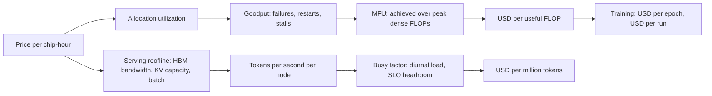

# GPU and TPU Unit Economics

## TL;DR

Cost per useful unit of work is the hourly price divided by the product peak_FLOPs x MFU x goodput x allocation_utilization, so a quoted $/GPU-hour only matters after you measure or model each factor in that stack.
Training cost is 6 x N x D FLOPs divided by what the fleet really delivers, and at cluster scale the dominant hidden term is goodput, because cluster MTBF falls as 1/N while restart time R does not shrink.
Serving cost per million tokens is set by HBM bandwidth and KV-cache capacity, not by FLOPs: decode throughput saturates at roughly bandwidth / (context x KV bytes per token), which is why output tokens cost more than input tokens.
A reservation, commitment, or owned rack is a prepaid option on capacity that you pay for at 100 percent of hours, so its break-even is a utilization threshold (own or commit price / on-demand price), and generational obsolescence moves that threshold against owners.
Every number in a business case must come from your own measured tokens/s, MFU, and goodput; list prices, sparse-FLOPs datasheets, and nvidia-smi utilization are all systematically optimistic.

## Mental Model



The hourly price is a metering fact about rented silicon, and everything that turns it into a business metric is a ratio you control or measure.
On the training side the ratios are multiplicative and independent: a fleet that is 90 percent allocated, 85 percent goodput, and 40 percent MFU delivers about 31 percent of the datasheet FLOPs you paid for.
On the serving side the binding constraint changes from compute to memory: each decode step streams the weights plus every live sequence's KV cache through HBM, so the batch you can hold and the bandwidth you actually achieve determine tokens per second.
Ownership versus rental is the same equation with the price replaced by an amortized capex-plus-opex rate that you pay whether or not the silicon is busy.
The rest of this chapter makes each factor measurable and shows where each one silently erodes.

## Internals

### How the hourly price is formed

A cloud accelerator-hour bundles amortized hardware, power and cooling at facility PUE, networking fabric share, host CPU and memory, software and operations, and a scarcity premium for guaranteed capacity.
The scarcity term is the one that moves: AWS cut On-Demand prices for P5 by up to 45 percent, P5en by up to 26 percent, and P4d/P4de by up to 33 percent effective 2025-06-01, with Savings Plan purchases repriced after 2025-06-04 (AWS What's New, 2025-06-05, as of 2026-10; [announcement](https://aws.amazon.com/about-aws/whats-new/2025/06/pricing-usage-model-ec2-instances-nvidia-gpus)).
The percentages apply to Amazon Linux and are smaller for other operating systems (same source), and the same announcement made at-scale On-Demand capacity available in more Regions and made Savings Plans available for P6-B200, which had launched only through EC2 Capacity Blocks for ML (same source).
The lesson for a model is that list price is a time series, not a constant, and a three-year commitment signed before a cut keeps paying the old rate.
Treat any $/hr in a spreadsheet as an input with a timestamp and a source query, as the worked example does.

### The multiplicative stack: peak, MFU, goodput, allocation

Peak FLOPs are quoted per precision and with or without 2:4 structured sparsity, and the sparse figure is exactly 2x the dense one.
Using the sparse number as the denominator understates cost per FLOP by 2x, which is the single most common error in vendor comparisons.
Model FLOPs Utilization (MFU) is defined in the PaLM paper as observed model FLOPs per second over theoretical peak, counting only the FLOPs the model math requires and excluding recomputation ([Chowdhery et al., PaLM, 2022](https://arxiv.org/abs/2204.02311)).
Hardware FLOPs Utilization (HFU) counts recomputed FLOPs too, so activation checkpointing raises HFU without raising useful throughput; always cost against MFU.
Published large-scale training sits in the high 30s to mid 40s percent MFU for dense transformers: PaLM reported 46.2 percent on 6144 TPU v4 chips, and the Llama 3 paper reported 38 to 43 percent BF16 MFU on up to 16K H100s ([Llama 3 Herd of Models, 2024](https://arxiv.org/abs/2407.21783)) (both UNVERIFIED this session, recalled from the papers).
A second mechanism hides in the monitoring stack: nvidia-smi "GPU-Util" is the fraction of sample intervals in which at least one kernel was resident, not SM occupancy, so a job can show 100 percent while tensor pipes idle at 20 percent.
The DCGM profiling fields (for example `DCGM_FI_PROF_SM_ACTIVE` and `DCGM_FI_PROF_PIPE_TENSOR_ACTIVE`) measure what you actually want, and chargeback built on the coarse metric rewards busy-waiting on NCCL collectives.
See [[17-Cloud-AI-Engineering/Volume_10_AI_Infrastructure_on_Cloud/Chapter_01_Accelerator_Architectures_GPUs_Trainium_TPUs|Accelerator Architectures]] for why each precision's peak is reachable only with specific tile shapes.

### Training cost: 6ND and where it breaks

Dense transformer training costs about 6 x N x D FLOPs for N parameters and D tokens: 2ND for the forward pass and 4ND for the backward pass (Kaplan et al., [Scaling Laws](https://arxiv.org/abs/2001.08361); [Hoffmann et al., Chinchilla](https://arxiv.org/abs/2203.15556)).
Full activation recomputation adds roughly another forward pass, giving 8ND of hardware FLOPs, but the useful work stays 6ND.
For mixture-of-experts models N is the active parameter count per token, while memory sizing (and therefore chip count and communication) is set by total parameters, so MoE cost per FLOP is not comparable to dense cost per FLOP.
"Cost per epoch" is just 6 x N x D_epoch x $/useful FLOP, and it is only a meaningful unit for fine-tuning and data-constrained runs; repeated epochs have diminishing value beyond a few passes (Muennighoff et al., 2023, UNVERIFIED recall), so the economic unit for pretraining is cost per unique token.

### Goodput: why cluster size taxes your price

A synchronous job dies when any one of its N nodes dies.
If nodes fail independently at rate lambda, cluster MTBF is M = 1 / (N x lambda).
With checkpoint stall C, checkpoint interval T, and restart time R (detect, reschedule, reload, recompile, re-initialize NCCL), the first-order waste fraction is

W(T) = C/T + (T/2 + R) / M

Minimizing gives the Young/Daly interval T* = sqrt(2 x C x M) and W_min = sqrt(2C/M) + R/M ([Young, CACM 1974](https://dl.acm.org/doi/10.1145/361147.361115); Daly, FGCS 2006, higher-order estimate).
The consequences are not obvious from product docs.
First, doubling N halves M, so the C/T and lost-work terms grow by sqrt(2) and the R/M term doubles.
Second, R is not a constant: it grows with rank count (more processes to rendezvous), includes XLA or `torch.compile` recompilation, and on Spot or flex capacity includes the wait to re-acquire replacement nodes, which can be hours.
Third, the formula is only valid while T << M; once R approaches M the job spends its life restarting and effective cost diverges, which the worked example shows numerically.
Meta reported 466 job interruptions in a 54-day window on a 16,384-GPU H100 cluster, 419 of them unexpected and most attributed to hardware, while still holding over 90 percent effective training time through automation ([Llama 3 Herd of Models](https://arxiv.org/abs/2407.21783)) (UNVERIFIED recall of exact counts).
That is the public reference dataset for what a well-run fleet sees; plan for an interruption every few hours at 10K+ accelerators.
Asynchronous checkpointing shrinks C to the device-to-host copy, but the remote write still has to finish before the next snapshot, so object-store write bandwidth bounds T from below; see [[17-Cloud-AI-Engineering/Volume_10_AI_Infrastructure_on_Cloud/Chapter_06_High_Throughput_Checkpointing_to_Object_Storage|High-Throughput Checkpointing]] and [[17-Cloud-AI-Engineering/Volume_10_AI_Infrastructure_on_Cloud/Chapter_08_Fault_Tolerance_and_Fleet_Resiliency_at_Scale|Fault Tolerance and Fleet Resiliency]].
Spot and preemptible capacity changes M (interruptions are far more frequent than hardware faults) and R (capacity may not exist when you retry), so the Spot break-even is "waste < 1 - spot/on-demand price ratio", not "Spot is 60 percent cheaper"; see [[17-Cloud-AI-Engineering/Volume_09_FinOps_and_Cloud_Economics/Chapter_03_Spot_Economics_and_Interruption_Handling|Spot Economics and Interruption Handling]].

### Allocation utilization and stranded capacity

Accelerators are allocated in indivisible shapes: an 8-GPU node, a multi-node placement group, or a TPU slice of fixed topology.
A job that needs 5 GPUs on 8-GPU nodes strands 3 for the node's lifetime unless a scheduler bin-packs smaller jobs into the remainder.
Gang scheduling makes it worse: a 512-GPU job cannot start until all 512 are free in one network-adjacent domain, so a scheduler either reserves headroom (idle spend) or backfills with preemptible work (complexity and restarts).
Fleet-level economics therefore has three distinct utilizations: allocated (nodes assigned to a job), active (SMs or MXUs busy), and useful (MFU x goodput); a dashboard that shows only the first overstates efficiency by 2x or more.
TPU slices add a billing-granularity wrinkle: you pay per chip for the whole slice topology you provision, and valid multi-host slice shapes are discrete (UNVERIFIED this session), so a workload that needs 20 chips' worth of HBM provisions 32.
See [[17-Cloud-AI-Engineering/Volume_10_AI_Infrastructure_on_Cloud/Chapter_03_High_Performance_AI_Cluster_Architectures|High-Performance AI Cluster Architectures]] for placement rules.

### Serving economics: the decode roofline

Prefill processes the whole prompt in large matrix-matrix products and is compute-bound at roughly 2 x N FLOPs per token, so prefill tokens per second is about (chips x peak x MFU) / (2N).
Decode generates one token per sequence per step and must stream all weights plus every live sequence's KV cache from HBM each step, so step time is approximately

step = (weight_bytes + B x ctx x kv_bytes_per_token) / (chips x HBM_BW x efficiency)

and tokens per second is B / step ([Pope et al., Efficiently Scaling Transformer Inference](https://arxiv.org/abs/2211.05102); [Kwon et al., vLLM/PagedAttention, SOSP 2023](https://arxiv.org/abs/2309.06180)).
KV bytes per token is 2 x layers x kv_heads x head_dim x bytes_per_element; for a Llama-3-70B-class model (80 layers, 8 KV heads, head dim 128, FP16 KV; config UNVERIFIED recall) that is 327,680 bytes, or 320 KiB, per token.
Batching amortizes the weight read but not the KV read, so there is a crossover batch B* = weight_bytes / (ctx x kv_bytes), about 52 sequences at 4K context for 70 GB of FP8 weights.
Past B*, KV traffic dominates and throughput asymptotes at HBM_BW / (ctx x kv_bytes) regardless of how many more sequences you pack in.
This is the mechanism behind several non-obvious levers: grouped-query attention and KV-cache quantization (FP8 KV halves the dominant term) matter more than weight quantization at long context; prefix caching removes KV reads and prefill compute together; and the output-to-input price ratio of commercial APIs reflects the cost asymmetry between a memory-bound decode token and a compute-bound prefill token.
KV capacity bounds B directly: free HBM after weights and activation workspace divided by (ctx x kv_bytes) is the maximum concurrent sequences, and paged allocation exists to make that bound close to achievable ([[17-Cloud-AI-Engineering/Volume_11_LLM_Serving_and_Inference_Systems_on_Cloud/Chapter_03_KV_Cache_Management_and_PagedAttention|KV-Cache Management]]).
An inter-token latency SLO caps step time, which caps B, which sets a Pareto frontier: tightening ITL from 50 ms to 25 ms can raise cost per token well beyond 2x, and disaggregating prefill from decode attacks exactly this tradeoff ([[17-Cloud-AI-Engineering/Volume_11_LLM_Serving_and_Inference_Systems_on_Cloud/Chapter_07_Prefill_and_Decode_Disaggregation|Prefill and Decode Disaggregation]]).
Finally, the busy factor: fleets provisioned for peak with diurnal load run at 30 to 60 percent average busy, and cost per token scales with 1/busy, so autoscaling granularity and cold-start time ([[17-Cloud-AI-Engineering/Volume_11_LLM_Serving_and_Inference_Systems_on_Cloud/Chapter_08_Cloud_GPU_Autoscaling_and_Cold_Start_Mitigation|Cloud GPU Autoscaling]]) are unit-economics levers, not just latency levers.

### Capacity as an option: reservation, commitment, ownership

Every non-on-demand purchase trades flexibility for price and guarantees.
If the discounted price is p_c and on-demand is p_od, the commitment wins when your billable-hour utilization u of the committed hours satisfies p_c < u x p_od, that is u > p_c / p_od, and the same inequality with an amortized all-in rate gives the own-versus-rent threshold.
Short fixed-window products such as EC2 Capacity Blocks for ML (prepaid, start time and duration fixed at purchase, instances ending at the window end) add a packing problem: a run that finishes early or slips past the window wastes the tail or forces a gap between blocks, so the effective price is the block price divided by window-fill ratio (block mechanics UNVERIFIED this session).
Ownership adds correlated risks that a rental price hides: power and cooling lead times, firmware and NIC fault rates in your own operations, and obsolescence.
Accelerator price-performance has roughly doubled each generation, and the rental market reprices older generations downward, so the economic life of an owned fleet is shorter than the five-to-six year depreciation schedule used for accounting (accounting lives UNVERIFIED).
The own-versus-rent model in the worked example makes that explicit by dividing owned cost by residual economic value.
See [[17-Cloud-AI-Engineering/Volume_09_FinOps_and_Cloud_Economics/Chapter_02_Commitment_Discounts_Savings_Plans_vs_CUDs|Commitment Discounts: Savings Plans vs CUDs]] for the commitment mechanics and [[17-Cloud-AI-Engineering/Volume_09_FinOps_and_Cloud_Economics/Chapter_04_Network_Egress_Economics_and_Optimization|Network Egress Economics]] for the data-movement terms (checkpoint replication, cross-region dataset copies) that sit outside the accelerator price.

## Numbers to Know

Status column: "Verified" means retrieved from the cited primary page in this authoring session; "UNVERIFIED" means recalled and listed in the batch report.
Do not paste UNVERIFIED rows into a business case; re-query the cited source.

| Quantity | Value | Source and date | Status |
|---|---|---|---|
| AWS GPU On-Demand cut, P5 | up to 45 percent, effective 2025-06-01 | AWS What's New, 2025-06-05 (as of 2026-10) | Verified |
| AWS GPU On-Demand cut, P5en | up to 26 percent | AWS What's New, 2025-06-05 (as of 2026-10) | Verified |
| AWS GPU On-Demand cut, P4d and P4de | up to 33 percent | AWS What's New, 2025-06-05 (as of 2026-10) | Verified |
| P6-B200 Savings Plans | available after launch via Capacity Blocks only | AWS What's New, 2025-06-05 (as of 2026-10) | Verified |
| Current absolute P5/P6 hourly price | varies by Region and OS; query the Pricing API | AWS Price List API (as of 2026-10) | UNVERIFIED (not fetched) |
| H100 SXM dense BF16 | about 989 TFLOPS (1979 with sparsity) | NVIDIA H100 datasheet (as of 2026-10) | UNVERIFIED |
| H100 SXM HBM | 80 GB HBM3, about 3.35 TB/s | NVIDIA H100 datasheet (as of 2026-10) | UNVERIFIED |
| p5.48xlarge shape | 8 x H100, 640 GB HBM, 3200 Gbps EFA | AWS EC2 docs (as of 2026-10) | UNVERIFIED |
| TPU v5p | about 459 TFLOPS BF16, 95 GB HBM | Google Cloud TPU docs (as of 2026-10) | UNVERIFIED |
| TPU v6e (Trillium) | about 918 TFLOPS BF16, 32 GB HBM, 256-chip pod | Google Cloud TPU docs (as of 2026-10) | UNVERIFIED |
| TPU v6e list price, us-central | about $2.70 per chip-hour (illustrative input) | Google Cloud TPU pricing (as of 2026-10) | UNVERIFIED |
| TPU v5p list price | about $4.20 per chip-hour (illustrative input) | Google Cloud TPU pricing (as of 2026-10) | UNVERIFIED |
| TPU v7 (Ironwood) GA status and price | not stated here | Google Cloud docs (as of 2026-10) | UNVERIFIED |
| PaLM 540B MFU | 46.2 percent on 6144 TPU v4 | Chowdhery et al., 2022 | UNVERIFIED recall |
| Llama 3 405B, 16,384 H100 | 466 interruptions in 54 days, MFU 38 to 43 percent | Llama 3 Herd of Models, 2024 | UNVERIFIED recall |
| DGX H100 max system power | about 10.2 kW | NVIDIA DGX H100 docs (as of 2026-10) | UNVERIFIED |
| KV bytes per token, 70B-class GQA, FP16 | 327,680 B (320 KiB) | derived from model config | UNVERIFIED config |
| Young/Daly optimum interval | T* = sqrt(2 C M) | Young 1974, Daly 2006 | derivation, checked numerically |
| Output tokens cost multiple vs input, this chapter's model | about 2.1x at 40 percent prefill MFU, 65 percent decode bandwidth efficiency | worked example below | model output |
| Decode throughput asymptote, 8 x H100, 4K ctx, FP16 KV | about 20K tokens/s ideal | worked example below | model output |
| S3 Standard storage | about $0.023 per GB-month first tier | AWS S3 pricing (as of 2026-10) | UNVERIFIED |

## AWS vs GCP Mechanism Parity

| Dimension | AWS | Google Cloud | Economic consequence |
|---|---|---|---|
| Merchant GPU families | P4d/P4de (A100), P5 (H100), P5en (H200), P6-B200 | A2 (A100), A3 family (H100, H200 variants), A4 (B200) | Names and shapes change per generation; always price per GPU, not per instance (families UNVERIFIED for GCP) |
| Custom silicon | Trainium2 in Trn2 instances, Inferentia | TPU v5e, v5p, v6e, newer generations | Lower $/FLOP, but MFU depends on compiler maturity (Neuron SDK, XLA); portability cost is a one-time engineering spend |
| Billing unit | Instance-hour, per-second for On-Demand Linux | Per GPU or per TPU chip-hour, per-second | TPU slices bill all chips in the provisioned topology, so shape granularity creates stranded chips |
| On-demand capacity | Subject to `InsufficientInstanceCapacity` | Subject to zonal resource-pool exhaustion errors | On-demand price is not availability; the effective price of a failed launch is the delay |
| Guaranteed short-term capacity | EC2 Capacity Blocks for ML (prepaid fixed window) | Dynamic Workload Scheduler calendar mode and reservations (UNVERIFIED) | Fixed windows need job-to-window packing; fill ratio sets effective price |
| Queued best-effort capacity | Spot Instances, interruption notice | Spot VMs; DWS flex-start queued provisioning (UNVERIFIED) | Break-even is waste fraction, see Internals; capacity re-acquisition dominates R |
| Long commitments | EC2 Instance Savings Plans, Compute Savings Plans, Reserved capacity via ODCR | Resource-based CUDs for accelerators and TPUs; spend-based flexible CUDs do not cover GPUs (UNVERIFIED) | Commit to a shape and Region vs commit to dollars; obsolescence risk sits with you either way |
| Scale-out fabric | EFA with SRD multipath transport | GPUDirect-TCPXO or RoCE on A3 Mega and later; TPU ICI plus OCS | Fabric efficiency feeds MFU; see [[17-Cloud-AI-Engineering/Volume_10_AI_Infrastructure_on_Cloud/Chapter_02_Interconnect_Technologies_NVLink_EFA_and_TPU_ICI\|Interconnect Technologies]] |
| Auto-recovery managed layer | SageMaker HyperPod resiliency and auto-resume | GKE node auto-repair plus orchestration; Pathways-style resilient runtimes | Shrinks R directly; value equals (R saved) / M x fleet cost |
| Cost telemetry | Cost and Usage Report, Data Exports, Cost Explorer | Billing export to BigQuery | Neither exports MFU or goodput; you must join billing with DCGM or TPU runtime metrics |
| Budget enforcement | AWS Budgets actions can apply IAM or SCP policies or stop instances | Budgets notify; enforcement needs Pub/Sub plus automation | Hard stops need engineering on GCP and careful scoping on AWS |

## Worked Example

### Worked Example: A unit-economics model you can run, plus a measured-input lab

The model below provisions nothing and costs nothing to run.
All prices are illustrative inputs labelled as such; override them from a JSON file produced by the pricing queries after it.
Run `python3 gpu_econ.py` and read the sections in order.

```python
#!/usr/bin/env python3
"""Unit-economics model for accelerator fleets. Pure stdlib, ASCII only. Provisions nothing."""
import json, math, os, sys

# ---- Inputs. Override with: GPU_ECON_PRICES=prices.json ----
PRICES = {  # USD per accelerator-hour. ILLUSTRATIVE - replace with live catalog values.
    "h100_ondemand": 55.0 / 8,
    "h100_commit3y": 55.0 * 0.5 / 8,
    "h100_spot":     55.0 * 0.4 / 8,
    "tpu_v6e_ondemand": 2.70,
    "tpu_v5p_ondemand": 4.20,
}
if os.environ.get("GPU_ECON_PRICES"):
    PRICES.update(json.load(open(os.environ["GPU_ECON_PRICES"])))

PEAK_BF16 = {"h100": 989e12, "tpu_v6e": 918e12, "tpu_v5p": 459e12}  # dense, per chip

def train_cost(params, tokens, peak, mfu, goodput, usd_per_chip_hr, recompute=False):
    flops = (8 if recompute else 6) * params * tokens
    chip_sec = flops / (peak * mfu)
    chip_hr = chip_sec / 3600 / goodput
    return chip_hr, chip_hr * usd_per_chip_hr

def waste_fraction(C, T, M, R):
    """Young/Daly style first-order waste: checkpoint stall + expected lost work + restart."""
    return C / T + (T / 2 + R) / M

def young_daly(C, M):
    return math.sqrt(2 * C * M)

def decode_tokens_per_sec(n_gpu, hbm_bw, weight_bytes, kv_bytes_per_tok, ctx, batch, bw_eff):
    bytes_per_step = weight_bytes + batch * ctx * kv_bytes_per_tok
    step_s = bytes_per_step / (n_gpu * hbm_bw * bw_eff)
    return batch / step_s, step_s

def usd_per_mtok(usd_per_hr, tok_per_s, busy=1.0):
    return usd_per_hr / (tok_per_s * 3600 * busy) * 1e6

def own_hourly(capex, years, kw, pue, usd_kwh, colo_kw_month, support_pct):
    cap = capex / (years * 8760)
    energy = kw * pue * usd_kwh
    colo = kw * colo_kw_month * 12 / 8760
    sup = capex * support_pct / 8760
    return cap + energy + colo + sup

if __name__ == "__main__":
    h = PRICES["h100_ondemand"]
    print("== Training: 8B params, 15T tokens, H100 BF16")
    for mfu, gp in [(0.40, 0.90), (0.40, 0.75), (0.30, 0.75)]:
        ch, usd = train_cost(8e9, 15e12, PEAK_BF16["h100"], mfu, gp, h)
        print(f"mfu={mfu:.2f} goodput={gp:.2f} gpu_hours={ch:,.0f} usd={usd:,.0f}")
    print("== Per epoch: 7B SFT, 1B tokens/epoch, mfu 0.35 goodput 0.9")
    ch, usd = train_cost(7e9, 1e9, PEAK_BF16["h100"], 0.35, 0.9, h)
    print(f"gpu_hours={ch:,.1f} usd={usd:,.0f}")
    print("== USD per 1e18 useful FLOPs, mfu 0.40")
    for k, p in [("h100_ondemand", "h100"), ("tpu_v6e_ondemand", "tpu_v6e"), ("tpu_v5p_ondemand", "tpu_v5p")]:
        useful = PEAK_BF16[p] * 0.40
        print(f"{k}: {PRICES[k] / (useful * 3600) * 1e18:,.2f}")
    print("== Spot vs on-demand, per-node interruption 0.5 pct/hr, C=60s; R = restart + capacity wait")
    for R in (600, 3600):
        for nodes in (8, 32, 128):
            M = 3600 / (nodes * 0.005)
            T = young_daly(60, M)
            w = waste_fraction(60, T, M, R)
            eff = PRICES["h100_spot"] / (1 - w) if w < 1 else float("inf")
            print(f"R={R}s nodes={nodes} M={M/3600:.1f}h T*={T/60:.1f}min waste={w:.1%} "
                  f"spot_eff={eff:.2f} vs od={h:.2f} breakeven_waste={1-PRICES['h100_spot']/h:.0%}")
    print("== Decode: 70B FP8 on 8xH100, TP8, KV fp16")
    kv = 2 * 80 * 8 * 128 * 2
    print(f"kv_bytes_per_token={kv} ({kv/1024:.0f} KiB)")
    free = 8 * (80e9 * 0.90 - 70e9 / 8 - 4e9)
    for ctx in (2048, 4096, 8192):
        print(f"ctx={ctx} max_concurrent_seqs={free/(ctx*kv):,.0f}")
    for ctx, batch in [(4096, 128), (4096, 256), (4096, 320)]:
        for eff in (1.0, 0.65):
            tps, step = decode_tokens_per_sec(8, 3.35e12, 70e9, kv, ctx, batch, eff)
            print(f"ctx={ctx} B={batch} bw_eff={eff} step_ms={step*1e3:.1f} tok/s={tps:,.0f} "
                  f"usd/Mtok={usd_per_mtok(55.0, tps):.2f}")
    print("== Prefill (compute-bound), 70B, mfu 0.40")
    pre = 8 * PEAK_BF16["h100"] * 0.40 / (2 * 70e9)
    print(f"prefill tok/s={pre:,.0f} usd/Mtok in={usd_per_mtok(55.0, pre):.2f}")
    tps, _ = decode_tokens_per_sec(8, 3.35e12, 70e9, kv, 4096, 256, 0.65)
    for busy in (0.8, 0.5, 0.3):
        print(f"decode busy={busy} usd/Mtok={usd_per_mtok(55.0, tps, busy):.2f}")
    print("== Own vs rent, 8-GPU node")
    own = own_hourly(360_000, 5, 10.2, 1.3, 0.10, 150, 0.08)
    print(f"own usd/node-hr at 100pct busy={own:.2f}")
    for name, price in [("on-demand", 55.0), ("3y commit", 27.5)]:
        print(f"breakeven utilization vs {name} ({price}/hr): {own/price:.0%}")
    for obs in (1.0, 0.7, 0.5):
        print(f"economic value retained {obs:.0%}: own={own/obs:.2f}/hr")
```

### Step-by-step back-of-the-envelope, with the script's output

**Training an 8B model on 15T tokens.**
FLOPs = 6 x 8e9 x 15e12 = 7.2e23.
At 989e12 x 0.40 = 3.96e14 useful FLOP/s per H100, that is 1.82e9 GPU-seconds, or 505,600 GPU-hours before goodput.
At 0.90 goodput the script prints 561,735 GPU-hours and about $3.86M at the illustrative $6.875 per GPU-hour.
At 0.75 goodput and 0.30 MFU the same run costs about $6.18M, a 1.6x swing from two efficiency factors alone, with no change in list price.

**Cost per epoch for fine-tuning.**
A 7B SFT run over 1B tokens per epoch at 0.35 MFU and 0.90 goodput costs 37.4 GPU-hours, about $257 per epoch.
Any number you quote here is only credible if it includes the data-loader stall and evaluation pass inside goodput.

**TPU versus GPU at equal assumed MFU.**
With illustrative prices the script shows about $4.83 per 1e18 useful FLOPs on H100 On-Demand, $2.04 on v6e, and $6.35 on v5p.
This comparison assumes equal MFU, which is the claim you must test; a 2x MFU gap from compiler maturity, memory capacity per chip (v6e has far less HBM per chip than H100), or communication pattern erases the price advantage.

**Spot break-even.**
With a 0.5 percent per-node hourly interruption rate, 60 s checkpoint stall, and an illustrative Spot price at 40 percent of On-Demand, break-even waste is 60 percent.
At R = 600 s the waste is 4.3, 10.0, and 25.3 percent at 8, 32, and 128 nodes, so Spot wins everywhere (effective $2.87 to $3.68 versus $6.88).
At R = 3600 s, because replacement capacity takes an hour to appear, the 128-node job wastes 78.6 percent and Spot loses decisively, while 8 nodes still wins.
The sensitivity to R, not the discount, decides the outcome.

**Decode economics, 70B FP8 on 8 x H100.**
KV is 320 KiB per token.
Free HBM per GPU is 0.9 x 80 GB - 8.75 GB weights - 4 GB workspace = 59.25 GB, giving about 353 concurrent 4K-context sequences across the node.
At B = 256 and 4K context, one step reads 70 GB of weights plus 343 GB of KV, so KV is 83 percent of the traffic.
Ideal step time is 15.4 ms (16.6K tokens/s, $0.92 per million output tokens); at 65 percent achieved bandwidth it is 23.7 ms (10.8K tokens/s, $1.42 per million).
Going from B = 256 to B = 320 buys only 3 percent more throughput, confirming the KV-dominated asymptote near 20K tokens/s.

**Prefill and the input/output asymmetry.**
Prefill at 40 percent MFU delivers 22.6K tokens/s on the node, or $0.68 per million input tokens, so output is about 2.1x input in this model.
Commercial price ratios are usually larger than this, which reflects ITL headroom, queueing slack, and margin on a latency-sensitive resource (UNVERIFIED as a statement about vendor pricing).

**Busy factor.**
The same decode fleet at 80, 50, and 30 percent average busy costs $1.77, $2.83, and $4.72 per million output tokens, so the autoscaler and the traffic shape move cost per token more than any kernel optimization.

**Own versus rent.**
With $360K all-in per 8-GPU node (illustrative, includes fabric share), five-year amortization, 10.2 kW at PUE 1.3 and $0.10 per kWh, $150 per kW-month colocation, and 8 percent annual support, owned cost is $14.93 per node-hour at full utilization.
Break-even utilization is 27 percent versus the illustrative $55 On-Demand rate and 54 percent versus a $27.50 three-year commitment.
If obsolescence means you retain only 70 percent or 50 percent of economic value over the horizon, the owned rate rises to $21.33 or $29.86, which crosses the three-year commitment price.
That crossing, not the headline $/GPU-hour, is why owners need a believable 3-year-plus demand forecast.

### Pull live prices instead of trusting the constants

This helper reads the AWS Price List API, which is free, and was not executed against the live API in this session.

```python
import json, boto3

def aws_ondemand_usd_per_hr(instance_type, region_code="us-east-1"):
    pricing = boto3.client("pricing", region_name="us-east-1")
    flt = lambda f, v: {"Type": "TERM_MATCH", "Field": f, "Value": v}
    resp = pricing.get_products(
        ServiceCode="AmazonEC2",
        Filters=[flt("instanceType", instance_type), flt("regionCode", region_code),
                 flt("operatingSystem", "Linux"), flt("tenancy", "Shared"),
                 flt("preInstalledSw", "NA"), flt("capacitystatus", "Used")],
        MaxResults=10)
    for item in resp["PriceList"]:
        terms = json.loads(item)["terms"]["OnDemand"]
        for t in terms.values():
            for d in t["priceDimensions"].values():
                return float(d["pricePerUnit"]["USD"])
    raise LookupError(instance_type)

# Example: write the override file consumed by gpu_econ.py
# json.dump({"h100_ondemand": aws_ondemand_usd_per_hr("p5.48xlarge") / 8}, open("prices.json", "w"))
```

For Google Cloud, read the Cloud Billing Catalog API (`cloudbilling.googleapis.com`, SKU list per service) with the same intent; match on SKU description for the accelerator and Region, and record the retrieval date next to each price.

### Measurement lab: replace the 0.65 bandwidth-efficiency guess with a real number

The model's weakest inputs are decode bandwidth efficiency and MFU.
This lab measures tokens/s and tensor-pipe activity for a small model on one cheap GPU so you can calibrate the model's structure; the absolute numbers will not transfer to a TP8 70B deployment.

**Cost estimate.**
One g6e.xlarge-class single-GPU instance for at most 1.5 hours at an assumed $2 per hour is about $3, plus a gp3 root volume worth cents; the instance auto-terminates after 90 minutes (prices UNVERIFIED, check the Pricing API).

**Budget alarm (AWS).**

```bash
cat > budget.json <<'EOF'
{"BudgetName":"gpu-econ-lab","BudgetLimit":{"Amount":"10","Unit":"USD"},"TimeUnit":"DAILY","BudgetType":"COST"}
EOF
cat > notify.json <<'EOF'
[{"Notification":{"NotificationType":"ACTUAL","ComparisonOperator":"GREATER_THAN","Threshold":80,"ThresholdType":"PERCENTAGE"},
  "Subscribers":[{"SubscriptionType":"EMAIL","Address":"you@example.com"}]}]
EOF
aws budgets create-budget --account-id "$ACCT" --budget file://budget.json --notifications-with-subscribers file://notify.json
```

**Budget alarm (GCP equivalent).**

```bash
gcloud billing budgets create --billing-account="$BILLING_ACCOUNT" \
  --display-name=gpu-econ-lab --budget-amount=10USD --threshold-rule=percent=0.8
```

**Launch with a self-destruct timer.**

```bash
printf '#!/bin/bash\nshutdown -h +90\n' > autostop.sh
IID=$(aws ec2 run-instances --image-id "$AMI_ID" --instance-type g6e.xlarge --key-name "$KEY" \
  --instance-initiated-shutdown-behavior terminate --user-data file://autostop.sh \
  --tag-specifications 'ResourceType=instance,Tags=[{Key=project,Value=gpu-econ-lab}]' \
  --query 'Instances[0].InstanceId' --output text)
echo "$IID"
```

`$AMI_ID` is a GPU-driver-enabled AMI of your choice in your Region.
Serve a small model with your engine of choice, drive it with the engine's bundled serving benchmark at several concurrency levels, and record output tokens/s, p99 inter-token latency, and DCGM `DCGM_FI_PROF_DRAM_ACTIVE` and `DCGM_FI_PROF_PIPE_TENSOR_ACTIVE` at each level.
Then compute `usd_per_mtok(price_per_hr, measured_tokens_per_s, busy)` from the module and compare against the roofline prediction to back out your bandwidth efficiency.

**Teardown.**

```bash
aws ec2 terminate-instances --instance-ids "$IID"
aws ec2 wait instance-terminated --instance-ids "$IID"
aws budgets delete-budget --account-id "$ACCT" --budget-name gpu-econ-lab
```

On GCP, delete the budget with `gcloud billing budgets delete BUDGET_ID --billing-account="$BILLING_ACCOUNT"` and delete any test VM with `gcloud compute instances delete`.

## Failure Modes and Pitfalls

**Sparse versus dense FLOPs.**
Comparing a vendor's sparse FP8 headline to a competitor's dense BF16 number understates $/FLOP by 2x per factor, and the two factors compound to 4x.
Always normalize to dense, same precision, then state MFU separately.

**Believing "GPU-Util".**
Chargeback or autoscaling keyed on the coarse nvidia-smi metric treats a rank blocked in an all-reduce as productive.
Use DCGM profiling fields or framework-reported MFU, and tag the metric source in every dashboard.

**Goodput collapse at scale from restart time.**
A run that was fine at 64 GPUs (R/M small) becomes restart-bound at 4096 GPUs because M shrank 64x while R grew.
The Llama 3 interruption record is the cautionary public dataset: at that scale the engineering effort goes into shrinking detection and recovery time, because the per-interruption cost is R x fleet price ([Llama 3 Herd of Models](https://arxiv.org/abs/2407.21783)).
Loss spikes and silent data corruption add restarts that no hardware SLA credits; see [[17-Cloud-AI-Engineering/Volume_10_AI_Infrastructure_on_Cloud/Chapter_08_Fault_Tolerance_and_Fleet_Resiliency_at_Scale|Fault Tolerance and Fleet Resiliency]].

**Spot with sticky capacity.**
Spot looks free until replacement capacity does not exist after a reclaim, at which point R includes an unbounded wait and the entire gang idles.
Mitigate with elastic or diverse-shape pools, on-demand floor capacity, and a policy that falls back automatically when waste exceeds the break-even.

**Reservation idle tail.**
Fixed-window products bill the whole window.
Teams burn the first days on environment bring-up and data-pipeline debugging, then run out of window before convergence; budget a bring-up rehearsal on small On-Demand capacity first and measure window-fill ratio as a first-class metric.

**Stranded fragments and fleet-level false efficiency.**
Eight-GPU granularity, placement-group constraints, and multi-host TPU slice shapes leave remainder capacity.
A dashboard that reports 92 percent allocated while MFU x goodput is 30 percent is the typical outcome; track all three utilizations separately.

**Serving cost regression from context drift.**
Average context length creeping from 2K to 6K (longer RAG prompts, agent histories) cuts max concurrency 3x and, in the KV-dominated regime, cuts throughput nearly proportionally, so cost per token triples with no code change.
Alert on p50 and p99 context length alongside cost per token.

**Quantization that does not move the bottleneck.**
Weight-only INT4 reduces the weight term, but at long context the KV term dominates, so the measured throughput gain is far below the 2x you expected; quantize KV or reduce KV (GQA, sliding windows, prefix reuse) for that regime ([[17-Cloud-AI-Engineering/Volume_11_LLM_Serving_and_Inference_Systems_on_Cloud/Chapter_06_Model_Quantization_and_Compression|Model Quantization and Compression]]).

**Hidden terms outside the accelerator line.**
A 405B-parameter run keeping full-precision optimizer state checkpoints on the order of 16 bytes per parameter, about 6.5 TB per snapshot; retaining 50 snapshots is 325 TB, roughly $7.5K per month at about $0.023 per GB-month (price UNVERIFIED), plus request charges and cross-AZ or cross-region transfer if replicated; see [[17-Cloud-AI-Engineering/Volume_09_FinOps_and_Cloud_Economics/Chapter_04_Network_Egress_Economics_and_Optimization|Network Egress Economics and Optimization]].
These are small beside the compute bill, but unbounded retention and unused FSx or Lustre throughput provisioning are classic budget leaks.

**Capacity errors as a cost.**
`InsufficientInstanceCapacity` on EC2 and zonal resource-exhaustion errors on Compute Engine are not outages, but a job delayed two weeks for capacity has a cost in opportunity and in engineers waiting; no public post-incident review prices this, so you must price it yourself when comparing a guaranteed reservation to On-Demand.

**Public incident record.**
Hyperscaler post-incident reviews rarely discuss accelerator economics; the most useful public failure data for goodput modeling is the Llama 3 paper's interruption taxonomy and, for general control-plane failure patterns that strand reserved fleets, the cases in [[17-Cloud-AI-Engineering/Volume_07_Reliability_and_SRE/Chapter_07_Anatomy_of_Major_Cloud_Outages|Anatomy of Major Cloud Outages]].

## Security and Cost Angles

**Spend-authority IAM.**
Purchases that commit money for months should be a distinct, narrowly granted permission set.
On AWS, restrict `savingsplans:CreateSavingsPlan` and the Capacity Block purchase action (`ec2:PurchaseCapacityBlock`, name UNVERIFIED) to a FinOps role through an SCP deny with a principal-tag exemption, and require a cost-center tag condition on `ec2:RunInstances` for accelerator instance types.
On GCP, grant `compute.commitments.create` and `compute.reservations.create` only to a billing-owner custom role, and keep project-level editors away from them.
The principle is the same one used for key administration: separate the person who can spend irreversibly from the person who runs jobs.

**Budget enforcement.**
AWS Budgets actions can attach an IAM or SCP policy or stop instances when a threshold trips; scope the action narrowly (a deny on accelerator launches, not on everything) so a runaway notebook cannot take down serving.
GCP budgets only notify by default; hard enforcement needs a Pub/Sub subscriber that disables billing or scales node pools, and disabling billing on a project that hosts production serving is itself an outage, so prefer scaling down a labeled training pool.

**Checkpoint and weight protection.**
Weights are the highest-value artifact in the fleet.
Encrypt checkpoint buckets with a customer-managed key, use S3 Bucket Keys to cut KMS request volume (AWS documents up to a 99 percent reduction in request traffic) so per-object KMS charges do not scale with shard count, and keep access inside the network boundary with VPC endpoints on AWS and VPC Service Controls on GCP ([[17-Cloud-AI-Engineering/Volume_08_Security_Identity_and_the_Data_Perimeter/Chapter_04_Encryption_Key_Hierarchies_and_Envelope_Encryption|Encryption Key Hierarchies and Envelope Encryption]]).
Confidential computing modes on accelerators impose some throughput overhead that belongs in the MFU term if you enable them (magnitude UNVERIFIED).

**Unit-economics levers, ranked by typical leverage.**
First, raise goodput: async checkpointing, faster restart, hot spares, topology-aware placement.
Second, raise busy factor for serving: right-sized autoscaling, request queueing with deadlines, scale-to-zero only for non-latency-bound pools.
Third, reduce bytes per token: KV quantization, GQA models, prefix caching, speculative decoding ([[17-Cloud-AI-Engineering/Volume_11_LLM_Serving_and_Inference_Systems_on_Cloud/Chapter_05_Speculative_Decoding_and_Advanced_Decoding|Speculative Decoding]]).
Fourth, match purchase model to demand shape: commitments for the baseline, Spot or flex for restartable batch, On-Demand or short reservations for the spike.
Fifth, negotiate price, which in this market is the smallest and least controllable lever.
For managed inference where you pay per token, the equivalent levers are prompt caching and batch endpoints; see [[17-Cloud-AI-Engineering/Volume_11_LLM_Serving_and_Inference_Systems_on_Cloud/Chapter_09_Managed_Inference_Amazon_Bedrock_vs_Vertex_AI|Managed Inference]] and [[17-Cloud-AI-Engineering/Volume_11_LLM_Serving_and_Inference_Systems_on_Cloud/Chapter_11_End_to_End_Latency_Throughput_and_Cost_Modeling|End-to-End Latency, Throughput, and Cost Modeling]].

**Allocation.**
Chargeback by accelerator-hours rewards hoarding; chargeback by allocated hours plus a surcharge on the idle and fragmentation overhead, with MFU and goodput reported beside it, rewards efficiency.
See [[17-Cloud-AI-Engineering/Volume_09_FinOps_and_Cloud_Economics/Chapter_06_FinOps_Organizational_Practices_and_Automation|FinOps Organizational Practices and Automation]] for the organizational mechanics.

## Interview Questions and Model Answers

### Question 1 (L5 - Senior)

Estimate the cloud cost to pretrain an 8B-parameter dense model on 15T tokens on H100s, and state which assumptions move the answer most.

#### Model Answer

Training FLOPs are about 6 x N x D = 6 x 8e9 x 15e12 = 7.2e23.
An H100 delivers about 989 TFLOPS dense BF16; I would assume 40 percent MFU, giving 3.96e14 useful FLOP/s per GPU.
That is 1.82e9 GPU-seconds, or about 506K GPU-hours.
Divide by goodput, say 0.90 for a mature stack, to get about 562K GPU-hours, then multiply by the effective per-GPU price.
At an illustrative $6.9 per GPU-hour that is about $3.9M; the exact price must come from the Pricing API for the Region and purchase model, since AWS repriced P5 by up to 45 percent in June 2025.
The assumptions that dominate are MFU and goodput, not the rate: dropping to 30 percent MFU and 75 percent goodput raises the bill about 1.6x.
I would also flag that I used dense numbers (the sparse headline would halve the estimate wrongly), that 6ND excludes evaluation, data-pipeline failures, and ablation runs which typically multiply the program cost several times, and that MoE or recomputation changes the arithmetic.

#### Follow-up Interviewer Question

You measured 33 percent MFU in a 64-GPU pilot; how would you decide whether the 4096-GPU run will hit the same number?

### Question 2 (L5 - Senior)

Why do LLM APIs charge more for output tokens than input tokens, and can you derive the order of magnitude of the ratio?

#### Model Answer

Prefill processes the prompt as large matrix-matrix products, so it is compute-bound and runs near a fixed fraction of peak FLOPs: tokens/s is roughly (chips x peak x MFU) / (2N).
Decode generates one token per sequence per step and each step streams the full weights plus every live sequence's KV cache from HBM, so it is memory-bandwidth-bound.
For a 70B FP8 model on 8 H100s at 4K context and batch 256, the roofline gives about 16.6K tokens/s ideal and roughly 10.8K at 65 percent bandwidth efficiency, versus about 22.6K tokens/s of prefill at 40 percent MFU.
That is a ratio of about 2x on raw throughput, and real price ratios are larger because decode capacity is also constrained by KV memory (which caps batch), the inter-token latency SLO (which caps batch again), and the need to hold headroom for bursts.
Decode throughput also saturates at HBM bandwidth over (context x KV bytes per token), so longer outputs and longer contexts raise the marginal cost of a token in a way input tokens do not.

#### Follow-up Interviewer Question

A customer sends 100K-token prompts and expects 200-token outputs; where does your cost model say your margin goes, and what would you change in the serving stack?

### Question 3 (L6 - Staff)

A team's training cluster averages 60 percent utilization with weekly spikes. Finance proposes a three-year commitment for peak capacity. What do you do?

#### Model Answer

The commitment wins only above a utilization threshold u* = p_commit / p_on-demand of the committed hours; with a 50 percent discount that is 50 percent, but utilization must be measured against committed hours at peak size, not against average demand.
If they commit to peak, average utilization is 60 percent only if the 60 percent is of the peak fleet, and that already sits near the threshold with no margin for the obsolescence risk: a new generation can cut the market price per FLOP by half within a commitment term.
I would size the commitment to the baseline that is busy at least, say, 80 to 90 percent of hours (the p10 of the demand curve), cover the spikes with short fixed-window reservations or flex or On-Demand capacity, and push restartable batch work (evals, ablations, data processing) onto Spot to fill baseline gaps.
I would also check whether utilization is really useful work: allocated-but-idle during debugging and data stalls inflates the 60 percent, so I would measure active and useful utilization before committing.
Finally, instance-family-bound commitments carry generation risk, so I would prefer instruments that allow family changes if the price premium is small, and I would ladder terms rather than commit all at once.

#### Follow-up Interviewer Question

The baseline team refuses to share the committed pool with other teams because of scheduling latency; how do you change the economics of sharing?

### Question 4 (L6 - Staff)

Should a 256-GPU pretraining run use Spot capacity? Give the decision rule, not an opinion.

#### Model Answer

Spot wins when effective waste W is below 1 - (spot price / on-demand price); with a 60 percent discount that is 60 percent.
Waste is W = C/T + (T/2 + R) / M with M = 1 / (N x lambda) the cluster's mean time between interruptions, C the checkpoint stall, T the interval, and R the restart time; the optimum is T* = sqrt(2CM).
For 32 nodes at 0.5 percent per-node-hour interruption and a 60 s stall, M is about 6.2 hours, T* is about 27 minutes, and waste is about 10 percent at R = 10 minutes, so Spot is a clear win.
At 128 nodes and R = 1 hour, because replacement capacity takes an hour to appear, the model gives about 79 percent waste and Spot loses.
So the answer depends on measured interruption rate for that shape and zone, and on R including capacity re-acquisition; I would also note that all-or-nothing gang jobs experience the whole-cluster interruption rate, which is why mixed pools help: a small On-Demand or reserved core of hot spares keeps R short.
I would run it as an experiment: replay the observed interruption trace for that instance family against the job's C and R before committing.

#### Follow-up Interviewer Question

How does elastic training (changing world size after a loss) alter the formula, and what new cost does it introduce?

### Question 5 (L6 - Staff)

Your inference cost per million tokens rose 35 percent over two weeks with no price change and no model change. Walk me through the diagnosis.

#### Model Answer

Cost per token = price per hour / (tokens per second x 3600 x busy), so I would decompose the 35 percent across the three terms rather than guess.
First, busy: did autoscaler minimums, a canary, or reduced traffic drop average busy, and did cold-start time lengthen so the fleet holds more headroom?
Second, tokens per second: compare p50 and p99 context length and output length, because in the KV-dominated regime throughput falls almost proportionally with context, and concurrency is bounded by free HBM divided by (context x KV bytes).
Check prefix-cache hit rate, since a prompt template change that moves a variable field to the front of the prompt destroys prefix reuse and adds prefill compute and KV reads.
Check scheduler changes: chunked prefill settings, max batch tokens, and ITL SLO changes that cap batch; also check bandwidth efficiency regressions from a new kernel or driver, or from a topology change that put a tensor-parallel group across a slower link.
Third, price: confirm the instance mix did not shift to On-Demand after a reservation lapsed or Spot reclaim.
Each term has a cheap metric: busy from the autoscaler, context percentiles from request logs, cache hit rate from the engine, and effective $/hr from the billing export joined by tag.

#### Follow-up Interviewer Question

You find mean context length rose 40 percent because an agent framework now appends full tool histories; what are your options and what does each cost?

### Question 6 (L7+ - Principal)

You have budget for 5,000 H100-class accelerators for five years and demand forecasts with wide error bars. Own, rent on commitment, or rent flexibly? Make the case with numbers and name the risks.

#### Model Answer

I would frame it as three costs per useful accelerator-hour: owned amortized, committed, and On-Demand/flex, each divided by the fraction of hours that produce value.
With illustrative numbers, an owned 8-GPU node costs about $15 per node-hour all-in at full utilization (capex amortized over five years, energy at PUE 1.3, colocation per kW, support at 8 percent of capex), which breaks even against On-Demand at about 27 percent utilization but against a three-year commitment at about 54 percent.
The real risks are not in that arithmetic: obsolescence (if the next generation halves price per FLOP, your effective economic value drops and the owned rate against the market rises toward or above the commitment rate), demand shape (owned capacity is paid at 100 percent of hours, so a forecast miss converts directly into cost per useful hour), lead time and power availability (months to stand up, versus days for cloud), and operational competence (fault rates, firmware, network tuning; the Llama 3 interruption record shows that goodput at scale is an engineering program).
My recommendation would be a portfolio: own or commit the baseline that is demonstrably above 80 percent busy and will remain so across a generation, use shorter commitments and flex capacity for the uncertain band, and keep a rental option so that new-generation capacity can be adopted without writing down owned assets.
I would add decision gates at 12 and 24 months with explicit triggers (utilization, price per FLOP of the new generation, goodput achieved) to decide whether to extend ownership.
I would also surface what the model omits: egress and storage for datasets and checkpoints, staffing, and the option value of a vendor's capacity guarantee during shortages.

#### Follow-up Interviewer Question

Your CFO wants a single number for expected savings from ownership; what distribution do you give them and what do you refuse to promise?

### Question 7 (L7+ - Principal)

Design the unit-economics measurement system for a shared fleet that runs training, batch evaluation, and low-latency inference for six teams across AWS and GCP. What do you measure, what do you charge, and what incentives do you avoid creating?

#### Model Answer

I would define three layered metrics per workload: allocated chip-hours (billing truth), active utilization (DCGM or TPU runtime profiling, not nvidia-smi), and useful throughput (MFU for training, tokens/s at SLO for serving), then derive goodput by joining job state events (restarts, checkpoints, stalls) to chip-hours so lost time is attributable to a cause.
The billing export is joined with those metrics by resource labels or tags enforced at launch, with different treatment for baseline (committed) capacity, which is a shared sunk cost, and marginal capacity (Spot, On-Demand), which is a true variable cost.
Chargeback would be on allocated hours at a blended internal rate, plus an explicit line for idle and fragmentation that is shown per team, so hoarding shows up in the owner's number while pool-level fragmentation is a platform KPI.
I would avoid rewarding utilization of the coarse metric (it makes teams burn cycles), avoid charging by tokens for training teams (no controllable unit), and avoid per-team static quotas that strand capacity; instead use priority classes with preemption so a latency-bound serving tier can reclaim chips from batch evaluation, and charge preempted batch at the discounted rate.
For serving, the executive unit is cost per million tokens at an SLO, reported by model and by context-length bucket, because averages hide the KV-dominated tail.
Cross-cloud, normalize on dense BF16-equivalent useful FLOPs and tokens/s at SLO on a fixed benchmark so a TPU pool and a GPU pool are comparable only after MFU is measured; and I would treat any decision driven by list price alone as unreviewed.
The system's failure mode is metric gaming and stale prices, so prices and discounts are versioned with effective dates, and the reconciliation to the invoice is automated monthly with an error budget.

#### Follow-up Interviewer Question

Two teams dispute who owns the cost of a preemption that cost eight hours of lost training; how does your system settle it without a meeting?

### Question 8 (L7+ - Principal)

A research lead proposes training a 2x smaller model on 3x more tokens to cut serving cost. How do you evaluate that on total lifecycle cost?

#### Model Answer

Lifecycle cost is training cost plus the discounted stream of serving cost over the model's useful life.
Training cost scales as 6ND times cost per useful FLOP; a model with half the parameters trained on three times the tokens costs 1.5x the training FLOPs of the baseline.
Serving cost per token in the memory-bound decode regime scales roughly with bytes read per token, which is weights over batch plus KV per sequence, so a smaller model helps through the weight term and through fewer layers or KV heads if the architecture shrinks them; it does not help the KV term if context and KV configuration are unchanged, so I would compute the actual KV bytes per token for both candidates before assuming a 2x saving.
The break-even is the lifetime token volume Q at which the serving saving exceeds the extra training cost: Q x (cost per token_big - cost per token_small) > extra training cost.
For a model serving trillions of tokens that is very easy to satisfy, and for an internal tool with low volume it fails, which is the argument in the compute-optimal versus inference-optimal literature that Chinchilla-optimal training is not lifecycle-optimal when Q is large ([Hoffmann et al.](https://arxiv.org/abs/2203.15556)).
I would stress-test with quality: the smaller model must meet the eval bar, which is itself uncertain, and over-training saturates, so the 3x token budget may not deliver the expected loss, and data may not exist (repeated epochs give diminishing returns).
I would also account for the fleet effects: a smaller model fits on fewer chips with less tensor-parallel communication, may fit a cheaper accelerator class, and shortens cold start, which all lower the effective cost per token beyond the pure FLOP argument.
The recommendation would be a small pilot to measure the loss curve and serving roofline on real hardware, then a go/no-go on the volume forecast.

#### Follow-up Interviewer Question

Product doubles the maximum context length after launch; which of your conclusions flips and which survives?

## Further Reading

- [Chowdhery et al., PaLM (2022)](https://arxiv.org/abs/2204.02311) - Defines MFU versus HFU and reports achieved utilization at 6144-chip scale; the reference for what efficiency to assume.
- [Llama 3 Herd of Models (2024)](https://arxiv.org/abs/2407.21783) - The best public dataset on interruption rates, root causes, and effective training time at 16K-GPU scale.
- [Hoffmann et al., Chinchilla (2022)](https://arxiv.org/abs/2203.15556) and [Kaplan et al., Scaling Laws (2020)](https://arxiv.org/abs/2001.08361) - Origin of the 6ND cost model and the tokens-per-parameter tradeoff behind lifecycle cost reasoning.
- [Narayanan et al., Efficient Large-Scale Language Model Training on GPU Clusters (SC 2021)](https://arxiv.org/abs/2104.04473) - Concrete per-GPU achieved throughput numbers and the communication terms that depress MFU.
- [Pope et al., Efficiently Scaling Transformer Inference (MLSys 2023)](https://arxiv.org/abs/2211.05102) - Analytical latency and cost model for decode, the formal version of this chapter's roofline.
- [Kwon et al., Efficient Memory Management for LLM Serving with PagedAttention (SOSP 2023)](https://arxiv.org/abs/2309.06180) - Why KV capacity, not FLOPs, bounds batch and therefore cost per token.
- [Jouppi et al., TPU v4 (ISCA 2023)](https://arxiv.org/abs/2304.01433) - Optical circuit switching and slice reconfiguration that determine TPU availability and goodput; see also [[17-Cloud-AI-Engineering/Volume_13_Seminal_Papers_and_Case_Studies/Chapter_15_Google_TPU_Architecture_Evolution|Google TPU Architecture Papers]].
- [AWS What's New: Pricing and usage model updates for NVIDIA GPU instances (2025-06-05)](https://aws.amazon.com/about-aws/whats-new/2025/06/pricing-usage-model-ec2-instances-nvidia-gpus) - Primary source for the 2025 price reductions and the P6-B200 Savings Plans change.
- Young, "A first order approximation to the optimum checkpoint interval" (CACM 1974), and Daly, "A higher order estimate of the optimum checkpoint interval for restart dumps" (FGCS 2006) - The derivations behind T* and the correction terms when T approaches M.
- [[17-Cloud-AI-Engineering/Volume_11_LLM_Serving_and_Inference_Systems_on_Cloud/Chapter_11_End_to_End_Latency_Throughput_and_Cost_Modeling|End-to-End Latency, Throughput, and Cost Modeling]] - The serving-side continuation of this chapter's model, with SLO-bound sizing.
- [[17-Cloud-AI-Engineering/Volume_14_Staff_Plus_Interview_Arena/Chapter_06_Cloud_AI_Numbers_Every_Staff_Engineer_Must_Know|Cloud AI Numbers Every Staff Engineer Must Know]] - The consolidated cheat sheet where verified prices from this chapter should be refreshed.
