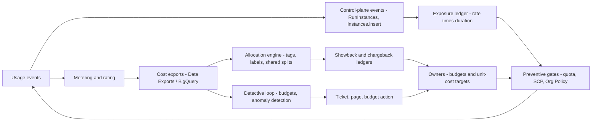

# FinOps Organizational Practices and Automation

## TL;DR

- Cost data is a delayed, restated signal: budgets refresh a few times a day and anomaly detection lags up to about a day (both UNVERIFIED, see Numbers to Know). A budget alarm is therefore a lagging detective control, and its worst-case overshoot is burn rate multiplied by total loop latency.
- Bound exposure with preventive controls that have zero detection latency: quotas, SCP and Org Policy guardrails, tag-on-create enforcement, and an event-driven exposure ledger. Use budgets and anomaly detection only as the backstop behind them.
- Showback is information and chargeback is a transfer price. Chargeback only changes behavior when the price is controllable by the payer, which means allocation rules, commitment attribution, and idle-capacity ownership must be explicit and published.
- Rightsizing automation must be read-only by default and must refuse signals it cannot trust. Examples are missing memory metrics, observation windows shorter than the workload period, and CPU-based advice for accelerator fleets whose real metric is goodput per dollar.
- Anomaly detection is a statistics problem with failure modes: mean and standard deviation mask the very outliers they should catch, seasonality dominates false positives, commitment purchases look like spend spikes, and sustained level shifts are silently absorbed into the baseline unless you track them.

## Mental Model



FinOps is a control system with two feedback paths of very different latency.
The slow path (hours to days) runs through billing: usage is metered, rated against prices and discounts, exported, allocated to owners, and compared against budgets.
The fast path (seconds) runs through the control plane: a launch event is priced at its hourly rate immediately, added to an exposure ledger, and checked against quotas and guardrails before or as capacity is created.
Mature programs put the hard limits on the fast path and use the slow path for attribution, forecasting, and catching what the fast path cannot see, such as per-request pricing, egress, and token billing.
The organizational layer decides who owns each budget, who owns the shared remainder, and what price teams are charged, because the control loop only closes when a human with authority can change the spend.

## Internals

### The cost data plane and its latency chain

Every cloud bill is the output of a pipeline: services emit usage records, a metering layer aggregates them, a rating layer applies list prices, then discount programs, credits, and commitments, and an export layer writes rows.
On AWS the exports are Cost and Usage Report and its successor, AWS Data Exports (CUR 2.0 and a FOCUS-format export), delivered to S3 as Parquet or CSV (AWS docs, as of 2026-10, UNVERIFIED which FOCUS version).
On Google Cloud the exports are the standard usage cost, detailed usage cost, and pricing tables in BigQuery (Google Cloud docs, as of 2026-10).
Three properties of this pipeline matter more than any dashboard:

1. **Latency is stacked.** Usage-to-export lag, then export-to-evaluation lag in the consumer (Budgets, Anomaly Detection, your own job), then notification lag, then human or automated action lag. The sum is the control-loop delay.
2. **Data is restated.** Credits, refunds, support fees, tax, and enterprise discount true-ups land late. On GCP, corrections arrive as additional rows rather than edits (UNVERIFIED), so queries must aggregate, never deduplicate. A detector that reads "yesterday" at 02:00 reads an incomplete day.
3. **Discounts are applied in billing, not at usage time.** A Savings Plan or CUD is a rating-time construct. Two teams running identical instances can show different effective costs depending on where the commitment was applied, which is the root of most chargeback disputes (see below).

The practical rule is to snapshot facts by `(usage_date, as_of_timestamp)` and never overwrite.
Forecast-accuracy measurement, chargeback close, and detector backtests are only reproducible if you can ask what the data looked like on a given day.

### Why a budget alarm is a lagging control

AWS Budgets refreshes up to three times per day, depending on billing data availability (AWS docs, as of 2026-10, UNVERIFIED).
AWS Cost Anomaly Detection can take up to roughly 24 hours after usage occurs to flag an anomaly (AWS docs, as of 2026-10, UNVERIFIED).
Google Cloud budget notifications are published to Pub/Sub on a schedule of multiple updates per day, and Google's own guidance on automated billing shutoff warns that costs can accrue between the event and the notification (Google Cloud docs, as of 2026-10, UNVERIFIED wording).
Define the overshoot bound:

```
overshoot = burn_rate_usd_per_hour * (t_detect + t_notify + t_act)
```

For accelerator fleets the burn rate is large and the product is dominated by `t_detect`.
That is why GPU spend control cannot be a budget-only design.

### The exposure ledger (a mechanism getting-started guides omit)

An exposure ledger moves the cost signal onto the control-plane event stream.
On AWS, an EventBridge rule on EC2 instance state-change events (or CloudTrail `RunInstances`) invokes a function that looks up the hourly rate for the instance type and market (on-demand, Spot, Capacity Block) and does an atomic add to a per-owner `running_rate_usd_per_hour` counter.
A termination event does the atomic subtract.
On Google Cloud the equivalent is a Cloud Audit Logs sink for `compute.instances.insert` and `delete` into Pub/Sub.
The invariant is `exposure_24h(owner) = running_rate(owner) * 24`, which you compare to the owner's daily allowance in seconds, not hours.

Events get lost, duplicated, and reordered, so an event-only ledger drifts.
The fix is the constant-work pattern from [[17-Cloud-AI-Engineering/Volume_01_Cloud_Architecture_Principles/Chapter_05_Constant_Work_and_Workload_Smoothing|Constant Work and Workload Smoothing]].
A reconciler runs on a fixed schedule regardless of event volume, lists all running billable resources, recomputes the rate per owner from scratch, and overwrites the counter.
The event path gives low latency and the reconciler gives correctness, and the reconciler's work does not grow with incident severity.
The ledger prices only rate-based resources.
Per-request and per-token charges, egress, and storage growth still need the billing path.

### Allocation: three stages and where the money leaks

Allocation turns an account-level bill into owner-level costs in three stages:

1. **Direct attribution** by account, project, or folder. This is the cheapest and most robust, and it is why landing-zone design in [[17-Cloud-AI-Engineering/Volume_01_Cloud_Architecture_Principles/Chapter_06_Multi_Account_and_Multi_Project_Landing_Zones|Multi-Account and Multi-Project Landing Zones]] is a FinOps decision.
2. **Attribute-based attribution** by cost allocation tags (AWS) or labels (GCP). Both apply from the moment of activation or attachment, not retroactively (UNVERIFIED for AWS, which announced a tag backfill capability of up to 12 months). GCP labels are stamped onto usage rows at usage time, so a label added later never rewrites history. The only reliable control is tag-on-create enforcement.
3. **Shared-cost distribution**, covering untagged residual, support, networking, observability, and idle capacity.

Shared-cost distribution is where chargeback politics live.
The default proportional rule is `allocated_i = direct_i + shared * direct_i / sum(direct)`.
It is simple and stable, but it punishes the team that tags well and rewards the team that does not.
A usage-driver rule (requests, bytes, GPU-hours) is fairer and more work.
Whatever you choose, publish the rule and report **allocatable percentage** (spend with a valid owner divided by total spend) as the program's first KPI.

AWS Cost Categories support split charge rules (proportional, fixed, even) so shared cost can be distributed inside the AWS tooling (AWS docs, as of 2026-10, UNVERIFIED rule names).

### Kubernetes and GPU allocation

Cloud bills show nodes, not pods.
Pod-level allocation requires a join of node cost with pod resource requests and usage, as in AWS split cost allocation data for EKS and GKE cost allocation (both UNVERIFIED in detail) or OpenCost-style tooling.
The usual pod charge is the greater of request and observed usage, because requested capacity is capacity nobody else can use.
Node cost minus the sum of pod charges is idle, and you must assign idle to someone.
Assigning it to the platform team funds scheduler improvements.
Spreading it to tenants hides the packing problem.

GPUs add two wrinkles.
Whole-device allocation through the device plugin makes GPU-hours integer, so a pod that requests 1 of 8 GPUs and uses 5 percent of it is charged 1/8 of the node.
Time-slicing and MIG make fractions possible but allocation tools may not see them, so reconcile against device-plugin metrics.
See [[17-Cloud-AI-Engineering/Volume_05_Kubernetes_and_Platform_Engineering/Chapter_04_Autoscaling_at_Scale_HPA_KEDA_and_Karpenter|Autoscaling at Scale: HPA, KEDA, and Karpenter]] for how node provisioners must propagate tags or the nodes land untagged.

### Commitment attribution: the chargeback mechanism that breaks naive models

Commitments are rated at the billing-family level.
On AWS, a Savings Plan applies first to the owning account's eligible usage and then, when sharing is enabled, to other accounts in the organization, preferring usage with the highest savings percentage (AWS docs, as of 2026-10, UNVERIFIED).
The CUR exposes effective and unused components as distinct fields: `savingsPlan/SavingsPlanEffectiveCost`, `savingsPlan/UsedCommitment`, and `reservation/EffectiveCost` (UNVERIFIED field names).
Unused commitment is a line item with no consuming workload.
On GCP, spend-based CUD credits appear in the `credits` array of the export rows, and the commitment fee is a separate charge (UNVERIFIED in detail).

Three attribution models exist, and each answers a different question:

| Model | Who pays unused commitment | Behavior it produces |
| --- | --- | --- |
| Pooled effective rate | Everyone, proportionally | Teams see a blended rate and do not optimize individually |
| Consumer-amortized | The payer account, until reallocated | Platform appears to waste money, consumers look cheap |
| Owner-assigned | The team that requested the commitment | Teams hesitate to commit, so coverage falls |

The robust design is: charge consumers the effective committed rate for covered usage, charge the **unused commitment** to a named FinOps pool, and review that pool in the commitment cadence from [[17-Cloud-AI-Engineering/Volume_09_FinOps_and_Cloud_Economics/Chapter_02_Commitment_Discounts_Savings_Plans_vs_CUDs|Commitment Discounts: Savings Plans vs CUDs]].
Unused commitment then has an owner and a target, for example less than 5 percent of commitment dollars.

### Rightsizing mechanics

Rightsizing is a vertical autoscaling problem.
Google's Borg estimates a task's actual reservation from observed usage plus a safety margin and decays it, reclaiming the slack between limit and usage for lower-priority work (Verma et al., Borg, EuroSys 2015).
Google's Autopilot generalizes this with moving-window recommenders over exponentially decayed usage histograms plus an ML recommender, and reports large reductions in slack and out-of-memory events relative to manual limits (Rzadca et al., EuroSys 2020; headline numbers UNVERIFIED, recalled from memory).
Cloud advisors (AWS Compute Optimizer, Google Recommender) implement the same idea at the instance granularity with much coarser windows.
Four properties of those advisors decide whether automation is safe:

1. **Observation window versus workload period.** Compute Optimizer defaults to a 14-day lookback and offers a longer enhanced infrastructure metrics option (UNVERIFIED, see Numbers to Know). A monthly batch job, quarter-end close, or weekly retraining cycle can be entirely invisible to a 14-day window. This is aliasing. Require a window of at least twice the longest period of the workload, or tag long-period workloads as opt-out.
2. **Missing metrics change the answer silently.** EC2 does not publish memory utilization by default, so without the CloudWatch agent the recommendation is based on CPU, network, and EBS signals only (AWS docs, as of 2026-10, UNVERIFIED). The Lambda in the Worked Example refuses to propose when a memory metric is absent.
3. **Peak versus mean.** Advisors protect against peaks. A recommendation that looks conservative for CPU can be aggressive for burstable network or EBS throughput, which is why `performanceRisk` and `platformDifferences` must be gated, not just the savings amount.
4. **In-place change is disruptive.** Resizing a standalone EC2 instance requires stop and start, drops instance store, and may change architecture, hypervisor, or NIC type. Rightsizing belongs at the provisioner (launch template, Karpenter NodePool requirements, instance-group template), not as a mutation of running instances.

For accelerators, CPU rightsizing is the wrong problem.
The relevant metric is goodput per dollar, using the model-FLOPs-utilization framing from [[17-Cloud-AI-Engineering/Volume_09_FinOps_and_Cloud_Economics/Chapter_05_GPU_and_TPU_Unit_Economics|GPU and TPU Unit Economics]].
The commonly reported "GPU utilization" counter (nvidia-smi `utilization.gpu`) measures the fraction of time at least one kernel was resident, so a memory-bound decode loop can show a high value at low arithmetic utilization.
DCGM profiling fields such as `DCGM_FI_PROF_PIPE_TENSOR_ACTIVE` and `DCGM_FI_PROF_DRAM_ACTIVE` describe the roofline position better.
Feed those, plus tokens per second per GPU, into rightsizing decisions.

### Anomaly detection mechanics

AWS Cost Anomaly Detection runs managed ML monitors scoped by AWS service, linked account, cost category, or cost allocation tag, and alerts when a total-impact threshold (absolute, percentage, or both) is crossed (AWS docs, as of 2026-10, UNVERIFIED details).
Google Cloud surfaces cost anomalies in the Billing console (GA status UNVERIFIED).
Managed detectors are a good default.
Understanding why they miss things lets you decide what to build yourself.

- **Masking.** Mean and standard deviation are not robust. An outlier inflates the standard deviation and pulls the mean, which weakens detection of the next outlier. Use median and MAD (median absolute deviation, scaled by 1.4826 to match sigma under normality), which have a 50 percent breakdown point (Hampel, 1974).
- **Seasonality.** Cloud cost has weekly cycles (weekday compute, weekend dips) and a monthly cycle (month-start fees, batch closes). A baseline of "same weekday, previous six weeks" removes most of this. See Hochenbaum et al. (2017) on seasonal hybrid ESD for the generalization.
- **Impact floor.** A z-score alone alerts on a $4 to $40 move on a tiny service. Require robust z, absolute dollars, and relative percentage together.
- **Input choice.** Feed amortized cost. Upfront fees for Savings Plans and RIs book on a single day under unblended cost and look like a spike.
- **Level shifts.** After a real shift (a new 64-node reservation), a robust baseline adapts within weeks. The shift is flagged for a while, then silently becomes normal. You need a registry of acknowledged changes so a sustained step is alerted once, annotated, and then re-based deliberately.

### Org model and cadence

The FinOps Foundation framework organizes the practice into four domains: Understand Usage and Cost, Quantify Business Value, Optimize Usage and Cost, and Manage the FinOps Practice, with capabilities including Allocation, Anomaly Management, Forecasting, Budgeting, Rate Optimization, Workload Optimization, Unit Economics, and Invoicing and Chargeback (FinOps Foundation, as of 2026-10, UNVERIFIED current capability list).
The framework treats scopes (public cloud, AI, SaaS, data center) as lenses on the same capabilities.
The FOCUS specification normalizes billing columns across providers so allocation and anomaly logic can be written once.
Which FOCUS version each provider emits is UNVERIFIED.

A workable operating cadence:

| Cadence | Forum | Decision |
| --- | --- | --- |
| Continuous | Automated gates and alerts | Block, page, or ticket |
| Weekly | Anomaly and tag-coverage review, 30 minutes | Close anomalies, assign tag debt |
| Monthly | Forecast versus actual, unit-cost review | Re-forecast, reset team budgets |
| Quarterly | Commitment and capacity review | Buy, trade, or let expire commitments |
| Annual | Pricing and chargeback model review | Change internal price, quotas, allocation rules |

Foundational reading on how the signal gets processed as alerts is the multi-window, multi-burn-rate approach in the SRE Workbook, which this chapter adapts to billing granularity.
See also [[17-Cloud-AI-Engineering/Volume_07_Reliability_and_SRE/Chapter_01_SLIs_SLOs_and_Error_Budget_Engineering|SLIs, SLOs, and Error Budget Engineering]].

## Numbers to Know

All rows are dated 2026-10.
Web research tooling was unavailable for most of this session, so rows are marked with a status.
"Secondary" means confirmed in this session through a third-party summary of the primary page.
"UNVERIFIED" means recalled and not re-checked against the primary source.

| Quantity | Value | Source and date | Status |
| --- | --- | --- | --- |
| AWS Budgets, action-enabled budgets | First two per month free, then $0.10 per day each | [AWS Cost Management pricing](https://aws.amazon.com/aws-cost-management/pricing/) via secondary summary (usage.ai), as of 2026-10 | Secondary |
| AWS Budgets report delivery | $0.01 per report | Same | Secondary |
| Cost Explorer API | $0.01 per request on the primary billing view | Same | Secondary |
| AWS Budgets refresh cadence | Up to 3 times per day | [AWS Budgets docs](https://docs.aws.amazon.com/cost-management/latest/userguide/budgets-managing-costs.html), as of 2026-10 | UNVERIFIED |
| Alerts per budget | This chapter uses 5; the platform maximum is not confirmed | AWS docs, as of 2026-10 | UNVERIFIED |
| Cost Anomaly Detection latency | Up to about 24 hours after usage | [AWS docs](https://docs.aws.amazon.com/cost-management/latest/userguide/manage-ad.html), as of 2026-10 | UNVERIFIED |
| Cost Anomaly Detection price | No additional charge | AWS docs, as of 2026-10 | UNVERIFIED |
| Cost Explorer data freshness | At least once per 24 hours | AWS docs, as of 2026-10 | UNVERIFIED |
| Compute Optimizer lookback | 14 days default; up to 93 days with paid enhanced infrastructure metrics | [AWS docs](https://docs.aws.amazon.com/compute-optimizer/latest/ug/what-is-compute-optimizer.html), as of 2026-10 | UNVERIFIED |
| Compute Optimizer Lambda minimum | 50 invocations in the lookback window | AWS docs, as of 2026-10 | UNVERIFIED |
| Lambda price (x86) | $0.0000166667 per GB-second, $0.20 per million requests | AWS pricing, as of 2026-10 | UNVERIFIED |
| p5.48xlarge shape and price | 8 H100 GPUs, 192 vCPU, roughly $55 per hour on-demand in us-east-1 after the 2025 price reduction | AWS pricing, as of 2026-10 | UNVERIFIED, used as illustrative rate |
| m6i.xlarge and m6i.2xlarge | $0.192 and $0.384 per hour on-demand, us-east-1 | AWS pricing, as of 2026-10 | UNVERIFIED |
| GCP budget semantics | Thresholds on current or forecasted spend, Pub/Sub programmatic notifications, no hard spend cap | [Google Cloud budgets docs](https://cloud.google.com/billing/docs/how-to/budgets), as of 2026-10 | UNVERIFIED |
| GCP billing export | Standard usage cost, detailed usage cost, and pricing tables in BigQuery; no export of history before enablement | [Google Cloud docs](https://cloud.google.com/billing/docs/how-to/export-data-bigquery), as of 2026-10 | UNVERIFIED |

Derived numbers used in the Worked Example (arithmetic checked by script, inputs as above):

| Quantity | Formula | Result |
| --- | --- | --- |
| 8-node burn rate | 8 x $55 | $440 per hour |
| 64-node burn rate | 64 x $55 | $3,520 per hour, $84,480 per day |
| 64-node overshoot at 8 h, 24 h, 36 h | rate x latency | $28,160, $84,480, $126,720 |
| 8-node overshoot at 8 h, 24 h, 36 h | rate x latency | $3,520, $10,560, $15,840 |
| 8-node vCPU quota | 8 x 192 | 1,536 vCPUs |
| Budget of $250,000 in node-hours | 250,000 / 55 | 4,545 node-hours, 77.8 percent duty on 8 nodes x 730 h |
| Burn rate of $5,000 in 24 h on a $20,000 monthly budget | 5,000 / (20,000 x 24 / 720) | 7.5x |
| Budget consumed by sustained burn rate r over window w in a period P | r x w / P | 8x for 1 day of 30 is 26.7 percent |

## AWS vs GCP Mechanism Parity

| Mechanism | AWS | Google Cloud | Critical difference |
| --- | --- | --- | --- |
| Cost data export | Data Exports (CUR 2.0, FOCUS-format) to S3 | Standard and detailed export to BigQuery | GCP is queryable in place with SQL. AWS needs Athena or a warehouse. FOCUS version support is UNVERIFIED on both. |
| Hierarchy for direct attribution | Accounts and OUs, cost categories | Billing accounts, folders, projects | Both make the account or project the most reliable owner key. |
| Attribute attribution | Cost allocation tags, must be activated | Labels, stamped on usage rows at usage time | Neither rewrites history reliably. Enforce at creation. |
| Budget evaluation | Budgets, up to 3 refreshes per day (UNVERIFIED) | Budgets, multiple updates per day (UNVERIFIED) | Both lag. Neither is a real-time control. |
| Forecast-based alerts | FORECASTED notification type | Forecasted spend basis | Forecast needs history (AWS needs several weeks, UNVERIFIED), so new accounts get no forecast alerts. |
| Programmatic reaction | Budget actions (apply IAM or SCP policy, stop EC2 or RDS) and SNS | Pub/Sub message to a function | AWS has native actions. GCP requires you to write the handler. |
| Hard spend cap | None; budgets notify | None; the documented workaround detaches billing from the project | GCP's workaround can stop or destroy resources and is an availability risk. |
| Anomaly detection | Cost Anomaly Detection monitors and subscriptions | Cost anomalies in Billing console (UNVERIFIED GA) | Build your own on BigQuery or Data Exports when you need custom seasonality or ownership routing. |
| Rightsizing advisor | Compute Optimizer, Cost Optimization Hub | Recommender (machine type, idle VM) | Both rely on windows measured in days. GCP and AWS differ on memory visibility, so check agent presence. |
| Commitments | Savings Plans and RIs, shared across the billing family | Flexible and resource-based CUDs, credits in export rows | Unused-commitment attribution differs in the data model (UNVERIFIED), so build one ledger per cloud and normalize. |
| Kubernetes allocation | Split cost allocation data for EKS (UNVERIFIED) | GKE cost allocation and usage metering | Both depend on cluster-level opt-in and consistent node labels. |
| Preventive guardrails | SCP, tag policies, Service Quotas | Org Policy, IAM Deny, quotas | See [[17-Cloud-AI-Engineering/Volume_02_AWS_Deep_Dive/Chapter_01_IAM_Policy_Evaluation_Engine\|IAM Policy Evaluation Engine]] and [[17-Cloud-AI-Engineering/Volume_03_GCP_Deep_Dive/Chapter_01_Resource_Hierarchy_and_Organization_Policies\|Resource Hierarchy and Organization Policies]]. Quotas are the only zero-latency spend ceiling on both. |

## Worked Example: A Budget, Anomaly, and Rightsizing Stack for a GPU Team

### Scenario and capacity arithmetic

The ML platform team has a quota for 8 GPU nodes of the p5.48xlarge shape and a monthly budget of $250,000.
Illustrative rate: $55 per node-hour (UNVERIFIED, replace with the current price).

1. Full-time cost of 8 nodes is 8 x 730 x $55 = $321,200 per month, so the $250,000 budget implies 77.8 percent duty.
2. Daily allowance is $250,000 / 30 = $8,333, and the daily-burn guard fires at 3x, which is $25,000 per day.
3. A mistaken launch of 64 nodes burns $84,480 per day, or 10.1x the daily allowance. The daily budget catches it but only after the billing lag. At 24 hours of loop latency the overshoot is $84,480.
4. A vCPU quota of 1,536 (8 x 192) caps exposure at $440 per hour, or $10,560 per day, with zero detection latency. The same 24-hour loop latency now costs at most $10,560.
5. Rightsizing sizing for the general-purpose fleet: 200 m6i.2xlarge instances, 60 percent overprovisioned by one step. Moving 120 instances to m6i.xlarge saves 120 x ($0.384 - $0.192) x 730 = $16,819 per month (UNVERIFIED prices). The $25 per month savings floor in the Lambda filters noise, not meaningful savings.

### Cost estimate

| Item | Estimate |
| --- | --- |
| Two Budgets (not action-enabled) | Free (Budgets monitoring and notifications are free per the pricing summary above) |
| Cost Anomaly Detection | No additional charge (UNVERIFIED) |
| Compute Optimizer basic recommendations | No additional charge (UNVERIFIED). Do not enable the paid enhanced metrics for this lab. |
| Lambda, 1 run per week, 256 MB, about 10 s | About 2.5 GB-s per run, about $0.00004 per run, inside the free tier |
| SNS email | Negligible |
| Detector job on Cost Explorer | A few paginated requests at $0.01 each, so $0.01 to $0.10 per run |
| **Total** | **Under $1 per month** |

### OpenTofu: budgets, anomaly detection, SNS, and the read-only rightsizing Lambda

Save the Python modules from this section next to the OpenTofu file.
`rightsizing_lambda.py` is listed below.
`finops_core.py` is listed after it, with its tested behavior.

```hcl
terraform {
  required_version = ">= 1.6"
  required_providers {
    aws     = { source = "hashicorp/aws", version = ">= 5.40" }
    archive = { source = "hashicorp/archive", version = ">= 2.4" }
  }
}

# Budgets, Cost Explorer and Anomaly Detection are served from us-east-1.
# Compute Optimizer is regional: deploy one Lambda per region you want covered.
provider "aws" { region = "us-east-1" }

variable "alert_email" { type = string }
variable "team" {
  type    = string
  default = "ml-platform"
}
variable "monthly_limit_usd" {
  type    = number
  default = 250000
}

resource "aws_sns_topic" "finops" { name = "finops-alerts" }

data "aws_iam_policy_document" "sns" {
  statement {
    sid       = "AllowBillingServices"
    actions   = ["SNS:Publish"]
    resources = [aws_sns_topic.finops.arn]
    principals {
      type        = "Service"
      identifiers = ["budgets.amazonaws.com", "costalerts.amazonaws.com"]
    }
  }
}

resource "aws_sns_topic_policy" "finops" {
  arn    = aws_sns_topic.finops.arn
  policy = data.aws_iam_policy_document.sns.json
}

resource "aws_sns_topic_subscription" "email" {
  topic_arn = aws_sns_topic.finops.arn
  protocol  = "email"
  endpoint  = var.alert_email
}

# Monthly budget scoped by an ACTIVATED cost allocation tag. Filter format is "user:<key>$<value>".
resource "aws_budgets_budget" "team_monthly" {
  name         = "team-${var.team}-monthly"
  budget_type  = "COST"
  limit_amount = tostring(var.monthly_limit_usd)
  limit_unit   = "USD"
  time_unit    = "MONTHLY"

  cost_filter {
    name   = "TagKeyValue"
    values = [format("user:cost-center$%s", var.team)]
  }

  dynamic "notification" {
    for_each = [
      { t = 50, type = "ACTUAL" },
      { t = 80, type = "ACTUAL" },
      { t = 100, type = "ACTUAL" },
      { t = 100, type = "FORECASTED" },
      { t = 120, type = "FORECASTED" },
    ]
    content {
      comparison_operator       = "GREATER_THAN"
      threshold                 = notification.value.t
      threshold_type            = "PERCENTAGE"
      notification_type         = notification.value.type
      subscriber_sns_topic_arns = [aws_sns_topic.finops.arn]
    }
  }
}

# Daily burn guard: 3x the daily allowance. This is the lab's budget alarm snippet.
resource "aws_budgets_budget" "team_daily_burn" {
  name         = "team-${var.team}-daily-3x"
  budget_type  = "COST"
  limit_amount = tostring(ceil(var.monthly_limit_usd / 30 * 3))
  limit_unit   = "USD"
  time_unit    = "DAILY"

  cost_filter {
    name   = "TagKeyValue"
    values = [format("user:cost-center$%s", var.team)]
  }

  notification {
    comparison_operator       = "GREATER_THAN"
    threshold                 = 100
    threshold_type            = "PERCENTAGE"
    notification_type         = "ACTUAL"
    subscriber_sns_topic_arns = [aws_sns_topic.finops.arn]
  }
}

resource "aws_ce_anomaly_monitor" "by_service" {
  name              = "by-service"
  monitor_type      = "DIMENSIONAL"
  monitor_dimension = "SERVICE"
}

resource "aws_ce_anomaly_subscription" "immediate" {
  name             = "finops-immediate"
  frequency        = "IMMEDIATE"
  monitor_arn_list = [aws_ce_anomaly_monitor.by_service.arn]

  subscriber {
    type    = "SNS"
    address = aws_sns_topic.finops.arn
  }

  threshold_expression {
    dimension {
      key           = "ANOMALY_TOTAL_IMPACT_ABSOLUTE"
      match_options = ["GREATER_THAN_OR_EQUAL"]
      values        = ["500"]
    }
  }
  depends_on = [aws_sns_topic_policy.finops]
}

data "archive_file" "fn" {
  type        = "zip"
  source_file = "${path.module}/rightsizing_lambda.py"
  output_path = "${path.module}/rightsizing.zip"
}

data "aws_iam_policy_document" "assume" {
  statement {
    actions = ["sts:AssumeRole"]
    principals {
      type        = "Service"
      identifiers = ["lambda.amazonaws.com"]
    }
  }
}

resource "aws_iam_role" "fn" {
  name               = "finops-rightsizing-readonly"
  assume_role_policy = data.aws_iam_policy_document.assume.json
}

resource "aws_iam_role_policy_attachment" "logs" {
  role       = aws_iam_role.fn.name
  policy_arn = "arn:aws:iam::aws:policy/service-role/AWSLambdaBasicExecutionRole"
}

data "aws_iam_policy_document" "fn" {
  statement {
    actions   = ["compute-optimizer:GetEC2InstanceRecommendations"]
    resources = ["*"] # no resource-level scoping is offered for this action (UNVERIFIED)
  }
  statement {
    actions   = ["sns:Publish"]
    resources = [aws_sns_topic.finops.arn]
  }
}

resource "aws_iam_role_policy" "fn" {
  role   = aws_iam_role.fn.id
  policy = data.aws_iam_policy_document.fn.json
}

resource "aws_lambda_function" "rightsize" {
  function_name    = "finops-rightsizing-report"
  role             = aws_iam_role.fn.arn
  runtime          = "python3.12"
  handler          = "rightsizing_lambda.handler"
  filename         = data.archive_file.fn.output_path
  source_code_hash = data.archive_file.fn.output_base64sha256
  timeout          = 120
  memory_size      = 256
  environment {
    variables = {
      TOPIC_ARN            = aws_sns_topic.finops.arn
      MAX_PERF_RISK        = "1.0"
      MIN_MONTHLY_SAVINGS  = "25"
    }
  }
}

resource "aws_cloudwatch_event_rule" "weekly" {
  name                = "finops-rightsizing-weekly"
  schedule_expression = "cron(0 13 ? * MON *)"
}

resource "aws_cloudwatch_event_target" "weekly" {
  rule = aws_cloudwatch_event_rule.weekly.name
  arn  = aws_lambda_function.rightsize.arn
}

resource "aws_lambda_permission" "events" {
  statement_id  = "AllowEventBridge"
  action        = "lambda:InvokeFunction"
  function_name = aws_lambda_function.rightsize.function_name
  principal     = "events.amazonaws.com"
  source_arn    = aws_cloudwatch_event_rule.weekly.arn
}
```

### The Lambda: guardrails before proposals

```python
"""Read-only rightsizing recommender. Never mutates infrastructure.
Reads AWS Compute Optimizer EC2 recommendations, applies guardrails, publishes a JSON report to SNS."""
import json
import os

ACCEL_PREFIXES = ("p", "g", "trn", "inf", "dl")
MAX_PERF_RISK = float(os.environ.get("MAX_PERF_RISK", "1.0"))
MIN_MONTHLY_SAVINGS = float(os.environ.get("MIN_MONTHLY_SAVINGS", "25"))
ALLOWED_PLATFORM_DIFFS = set(filter(None, os.environ.get("ALLOWED_PLATFORM_DIFFS", "").split(",")))
SKIP_TAG = os.environ.get("SKIP_TAG", "finops:rightsize")


def _family(instance_type):
    return instance_type.split(".")[0]


def _tags(rec):
    return {t.get("key"): t.get("value") for t in rec.get("tags", [])}


def evaluate(rec):
    """Return (decision, reason, option) for one instance recommendation."""
    cur = rec.get("currentInstanceType", "")
    if _tags(rec).get(SKIP_TAG) == "skip":
        return "skip", "opt-out tag", None
    if _family(cur).startswith(ACCEL_PREFIXES):
        return "review", "accelerator instance: CPU/memory rightsizing is not a valid signal", None
    metric_names = {m.get("name") for m in rec.get("utilizationMetrics", [])}
    if "MEMORY" not in metric_names:
        return "review", "no memory metric (CloudWatch agent absent): recommendation is CPU/network/EBS only", None
    opts = sorted(rec.get("recommendationOptions", []), key=lambda o: o.get("rank", 99))
    if not opts:
        return "skip", "no options", None
    top = opts[0]
    if top.get("performanceRisk", 4) > MAX_PERF_RISK:
        return "skip", "performance risk %.1f above limit" % top.get("performanceRisk", 4), top
    diffs = set(top.get("platformDifferences", []))
    if diffs - ALLOWED_PLATFORM_DIFFS:
        return "review", "platform differences: " + ",".join(sorted(diffs)), top
    sv = top.get("savingsOpportunity", {}).get("estimatedMonthlySavings", {}).get("value", 0.0)
    if sv < MIN_MONTHLY_SAVINGS:
        return "skip", "savings %.2f below floor" % sv, top
    return "propose", "ok", top


def build_report(client):
    kwargs = {"filters": [{"name": "Finding", "values": ["Overprovisioned"]}], "maxResults": 100}
    report = {"propose": [], "review": [], "skipped": 0}
    while True:
        resp = client.get_ec2_instance_recommendations(**kwargs)
        for rec in resp.get("instanceRecommendations", []):
            decision, reason, top = evaluate(rec)
            if decision == "skip":
                report["skipped"] += 1
                continue
            item = {"arn": rec["instanceArn"], "from": rec["currentInstanceType"], "reason": reason}
            if top:
                item["to"] = top["instanceType"]
                item["risk"] = top.get("performanceRisk")
                item["monthly_savings_usd"] = top.get("savingsOpportunity", {}).get("estimatedMonthlySavings", {}).get("value")
            report[decision].append(item)
        token = resp.get("nextToken")
        if not token:
            return report
        kwargs["nextToken"] = token


def handler(event, context):
    import boto3  # imported lazily so build_report is testable without boto3
    co = boto3.client("compute-optimizer")
    report = build_report(co)
    total = sum(i.get("monthly_savings_usd") or 0 for i in report["propose"])
    report["total_proposed_monthly_savings_usd"] = round(total, 2)
    boto3.client("sns").publish(TopicArn=os.environ["TOPIC_ARN"], Subject="FinOps rightsizing report",
                                Message=json.dumps(report, indent=2)[:250000])
    return {"proposed": len(report["propose"]), "review": len(report["review"])}
```

I ran `build_report` against a fake client returning seven recommendations over two pages.
One was proposed.
One accelerator instance and one instance with no memory metric were routed to review, as was one with an architecture change.
Three were skipped for high risk, the opt-out tag, and sub-floor savings.
The response field names (`instanceRecommendations`, `recommendationOptions`, `performanceRisk`, `platformDifferences`, `savingsOpportunity`) and the `MEMORY` metric name are recalled from the Compute Optimizer API reference and are UNVERIFIED against live responses.
Run the Lambda once against a real account and inspect the raw payload before trusting the filter.

### The detector and burn-rate math (`finops_core.py`)

```python
"""Pure functions: burn-rate math, exposure overshoot, robust seasonal anomaly detection. No cloud calls."""
from statistics import median


def burn_rate(spend_in_window, window_hours, budget, period_hours):
    """Multiples of the 'on-budget' spend rate observed in the window."""
    allowed = budget * (window_hours / period_hours)
    return spend_in_window / allowed if allowed > 0 else float("inf")


def overshoot_usd(nodes, usd_per_node_hour, detect_h, notify_h=0.0, act_h=0.0):
    """Spend that accrues between onset and effective control action."""
    return nodes * usd_per_node_hour * (detect_h + notify_h + act_h)


def _mad_scale(xs):
    m = median(xs)
    return 1.4826 * median([abs(x - m) for x in xs])


def robust_seasonal_anomalies(series, season=7, weeks=6, z=4.0, min_abs=200.0, min_pct=0.15, floor_pct=0.03):
    """series: list of daily costs, oldest first.
    Baseline for day t = median of the same weekday over the previous `weeks` weeks.
    Scale = 1.4826 * MAD of historical residuals (same baseline rule), floored at floor_pct * baseline.
    Flags only if robust z, absolute impact and percentage impact all exceed thresholds."""
    out = []
    n = len(series)
    need = season * weeks
    for t in range(need, n):
        hist = [series[t - season * k] for k in range(1, weeks + 1)]
        base = median(hist)
        resid = []
        for u in range(t - need + season * 1, t):
            h = [series[u - season * k] for k in range(1, weeks + 1) if u - season * k >= 0]
            if len(h) >= 3:
                resid.append(series[u] - median(h))
        if len(resid) < 10:
            continue
        scale = max(_mad_scale(resid), floor_pct * base)
        impact = series[t] - base
        zscore = impact / scale
        if zscore >= z and impact >= min_abs and impact >= min_pct * base:
            out.append({"index": t, "actual": series[t], "expected": base, "impact": impact, "z": round(zscore, 1)})
    return out


def classify(flags, persist_days=3, tol=0.25):
    """Group consecutive flags. Persistent same-magnitude runs are 'level_shift', others 'spike'."""
    groups, cur = [], []
    for f in flags:
        if cur and f["index"] == cur[-1]["index"] + 1:
            cur.append(f)
        else:
            if cur:
                groups.append(cur)
            cur = [f]
    if cur:
        groups.append(cur)
    res = []
    for g in groups:
        imp = [x["impact"] for x in g]
        steady = len(g) >= persist_days and (max(imp) - min(imp)) <= tol * max(imp)
        res.append({"start": g[0]["index"], "days": len(g), "kind": "level_shift" if steady else "spike",
                    "mean_impact": round(sum(imp) / len(imp), 1)})
    return res
```

Feed it amortized daily cost per service.
On AWS the input comes from `ce.get_cost_and_usage(Granularity="DAILY", Metrics=["AmortizedCost"], GroupBy=[{"Type":"DIMENSION","Key":"SERVICE"}])`, following `NextPageToken`, at $0.01 per request (secondary source above).
On GCP the input comes from BigQuery:

```sql
SELECT DATE(usage_start_time) AS d,
       service.description AS svc,
       SUM(cost) + SUM(IFNULL((SELECT SUM(c.amount) FROM UNNEST(credits) c), 0)) AS net_cost
FROM `PROJECT.DATASET.gcp_billing_export_v1_BILLING_ACCOUNT_ID`
WHERE usage_start_time >= TIMESTAMP_SUB(CURRENT_TIMESTAMP(), INTERVAL 60 DAY)
GROUP BY d, svc
ORDER BY svc, d;
```

Exclude the most recent day, or the most recent two days, because of restatement lag.

I tested the detector on a synthetic 120-day series with a weekday cycle, 3 percent noise, a one-day $900 spike on day 60, and a sustained $500 per day step starting on day 85.
It flagged the spike with a robust z of 30 and classified it as a spike.
It flagged the step for 14 consecutive days and classified it as a level shift, then stopped flagging it as the residual history absorbed the shift.
A trailing-30-day mean and standard deviation detector at z of 3 flagged only the spike on that series.
This is a synthetic result and not a benchmark, but it shows both effects: weekly seasonality inflates the plain standard deviation, and a robust baseline eventually normalizes a persistent step.
The absorbed step is the reason for the level-shift registry.

### GCP counterpart (gcloud)

```bash
export BILLING_ACCOUNT=XXXXXX-XXXXXX-XXXXXX
export PROJECT=my-finops-lab
gcloud pubsub topics create finops-budget-alerts --project="$PROJECT"
gcloud billing budgets create \
  --billing-account="$BILLING_ACCOUNT" \
  --display-name="ml-platform-monthly" \
  --budget-amount=250000USD \
  --filter-projects="projects/$PROJECT" \
  --threshold-rule=percent=0.5 \
  --threshold-rule=percent=0.8 \
  --threshold-rule=percent=1.0 \
  --threshold-rule=percent=1.0,basis=forecasted-spend \
  --notifications-rule-pubsub-topic="projects/$PROJECT/topics/finops-budget-alerts"
```

Flag spellings are recalled from the gcloud reference and UNVERIFIED, so run `gcloud billing budgets create --help` first.
Cost is zero.
The budget publishes `costAmount`, `budgetAmount`, `alertThresholdExceeded`, and `forecastThresholdExceeded` fields on the Pub/Sub message (UNVERIFIED field list).

### Run and verify

```bash
aws ce update-cost-allocation-tags-status --cost-allocation-tags-status TagKey=cost-center,Status=Active
aws compute-optimizer update-enrollment-status --status Active --region us-east-1
tofu init && tofu apply -var alert_email=you@example.com
aws lambda invoke --function-name finops-rightsizing-report /tmp/out.json && cat /tmp/out.json
```

Tag activation can take up to about a day to appear in Budgets filters and Cost Explorer (UNVERIFIED), and a budget filtered on an inactive tag will show zero spend.
Confirm the SNS email subscription, or alerts go nowhere.

### Teardown

```bash
tofu destroy -auto-approve
aws ce update-cost-allocation-tags-status --cost-allocation-tags-status TagKey=cost-center,Status=Inactive
aws compute-optimizer update-enrollment-status --status Inactive --region us-east-1
# GCP, if created:
gcloud billing budgets list --billing-account="$BILLING_ACCOUNT"
gcloud billing budgets delete BUDGET_ID --billing-account="$BILLING_ACCOUNT"
gcloud pubsub topics delete finops-budget-alerts --project="$PROJECT"
```

## Failure Modes and Pitfalls

1. **Budget-only control on accelerator fleets.** With a $3,520 per hour fleet and a 24-hour loop, the overshoot is $84,480 before any alert has a chance to be acted on. Cap the quota, gate instance types by SCP or Org Policy, and use pre-purchased capacity (Capacity Blocks or reservations) where cost is fixed at purchase.
2. **Budget actions that do not stop the spend.** An IAM-deny action does not stop running resources. A stop-instances action will not hold against a node provisioner such as Karpenter or an Auto Scaling group that relaunches capacity. Act on the provisioner (set NodePool limits, scale desired capacity to zero), not only on instances.
3. **The GCP billing-detach kill switch.** Detaching billing from a project can stop services and may delete resources, and recovery is not always clean. Google's own documentation positions it as a last resort with delay caveats (Google Cloud docs, as of 2026-10, UNVERIFIED wording). Use it for sandbox projects only.
4. **Tag drift and the untagged tax.** Tags applied after creation do not rewrite history. Node provisioners must propagate tags (for Karpenter this is `spec.tags` on the node class, UNVERIFIED field), launch templates must carry them, and an SCP condition on `aws:RequestTag` or a GCP label constraint should deny creation without an owner key (support varies by resource type, UNVERIFIED). When untagged spend sits at 25 percent of the bill, proportional redistribution quietly shifts a quarter of the bill onto the best-behaved teams.
5. **Commitment purchase as a false anomaly.** Upfront Savings Plan fees book on one day. Detect on amortized cost, or register a known-change annotation before the purchase.
6. **Alert fatigue and silent absorption.** A $100 absolute threshold on a multi-million-dollar bill pages weekly. A robust baseline then absorbs a real, sustained step within about two weeks. The ack registry is the fix, and so is a weekly review that looks at stepped services even when no alert fired.
7. **Rightsizing outage.** Typical causes are missing memory metrics (a database sized on CPU alone), a 14-day window missing a monthly batch, a burstable network or EBS baseline that the new size cannot sustain, and instance-store loss on stop and start. Every one is a gate in the Lambda or a reason to move change into the provisioner with a canary.
8. **Automation coupled to a degraded control plane.** In the October 2025 us-east-1 event, a DNS failure in DynamoDB cascaded to EC2 launch and network health systems (AWS post-event summary at [aws.amazon.com/message/101925](https://aws.amazon.com/message/101925/), as of 2026-10, UNVERIFIED details). Automation that terminates or resizes accelerator capacity during or after such an event can strand capacity that is hard to re-acquire. Exclude GPU capacity from auto-remediation and see [[17-Cloud-AI-Engineering/Volume_07_Reliability_and_SRE/Chapter_07_Anatomy_of_Major_Cloud_Outages|Anatomy of Major Cloud Outages]]. I know of no public post-incident review dedicated to FinOps automation failures, so treat anecdotes about runaway bills as unaudited.
9. **Chargeback gaming.** Teams move workloads into shared accounts, shave tags, or time purchases to dodge allocation. Counter with automated allocation, a published rule set, and finance sign-off on changes to the rules.
10. **Forecast gaps for new accounts.** Forecast-based alerts need history, so a new project gets only actual-based alerts, which is exactly when a mistake is most likely.

## Security and Cost Angles

### IAM scoping

- The rightsizing Lambda needs only `compute-optimizer:GetEC2InstanceRecommendations` and `sns:Publish` on one topic. If you add an apply path, put it in a separate role with `ec2:ModifyInstanceAttribute` and tag conditions, behind a human approval step (see [[17-Cloud-AI-Engineering/Volume_06_Infrastructure_as_Code_and_Delivery/Chapter_04_Policy_as_Code_OPA_Sentinel_and_Guardrails|Policy as Code: OPA, Sentinel, and Guardrails]]).
- Cost Explorer and billing actions are account-level, not resource-level, and billing data reveals launch plans and customer volumes. Grant billing read in a dedicated role, restrict it to the management or delegated account, and share subsets through billing views or BigQuery authorized views instead of broad billing roles (billing-view availability UNVERIFIED).
- Budget actions assume an execution role. Scope it to the specific policy ARN it attaches or the specific instances it stops.
- On GCP, separate Billing Account Viewer and Costs Manager style roles from Billing Account Administrator (role names UNVERIFIED), and give the Pub/Sub handler only the narrow permission to detach, if you use that path at all.

### Encryption and boundaries

- If the alert topic uses SSE-KMS, use a customer managed key and allow `budgets.amazonaws.com` and `costalerts.amazonaws.com` in the key policy. The AWS managed SNS key does not allow other services to use it, so alerts would fail silently (AWS docs, as of 2026-10, UNVERIFIED).
- The export bucket needs a bucket policy for the billing export service principal. Add `aws:SourceArn` and `aws:SourceAccount` conditions against confused-deputy writes (service principal name UNVERIFIED).
- BigQuery billing datasets can use CMEK and VPC Service Controls. Billing export writers are Google-managed, so test the export path after adding a perimeter.
- For tag-on-create enforcement across the organization, see the data perimeter patterns in [[17-Cloud-AI-Engineering/Volume_08_Security_Identity_and_the_Data_Perimeter/Chapter_06_Constructing_an_Impenetrable_Data_Perimeter|Constructing an Impenetrable Data Perimeter]].

### Unit-economics levers

- Attach tag keys for team, service, environment, and for AI workloads model or endpoint. Without a model key you cannot compute cost per million tokens or per successful request, the metrics defined in [[17-Cloud-AI-Engineering/Volume_09_FinOps_and_Cloud_Economics/Chapter_05_GPU_and_TPU_Unit_Economics|GPU and TPU Unit Economics]].
- Spot and preemptible usage is a lever with a restart tax, covered in [[17-Cloud-AI-Engineering/Volume_09_FinOps_and_Cloud_Economics/Chapter_03_Spot_Economics_and_Interruption_Handling|Spot Economics and Interruption Handling]].
- Network egress is billed per byte and invisible to rightsizing. Use the allocation views from [[17-Cloud-AI-Engineering/Volume_09_FinOps_and_Cloud_Economics/Chapter_04_Network_Egress_Economics_and_Optimization|Network Egress Economics and Optimization]].
- Billing semantics and the meaning of effective versus list cost are in [[17-Cloud-AI-Engineering/Volume_09_FinOps_and_Cloud_Economics/Chapter_01_Cloud_Billing_Models_and_Unit_Cost_Allocation|Cloud Billing Models and Unit Cost Allocation]].
- The measure of the program is the trend of unit cost, not the monthly total. A rising bill with falling cost per token is success.

## Interview Questions and Model Answers

### Question 1 (L5 - Senior)

A team runs a GPU training workload on AWS with a $250,000 monthly budget. Configure budget alerts and explain what they do and do not protect against.

#### Model Answer

Create a monthly cost budget scoped by an activated cost allocation tag, with actual alerts at 50, 80, and 100 percent and forecast alerts at 100 and 120 percent.
Actual alerts tell you how much has been spent.
Forecast alerts tell you where the trajectory lands, and they fire earlier but need history.
Add a daily budget at 3x the daily allowance to catch a step change inside a month.
Route alerts to SNS and a ticketing system, with the 100 percent and daily alerts paging.

What this does not protect against is speed.
Budgets refresh up to three times per day and the underlying billing data lags (AWS docs, UNVERIFIED), so an 8-node fleet at about $440 per hour can burn $10,560 across a 24-hour loop, and a mistaken 64-node launch $84,480.
The bound is `burn_rate * loop_latency`, so I would add a vCPU quota matching the approved node count (8 x 192 = 1,536), an SCP restricting GPU instance families to a specific launch role, and tag-on-create enforcement.
Budget alerts then become the backstop for what quotas cannot see: egress, storage growth, and per-request pricing.

#### Follow-up Interviewer Question

The quota stops the over-launch but a legitimate 12-node burst is blocked at 2 a.m. How does the process work without a human in the loop for every request?

### Question 2 (L5 - Senior)

Explain showback versus chargeback and when you would choose each.

#### Model Answer

Showback reports cost to owners without moving money.
Chargeback transfers the cost into the owner's P&L through an internal price.
Showback is cheap, has low political risk, and works when teams have budgets they genuinely manage, but it has no consequence if ignored.
Chargeback creates incentives and also creates accounting overhead, disputes over allocation rules, and gaming.

I choose showback first for anything with unstable allocation, which usually means untagged or shared spend.
I move specific cost pools to chargeback once three conditions hold.
Allocatable percentage is above roughly 90 percent.
The payer can actually control the usage driver.
Finance agrees on the rules.
GPU capacity is the first candidate because it is scarce, large, and attributable.
Shared platform overhead often stays showback, or is distributed by a published driver, because charging teams for platform cost they cannot influence breeds resentment.

#### Follow-up Interviewer Question

Your showback report is 70 percent allocatable. What is the cheapest path to 90 and what do you do with the remaining 30 percent in the meantime?

### Question 3 (L6 - Staff)

You operate a shared EKS cluster with 128 GPUs serving 14 teams. Design the cost allocation, including idle and untagged spend.

#### Model Answer

Cloud billing sees nodes, so allocation needs a join of node cost with pod data.
The charge for a pod is the greater of its request and observed usage, because requested capacity is unavailable to others.
For GPUs, whole-device allocation makes the unit device-hours, and I would reconcile against device-plugin metrics, because MIG and time-slicing hide fractions from allocation tooling.
Node cost minus the sum of pod charges is idle.

I would not spread idle across tenants by default.
That hides the bin-packing problem.
Idle goes to the platform team's cost pool with a target (say under 15 percent of GPU-hours), and tenants pay for what they reserved.
Reservations beyond quota are priced higher to discourage hoarding.
Untagged cost is handled upstream: node provisioners propagate tags, namespaces carry owner labels enforced by admission policy, and allocation fails closed by routing unattributed pods to a named "unowned" pool visible on the dashboard.
I would measure allocatable percentage weekly.

Accuracy matters less than stability and publication.
The rule is documented, versioned, and changed only at quarter boundaries, so numbers do not shift mid-quarter.
I would validate the model quarterly by reconciling the sum of allocations to the invoice within 1 to 2 percent.

#### Follow-up Interviewer Question

Two tenants share a MIG-partitioned GPU, and one of them runs a memory-bound decode workload that looks idle by SM metrics. How does your charge model avoid penalizing or subsidizing it?

### Question 4 (L6 - Staff)

Design anomaly detection for cloud and AI spend. Why not just use mean plus three sigma?

#### Model Answer

Mean and standard deviation are not robust.
A single outlier inflates sigma and shifts the mean, so the next outlier is under-flagged (masking), and weekly seasonality inflates sigma so real anomalies look normal.
I would use a seasonal baseline (median of the same weekday over the prior six weeks) and a scale from the median absolute deviation, scaled by 1.4826.
An alert requires three conditions together: robust z above about 4, absolute impact above a dollar floor, and percentage impact above a relative floor, so tiny services do not page.

Inputs matter as much as the math.
Use amortized net cost so upfront commitment fees do not look like spikes.
Read data at T+2 to avoid restatement artifacts.
Run per service and per owner as well as in aggregate, because aggregation dilutes a $20,000 anomaly inside a $2 million total.

Then handle level shifts.
A robust baseline absorbs a sustained step within a couple of weeks.
In a synthetic test I ran, a persistent step was flagged for 14 days and then silently became normal, while a trailing mean and sigma detector missed it altogether.
So I classify runs of consistent magnitude as level shifts, alert once, require an owner to acknowledge, and store a change annotation.
I would use AWS Cost Anomaly Detection as the default managed layer because it costs nothing extra (UNVERIFIED) and covers all services, and add the custom detector where I need ownership routing, GPU-specific dimensions, or tighter latency.

#### Follow-up Interviewer Question

How do you evaluate the detector? You have no labeled anomalies and the team wants a precision and recall number.

### Question 5 (L6 - Staff)

Design automated rightsizing for a 4,000-instance fleet. What can go wrong, and why would you exclude GPU instances?

#### Model Answer

Automation starts read-only.
The Lambda ingests Compute Optimizer recommendations and gates them.
Required gates are an opt-out tag, a memory metric present (without the CloudWatch agent the advice is CPU, network, and EBS only), performance risk at or below a limit, no unaccepted platform differences, and a savings floor.
It publishes a ranked report to the owning team.

The risks are specific.
A 14-day window can miss a monthly job (aliasing), so long-period workloads need an opt-out or a longer window.
Burstable network and EBS limits can be violated at the new size even when CPU fits.
Standalone resize needs stop and start and may lose instance store.
So I move changes into the provisioner: change the launch template or NodePool, then roll with a canary and an automatic revert on SLO burn.
That is how Borg and Autopilot treat it, as continuous vertical adjustment with a safety margin and out-of-memory feedback, not as a manual resize.

For GPUs, CPU and memory utilization are not the cost driver.
The `utilization.gpu` counter only reflects whether a kernel was resident, so a memory-bound decode loop can look busy at low arithmetic utilization.
The right signals are tensor-pipe and DRAM activity from DCGM and tokens per second per GPU.
GPU capacity is also scarce enough that a wrong downsize may not be reversible during a shortage.
So GPU recommendations go to human review, with goodput per dollar as the basis.

#### Follow-up Interviewer Question

The report shows $200,000 per month of savings and teams accept 10 percent of it after six months. What do you change?

### Question 6 (L6 - Staff)

A $2 million per year Savings Plan is 12 percent unused. Who pays for the unused 12 percent in your chargeback model, and why?

#### Model Answer

Savings Plans are rated at the billing-family level.
The plan applies to the owning account's usage first and then to other accounts when sharing is enabled (AWS docs, UNVERIFIED), so the unused portion has no consuming workload.
A pooled effective rate hides it, consumer-amortized models make consumers look cheap while the payer account looks wasteful, and owner-assigned models make teams reluctant to commit.

I charge consumers the effective committed rate for covered usage and put the unused portion in a named FinOps pool.
The 12 percent is $240,000 per year or $20,000 per month.
The pool has a target (for example under 5 percent), an owner, and a review in the quarterly commitment meeting.
Below the target the pool is funded centrally, because the central team makes the purchase and benefits from the coverage.
Above the target, the excess is shown against the workload forecast that justified the purchase.
That keeps teams willing to share forecasts honestly and avoids penalizing consumers for a purchasing decision they did not make.

I also check the data: on AWS the CUR gives used and effective commitment fields, and on GCP the credits array plus commitment fee lines (field names UNVERIFIED), and I confirm that the sum of allocations equals the invoice.

#### Follow-up Interviewer Question

A team asks to leave the shared pool and buy its own plan to get a clearer bill. What do you say?

### Question 7 (L7+ - Principal)

Design an internal pricing and chargeback model for a 2,000-GPU fleet that serves research, product training, and online inference, across both AWS and GCP.

#### Model Answer

Start from the goal: allocate scarce capacity efficiently, keep utilization high, and make the price controllable by the payer.
Whole-fleet cost, including commitments, capacity reservations, idle headroom, and platform overhead, is divided into pools.

1. **Committed base** is priced at the effective amortized committed rate per GPU-hour and sold as quota with guaranteed capacity. Teams pay for their quota whether used or not, because the reservation is what the fleet pays for. Quota is the currency.
2. **Burst and preemptible tier** is priced at a discount to the committed rate, reflecting that it can be preempted, and is funded from the fleet's idle headroom. Because idle capacity is monetized at a lower price, utilization goes up and quota hoarding is less attractive.
3. **Platform overhead** (networking, scheduling, observability, support) is spread by a stated driver, or kept central if teams cannot influence it.
4. **Unused commitment and unfilled headroom** go to the platform pool with explicit targets.

A quota ledger and a time-series of per-team GPU-hours is the source of truth, with cloud billing exports used as reconciliation rather than as the primary allocation.
Cross-cloud is normalized through FOCUS-style columns, but I would keep the per-cloud commitment ledgers separate and unify only the internal price.

The failure modes are an internal price that drifts from true cost (review at least quarterly with finance), teams gaming quota by over-requesting (counter with a utilization floor that reclaims quota after sustained low goodput, not low `utilization.gpu`), and chargeback so complex that engineers ignore it.
I would pilot with showback for a quarter and set the internal price at cost.
Only after the numbers are credible do I introduce differential pricing.

#### Follow-up Interviewer Question

Inference needs guaranteed headroom for traffic spikes that the training teams would happily use. How does the price model fund that headroom without making inference look uneconomical?

### Question 8 (L7+ - Principal)

Leadership asks you to prove that the FinOps program is worth its cost and that it is not slowing engineers down. How do you measure and report this?

#### Model Answer

Separate three things that often get conflated: realized savings, avoided cost, and cost growth.
Realized savings are measurable reductions against a documented baseline, for example an instance changed to a cheaper type, reported at the delta in effective cost and tracked until the savings appear on the bill.
Avoided cost is counterfactual and must be labeled as such: a quota that prevented a 64-node mistake is real, but it is an estimate.
Cost growth is expected and should be judged against unit economics, such as cost per million tokens or per successful request.

I report a small, stable scorecard:

- Unit cost trend per product line.
- Allocatable percentage.
- Commitment utilization and unused commitment dollars.
- Forecast accuracy (mean absolute percentage error against the month-start forecast).
- Mean time to detect and to resolve an anomaly.
- Idle share of accelerator hours.

To avoid double counting, a savings is credited once, to one initiative, with a recorded owner and a verification date.
Savings from a commitment and savings from rightsizing the same workload are computed in a fixed order.

For engineer friction I measure the other side: time added to provisioning by guardrails, the number of denied requests that were later approved (a false-positive rate for the policy), and quota-request turnaround.
If preventive controls generate many approved-after-denial requests, the policy is too tight and I loosen it or automate the approval.
The program is worth its cost when unit cost trends down, the incident exposure stays within the budgets, and friction metrics stay flat or improve.

#### Follow-up Interviewer Question

A VP points out that your "savings" of $3 million include $1 million from a Savings Plan that finance had already planned to buy. How do you handle the attribution?

## Further Reading

- [FinOps Foundation Framework](https://www.finops.org/framework/) - the canonical domains, capabilities, and scopes (including AI), and the vocabulary stakeholders will use in reviews.
- [FOCUS specification](https://focus.finops.org/) - the open billing-data schema that makes multi-cloud allocation and anomaly logic portable; check which version each provider emits.
- [AWS Budgets documentation](https://docs.aws.amazon.com/cost-management/latest/userguide/budgets-managing-costs.html) - authoritative on refresh cadence, budget actions, and alert limits; verify the numbers cited as UNVERIFIED here.
- [AWS Cost Anomaly Detection documentation](https://docs.aws.amazon.com/cost-management/latest/userguide/manage-ad.html) - monitor types, threshold expressions, and alert frequency semantics.
- [AWS Compute Optimizer user guide](https://docs.aws.amazon.com/compute-optimizer/latest/ug/what-is-compute-optimizer.html) - lookback windows, metric requirements, and the recommendation schema the Lambda depends on.
- [Google Cloud Billing budgets and alerts](https://cloud.google.com/billing/docs/how-to/budgets) - threshold rules, forecast basis, and Pub/Sub notification schema.
- [Google Cloud Billing export to BigQuery](https://cloud.google.com/billing/docs/how-to/export-data-bigquery) - export tables, schema fields (credits, labels, export time), and backfill behavior.
- [Google SRE Workbook - Alerting on SLOs](https://sre.google/workbook/alerting-on-slos/) - the multi-window, multi-burn-rate method this chapter adapts to monthly budgets.
- Verma et al., "Large-scale cluster management at Google with Borg" (EuroSys 2015) - resource reclamation, the origin of reservation-versus-usage rightsizing.
- Rzadca et al., "Autopilot: workload autoscaling at Google" (EuroSys 2020) - decayed-histogram and ML vertical recommenders, and a measured treatment of slack versus out-of-memory risk.
- Hochenbaum, Vallis, Kejariwal, "Automatic Anomaly Detection in the Cloud Via Statistical Learning" (2017) - seasonal hybrid ESD, the practical basis for robust seasonal detection on operational metrics.
- Hampel, "The influence curve and its role in robust estimation" (JASA, 1974) - the breakdown-point argument for median and MAD over mean and standard deviation.
- [AWS post-event summary, October 2025 us-east-1](https://aws.amazon.com/message/101925/) - an example of control-plane degradation that argues against auto-remediating scarce capacity.
- [[17-Cloud-AI-Engineering/Volume_09_FinOps_and_Cloud_Economics/Chapter_05_GPU_and_TPU_Unit_Economics|GPU and TPU Unit Economics]] - the unit-cost definitions that this chapter's allocation and rightsizing logic feeds.
