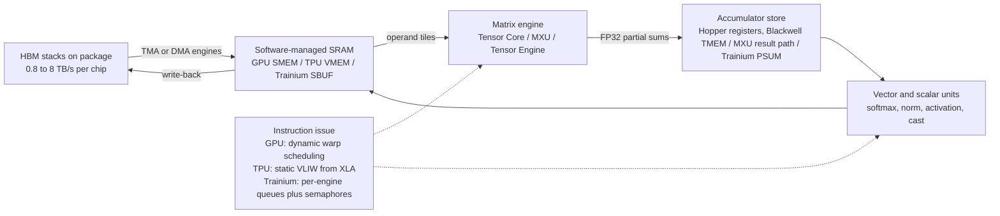

# Accelerator Architectures: GPUs, Trainium, TPUs

## TL;DR

- Every AI accelerator works the same way: a matrix engine (Tensor Core, MXU, or Tensor Engine) is fed from on-chip SRAM, the SRAM is filled from HBM, and HBM bandwidth divided into peak FLOP/s gives the arithmetic intensity a kernel needs before the matrix engine stops waiting on memory.
- Ridge points in dense BF16 FLOP per HBM byte are about 295 on H100, 206 on H200, 281 on B200, 230 on Trainium2, 166 on TPU v5p, and 560 on TPU v6e, so small-batch LLM decode is memory-bound on all of them, and most strongly on v6e.
- GPUs schedule work in hardware at run time (warps, asynchronous TMA copies, mbarriers), while TPUs and Trainium rely on a compiler (XLA, neuronx-cc) to schedule VLIW or multi-engine instruction streams ahead of time, so GPUs tolerate dynamic shapes and TPU or Trainium programs punish them with recompiles and padding.
- Blackwell moved the MMA accumulator out of the register file into a 256 KB per-SM Tensor Memory, and a single thread now issues the MMA, which removes the Hopper register-pressure ceiling on tile size but means Hopper-tuned kernels such as FlashAttention-3 have to be rewritten for B200.
- HBM is the scarcest and least reliable part of the package: capacity sets the minimum shard count, bandwidth sets decode tokens per second, and HBM faults were about 17% of unexpected interruptions in Meta's 16K-H100 Llama 3 run, so size, price, and plan failure handling around memory as well as FLOPs.

## Mental Model



All three accelerator families are the same staged pipeline.
Bytes come in from HBM through a copy engine, wait in an SRAM scratchpad that the programmer or compiler manages, go through a matrix unit that does far more math per byte than anything else on the chip, build up partial sums in a dedicated accumulator store, and get cleaned up by vector units before going back to SRAM and HBM.
The families differ mainly in who schedules that pipeline and when.
NVIDIA GPUs schedule it at run time with thousands of hardware threads and asynchronous barriers.
Google TPUs schedule it at compile time, with XLA producing long VLIW bundles.
AWS Trainium splits it across four independent engines that synchronize through semaphores the compiler inserts.
Once you know who schedules the pipeline and how fast HBM can refill it, you can predict most of how a workload will behave on each chip before you rent it.

## Internals

### The one equation: roofline and the ridge point

The roofline model bounds attainable throughput at `min(peak_FLOPs, arithmetic_intensity x peak_bandwidth)`, where arithmetic intensity is FLOPs performed per byte moved from the memory level in question ([Williams, Waterman, Patterson, CACM 2009](https://doi.org/10.1145/1498765.1498785)).
The ridge point, `peak_FLOPs / peak_HBM_bandwidth`, is the intensity a kernel needs before it becomes compute-bound.
Take a BF16 matrix-vector or skinny matrix-matrix product with M activation rows and a K x N weight.
It does `2*M*K*N` FLOPs and reads about `2*K*N` weight bytes, so when M is small relative to K and N, the intensity is roughly M FLOP per byte.
That makes the decode batch size directly the arithmetic intensity, and it explains why decode on every accelerator in this chapter is HBM-bound until the batch reaches the low hundreds.
The serving consequences are worked through in [[17-Cloud-AI-Engineering/Volume_11_LLM_Serving_and_Inference_Systems_on_Cloud/Chapter_01_LLM_Inference_Mechanics_Prefill_vs_Decode|LLM Inference Mechanics: Prefill vs Decode Phases]].

### NVIDIA Hopper (H100, H200): an asynchronous dataflow machine built on SIMT

The H100 SXM5 enables 132 of the 144 SMs on the full GH100 die ([NVIDIA H100 whitepaper](https://modal-cdn.com/gpu-glossary/gtc22-whitepaper-hopper.pdf), as of 2026-10).
Each SM has four fourth-generation Tensor Cores, 65,536 32-bit registers (256 KB), and up to 228 KB of shared memory that a kernel can opt into ([arXiv 2609.12923 citing NVIDIA](https://arxiv.org/pdf/2609.12923), as of 2026-10).
Hopper doubled the per-SM, clock-for-clock MMA rate over A100, which works out to 512 dense BF16 FMAs per Tensor Core per clock.
As a sanity check, 989.4 TFLOP/s divided by (132 SMs x 4 Tensor Cores x 512 FMA x 2 FLOP) implies a tensor clock of about 1.83 GHz, consistent with the SXM5 boost clock.
That calculation is how you should read every datasheet: peak FLOP/s = matrix-engine MACs x 2 x clock, and only the clock moves under power and thermal limits.

The mechanism a getting-started guide skips is how Hopper keeps those Tensor Cores busy.
Hopper added three primitives that together turn an SM into a producer-consumer dataflow engine ([NVIDIA Hopper Architecture In-Depth](https://developer.nvidia.com/blog/nvidia-hopper-architecture-in-depth/)):
- The Tensor Memory Accelerator (TMA) is a copy engine driven by descriptors: one thread issues a bulk tensor copy of a multi-dimensional tile from global memory to shared memory, and the TMA computes addresses and handles out-of-bounds tiles itself.
- The asynchronous transaction barrier (mbarrier) counts arriving bytes, so a consumer can wait until a whole tile has landed without polling.
- `wgmma.mma_async` is a warpgroup-wide (4 warps, 128 threads) asynchronous MMA that reads its A and B operands straight from shared memory through descriptors and accumulates into registers.

High-performance Hopper kernels such as CUTLASS 3.x and FlashAttention-3 use these primitives for warp specialization.
One producer warpgroup does nothing but issue TMA loads into a multi-stage shared-memory ring buffer, and one or two consumer warpgroups do nothing but issue `wgmma` against whichever stage is ready ([FlashAttention-3, Shah et al. 2024](https://arxiv.org/abs/2407.08608)).
The hidden constraint is the register file.
A 128 x 256 FP32 accumulator tile is 128 KB, half of the SM's 256 KB register file, and it has to sit in the consumer warpgroup's registers for the entire K loop.
Hopper's `setmaxnreg` instruction lets the producer warpgroup give back registers it does not need so the consumers can hold larger accumulators.
Even so, accumulator size caps the tile size, and tile size caps the data reuse per byte loaded from shared memory.
Thread block clusters (up to 16 co-scheduled CTAs, as documented in [arXiv 2604.17834](https://arxiv.org/pdf/2604.17834)) and distributed shared memory let a TMA multicast one tile to every CTA in the cluster, which cuts L2 traffic when several CTAs share an operand.

The Hopper Transformer Engine adds FP8 in E4M3 and E5M2 formats with per-tensor scale factors, which doubles dense throughput to about 1,979 TFLOP/s on H100 SXM.
The cost is that FP8 training needs amax tracking and scaling recipes to avoid overflow and underflow.
H200 uses the same GH100 compute with 141 GB of HBM3e at 4.8 TB/s instead of 80 GB of HBM3 at 3.35 TB/s ([NVIDIA figures via Medium summary](https://medium.com/@vedantb3705/nvidia-blackwell-when-208-billion-transistors-decided-to-rewrite-the-rules-ed827ae281ae), as of 2026-10).
That makes H200 the better decode part at identical FLOPs, because its ridge point drops from 295 to 206.

### NVIDIA Blackwell (B200, GB200): two dies, Tensor Memory, and single-thread MMA

B200 is two reticle-limited dies totalling 208 billion transistors, joined by the 10 TB/s NV-HBI die-to-die link and presented to CUDA as one device ([Wikipedia summary of NVIDIA disclosures](https://en.wikipedia.org/wiki/Blackwell_(microarchitecture)), as of 2026-10).
The package carries 192 GB of HBM3e at 8 TB/s ([Jarvislabs B200 spec summary](https://jarvislabs.ai/ai-faqs/nvidia-b200-specs), as of 2026-10).
Some system listings expose about 180 GB per GPU, so check usable memory in the actual instance spec rather than the chip datasheet ([Runpod B200 guide](https://www.runpod.io/articles/guides/nvidia-b200), as of 2026-10).
Microbenchmark work counts 148 SMs on B200 ([Jarmusch et al., arXiv 2512.02189](https://arxiv.org/pdf/2512.02189)).

The architectural change that matters most for kernel authors is the fifth-generation Tensor Core and its `tcgen05` PTX instruction family.
- Tensor Memory (TMEM) is a dedicated 256 KB per-SM store organized as 128 lanes x 512 columns of 32-bit cells, read and written only through `tcgen05.ld`, `tcgen05.st`, and `tcgen05.cp` ([Emergent Mind summary of Blackwell microbenchmarks](https://www.emergentmind.com/topics/blackwell-gpu-architecture)).
- `tcgen05.mma` normally reads A and B from shared memory and accumulates C and D in TMEM, and the epilogue then moves the result back into registers with `tcgen05.ld` ([MLC modern GPU programming notes](https://mlc.ai/modern-gpu-programming-for-mlsys/chapter_tensor_cores/index.html)).
- A single thread issues the MMA, unlike Hopper's warpgroup-wide `wgmma`, so other warps do not have to rendezvous with it ([Modular, Blackwell matmul part 2](https://www.modular.com/blog/matrix-multiplication-on-nvidias-blackwell-part-2-using-hardware-features-to-optimize-matmul)).
- With `cta_group::2`, two CTAs on paired SMs run one MMA together, so each SM only stages half of the shared operand ([MLC notes](https://mlc.ai/modern-gpu-programming-for-mlsys/chapter_tensor_cores/index.html)).

Here is why this matters mechanically.
Hopper's accumulator lived in the registers of the warps that issued the MMA, so tile size, register spills, and epilogue overlap all competed for one 256 KB register file.
On Blackwell the accumulator lives in TMEM.
512 columns hold two 128 x 256 FP32 accumulators, so a kernel can double-buffer them: the MMA warp fills accumulator B while epilogue warps drain accumulator A through `tcgen05.ld`, apply bias and activation, and write out through TMA.
TMEM is also a hard budget.
A compiler pass that asks for more than 512 columns fails, and in one documented Mamba-3 case on GB200 the fallback path was 38.7x slower ([arXiv 2608.12700](https://arxiv.org/pdf/2608.12700)).
Blackwell adds FP6 and FP4 Tensor Core formats with block-scaled microscaling, in which small blocks of elements share one scale factor.
NVFP4 uses 16-element blocks with an FP8 scale, and the OCP MX formats use 32-element blocks with a power-of-two scale.
FP4 does not fail as obviously as FP8, which overflows: an FP4 model can keep working while quietly losing accuracy, so quantization evaluation is mandatory ([[17-Cloud-AI-Engineering/Volume_11_LLM_Serving_and_Inference_Systems_on_Cloud/Chapter_06_Model_Quantization_and_Compression|Model Quantization and Compression]]).

### HBM: where bandwidth physically comes from

Each HBM stack exposes a 1,024-bit interface, so package bandwidth is roughly `stacks x 1024 bits x per-pin data rate / 8`.
H100 SXM5 enables five HBM3 stacks through ten 512-bit memory controllers, a 5,120-bit bus, so 3.35 TB/s implies about 5.2 Gb/s per pin.
B200's eight HBM3e stacks give an 8,192-bit bus, and 8 TB/s implies about 7.8 Gb/s per pin.
Trainium2 puts four 24 GB HBM stacks on package for 96 GiB at 2.9 TB/s ([Microprocessor Report](https://www.microprocessorreport.com/p/trainium2-puts-aws-on-track-for-ai), as of 2026-10).
Capacity and bandwidth are coupled through the stack count, which is why vendors raise both together and why a 32 GB part like TPU v6e can only reach 1.6 TB/s.
Bytes per FLOP keep falling: H100 provides about 0.0034 HBM bytes per BF16 FLOP, B200 about 0.0036, and TPU v6e about 0.0018.
Each generation therefore pushes harder toward data reuse in SRAM, lower precision, and larger batches.

HBM is also a reliability component.
GPUs correct single-bit errors with ECC.
When they detect uncorrectable errors in a row, NVIDIA data-center GPUs remap the row to a spare, and the remap only takes effect after a GPU reset.
A node can therefore look healthy and still carry a pending remap that a scheduler must drain.
Meta's Llama 3 report attributes 17.2% of unexpected interruptions during a 54-day pre-training snapshot on 16K H100s to HBM3 memory ([The Llama 3 Herd of Models, arXiv 2407.21783](https://arxiv.org/abs/2407.21783)).

### Google TPU (v4, v5e, v5p, v6e Trillium): compiler-scheduled systolic arrays

A TPU TensorCore has three kinds of unit.
A scalar unit fetches VLIW bundles and handles control flow.
A vector unit (VPU) handles elementwise work, reductions, and layout changes.
One or more matrix-multiply units (MXUs) are systolic arrays of BF16 multipliers with FP32 accumulation.
The lineage begins with TPU v1, whose matrix unit was a weight-stationary systolic array: weights were loaded into the array and double-buffered while activations streamed through ([Jouppi et al., ISCA 2017](https://arxiv.org/abs/1704.04760)).
In the cloud generations:
- TPU v4 has two TensorCores and introduced optical circuit switches (OCSes) that let a 4,096-chip supercomputer reconfigure around unavailable hosts, plus SparseCores that accelerate embedding-heavy models 5x to 7x for about 5% of die area and power ([Jouppi et al., ISCA 2023](https://arxiv.org/abs/2304.01433)).
- TPU v5p has two TensorCores with four MXUs each, 95 GB of HBM at 2,765 GB/s, and scales to 8,960 chips in a 3D torus ([Clarigital v5p guide](https://www.clarigital.com/hardware/ai-chips/google-tpu/v5p/); [Medium TPU versions summary](https://medium.com/womenintechnology/google-cloud-tpu-architecture-versions-explained-from-v1-to-the-eighth-generation-3f2371962154), as of 2026-10).
- TPU v6e (Trillium) has one TensorCore with two MXUs, a vector unit, and a scalar unit, delivering 918 BF16 TFLOP/s with 32 GB of HBM at 1,638 GBps per chip ([Google Cloud TPU v6e docs](https://docs.cloud.google.com/tpu/docs/v6e), as of 2026-10).

The mechanism that matters operationally is static scheduling.
A TPU has no hardware-managed data cache in front of HBM for the matrix path.
XLA tiles every operation into on-chip vector memory (VMEM), decides when each DMA runs, fuses elementwise ops into producer and consumer kernels, and emits a fixed instruction schedule for each concrete tensor shape.
Three consequences follow.
First, every new input shape triggers a new compilation, so variable sequence lengths have to be bucketed or padded, or you get a recompile storm.
Second, matmul dimensions are padded up to MXU-friendly multiples (128 on older generations), so a hidden size or head dimension that is not aligned wastes MACs you still pay for.
Third, a weight-stationary array only hides weight-load latency when each loaded weight tile is reused across enough streamed rows, so tiny batches leave the MXU waiting on weight movement as well as HBM.
Pallas, the JAX kernel language, exposes VMEM and the DMA schedule when XLA's fusion decisions are wrong.

Ironwood, the seventh-generation TPU (TPU7x in API surfaces), was announced at Google Cloud Next 2025 and reported generally available in late 2025 ([Medium TPU versions summary](https://medium.com/womenintechnology/google-cloud-tpu-architecture-versions-explained-from-v1-to-the-eighth-generation-3f2371962154), as of 2026-10).
Its per-chip figures are omitted here because they could not be checked against Google documentation for this edition (UNVERIFIED).

### AWS Trainium (Trn1, Trn2): four engines and an explicit memory hierarchy

Each Trainium2 chip contains eight NeuronCore-v3.
Together they deliver 1,299 dense FP8 TFLOP/s, 667 BF16/FP16/TF32 TFLOP/s, and 181 FP32 TFLOP/s, with 96 GiB of HBM at 2.9 TB/s and 3.5 TB/s of DMA bandwidth with inline compression ([AWS Neuron docs, Trainium2 architecture](https://awsdocs-neuron.readthedocs-hosted.com/en/v2.25.0/general/arch/neuron-hardware/trainium2.html), as of 2026-10).
On-chip SBUF grows from 48 MiB on Trainium to 224 MiB on Trainium2, and the NeuronLink memory pool grows from 16 to 64 chips ([AWS Neuron docs](https://awsdocs-neuron.readthedocs-hosted.com/en/latest/about-neuron/arch/neuron-hardware/trainium2.html), as of 2026-10).
NeuronLink-v3 provides 1.28 TB/s of chip-to-chip bandwidth per chip, and within a trn2.48xlarge the 16 chips form a 4 x 4 2D torus ([Microprocessor Report](https://www.microprocessorreport.com/p/trainium2-puts-aws-on-track-for-ai), as of 2026-10).

Each NeuronCore has four heterogeneous engines - Tensor, Vector, Scalar, and GpSimd - and each one runs its own instruction stream ([Clarigital Trainium2 guide citing Neuron docs](https://www.clarigital.com/hardware/ai-chips/amazon-trainium/trainium2/), as of 2026-10).
The Tensor Engine is a systolic array that reads operands from SBUF, a software-managed scratchpad organized as 128 partitions, and writes partial sums to PSUM, a separate accumulation buffer.
The Vector and Scalar engines then move results out of PSUM into SBUF, applying activations and casts on the way.
DMA queues move data between HBM and SBUF.
No hardware cache sits in this path, so the compiler (neuronx-cc) or a hand-written Neuron Kernel Interface (NKI) kernel decides every tile placement and inserts the semaphores that order the engines.
Two Trainium2 features matter for training numerics and placement.
Hardware stochastic rounding can be selected instead of round-to-nearest-even, which helps BF16 weight updates avoid systematic bias.
Logical NeuronCore Configuration (LNC) fuses physical cores into one larger logical core, which changes the device count frameworks see and has to match the compiled artifact ([AWS Neuron docs](https://awsdocs-neuron.readthedocs-hosted.com/en/v2.25.0/general/arch/neuron-hardware/trainium2.html), as of 2026-10).
GpSimd engines run custom operators in C++, the way to write an op the compiler does not lower well.
AWS has announced Trainium3 and Trn3 UltraServers, but their specifications and GA status are not stated here (UNVERIFIED).

### Control plane, data plane, partitioning, and failure domains

At chip level, the control plane is the driver and runtime: the NVIDIA kernel driver and CUDA runtime, libtpu on the TPU VM, or the Neuron driver and runtime.
They allocate memory, load executables, and set up collective communicators.
The data plane is the kernels and DMA traffic, which never touch the host CPU once launched.
This is the accelerator form of the separation in [[17-Cloud-AI-Engineering/Volume_01_Cloud_Architecture_Principles/Chapter_04_Control_Plane_vs_Data_Plane_Separation|Control Plane vs Data Plane Separation]]: a hung runtime call or a failed collective setup stops new work, but kernels already in flight finish.

Partitioning options differ by family.
H100 supports up to seven isolated MIG instances, each with dedicated slices of SMs, L2, and HBM bandwidth ([Yobitel H100 reference](https://yobitel.com/knowledge-base/nvidia-h100), as of 2026-10).
TPUs are partitioned by slice topology, not within a chip.
Trainium is partitioned by NeuronCore and by LNC grouping.
Failure domains nest outward from the chip: chip (ECC, Xid, HBM), host (PCIe, NIC, CPU), scale-up domain (the 8-GPU NVLink board, NVL72 rack, TPU slice, or Trn2 UltraServer), then cluster fabric.
For a synchronous job, one chip failing inside a TPU slice or an NVLink domain usually kills the whole job step, which is why [[17-Cloud-AI-Engineering/Volume_10_AI_Infrastructure_on_Cloud/Chapter_08_Fault_Tolerance_and_Fleet_Resiliency_at_Scale|Fault Tolerance and Fleet Resiliency at Scale]] treats the scale-up domain as the unit of replacement.
Interconnect mechanics are covered in [[17-Cloud-AI-Engineering/Volume_10_AI_Infrastructure_on_Cloud/Chapter_02_Interconnect_Technologies_NVLink_EFA_and_TPU_ICI|Interconnect Technologies: NVLink, EFA, and TPU ICI]].

## Numbers to Know

| Metric | Value | Source and date |
| --- | --- | --- |
| H100 SXM5 SMs | 132 enabled of 144 on GH100 | NVIDIA H100 whitepaper, as of 2026-10 |
| H100 SXM dense BF16 / FP8 | ~989 / ~1,979 TFLOP/s | NVIDIA datasheet via spec aggregators, as of 2026-10 |
| H100 SXM HBM | 80 GB HBM3, 3.35 TB/s | NVIDIA via secondary summaries, as of 2026-10 |
| H100 per-SM registers / max SMEM | 65,536 x 32-bit / 228 KB | arXiv 2609.12923 citing NVIDIA, as of 2026-10 |
| H100 SXM TDP | 700 W | Spheron H100 spec table, as of 2026-10 |
| H200 HBM | 141 GB HBM3e, 4.8 TB/s | NVIDIA via secondary summaries, as of 2026-10 |
| B200 transistors / die link | 208 B, two dies, NV-HBI 10 TB/s | NVIDIA via Wikipedia and Civo, as of 2026-10 |
| B200 HBM | 192 GB HBM3e physical, 8 TB/s; some systems expose ~180 GB | Jarvislabs, Runpod, as of 2026-10 |
| B200 dense BF16 / FP8 | ~2,250 / ~4,500 TFLOP/s (HGX-class) | Spheron B200 guide, as of 2026-10 |
| B200 TMEM | 256 KB per SM, 128 lanes x 512 cols x 32 bit | Blackwell microbenchmark summaries, as of 2026-10 |
| Trainium2 compute | 1,299 FP8 / 667 BF16 / 181 FP32 TFLOP/s dense | AWS Neuron docs, as of 2026-10 |
| Trainium2 memory | 96 GiB HBM, 2.9 TB/s; SBUF 224 MiB per chip | AWS Neuron docs, as of 2026-10 |
| Trainium2 NeuronLink-v3 | 1.28 TB/s per chip; pool up to 64 chips | AWS Neuron docs, as of 2026-10 |
| Trainium (gen 1) memory | 32 GiB HBM, 0.8 TB/s; SBUF 48 MiB | AWS Neuron docs, as of 2026-10 |
| trn2.48xlarge | 16 Trainium2, 1.5 TiB HBM, 20.8 PF FP8 | AWS figures via Neuron guides, as of 2026-10 |
| Trn2 UltraServer | 64 Trainium2, 6 TiB HBM, 83 PF FP8 | AWS figures via Clarigital, as of 2026-10 |
| TPU v4 | 275 BF16 TFLOP/s, 32 GB HBM, ~1.2 TB/s, 4,096-chip pod | ISCA 2023 paper; EaseCloud summary, as of 2026-10 |
| TPU v5e | 197 BF16 TFLOP/s, 16 GB HBM, 800 GBps | Google Cloud v6e docs comparison table, as of 2026-10 |
| TPU v5p | 459 BF16 TFLOP/s, 95 GB HBM, 2,765 GB/s, 8,960-chip pod | Google figures via Tweaktown and Clarigital, as of 2026-10 |
| TPU v6e | 918 BF16 TFLOP/s, 1,836 INT8 TOP/s, 32 GB, 1,638 GBps | Google Cloud TPU v6e docs, as of 2026-10 |
| TPU v6e ICI and pod | 800 GBps bidirectional per chip, 4 ports, 2D torus, 256 chips, 234.9 PF BF16 per pod | Google Cloud TPU v6e docs, as of 2026-10 |
| TPU v6e host | 8 chips per host, 1,536 GiB DRAM, 4 x 200 Gbps NIC | Google Cloud TPU v6e docs, as of 2026-10 |
| Ridge point, dense BF16 FLOP/byte | H100 295, H200 206, B200 281, Trn2 230 (FP8 448), v4 229, v5e 246, v5p 166, v6e 560 | Computed from rows above |
| DWS flex-start price per chip-hour | v6e $1.35, v5p $2.10, v5e $0.60 | Google Cloud DWS pricing, as of 2026-10 |
| DWS calendar mode price per chip-hour | v6e $1.89, v5p $2.94, v5e $0.84 | Google Cloud DWS pricing, as of 2026-10 |
| TPU on-demand per chip-hour | v5e ~$1.20, v5p ~$4.20 | Secondary pricing guides, as of 2026-10 |
| Llama 3 interruptions (54 days, 16K H100) | 419 unexpected; GPU 30.1%, HBM3 17.2% | Meta, arXiv 2407.21783 |
| TPU v4 OCS cost and power | <5% of system cost, <3% of system power | ISCA 2023 paper |

## AWS vs GCP Mechanism Parity

| Dimension | AWS | Google Cloud | Critical difference |
| --- | --- | --- | --- |
| First-party accelerator | Trainium2 (NeuronCore-v3, four engines per core) | TPU v5e, v5p, v6e, Ironwood (TensorCore with MXUs) | Trainium exposes independent engines synchronized by semaphores; a TPU core issues one VLIW stream |
| On-chip memory model | SBUF scratchpad plus PSUM accumulator, software-managed | VMEM scratchpad managed by XLA or Pallas | Neither has a cache in front of HBM for the matrix path, so tiling quality is a compiler property |
| NVIDIA offering | P5 (H100), P5e/P5en (H200), P6 (B200), P6e GB200 UltraServers (UNVERIFIED for current SKU list) | A3 (H100), A3 Ultra (H200), A4 (B200), A4X (GB200) (UNVERIFIED for current SKU list) | Same silicon; the differences are host NIC, scale-out fabric, and placement controls |
| Compiler stack | Neuron SDK, neuronx-cc, NKI; PyTorch via Neuron integrations; JAX support | XLA with JAX first-class, PyTorch/XLA, Pallas kernels | XLA is the most mature ahead-of-time ML compiler; on Neuron, operator coverage has to be checked per model |
| Scale-up domain | 16 chips per trn2.48xlarge in a 4 x 4 torus, 64 per UltraServer | 256 chips per v6e pod (2D torus), 8,960 per v5p pod (3D torus with OCS) | TPU scale-up domains are much larger, which favors model parallelism without leaving ICI |
| Numerics | FP8, BF16, FP32, hardware stochastic rounding, structured sparsity | BF16 and INT8 on v6e; FP8 on newer generations (UNVERIFIED per generation) | Stochastic rounding on Trainium is selected by the user; on TPU, numerics are mostly decided by XLA |
| Partitioning | NeuronCore and LNC grouping; MIG on NVIDIA instances | Slice topology (1x1 up to pod); MIG on NVIDIA VMs | You cannot split a TPU chip between tenants; you can pick a smaller slice |
| Shape tolerance | Static shapes preferred; dynamic shapes supported via NeuronCore-v3 ISA extensions | Static shapes; every new shape recompiles | Both punish unbucketed dynamic shapes; GPUs mostly do not |
| Capacity procurement | On-demand, Spot, EC2 Capacity Blocks for ML, Savings Plans | On-demand, Spot, DWS flex-start and calendar mode, CUDs | DWS publishes per-chip prices; Capacity Blocks price by instance-hour and vary over time |
| Failure unit | Instance (8 GPUs or 16 Trainium2), UltraServer | Slice (host failure takes the slice down), multislice | A TPU slice is all-or-nothing; replacing a host means recreating or repairing the slice |

## Worked Example: Measuring the Roofline on TPU v6e and Sizing a 70B Decode Replica

### Step 0: cost estimate, budget alarm, and quota check

The lab uses one v6e-1 TPU VM (one chip) for under an hour.
At the published DWS flex-start reference of $1.35 per chip-hour and an on-demand rate that is higher (UNVERIFIED at about $2.70 per chip-hour), the lab costs a few dollars plus the boot disk.
A $25 budget leaves a wide margin.
Before you start, confirm that your project has v6e quota in the target zone, because new projects frequently have zero.

```bash
export PROJECT_ID="your-project"
export BILLING_ACCOUNT="000000-000000-000000"
export ZONE="us-east5-b"          # confirm v6e availability for your project in the TPU regions doc
export TPU_NAME="roofline-v6e"

gcloud billing budgets create \
  --billing-account="$BILLING_ACCOUNT" \
  --display-name="tpu-roofline-lab" \
  --budget-amount=25USD \
  --filter-projects="projects/$PROJECT_ID" \
  --threshold-rule=percent=0.5 \
  --threshold-rule=percent=0.9 \
  --threshold-rule=percent=1.0

gcloud services enable tpu.googleapis.com --project "$PROJECT_ID"
```

### Step 1: provision

```bash
gcloud compute tpus tpu-vm create "$TPU_NAME" \
  --project "$PROJECT_ID" --zone "$ZONE" \
  --accelerator-type v6e-1 \
  --version v2-alpha-tpuv6e \
  --spot
```

The runtime version string follows the v6e docs pattern and should be checked against the current docs before use (UNVERIFIED).
If Spot capacity is not available, drop `--spot` and accept the on-demand price.

### Step 2: the probe

Save this file as `roofline_probe.py`.
It runs unchanged on a TPU VM or on a GPU instance with CUDA-enabled JAX.

```python
#!/usr/bin/env python3
# roofline_probe.py - measure achieved matmul throughput and HBM bandwidth with JAX
# and compare them with the published roofline of the detected accelerator.
# Usage: python3 roofline_probe.py [--chip "TPU v6e"] [--k 8192]
import argparse
import time

import jax
import jax.numpy as jnp

# Published dense BF16 peak FLOP/s and HBM bytes/s (sources in Numbers to Know).
PEAKS = {
    "TPU v6e": (918e12, 1638e9),
    "TPU v5p": (459e12, 2765e9),
    "TPU v5e": (197e12, 800e9),
    "TPU v4": (275e12, 1200e9),
    "H100": (989e12, 3.35e12),
    "H200": (989e12, 4.8e12),
    "B200": (2250e12, 8.0e12),
}


def detect_chip(kind):
    k = kind.lower()
    if "v6" in k:
        return "TPU v6e"
    if "v5 lite" in k or "v5e" in k:
        return "TPU v5e"
    if "v5" in k:
        return "TPU v5p"
    if "v4" in k:
        return "TPU v4"
    for name in ("H100", "H200", "B200"):
        if name.lower() in k:
            return name
    raise SystemExit("Unknown device_kind %r; pass --chip explicitly" % kind)


def time_fn(fn, *args, iters=30):
    jax.block_until_ready(fn(*args))  # compile and warm up
    start = time.perf_counter()
    out = None
    for _ in range(iters):
        out = fn(*args)
    jax.block_until_ready(out)
    return (time.perf_counter() - start) / iters


def main():
    parser = argparse.ArgumentParser()
    parser.add_argument("--chip", default=None)
    parser.add_argument("--k", type=int, default=8192)
    args = parser.parse_args()

    dev = jax.devices()[0]
    chip = args.chip or detect_chip(dev.device_kind)
    peak_flops, peak_bw = PEAKS[chip]
    print("device_kind=%s chip=%s ridge=%.0f FLOP/byte"
          % (dev.device_kind, chip, peak_flops / peak_bw))

    # 1. HBM stream: an elementwise op reads N bytes and writes N bytes.
    n = 512 * 1024 * 1024 // 2  # 512 MiB of bf16
    x = jnp.ones((n,), dtype=jnp.bfloat16)
    double = jax.jit(lambda v: v * jnp.bfloat16(2.0))
    t = time_fn(double, x)
    bw = 2 * x.nbytes / t
    print("HBM stream: %.0f GB/s achieved = %.0f%% of %.0f GB/s peak"
          % (bw / 1e9, 100 * bw / peak_bw, peak_bw / 1e9))

    # 2. Matmul sweep: M activation rows against a fixed K x K bf16 weight.
    k = args.k
    key = jax.random.PRNGKey(0)
    w = jax.random.normal(key, (k, k), dtype=jnp.bfloat16)
    mm = jax.jit(lambda a, b: jnp.dot(
        a, b, preferred_element_type=jnp.float32).astype(jnp.bfloat16))
    print("%6s %10s %10s %10s %8s" % ("M", "FLOP/B", "TFLOP/s", "roofline", "frac"))
    for m in (1, 8, 32, 64, 128, 256, 512, 1024, 2048, 4096):
        a = jax.random.normal(key, (m, k), dtype=jnp.bfloat16)
        t = time_fn(mm, a, w)
        flops = 2.0 * m * k * k
        bytes_moved = 2.0 * (m * k + k * k + m * k)
        intensity = flops / bytes_moved
        achieved = flops / t
        bound = min(peak_flops, intensity * peak_bw)
        print("%6d %10.1f %10.1f %10.1f %7.0f%%"
              % (m, intensity, achieved / 1e12, bound / 1e12, 100 * achieved / bound))


if __name__ == "__main__":
    main()
```

### Step 3: run and interpret

```bash
gcloud compute tpus tpu-vm scp roofline_probe.py "$TPU_NAME": \
  --project "$PROJECT_ID" --zone "$ZONE"
gcloud compute tpus tpu-vm ssh "$TPU_NAME" --project "$PROJECT_ID" --zone "$ZONE" \
  --command 'pip install -U "jax[tpu]" && python3 roofline_probe.py'
```

Read the output as three regions.
For M up to about 64, achieved TFLOP/s should rise linearly with M and stay close to the memory roof, which shows the weight read sets the time.
Around the ridge (560 FLOP/byte on v6e, which this shape reaches near M = 1,000), the curve bends.
Beyond it, the fraction of the compute roof you reach is your real MFU ceiling for that shape.
Record the achieved HBM stream fraction, because the capacity model below scales by it.
On an H100 instance the same script bends near M = 300, and that gap is the whole argument for why H100 serves small batches more efficiently per peak FLOP than v6e.

### Step 4: free AWS-side queries for the same decision

```bash
aws ec2 describe-instance-types --region us-east-2 --instance-types p5.48xlarge \
  --query 'InstanceTypes[].{type:InstanceType,vcpu:VCpuInfo.DefaultVCpus,gpu:GpuInfo.Gpus[0].Name,count:GpuInfo.Gpus[0].Count,gpuMemMiB:GpuInfo.TotalGpuMemoryInMiB}' \
  --output table

aws ec2 describe-instance-types --region us-east-2 --instance-types trn2.48xlarge \
  --query 'InstanceTypes[].{type:InstanceType,vcpu:VCpuInfo.DefaultVCpus,neuron:NeuronInfo}' \
  --output json

aws ec2 describe-capacity-block-offerings --region us-east-2 \
  --instance-type p5.48xlarge --instance-count 1 --capacity-duration-hours 24
```

These calls are free.
Purchasing a Capacity Block is billable and cannot be cancelled, so this lab stops at listing offerings.

### Step 5: capacity sizing for a 70B decode replica

Assume a Llama-3-70B-class dense model in BF16 with grouped-query attention: 80 layers, 8 KV heads, head dimension 128.
Weights take `70e9 x 2 bytes = 140 GB`.
The KV cache per token is `2 (K and V) x 80 x 8 x 128 x 2 bytes = 327,680 bytes`, which is 320 KiB.
The workload is 64 concurrent sequences with an average context of 4,096 tokens.

For each decode step, the replica reads every weight once plus the KV cache of every active sequence.
KV bytes per step are `64 x 4096 x 327,680 = 85.9 GB`, which is 61% of the weight bytes, so long-context decode is dominated by KV reads as much as by weights.
Compute per step is `2 x 70e9 x 64 = 8.96 TFLOP`, which takes about 1.2 ms at the 7.3 PFLOP/s peak of 8 x v6e, while the memory traffic takes far longer.
The step is therefore memory-bound, and the time per step is about `(140 + 85.9) GB / aggregate_HBM_BW`.

| Replica | HBM total | Aggregate HBM BW | KV capacity after weights (90% usable) | Step time ceiling | Tokens/s ceiling at batch 64 |
| --- | --- | --- | --- | --- | --- |
| v6e-8 (one host) | 256 GB | 13.1 TB/s | 104 GB, ~318K tokens, ~77 seqs at 4K | 17.2 ms | ~3,700 |
| 8 x H100 (p5.48xlarge) | 640 GB | 26.8 TB/s | 450 GB, ~1.37M tokens, ~335 seqs at 4K | 8.4 ms | ~7,600 |
| 8 x H200 (p5en.48xlarge) | 1,128 GB | 38.4 TB/s | 889 GB, ~2.7M tokens, ~662 seqs at 4K | 5.9 ms | ~10,900 |

Multiply each ceiling by the achieved stream fraction from Step 3, then subtract tensor-parallel all-reduce time, which [[17-Cloud-AI-Engineering/Volume_10_AI_Infrastructure_on_Cloud/Chapter_02_Interconnect_Technologies_NVLink_EFA_and_TPU_ICI|the next chapter]] models.
Cost per million output tokens is `hourly_price / (tokens_per_s x 3600) x 1e6`.
For v6e-8 at the DWS flex-start rate, `8 x $1.35 = $10.80/h`, which gives about $0.81 per million tokens at the ceiling.
For 8 x H100, the same formula gives `P x 0.0366` dollars per million tokens, so the H100 replica wins only if its effective hourly price is below about $22/h.
Plug in your negotiated p5 price instead of trusting any list price here.
The H100 replica also holds 4.3x more KV cache, so at longer contexts or larger batches v6e-8 runs out of memory before it runs out of bandwidth, and you would move to v6e-16 or larger.
Full serving cost models are in [[17-Cloud-AI-Engineering/Volume_11_LLM_Serving_and_Inference_Systems_on_Cloud/Chapter_11_End_to_End_Latency_Throughput_and_Cost_Modeling|End-to-End Latency, Throughput, and Cost Modeling]] and [[17-Cloud-AI-Engineering/Volume_09_FinOps_and_Cloud_Economics/Chapter_05_GPU_and_TPU_Unit_Economics|GPU and TPU Unit Economics]].

### Teardown

```bash
gcloud compute tpus tpu-vm delete "$TPU_NAME" --project "$PROJECT_ID" --zone "$ZONE" --quiet
gcloud compute tpus tpu-vm list --project "$PROJECT_ID" --zone "$ZONE"   # must print no rows
```

Delete the budget after the billing cycle closes if you no longer want the alert.

## Failure Modes and Pitfalls

### Hardware attrition is a steady rate, not an exception

In Meta's Llama 3 pre-training, 419 of 466 interruptions over 54 days were unexpected, and faulty GPUs (30.1%) and HBM3 memory (17.2%) were the two largest categories ([arXiv 2407.21783](https://arxiv.org/abs/2407.21783)).
At that rate a 16K-GPU job is interrupted several times a day, so checkpoint cadence, hot spares, and automated node eviction have to be designed in from the start ([[17-Cloud-AI-Engineering/Volume_10_AI_Infrastructure_on_Cloud/Chapter_06_High_Throughput_Checkpointing_to_Object_Storage|High-Throughput Checkpointing to Object Storage]]).
Pending HBM row remaps only take effect after a reset, so health checks should read remapper state (`nvidia-smi -q -d ROW_REMAPPER`) and run `dcgmi diag` before a node rejoins a job.

### Silent data corruption

Google's "Cores that don't count" (HotOS 2021) and Meta's "Silent Data Corruptions at Scale" (2021) document compute units that return wrong results without raising any error.
In training, SDC shows up as loss spikes or NaNs that do not reproduce after rollback, or as one data-parallel replica whose gradients drift from the rest.
Mitigations include periodic known-answer tests on idle accelerators, cross-replica gradient checksums, and quarantining any node implicated twice.

### Stragglers from power and thermal throttling

Peak FLOP/s scales with clock, and clocks drop under power capping or poor cooling.
In synchronous training, the slowest chip sets the step time for the whole job, so a single throttled GPU can cost a few percent of fleet throughput with no error at all.
Track per-rank step time and SM clock telemetry, not just utilization, which reads 100% on a throttled GPU.

### TPU and Trainium shape pathologies

Unbucketed sequence lengths trigger an XLA or neuronx-cc compile for each new shape, and compiles take seconds to minutes and stall serving.
Pad to a small set of bucket sizes and warm the compilation cache at deploy time.
Hidden or head dimensions that do not align to the matrix unit get padded silently, and the lost MACs show up as lower MFU, not as an error.
On Trainium2, a compiled artifact whose LNC setting differs from the runtime's sees a different device count, which surfaces as a confusing load or rank-mismatch failure.

### Kernel portability across GPU generations

Hopper `wgmma` kernels do not use Blackwell TMEM or `tcgen05`, so a Hopper-tuned binary can run on B200 far below what the hardware can do.
Kernels that exceed the 512-column TMEM budget fail to compile or fall back to slow paths, as in the 38.7x Mamba-3 regression documented on GB200 ([arXiv 2608.12700](https://arxiv.org/pdf/2608.12700)).
Pin framework and kernel-library versions per hardware generation, and gate rollouts on per-kernel benchmarks, not just end-to-end tests.

### Reading the wrong spec

Vendor headline numbers often include 2:4 structured sparsity, which doubles the figure, while dense training gets only half.
B200 capacity appears as 192 GB or about 180 GB depending on the listing, and TPU v6e bandwidth appears as 1,600 or 1,638 GBps across doc revisions.
Always size with dense figures and the memory the instance actually exposes, then measure (Step 3).

### Capacity and quota

AWS P- and Trn-family on-demand quotas are expressed in vCPUs, and a p5.48xlarge has 192 vCPUs, so a default quota near zero blocks the very first launch.
TPU quotas are per chip type, per region or zone, and per provisioning model, and a slice request either gets every host or none.
GPU stockouts are regional and correlated, so reserved capacity (Capacity Blocks, DWS calendar mode, or long-term commitments) is a reliability decision as much as a cost one ([[17-Cloud-AI-Engineering/Volume_09_FinOps_and_Cloud_Economics/Chapter_03_Spot_Economics_and_Interruption_Handling|Spot Economics and Interruption Handling]]).

### Noisy neighbors inside one chip

MIG isolates SMs, L2 slices, and HBM bandwidth, but time-sliced or MPS sharing does not, so a co-tenant's bandwidth-heavy decode can double another tenant's tail latency.
Use MIG or dedicated chips for latency SLOs, and keep time-slicing for batch jobs.

## Security and Cost Angles

### IAM scoping for expensive accelerators

On AWS, use an SCP or permission boundary that denies `ec2:RunInstances` when the `ec2:InstanceType` condition key matches `p5*`, `p6*`, or `trn2*` outside approved accounts, so one compromised developer role cannot start a five-figure daily bill.
On Google Cloud, give `roles/tpu.admin` only to the platform automation service account, give humans `roles/tpu.viewer`, and set per-project quota overrides for TPU and GPU types to cap the blast radius.
Crypto-mining abuse targets exactly these instance types, so alert on any accelerator launch outside the approved IaC pipeline ([[17-Cloud-AI-Engineering/Volume_02_AWS_Deep_Dive/Chapter_01_IAM_Policy_Evaluation_Engine|IAM Policy Evaluation Engine]]).

### Protecting model weights and checkpoints

Weights and optimizer state are the most valuable artifacts in the system, so store them in S3 or GCS encrypted with customer-managed KMS keys and grant decrypt only to the training and serving roles ([[17-Cloud-AI-Engineering/Volume_08_Security_Identity_and_the_Data_Perimeter/Chapter_04_Encryption_Key_Hierarchies_and_Envelope_Encryption|Encryption Key Hierarchies and Envelope Encryption]]).
Pull weights over S3 gateway or interface VPC endpoints on AWS, and over Private Google Access inside a VPC Service Controls perimeter that includes `storage.googleapis.com` and `tpu.googleapis.com` on Google Cloud ([[17-Cloud-AI-Engineering/Volume_03_GCP_Deep_Dive/Chapter_03_VPC_Service_Controls_Security_Perimeters|VPC Service Controls: Security Perimeters]]).
Uninitialized GPU local memory leaks such as LeftoverLocals (CVE-2023-4969) affected several non-NVIDIA vendors, which is a reminder to treat on-chip memory reuse between tenants as part of the threat model whenever accelerators are shared below the VM level.
H100-class confidential computing modes exist, but the GA status of their cloud offerings varies by provider and region and should be checked before you design around them (UNVERIFIED).

### Unit-economics levers

Match the chip to the bottleneck.
Buy HBM bandwidth per dollar for decode, FLOPs per dollar for prefill and training, and HBM capacity per dollar for long-context KV cache.
H200 over H100 is the canonical example: the same FLOPs with 43% more bandwidth and 76% more memory improve decode economics directly.
Model FLOPs utilization is the multiplier on every price: a 35% MFU job pays nearly twice as much per useful FLOP as a 60% MFU job on the same hardware, and kernel work such as TMA pipelining or Pallas tiling is often cheaper than a hardware upgrade.
For capacity, DWS flex-start lists v6e at $1.35 per chip-hour against a higher on-demand rate, and calendar mode at $1.89 buys a time guarantee ([Google Cloud DWS pricing](https://cloud.google.com/products/dws/pricing), as of 2026-10).
Commitments (Savings Plans and CUDs) only pay off at sustained utilization, as discussed in [[17-Cloud-AI-Engineering/Volume_09_FinOps_and_Cloud_Economics/Chapter_02_Commitment_Discounts_Savings_Plans_vs_CUDs|Commitment Discounts: Savings Plans vs CUDs]].

## Interview Questions and Model Answers

### Question 1 (L5 - Senior)

Why is LLM decode memory-bound on an H100, and what batch size would make it compute-bound?

#### Model Answer

In decode, each step generates one token per sequence, so every weight matrix is multiplied by a matrix with only B rows, where B is the batch size.
A BF16 weight of K x N elements costs `2KN` bytes to read and gives `2BKN` FLOPs, so arithmetic intensity is about B FLOP per byte.
The H100 SXM ridge point is about 989 TFLOP/s divided by 3.35 TB/s, which is roughly 295 FLOP per byte.
Below a batch of about 300, the Tensor Cores wait on HBM, and the step time is about the weight bytes plus KV bytes divided by bandwidth.
That simple model ignores the KV cache, which is the bigger problem in practice.
Attention reads each sequence's own KV cache, and that read does not amortize across the batch, so attention intensity stays near 1 FLOP per byte regardless of B.
So even at large batches, long-context decode does not become compute-bound; it moves from being bound by weight bandwidth to being bound by KV bandwidth.
The practical levers are larger batches until KV capacity runs out, GQA or MQA to shrink KV, FP8 weights and KV to halve the bytes, and higher-bandwidth parts such as H200 or B200.

#### Follow-up Interviewer Question

If you quantize weights to FP8 but keep BF16 activations and a BF16 KV cache, how does the ridge-point argument change, and where does the bottleneck move at 32K context?

### Question 2 (L5 - Senior)

Your team wants to serve a 70B dense model on TPU v6e instead of H100. What is the first-order sizing concern, and how do you compute the minimum slice?

#### Model Answer

Capacity comes before FLOPs, because each v6e chip has 32 GB of HBM.
BF16 weights are 140 GB, so the weights alone need five chips, and slices come in power-of-two shapes, so the real minimum is v6e-8 with 256 GB total.
After weights and roughly 10% runtime overhead, about 104 GB remains for KV cache.
At 320 KiB per token for an 80-layer, 8-KV-head model, that is about 318K tokens, or roughly 77 sequences at 4K context.
The step time ceiling is weight plus KV bytes divided by 13.1 TB/s of aggregate bandwidth, about 17 ms at batch 64 and 4K context.
The second concern is the ridge point: v6e needs about 560 FLOP per byte, so v6e is less efficient than H100 per peak FLOP for small-batch decode.
v6e can still win on cost, because its per-chip price is low, especially on DWS flex-start.
The third concern is shape discipline: the serving engine must bucket sequence lengths so XLA does not recompile during traffic.
I would benchmark v6e-8 against an 8 x H100 replica on tokens per second per dollar at the target p99 inter-token latency, not on raw throughput.

#### Follow-up Interviewer Question

The product team wants 32K context; at what point does v6e-8 stop fitting, and would you scale to v6e-16 with more tensor parallelism or move to H200?

### Question 3 (L6 - Staff)

Explain why a Hopper-optimized attention kernel such as FlashAttention-3 does not automatically run well on B200, in terms of the hardware mechanisms.

#### Model Answer

FlashAttention-3 is built around Hopper's asynchronous primitives.
A producer warpgroup issues TMA bulk tensor copies into a shared-memory ring buffer, mbarriers signal when tiles land, and consumer warpgroups issue `wgmma.mma_async` against shared-memory descriptors with accumulators in registers.
It ping-pongs two consumer warpgroups so softmax on one overlaps with the GEMM on the other, and it uses `setmaxnreg` to move registers to the consumers.
On Blackwell, the fifth-generation Tensor Core uses a different instruction family, `tcgen05.mma`, which a single thread issues and which accumulates into Tensor Memory, a 256 KB per-SM store of 128 lanes by 512 columns, not into registers.
A kernel compiled for `wgmma` either cannot target the new path or reaches only part of Blackwell's throughput through compatibility paths.
More importantly, its whole design is shaped around a register-pressure constraint that no longer holds.
A Blackwell-native kernel restructures roles.
One warp issues MMAs, TMA warps load, and epilogue or softmax warps drain accumulators from TMEM with `tcgen05.ld`, while a second TMEM accumulator buffer keeps the Tensor Core busy.
It can also use `cta_group::2` so two SMs share one larger MMA and each stages only half the shared operand, which raises data reuse per byte of shared memory.
New constraints replace the old one: the TMEM column budget is hard, and allocation and deallocation must be explicit, or the kernel fails to compile or deadlocks.
Operationally, I would treat each GPU generation as a separate kernel target, pin kernel library versions per fleet, and gate rollouts on per-kernel microbenchmarks.

#### Follow-up Interviewer Question

Given a 512-column TMEM budget, how would you split it between the S = QK^T accumulator and the O accumulator in a Blackwell attention kernel, and what does that cap the head dimension at?

### Question 4 (L6 - Staff)

You need to choose between trn2.48xlarge and an H200-based instance for pre-training a 70B dense model. What do you measure, and what non-hardware factors decide it?

#### Model Answer

On paper, a Trainium2 chip has 667 dense BF16 TFLOP/s and 96 GiB at 2.9 TB/s, and an H200 has about 989 TFLOP/s and 141 GB at 4.8 TB/s, so the comparison has to be per dollar and per achieved FLOP, not per chip.
I would run the actual model at the target sequence length and global batch on both, at a small but representative scale such as one or two scale-up domains.
I would record MFU, step time, and step-time variance, then extrapolate collective costs using each fabric's bandwidth.
On Trainium, compiler maturity is the dominant risk.
neuronx-cc has to lower every op in the model, custom ops need NKI or GpSimd kernels, and compile time and cache behavior affect iteration speed.
Stochastic rounding is a numerics advantage for BF16 master weights, and LNC choice affects how parallelism maps onto devices.
On H200, the ecosystem (Megatron-style parallelism, FlashAttention, NCCL) is mature, and the risk is mostly capacity and price.
Non-hardware factors often decide it.
They include whether the organization can staff compiler-level debugging, the availability of reserved capacity in the needed region and time window, the cost of porting back if the model architecture changes, and whether serving will run on the same hardware so that quantization and kernels are developed once.
I would choose Trainium when the model uses well-supported ops, capacity is committed, and the price-performance gap after measured MFU exceeds the engineering cost of the port, usually only at multi-month scale.

#### Follow-up Interviewer Question

The Trainium run reaches 85% of H200 MFU, but step time variance is twice as high; how do you find out whether that comes from the compiler schedule, the collectives, or the hardware?

### Question 5 (L6 - Staff)

A 4,096-GPU synchronous training job's step time degrades 6% over a week with no errors logged. Walk through your diagnosis.

#### Model Answer

In synchronous training the slowest rank sets the step time, so I start with per-rank step-phase timings, not fleet averages.
The first branch is compute stragglers.
I would check per-GPU SM clocks, power draw, and temperature, because a GPU that is power-capped or throttled for cooling reports 100% utilization while running at a lower clock.
The second branch is memory health.
Rising corrected ECC counts or pending row remaps point to degrading HBM, which Meta's Llama 3 data shows is a leading failure category, and a node with pending remaps needs a reset to apply them.
The third branch is the fabric.
Collective time growing on a subset of ranks points to a degraded link, a flapping NIC, or a congested spine, which the next chapter covers.
The fourth branch is software: data loader stalls, checkpoint writes overlapping with steps, or Python garbage collection pauses on one host.
I would bisect by excluding suspect nodes via hot spares, and confirm with `dcgmi diag` and known-answer tests before returning any node.
Because silent data corruption can travel with slowdowns, I would also compare gradient norms across data-parallel replicas for outliers.
The systemic fix is continuous straggler detection with automatic eviction, so a single bad chip costs minutes, not a week.

#### Follow-up Interviewer Question

How would you design the eviction policy so a correlated event, such as a firmware rollout affecting 5% of nodes, does not drain your entire spare pool and stall the job?

### Question 6 (L7+ - Principal)

Your company spends nine figures a year on accelerators across H100, B200, TPU, and Trainium. Design the portfolio and software strategy.

#### Model Answer

I would split the portfolio by workload physics, not by vendor.
Frontier pre-training needs the largest high-bandwidth scale-up domains and the highest sustained MFU, so it goes on whichever platform the research stack runs best on at committed scale, typically NVIDIA or TPU pods.
High-volume decode is bound by bandwidth and capacity, so it goes to the best HBM bandwidth per dollar at the target latency, which may be H200, B200, TPU v6e, or Trainium2, chosen on measured tokens per dollar.
Prefill and batch inference are compute-bound and tolerate preemption, so they absorb Spot and flex-start capacity.
The software strategy decides whether that portfolio is an option or a liability.
I would standardize the model definition at a level that compiles to multiple backends, for example JAX/XLA where TPU and GPU both matter, or PyTorch with XLA and Neuron backends where they do.
I would keep a small set of hand-tuned kernels per hardware generation owned by a central performance team, because attention and GEMM kernels are where 2x differences live, and they do not port.
Every model release would run a hardware qualification suite covering per-kernel microbenchmarks, numerics against a reference, and end-to-end tokens per dollar on each target.
That way capacity can be moved between platforms within weeks, not quarters.
Procurement should be a portfolio too.
Commit to baseline capacity on two platforms, keep 10 to 20% elastic headroom on reservation products such as Capacity Blocks and DWS calendar mode, and negotiate price in tokens per dollar terms backed by our own benchmarks.
The main trade-off is engineering overhead: each additional platform costs a team, so I would only add one when measured savings exceed roughly twice that team's fully loaded cost, and I would retire platforms that fall below it.

#### Follow-up Interviewer Question

A vendor offers a 40% discount on a three-year commitment for a single platform; how do you value the lost optionality against the discount?

### Question 7 (L7+ - Principal)

HBM bytes per FLOP are falling with each generation. What architectural responses do you expect, and how should a platform team position itself?

#### Model Answer

The trend is visible in the specs: H100 gives about 0.0034 HBM bytes per BF16 FLOP, and TPU v6e about 0.0018, so the arithmetic needed to keep matrix engines busy keeps rising.
Hardware responds in four ways.
The first is lower precision with block scaling (FP8, then MX and NVFP4 formats), which raises effective intensity because each byte carries more operands.
The second is deeper on-chip memory, such as Trainium2's 224 MiB of SBUF and Blackwell's TMEM, which increases reuse within a tile.
The third is larger scale-up domains, such as NVL72 racks and multi-thousand-chip TPU pods, so a model can be sharded across many HBM stacks without crossing a slow fabric.
The fourth is disaggregation, splitting compute-bound prefill from memory-bound decode so each runs on hardware matched to its intensity.
Systems respond with algorithms that cut bytes per token: GQA and MLA-style KV compression, speculative decoding to turn several decode steps into one higher-intensity verification step, and KV cache tiering to host memory or remote stores.
A platform team should make these levers configurable per workload instead of hard-coding one stack.
That means building quantization evaluation pipelines so lower precision can be adopted safely, supporting prefill and decode disaggregation in the serving layer, and building capacity models in bytes per token, not FLOPs per token.
Every procurement decision should be checked against the ridge point and the measured bandwidth fraction of the actual workload, not against headline TFLOP/s.

#### Follow-up Interviewer Question

If the next generation doubles FLOPs but raises HBM bandwidth by only 30%, which of your current workloads gets cheaper per token, which do not, and how do you communicate that to finance?

## Further Reading

- [NVIDIA H100 Tensor Core GPU Architecture whitepaper](https://modal-cdn.com/gpu-glossary/gtc22-whitepaper-hopper.pdf) - the primary source for SM counts, TMA, thread block clusters, and the Hopper memory subsystem.
- [NVIDIA Hopper Architecture In-Depth](https://developer.nvidia.com/blog/nvidia-hopper-architecture-in-depth/) - a shorter official walkthrough of TMA, DSMEM, and the asynchronous transaction barrier.
- [FlashAttention-3 (Shah et al., 2024)](https://arxiv.org/abs/2407.08608) - the clearest worked example of warp specialization, TMA pipelining, and wgmma overlap on Hopper.
- [Microbenchmarking NVIDIA's Blackwell Architecture (arXiv 2512.02189)](https://arxiv.org/pdf/2512.02189) - measured behavior of TMEM, tcgen05, the decompression engine, and the dual-die design.
- [Modular: Matrix multiplication on Blackwell, part 2](https://www.modular.com/blog/matrix-multiplication-on-nvidias-blackwell-part-2-using-hardware-features-to-optimize-matmul) - a practitioner explanation of TMEM, single-thread MMA, and CTA pairs.
- [MLC: Blackwell Tensor Core and tcgen05.mma](https://mlc.ai/modern-gpu-programming-for-mlsys/chapter_tensor_cores/index.html) - operand and accumulator layouts across Ampere, Hopper, and Blackwell, including cta_group semantics.
- [In-Datacenter Performance Analysis of a Tensor Processing Unit (Jouppi et al., ISCA 2017)](https://arxiv.org/abs/1704.04760) - the origin of the weight-stationary systolic design that every later TPU builds on.
- [TPU v4: An Optically Reconfigurable Supercomputer (Jouppi et al., ISCA 2023)](https://arxiv.org/abs/2304.01433) - OCS reconfiguration, SparseCore, and the reliability argument for optical switching.
- [Google Cloud TPU v6e documentation](https://docs.cloud.google.com/tpu/docs/v6e) - the authoritative v6e spec table, slice shapes, and host configuration.
- [AWS Neuron Trainium2 architecture](https://awsdocs-neuron.readthedocs-hosted.com/en/latest/about-neuron/arch/neuron-hardware/trainium2.html) - official Trainium2 compute, memory, SBUF, and NeuronLink figures.
- [Roofline: An Insightful Visual Performance Model (Williams et al., CACM 2009)](https://doi.org/10.1145/1498765.1498785) - the model behind every ridge-point argument in this chapter.
- [The Llama 3 Herd of Models (Meta, 2024)](https://arxiv.org/abs/2407.21783) - the best public data on accelerator failure rates and categories at 16K-GPU scale.
- [How to Scale Your Model (JAX team)](https://jax-ml.github.io/scaling-book/) - a TPU-centric treatment of rooflines, sharding, and inference cost math that carries over to GPUs.
- [[17-Cloud-AI-Engineering/Volume_13_Seminal_Papers_and_Case_Studies/Chapter_15_Google_TPU_Architecture_Evolution|Google TPU Architecture Papers: TPU v1 to v5p]] - this curriculum's paper-by-paper treatment of the TPU lineage.
- [[17-Cloud-AI-Engineering/Volume_14_Staff_Plus_Interview_Arena/Chapter_06_Cloud_AI_Numbers_Every_Staff_Engineer_Must_Know|Cloud AI Numbers Every Staff Engineer Must Know]] - the cheat sheet that collects the numbers from this chapter alongside network and storage figures.
