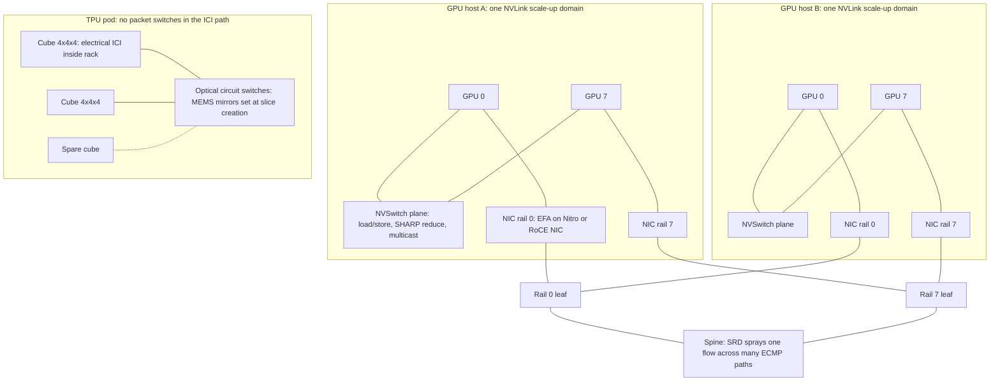

# Interconnect Technologies: NVLink, EFA, and TPU ICI

## TL;DR

An accelerator cluster has three separate networks: a scale-up fabric (NVLink/NVSwitch, TPU ICI), a scale-out backend fabric (EFA on SRD, or RoCE), and a frontend network for storage and control. Treat each one as its own failure domain with its own bandwidth budget.
Scale-up bandwidth per GPU is about 9x to 18x higher than scale-out bandwidth per GPU (NVLink 4 at 450 GB/s per direction versus 50 GB/s per GPU of EFA on a 3.2 Tbps node). That gap decides placement: tensor and expert parallelism stay inside the scale-up domain, and data and pipeline parallelism cross the scale-out fabric.
SRD is a reliable but out-of-order transport built into the Nitro card. It sprays one message's packets over many ECMP paths and picks paths by measured RTT. It retransmits from hardware in well under a millisecond, so it tolerates a lossy multi-tenant Clos without PFC.
TPU ICI has no switches. Chips link directly to their neighbours in a 3D torus. Optical circuit switches (OCS) join 4x4x4 cubes into slices of any shape, and they route around failed cubes by moving mirrors rather than by re-cabling.
For a multi-node ring all-reduce, the bus-bandwidth ceiling is the node's total NIC bandwidth, not NVLink. Hierarchy buys you fewer latency steps, and in-switch or in-network reduction (NVLink SHARP) buys you up to ~2x less data moved.

## Mental Model



A useful way to picture it is as memory with three levels of distance.
Inside an NVLink domain, a GPU reaches a peer's HBM with plain load and store instructions through a non-blocking switch, so the domain behaves like one large, slower NUMA memory.
Across nodes, every byte goes from HBM over PCIe to a NIC, then through a Clos fabric shared with other flows, and back up into the remote GPU's memory through GPUDirect RDMA. Each GPU gets roughly a tenth of its NVLink bandwidth on that path.
The TPU pod changes the design: there are no switches between chips, so bandwidth scales with neighbour links, and the circuit-switched optics only decide which cubes count as neighbours.
Every design decision in the rest of this volume maps a parallelism dimension onto one of these distances. Get that mapping wrong and the job becomes network-bound, no matter how many FLOPs you rented.

## Internals

### The three networks on an accelerator host

The scale-up fabric connects accelerators inside one domain: 8 GPUs on HGX, 72 GPUs on an NVL72 rack, or a TPU slice. It carries tensor-parallel all-reduces, expert-parallel all-to-alls, and peer memory loads.
The scale-out backend fabric connects domains to each other. On AWS it is EFA. On Google Cloud GPU families it is GPUDirect-TCPX/TCPXO or RoCE, and between TPU slices it is the datacenter network (DCN). It carries data-parallel gradient reductions, pipeline activations, and FSDP gathers that cross domain boundaries.
The frontend network (ENA on AWS, gVNIC on Google Cloud) carries storage reads, checkpoint writes, metrics, and SSH. It should never carry collective traffic. If NCCL silently falls back to it, that fallback is one of the most expensive misconfigurations covered in this chapter.
AWS states the split explicitly on P6-B300. Each instance has 6.4 Tbps of EFA networking plus a separate 300 Gbps of dedicated ENA throughput (AWS What's New, as of 2026-10).
The fabrics underneath (Clos, ECMP, Jupiter) are covered in [[17-Cloud-AI-Engineering/Volume_00_Foundations_Under_the_Cloud/Chapter_02_Datacenter_Networking_Fabrics|Datacenter Networking Fabrics]]. The Nitro card that implements SRD is covered in [[17-Cloud-AI-Engineering/Volume_02_AWS_Deep_Dive/Chapter_04_EC2_Nitro_Architecture_and_Graviton|EC2, Nitro Architecture, and Graviton]].

### NVLink and NVSwitch: a memory-semantic scale-up fabric

NVLink is a point-to-point serial link that carries memory transactions, not network messages.
CUDA maps a peer GPU's HBM into the local GPU's virtual address space. A kernel that dereferences a peer pointer emits NVLink read and write transactions directly from the SMs, with no NIC, no kernel driver, and no packet stack on the path.
Hopper H100 has 18 fourth-generation NVLink links, for 900 GB/s of total bidirectional bandwidth per GPU (NVIDIA H100 architecture whitepaper, as of 2026-10). That works out to 50 GB/s bidirectional per link, or 25 GB/s each way.
On an 8-GPU HGX baseboard, the 18 links from each GPU spread across third-generation NVSwitch chips. The result is a non-blocking crossbar: any GPU pair can talk at full per-GPU bandwidth at the same moment as every other pair.
The third-generation NVSwitch also added hardware for multicast and for SHARP in-network reductions (NVIDIA H100 architecture whitepaper, as of 2026-10).
Blackwell's fifth-generation NVLink keeps 18 links per GPU but doubles total bandwidth to 1.8 TB/s per GPU. GB200 NVL72 extends the switched domain to 72 GPUs, with 130 TB/s of aggregate NVLink bandwidth across the rack (NVIDIA GB200 NVL72 product page, as of 2026-10).
Physically, NVL72 moves the NVSwitch chips out of the compute trays into dedicated switch trays in the same rack. NVIDIA described nine NVLink switch trays per NVL72 at launch (NVIDIA via HPCwire, 2024-03).
Sixth-generation NVLink on Vera Rubin doubles per-GPU bandwidth again to 3.6 TB/s, with 260 TB/s across a 72-GPU rack and 28.8 TB/s per switch tray. Its switch SHARP engines accelerate FP8 collectives (NVIDIA developer blog, as of 2026-10).

#### The mechanism most guides skip: why in-switch reduction is worth up to 2x

A ring all-reduce over N ranks has two halves. First comes a reduce-scatter of N-1 steps, then an all-gather of N-1 steps. In each step every rank sends 1/N of the buffer to its ring neighbour.
Each rank therefore sends, and receives, 2(N-1)/N x S bytes. For N = 8 that is 1.75 x S, so the time is 1.75 x S / B, where B is the per-direction link bandwidth.
With NVLink SHARP (NVLS in NCCL terminology), the GPU writes its full buffer once into a multimem address. The NVSwitch adds the contributions arriving from all GPUs in its arithmetic units and multicasts the reduced result back to every GPU. Each rank sends S once and receives S once.
The bandwidth term falls from 2(N-1)/N x S/B to S/B. For N = 8 that is 1.75x less wire time, and the ratio approaches 2x as N grows. The worked-example model below reproduces this: 4.90 ms for the ring versus 2.78 ms in-switch for a 1 GB buffer.
There is a second, less visible gain. The reduction arithmetic no longer runs on the SMs, so the collective kernel needs fewer thread blocks, and more SMs stay free for the GEMMs it overlaps with.
The cost is that the switch must allocate multicast group state and reduction buffers. The device-side primitives (PTX `multimem` load-reduce and store instructions on sm_90 and later) are an UNVERIFIED detail here. In NCCL, the feature is switched on or off by the `NCCL_NVLS_ENABLE` environment variable (UNVERIFIED in this pass).

#### Control plane of an NVSwitch domain

The NVSwitch routing tables are programmed by a host-side control plane, not by the data path.
On HGX systems this is the NVIDIA Fabric Manager service. If it is not running, CUDA initialisation on NVSwitch-based systems fails with a "system not yet initialized" error, and the GPUs cannot form the NVLink fabric. Treat this as a hard boot-time dependency (UNVERIFIED in this pass; check the NVIDIA Fabric Manager user guide).
On rack-scale NVL72 systems, the control plane manages a fabric spread over many trays, so a single bad switch tray, cable cartridge, or management-plane fault can degrade the whole 72-GPU domain.
This is the main reliability trade-off of large scale-up domains: the blast radius of a fabric fault grows with the domain size you bought for performance.

### AWS Elastic Fabric Adapter and the SRD transport

EFA is an ENA network interface plus an OS-bypass path. User-space libraries post work requests straight to the Nitro card's queues, without system calls.
Applications do not program EFA through InfiniBand verbs reliable connections. They use libfabric's `efa` provider. For NCCL, the `aws-ofi-nccl` plugin translates NCCL's network API into libfabric calls, and GPUDirect RDMA lets the Nitro card read and write GPU HBM over PCIe without a bounce buffer.
The transport under EFA is the Scalable Reliable Datagram (SRD) protocol, described in Shalev et al., "A Cloud-Optimized Transport Protocol for Elastic and Scalable HPC", IEEE Micro 40(6), 2020.
SRD's design follows from one observation in that paper. AWS datacenters are high-radix folded Clos fabrics with many equal-cost paths, but ECMP's static per-flow hashing puts each flow on one path. A few large flows collide on the same links and create both load imbalance and inconsistent latency.
SRD's answer has four parts, and together they explain why EFA behaves differently from RoCE under load:

- **Packet spraying.** SRD does not preserve packet order. It sends the packets of a single message over as many paths as it can (Shalev et al. 2020).
- **Path steering.** The sender steers each packet by changing fields in the encapsulation header that the switches' ECMP hash reads, so the switches stay ordinary ECMP routers while the endpoint chooses the path.
- **RTT-based avoidance.** SRD tracks round-trip time per path and avoids overloaded paths, so a congested spine link drains instead of growing a queue (Shalev et al. 2020).
- **Hardware retransmission.** Reliability and congestion control live on the Nitro card, which avoids OS scheduling jitter. Dropped packets are resent at microsecond timescales on a different path. The paper's baseline, kernel TCP, has a minimum retransmission timeout of 50 ms, which shows up directly as tail latency (Shalev et al. 2020).

SRD's congestion control works to keep queues near empty. That lowers the chance of drops in the first place and shortens recovery when drops happen (Shalev et al. 2020).
Order restoration is left to the layer above, which knows which ordering the application actually needs. For message passing, AWS put a reordering engine in the EFA user-space stack (AWS HPC whitepaper "Lower the Time-to-Results for Tightly Coupled HPC", 2019).
The design consequence is that SRD does not need a lossless fabric. RoCEv2 deployments usually depend on Priority Flow Control (PFC), because classic go-back-N retransmission collapses when packets are lost. PFC in turn brings head-of-line blocking, pause storms, and deadlocks (Guo et al., "RDMA over Commodity Ethernet at Scale", SIGCOMM 2016).
SRD instead accepts loss and repairs it fast and per packet. That lets EFA run over a multi-tenant, lossy, commodity Ethernet Clos without per-priority pause.
The costs are real. Applications must be written against libfabric's message and RDMA semantics, not the verbs reliable-connection model. Ecosystem support depends on the plugin. And per-path state plus reordering logic sit in custom Nitro silicon that only AWS can change.

#### Rail-optimized placement and PXN

On 8-GPU instances, each GPU sits on a PCIe switch next to its own NIC, or its own group of NICs. Cluster fabrics are commonly built "rail-optimized": NIC k on every node connects to the same leaf group, so traffic from rail k to rail k crosses as few switch tiers as possible.
If GPU 3 on node A must send to GPU 5 on node B, NCCL's PXN mechanism (PCI x NVLink) first moves the data over NVLink to GPU 5 on node A, then sends it on rail 5. The cross-node hop stays on a single rail.
This is why NVLink bandwidth matters even for traffic that is "purely inter-node".
AWS does not publish the full UltraCluster topology, so assume rails rather than know them. Measure with nccl-tests on your actual placement (UNVERIFIED: exact AWS rail and leaf mapping).

### Google Cloud GPU scale-out: GPUDirect-TCPX/TCPXO and RoCE

On Google Cloud, GPU scale-out has gone through several generations of transport.
A3 Mega uses GPUDirect-TCPXO, which offloads the TCP data path so payloads move directly between GPU memory and NIC. Google documents eight 200 Gbps NICs per VM for 1,600 Gbps (UNVERIFIED in this pass).
A3 Ultra (H200) and A4 (B200) moved to RDMA over Converged Ethernet with NVIDIA ConnectX NICs, at 3,200 Gbps per VM (UNVERIFIED in this pass).
A4X is Google Cloud's GB200 NVL72-based family, which brings the 72-GPU NVLink domain to GCP (UNVERIFIED in this pass).
Google's host networking research covers delay-based congestion control in Swift (Kumar et al., SIGCOMM 2020). It also covers hardware reliable transport in Falcon, which Google contributed to the Open Compute Project (UNVERIFIED: which GPU families, if any, run Falcon end to end).

### TPU ICI: a direct-connect torus with optical reconfiguration

TPU chips connect to each other through the Inter-Chip Interconnect (ICI), and there is no packet switch on the path.
In TPU v4, each chip has links to six neighbours (plus and minus in X, Y, Z). Sixty-four chips form a 4x4x4 cube inside a rack, wired electrically.
The links on each cube's six faces leave the rack as optics and land on optical circuit switches. TPU v4 used 48 OCS units to join 64 cubes into a 4,096-chip pod (Jouppi et al., "TPU v4: An Optically Reconfigurable Supercomputer for Machine Learning with Hardware Support for Embeddings", ISCA 2023; figures UNVERIFIED in this pass).
An OCS (Google's Palomar) is a MEMS mirror array. It does not read packets. It steers light from an input fibre to an output fibre, so it works at any line rate, adds almost no latency, and uses little power. The TPU v4 paper reports the OCS and optics at under 5% of system cost and under 3% of system power (UNVERIFIED in this pass).
Mirror reconfiguration is far too slow for per-packet switching, so the OCS is set when a slice is created. It acts as a programmable patch panel, not a router.
That gives the TPU control plane three abilities that a static torus lacks:

1. **Arbitrary placement.** A slice can be built from any healthy cubes in the pod, not only from a contiguous physical block, which removes most scheduling fragmentation.
2. **Failure bypass.** When a chip or host in a cube fails, the scheduler marks the whole cube unhealthy and builds the next slice from a spare cube by moving mirrors. No one has to be dispatched to a rack.
3. **Topology shaping.** The same cubes can be wired as a regular torus or as a twisted torus. The twisted form adds a shift to the wraparound links so that asymmetric shapes (for example 4x4x8) gain bisection bandwidth, which the TPU v4 paper credits with better all-to-all throughput (UNVERIFIED: magnitude).

Google's broader OCS deployment in Jupiter is described in Poutievski et al., "Jupiter Evolving", SIGCOMM 2022. The optical switch and transceiver design is in Liu et al., "Lightwave Fabrics", SIGCOMM 2023. See [[17-Cloud-AI-Engineering/Volume_13_Seminal_Papers_and_Case_Studies/Chapter_13_Jupiter_Datacenter_Network|Jupiter]] and [[17-Cloud-AI-Engineering/Volume_13_Seminal_Papers_and_Case_Studies/Chapter_15_Google_TPU_Architecture_Evolution|TPU Architecture Evolution]].

#### The mechanism most guides skip: wraparound is worth 2x, and slice shape decides whether you have it

On a torus, the all-reduce is broken into one ring reduce-scatter per dimension, followed by all-gathers in reverse order.
In a dimension with wraparound, the chips form a ring, and a bidirectional ring algorithm splits the buffer in half, one half per direction. Effective bandwidth per dimension is therefore 2 x link bandwidth.
In a dimension without wraparound, the chips form a line, and the busiest link in the middle carries about twice as much traffic. The effective bandwidth roughly halves, and the model below shows 24.65 ms versus 49.25 ms for a 1 GB all-reduce on a 4x4x4 shape.
On OCS-based pods, wraparound links pass through the OCS, so slice shapes that do not fill whole cube faces may not get wraparound in every dimension. Check the published topology for your accelerator type before you choose a slice shape (UNVERIFIED: exact wraparound rules per TPU generation; see Cloud TPU system architecture docs).
The second consequence concerns the logical mesh. The axes of a JAX device mesh map onto physical torus dimensions. If you put the heaviest collective (usually FSDP or tensor-parallel sharding) on a dimension that is too short or has no wraparound, step time rises with no error or warning.
Generation scale (all UNVERIFIED in this pass): TPU v5p pods reach 8,960 chips in a 3D torus, TPU v6e (Trillium) pods are 256 chips in a 2D torus, and Ironwood pods reach 9,216 chips.
Collectives between slices (Multislice) cross the DCN instead of ICI. Put only the least frequent collective, typically the data-parallel gradient all-reduce, across slices.

### Collective algorithm selection: what the alpha-beta model tells you

Every collective costs alpha x steps + beta x bytes. Alpha is the per-message latency (software, NIC, switch hops) and beta is the inverse bandwidth.
On a multi-node NCCL ring with one channel per rail, each channel crosses every node boundary once on its own NIC, and the NVLink hops in between run pipelined in parallel. The bandwidth term is about 2 x S / B_node_NIC.
This gives the counter-intuitive result in the worked example. For a large 16 GB gradient on 16 P5-class nodes, the pipelined rail ring (103 ms) beats an explicit hierarchical reduce-scatter, all-reduce, all-gather sequence (172 ms). The hierarchical version runs its NVLink phases serially instead of overlapping them.
For a 4 MiB bucket, the order flips: the rail ring takes 3.84 ms and the hierarchy takes 0.54 ms. The ring's latency term grows with total rank count (2 x 127 steps), while the hierarchy's grows with node count (2 x 15 steps).
NCCL picks among ring, tree, NVLS, and CollNet by message size and topology for exactly this reason. When your bucket size, rank count, or fabric changes, re-run the sweep rather than trusting a tuned value from another cluster.
Patarasuk and Yuan prove the ring's bandwidth optimality ("Bandwidth optimal all-reduce algorithms for clusters of workstations", JPDC 2009). Thakur, Rabenseifner, and Gropp cover the latency-optimized alternatives in MPICH (IJHPCA 2005).

### Control plane versus data plane summary

| Fabric | Data plane | Control plane | Failure domain |
|---|---|---|---|
| NVLink/NVSwitch | SM load/store and copy engines over NVLink, NVSwitch SHARP | Fabric Manager or rack fabric management software programs routing and multicast state | 8-GPU node or 72-GPU rack |
| EFA/SRD | libfabric user-space queues, SRD on Nitro, GPUDirect RDMA | EC2 APIs attach EFA interfaces; placement groups and capacity reservations determine fabric locality | Instance, plus shared spine paths |
| TPU ICI | Direct chip-to-chip links, XLA-scheduled collectives | TPU scheduler programs OCS mirrors at slice creation | Cube (64 chips on v4/v5p), slice |
| TPU DCN (Multislice) | Host NICs over datacenter network | Multislice orchestration | Slice-to-slice paths |

## Numbers to Know

| Quantity | Value | Source |
|---|---|---|
| NVLink 4 per H100/H200 GPU | 18 links, 900 GB/s bidirectional (450 GB/s per direction) | (NVIDIA H100 architecture whitepaper, as of 2026-10) |
| NVLink 4 per link | 50 GB/s bidirectional, 25 GB/s each way | Derived from 900/18 |
| NVSwitch gen 3 collective offload | Multicast plus SHARP in-network reductions | (NVIDIA H100 architecture whitepaper, as of 2026-10) |
| NVLink 5 per Blackwell GPU | 18 links, 1.8 TB/s bidirectional | (NVIDIA GB200 NVL72 page, as of 2026-10) |
| GB200 NVL72 NVLink domain | 72 GPUs, 130 TB/s aggregate | (NVIDIA GB200 NVL72 page, as of 2026-10) |
| NVLink 5 maximum announced domain | Up to 576 GPUs | (NVIDIA via HPCwire, 2024-03); cloud availability of 576-GPU domains UNVERIFIED |
| NVLink 6 per Rubin GPU | 3.6 TB/s; 260 TB/s per NVL72 rack; 28.8 TB/s per switch tray; FP8 SHARP | (NVIDIA developer blog, as of 2026-10) |
| PCIe Gen5 x16 | ~64 GB/s per direction | (PCIe 5.0 specification) |
| EC2 P6-B300 networking | 6.4 Tbps EFA plus 300 Gbps dedicated ENA, 8x B300, 2.1 TB HBM | (AWS What's New, as of 2026-10) |
| EC2 P6-B200 EFA | 3.2 Tbps (AWS states P6-B300 doubles it) | Derived from (AWS What's New, as of 2026-10) |
| EC2 P5 EFA | 3,200 Gbps per instance | UNVERIFIED |
| Kernel TCP minimum RTO in SRD comparison | 50 ms | (Shalev et al., IEEE Micro 2020) |
| TPU v4 pod | 4,096 chips, 64 cubes of 4x4x4, 48 OCS | (Jouppi et al., ISCA 2023) UNVERIFIED |
| TPU v4 OCS overhead | <5% system cost, <3% system power | (Jouppi et al., ISCA 2023) UNVERIFIED |
| TPU v5p, v6e, Ironwood pod sizes | 8,960 (3D torus); 256 (2D torus); 9,216 | UNVERIFIED |
| GCP A3 Mega scale-out | 8 x 200 Gbps GPUDirect-TCPXO | UNVERIFIED |
| Ring all-reduce bytes per rank | 2(N-1)/N x S | (Patarasuk and Yuan, JPDC 2009) |
| In-switch all-reduce bytes per rank | S sent, S received | Derived (this chapter's model) |
| Model: 16 GB gradient, 16 nodes x 8 GPUs, 3.2 Tbps per node, 80% efficiency | 103 ms rail ring; 172 ms serial hierarchy | Derived (this chapter's model) |
| Model: TP=8 activation all-reduce, 70B-class, seq 8192 | 222 ms/step on NVLink 4; 1,946 ms/step over EFA | Derived (this chapter's model) |
| On-demand prices for p5/p6/c5n, TPU chip-hours | Fetch live with the AWS Pricing API or the Cloud TPU pricing page | UNVERIFIED in this pass; no prices stated |

## AWS vs GCP Mechanism Parity

| Dimension | AWS | Google Cloud | Critical difference |
|---|---|---|---|
| GPU scale-up | NVLink/NVSwitch on P5/P6; NVL72 via P6e-GB200 UltraServers (UNVERIFIED) | NVLink/NVSwitch on A3/A4; NVL72 via A4X (UNVERIFIED) | Same NVIDIA silicon; difference is rack-level operations and capacity packaging |
| In-house accelerator scale-up | Trainium NeuronLink; Trn2 UltraServer joins 64 chips (UNVERIFIED) | TPU ICI 3D/2D torus with OCS | Google's fabric is switchless and optically reconfigurable; see [[17-Cloud-AI-Engineering/Volume_10_AI_Infrastructure_on_Cloud/Chapter_01_Accelerator_Architectures_GPUs_Trainium_TPUs\|Accelerator Architectures]] |
| Scale-out transport | SRD on Nitro, exposed as EFA through libfabric | GPUDirect-TCPXO (A3 Mega), RoCEv2 on ConnectX (A3 Ultra, A4), DCN for TPU Multislice (UNVERIFIED) | SRD is AWS-proprietary and lossy-tolerant; RoCE follows verbs semantics and usually depends on fabric-level flow control |
| Ordering | Out-of-order delivery; ordering restored above transport | RoCE RC is in-order per queue pair | Out-of-order delivery removes head-of-line blocking from retransmits |
| Multipathing | Per-packet spray steered by encapsulation entropy and per-path RTT | Per-flow ECMP; collective libraries add entropy with more queue pairs (UNVERIFIED for GCP specifics) | Per-flow hashing collides with few large flows; spraying does not |
| Loss recovery | Hardware retransmit on Nitro at microsecond timescale | NIC-dependent (selective repeat on newer ConnectX, UNVERIFIED) | Loss tolerance decides whether PFC is mandatory |
| NCCL integration | `aws-ofi-nccl` plugin over libfabric `efa` provider | NCCL plugins for TCPX/TCPXO and RoCE (UNVERIFIED names) | Plugin version mismatch is a top cause of silent fallback on both clouds |
| Locality primitive | Cluster placement groups, EC2 UltraClusters, Capacity Blocks for ML | Compact placement policy (`group-placement --collocation=collocated`), TPU slice topology at creation | TPU topology is explicit and guaranteed; GPU Clos locality is best-effort unless reserved |
| Reconfigurability | Static Clos; locality fixed at placement | OCS reshapes TPU slices and bypasses failed cubes | OCS turns hardware failure into a scheduling event |
| Failure unit | Instance (8 GPUs) or UltraServer | VM or NVL72 rack for GPUs; cube for TPUs | Bigger scale-up domains mean bigger failure units |

## Worked Example: Measuring EFA and Sizing Collectives

### Part A: free fabric inventory

These read-only calls cost nothing. They show which instance types expose EFA and how many network cards and EFA interfaces each one has.

```bash
aws ec2 describe-instance-types \
  --filters Name=network-info.efa-supported,Values=true \
  --query 'InstanceTypes[?starts_with(InstanceType, `p`) || starts_with(InstanceType, `trn`)].[InstanceType,NetworkInfo.NetworkPerformance,NetworkInfo.EfaInfo.MaximumEfaInterfaces,NetworkInfo.MaximumNetworkCards]' \
  --output table

ZONE=us-central1-a   # pick a zone that offers TPUs
gcloud compute tpus accelerator-types list --zone="$ZONE"
gcloud compute accelerator-types list --filter="name~nvidia" --format="table(name,zone)"
```

### Part B: the alpha-beta collective model

This script runs on any machine with Python 3 and has no dependencies.
Every alpha value and every efficiency factor in it is an explicit assumption. Replace them with your own `nccl-tests` and `fi_pingpong` measurements.

```python
#!/usr/bin/env python3
"""Alpha-beta cost model for collectives on scale-up and scale-out fabrics.

All bandwidths are per-GPU (or per-chip), unidirectional, in bytes/s.
Latency (alpha) values are ASSUMPTIONS for illustration; replace them with
your own nccl-tests / fi_pingpong measurements.
"""
import argparse

GB = 1e9


def ring_allreduce(size, n, bw, alpha, eff=1.0):
    """Ring all-reduce: 2(n-1) steps, each moves size/n bytes per rank."""
    if n == 1:
        return 0.0
    return 2 * (n - 1) * alpha + 2 * (n - 1) / n * size / (bw * eff)


def ring_reduce_scatter(size, n, bw, alpha, eff=1.0):
    if n == 1:
        return 0.0
    return (n - 1) * alpha + (n - 1) / n * size / (bw * eff)


ring_allgather = ring_reduce_scatter


def multinode_ring_allreduce(size, ranks, node_nic_bw, alpha, eff=1.0):
    """NCCL-style ring across nodes with one channel per NIC (rail).
    Each channel carries size/k and crosses each node boundary once on its
    own NIC, so the aggregate bottleneck is the node's total NIC bandwidth:
    t ~= 2(R-1)/R * size / node_nic_bw. NVLink hops run pipelined in parallel.
    The latency term grows with total ranks R, not with node count."""
    return 2 * (ranks - 1) * alpha + 2 * (ranks - 1) / ranks * size / (node_nic_bw * eff)


def switch_allreduce(size, n, bw, alpha, eff=1.0):
    """In-switch reduction (NVLink SHARP style): each rank pushes its full
    buffer once and receives the reduced buffer once via multicast, so the
    bandwidth term is size/bw instead of 2(n-1)/n * size/bw."""
    if n == 1:
        return 0.0
    return 2 * alpha + size / (bw * eff)


def torus_allreduce(size, dims, link_bw, alpha, eff=1.0, wrap=True):
    """Per-dimension bidirectional-ring all-reduce on a torus.
    Reduce-scatter along dim0, dim1, dim2, then all-gather in reverse.
    Each dimension ring uses 2 links (both directions of the wraparound
    ring), so effective bandwidth per dimension is 2 * link_bw.
    Without wraparound a dimension is a line, not a ring, and the
    bandwidth term degrades to roughly 1 * link_bw."""
    dim_bw = (2 if wrap else 1) * link_bw
    t = 0.0
    remaining = size
    for k in dims:
        t += ring_reduce_scatter(remaining, k, dim_bw, alpha, eff)
        remaining /= k
    for k in reversed(dims):
        remaining *= k
        t += ring_allgather(remaining, k, dim_bw, alpha, eff)
    return t


def main():
    p = argparse.ArgumentParser()
    p.add_argument("--grad-gb", type=float, default=16.0,
                   help="gradient bytes in GB (8B params x bf16 = 16 GB)")
    p.add_argument("--nodes", type=int, default=16)
    p.add_argument("--gpus-per-node", type=int, default=8)
    p.add_argument("--nvlink-dir-gbs", type=float, default=450.0,
                   help="NVLink4 per-GPU per-direction GB/s (900 bidir / 2)")
    p.add_argument("--efa-node-gbps", type=float, default=3200.0,
                   help="EFA Gbps per node (P5 class)")
    p.add_argument("--eff", type=float, default=0.8,
                   help="achieved/peak bus bandwidth (ASSUMPTION)")
    p.add_argument("--alpha-nvl-us", type=float, default=3.0)
    p.add_argument("--alpha-efa-us", type=float, default=15.0)
    a = p.parse_args()

    S = a.grad_gb * GB
    g = a.gpus_per_node
    nvl = a.nvlink_dir_gbs * GB
    efa_per_gpu = a.efa_node_gbps / 8 / g * GB  # bytes/s per GPU per direction
    an, ae = a.alpha_nvl_us * 1e-6, a.alpha_efa_us * 1e-6

    print("== Hierarchical DP all-reduce (%d nodes x %d GPUs) ==" % (a.nodes, g))
    rs = ring_reduce_scatter(S, g, nvl, an, a.eff)
    ar = ring_allreduce(S / g, a.nodes, efa_per_gpu, ae, a.eff)
    ag = ring_allgather(S, g, nvl, an, a.eff)
    print("  intra-node reduce-scatter (NVLink): %7.1f ms" % (rs * 1e3))
    print("  inter-node all-reduce of 1/%d shard (EFA): %7.1f ms" % (g, ar * 1e3))
    print("  intra-node all-gather (NVLink):     %7.1f ms" % (ag * 1e3))
    print("  total:                              %7.1f ms" % ((rs + ar + ag) * 1e3))
    flat = multinode_ring_allreduce(S, a.nodes * g, efa_per_gpu * g, ae, a.eff)
    print("  NCCL-style rail ring (pipelined, k=%d channels): %7.1f ms" % (g, flat * 1e3))
    small = 4 * 2**20
    print("  4 MiB bucket: rail ring %.2f ms vs hierarchical %.2f ms" % (
        multinode_ring_allreduce(small, a.nodes * g, efa_per_gpu * g, ae, a.eff) * 1e3,
        (ring_reduce_scatter(small, g, nvl, an, a.eff) + ring_allreduce(small / g, a.nodes, efa_per_gpu, ae, a.eff)
         + ring_allgather(small, g, nvl, an, a.eff)) * 1e3))

    print("== NVLink SHARP vs ring, one 8-GPU node, 1 GB buffer ==")
    one = 1 * GB
    r = ring_allreduce(one, g, nvl, an, a.eff)
    s = switch_allreduce(one, g, nvl, an, a.eff)
    print("  ring: %6.2f ms  in-switch: %6.2f ms  speedup %.2fx" % (r * 1e3, s * 1e3, r / s))

    print("== Tensor-parallel activation all-reduce, TP=8 ==")
    b, seq, h, layers = 1, 8192, 8192, 80
    msg = b * seq * h * 2  # bf16
    count = 4 * layers     # 2 fwd + 2 bwd per layer (Megatron-style)
    t_nvl = count * ring_allreduce(msg, 8, nvl, an, a.eff)
    t_efa = count * ring_allreduce(msg, 8, efa_per_gpu, ae, a.eff)
    print("  message %.0f MiB x %d per step" % (msg / 2**20, count))
    print("  TP inside NVLink domain: %7.1f ms/step" % (t_nvl * 1e3))
    print("  TP across EFA:           %7.1f ms/step" % (t_efa * 1e3))

    print("== Torus all-reduce, 1 GB, per-link 50 GB/s/dir (ASSUMPTION) ==")
    for dims in ([4, 4, 4], [8, 8, 8], [16, 16, 16], [4, 4, 64]):
        t = torus_allreduce(one, dims, 50 * GB, 2e-6, a.eff)
        print("  %-12s chips=%5d  %6.2f ms" % ("x".join(map(str, dims)),
              dims[0] * dims[1] * dims[2], t * 1e3))
    t = torus_allreduce(one, [4, 4, 4], 50 * GB, 2e-6, a.eff, wrap=False)
    print("  4x4x4 without wraparound      %6.2f ms" % (t * 1e3))


if __name__ == "__main__":
    main()
```

Output with the defaults (P5-class assumptions):

```text
== Hierarchical DP all-reduce (16 nodes x 8 GPUs) ==
  intra-node reduce-scatter (NVLink):    38.9 ms
  inter-node all-reduce of 1/8 shard (EFA):    94.2 ms
  intra-node all-gather (NVLink):        38.9 ms
  total:                                172.0 ms
  NCCL-style rail ring (pipelined, k=8 channels):   103.0 ms
  4 MiB bucket: rail ring 3.84 ms vs hierarchical 0.54 ms
== NVLink SHARP vs ring, one 8-GPU node, 1 GB buffer ==
  ring:   4.90 ms  in-switch:   2.78 ms  speedup 1.76x
== Tensor-parallel activation all-reduce, TP=8 ==
  message 128 MiB x 320 per step
  TP inside NVLink domain:   222.2 ms/step
  TP across EFA:            1946.2 ms/step
== Torus all-reduce, 1 GB, per-link 50 GB/s/dir (ASSUMPTION) ==
  4x4x4        chips=   64   24.65 ms
  8x8x8        chips=  512   25.04 ms
  16x16x16     chips= 4096   25.17 ms
  4x4x64       chips= 1024   25.25 ms
  4x4x4 without wraparound       49.25 ms
```

### Part C: capacity sizing, step by step

Step 1 is data parallelism for an 8B dense model on 128 H100-class GPUs (16 nodes).
The bf16 gradients total 8e9 x 2 bytes = 16 GB per step.
Compute per GPU: 6 x 8e9 parameters x 32,768 tokens = 1.57e15 FLOPs. At an assumed 40% MFU on a ~989 dense bf16 TFLOPS part (H100 peak UNVERIFIED in this pass), that is ~396 TFLOPS effective, or about 3.97 s of compute.
The gradient all-reduce costs about 103 ms, which is 2.6% of compute, and DDP or FSDP can overlap it with the backward pass. This job is compute-bound, and moving to a 6.4 Tbps node (P6-B300) buys almost nothing.
Step 2 is tensor parallelism for a 70B-class model (hidden 8192, 80 layers, sequence length 8192).
Compute per GPU at TP=8: 6 x 70e9 x 8,192 / 8 = 4.3e14 FLOPs, or about 1.09 s at the same 396 TFLOPS.
Inside the NVLink domain, the TP all-reduces cost 222 ms per step, about 20% of compute. That is acceptable, and sequence parallelism with communication overlap can hide part of it.
Across EFA, the same all-reduces cost 1,946 ms per step, about 180% of compute. TP collectives sit on the critical path of every layer, so step time rises from about 1.3 s to about 3.0 s, and cost per token roughly doubles.
Step 3 converts that into money with a formula, without needing a price: cost per token = (price per GPU-hour x GPUs x step time) / tokens per step. Any placement that inflates step time by a factor f multiplies cost per token by f.
Step 4: once the placement is right, measure the real efficiency factor with `nccl-tests` `all_reduce_perf` and feed it back into the model (efficiency = measured busbw / theoretical bandwidth).

### Part D: billable lab, EFA latency versus kernel TCP on two instances

This lab launches two `c5n.18xlarge` instances, which support EFA at 100 Gbps, in a cluster placement group, and compares libfabric ping-pong latency over EFA with latency over the kernel TCP provider.
The cost estimate depends on the on-demand price, which this chapter does not state (UNVERIFIED). Fetch it live with the command below and multiply by 2 instances x 1.5 hours.
The budget alarm below triggers at 50% of a 25 USD monthly limit.

```bash
#!/usr/bin/env bash
set -euo pipefail
export AWS_REGION=us-east-1
AZ=us-east-1a                     # choose an AZ that offers c5n.18xlarge
ACCT=$(aws sts get-caller-identity --query Account --output text)
MYIP="$(curl -s https://checkip.amazonaws.com)/32"

# 0. Live price lookup (cost estimate = price x 2 instances x 1.5 h)
aws pricing get-products --region us-east-1 --service-code AmazonEC2 \
  --filters Type=TERM_MATCH,Field=instanceType,Value=c5n.18xlarge \
            Type=TERM_MATCH,Field=location,Value="US East (N. Virginia)" \
            Type=TERM_MATCH,Field=operatingSystem,Value=Linux \
            Type=TERM_MATCH,Field=tenancy,Value=Shared \
            Type=TERM_MATCH,Field=preInstalledSw,Value=NA \
            Type=TERM_MATCH,Field=capacitystatus,Value=Used \
  --query 'PriceList[0]' --output text \
  | jq -r '.terms.OnDemand[].priceDimensions[].pricePerUnit.USD'

# 1. Budget alarm
aws budgets create-budget --account-id "$ACCT" \
  --budget '{"BudgetName":"efa-lab","BudgetLimit":{"Amount":"25","Unit":"USD"},"TimeUnit":"MONTHLY","BudgetType":"COST"}' \
  --notifications-with-subscribers '[{"Notification":{"NotificationType":"ACTUAL","ComparisonOperator":"GREATER_THAN","Threshold":50,"ThresholdType":"PERCENTAGE"},"Subscribers":[{"SubscriptionType":"EMAIL","Address":"you@example.com"}]}]'

# 2. Network: EFA requires a security group that allows all traffic to and from itself
VPC=$(aws ec2 describe-vpcs --filters Name=isDefault,Values=true --query 'Vpcs[0].VpcId' --output text)
SUBNET=$(aws ec2 describe-subnets --filters Name=vpc-id,Values="$VPC" Name=availability-zone,Values="$AZ" \
  --query 'Subnets[0].SubnetId' --output text)
SG=$(aws ec2 create-security-group --group-name efa-lab-sg --description "EFA lab" \
  --vpc-id "$VPC" --query GroupId --output text)
aws ec2 authorize-security-group-ingress --group-id "$SG" --protocol -1 --source-group "$SG"
aws ec2 authorize-security-group-egress  --group-id "$SG" --protocol -1 --source-group "$SG"
aws ec2 authorize-security-group-ingress --group-id "$SG" --protocol tcp --port 22 --cidr "$MYIP"

# 3. Key pair and cluster placement group
aws ec2 create-key-pair --key-name efa-lab --query KeyMaterial --output text > efa-lab.pem
chmod 600 efa-lab.pem
aws ec2 create-placement-group --group-name efa-lab-pg --strategy cluster

# 4. Launch two instances with an EFA primary interface
IDS=$(aws ec2 run-instances --count 2 --instance-type c5n.18xlarge \
  --image-id resolve:ssm:/aws/service/ami-amazon-linux-latest/al2023-ami-kernel-default-x86_64 \
  --key-name efa-lab --placement GroupName=efa-lab-pg \
  --network-interfaces "DeviceIndex=0,InterfaceType=efa,Groups=$SG,SubnetId=$SUBNET,AssociatePublicIpAddress=true" \
  --tag-specifications 'ResourceType=instance,Tags=[{Key=lab,Value=efa}]' \
  --query 'Instances[].InstanceId' --output text)
echo "$IDS" > efa-lab-ids.txt
echo "$SG"  > efa-lab-sg.txt
aws ec2 wait instance-status-ok --instance-ids $IDS
aws ec2 describe-instances --instance-ids $IDS \
  --query 'Reservations[].Instances[].[InstanceId,PublicIpAddress,PrivateIpAddress]' --output table
```

On each instance (`ssh -i efa-lab.pem ec2-user@<public-ip>`), install the EFA software stack and confirm that the `efa` provider is visible:

```bash
curl -O https://efa-installer.amazonaws.com/aws-efa-installer-latest.tar.gz
tar -xf aws-efa-installer-latest.tar.gz && cd aws-efa-installer
sudo ./efa_installer.sh -y
/opt/amazon/efa/bin/fi_info -p efa -t FI_EP_RDM
```

Measure latency over EFA, then over the libfabric kernel-TCP provider, on the same pair of instances:

```bash
# server (instance 1)
/opt/amazon/efa/bin/fi_pingpong -p efa -e rdm
# client (instance 2)
/opt/amazon/efa/bin/fi_pingpong -p efa -e rdm <server-private-ip>

# repeat with the kernel TCP provider for comparison
/opt/amazon/efa/bin/fi_pingpong -p tcp -e msg                       # server
/opt/amazon/efa/bin/fi_pingpong -p tcp -e msg <server-private-ip>   # client
```

Expect EFA small-message latency to be several times lower than the kernel TCP path. Also look at the spread across repeated runs, because tail stability is the property SRD was built for (UNVERIFIED: exact microsecond values on c5n; record your own).
Feed your measured small-message latency into `--alpha-efa-us` in the model and re-run it.

Exact teardown:

```bash
IDS=$(cat efa-lab-ids.txt); SG=$(cat efa-lab-sg.txt)
ACCT=$(aws sts get-caller-identity --query Account --output text)
aws ec2 terminate-instances --instance-ids $IDS
aws ec2 wait instance-terminated --instance-ids $IDS
aws ec2 delete-placement-group --group-name efa-lab-pg
aws ec2 delete-security-group --group-id "$SG"
aws ec2 delete-key-pair --key-name efa-lab && rm -f efa-lab.pem efa-lab-ids.txt efa-lab-sg.txt
aws budgets delete-budget --account-id "$ACCT" --budget-name efa-lab
```

## Failure Modes and Pitfalls

**Silent fallback to sockets.**
If the `aws-ofi-nccl` plugin is missing, the wrong version, or cannot open the EFA device, NCCL can fall back to its TCP socket transport over the frontend ENA interface. The job runs correctly at a fraction of the bandwidth, and nothing errors.
Make `NCCL_DEBUG=INFO` mandatory in the first minute of every job, and fail the job if the log does not show the OFI plugin with the `efa` provider selected.

**Security group without a self-reference.**
EFA's OS-bypass traffic needs a security group that allows all traffic to and from itself. Without that rule, NCCL initialisation hangs at bootstrap or at the first collective, not at instance launch.

**Fabric Manager not running on NVSwitch systems.**
Custom AMIs that leave out or disable the NVIDIA Fabric Manager service leave the GPUs unable to initialise the NVSwitch fabric. Bake the service into the AMI and add it to node health checks (UNVERIFIED: exact error text per driver version).

**ECMP hash collisions on RoCE fabrics.**
Collective traffic produces a few long, high-bandwidth flows with little hash entropy, so per-flow ECMP can put two of them on one uplink while other uplinks sit idle.
Meta described this failure mode and its mitigations for its RoCE training fabrics in Gangidi et al., "RDMA over Ethernet for Distributed AI Training at Meta Scale", SIGCOMM 2024. Alibaba described the same problem, and a dual-plane design to address it, in "Alibaba HPN: A Data Center Network for Large Language Model Training", SIGCOMM 2024.
SRD's per-packet spraying is built to avoid this class of problem. On GCP RoCE families, the collective library's queue-pair count and the fabric's load balancing carry the burden instead (UNVERIFIED for GCP specifics).

**PFC pause storms and deadlock.**
In lossless RoCE fabrics, one misbehaving NIC that keeps sending pause frames can spread back-pressure across switches and stall unrelated flows. Cyclic buffer dependencies can deadlock the fabric (Guo et al., SIGCOMM 2016).
Mittal et al., "Revisiting Network Support for RDMA" (SIGCOMM 2018), argue that better loss recovery in the NIC removes the need for PFC. SRD reaches the same conclusion in production.

**Degraded links that never fail.**
An NVLink lane with rising CRC or replay errors, a PCIe link that has trained down to a lower width or generation, or an ICI link with error bursts keeps working but slows its rank. In a synchronous collective, the slowest rank sets everyone's step time.
Poll DCGM NVLink error counters, check `lspci -vv` link status against capability, and treat any rank that is persistently 5-10% slower in the collective-time histogram as a hardware suspect.
Meta's Llama 3 report gives a public breakdown of interruption causes on a 16K-GPU H100 cluster, including network switch and cable failures (Llama 3 Herd of Models, arXiv 2407.21783; percentages UNVERIFIED in this pass). Fleet-level handling is in [[17-Cloud-AI-Engineering/Volume_10_AI_Infrastructure_on_Cloud/Chapter_08_Fault_Tolerance_and_Fleet_Resiliency_at_Scale|Fault Tolerance and Fleet Resiliency at Scale]].

**Scale-up blast radius.**
On NVL72, a tensor- or expert-parallel group that spans the whole rack loses the whole group when one GPU or one switch tray fails.
Either keep spare capacity inside the domain, or use group sizes that let the scheduler drain a partial rack and resume on fewer domains from checkpoint (see [[17-Cloud-AI-Engineering/Volume_10_AI_Infrastructure_on_Cloud/Chapter_06_High_Throughput_Checkpointing_to_Object_Storage|High-Throughput Checkpointing]]).

**TPU mesh-axis mismapping and missing wraparound.**
Mapping the FSDP axis onto a short or non-wraparound physical dimension roughly halves collective bandwidth, as the model shows. Check the slice topology and the JAX mesh construction together in code review.
Putting FSDP or tensor-parallel collectives across Multislice DCN instead of ICI is the TPU equivalent of running tensor parallelism over EFA.

**Placement and capacity.**
Cluster placement groups can fail with insufficient capacity when instances are launched one at a time. Launch the whole group in one request or use reserved capacity, as covered in [[17-Cloud-AI-Engineering/Volume_10_AI_Infrastructure_on_Cloud/Chapter_03_High_Performance_AI_Cluster_Architectures|High-Performance AI Cluster Architectures]].
Instances that land on distant parts of the fabric pay extra switch hops on every collective. Locality must be part of the capacity request, not an afterthought.

**Shared-fabric interference.**
EFA runs on a multi-tenant fabric, and SRD reduces but does not remove interference from other tenants' traffic on shared spine paths.
Track p99 collective time per step, not only the mean, and compare it with an idle-fabric baseline taken at burn-in.

## Security and Cost Angles

**IAM scoping.**
Restrict who can launch accelerator instances with the `ec2:InstanceType` condition key on `ec2:RunInstances`, so only the training-platform role can start `p*` and `trn*` types. On Google Cloud, grant `roles/tpu.admin` only to the scheduler's service account and give humans `roles/tpu.viewer`.
Quotas are a security control too: a stolen credential with a high GPU quota becomes a cryptomining bill within hours, so keep per-project accelerator quotas close to planned use (see [[17-Cloud-AI-Engineering/Volume_02_AWS_Deep_Dive/Chapter_01_IAM_Policy_Evaluation_Engine|IAM Policy Evaluation Engine]] and [[17-Cloud-AI-Engineering/Volume_03_GCP_Deep_Dive/Chapter_02_Cloud_IAM_Roles_Policies_and_Conditions|Cloud IAM]]).

**Network boundaries.**
The EFA security group's allow-all self rule is, in effect, a flat trust zone. Use a dedicated security group and subnet per training cluster, never attach that group to any other workload, and remove public IPs from training nodes in production (the lab uses them only for SSH convenience).
Reach S3 through gateway VPC endpoints, and put `tpu.googleapis.com` and `storage.googleapis.com` inside a VPC Service Controls perimeter so checkpoints and datasets cannot leave through the frontend network (UNVERIFIED: VPC-SC supported-service status for Cloud TPU; see [[17-Cloud-AI-Engineering/Volume_03_GCP_Deep_Dive/Chapter_03_VPC_Service_Controls_Security_Perimeters|VPC Service Controls]]).

**Encryption.**
Collective traffic on the scale-up fabric never leaves the single-tenant instance or rack. Whether Nitro's automatic in-transit encryption covers EFA traffic between specific instance types must be checked per instance family (UNVERIFIED).
Weights and checkpoints at rest belong under KMS or Cloud KMS envelope encryption, as covered in [[17-Cloud-AI-Engineering/Volume_08_Security_Identity_and_the_Data_Perimeter/Chapter_04_Encryption_Key_Hierarchies_and_Envelope_Encryption|Encryption Key Hierarchies]].

**Unit-economics levers, ordered by typical impact:**

1. Map parallelism to fabric distance: tensor and expert parallelism inside the scale-up domain, FSDP inside it where possible, and only data and pipeline parallelism across scale-out. A misplacement costs a multiple of the bill, not a percentage.
2. Overlap communication with compute, and tune bucket sizes against the measured alpha. Fewer, larger buckets suit ring and NVLS; small latency-critical buckets suit tree or hierarchical algorithms.
3. Send fewer bytes: bf16 or FP8 gradient and activation communication where convergence allows (NVLink 6 SHARP accelerates FP8 collectives natively, per NVIDIA's developer blog, as of 2026-10).
4. Buy bigger scale-up domains only when all-to-all or tensor-parallel traffic dominates. Use the step-time ratio test in Question 6 below to decide whether the per-GPU premium pays back.
5. Buy scale-out bandwidth (6.4 Tbps versus 3.2 Tbps) only when measured exposed communication time exceeds about 10% of step time. Pure data parallelism on a compute-bound model gains nothing from it.

GPU and TPU cost modelling is covered in depth in [[17-Cloud-AI-Engineering/Volume_09_FinOps_and_Cloud_Economics/Chapter_05_GPU_and_TPU_Unit_Economics|GPU and TPU Unit Economics]].

## Interview Questions and Model Answers

### Question 1 (L5 - Senior)

nccl-tests reports both "algbw" and "busbw" for all-reduce. Explain the difference, derive the bytes each rank moves in a ring all-reduce, and state the theoretical busbw ceiling for a multi-node all-reduce on 3.2 Tbps, 8-GPU nodes.

#### Model Answer

Algbw is buffer size divided by elapsed time, which is what the application experiences.
A ring all-reduce over N ranks is a reduce-scatter followed by an all-gather, each N-1 steps long, and in every step each rank sends 1/N of the buffer. Each rank therefore sends 2(N-1)/N x S bytes.
Busbw is algbw multiplied by 2(N-1)/N. It normalises away the algorithm's data amplification so that the number can be compared directly with the bandwidth of the hardware's bottleneck link.
On a multi-node rail-optimized ring, NCCL runs one channel per NIC. Each channel carries S/k bytes and crosses every node boundary once through its NIC, and the NVLink hops in between run pipelined in parallel.
The bandwidth term is therefore about 2 x S / B_node, where B_node is the node's total NIC bandwidth: 3,200 Gbps / 8 = 400 GB/s per direction. That makes the busbw ceiling about 400 GB/s.
The NVLink 4 per-direction bandwidth of 450 GB/s is only slightly above that, because PXN and the pipelined ring push every inter-node byte through NVLink as well. The intra-node hop is close to saturated even in "inter-node" collectives.
In practice I expect measured busbw below the ceiling because of protocol headers, chunking, and the efficiency of the GPU's copy and reduction kernels. I treat the measured-to-theoretical ratio as the efficiency factor in capacity models rather than assuming 100%.

#### Follow-up Interviewer Question

Why does busbw collapse at small message sizes, and what does NCCL change to compensate?

### Question 2 (L5 - Senior)

Your team wants tensor parallelism of 16 on 8-GPU P5-class nodes for a 70B model. Should you approve it?

#### Model Answer

No. TP=16 puts every tensor-parallel all-reduce across the scale-out fabric, and those collectives sit on the critical path of every layer in both the forward and backward passes.
With hidden size 8192 and sequence length 8192 in bf16, each all-reduce message is 128 MiB, and a Megatron-style layer needs four of them per step (two forward, two backward), for 320 per step over 80 layers.
Inside the NVLink domain at 450 GB/s per direction and 80% efficiency, that is about 222 ms per step against about 1.1 s of compute per GPU. Partial overlap through sequence parallelism can hide some of it.
Over EFA at 50 GB/s per GPU, the same traffic is about 1.9 s, which exceeds compute. Cost per token would roughly double.
Data-parallel gradient traffic, by contrast, happens once per step and overlaps with the backward pass, so it tolerates the slower fabric.
My counter-proposal is TP=8 inside the node, pipeline or FSDP across nodes, and data parallelism outermost. TP=16 makes sense only on an NVL72-class domain where all 16 ranks share NVLink.

#### Follow-up Interviewer Question

On an NVL72 rack, would you raise tensor parallelism to 72, and if not, what would you use the larger domain for?

### Question 3 (L6 - Staff)

Why did AWS build SRD instead of deploying RoCEv2 for EFA, and what does that choice cost software above it?

#### Model Answer

RoCEv2 with classic go-back-N retransmission behaves badly under loss, so production deployments usually make the fabric lossless with PFC.
PFC brings head-of-line blocking, pause propagation, and deadlock risk, all documented in Microsoft's SIGCOMM 2016 paper. Those risks are hard to accept on a multi-tenant cloud fabric, where one misbehaving tenant NIC must not pause another tenant's traffic.
RoCE also pins each queue pair to one ECMP path. Collective traffic has few, long, large flows, so hash collisions put two flows on one uplink while others sit idle. Meta's and Alibaba's SIGCOMM 2024 papers both describe this.
SRD makes the opposite trade. It sprays packets of a single message over many paths, steering them by varying encapsulation fields the switches hash on, and tracks RTT per path to avoid hot ones. It runs reliability and congestion control on the Nitro card, so a lost packet is resent on another path in microseconds instead of after a TCP-scale timeout.
Because it delivers out of order, a single lost packet does not block later packets. Ordering moves up to the libfabric provider or the application, which knows what ordering it actually needs.
The costs show up in software. Applications use libfabric through the `efa` provider and the `aws-ofi-nccl` plugin, not native verbs reliable connections. Each new NCCL feature depends on plugin support. And EFA's semantics differ from InfiniBand in ways that porting teams discover late.
Operationally, AWS gives up the ecosystem of standard RDMA NICs in return for running the high-performance fabric on the same commodity Clos and multi-tenant model as the rest of EC2. I consider that the right trade for a cloud provider and the wrong one for a single-tenant on-premises cluster.

#### Follow-up Interviewer Question

If packets of one RDMA write arrive out of order, what bounds the receiver's state, and how does the sender's congestion window relate to that bound?

### Question 4 (L6 - Staff)

A chip fails in the middle of a training job on a 4,096-chip TPU v4 pod. Walk through what the OCS changes about recovery, and what it does not change.

#### Model Answer

The job is a synchronous SPMD program across the slice, so a failed chip stops the next collective, and the job must restart from its last checkpoint regardless of fabric.
The OCS changes what happens next. The scheduler marks the failed chip's whole 4x4x4 cube unhealthy, picks any healthy spare cube anywhere in the pod, and reprograms the OCS mirrors so the new set of cubes forms the same torus shape with the same wraparound.
The job restarts on an identical logical topology, so XLA's compiled collectives and the JAX mesh mapping stay valid without any change.
In a static torus, the scheduler would need a new contiguous physical region of the requested shape. Fragmentation would make that hard to find on a busy pod, and many jobs would wait. The TPU v4 paper reports availability gains from exactly this effect.
What the OCS does not change: mirrors move far too slowly for per-packet routing, so it cannot reroute traffic during a running job.
The electrical links inside a cube are fixed, so any fault inside a cube costs the whole cube of 64 chips.
Checkpoint restore time is unchanged, so restart cost is still dominated by checkpoint size and storage throughput.
The equivalent GPU picture is instance replacement in a Clos fabric. Any node in the same placement domain gives roughly equivalent locality, but inside an NVL72 rack the scale-up domain itself is the failure unit, and the OCS has no counterpart there.

#### Follow-up Interviewer Question

How would you size the number of spare cubes for a pod given a per-chip failure rate and a target probability that a 2,048-chip job can be rebuilt immediately?

### Question 5 (L6 - Staff)

A 1,024-GPU job on EFA shows a bimodal step-time distribution: most steps take 1.9 s and about 15% take 2.6 s. Debug it.

#### Model Answer

A bimodal distribution in a synchronous job usually means one or more ranks are intermittently slow, because every collective waits for its slowest participant.
First, I instrument per-rank time spent in the collective versus compute. The slow rank tends to be the one that arrives at the collective last, so its own collective wait is the shortest, which points directly at it.
Second, I confirm the transport. `NCCL_DEBUG=INFO` must show the OFI plugin with the `efa` provider on every rank, because a single node falling back to sockets produces exactly this kind of periodic slowdown.
Third, I check hardware on the suspect nodes: PCIe link width and generation in `lspci -vv` against capability, DCGM NVLink error counters, GPU clocks and thermal throttling, and EFA device error counters.
Fourth, I bisect with `nccl-tests` on halves of the node set until one node or one pair is isolated, then compare against the burn-in baseline for that node.
Fifth, if no single node is to blame, I correlate slow steps with time. Shared-fabric congestion, checkpoint writes on the frontend network, or data loader stalls shows up as periodic patterns rather than node-specific ones.
The fix for a hardware outlier is to cordon and replace the node, then resume from checkpoint. The lasting fix is a pre-flight burn-in, plus continuous canary collectives that catch degraded links before a long job is scheduled on them.

#### Follow-up Interviewer Question

How do you make outlier detection automatic without adding synchronization overhead to every training step?

### Question 6 (L7+ - Principal)

You are choosing between NVL72-class racks and 8-GPU nodes on 3.2 Tbps EFA for training a mixture-of-experts model with 64-way expert parallelism. Build the decision.

#### Model Answer

Expert parallelism turns every MoE layer into two all-to-alls: dispatch tokens to their experts, then combine the results. All-to-all gets no help from rings, trees, or reduction offload, because every byte must actually travel to its destination.
With uniform routing over 64 experts spread across 8-GPU nodes, (64-8)/64 = 87.5% of all-to-all bytes leave the node and cross EFA at 50 GB/s per GPU. On NVL72 they stay on NVLink 5 at 900 GB/s per direction per GPU, about 18x more.
For example, with 8,192 tokens per GPU, hidden size 7,168, top-8 routing, FP8 dispatch, and bf16 combine, each MoE layer moves about 470 MB on dispatch and 940 MB on combine per GPU.
Across EFA at 80% efficiency, that is roughly 31 ms per layer for the 87.5% that leaves the node. On NVLink 5 it is under 2 ms. Over about 60 MoE layers, communication goes from about 0.1 s to about 1.8 s per forward pass.
The decision rule is cost per token, which is proportional to price per GPU-hour x step time. NVL72 wins if its per-GPU price premium is smaller than the ratio of step times it delivers.
I would get that ratio from a measured prototype rather than this model, because overlap techniques change it: two-micro-batch overlap, node-limited routing that caps how many nodes a token may reach, and NVLink-forwarded hierarchical all-to-all.
Then I weigh the non-performance factors. A 72-GPU failure unit needs spares inside the rack. Rack-scale liquid cooling and power constrain which regions and zones can host it. Rack-scale capacity is scarcer on both clouds, so the schedule risk is real.
My recommendation would be NVL72 for expert parallelism, with routing and checkpointing designed so the job can lose a rack and continue on fewer racks. The fallback plan is node-limited routing on 8-GPU nodes if rack capacity cannot be reserved.

#### Follow-up Interviewer Question

If you were forced onto 8-GPU nodes, which model-architecture changes would you push for to make all-to-all tolerable, and what accuracy risk do they carry?

### Question 7 (L7+ - Principal)

You are designing the scale-up fabric for a next-generation in-house accelerator. Argue between a switched all-to-all domain (NVSwitch-style) and a direct-connect torus with OCS, and quantify the all-to-all penalty of a 16x16x16 torus.

#### Model Answer

A torus needs no switch silicon. Cost and power grow linearly with chip count, each chip uses its links efficiently for nearest-neighbour and all-reduce traffic, and the OCS adds reconfigurable placement and failure bypass. That is why Google scaled TPU pods to thousands of chips.
A switched domain gives uniform any-to-any bandwidth, which suits MoE all-to-all and irregular access. But switch radix, power, and the reach of copper cabling have historically limited it to about one rack, and a switch-tray failure degrades the whole domain.
The quantitative test is bisection bandwidth under uniform all-to-all.
Cut a 16x16x16 torus in half perpendicular to one dimension. Each of the 256 rings in that dimension crosses the cut twice because of wraparound, so 512 links carry traffic in each direction.
If each of the 4,096 chips sends S bytes spread evenly, each chip in one half sends S/2 to the other half, for 2,048 x S/2 = 1,024 x S crossing each way. The time is at least 1,024 x S / (512 x B) = 2S/B.
A full-bisection switch with the same per-chip injection bandwidth of 6B finishes in about S/(6B). The torus is therefore about 12x slower on all-to-all at this scale, while being near-optimal on all-reduce, because the per-dimension ring decomposition is bandwidth-optimal.
A twisted torus and smarter slice shapes recover part of that gap for asymmetric shapes, and dedicated hardware for embedding-style all-to-all helps specific workloads. Neither changes the asymptotic bisection result.
I would pick based on projected workload mix. If dense models with large all-reduce dominate, the torus plus OCS wins on cost and availability.
If MoE with wide expert parallelism dominates, I want a switched scale-up domain of roughly 64 to 144 chips for expert parallelism, with torus, OCS, or Clos scale-out beyond it. In other words, a hybrid in which each fabric carries the collective it is optimal for.

#### Follow-up Interviewer Question

How does adding OCS-based reconfiguration change your answer if the scheduler can reshape slices per job to match each model's dominant collective?

## Further Reading

- [Shalev et al., "A Cloud-Optimized Transport Protocol for Elastic and Scalable HPC", IEEE Micro 2020](https://assets.amazon.science/a6/34/41496f64421faafa1cbe301c007c/a-cloud-optimized-transport-protocol-for-elastic-and-scalable-hpc.pdf) - The primary source for SRD's multipath spraying, out-of-order delivery, and Nitro-resident reliability.
- [IEEE Xplore entry for the SRD paper](https://ieeexplore.ieee.org/document/9167399/) - The citable version of record for the same paper.
- Jouppi et al., "TPU v4: An Optically Reconfigurable Supercomputer for Machine Learning with Hardware Support for Embeddings", ISCA 2023 - The definitive description of OCS-connected 4x4x4 cubes, twisted tori, and the availability argument.
- Poutievski et al., "Jupiter Evolving: Transforming Google's Datacenter Network via Optical Circuit Switches and Software-Defined Networking", SIGCOMM 2022 - How Google runs OCS at datacenter scale, which is the context for its use in TPU pods.
- Liu et al., "Lightwave Fabrics: At-Scale Optical Circuit Switching for Datacenter and Machine Learning Systems", SIGCOMM 2023 - The OCS hardware, optics, and reliability engineering behind Palomar.
- Guo et al., "RDMA over Commodity Ethernet at Scale", SIGCOMM 2016 - The canonical account of PFC pause storms and deadlocks that SRD was designed to avoid.
- Mittal et al., "Revisiting Network Support for RDMA", SIGCOMM 2018 - The argument that better NIC loss recovery removes the need for lossless fabrics.
- Gangidi et al., "RDMA over Ethernet for Distributed AI Training at Meta Scale", SIGCOMM 2024 - Production lessons on ECMP collisions and congestion in RoCE training fabrics.
- Kumar et al., "Swift: Delay is Simple and Effective for Congestion Control in the Datacenter", SIGCOMM 2020 - Google's delay-based congestion control and the reasoning behind measuring RTT per path.
- Patarasuk and Yuan, "Bandwidth Optimal All-reduce Algorithms for Clusters of Workstations", JPDC 2009 - The proof behind the 2(N-1)/N ring bound used throughout this chapter.
- [NVIDIA NVLink and NVLink Switch](https://www.nvidia.com/en-us/data-center/nvlink/) - Current per-generation NVLink bandwidth and switch SHARP capabilities.
- [NVIDIA GB200 NVL72](https://www.nvidia.com/en-us/data-center/gb200-nvl72/) - The rack-scale 72-GPU NVLink domain specification.
- [NVIDIA developer blog: NVLink, the scale-up network for AI factories](https://developer.nvidia.com/blog/nvidia-nvlink-the-scale-up-network-for-ai-factories/) - Sixth-generation NVLink figures and FP8 in-network reduction.
- [AWS What's New: EC2 P6-B300](https://aws.amazon.com/about-aws/whats-new/2026/08/amazon-ec2-p6-b300/) - The current flagship EFA bandwidth figure and the split between EFA and ENA.
- [Amazon EC2 Elastic Fabric Adapter user guide](https://docs.aws.amazon.com/AWSEC2/latest/UserGuide/efa.html) - Supported instances, security group requirements, and installer procedures.
- [aws-ofi-nccl](https://github.com/aws/aws-ofi-nccl) - The plugin that connects NCCL to libfabric EFA; read its release notes before upgrading NCCL.
- [nccl-tests PERFORMANCE.md](https://github.com/NVIDIA/nccl-tests/blob/master/doc/PERFORMANCE.md) - The authoritative definition of algbw and busbw.
- [Cloud TPU system architecture](https://cloud.google.com/tpu/docs/system-architecture-tpu-vm) - Slice topologies, wraparound, and ICI versus DCN for each TPU generation.
- Related chapters in this curriculum: [[17-Cloud-AI-Engineering/Volume_10_AI_Infrastructure_on_Cloud/Chapter_01_Accelerator_Architectures_GPUs_Trainium_TPUs|Accelerator Architectures]] (previous), [[17-Cloud-AI-Engineering/Volume_10_AI_Infrastructure_on_Cloud/Chapter_03_High_Performance_AI_Cluster_Architectures|High-Performance AI Cluster Architectures]] (next), [[17-Cloud-AI-Engineering/Volume_10_AI_Infrastructure_on_Cloud/Chapter_04_Distributed_Training_Parallelism_Strategies|Distributed Training Parallelism Strategies]], [[17-Cloud-AI-Engineering/Volume_11_LLM_Serving_and_Inference_Systems_on_Cloud/Chapter_07_Prefill_and_Decode_Disaggregation|Prefill and Decode Disaggregation]], and [[15-Technical-Whitepapers/10-Seminal-Low-Latency-Systems-Papers/03-Kernel-Bypass-and-Sub-Microsecond-IO|Kernel Bypass and Sub-Microsecond IO]].
