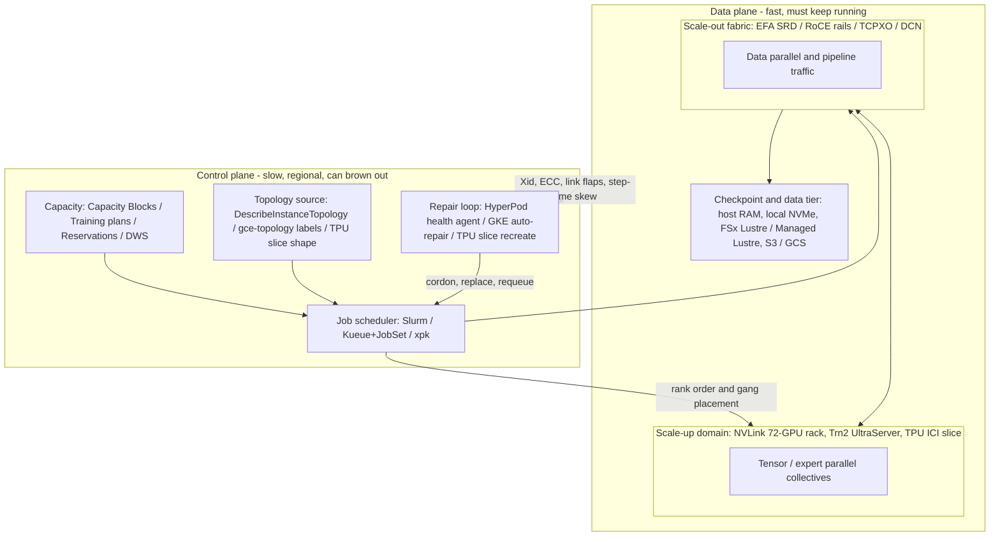

# High-Performance AI Cluster Architectures

## TL;DR

A synchronous training job behaves like one big machine: if one accelerator stalls or fails, every rank stops, so job MTBF falls roughly as 1/N and the number that matters is goodput, not peak FLOPs.
Every AI cluster has two fabrics: a scale-up domain (NVLink/NVSwitch, NeuronLink, TPU ICI) with TB/s per chip, and a scale-out fabric (EFA/SRD, RoCE, GPUDirect-TCPXO, TPU DCN) with roughly 0.4 Tb/s per accelerator, and parallelism has to be mapped onto them in that order.
Placement is a topology problem: EC2 exposes network-node hierarchies, Compute Engine and GKE expose block/sub-block/host labels, and TPUs expose slice shapes built from OCS-wired cubes; a scheduler that ignores this pays in cross-spine collective time on every step.
Automated repair (HyperPod health agents and auto-resume, GKE node auto-repair and atomic TPU slice repair) only works if the provider control plane works, so hot spares, in-memory checkpoints and fast restart are what keep goodput up during regional control-plane brownouts.
Accelerator capacity, not dollars, is the binding constraint: Capacity Blocks, training plans, reservations and Dynamic Workload Scheduler trade commitment risk against idle cost, and picking that portfolio is a principal-level decision.

## Mental Model



An AI cluster is a control loop wrapped around a big synchronous computation.
The data plane is the job: thousands of ranks moving tensors over two fabrics, one fast and local, one slower and wide.
The control plane decides which physical machines join the job and in which rank order, and which ones get evicted when they break.
How well a cluster performs is mostly determined before the first step runs, by placement (the order of ranks relative to switches) and capacity (whether a spare exists when something fails).
The repair loop runs at control-plane speed, minutes to hours, while the job loses money at data-plane speed every second it is stalled.
Everything below is about cutting the time between "a chip misbehaves" and "the job is stepping again at full speed".

## Internals

### The cluster is one synchronous machine

In data-parallel and fully-sharded training, every optimizer step ends in a collective (all-reduce or reduce-scatter plus all-gather) that cannot finish until the slowest rank contributes.
That makes the job a series system: if each node fails independently at rate lambda, a job on N nodes fails at roughly N x lambda, and job MTBF is node MTBF divided by N.
Meta's Llama 3 report gives a public calibration point: in a 54-day snapshot of pre-training on 16,384 H100 GPUs there were 466 job interruptions, 419 of them unexpected, and about 78% of the unexpected ones traced to confirmed or suspected hardware, with faulty GPUs and HBM3 the leading categories (Meta, The Llama 3 Herd of Models, 2024-07).
Taking 419 interruptions over 2,048 nodes and 54 days gives roughly 1.6e-4 interruptions per node-hour, or a per-node MTBF of about 6,300 hours.
With that rate, a 128-node (1,024-GPU) job fails about every 49 hours and a 2,048-node job about every 3.1 hours.
Meta's reliability study of its research clusters reports the same inverse scaling, with mean time to failure shrinking from hours at the thousand-GPU scale toward minutes in projections for 100K-GPU jobs (Kokolis et al., Revisiting Reliability in Large-Scale ML Research Clusters, arXiv 2410.21680, 2024-10; exact MTTF figures UNVERIFIED in this edition).

The classical way to tune checkpointing against this is the Young/Daly first-order optimum: interval T_opt = sqrt(2 x C x M), where C is the blocking checkpoint cost and M is job MTBF (Young, CACM 1974; Daly, FGCS 2006).
The fraction of time wasted is approximately C/T + T/(2M) + R/M, where R is restart time: detect, replace node, re-rendezvous, reload state, warm up compilation caches.
The point that getting-started guides do not make is that R/M takes over at scale, because M shrinks with N while R does not.
The Worked Example puts numbers on this: at 2,048 nodes, a 20-minute restart alone costs more than 10% of wall clock, whatever the checkpoint interval.
This is why the 2024-2026 platform features (in-memory and tiered checkpointing, hot spares, peer-to-peer state recovery, health checks before a node is admitted) all target R and M, not C.

ByteDance's MegaScale paper is the best public description of what a production fix for this looks like.
It covers a 12,288-GPU training system that reached 55.2% MFU on a 175B model, plus a diagnosis stack (heartbeats, in-band RDMA traffic monitoring, NCCL test bisection, CUDA-event-based per-rank timelines) that kept effective training time above 90% (Jiang et al., NSDI 2024).

### Two fabrics and why rank order matters

A modern 8-GPU node has a scale-up fabric (NVLink through NVSwitch, roughly 900 GB/s per H100 GPU) and a scale-out fabric (P5 provides 3,200 Gbps of EFA per instance, so 400 Gbps per GPU) (AWS P5 launch, 2023-07).
That is about a 9x bandwidth gap per direction per GPU between the two fabrics, before counting the latency difference.
So the mapping is roughly fixed: tensor parallelism and expert all-to-all stay inside the NVLink domain; pipeline stages cross the scale-out fabric point to point; data parallelism crosses it with large, overlap-friendly reduce-scatter and all-gather operations.
The next chapter, [[17-Cloud-AI-Engineering/Volume_10_AI_Infrastructure_on_Cloud/Chapter_04_Distributed_Training_Parallelism_Strategies|Distributed Training Parallelism Strategies]], derives the volumes; this chapter is about making the physical layout match them.

The scale-out fabric is built rail-optimized: NIC k on every node in a group connects to the same leaf switch (rail k), so the GPU-k-to-GPU-k traffic of ring and tree collectives stays one switch hop away within the group.
Above the leaves, spine and higher tiers are usually oversubscribed or shared with other tenants, and the cost of crossing them shows up as tail latency in collectives.
NCCL builds its rings and trees from rank order plus intra-node topology detection, not from knowledge of the cloud's switch hierarchy.
**The mechanism the getting-started guides skip:** if the scheduler hands out ranks in instance-ID or hostname order, consecutive data-parallel ranks land under different leaves, and every ring segment crosses the spine.
The fix is cheap and deterministic: get the provider's topology, sort hosts by (top node, middle node, leaf node), and assign ranks in that order, so that rings and pipeline neighbours share leaves and only the tree root crosses the top tier.
The Worked Example does this on AWS.

### EC2 UltraClusters and UltraServers

An EC2 UltraCluster is a physical deployment: high-end accelerated instances co-located in one Availability Zone on a non-blocking, petabit-class EFA network, with access to FSx for Lustre.
At P5 launch AWS described UltraClusters that scale to 20,000 H100 GPUs (AWS P5 launch, 2023-07).
At re:Invent 2024 AWS described its "10p10u" fabric for Trainium2 UltraClusters, targeting tens of petabits per second with under 10 microseconds of latency (AWS re:Invent 2024 infrastructure keynote; exact figures UNVERIFIED).
EFA's transport is Scalable Reliable Datagram (SRD), which sprays packets of one flow across many ECMP paths, tolerates out-of-order arrival, and runs retransmission in the Nitro card at microsecond timescales instead of in host software at millisecond timescales (Shalev et al., A Cloud-Optimized Transport Protocol for Elastic and Scalable HPC, IEEE Micro 2020).
Because SRD sprays, a single elephant flow does not hash onto one congested link the way RoCE's per-flow ECMP does.
That is why AWS can run large collectives on a shared Clos without per-tenant lossless-Ethernet tuning; the previous chapter, [[17-Cloud-AI-Engineering/Volume_10_AI_Infrastructure_on_Cloud/Chapter_02_Interconnect_Technologies_NVLink_EFA_and_TPU_ICI|Interconnect Technologies: NVLink, EFA, and TPU ICI]], covers the transport itself.

AWS now ships three building blocks:

- **8-accelerator instances**: p5.48xlarge (H100), p5e/p5en (H200; p5en adds EFAv3 and PCIe Gen5 host attach), p6-b200 (B200, EFAv4), trn2.48xlarge (16 Trainium2).
- **UltraServers**: several instances joined into one scale-up domain. The P6e-GB200 UltraServer exposes up to 72 Blackwell GPUs in one NVLink domain (AWS launch, 2025-07). The Trn2 UltraServer joins 64 Trainium2 chips over NeuronLink (AWS re:Invent, 2024-12).
- **The UltraCluster fabric**: connects instances or UltraServers over EFA.

UltraServers change the failure domain, and this is easy to miss.
The NVLink domain now spans several hosts and a rack-scale switch tray, so one failed compute tray or NVLink switch tray takes out a tensor-parallel group that is much bigger than one instance.
A replacement has to come from the same UltraServer class, which narrows the pool of usable spares.

**Placement controls on EC2:**

- Cluster placement groups ask for low-latency co-location.
- Capacity Blocks for ML sell future, time-boxed, co-located capacity inside UltraClusters. At launch they ran 1 to 14 days, up to 64 instances, and could be booked up to 8 weeks ahead (AWS docs, 2023-11). Later duration and size extensions are UNVERIFIED for 2026-10.
- The DescribeInstanceTopology API returns, for each supported instance, an ordered list of network node IDs from the top of the hierarchy down to the node the instance attaches to (AWS EC2 docs, 2023-11).

Two instances that share their last network node are under the same leaf.
Two that share only the first are joined only through the top tier.
The API is read-only and free.
It is the cheapest topology optimization available on AWS, and most teams do not use it.

### SageMaker HyperPod: managed cluster plus a repair loop

HyperPod launched at re:Invent 2023 with Slurm orchestration and added Amazon EKS orchestration in 2024 (AWS launch posts, 2023-11 and 2024-09).
Architecturally, it is a managed control plane that owns the EC2 instances in service-managed accounts, attaches their ENIs and EFA interfaces into your VPC, runs your lifecycle scripts from S3 at node creation, and runs a repair loop with four stages:

1. **Admission screening.** For EKS-orchestrated clusters, CreateCluster accepts per-instance-group `OnStartDeepHealthChecks` (InstanceStress, InstanceConnectivity), which run GPU or accelerator stress and EFA/NCCL connectivity tests before a node is marked schedulable (SageMaker API reference, 2025; parameter names UNVERIFIED for 2026-10). Admission screening matters because a newly provisioned node is the most likely one to be bad: burn-in failures cluster at the start of the bathtub curve.
2. **Continuous detection.** A health-monitoring agent on each node watches accelerator, interconnect and NIC signals (NVIDIA Xid and DCGM events, Neuron errors, EFA link state) and reports to the control plane.
3. **State machine.** On EKS, health is projected into the node label `sagemaker.amazonaws.com/node-health-status`. Its states include Schedulable, Unschedulable, UnschedulablePendingReboot and UnschedulablePendingReplacement (AWS docs, 2025; exact keys UNVERIFIED). Schedulers and operators see repair intent as Kubernetes metadata, which lets Kueue or your own controllers stop placing gang members onto a node that is about to disappear.
4. **Remediation and resume.** With `NodeRecovery: Automatic`, the faulty instance is rebooted or replaced. On Slurm, a job launched with `srun --auto-resume=1` is requeued onto the healthy set after replacement and restarts from the last checkpoint. Operators can force the same path by setting a Slurm node to fail with a reason such as `Action:Replace` or `Action:Reboot` (HyperPod docs, 2024).

Auto-resume only restarts the job.
It does not make restart fast, and it does nothing about the R term.
If the replacement instance is not already in the cluster's capacity, the repair loop is only as fast as an EC2 launch in a capacity-constrained pool.
Hence the spare-capacity question in the Worked Example.

HyperPod's later features address exactly the terms in the Young/Daly model:

- **Task governance** (Kueue-based quotas, priorities and preemption on EKS; AWS launch, 2024-12) and **flexible training plans** (reserved, time-boxed capacity for HyperPod; AWS launch, 2024-12) handle capacity.
- **Managed tiered checkpointing**, which writes checkpoints to host memory with peer replication and drains them to S3 asynchronously, attacks C and the reload part of R (AWS launch, 2025; UNVERIFIED).
- **Elastic and checkpointless training**, which lets a job continue or recover from peer state without a full storage reload, also targets R (AWS re:Invent, 2025-12; UNVERIFIED).

Treat the last two as features to verify against your SDK version before designing around them.

### GKE and Compute Engine AI clusters

On Google Cloud the GPU building blocks are A3 (H100), A3 Mega (H100 with GPUDirect-TCPXO), A3 Ultra (H200 with ConnectX-7 RDMA), A4 (B200) and A4X (GB200 NVL72, 4 GPUs per VM, 72 GPUs per NVLink domain) (Google Cloud GPU machine types docs, 2025).
The networking history is what you need to understand to debug these clusters.

**GPUDirect-TCPX and TCPXO (A3 and A3 Mega)** carry GPU traffic over Google's own Ethernet and TCP instead of RDMA.
The mechanism behind TCPX is header/payload split plus device-memory TCP.
The NIC splits each incoming segment and DMAs the payload directly into GPU memory, while the headers go to host memory where the kernel TCP stack processes them.
A user-space receive data path manager (RxDM, deployed as a privileged sidecar on GKE) and an NCCL network plugin manage the GPU buffer pools (Google Cloud GKE GPUDirect docs, 2024).
This is the upstream Linux "devmem TCP" receive design that Google engineers contributed to the kernel.
The practical consequences:

- TCPX needs specific kernel, driver, plugin and sidecar version combinations.
- A version drift between nodes shows up as NCCL falling back to host bounce buffers, which is silent apart from lower bus bandwidth.
- Each GPU NIC is a separate VPC network attachment, so GKE multi-networking objects (`Network`, `GKENetworkParamSet`) and per-pod interface annotations are part of the cluster's critical path.

TCPXO on A3 Mega offloads more of the data path to the NIC and doubles per-VM GPU network bandwidth over A3 (Google Cloud docs, 2024).

**A3 Ultra, A4 and A4X move to RDMA over Converged Ethernet** on ConnectX-7 NICs at 3,200 Gbps per VM in a rail-aligned, non-blocking design (Google Cloud docs, 2025).
This brings GCP's GPU clusters close to the conventional NCCL-over-RDMA model, along with its classic failure modes: PFC and ECN tuning, per-flow ECMP hash collisions, and link flaps that NCCL sees as timeouts.

**Cluster Director** (launched as Hypercompute Cluster in 2024 and renamed in 2025) is Google's dense-deployment and management layer: capacity in co-located blocks, topology-aware placement, and fault reporting (Google Cloud blog, 2024-10 and 2025; naming UNVERIFIED for 2026-10).
On GKE, nodes in these deployments carry topology labels: `cloud.google.com/gce-topology-block`, `cloud.google.com/gce-topology-subblock` and `cloud.google.com/gce-topology-host` (GKE docs, 2025; UNVERIFIED).
Kueue's Topology Aware Scheduling consumes a `Topology` object that lists those label levels.
It places a gang so that all pods fit under the lowest level that can hold them, and workloads ask for this through pod-set annotations for required or preferred topology level (Kueue docs, 2025; annotation names UNVERIFIED).
This is the GKE equivalent of sorting by DescribeInstanceTopology network nodes, except that it runs in the admission controller and not in a launcher script.
JobSet supplies the multi-job gang abstraction (one replicated job per slice or per pipeline stage, with a shared failure policy), and the Dynamic Workload Scheduler supplies capacity in flex-start (queue until the whole request fits) and calendar (fixed future window) modes (Google Cloud docs, 2025; calendar mode GA status UNVERIFIED).
GKE's control plane supports clusters of up to 65,000 nodes (Google Cloud blog, 2024-11).

### TPU slices, cubes, OCS and multislice

A TPU slice is a set of chips joined directly by inter-chip interconnect (ICI) in a 2D or 3D torus, with no NIC or switch in the path.
**v4 and v5p generations** build 3D slices from 4x4x4 cubes of 64 chips.
Inside a cube, ICI links are electrical.
The faces of each cube connect to optical circuit switches (OCS).
A TPU v4 pod is 64 cubes (4,096 chips) wired through 48 OCSes, and the OCS layer accounts for under 5% of system cost and under 3% of system power (Jouppi et al., TPU v4: An Optically Reconfigurable Supercomputer for Machine Learning, ISCA 2023).
TPU v5p scales the pod to 8,960 chips with 4,800 Gbps of ICI per chip (Google Cloud launch, 2023-12).
**Trillium (v6e) and v5e** use 2D tori of up to 256 chips per pod (Google Cloud docs, 2024).
**Ironwood (TPU7x)** scales to 9,216 chips per superpod with 192 GB of HBM per chip (Google Cloud blog, 2025-04; GA status and the 2026-10 product name UNVERIFIED).

The OCS mechanism matters more than the chip specs, because it determines how failures and placement behave.

- **Slices are compositions, not locations.** The scheduler programs OCS mirrors to connect any set of healthy cubes into the requested shape, so a slice does not need physically adjacent racks. That removes most of the fragmentation problem that plagues switched GPU clusters.
- **Failed cubes are swapped, not routed around.** When a host or chip in a cube fails, the system can rebuild the slice with a spare cube by reprogramming the OCS. Google's TPU v4 resilience paper describes this reconfiguration-based availability model and its effect on how often large slices can be scheduled (Zu et al., Resiliency at Scale: Managing Google's TPUv4 Machine Learning Supercomputer, NSDI 2024).
- **Torus wraparound depends on shape.** The wraparound links in a 3D slice come through the OCS on cube faces. A slice smaller than a full cube in some dimension is a mesh in that dimension, not a torus, and the worst-case hop count for a ring collective along that axis roughly doubles. The v4 paper also describes twisted-torus wirings for non-cubic shapes that raise bisection bandwidth (Jouppi et al., ISCA 2023; exact per-generation shape rules for v5p and Ironwood UNVERIFIED). The practical rule: request shapes whose dimensions are multiples of the cube edge, and benchmark your collective along each mesh axis.

**Multislice** joins several slices over the data-center network (DCN), meaning the hosts' ordinary NICs, not ICI (Google Cloud TPU docs, 2023).
ICI bandwidth per chip is roughly an order of magnitude above DCN bandwidth per chip, so the only collective that belongs on DCN is the data-parallel gradient reduction.
In practice, an FSDP or hybrid-sharded reduction runs within each slice and only the cross-slice reduction crosses DCN.
In JAX this is explicit: `mesh_utils.create_hybrid_device_mesh(ici_mesh_shape, dcn_mesh_shape)` returns a device array whose DCN axis spans slices.
You then name that axis "data" and keep "fsdp" and "tensor" axes inside the slice.
On GKE each slice is one multi-host TPU node pool and one JobSet replicated-job replica.
The runtime finds its peers through MEGASCALE_* environment variables (coordinator address, number of slices, slice ID), which tooling such as xpk wires up from JobSet labels (xpk and GKE docs, 2024; variable wiring UNVERIFIED for 2026-10).
Pathways, Google's single-controller runtime, coordinates many slices from one client and was used to train PaLM across two TPU v4 pods (Barham et al., Pathways, MLSys 2022; Chowdhery et al., PaLM, 2022).

**Atomicity** is the TPU property that most often surprises GPU engineers.
GKE treats a multi-host TPU slice node pool as one unit.
If one VM in the slice is unhealthy, the whole slice is unusable for SPMD work, and repair recreates the slice (GKE TPU docs, 2024).
In multislice, the JobSet failure policy normally restarts every slice when one slice fails.
So the blast radius of one bad host is the whole job, as with GPUs, but repair is coarser and faster: a slice comes back as a slice, and you never have to place a single replacement node into the right leaf.

### Control plane versus data plane

Every mechanism above has the split described in [[17-Cloud-AI-Engineering/Volume_01_Cloud_Architecture_Principles/Chapter_04_Control_Plane_vs_Data_Plane_Separation|Control Plane vs Data Plane Separation]].
The control plane covers four things: capacity acquisition (Capacity Blocks, reservations, DWS), placement (placement groups, topology APIs, Kueue TAS, OCS programming), health and repair (HyperPod agents, GKE auto-repair, slice recreation), and the orchestrator itself (Slurm controller, EKS or GKE API server).
The data plane is NCCL, Neuron collectives or XLA collectives over NVLink, EFA, RoCE, TCPXO or ICI and DCN, plus the checkpoint write path.
A healthy data plane keeps stepping through a control-plane outage, but only for as long as no component fails.
The first failure during a control-plane brownout turns into a stall that lasts until the control plane recovers, unless the replacement capacity and the restart path are already in place (see [[17-Cloud-AI-Engineering/Volume_01_Cloud_Architecture_Principles/Chapter_02_Regions_Zones_and_Static_Stability|Regions, Zones, and Static Stability]]).

## Numbers to Know

| Quantity | Value | Source and date |
|---|---|---|
| p5.48xlarge accelerators and scale-out network | 8x H100 80 GB, 3,200 Gbps EFA | AWS P5 launch, 2023-07 |
| H100 NVLink bandwidth per GPU | 900 GB/s | NVIDIA H100 spec, 2023 |
| P5 UltraCluster scale at launch | up to 20,000 H100 GPUs | AWS P5 launch, 2023-07 |
| P6e-GB200 UltraServer NVLink domain | up to 72 Blackwell GPUs | AWS launch, 2025-07 |
| Trn2 UltraServer | 64 Trainium2 chips over NeuronLink | AWS re:Invent, 2024-12 |
| Capacity Blocks for ML at launch | 1-14 days, up to 64 instances, up to 8 weeks ahead | AWS docs, 2023-11 (extensions UNVERIFIED) |
| DescribeInstanceTopology depth | ordered list of network nodes, 3 layers for most supported families | AWS EC2 docs, 2023-11 |
| A3 Ultra / A4 GPU network per VM | 3,200 Gbps RDMA (ConnectX-7) | Google Cloud docs, 2025 |
| A4X NVLink domain | 72 GPUs (18 VMs x 4 GPUs) | Google Cloud docs, 2025 |
| GKE max cluster size | 65,000 nodes | Google Cloud blog, 2024-11 |
| TPU v4 pod | 4,096 chips, 64 cubes of 4x4x4, 48 OCS | Jouppi et al., ISCA 2023 |
| TPU v4 OCS cost and power share | under 5% of cost, under 3% of power | Jouppi et al., ISCA 2023 |
| TPU v5p pod | 8,960 chips, 4,800 Gbps ICI per chip, 95 GB HBM | Google Cloud launch, 2023-12 |
| TPU v6e (Trillium) pod | 256 chips, 2D torus | Google Cloud docs, 2024 |
| Ironwood superpod | 9,216 chips, 192 GB HBM per chip | Google Cloud blog, 2025-04 |
| Llama 3 pre-training interruptions | 419 unexpected in 54 days on 16,384 H100s, ~78% hardware | Meta, 2024-07 |
| Derived per-node interruption rate | ~1.6e-4 per node-hour (MTBF ~6,300 h) | computed from Meta, 2024-07 |
| MegaScale | 12,288 GPUs, 55.2% MFU on 175B, >90% effective training time | Jiang et al., NSDI 2024 |
| p5.48xlarge on-demand, us-east-1 | ~$55/h after the 2025-06 price reduction | AWS pricing, 2025-06 (UNVERIFIED for 2026-10) |
| TPU v5p on-demand | $4.20 per chip-hour | Google Cloud pricing, 2024 (UNVERIFIED for 2026-10) |
| TPU v6e on-demand | $2.70 per chip-hour | Google Cloud pricing, 2024 (UNVERIFIED for 2026-10) |
| TPU v5e on-demand | $1.20 per chip-hour | Google Cloud pricing, 2024 (UNVERIFIED for 2026-10) |

Prices vary by region and by negotiated agreement, and they change often.
Treat every price row as an order of magnitude and re-check the pricing page before committing to a budget.

## AWS vs GCP Mechanism Parity

| Concern | AWS | Google Cloud | Critical difference |
|---|---|---|---|
| Scale-up domain | NVLink within p5/p6 instance; NVLink across P6e-GB200 UltraServer; NeuronLink across Trn2 UltraServer | NVLink within A3/A4 VM; NVL72 across A4X; ICI across entire TPU slice | A TPU slice is a scale-up domain of up to thousands of chips; GPU scale-up stops at 72 |
| Scale-out transport | EFA with SRD: multipath spraying, NIC-level retransmit, out-of-order tolerant | TCPX/TCPXO on A3/A3 Mega; RoCE on A3 Ultra/A4/A4X; DCN for TPU multislice | SRD avoids per-flow ECMP collisions by design; RoCE fleets depend on congestion-control tuning and hashing |
| Topology exposure | DescribeInstanceTopology network-node lists | Block/sub-block/host labels and physical host attributes; TPU topology string | AWS gives you raw hierarchy to consume yourself; GKE feeds it to Kueue TAS natively |
| Co-location primitive | Cluster placement group; UltraCluster via Capacity Blocks or reservations | Compact placement policy; Cluster Director blocks; TPU slice shape | TPU OCS composes slices from any healthy cubes, which reduces fragmentation |
| Capacity acquisition | On-demand, ODCR, Capacity Blocks, HyperPod training plans, Savings Plans | On-demand, reservations, future reservations, DWS flex-start and calendar, CUDs, Spot | Capacity Blocks are prepaid and terminate at window end; DWS flex-start queues until the whole request fits |
| Cluster manager | SageMaker HyperPod (Slurm or EKS), ParallelCluster, self-managed EKS | GKE with JobSet/Kueue, Cluster Director for Slurm, Cluster Toolkit | HyperPod owns instances in a service account; GKE nodes live in your project |
| Health detection | HyperPod health-monitoring agent, deep health checks before admission | GKE node auto-repair and node-problem signals, GPU health checks, faulty-host reporting | HyperPod projects repair intent into node labels; GKE repairs multi-host TPU slices atomically |
| Job resume | Slurm `--auto-resume=1`; Kubernetes job restart after node replacement | JobSet failurePolicy maxRestarts; Kueue requeue | Both restart from storage unless you add in-memory or peer checkpoints |
| Gang scheduling | Slurm natively; Kueue or Volcano on EKS | Kueue plus JobSet; xpk for TPUs | GKE multislice maps one slice to one JobSet replica |
| Parallel file tier | FSx for Lustre; S3 and S3 Express One Zone | Managed Lustre, Parallelstore, GCS with FUSE and Anywhere Cache | See [[17-Cloud-AI-Engineering/Volume_10_AI_Infrastructure_on_Cloud/Chapter_06_High_Throughput_Checkpointing_to_Object_Storage\|Checkpointing to Object Storage]] |
| Custom accelerator | Trainium2 with Neuron SDK, XLA-based compiler | TPU with XLA via JAX or PyTorch/XLA | TPU has multislice and OCS; Trainium leans on UltraServers plus EFA |

## Worked Example: Sizing a 1,024-accelerator run, then building topology-aware placement on both clouds

### Step 1 - Compute budget

Target: a 70B dense transformer trained on 2T tokens.
Training FLOPs are about 6 x N x D = 6 x 70e9 x 2e12 = 8.4e23.
On H100 at 989 TFLOP/s dense BF16 and an assumed 40% MFU, each GPU delivers about 3.96e14 FLOP/s.
On 1,024 GPUs (128 p5.48xlarge) that is 8.4e23 / (1,024 x 3.96e14) = about 2.07e6 s, or 24.0 days, which is about 590,000 GPU-hours.
At ~$55/h per instance (~$6.88 per GPU-hour, UNVERIFIED), the list-price compute bill is about $4.1M before discounts.
On TPU v5p at 459 TFLOP/s BF16 and an assumed 45% MFU, 1,024 chips take about 46 days and about 1.13M chip-hours, or about $4.7M at the $4.20 list price (UNVERIFIED).
That is a worse result than H100 at list price for this model size.
Committed-use pricing, and the fact that a v5p slice is one ICI domain (letting you use larger tensor or FSDP groups at higher MFU), can reverse the comparison.
The lesson: compare cost per useful FLOP at your measured MFU and your negotiated price, never spec sheets.
[[17-Cloud-AI-Engineering/Volume_09_FinOps_and_Cloud_Economics/Chapter_05_GPU_and_TPU_Unit_Economics|GPU and TPU Unit Economics]] develops this further.

### Step 2 - Failure budget and checkpoint interval

Using the derived rate of 1.58e-4 interruptions per node-hour, a 128-node job has M = 1/(128 x 1.58e-4) = about 49.5 hours.
Over 24 days (576 hours) that means about 11.6 expected interruptions.
Checkpoint state is about 16 bytes per parameter for BF16 weights plus FP32 master weights, two Adam moments, and gradients (or 14 bytes without gradients), so 70e9 x 16 = 1.12 TB.
At 50 GB/s of aggregate write bandwidth to FSx for Lustre, a synchronous checkpoint blocks for about 22 s; assume C = 30 s including the barrier.
Young/Daly gives T_opt = sqrt(2 x 30 x 178,200) = about 3,270 s, so checkpoint every ~55 minutes.
With R = 20 minutes, waste = 30/3270 + 3270/(2 x 178,200) + 1200/178,200 = 0.9% + 0.9% + 0.7% = about 2.5%.

Now scale the same job to 2,048 nodes (16,384 GPUs).
M falls to about 3.1 hours, T_opt falls to about 14 minutes, and waste rises to about 18%, of which restart alone (R/M) is about 11%.
With in-memory or tiered checkpoints (C = 5 s) and hot spares with pre-warmed images (R = 5 minutes), T_opt is about 5.6 minutes and waste drops to about 5.7%.
That 12-point gap is worth about $1.2M on a $10M run, which is why goodput engineering is a staff-level responsibility and not an afterthought.

### Step 3 - Hot spares

Repair turnaround (detect, drain, return to the provider, receive a healthy replacement) is the window in which a second failure finds no spare.
With 128 nodes and an assumed 48-hour turnaround, the expected number of nodes in repair is 128 x 1.58e-4 x 48 = about 0.97.
Under a Poisson model, P(more than 3 nodes in repair) is about 1.7%, so 4 spare nodes (about 3%) cover the run.
At 2,048 nodes the mean is about 15.5 nodes, and mean plus 2.5 sigma is about 25 nodes, about 1.2%.
Spare fraction falls with scale, but absolute spare count rises, and spares must sit under the same topology tier as the job to be useful.
That is a capacity-contract requirement (spares inside the same Capacity Block or reservation), not something to sort out at runtime.

### Step 4 - AWS: topology-aware rank ordering and Slurm tree (non-billable)

This script reads DescribeInstanceTopology and EC2 instance metadata.
It prints a Slurm `topology.conf` for `TopologyPlugin=topology/tree`, plus a host file in topology-sorted order for MPI or torchrun launchers.
Both API calls are free; the script does nothing useful unless you already run a supported instance family in the region.

```python
#!/usr/bin/env python3
# topo2slurm.py - build Slurm tree topology and rank order from EC2 instance topology.
# Requires: boto3, IAM permissions ec2:DescribeInstanceTopology and ec2:DescribeInstances.
import sys
import collections
import boto3

REGION = sys.argv[1] if len(sys.argv) > 1 else "us-east-1"
TYPES = sys.argv[2].split(",") if len(sys.argv) > 2 else ["p5.48xlarge"]

ec2 = boto3.client("ec2", region_name=REGION)

topo = []
pager = ec2.get_paginator("describe_instance_topology")
for page in pager.paginate(Filters=[{"Name": "instance-type", "Values": TYPES}]):
    topo.extend(page["Instances"])

if not topo:
    print("# no instances of", TYPES, "found in", REGION)
    sys.exit(0)

ids = [t["InstanceId"] for t in topo]
host = {}
for i in range(0, len(ids), 100):
    resp = ec2.describe_instances(InstanceIds=ids[i:i + 100])
    for r in resp["Reservations"]:
        for inst in r["Instances"]:
            host[inst["InstanceId"]] = inst["PrivateDnsName"].split(".")[0]

# NetworkNodes is ordered from the top of the hierarchy to the node the instance attaches to.
children = collections.defaultdict(set)
leaf_nodes = collections.defaultdict(list)
for t in topo:
    nn = t["NetworkNodes"]
    for parent, child in zip(nn, nn[1:]):
        children[parent].add(child)
    leaf_nodes[nn[-1]].append(host.get(t["InstanceId"], t["InstanceId"]))

print("# topology.conf generated from DescribeInstanceTopology")
for leaf, hosts in sorted(leaf_nodes.items()):
    print("SwitchName=%s Nodes=%s" % (leaf, ",".join(sorted(hosts))))
for parent, kids in sorted(children.items()):
    if parent not in leaf_nodes:
        print("SwitchName=%s Switches=%s" % (parent, ",".join(sorted(kids))))

# Rank order: sort by full network-node path so consecutive ranks share leaves.
ordered = sorted(topo, key=lambda t: (tuple(t["NetworkNodes"]), t["InstanceId"]))
with open("hostfile.sorted", "w") as f:
    for t in ordered:
        f.write(host.get(t["InstanceId"], t["InstanceId"]) + "\n")

per_leaf = collections.Counter(t["NetworkNodes"][-1] for t in topo)
print("# leaves=%d max_per_leaf=%d min_per_leaf=%d" % (
    len(per_leaf), max(per_leaf.values()), min(per_leaf.values())))
```

Run it with `python3 topo2slurm.py us-east-1 p5.48xlarge,p5en.48xlarge > topology.conf`.
On Slurm, submit with `sbatch --switches=1@00:30:00` to ask for a single leaf, waiting up to 30 minutes for one.
With torchrun or MPI, consume `hostfile.sorted` so that node rank follows network position.
The final comment line is your fragmentation alarm.
If a 128-node job spans many leaves with a skewed distribution, the job's tail collective latency is set by the most-crossed tier, and a replacement node landing in a new leaf makes it worse.

Next, check co-located capacity without buying it (free API):

```bash
aws ec2 describe-capacity-block-offerings \
  --region us-east-1 \
  --instance-type p5.48xlarge \
  --instance-count 16 \
  --capacity-duration-hours 48 \
  --start-date-range 2026-11-02T00:00:00Z \
  --end-date-range 2026-11-30T00:00:00Z \
  --query 'CapacityBlockOfferings[].[CapacityBlockOfferingId,StartDate,EndDate,UpfrontFee]' \
  --output table
```

Purchasing (`aws ec2 purchase-capacity-block --capacity-block-offering-id <id> --instance-platform Linux/UNIX`) charges an upfront, non-refundable fee.
Do not run it in a lab.

### Step 5 - GCP: two-slice TPU multislice on GKE (billable)

**Cost estimate:**

- Two v5e slices of topology 2x4 (8 chips, 2 hosts each) is 16 chips, about $19.20/h at the $1.20 on-demand list price (UNVERIFIED).
- The GKE cluster management fee is about $0.10/h and an e2-standard-4 system node is about $0.13/h (UNVERIFIED).
- One hour of lab is therefore about $20 on demand; `--spot` usually lowers this substantially but can be preempted.

Create a budget first:

```bash
export PROJECT_ID="$(gcloud config get-value project)"
export BILLING_ACCOUNT="XXXXXX-XXXXXX-XXXXXX"
gcloud billing budgets create \
  --billing-account="${BILLING_ACCOUNT}" \
  --display-name="tpu-multislice-lab" \
  --budget-amount=50USD \
  --filter-projects="projects/${PROJECT_ID}" \
  --threshold-rule=percent=0.5 \
  --threshold-rule=percent=0.9 \
  --threshold-rule=percent=1.0
```

A budget alerts; it does not stop spend, so teardown is still your job.

Provision the cluster and two single-slice node pools:

```bash
export REGION="us-west4"
export ZONE="us-west4-a"   # confirm with: gcloud compute tpus accelerator-types list --zone=${ZONE}
export CLUSTER="tpu-ms-lab"

gcloud container clusters create "${CLUSTER}" \
  --location="${REGION}" --node-locations="${ZONE}" \
  --release-channel=regular \
  --machine-type=e2-standard-4 --num-nodes=1 \
  --workload-pool="${PROJECT_ID}.svc.id.goog"

for i in 0 1; do
  gcloud container node-pools create "slice-${i}" \
    --cluster="${CLUSTER}" --location="${REGION}" --node-locations="${ZONE}" \
    --machine-type=ct5lp-hightpu-4t --tpu-topology=2x4 --num-nodes=2 \
    --spot
done

gcloud container clusters get-credentials "${CLUSTER}" --location="${REGION}"
# Install JobSet; pick the current release tag from github.com/kubernetes-sigs/jobset/releases.
export JOBSET_VERSION="v0.8.0"
kubectl apply --server-side -f \
  "https://github.com/kubernetes-sigs/jobset/releases/download/${JOBSET_VERSION}/manifests.yaml"
```

`--num-nodes=2` must equal chips divided by chips-per-VM (8 / 4).
Each node pool is one atomic slice.

The JobSet below puts one replicated-job replica in each node pool and wires up the multislice environment:

```yaml
# multislice.yaml
apiVersion: jobset.x-k8s.io/v1alpha2
kind: JobSet
metadata:
  name: ms
  annotations:
    alpha.jobset.sigs.k8s.io/exclusive-topology: cloud.google.com/gke-nodepool
spec:
  failurePolicy:
    maxRestarts: 2
  replicatedJobs:
  - name: slice
    replicas: 2
    template:
      spec:
        parallelism: 2
        completions: 2
        backoffLimit: 0
        template:
          spec:
            hostNetwork: true
            dnsPolicy: ClusterFirstWithHostNet
            restartPolicy: Never
            nodeSelector:
              cloud.google.com/gke-tpu-accelerator: tpu-v5-lite-podslice
              cloud.google.com/gke-tpu-topology: 2x4
            tolerations:
            - key: google.com/tpu
              operator: Exists
              effect: NoSchedule
            containers:
            - name: jax
              image: python:3.11-slim
              securityContext:
                privileged: true
              env:
              - name: JOBSET_NAME
                valueFrom:
                  fieldRef:
                    fieldPath: metadata.annotations['jobset.sigs.k8s.io/jobset-name']
              - name: REPLICATED_JOB_NAME
                valueFrom:
                  fieldRef:
                    fieldPath: metadata.annotations['jobset.sigs.k8s.io/replicatedjob-name']
              - name: MEGASCALE_COORDINATOR_ADDRESS
                value: "$(JOBSET_NAME)-$(REPLICATED_JOB_NAME)-0-0.$(JOBSET_NAME)"
              - name: MEGASCALE_NUM_SLICES
                value: "2"
              - name: MEGASCALE_SLICE_ID
                valueFrom:
                  fieldRef:
                    fieldPath: metadata.labels['jobset.sigs.k8s.io/job-index']
              command: ["bash", "-c"]
              args:
              - |
                pip install -q "jax[tpu]" -f https://storage.googleapis.com/jax-releases/libtpu_releases.html
                python - <<'EOF'
                import jax, jax.numpy as jnp
                from jax.experimental import mesh_utils
                from jax.sharding import Mesh, NamedSharding, PartitionSpec as P
                n_local = jax.device_count() // 2
                devs = mesh_utils.create_hybrid_device_mesh((1, n_local), (2, 1))
                mesh = Mesh(devs, ("data", "model"))
                x = jax.device_put(jnp.ones((2 * 1024, n_local * 1024)),
                                   NamedSharding(mesh, P("data", "model")))
                total = jax.jit(lambda a: a.sum())(x)
                print("proc", jax.process_index(), "devices", jax.device_count(),
                      "mesh", mesh.devices.shape, "sum", float(total))
                EOF
              resources:
                limits:
                  google.com/tpu: 4
```

```bash
kubectl apply -f multislice.yaml
kubectl get pods -o wide -w
kubectl logs -l jobset.sigs.k8s.io/jobset-name=ms --tail=5 --prefix
```

Each of the four processes should report 16 devices, a mesh of shape (2, 8), and a sum of 16,777,216.
The "data" axis crosses DCN between slices and the "model" axis stays on ICI.
To see atomic slice repair, delete one TPU VM in slice-1 from the Compute Engine console.
Then watch the node pool recover as a unit while the JobSet restarts both slices, consuming one of its `maxRestarts`.

**Teardown (exact):**

```bash
kubectl delete jobset ms --ignore-not-found
gcloud container clusters delete "${CLUSTER}" --location="${REGION}" --quiet
gcloud compute instances list --filter="name~${CLUSTER}" --format="table(name,status)" # expect empty
gcloud container clusters list --filter="name=${CLUSTER}" # expect empty
```

## Failure Modes and Pitfalls

### 1. Silent data corruption

A core or HBM bank that computes wrong values without raising an error corrupts gradients, and the first symptom may be a loss spike days later.
Google described "mercurial cores" that fail silently and repeatably at fleet scale (Hochschild et al., Cores That Don't Count, HotOS 2021).
Meta reported similar silent data corruption across its fleet, and the Llama 3 report lists SDC among its interruption causes (Meta, 2024-07).
Mitigations:

- Periodic deterministic replay of a fixed micro-batch, with cross-rank checksum comparison.
- Loss and gradient-norm anomaly detectors that trigger a bisection run.
- Keeping several historical checkpoints so you can roll back past the corruption.

### 2. Stragglers with no error

A thermally throttled GPU, an NVLink lane running degraded, a NIC that renegotiated to lower speed, or a host with a noisy daemon all slow every collective with nothing in the logs.
The health agent does not fire, because nothing is broken.
Detect stragglers from per-rank step-time and collective-time distributions, as MegaScale does, and evict nodes whose p50 step contribution is more than a few percent above the median.
A 1% straggler on a 2,048-node job costs as much as twenty idle nodes.

### 3. Repair needs the control plane

On 2025-10-19 and 2025-10-20, a latent race condition in DynamoDB's automated DNS management removed the regional DynamoDB endpoint record in us-east-1.
The resulting backlog in EC2's internal workflow and network-propagation systems impaired new instance launches for hours after DynamoDB recovered (AWS post-event summary, 2025-10).
On 2025-06-12, a null-pointer defect in Google's Service Control, triggered by a globally replicated policy change, caused API failures across many Google Cloud products (Google Cloud incident report, 2025-06).
In both events, running instances kept running, but anything that depended on launching a replacement or calling a management API stalled.
A cluster without in-cluster hot spares and locally reachable checkpoints turns its first hardware fault during such an event into an outage of the same length as the provider's.
See [[17-Cloud-AI-Engineering/Volume_07_Reliability_and_SRE/Chapter_07_Anatomy_of_Major_Cloud_Outages|Anatomy of Major Cloud Outages]].

### 4. Topology decay after repair

Each replacement lands wherever capacity exists.
After several weeks of repairs, a job that started with every node under a small number of leaves may span many, and step time drifts up a few percent at a time.
Re-run the topology report after every repair, alert on leaf-count growth, and prefer contracts in which spares sit in the same UltraCluster block or Cluster Director block.

### 5. Capacity window cliffs

Capacity Blocks end at a fixed time, and EC2 reclaims the instances near the end of the window (AWS docs, 2023-11; exact reclaim lead time UNVERIFIED).
A job that has not written a final checkpoint before then loses everything since the last one.
Schedule a forced checkpoint and graceful stop well ahead of the window end, and watch the window-end time from the same automation that launches jobs.

### 6. Slice atomicity surprises

On multi-host TPU slices, one bad VM makes the whole slice unschedulable, and in multislice the JobSet failure policy restarts every slice.
Teams that set `maxRestarts` low, or that reuse a failing slice because "only one host is bad", see repeated full-job restarts.
Size `maxRestarts` against the expected number of failures over the run, and alert on restart rate rather than on individual pod failures.

### 7. Image and driver drift on replacements

Lifecycle scripts or node images that pull "latest" drivers, the EFA installer, NCCL plugins or TCPX components can give a replacement node a different stack from its peers.
Results range from NCCL falling back to slower transports to outright hangs.
Pin every version, bake images, and make the admission deep health check include an NCCL all-reduce bus-bandwidth threshold, not just a pass/fail.

### 8. Checkpoint storms

Thousands of ranks writing shards at the same instant can exceed per-prefix request rates on S3 or GCS, or saturate Lustre metadata servers, which turns a 30-second checkpoint into a multi-minute stall.
Stagger writes, use hashed prefixes, write to host memory or local NVMe first and drain asynchronously, as covered in [[17-Cloud-AI-Engineering/Volume_10_AI_Infrastructure_on_Cloud/Chapter_06_High_Throughput_Checkpointing_to_Object_Storage|High-Throughput Checkpointing to Object Storage]].

### 9. Quota and address-space exhaustion

EC2 accelerator quotas are counted in vCPUs per instance family and region, and GCP GPU and TPU quotas are per region and per chip type.
A cluster-scale replacement or scale-up can hit quota limits even when physical capacity exists.
Multi-NIC instances also use many IP addresses each (a p5.48xlarge has 32 network cards), so EKS VPC CNI subnets and GKE multi-network subnets must be sized for the maximum node count plus spares.

### 10. Hang detection longer than MTBF

If the collective watchdog timeout is tens of minutes and job MTBF at scale is a few hours, a meaningful share of every failure's cost is waiting for the timeout.
Set the communicator timeout to a few times the worst healthy step time, and export heartbeats so that the orchestrator can kill a hung job before the library times out.
[[17-Cloud-AI-Engineering/Volume_10_AI_Infrastructure_on_Cloud/Chapter_08_Fault_Tolerance_and_Fleet_Resiliency_at_Scale|Fault Tolerance and Fleet Resiliency at Scale]] expands on detection pipelines.

## Security and Cost Angles

### Security

The HyperPod lifecycle-script S3 location runs code as root on every node at creation.
Write access to that prefix is equivalent to root on the cluster.
Restrict it to a deployment role, enable bucket versioning and object lock where appropriate, and alert on writes.
The HyperPod execution role should be scoped to the specific S3 prefixes, ECR repositories, CloudWatch log groups and KMS keys the cluster needs, and should never hold wildcard S3 access (see [[17-Cloud-AI-Engineering/Volume_02_AWS_Deep_Dive/Chapter_01_IAM_Policy_Evaluation_Engine|IAM Policy Evaluation Engine]]).
EFA requires a security group that allows all traffic to and from itself.
Isolate training clusters in dedicated subnets and security groups so that this broad rule does not reach other workloads.
Use SSM Session Manager or IAP-based access instead of open SSH, and route checkpoint traffic through S3 gateway endpoints or Private Google Access so that weights never cross the public internet.

On GCP, run training pods with Workload Identity, put the checkpoint and dataset buckets inside a VPC Service Controls perimeter, and encrypt checkpoints with CMEK so you can revoke access centrally (see [[17-Cloud-AI-Engineering/Volume_03_GCP_Deep_Dive/Chapter_03_VPC_Service_Controls_Security_Perimeters|VPC Service Controls]]).
TCPX receive-path sidecars and TPU containers often run privileged with host networking.
Constrain them with node-pool taints and admission policies so that only the training namespace can schedule onto accelerator nodes.
Model weights and optimizer state are the most valuable artifacts in the company.
Envelope-encrypt them with per-run data keys under a KMS key whose policy is narrower than the cluster role (see [[17-Cloud-AI-Engineering/Volume_08_Security_Identity_and_the_Data_Perimeter/Chapter_04_Encryption_Key_Hierarchies_and_Envelope_Encryption|Encryption Key Hierarchies]]).

### Cost

The largest lever is goodput.
Moving from 82% to 94% effective training time on a fixed-size reservation drops the cost per useful hour by 12.8% (a 14.6% throughput gain) that no negotiation will match.
The second lever is matching capacity instruments to workload shape:

- Capacity Blocks and training plans for bounded experiments.
- Multi-year commitments only for the baseline you will certainly use.
- DWS flex-start for jobs that can wait.
- Spot only for elastic, fault-tolerant work such as evaluation, small fine-tunes and data processing, never for large synchronous pre-training.

See [[17-Cloud-AI-Engineering/Volume_09_FinOps_and_Cloud_Economics/Chapter_02_Commitment_Discounts_Savings_Plans_vs_CUDs|Commitment Discounts]] and [[17-Cloud-AI-Engineering/Volume_09_FinOps_and_Cloud_Economics/Chapter_03_Spot_Economics_and_Interruption_Handling|Spot Economics]].
Idle reserved capacity is the silent killer.
Keep a preemptible backlog queue (evaluations, ablations) under Kueue or Slurm priorities so that reserved accelerators never sit idle between hero runs.
Checkpoint retention is real money at terabyte scale per checkpoint: keep a ladder (recent dense, older sparse) with lifecycle rules to colder storage classes.

## Interview Questions and Model Answers

### Question 1 (L5 - Senior)

You have 64 p5.48xlarge instances in one cluster placement group and NCCL all-reduce bus bandwidth is 30% below what a colleague measured on a 16-node job. What do you check, and in what order?

#### Model Answer

First I confirm that the comparison is fair: same message sizes, same NCCL and aws-ofi-nccl plugin versions, same EFA installer, and the same number of EFA devices visible in each instance.
A single instance with a missing or down EFA interface reduces bandwidth for every ring that passes through it.
Next I run `nccl-tests` all_reduce_perf on bisected halves and quarters of the fleet to find whether one host is the outlier, because collectives run at the speed of the slowest participant.
If no single host is bad, I pull DescribeInstanceTopology for all 64 instances and count distinct leaf network nodes.
At 16 nodes my colleague probably sat under one or two leaves, while at 64 the ring is crossing higher tiers, which costs latency and exposes the job to contention.
I then regenerate the host file in topology-sorted order, so consecutive ranks share leaves, and rerun.
That often recovers most of the gap without any hardware change.
If a gap remains, I compare against the expected algorithm-bandwidth curve for 64 nodes: ring all-reduce bus bandwidth should stay roughly flat with node count, but tree and latency terms grow, and small messages are latency-bound anyway.
Finally I check for noise on the hosts: CPU affinity of the NCCL proxy threads, NUMA placement relative to the NICs, and whether data loader processes are competing for PCIe bandwidth.

#### Follow-up Interviewer Question

After a week of node replacements the same job's step time has crept up 6%; how would you detect and prevent this automatically?

### Question 2 (L5 - Senior)

Explain the difference between a TPU slice and a multislice job, and how you would map FSDP, tensor parallelism and data parallelism onto a 4-slice v5p job.

#### Model Answer

A slice is a set of TPU chips connected directly by ICI in a torus, which behaves as one high-bandwidth collective domain.
On v5p it is assembled from 4x4x4 cubes through optical circuit switches.
Multislice joins several slices over the data-center network using host NICs, which gives much less bandwidth per chip than ICI.
The mapping follows bandwidth.
Tensor parallelism has the most frequent, latency-sensitive collectives, so it goes on an ICI axis, typically small and inside a cube.
FSDP's all-gathers and reduce-scatters are also large and frequent, so they go on the remaining ICI axes within the slice.
Pure data parallelism goes on the DCN axis between the four slices, because it only needs one gradient reduction per step, and that reduction can overlap with the backward pass.
In JAX I would build the mesh with `create_hybrid_device_mesh(ici_mesh_shape=(1, fsdp, tp), dcn_mesh_shape=(4, 1, 1))` and name the axes ("data", "fsdp", "tensor").
Only the "data" axis crosses DCN.
I would also check that the slice shape uses full cubes in each dimension, so the ICI axes are true tori with wraparound, not meshes.

#### Follow-up Interviewer Question

The DCN all-reduce is not overlapping well and shows up as 12% of step time; what are your options?

### Question 3 (L6 - Staff)

You are planning a 16,384-GPU pre-training run. Leadership asks for a goodput target and a plan to hit it. Walk through the numbers and the design.

#### Model Answer

I start from failure data, not optimism.
Meta's Llama 3 report implies about 1.6e-4 unexpected interruptions per node-hour, so 2,048 nodes give a job MTBF of about 3 hours, or about 8 interruptions a day.
Using the Young/Daly model, waste is about C/T + T/(2M) + R/M.
With a 30-second synchronous checkpoint to Lustre and a 20-minute restart, the optimum interval is about 14 minutes and waste is about 18%, most of it restart.
So the plan targets R and M first:

- **Cut R.** Keep hot spares inside the same capacity contract and topology block, sized by Poisson on the repair window (about 25 nodes at this scale for a 48-hour turnaround). Pre-pull container images and pre-warm compilation caches on the spares. Hold checkpoints in host memory with peer replication, so restart reloads at network speed rather than storage speed.
- **Cut C** to seconds with asynchronous, sharded checkpoints that block only for the device-to-host copy.
- **Raise effective M** by screening nodes with stress and NCCL tests before admission, which removes infant-mortality failures, and by proactively evicting nodes with rising correctable-error counts or straggler signatures.

With C at 5 seconds and R at 5 minutes, waste drops to about 6%, so I would commit to a goodput target around 90% and track it as an SLO with an error budget (see [[17-Cloud-AI-Engineering/Volume_07_Reliability_and_SRE/Chapter_01_SLIs_SLOs_and_Error_Budget_Engineering|SLIs, SLOs, and Error Budget Engineering]]).
I define goodput precisely as productive tokens per second divided by the theoretical tokens per second of the reserved fleet.
That definition counts idle spares and post-failure recomputation against us, so nobody can game it.
The trade-off I would state explicitly is that spares cost about 1-3% of the fleet permanently, which is cheap compared with the 12-point waste reduction.
The risk is correlated failures, such as a power or cooling event in one block, which Poisson spares do not cover.
For that I keep at least one checkpoint copy in regional object storage and rehearse a full-block loss.

#### Follow-up Interviewer Question

Your in-memory checkpoint replicates each shard to one peer; what failure pattern defeats it, and how do you choose the replication topology?

### Question 4 (L6 - Staff)

Compare the automated repair models of SageMaker HyperPod and GKE for GPU training, and describe what you would add on top of either.

#### Model Answer

HyperPod owns the instances and runs a health-monitoring agent plus optional deep health checks at node creation.
On EKS it exposes repair intent through a node health label with states such as pending reboot or pending replacement.
On Slurm it combines replacement with `--auto-resume` requeue.
The advantage is a closed loop with the provider's view of hardware faults and a single API to reboot or replace nodes.
GKE relies on node auto-repair driven by node conditions and health signals, plus Compute Engine host maintenance and faulty-host mechanisms.
Multi-host TPU slices are repaired as atomic units.
The advantage is that nodes live in your project and integrate with standard Kubernetes tooling such as Kueue and JobSet.
The weakness of both: they detect broken components well and degraded ones poorly, and both depend on a regional control plane that can brown out, as in the October 2025 us-east-1 event and the June 2025 Google Service Control incident.
On top of either I would add:

- A straggler detector built from per-rank step and collective timings, with an eviction policy.
- An SDC canary that replays a fixed batch and compares checksums.
- Hot spares already joined to the cluster, so replacement needs no launch API call.
- A topology auditor that rejects replacements landing outside the job's block.
- A watchdog that kills hung collectives within a few step-times instead of waiting for library timeouts.

I would also make every automated eviction rate-limited, so that a bad health-check rollout cannot drain the cluster.
That has been a real failure pattern in fleet automation generally.

#### Follow-up Interviewer Question

A new driver version makes the health agent flag 10% of nodes as unhealthy within an hour; how should the system behave?

### Question 5 (L6 - Staff)

A 512-GPU job's throughput dropped 15% overnight with no errors, no restarts and no code change. Diagnose it.

#### Model Answer

No errors and no restarts point to degradation rather than failure, so I look at distributions, not alarms.
I pull per-rank step time and per-collective time.
If one rank or one node is consistently last into the collective, it is a straggler: I check that GPU's clocks and temperature for throttling, NVLink error counters, and whether its NICs renegotiated to lower speed or lost an interface.
If every rank is uniformly slower, the cause is shared.
Candidates include a replacement node that moved the job across a higher network tier (check topology-leaf count against yesterday), fabric congestion from a neighbour, or storage: the data loader starving the GPUs, visible as rising time-to-first-batch and idle gaps in the GPU timeline.
I also check whether the checkpoint cadence changed or checkpoint writes slowed, which would show as periodic stalls rather than a uniform slowdown.
The fix depends on the cause: evict the straggler, re-sort ranks or move the job back into one block, or add data-loader prefetch and caching.
The lasting fix is to turn whichever signal identified the cause into an automated detector with an eviction or page policy.

#### Follow-up Interviewer Question

Suppose the cause is cross-tenant fabric congestion you cannot see; how do you prove it to the provider and protect the job?

### Question 6 (L7+ - Principal)

Your company needs roughly 20,000 accelerator-equivalents of training capacity for 18 months, plus burst capacity for experiments. Design the capacity strategy across AWS and Google Cloud.

#### Model Answer

I treat capacity as a portfolio with three layers, each with a different cost of being wrong.
**The baseline layer** is the hero training runs, which need large contiguous blocks under one topology domain.
That means long-term reservations or committed contracts in one region per cloud, sized to the 18-month plan's minimum certain need, not its forecast.
Being over-committed means paying for idle hardware, while being under-committed only means paying a higher price for burst.
**The experiment layer** uses time-boxed instruments, Capacity Blocks or HyperPod training plans on AWS and DWS calendar or flex-start on GCP, which match bursty demand without long commitments.
**The opportunistic layer** is Spot and preemptible capacity for evaluation and data processing, scheduled behind priorities on the baseline cluster so reserved capacity never idles.
Across clouds, the real decision is not "multi-cloud for resilience".
Synchronous training cannot span clouds or even regions efficiently, so each run lives on one cluster.
The real decision is which hardware family carries which model.
TPU multislice gives a very large ICI domain and coarse but fast slice repair, while GPU UltraClusters give the broadest software ecosystem and UltraServer-class NVLink domains.
I would keep the training stack portable at the framework level (JAX or PyTorch with XLA or Neuron backends, plus a common checkpoint format), so that capacity can move between providers between runs, which also strengthens our negotiating position.
The costs I would flag: dual platform teams, duplicated validation of numerics across hardware, and egress for datasets and checkpoints (see [[17-Cloud-AI-Engineering/Volume_04_AWS_vs_GCP_Translation/Chapter_07_Multi_Cloud_and_Hybrid_Architecture_Reality|Multi-Cloud and Hybrid Architecture Reality]]).
Governance: a quarterly capacity review that compares measured goodput per dollar on each platform, not list price, and drives the next commitment.

#### Follow-up Interviewer Question

Six months in, a new accelerator generation offers 2x performance per dollar but you hold 12 more months of commitment on the old one; what do you do?

### Question 7 (L7+ - Principal)

Argue for or against building a 400B-parameter mixture-of-experts training platform on TPU multislice versus GPU UltraServers on EC2.

#### Model Answer

MoE training is dominated by expert all-to-all, which needs high bisection bandwidth across the expert-parallel group, so the deciding question is how large a group the scale-up domain can hold.
A 72-GPU NVLink domain on P6e-GB200 or A4X holds a 64-way or 72-way expert group entirely on NVLink, and beyond that the all-to-all crosses EFA or RoCE at roughly an order of magnitude less bandwidth.
A TPU slice holds thousands of chips on ICI, so expert parallelism can span far more chips without touching the network.
The cost is that a torus has lower bisection bandwidth per chip than a switched NVLink domain for all-to-all patterns, and shape choice (full cubes, twisted tori where offered) matters.
Operationally, TPU's OCS composition reduces fragmentation and slice repair is atomic and fast.
GPU UltraServers bring a rack-scale failure domain where one tray loss removes a 72-GPU group, and spares must be of the same UltraServer class.
The software side matters as much: the TPU path means XLA and JAX or PyTorch/XLA, while the GPU path has the deepest kernel ecosystem for MoE routing and FP8.
My recommendation depends on three measurements I would insist on before committing:

- Expert all-to-all throughput at the target expert-parallel degree on each platform.
- End-to-end MFU on a scaled-down proxy model.
- Goodput under injected failures.

Absent those, I would not pick based on peak FLOPs, because MoE efficiency is set by communication and routing balance, not arithmetic.

#### Follow-up Interviewer Question

How would you design the scaled-down proxy so that its results actually predict behaviour at full scale?

## Further Reading

- [TPU v4: An Optically Reconfigurable Supercomputer for Machine Learning (ISCA 2023)](https://arxiv.org/abs/2304.01433) - the primary source on cubes, OCS, twisted tori and why optical reconfiguration improves availability.
- [Resiliency at Scale: Managing Google's TPUv4 Machine Learning Supercomputer (NSDI 2024)](https://www.usenix.org/conference/nsdi24/presentation/zu) - how Google runs reconfiguration, failure handling and scheduling in production TPU pods.
- [MegaScale: Scaling Large Language Model Training to More Than 10,000 GPUs (NSDI 2024)](https://www.usenix.org/conference/nsdi24/presentation/jiang-ziheng) - the most detailed public description of straggler and fault diagnosis on a 12K-GPU cluster.
- [The Llama 3 Herd of Models (Meta, 2024)](https://arxiv.org/abs/2407.21783) - the public interruption taxonomy for a 16K-GPU run, used here to calibrate failure math.
- [Revisiting Reliability in Large-Scale Machine Learning Research Clusters (Meta, 2024)](https://arxiv.org/abs/2410.21680) - fleet-level MTTF data and projections for how failure rates scale with job size.
- [Pathways: Asynchronous Distributed Dataflow for ML (MLSys 2022)](https://arxiv.org/abs/2203.12533) - the single-controller runtime that coordinates multi-pod TPU training.
- [Cores That Don't Count (HotOS 2021)](https://sigops.org/s/conferences/hotos/2021/papers/hotos21-s01-hochschild.pdf) - the foundational account of silent data corruption at fleet scale.
- Shalev et al., A Cloud-Optimized Transport Protocol for Elastic and Scalable HPC, IEEE Micro 2020 - the SRD design behind EFA's multipath spraying.
- [Amazon EC2 instance topology documentation](https://docs.aws.amazon.com/AWSEC2/latest/UserGuide/ec2-instance-topology.html) - the API contract for network-node hierarchies used in the Worked Example.
- [Amazon SageMaker HyperPod documentation](https://docs.aws.amazon.com/sagemaker/latest/dg/sagemaker-hyperpod.html) - current resiliency, health-check and orchestration options, which change frequently.
- [Cloud TPU Multislice introduction](https://cloud.google.com/tpu/docs/multislice-introduction) - official model of ICI versus DCN and supported generations.
- [GKE TPU Multislice guide](https://cloud.google.com/kubernetes-engine/docs/how-to/tpu-multislice) - JobSet-based deployment details for multislice on GKE.
- [AWS Builders' Library: Static stability using Availability Zones](https://aws.amazon.com/builders-library/static-stability-using-availability-zones/) - the principle behind keeping spares and restart paths independent of control-plane calls.
- [AWS post-event summary, us-east-1, October 2025](https://aws.amazon.com/message/101925/) - a concrete case of launch-path impairment that stalls control-plane-dependent repair.
- Young, A First Order Approximation to the Optimum Checkpoint Interval, CACM 1974, and Daly, A Higher Order Estimate of the Optimum Checkpoint Interval, FGCS 2006 - the checkpoint-interval mathematics used in the sizing section.
