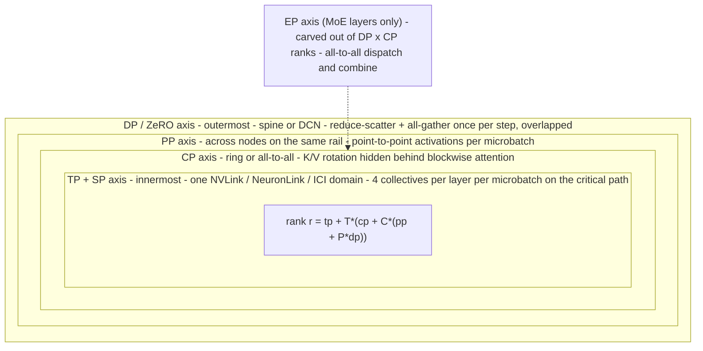

# Distributed Training Parallelism Strategies

## TL;DR

Each parallelism axis splits a different tensor dimension: DP splits the batch, TP the hidden dimension, CP/SP the sequence, PP the layer stack, and EP the expert set.
Put each axis on the network tier its traffic can tolerate: TP inside the NVLink/NeuronLink/ICI scale-up domain, CP next, PP across nodes, and DP (plus ZeRO sharding) outermost across the spine or DCN.
How much compute you get per byte moved depends on the axis: TP is about 4.5h/(t-1) FLOP/byte, DP is about 1.5 x tokens-per-replica, PP is about 36hL/p, and fine-grained EP is about 2.25 x expert-FFN-width.
Pipeline bubble fraction is (p-1)/(v*m), and the global batch size caps m x d, so at large scale the batch ceiling, not memory, forces you into model parallelism.
A synchronous job's blast radius is the whole job, so parallelism layout, checkpoint cadence, and hot-spare policy are one design decision.

## Mental Model



Treat a training job as a 4- or 5-dimensional device mesh laid over a physical bandwidth hierarchy.
The rank formula puts TP in the fastest-varying position, so ranks next to each other land on GPUs in the same NVLink domain.
Each axis farther out tolerates roughly an order of magnitude less bandwidth, because its collectives run less often or carry more compute per byte.
Every axis is a trade: something you would otherwise hold redundantly (weights, activations, optimizer state, experts) gets sharded, and you pay in collectives that must either hide behind compute or stall it.
The planner in this chapter uses the arithmetic-intensity framing to show why the mesh order is fixed by physics rather than taste.

## Internals

### Why parallelism exists: three walls

A dense model with N parameters trained with mixed-precision Adam needs about 2 bytes (bf16 weights) + 4 bytes (fp32 gradient buffer) + 12 bytes (fp32 master, m, v) = 18 bytes per parameter before activations.
A 70B model therefore needs ~1.27 TB of static state, roughly 16x an 80 GB HBM part.
That is the memory wall, and it forces sharding of weights (TP, PP, ZeRO-3/FSDP) or of optimizer state (ZeRO-1/2).
Training FLOPs are ~6N per token plus attention, so 2T tokens on 70B is ~8.5e23 FLOPs; one GPU would take decades, so you need thousands of devices running at once.
That is the compute wall.
The third wall is the one beginners miss: the global batch size B cannot grow without bound, because past the critical batch size more samples per step stop reducing the number of steps to a target loss ([McCandlish et al. 2018](https://arxiv.org/abs/1812.06162)).
With DP alone, B = d x b x m, so a fixed B caps the DP degree d.
Every GPU beyond that cap has to be used through TP, CP, PP, or EP.
This batch ceiling is why trillion-token runs on 16K GPUs use model parallelism even when ZeRO-3 alone could hold the weights.

### Data parallelism: the mechanism under DDP

Every DP rank holds a full replica (or, with ZeRO, a shard of the optimizer state), processes its own microbatches, and the ranks all-reduce gradients before the optimizer step.
PyTorch DDP groups gradients into buckets (25 MB by default via `bucket_cap_mb`) in reverse layer order and fires each bucket's all-reduce as soon as autograd has filled it.
That lets the last layers' communication overlap the first layers' backward compute.
A ring all-reduce over n ranks sends 2(n-1)/n x S bytes per rank, which is bandwidth-optimal and nearly independent of n; latency grows linearly with n, which is why NCCL switches to tree or hierarchical algorithms at scale.
ZeRO stage 1 replaces the all-reduce with a reduce-scatter of gradients plus an all-gather of updated parameters, the same total volume, and the optimizer state per GPU drops by a factor of d ([Rajbhandari et al., SC20](https://arxiv.org/abs/1910.02054)); the next chapter covers stages 2 and 3.
DP compute intensity is roughly 6 x N x tokens_per_replica FLOPs over 4N bytes (bf16 reduce-scatter + all-gather), about 1.5 FLOP/byte per token per replica.
At 64K tokens per replica per step that is ~98K FLOP/byte, enough to hide gradient traffic even behind a 400 Gbps-per-GPU NIC.
That arithmetic is why DP goes on the slowest, outermost tier.

### Tensor parallelism: Megatron's conjugate operators

Megatron-LM ([Shoeybi et al. 2019](https://arxiv.org/abs/1909.08053)) splits each transformer MLP into a column-parallel first GEMM (W1 split along its output dimension) and a row-parallel second GEMM (W2 split along its input dimension).
The elementwise GeLU between them needs no communication, because each rank holds complete columns of the intermediate activation.
The block is wrapped in two operators that are conjugates of each other.
Operator f is identity in forward and all-reduce in backward, because the input gradient is a sum of the partial products from every column shard.
Operator g is all-reduce in forward (summing the row-parallel partial outputs) and identity in backward.
Attention uses the same pattern: Q, K, V projections are split by heads (column-parallel), and the output projection is row-parallel.
The result is 2 all-reduces in forward and 2 in backward per transformer layer, each on an s x b x h activation buffer.
They are synchronous and sit on the critical path; without dedicated TP-comm overlap kernels, they stall the GEMMs.
Per token per layer, a TP rank does ~72h^2/t FLOPs (forward plus backward over ~12h^2 parameters) and sends ~16h(t-1)/t bytes, an intensity of about 4.5h/(t-1).
For h = 8192 and t = 8 that is ~5.3K FLOP/byte.
Over NVLink, an H100 needs only ~1.5K FLOP/byte (about 550 effective TFLOP/s over about 360 GB/s effective), so the comm hides.
Over a 400 Gbps NIC (about 40 GB/s effective per GPU) it needs ~14K FLOP/byte, so cross-node TP is comm-bound by roughly 2.6x.
That is the first-principles reason TP stays inside one scale-up domain, and why TP degree is capped by NVLink domain size rather than by memory.
A second constraint shows up with grouped-query attention: once t exceeds the number of KV heads, the KV projections must be replicated rather than sharded, which wastes memory and FLOPs.

### Sequence parallelism (Megatron-style): the equal-volume trick

The mechanism most getting-started guides skip is that a ring all-reduce is literally a reduce-scatter followed by an all-gather.
[Korthikanti et al.](https://arxiv.org/abs/2205.05198) exploit this by cutting the all-reduce in g into its two halves and moving the halves to opposite sides of the LayerNorm and dropout regions.
Between the reduce-scatter and the next all-gather, activations are sharded along the sequence dimension, so LayerNorm, dropout, and residual-add tensors (which pure TP replicates on every rank) shrink by t.
Total bytes on the wire are unchanged, so the activation memory saving is free in bandwidth terms.
The paper reports that sequence parallelism plus selective activation recomputation (recomputing only the attention softmax/dropout region) cut activation memory by ~5x versus the TP baseline ([Korthikanti et al., MLSys 2023](https://arxiv.org/abs/2205.05198)).
In that paper's accounting, activations per layer are s x b x h x (34 + 5as/h) bytes without parallelism, and 34 x s x b x h / t with TP + SP + selective recompute.
The 5as/h term is the materialized attention matrix, which fused flash-attention kernels never store anyway.
An operational subtlety: dropout inside a TP region needs identical RNG streams across TP ranks for replicated tensors and different streams for sharded ones.
Megatron handles this with a dedicated CUDA RNG state tracker, and getting it wrong corrupts training silently rather than crashing.

### Context parallelism: ring attention vs all-to-all

Long-context training (32K to 1M tokens) needs the sequence sharded through attention itself, not just the pointwise regions.
Ring attention ([Liu et al. 2023](https://arxiv.org/abs/2310.01889)) keeps each rank's query block resident and rotates K/V blocks around a ring of cp ranks.
At each step it computes blockwise attention and merges partial results with the online-softmax rescaling trick from flash attention.
The overlap condition is the key number: per ring step, attention math is ~4 x (s/cp)^2 x h_local FLOPs, while the K/V transfer is ~2 x (s/cp) x h_kv_local x 2 bytes.
Intensity therefore grows linearly with the local sequence block, so CP hides its traffic only once s/cp is large enough for the link it crosses.
GQA helps a lot, because K/V is h_kv/h the size of the activations (1/8 for a 64-query, 8-KV-head model).
Causal masking creates load imbalance, since the rank holding the last block does the most work; production systems reorder blocks (zigzag or striped assignment) so each rank holds an early and a late chunk.
DeepSpeed-Ulysses ([Jacobs et al. 2023](https://arxiv.org/abs/2309.14509)) instead does an all-to-all that swaps the sharded dimension from sequence to heads, runs ordinary full-sequence attention on a subset of heads, and swaps back with a second all-to-all.
Its degree is capped by head count, and with GQA by KV-head count unless K/V are replicated, which is why hybrid ring x Ulysses layouts exist.
Llama 3 405B training used four axes (tensor, context, pipeline, and data parallelism) on up to 16K H100 GPUs ([Llama 3 paper, 2024](https://arxiv.org/abs/2407.21783)).

### Pipeline parallelism: bubbles, memory skew, and schedules

PP assigns contiguous layer ranges to p stages and streams m microbatches through them, exchanging one activation tensor (forward) and one gradient tensor (backward) per microbatch per stage boundary.
GPipe ([Huang et al., NeurIPS 2019](https://arxiv.org/abs/1811.06965)) runs all forwards and then all backwards, so the pipeline sits idle for a fraction (p-1)/m of ideal time and every stage holds m microbatches of activations.
1F1B (PipeDream-Flush, from the [PipeDream](https://arxiv.org/abs/1806.03377) line of work) has the same bubble, but after a warm-up of p-i forwards, stage i alternates one forward with one backward, capping in-flight activations at p-i microbatches.
Stage 0 therefore holds p microbatches x (L/p) layers = activations for all L layers at microbatch size b.
That memory skew is structural: the first stage hits the HBM wall first, and the last stage carries the LM head and loss.
Llama 3 rebalanced its stages by removing layers from the first and last stages (UNVERIFIED this revision).
Interleaved 1F1B gives each rank v non-contiguous layer chunks, which divides the bubble by v at the cost of v times more point-to-point messages and somewhat more activation memory.
The SC21 paper reports this schedule improved throughput by 10+% ([Narayanan et al., SC21](https://arxiv.org/abs/2104.04473)).
Zero Bubble PP ([Qi et al., ICLR 2024](https://arxiv.org/abs/2401.10241)) splits backward into B (input gradient, on the critical path to the previous stage) and W (weight gradient, schedulable anywhere) and uses W to fill the bubbles.
Its authors report up to 15% higher throughput than 1F1B under similar memory limits ([ICLR 2024](https://proceedings.iclr.cc/paper_files/paper/2024/hash/d5a8e37f38a08c68162452dcba89ae9c-Abstract-Conference.html)).
DeepSeek-V3's DualPipe feeds microbatches from both ends of the pipeline and overlaps forward/backward compute with MoE all-to-all, giving fewer bubbles and hiding most communication ([DeepSeek-V3 report](https://arxiv.org/abs/2412.19437)).
PP intensity is ~72h^2 x (L/p) x s x b FLOPs per stage over 4 x s x b x h bytes total (2 x s x b x h bytes per direction), giving about 36hL/p FLOP/byte per direction (or 18hL/p across both directions).
That is the highest of any axis, so PP tolerates slow links but pays in bubbles, memory skew, and schedule complexity.

### Expert parallelism: all-to-all and the tail-latency tax

A mixture-of-experts layer replaces the dense FFN with E experts and a router that sends each token to its top-k experts.
GShard ([Lepikhin et al. 2020](https://arxiv.org/abs/2006.16668)) and Switch Transformer ([Fedus et al. 2021](https://arxiv.org/abs/2101.03961)) introduced the production pattern: each EP rank hosts E/ep experts, an all-to-all dispatches tokens to the ranks owning their chosen experts, and a second all-to-all combines the outputs back.
Backward mirrors both, so every MoE layer costs 4 all-to-alls per step.
Each expert has a static buffer of capacity = C x (tokens x k / E) slots, where C is the capacity factor.
Tokens beyond that capacity are dropped (they pass through the residual path) or the buffer is padded, so C trades wasted FLOPs and memory against model quality.
An auxiliary load-balancing loss pushes the router toward uniform expert usage.
DeepSeek-V3 instead uses an auxiliary-loss-free per-expert bias adjustment and node-limited routing that caps how many nodes a token's experts can span (UNVERIFIED this revision).
On the wire, an all-to-all is n^2 flows with message sizes set by the router.
A hot expert makes one rank receive far more than average (incast), and the whole collective completes only when that slowest transfer lands, so step time tracks the maximum expert load rather than the mean.
Fine-grained experts make this worse: per token per MoE layer, expert compute is ~18 x h x f_e x k FLOPs against ~8 x k x h bytes of all-to-all, about 2.25 x f_e FLOP/byte.
For f_e around 2K that is ~4.6K FLOP/byte, which needs NVLink-class bandwidth or aggressive compute-communication overlap.
That is why EP is usually kept inside the scale-up domain or a small node group, and why the rack-scale NVLink domains on GB200 NVL72-class systems matter so much for MoE.
EP ranks are carved out of the DP x CP ranks for the MoE layers only, while attention layers keep their own TP/CP/DP layout.
Megatron-Core calls this "parallel folding."

### Composition and topology mapping

The canonical order from innermost to outermost is TP, CP, PP, DP.
Llama 3 describes the same order, chosen against its network bandwidth hierarchy ([Llama 3 paper, 2024](https://arxiv.org/abs/2407.21783)).
Under that order, rank r = tp + T x (cp + C x (pp + P x dp)), so the T ranks of a TP group are consecutive local ranks on one node.
In rail-optimized fabrics, local GPU i of every node connects to leaf switch ("rail") i.
DP and PP peers share a local rank index, so their traffic stays on one rail, one switch hop away, and never crosses the spine for intra-rail collectives.
Get the order wrong (for example DP innermost, TP outermost) and the job still runs, but TP all-reduces cross the NIC on every layer and throughput collapses.
Nothing errors out; the job just runs at a fraction of expected MFU.
On TPU, the mesh axes map onto physical torus dimensions inside a slice (ICI), and Multislice extends the outermost (data) axis across slices over the datacenter network (DCN).
GSPMD ([Xu et al. 2021](https://arxiv.org/abs/2105.04663)) and Alpa ([Zheng et al., OSDI 2022](https://arxiv.org/abs/2201.12023)) show the compiler-driven alternative: you annotate tensor shardings, and XLA inserts the same all-reduce, reduce-scatter, all-gather, and all-to-all collectives that Megatron hand-codes.
Physical topology for the accelerators and fabrics is covered in [[17-Cloud-AI-Engineering/Volume_10_AI_Infrastructure_on_Cloud/Chapter_02_Interconnect_Technologies_NVLink_EFA_and_TPU_ICI|Interconnect Technologies]] and [[17-Cloud-AI-Engineering/Volume_10_AI_Infrastructure_on_Cloud/Chapter_03_High_Performance_AI_Cluster_Architectures|High-Performance AI Cluster Architectures]].

### Control plane vs data plane, and failure domains

The data plane is the NCCL, Neuron collectives, or XLA/ICI traffic between ranks, plus the point-to-point sends between pipeline stages.
The control plane is rendezvous (the torchrun c10d store, the Slurm or Kubernetes job controller, the TPU runtime), communicator creation, health checking, and restart orchestration.
Synchronous training has no partial availability: a rank that dies or stalls blocks its TP collective, which blocks its pipeline, which blocks the DP gradient reduction, which blocks every other rank.
The failure domain is the job, so the blast radius equals the fleet size.
The [[17-Cloud-AI-Engineering/Volume_01_Cloud_Architecture_Principles/Chapter_03_Cell_Based_Architecture_and_Shuffle_Sharding|cell-based architecture]] instinct does not carry over directly.
What you can do instead is shrink the recovery window: fast detection, hot spares, in-memory or local-NVMe checkpoints, and in elastic designs, dropping a whole DP replica instead of restarting the job.
[MegaScale (NSDI 2024)](https://www.usenix.org/system/files/nsdi24-jiang-ziheng.pdf) is the best public account of the diagnosis and recovery tooling this requires at 10K+ GPU scale.

## Numbers to Know

| Quantity | Value | Source |
|---|---|---|
| PTD-P (Megatron TP+PP+DP) efficiency | 52% of peak on 1000s of GPUs, 1T-parameter model | ([Narayanan et al., SC21](https://arxiv.org/abs/2104.04473), paper 2021) |
| Interleaved 1F1B gain | 10+% throughput at comparable memory | ([Narayanan et al., SC21](https://people.eecs.berkeley.edu/~matei/papers/2021/sc_megatron_lm.pdf), paper 2021) |
| SP + selective recompute | ~5x activation memory reduction vs TP baseline | ([Korthikanti et al.](https://arxiv.org/abs/2205.05198), paper 2022) |
| Zero Bubble PP | up to 15% throughput over 1F1B at similar memory | ([Qi et al., ICLR 2024](https://proceedings.iclr.cc/paper_files/paper/2024/hash/d5a8e37f38a08c68162452dcba89ae9c-Abstract-Conference.html)) |
| MegaScale | 55.2% MFU, 175B model, 12,288 GPUs, 1.34x over Megatron-LM | ([MegaScale, NSDI 2024](https://www.usenix.org/system/files/nsdi24-jiang-ziheng.pdf)) |
| DeepSeek-V3 pre-training cost | 180K H800 GPU-hours per trillion tokens, 3.7 days per trillion tokens on their cluster | ([DeepSeek-V3 report](https://arxiv.org/pdf/2412.19437), paper 2024) |
| Llama 3 405B scale | up to 16K H100 80 GB HBM3 GPUs at 700 W, 8 GPUs per NVLink server | ([Llama 3 paper](https://arxiv.org/abs/2407.21783), paper 2024) |
| Llama 3 405B BF16 MFU | 38-43% depending on configuration | UNVERIFIED this revision |
| Ring all-reduce bytes per rank | 2(n-1)/n x S | derivation |
| Reduce-scatter or all-gather bytes per rank | (n-1)/n x S | derivation |
| Pipeline bubble fraction | (p-1)/(v x m) of ideal time | ([Narayanan et al., SC21](https://arxiv.org/abs/2104.04473)) |
| 1F1B peak in-flight microbatches (stage 0) | p | ([Narayanan et al., SC21](https://arxiv.org/abs/2104.04473)) |
| Activations per layer, TP+SP+selective recompute | 34 x s x b x h / t bytes | ([Korthikanti et al.](https://arxiv.org/abs/2205.05198)) |
| TP arithmetic intensity | ~4.5h/(t-1) FLOP/byte | derivation, this chapter |
| DP arithmetic intensity | ~1.5 x tokens per replica per step FLOP/byte | derivation, this chapter |
| PyTorch DDP default gradient bucket | 25 MB (`bucket_cap_mb`) | (PyTorch docs, as of 2026-10, UNVERIFIED) |
| H100 SXM NVLink bandwidth | 900 GB/s per GPU bidirectional | (NVIDIA spec, as of 2026-10, UNVERIFIED) |
| H100 SXM dense BF16 peak | ~989 TFLOP/s | (NVIDIA spec, as of 2026-10, UNVERIFIED) |
| AWS p5.48xlarge | 8x H100, 3200 Gbps EFA per instance | (AWS docs, as of 2026-10, UNVERIFIED) |
| Google TPU v5p pod | 8960 chips, 3D torus ICI | (Google Cloud docs, as of 2026-10, UNVERIFIED) |

## AWS vs GCP Mechanism Parity

| Mechanism | AWS | Google Cloud | Critical difference |
|---|---|---|---|
| TP / EP scale-up domain | 8-GPU NVLink nodes (P5/P5en/P6-B200); rack-scale NVLink on P6e-GB200 UltraServers; NeuronLink on Trn2 and Trn2 UltraServers (UNVERIFIED) | 8-GPU NVLink nodes (A3/A4); rack-scale NVLink on A4X (GB200); ICI inside a TPU slice (UNVERIFIED) | TPU ICI spans the entire slice (hundreds to thousands of chips), so TP/EP can extend beyond 8 without crossing a NIC; GPU domains are 8 or 72 |
| Scale-out transport for PP/DP | Elastic Fabric Adapter with SRD: multipath spraying, out-of-order reliable delivery offloaded to Nitro, via the aws-ofi-nccl libfabric plugin | GPUDirect-TCPXO on A3 Mega; RDMA over Converged Ethernet on A3 Ultra/A4 (UNVERIFIED); DCN between TPU slices | SRD's packet spraying makes the fabric tolerant of the ECMP flow collisions that hurt single-path RoCE flows; TPU DCN is much slower than ICI, so only DP belongs on it |
| Placement and locality | Cluster placement groups, EC2 UltraClusters | Compact placement policies; TPU slices are physically contiguous by construction | Without compact placement, PP/DP traffic crosses more switch tiers and tail latency widens |
| Collective library | NCCL (GPU), Neuron Collective Communication (Trainium) | NCCL plus Google's network plugins (GPU), XLA collectives over ICI (TPU) | On TPU, the compiler schedules collectives statically, so there is no runtime NCCL tuning surface |
| Parallelism frameworks | Megatron-Core/NeMo, PyTorch FSDP2 and DTensor; NeuronX Distributed Training on Trainium | Megatron-Core/NeMo on GPU; JAX + GSPMD/shard_map, MaxText on TPU | Megatron hand-places collectives; GSPMD infers them from sharding annotations |
| Orchestration and repair | SageMaker HyperPod (Slurm or EKS) with health checks and auto-resume; ParallelCluster | GKE with JobSet/Kueue, Cluster Director, Slurm; Multislice for TPU | Both replace failed nodes and restart from checkpoint; neither makes synchronous training survive a rank loss in place |
| Capacity acquisition | EC2 Capacity Blocks for ML, On-Demand Capacity Reservations | Dynamic Workload Scheduler (flex-start, calendar mode), reservations | Parallelism plans assume a fixed gang size; elastic capacity requires a re-shardable checkpoint |
| Gradient compression / low precision | FP8 via Transformer Engine on H100/B200 | FP8 on GPU; bf16 and int8 paths on TPU | FP8 communication halves bytes but adds scaling-factor bookkeeping |

## Worked Example: Plan a 4D Layout, Prove the TP/SP Mechanics, and Validate GSPMD Collectives

### Artifact 1: the TP and SP mechanics, proven numerically (CPU, free)

This script needs NumPy only.
It simulates t = 4 tensor-parallel ranks in one process and checks the conjugate-operator and equal-volume claims from the Internals section.

```python
#!/usr/bin/env python3
"""Simulate Megatron tensor parallelism and sequence parallelism with NumPy on one CPU."""
import numpy as np

rng = np.random.default_rng(0)
S, H, F, T = 16, 32, 128, 4          # sequence, hidden, ffn, tensor-parallel degree


def gelu(x):
    return 0.5 * x * (1 + np.tanh(0.7978845608 * (x + 0.044715 * x ** 3)))


def dgelu(x):
    k = 0.7978845608
    th = np.tanh(k * (x + 0.044715 * x ** 3))
    return 0.5 * (1 + th) + 0.5 * x * (1 - th ** 2) * k * (1 + 3 * 0.044715 * x ** 2)


def layernorm(x):
    mu, var = x.mean(-1, keepdims=True), x.var(-1, keepdims=True)
    return (x - mu) / np.sqrt(var + 1e-5)


X = rng.standard_normal((S, H))
W1 = rng.standard_normal((H, F)) / np.sqrt(H)
W2 = rng.standard_normal((F, H)) / np.sqrt(F)
dY = rng.standard_normal((S, H))

Z = X @ W1
Y_ref = gelu(Z) @ W2
dX_ref = ((dY @ W2.T) * dgelu(Z)) @ W1.T

W1s, W2s = np.split(W1, T, axis=1), np.split(W2, T, axis=0)
partial_Y = [gelu(X @ W1s[i]) @ W2s[i] for i in range(T)]          # forward: f = identity
Y_tp = sum(partial_Y)                                               # g = all-reduce
partial_dX = [((dY @ W2s[i].T) * dgelu(X @ W1s[i])) @ W1s[i].T for i in range(T)]
dX_tp = sum(partial_dX)                                             # backward of f = all-reduce
assert np.allclose(Y_tp, Y_ref) and np.allclose(dX_tp, dX_ref)

X_shards = np.split(X, T, axis=0)                                   # SP: each rank holds S/T rows
LN_shards = [layernorm(x) for x in X_shards]                        # LayerNorm is row-local
LN_full = np.concatenate(LN_shards, axis=0)                         # all-gather (g)
partial = [gelu(LN_full @ W1s[i]) @ W2s[i] for i in range(T)]
Y_rs = [sum(p[r * S // T:(r + 1) * S // T] for p in partial) for r in range(T)]  # reduce-scatter
Y_sp = np.concatenate(Y_rs, axis=0)
assert np.allclose(Y_sp, gelu(layernorm(X) @ W1) @ W2)

buf = S * H * 2
print("TP forward/backward match serial: True")
print("SP forward matches serial: True")
print(f"bytes/rank all-reduce={2*(T-1)/T*buf:.0f}  all-gather+reduce-scatter={2*((T-1)/T*buf):.0f}")
print(f"LayerNorm activation elements per rank: TP-only={S*H}  TP+SP={S*H//T}")
```

Output:

```text
TP forward/backward match serial: True
SP forward matches serial: True
bytes/rank all-reduce=1536  all-gather+reduce-scatter=1536
LayerNorm activation elements per rank: TP-only=512  TP+SP=128
```

### Artifact 2: a 4D layout planner (stdlib only, free)

Save as `plan_parallelism.py` and run with `python3 plan_parallelism.py`.
It enumerates TP x CP x PP x DP x interleave x microbatch, rejects layouts that exceed 90% of HBM, and scores the rest with the cost terms from the Internals section.
Calibrate the two bandwidth constants against `nccl-tests` on your own cluster before trusting any absolute number.

```python
#!/usr/bin/env python3
"""Back-of-the-envelope 4D parallelism planner (TP x CP x PP x DP) for dense decoder LLMs."""
import argparse
import itertools
from dataclasses import dataclass


@dataclass
class Model:
    layers: int = 80
    hidden: int = 8192
    heads: int = 64
    kv_heads: int = 8
    ffn: int = 28672
    vocab: int = 128256
    seq: int = 8192

    def params(self) -> float:
        h, kvh = self.hidden, self.hidden * self.kv_heads // self.heads
        attn = h * h + 2 * h * kvh + h * h          # Q, K, V (GQA), O
        mlp = 3 * h * self.ffn                       # SwiGLU gate, up, down
        return self.layers * (attn + mlp) + 2 * self.vocab * h


@dataclass
class Cluster:
    gpus: int = 1024
    gpus_per_node: int = 8           # size of the NVLink scale-up domain
    hbm_gb: float = 80.0
    peak_tflops: float = 989.0       # dense BF16 per GPU (vendor spec)
    gemm_eff: float = 0.60           # achievable fraction of peak for big GEMMs
    nvlink_gbps: float = 360.0       # effective GB/s per GPU inside the domain
    nic_gbps: float = 40.0           # effective GB/s per GPU across the fabric


def ring_bytes(n, size, kind):
    if n == 1:
        return 0.0
    return 2.0 * (n - 1) / n * size if kind == "allreduce" else (n - 1) / n * size


def evaluate(m, c, t, cp, p, v, mb, global_seqs, dp_overlap=0.8):
    d = c.gpus // (t * cp * p)
    if d * t * cp * p != c.gpus or global_seqs % (d * mb):
        return None
    if m.layers % (p * v) or m.heads % t or t > c.gpus_per_node:
        return None
    n_micro = global_seqs // (d * mb)
    if p > 1 and n_micro < p:
        return None
    N = m.params()
    n_local = N / (t * p)
    s_local = m.seq // cp
    h = m.hidden

    states = n_local * (2 + 4) + n_local * 12 / (d * cp)   # bf16 w + fp32 grad + sharded Adam
    interleave_pen = 1 + (p - 1) / (p * v) if v > 1 else 1.0
    act = 34 * s_local * mb * h / t * m.layers * interleave_pen
    mem_gb = (states + act) / 1e9

    tokens = global_seqs * m.seq
    attn_flops = tokens * 6 * m.layers * h * m.seq
    flops = tokens * 6 * N + attn_flops
    narrow = min(s_local * mb, h // t, m.ffn // t)          # heuristic GEMM-shape penalty
    eff = c.gemm_eff * narrow / (narrow + 128)
    t_comp = flops / (c.gpus * c.peak_tflops * 1e12 * eff)
    t_attn = attn_flops / (c.gpus * c.peak_tflops * 1e12 * eff)
    bubble = (p - 1) / (v * n_micro) if p > 1 else 0.0
    t_pipe = t_comp * (1 + bubble)

    buf = s_local * mb * h * 2
    tp_bytes = 8 * ring_bytes(t, buf, "allgather") * (m.layers / p) * n_micro
    t_tp = tp_bytes / (c.nvlink_gbps * 1e9)

    kv_buf = 2 * s_local * mb * (h * m.kv_heads // m.heads) * 2 / t   # TP shards KV heads
    cp_bytes = 3 * (cp - 1) * kv_buf * (m.layers / p) * n_micro
    cp_bw = c.nvlink_gbps if t * cp <= c.gpus_per_node else c.nic_gbps
    t_cp = max(0.0, cp_bytes / (cp_bw * 1e9) - t_attn) if cp > 1 else 0.0

    pp_bytes = 2 * buf / t * n_micro * v if p > 1 else 0.0
    pp_bw = c.nic_gbps if t * cp * p > c.gpus_per_node else c.nvlink_gbps
    t_pp = pp_bytes / (pp_bw * 1e9)

    dp_n = d * cp
    dp_bytes = ring_bytes(dp_n, n_local * 2, "allgather") * 2
    dp_bw = c.nic_gbps if t * cp * p >= c.gpus_per_node else c.nvlink_gbps
    t_dp = (1 - dp_overlap) * dp_bytes / (dp_bw * 1e9)

    step = t_pipe + t_tp + t_cp + t_pp + t_dp
    ideal = flops / (c.gpus * c.peak_tflops * 1e12)
    return dict(t=t, cp=cp, p=p, v=v, d=d, mb=mb, micro=n_micro, mem_gb=mem_gb,
                bubble=bubble, t_comp=t_comp, t_tp=t_tp, t_cp=t_cp, t_pp=t_pp,
                t_dp=t_dp, step=step, mfu=ideal / step)


def main():
    ap = argparse.ArgumentParser()
    ap.add_argument("--gpus", type=int, default=1024)
    ap.add_argument("--hbm-gb", type=float, default=80.0)
    ap.add_argument("--seq", type=int, default=8192)
    ap.add_argument("--global-tokens", type=float, default=4194304)
    ap.add_argument("--top", type=int, default=8)
    a = ap.parse_args()
    m, c = Model(seq=a.seq), Cluster(gpus=a.gpus, hbm_gb=a.hbm_gb)
    gseq = int(a.global_tokens // m.seq)
    print(f"params={m.params()/1e9:.1f}B  global_batch={gseq} seqs x {m.seq} tokens")
    rows = []
    for t, cp, p, v, mb in itertools.product([1, 2, 4, 8], [1, 2, 4, 8, 16],
                                            [1, 2, 4, 5, 8, 10, 16, 20], [1, 2, 4, 5], [1, 2]):
        r = evaluate(m, c, t, cp, p, v, mb, gseq)
        if r and r["mem_gb"] <= 0.9 * c.hbm_gb:
            rows.append(r)
    rows.sort(key=lambda r: r["step"])
    print("TP CP PP  v   DP mb micro  memGB bubble  comp   tp    cp    pp    dp   step   MFU")
    for r in rows[: a.top]:
        print(f"{r['t']:>2} {r['cp']:>2} {r['p']:>2} {r['v']:>2} {r['d']:>4} {r['mb']:>2} "
              f"{r['micro']:>5} {r['mem_gb']:>6.1f} {r['bubble']:>6.3f} {r['t_comp']:>5.2f} "
              f"{r['t_tp']:>5.2f} {r['t_cp']:>5.2f} {r['t_pp']:>5.2f} {r['t_dp']:>5.2f} "
              f"{r['step']:>5.2f} {r['mfu']:>5.1%}")
    if not rows:
        print("no feasible configuration: add GPUs, raise TP/PP, or enable ZeRO-3/FSDP")


if __name__ == "__main__":
    main()
```

Output for a 70.6B GQA model, 1024 GPUs, 4M-token global batch (top 3 rows):

```text
params=70.6B  global_batch=512 seqs x 8192 tokens
TP CP PP  v   DP mb micro  memGB bubble  comp   tp    cp    pp    dp   step   MFU
 2  4  8  5   16  1    32   54.1  0.044  3.34  0.12  0.00  0.13  0.09  3.83 49.3%
 2  4 16  5    8  1    64   41.2  0.047  3.34  0.12  0.00  0.27  0.04  3.93 48.0%
 2  4  8  2   16  1    32   60.1  0.109  3.34  0.12  0.00  0.05  0.09  3.97 47.6%
```

Output at 16,384 GPUs with a 16M-token batch (`--gpus 16384 --global-tokens 16777216`, top row):

```text
TP CP PP  v   DP mb micro  memGB bubble  comp   tp    cp    pp    dp   step   MFU
 4  4  8  5  128  1    16   26.7  0.087  0.84  0.09  0.02  0.03  0.04  1.09 43.2%
```

The second run shows the strong-scaling wall.
Each DP replica now gets 16 microbatches instead of 32, so the bubble doubles, and every exposed collective weighs more against a 0.84 s compute window.
The model is deliberately first-order and optimistic: it ignores stragglers, kernel launch overhead, LM-head stage imbalance, and NCCL protocol overheads.
Real runs land well below its estimates.

### Step-by-step capacity sizing (top row of the 1024-GPU run)

1. Parameters: 80 layers x (2 x 8192^2 + 2 x 8192 x 1024 + 3 x 8192 x 28672) + 2 x 128256 x 8192 = 70.6B.
2. Weights and gradients per GPU at TP=2, PP=8: 70.6B / 16 = 4.41B params x 6 bytes = 26.5 GB.
3. Adam state sharded over DP x CP = 64 ranks: 4.41B x 12 / 64 = 0.83 GB.
4. Activations at stage 0: 34 x (8192/4) x 1 x 8192 / 2 x 80 layers x (1 + 7/40) = 26.8 GB, so the total is 54.1 GB of 80 GB.
5. FLOPs per step: 4.19M tokens x (6 x 70.6B + 6 x 80 x 8192 x 8192) = 1.91e18, ideal time 1.91e18 / (1024 x 989e12) = 1.89 s.
6. Realistic compute at ~56% kernel efficiency is 3.34 s, the bubble adds (8-1)/(5 x 32) = 4.4%, and exposed TP, PP, and DP traffic adds ~0.34 s, giving a 3.83 s step and ~49% MFU.
7. Throughput: 4.19M tokens / 3.83 s x 86,400 s = 94.6B tokens per day, so 2T tokens takes 21.1 days.
8. GPU-hours: 1024 x 24 x 21.1 = 519K GPU-hours.
9. Cost: at an illustrative $4.00 per GPU-hour (an assumption, not a list price; check current Capacity Block, reservation, and on-demand rates), that is ~$2.08M.
10. Each MFU point is worth about 2% of that bill (~$40K here), which is the budget that justifies months of parallelism tuning.

### Artifact 3 (optional, billable): watch GSPMD insert Megatron's collectives on a TPU slice

This step creates a single-host TPU v6e-8 slice and checks that sharding annotations alone make XLA emit the TP all-reduce.
Cost estimate: 8 chips x the current v6e on-demand chip-hour price (UNVERIFIED; ~$2.70 per chip-hour in some regions as last checked), so roughly $22 per hour.
Budget for a 1-hour lab with a $30 cap.
Accelerator type, runtime version, and zone availability change; confirm them with `gcloud compute tpus tpu-vm versions list` and `gcloud compute tpus accelerator-types list` first.

```bash
export PROJECT_ID="my-project"
export ZONE="us-east5-b"                 # pick a zone that offers v6e in your project
export BILLING_ACCOUNT="000000-000000-000000"
gcloud config set project "$PROJECT_ID"

# Budget alarm first (alerts at 50/90/100 percent; budgets notify, they do not cap spend).
gcloud billing budgets create \
  --billing-account="$BILLING_ACCOUNT" \
  --display-name="ch10-04-parallelism-lab" \
  --budget-amount=30USD \
  --threshold-rule=percent=0.5 \
  --threshold-rule=percent=0.9 \
  --threshold-rule=percent=1.0

gcloud compute tpus tpu-vm create ch1004-tpu \
  --zone="$ZONE" --accelerator-type=v6e-8 --version=v2-alpha-tpuv6e

gcloud compute tpus tpu-vm ssh ch1004-tpu --zone="$ZONE" --command='
pip install -q "jax[tpu]" && python3 - <<EOF
import jax, jax.numpy as jnp, numpy as np
from jax.sharding import Mesh, NamedSharding, PartitionSpec as P
mesh = Mesh(np.array(jax.devices()).reshape(2, 4), ("data", "model"))
x  = jax.device_put(jnp.ones((8192, 8192), jnp.bfloat16),  NamedSharding(mesh, P("data", None)))
w1 = jax.device_put(jnp.ones((8192, 32768), jnp.bfloat16), NamedSharding(mesh, P(None, "model")))
w2 = jax.device_put(jnp.ones((32768, 8192), jnp.bfloat16), NamedSharding(mesh, P("model", None)))
mlp = jax.jit(lambda x, w1, w2: jax.nn.gelu(x @ w1) @ w2)
hlo = mlp.lower(x, w1, w2).compile().as_text()
print("collectives:", [c for c in ("all-reduce", "reduce-scatter", "all-gather", "all-to-all") if c in hlo])
print("output sharding:", mlp(x, w1, w2).sharding)
EOF'
```

Expected behavior: the compiled HLO contains an all-reduce (or a reduce-scatter if XLA picks the SP-like lowering) over the `model` axis and no collective over `data` in the forward pass.
That is f/g from Megatron, derived by the compiler.

Teardown (run immediately after the lab):

```bash
gcloud compute tpus tpu-vm delete ch1004-tpu --zone="$ZONE" --quiet
gcloud compute tpus tpu-vm list --zone="$ZONE"     # must return nothing
gcloud billing budgets list --billing-account="$BILLING_ACCOUNT" --format="value(name,displayName)"
# gcloud billing budgets delete <BUDGET_ID> --billing-account="$BILLING_ACCOUNT"
```

## Failure Modes and Pitfalls

### Mesh order inverted or TP straddling nodes

This failure is silent: a launcher that assigns ranks DP-fastest, or a TP degree of 16 on 8-GPU nodes, moves the per-layer TP collectives onto the NIC.
By the intensity math above, cross-node TP on a 400 Gbps-per-GPU fabric is comm-bound by ~2.6x, so MFU halves or worse with no error raised.
Detection: per-collective timing from NCCL or PyTorch profiler traces, plus a check that the TP process group's ranks share a hostname.

### Pipeline stage imbalance

The last stage carries the vocabulary projection and loss, and with a 128K vocabulary the LM head equals several transformer layers in FLOPs and memory.
Stage 0 also carries p in-flight microbatches.
The slowest stage sets the pace for the whole pipeline, so a 10% heavier stage costs ~10% of the job.
Remedies: uneven layer assignment, putting embedding and LM head on their own virtual stages, or recomputation targeted at stage 0.

### Batch-ceiling bubble growth during scale-out

Doubling the GPU count at a fixed global batch halves m per replica, which doubles the bubble, as the 1024-GPU vs 16K-GPU planner runs show.
Teams that respond by raising the global batch past the critical batch size buy throughput and pay in convergence, which shows up weeks later as a worse loss curve per token.

### MoE hot experts, token dropping, and all-to-all incast

A router that collapses onto a few experts raises the drop rate (quality loss) or, with dropless kernels, makes one EP rank the straggler for every all-to-all.
Symptoms: step-time variance that tracks the per-step max expert load, loss spikes after data-mix changes, and NIC receive queues saturating on specific hosts.
Track tokens per expert per step as a first-class metric, not a debug log line.

### ECMP flow collisions and network stragglers

Collective traffic is a few long-lived elephant flows, and ECMP hashing can pile several of them onto one uplink while others sit idle.
Llama 3's network work raised the number of flows between GPU pairs specifically to cut traffic per flow and give load balancing more flows to spread ([Llama 3 paper](https://www.researchgate.net/publication/382739128_The_Llama_3_Herd_of_Models)).
On AWS, SRD's multipath spraying sidesteps per-flow hashing at the transport layer.
On RoCE fabrics, you depend on QP-count tuning and adaptive routing.

### Hangs instead of crashes

A rank stuck in a collective (a bad NVLink lane, an ECC-retired page causing slow memory, a thermally throttled GPU) does not fail; it stalls.
Every other rank then waits until the NCCL watchdog timeout fires, often after many minutes of a fully paid, fully idle fleet.
MegaScale documents the in-depth observability and diagnosis tooling ByteDance had to build to localize such stragglers at 10K+ GPUs ([MegaScale, NSDI 2024](https://www.usenix.org/system/files/nsdi24-jiang-ziheng.pdf)).
Llama 3 reported hundreds of job interruptions over a ~54-day window, the majority attributed to hardware, GPUs in particular (exact counts UNVERIFIED this revision).
At those rates, mean time between job-level failures at 16K GPUs is measured in hours, so checkpoint and restart latency become first-order throughput terms.

### Silent numerical divergence from parallelism bugs

Wrong RNG tracking for dropout in TP regions, a missing gradient all-reduce for parameters replicated across TP (LayerNorm weights under SP need an all-reduce over the TP group), or mismatched GQA head sharding all produce a model that trains, just worse.
Run a bitwise or tolerance-bounded loss-curve comparison between the parallel layout and a small single-node reference before every large launch.

### Capacity and quota

A layout fixes the gang size: a 1024-GPU plan cannot start on 1016 GPUs.
Capacity reservations must include hot spares (commonly a few percent), and the checkpoint format must be re-shardable (Megatron distributed checkpointing, PyTorch DCP, Orbax) so a layout change does not mean a format conversion.
See [[17-Cloud-AI-Engineering/Volume_10_AI_Infrastructure_on_Cloud/Chapter_08_Fault_Tolerance_and_Fleet_Resiliency_at_Scale|Fault Tolerance and Fleet Resiliency at Scale]] and [[17-Cloud-AI-Engineering/Volume_10_AI_Infrastructure_on_Cloud/Chapter_06_High_Throughput_Checkpointing_to_Object_Storage|High-Throughput Checkpointing]].

## Security and Cost Angles

### IAM scoping

Training nodes need read access to dataset prefixes, write access to one checkpoint prefix, and nothing else.
On AWS, grant the instance or pod role `s3:GetObject` on the dataset prefix and `s3:PutObject` on the checkpoint prefix, and gate KMS use with `kms:ViaService` conditions.
On GCP, grant the node service account `roles/storage.objectViewer` on the dataset bucket and a custom role with object create permissions on the checkpoint bucket.
Use workload identity rather than keys on both clouds ([[17-Cloud-AI-Engineering/Volume_08_Security_Identity_and_the_Data_Perimeter/Chapter_02_Workload_Identity_Federation|Workload Identity Federation]]).
Checkpoints are the model, so treat checkpoint-write principals as crown-jewel identities and block cross-account or cross-project copy with SCPs or organization policies.

### Encryption and key hierarchy

Encrypt dataset and checkpoint buckets with customer-managed keys (KMS or Cloud KMS CMEK) through envelope encryption, so the data keys live with the objects and the KEK never leaves the HSM boundary ([[17-Cloud-AI-Engineering/Volume_08_Security_Identity_and_the_Data_Perimeter/Chapter_04_Encryption_Key_Hierarchies_and_Envelope_Encryption|Envelope Encryption]]).
Checkpoint bursts from thousands of ranks multiply KMS request rates.
Use S3 Bucket Keys or large multipart objects so you do not throttle on KMS request quotas at the moment you can least afford a stall.

### Network boundaries

Collective traffic stays inside the VPC; EFA requires a security group that allows all traffic to and from itself, so put training nodes in a dedicated, otherwise-empty security group and subnet.
Reach object storage through S3 gateway endpoints or Private Google Access, and put the training project inside a VPC Service Controls perimeter so a compromised node cannot write checkpoints to an external bucket ([[17-Cloud-AI-Engineering/Volume_08_Security_Identity_and_the_Data_Perimeter/Chapter_06_Constructing_an_Impenetrable_Data_Perimeter|Data Perimeter]]).

### Unit-economics levers

Cost per trained token = fleet price per hour / (tokens per second x 3600), so MFU is the dominant lever: going from 40% to 50% MFU cuts cost per token by 20%.
Bubble time, exposed TP time, and straggler wait are all paid idle time; the planner's per-term breakdown gives an itemized idle bill.
Capacity Blocks and calendar-mode reservations price a fixed gang for a fixed window, which matches synchronous training; Spot only suits elastic DP-replica designs with frequent checkpoints.
FP8 compute and communication can cut both FLOP time and bytes, but the convergence-risk budget belongs in the cost model.
For the broader treatment, see [[17-Cloud-AI-Engineering/Volume_09_FinOps_and_Cloud_Economics/Chapter_05_GPU_and_TPU_Unit_Economics|GPU and TPU Unit Economics]].

## Interview Questions and Model Answers

### Question 1 (L5 - Senior)

You are training a 70B dense model on 8-GPU H100 nodes, and a colleague proposes TP=16 to "use less memory per GPU."
What happens, and what would you do instead?

#### Model Answer

TP=16 on 8-GPU nodes puts half of every TP group on another host, so the 4 per-layer, per-microbatch collectives (2 forward, 2 backward, on an s x b x h buffer) cross the NIC instead of NVLink.
TP intensity is about 4.5h/(t-1) FLOP/byte, roughly 2.5K for h = 8192 at t = 16.
An H100 at realistic throughput needs ~14K FLOP/byte to hide traffic behind a ~40 GB/s effective per-GPU NIC, versus ~1.5K over NVLink, so the job would be comm-bound by several times.
These collectives are synchronous and on the critical path, so nothing overlaps them by default.
The memory goal is better met along axes whose traffic suits the inter-node tier.
PP divides weights and optimizer state by p with only point-to-point activation traffic.
ZeRO-1 or a distributed optimizer shards the 12 bytes per parameter of Adam state across DP.
SP plus selective recompute cuts activations ~5x without extra bandwidth.
Keep TP at 8 or below inside the node, add PP across nodes, and verify the layout with a memory and throughput planner before launching.

#### Follow-up Interviewer Question

The model is GQA with 8 KV heads; what changes if you instead move to a 72-GPU NVLink domain and try TP=16 there?

### Question 2 (L5 - Senior)

Explain the pipeline bubble, derive its size for 1F1B, and describe two ways to shrink it with their costs.

#### Model Answer

With p stages, the first stage starts the last microbatch's backward only after the pipeline fills, and stage p-1 idles at the start until the first forward arrives.
In aggregate, each stage idles for (p-1) microbatch-slots of forward plus backward per step, so the bubble is (p-1)/m of ideal compute time.
1F1B leaves the bubble unchanged compared with GPipe but caps stage-0 activation memory at p microbatches instead of m.
The first remedy is more microbatches per replica, but m x d x b equals the global batch, so raising m either lowers DP or raises the batch, and the batch is bounded by convergence.
The second is interleaving: v layer chunks per rank divide the bubble by v, at the cost of v times more point-to-point messages and a higher activation footprint of (1 + (p-1)/(pv)).
SC21 reported 10+% throughput from interleaving.
A third remedy is Zero Bubble scheduling, which splits backward into input-gradient and weight-gradient parts and uses the deferrable weight-gradient work to fill idle slots, at the cost of schedule complexity and optimizer-step synchronization tricks.
Example: p = 8, m = 32, v = 5 gives a bubble of 7/160, about 4.4%.

#### Follow-up Interviewer Question

Your step time is 8% worse than the bubble formula predicts and profiles show stage 7 always finishing last; what do you check?

### Question 3 (L6 - Staff)

Walk through sequence parallelism in Megatron and explain why it reduces memory without increasing communication.
Then contrast it with context parallelism for 128K-token training.

#### Model Answer

In pure TP, each layer ends with an all-reduce, and everything between that all-reduce and the next column-parallel GEMM is replicated on every TP rank: LayerNorm inputs and outputs, dropout masks, residuals.
A ring all-reduce is literally a reduce-scatter followed by an all-gather.
Megatron SP performs the reduce-scatter along the sequence dimension at the end of the row-parallel GEMM, runs LayerNorm and dropout on s/t rows per rank, and does the all-gather just before the next column-parallel GEMM.
Total bytes match the all-reduce, but the replicated regions are now sharded t ways.
Per-layer activations drop from s x b x h x (10 + 24/t + 5as/(ht)) to (34 + 5as/h) x s x b x h / t, and with selective recompute to 34 x s x b x h / t.
SP does not shard attention itself: every rank still needs the full sequence's K and V for its heads, so attention memory and compute still scale with s.
CP shards the sequence through attention.
Ring attention rotates K/V blocks around cp ranks and merges partial results with online softmax.
It hides the rotation only when per-step attention math (~4 x (s/cp)^2 x h_local FLOPs) exceeds the transfer (~4 x (s/cp) x h_kv_local bytes), which is easy at 128K over NVLink and on reasonable fabrics given GQA's small K/V.
Ulysses instead does two all-to-alls to swap sequence-sharding for head-sharding; it is bandwidth-efficient but capped by KV-head count under GQA.
At 128K I would run TP+SP inside the node, CP across a small node group with zigzag load balancing for the causal mask, and check the overlap condition per link tier.

#### Follow-up Interviewer Question

LayerNorm weights are replicated across the TP group under SP; what extra gradient synchronization does that require, and what happens if you forget it?

### Question 4 (L6 - Staff)

Your MoE training job's step time has a long tail: p50 is 4.1 s, p99 is 6.8 s, and the tail correlates with data-shard boundaries.
Diagnose and fix it.

#### Model Answer

The correlation with data shards points at router behavior: different data mixes route tokens unevenly, and every all-to-all completes only when the most loaded EP rank has received and processed its tokens.
Step time therefore tracks the max over experts, not the mean, and each MoE layer has 4 such barriers per step (dispatch and combine, forward and backward).
I would confirm by logging tokens per expert per layer per step and correlating the max-to-mean ratio with step time.
I would also check per-host NIC receive throughput for incast on the ranks hosting hot experts and see whether the capacity factor is clipping (drop rate rising) or, in dropless mode, letting buffers grow.
Fixes come in three layers.
On the model side: tune the auxiliary load-balancing loss coefficient, or use bias-based balancing that adjusts per-expert routing bias without a gradient-interfering loss, and stage data-mix changes gradually.
On the system side: keep EP inside the NVLink domain or a small node group, restrict how many nodes a token can route to so cross-node traffic is bounded, and overlap all-to-all with attention or shared-expert compute, as DualPipe-style schedules do.
On the capacity side: replicate hot experts on extra ranks, or rebalance expert placement periodically from observed load.
I would set an SLO on the step-time p99/p50 ratio and alert on the max-to-mean expert-load ratio before it shows up as lost throughput.

#### Follow-up Interviewer Question

Fine-grained experts with small FFN width make all-to-all intensity worse; quantify why, and explain what that implies for choosing between an 8-GPU and a 72-GPU scale-up domain.

### Question 5 (L6 - Staff)

You need to move a Megatron GPU training job to TPU v5p.
How do the parallelism concepts map, and what changes operationally?

#### Model Answer

The math is the same; the mechanism differs.
On TPU, you declare a device mesh with named axes and annotate tensor shardings, and GSPMD inserts the all-reduces, reduce-scatters, all-gathers, and all-to-alls that Megatron codes by hand.
Megatron's column-then-row MLP becomes weights sharded P(None, model) and P(model, None), and the compiler derives f and g.
The scale-up domain is the slice's ICI torus rather than an 8-GPU NVLink island, so the "model" axis can be wider than 8 without crossing a NIC.
Mesh axes should still align with torus dimensions so each collective rides the shortest ring.
Across slices, Multislice sends traffic over the datacenter network, which is far slower than ICI, so only the data/FSDP axis belongs there, exactly like DP on the GPU spine.
Operationally: collectives are scheduled statically at compile time, so there is no NCCL tuning but recompilation costs for shape changes.
Pipelining is less common in JAX stacks because FSDP plus wide tensor sharding over ICI often suffices.
Checkpoints must be re-sharded (Orbax) when the mesh changes.
Failure handling shifts to slice-level replacement through the orchestration layer.
I would port by matching the GPU baseline's loss curve on a small slice first, then scale the data axis.

#### Follow-up Interviewer Question

Where would you place expert parallelism for a MoE model on a multislice TPU deployment, and why not across DCN?

### Question 6 (L7+ - Principal)

Design the parallelism layout and operating model for pre-training a ~400B dense model on ~16K GPUs in a single cloud region.
Defend the layout, the batch size, and the reliability plan.

#### Model Answer

Start with the constraints.
At ~18 bytes per parameter of static state, 400B needs ~7.2 TB before activations, so weights and optimizer must be sharded across hundreds of GPUs.
The global batch has a convergence ceiling of a few million to low tens of millions of tokens, ramped during training, which caps DP at roughly 64 to 128 replicas at 8K sequence length.
That forces TP x PP x CP of about 128 to 256 per replica.
Layout: TP=8 inside each NVLink node with SP, because TP traffic is per-layer and synchronous.
PP=16 across nodes on the same rail with interleaving to cut the bubble, and with the first and last stages lightened for the embedding, LM head, and stage-0 activation skew.
CP=1 for short-context pre-training, rising for long-context phases.
DP with a distributed optimizer across the rest, overlapped with backward.
This matches the TP, CP, PP, DP ordering published for Llama 3 405B, and I would confirm it with a planner sweep calibrated by nccl-tests on the actual fabric.
Reliability: at 16K GPUs, job-level interrupts arrive every few hours, so goodput depends on time to detect, time to replace, and time to restore.
I would run hang detection on collective progress rather than wall-clock timeouts, keep a pool of hot-spare nodes inside the same placement domain, take frequent asynchronous checkpoints to local NVMe with background upload to object storage, and use a re-shardable checkpoint format so the job can restart on a different gang size.
Economics: every MFU point is ~2% of the bill, so I would budget engineering time against the planner's itemized idle terms (bubble, exposed TP, straggler wait, restart loss) and track goodput (useful tokens per paid GPU-hour) as the top-level SLI.
Capacity would come from a reservation or capacity block sized to gang plus spares, not from on-demand or Spot.

#### Follow-up Interviewer Question

Midway through the run, 3% of nodes are lost to a hardware recall and cannot be replaced for two weeks; what do you change in the layout and the batch schedule?

### Question 7 (L7+ - Principal)

After doubling a job from 4K to 8K GPUs at constant global batch, MFU fell from 44% to 33%.
Leadership asks whether to buy faster networking.
How do you answer?

#### Model Answer

First decompose the loss before buying anything.
At constant global batch, doubling DP halves microbatches per replica, so the pipeline bubble (p-1)/(v x m) doubles.
Per-step compute halves while some exposed communication terms (DP latency, which grows with ring length, and TP time per microbatch) do not shrink.
That is the strong-scaling wall, and faster networking fixes only part of it.
I would compute the expected bubble from the schedule.
Going from m = 32 to m = 16 at p = 16, v = 2 moves it from ~23% to ~47% of ideal compute, which by itself explains most of an 11-point drop.
I would confirm with profiler traces that split step time into compute, bubble, exposed TP, exposed DP, and straggler wait.
Cheaper fixes come first: raise v, reduce p (more TP or CP inside faster domains, or ZeRO-style sharding instead of pipeline depth), adopt a zero-bubble schedule, or raise the global batch if the loss curves show we are under the critical batch size.
Networking spend is justified only if the residual exposed DP or straggler terms dominate after the schedule fix, and I would show the projected MFU and cost per token for each option.
The principal-level point is to present a cost-per-useful-token comparison across options, not a hardware purchase.

#### Follow-up Interviewer Question

How would you measure the critical batch size for this model cheaply enough to make that decision with data?

### Question 8 (L7+ - Principal)

Argue for or against making your training platform elastic, so jobs keep running when DP replicas are lost.

#### Model Answer

Elasticity buys goodput only along the DP axis.
Losing a rank inside a TP or PP group destroys that replica's model shard, so the unit of elasticity is a whole DP replica (TP x CP x PP GPUs), not a GPU.
Benefits: no full-job restart on single failures, and the ability to run on preemptible or fragmented capacity.
Costs: changing d at fixed per-replica microbatch changes the global batch, so you must either rescale the learning rate schedule or rebalance microbatches.
Both perturb training dynamics and complicate reproducibility.
Communicator rebuilds and optimizer-state resharding (ZeRO shards are partitioned by d) take time and code.
Most frameworks still assume a fixed gang.
My position: for very large dense runs on reserved capacity, invest first in fast restart (hot spares, in-memory or NVMe checkpoints, fast collective health checks), because the gang is stable and determinism is valuable.
For mid-size jobs on mixed or preemptible capacity, elastic DP with a batch-preserving microbatch policy is worth it.
I would decide with a goodput model: failures per hour x (detection + restart + lost work) versus elastic overhead plus convergence risk.

#### Follow-up Interviewer Question

How does a ZeRO-1 optimizer shard layout constrain fast replica loss, and what checkpoint format property makes recovery O(seconds) instead of O(minutes)?

## Further Reading

- [Shoeybi et al., Megatron-LM (2019)](https://arxiv.org/abs/1909.08053) - the original intra-layer tensor parallelism with the f/g conjugate operators.
- [Narayanan et al., Efficient Large-Scale Language Model Training on GPU Clusters Using Megatron-LM (SC21)](https://arxiv.org/abs/2104.04473) - PTD-P composition, interleaved 1F1B, and the bubble and communication analysis this chapter builds on.
- [Korthikanti et al., Reducing Activation Recomputation in Large Transformer Models](https://arxiv.org/abs/2205.05198) - sequence parallelism, the equal-volume reduce-scatter/all-gather trick, and the activation memory formulas.
- [Huang et al., GPipe (NeurIPS 2019)](https://arxiv.org/abs/1811.06965) - the fill-drain pipeline and the original bubble analysis.
- [Narayanan et al., PipeDream (SOSP 2019)](https://arxiv.org/abs/1806.03377) - 1F1B scheduling and weight-version semantics in pipelines.
- [Qi et al., Zero Bubble Pipeline Parallelism (ICLR 2024)](https://arxiv.org/abs/2401.10241) - splitting backward into input and weight gradients to fill bubbles.
- [Rajbhandari et al., ZeRO (SC20)](https://arxiv.org/abs/1910.02054) - optimizer, gradient, and parameter sharding across DP; the bridge to the next chapter.
- [Lepikhin et al., GShard (2020)](https://arxiv.org/abs/2006.16668) - MoE expert parallelism with capacity factors and compiler-driven sharding.
- [Fedus et al., Switch Transformer (2021)](https://arxiv.org/abs/2101.03961) - top-1 routing, load-balancing loss, and capacity-factor trade-offs.
- [Liu et al., Ring Attention (2023)](https://arxiv.org/abs/2310.01889) - blockwise attention with K/V rotation for near-unbounded context.
- [Jacobs et al., DeepSpeed-Ulysses (2023)](https://arxiv.org/abs/2309.14509) - all-to-all head/sequence swapping for long-context training.
- [Xu et al., GSPMD (2021)](https://arxiv.org/abs/2105.04663) - annotation-driven SPMD partitioning in XLA, the mechanism behind JAX sharding on TPU.
- [Zheng et al., Alpa (OSDI 2022)](https://arxiv.org/abs/2201.12023) - automated search over inter- and intra-operator parallelism.
- [Jiang et al., MegaScale (NSDI 2024)](https://www.usenix.org/system/files/nsdi24-jiang-ziheng.pdf) - production 10K+ GPU training: overlap techniques, straggler diagnosis, and fault tolerance.
- [Llama 3 Herd of Models (2024)](https://arxiv.org/abs/2407.21783) - 4D parallelism ordering, network load balancing, and failure statistics at 16K H100 scale.
- [DeepSeek-V3 Technical Report (2024)](https://arxiv.org/abs/2412.19437) - DualPipe, MoE all-to-all co-design, and published GPU-hour economics.
- [McCandlish et al., An Empirical Model of Large-Batch Training (2018)](https://arxiv.org/abs/1812.06162) - the critical batch size that caps data parallelism.
- Next: [[17-Cloud-AI-Engineering/Volume_10_AI_Infrastructure_on_Cloud/Chapter_05_Memory_Optimization_ZeRO_FSDP_and_JAX_Sharding|Memory Optimization: ZeRO, FSDP, and JAX Sharding]] - how the DP axis absorbs weight and optimizer sharding.
- Previous: [[17-Cloud-AI-Engineering/Volume_10_AI_Infrastructure_on_Cloud/Chapter_03_High_Performance_AI_Cluster_Architectures|High-Performance AI Cluster Architectures]] - the physical clusters these meshes are laid onto.
