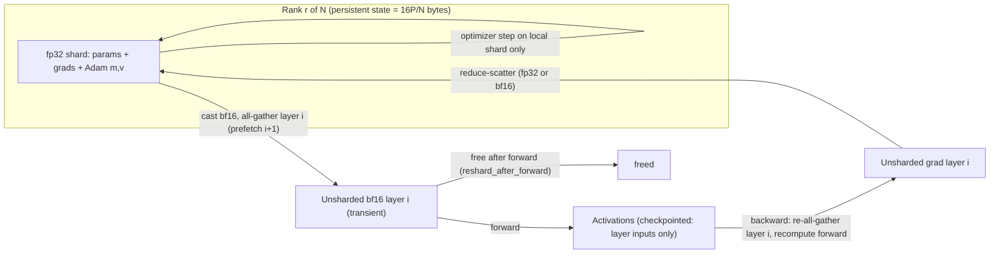

# Memory Optimization: ZeRO, FSDP, and JAX Sharding

## TL;DR

- Mixed-precision Adam needs about 16 bytes per parameter of model state: 2 for bf16 weights, 2 for bf16 gradients, and 12 for the fp32 master copy plus Adam m and v. Plain data parallelism stores all of it on every GPU. ZeRO stages 1, 2, and 3 cut this to 4P + 12P/N, 2P + 14P/N, and 16P/N bytes.
- Stages 1 and 2 cost the same communication as DDP, because an all-reduce is just a reduce-scatter plus an all-gather. Stage 3 (FSDP, `FULL_SHARD`) costs 1.5x DDP because it all-gathers the weights a second time in backward.
- Stage 3 traffic is about 6P bytes per GPU per micro-batch no matter the batch size, while compute grows with tokens. So communication is hidden only when tokens per GPU per micro-batch exceed roughly F_eff / B, the effective FLOP/s divided by per-GPU network bytes/s. On EFA-class fabrics that is about 6,000 to 8,000 tokens, and it does not depend on model size.
- Activation memory usually dominates once model state is sharded. Full recomputation adds one extra forward pass (about 33% more FLOPs). Selective recomputation and FlashAttention get most of the savings for a few percent.
- The production failures are rarely in the algorithm. They come from the CUDA caching allocator across streams, re-gathering on every gradient-accumulation step, all-gathers too small to be efficient, losing replicas you could have recovered from, and sharding propagation in XLA silently fully rematerializing a tensor.

## Mental Model



Think of ZeRO-3 and FSDP as virtual memory for model state.
Each rank permanently owns 1/N of every tensor, like resident pages.
The network acts as the page-in path, bringing one layer into memory just before it is used and dropping it right after.
The only fully materialized objects are the layer currently computing and the layer being prefetched.
So peak memory is the persistent shard, plus two layers of unsharded weights, plus whatever activations you chose to keep.
Activation checkpointing applies the same trade to activations, except the "network" is recomputation on the tensor cores.
Every design decision in this chapter picks a point on one curve: memory saved versus bytes moved or FLOPs repeated.

## Internals

### Where the bytes go: model state versus residual state

The ZeRO paper ([Rajbhandari et al., SC20, arXiv 1910.02054](https://arxiv.org/abs/1910.02054)) splits training memory into two parts.
Model states are weights, gradients, and optimizer state.
Residual states are activations, temporary buffers, and fragmentation.
With mixed-precision Adam, model state is (2 + 2 + K) x P bytes, where K = 12 for the fp32 master weights, momentum, and variance (ZeRO paper, arXiv 1910.02054).
A 70B-parameter model therefore carries 1,120 GB of model state, which is 14 H100s' worth of HBM before a single activation is stored.
Under DDP, every rank holds all 1,120 GB.
That redundancy is what ZeRO removes.

### ZeRO-DP stages as a partitioning schedule

Stage 1 (P_os) partitions only the optimizer state.
Each rank runs Adam on its 1/N slice of the fp32 master weights, then all-gathers the updated bf16 weights.
Memory drops to 4P + 12P/N.
Stage 2 (P_os+g) also partitions gradients.
Instead of all-reducing gradients, each rank reduce-scatters them, so each rank receives only the summed gradient slice it will update.
Memory drops to 2P + 14P/N.
Stage 3 (P_os+g+p) also partitions the bf16 weights.
Each rank must all-gather a layer's weights before forward, free them, all-gather them again before backward, and reduce-scatter the gradients.
Memory drops to 16P/N.
As a sanity check, the paper's 7.5B-parameter example at N = 64 gives 120 GB for DDP, 31.4 GB for stage 1, 16.6 GB for stage 2, and 1.9 GB for stage 3, which matches the formulas.

On communication, a ring all-reduce is a reduce-scatter followed by an all-gather, and each moves about P elements per rank.
Stages 1 and 2 just split that same pair around the optimizer step, so they cost exactly what DDP costs: 2P elements per rank per step.
Stage 3 adds one more all-gather in backward, so it costs 3P elements, which is the 1.5x overhead the paper reports (ZeRO paper, arXiv 1910.02054).
That is why stage 1 and 2 are nearly free upgrades over DDP, and stage 3 is a real engineering trade.

ZeRO also defines ZeRO-R for residual state.
It includes partitioned activation checkpoints under tensor parallelism, constant-size fused buffers, and on-the-fly defragmentation of long-lived versus short-lived tensors.
The follow-up papers extend the same idea down the memory hierarchy.
ZeRO-Offload ([USENIX ATC 2021, arXiv 2101.06840](https://arxiv.org/abs/2101.06840)) moves optimizer state and the Adam step to the CPU.
ZeRO-Infinity ([SC21, arXiv 2104.07857](https://arxiv.org/abs/2104.07857)) moves it further to NVMe.
ZeRO++ ([arXiv 2306.10209](https://arxiv.org/abs/2306.10209)) cuts cross-node traffic with quantized weight all-gathers (qwZ), a secondary intra-node weight partition (hpZ), and quantized gradient reduce-scatter (qgZ).

Google reached the same mechanism on its own for TPUs.
[Xu et al., "Automatic Cross-Replica Sharding of Weight Update in Data-Parallel Training" (arXiv 2004.13336)](https://arxiv.org/abs/2004.13336) has the XLA compiler rewrite all-reduce plus a replicated update into reduce-scatter, a sharded update, and an all-gather, which is ZeRO-1/2 done as a compiler pass rather than a runtime library.

### PyTorch FSDP1: FlatParameter and the rate limiter

FSDP1 ([Zhao et al., PVLDB 16(12): 3848-3860, 2023](https://www.vldb.org/pvldb/vol16/p3848-huang.pdf)) is PyTorch's built-in stage 3.
Its central data structure is the `FlatParameter`.
All parameters inside one wrapped unit are flattened, concatenated, padded to a multiple of N, and split evenly across ranks.
The padding exists because NCCL's all-gather and reduce-scatter are fastest on equal-sized inputs.
The paper measured that once all-gather size falls below about 33M elements, total communication time rises sharply (FSDP paper, VLDB 2023).
That sets the wrapping granularity: wrap each transformer block, not each `Linear`.

The mechanism most getting-started guides skip is memory management across CUDA streams.
FSDP runs all-gathers on a separate stream so they overlap with compute on the default stream.
PyTorch's caching allocator keeps a separate memory pool per stream.
A block allocated on the all-gather stream but used on the compute stream cannot simply be freed when the CPU drops its reference.
FSDP1 marks such blocks with `record_stream`, which delays their reuse until the GPU has passed a recorded event.
The CPU, though, runs far ahead of the GPU, so it can issue many all-gathers whose output blocks cannot yet be recycled.
The result is over-allocation and fragmentation, and when `cudaMalloc` fails the allocator falls back to an expensive retry path.
FSDP1's fix was a CPU-side rate limiter that caps in-flight all-gathers.
It gave up to 5x speedups on some models by avoiding fragmentation, and backward prefetching gave about 18% on GPT-175B (FSDP paper, VLDB 2023).
A PyTorch devlog confirms that `limit_all_gathers=True` is on by default and caps all-gathered memory at two FSDP instances by blocking the CPU thread ([PyTorch DevLog, as of 2026-09](https://docs.pytorch.org/devlogs/eager/2026-09-29-cross-stream-memory-without-record-stream/)).
The same devlog explains why peak memory under `record_stream` is nondeterministic.
It depends on CPU speed and kernel timing.
Under memory pressure, the OOM-retry path calls `release_cached_blocks`, which inserts a hidden device sync (PyTorch DevLog, as of 2026-09).
The diagnostic counter is `num_alloc_retries` in `torch.cuda.memory_stats()` (FSDP paper, VLDB 2023).
Any non-zero value that grows each step means you are paying for synchronizing frees in the middle of training.

### PyTorch FSDP2: per-parameter DTensor sharding

FSDP2 (`torch.distributed.fsdp.fully_shard`) replaces the flat parameter with per-parameter sharding.
Each parameter becomes a `DTensor` with placement `Shard(0)` on a `DeviceMesh` ([FSDP2 RFC, pytorch/pytorch#114299](https://github.com/pytorch/pytorch/issues/114299)).
`fully_shard` converts `model.parameters()` to DTensors in place, and the optimizer must be built on those DTensor parameters ([PyTorch fully_shard docs, as of 2026-10](https://docs.pytorch.org/docs/2.10/_sources/distributed.fsdp.fully_shard.md.txt)).
Each `fully_shard` call defines one communication group, whose parameters are all-gathered and reduce-scattered together (FSDP2 RFC).
So grouping is still at module granularity even though storage is per parameter.
The official tutorial says FSDP2 reaches lower, deterministic GPU memory by avoiding `recordStream`, without any CPU synchronization, and declares FSDP1 deprecated ([PyTorch FSDP2 tutorial, as of 2026-10](https://docs.pytorch.org/tutorials/intermediate/FSDP_tutorial.html)).
FSDP2 makes the compute stream wait on the communication stream's event and frees buffers in program order, rather than tagging blocks for deferred reuse.
That is the wait_event approach in the PyTorch devlog above.
One known gap: `record_stream` is still built into c10d collectives called with `async_op=True`, and a filed issue proposes `TORCH_NCCL_AVOID_RECORD_STREAMS=1` as the workaround ([pytorch/pytorch#147168](https://github.com/pytorch/pytorch/issues/147168)).

FSDP2 controls that matter in production:

- `reshard_after_forward` takes `bool` or `int` (FSDP2 RFC). An int reshards to a smaller world size after forward, for example within one node. That keeps a second copy partitioned over NVLink so the backward all-gather avoids the cross-node fabric. It is the same idea as ZeRO++ hpZ.
- `MixedPrecisionPolicy(param_dtype, reduce_dtype)` keeps the persistent shard in fp32 and casts to bf16 before the all-gather. Setting `reduce_dtype=torch.float32` keeps the gradient reduce-scatter in fp32, at twice the bytes.
- Passing a 2D `DeviceMesh` gives HSDP: replicate across mesh dim 0 and shard across dim 1. That limits all-gather and reduce-scatter to the shard group and leaves one all-reduce of the gradient shards across replicas.
- `set_modules_to_forward_prefetch` and `set_modules_to_backward_prefetch` set explicit prefetch order. The issue above describes combining them with `_set_unshard_async_op(True)` for aggressive overlap (pytorch/pytorch#147168).
- `set_requires_gradient_sync(False)` skips the reduce-scatter on non-final micro-batches. It is the key to affordable gradient accumulation (see Failure Modes).

FSDP2 is not free.
An independent analysis from the veScale-FSDP authors notes that per-parameter sharding adds a high tensor-copy overhead when packing and unpacking parameters around collectives ([veScale-FSDP, arXiv 2602.22437](https://arxiv.org/html/2602.22437v3)).
That cost is CPU and memory-bandwidth time you will see in profiles as copy kernels next to each all-gather.

### JAX: jit with NamedSharding, shard_map, and the compiler partitioner

JAX works the other way around: you annotate shardings and the XLA SPMD partitioner ([GSPMD, Xu et al., arXiv 2105.04663](https://arxiv.org/abs/2105.04663)) inserts the collectives.
FSDP in JAX is a sharding annotation, not a wrapper class.
You build a mesh with an `fsdp` axis, shard every weight's largest dimension over it with `NamedSharding(mesh, P("fsdp", None))`, and shard the batch over the same axis.
Sharding propagation then infers that each matmul needs the full weight, and the partitioner emits an all-gather.
In backward, it emits the matching reduce-scatter.

Status as of JAX 0.8.0 (October 15, 2025): `jax.experimental.pjit.pjit` is deprecated in favor of `jax.jit`, and `jax.experimental.shard_map.shard_map` is deprecated in favor of `jax.shard_map` ([JAX changelog, as of 2026-10](https://github.com/jax-ml/jax/blob/main/CHANGELOG.md)).
In the same release, `jax.pmap` is reimplemented as `jax.jit` over `jax.shard_map` and is in maintenance mode ([JAX 0.8.0 release notes](https://github.com/jax-ml/jax/discussions/32412)).
JAX 0.7.0 (July 22, 2025) moved the explicit-sharding APIs to `jax.sharding.reshard`, `jax.sharding.auto_axes`, and `jax.sharding.explicit_axes` (JAX changelog).
So "pjit" in interviews now just means `jax.jit` with `in_shardings` and `out_shardings`.

`shard_map` is the manual escape hatch.
Inside it you write per-device code with explicit collectives such as `jax.lax.all_gather` and `jax.lax.psum_scatter`.
Here is a mechanism a getting-started guide will not explain: reverse-mode autodiff in JAX transposes every linear collective.
The transpose of a tiled `all_gather` over axis `fsdp` is a `psum_scatter` over `fsdp`.
So if you write only the forward pass ("gather the weight shard, then matmul"), `jax.grad` produces the ZeRO-3 backward automatically: the weight gradient comes back already reduce-scattered into the owning shard.
You get FSDP with no runtime library, no hooks, and no allocator streams, because XLA schedules the collectives and buffers statically at compile time.
The cost is moved to compile time.
Buffer liveness and collective overlap are decided by the XLA scheduler, so memory is deterministic, but a bad propagation decision is baked into the executable.
The XLA warning to watch for is "Involuntary full rematerialization."
It means the partitioner could not reshard a tensor efficiently and replicated it in full, which can wipe out the FSDP savings for that tensor.
Use `jitted.lower(...).compile().memory_analysis()` to read the compiled per-device argument, output, and temp sizes before you spend accelerator hours.

### Activation checkpointing: the second memory axis

[Chen et al., "Training Deep Nets with Sublinear Memory Cost" (arXiv 1604.06174)](https://arxiv.org/abs/1604.06174) showed that saving only O(sqrt(n)) checkpoints of an n-layer network and recomputing the rest cuts activation memory to O(sqrt(n)) for one extra forward pass.
Transformer practice is simpler: checkpoint each block's input (2sbh bytes in bf16) and recompute the block during backward.
[Korthikanti et al., "Reducing Activation Recomputation in Large Transformer Models" (MLSys 2023, arXiv 2205.05198)](https://arxiv.org/abs/2205.05198) estimate per-layer activation memory without tensor parallelism at sbh(34 + 5as/h) bytes.
Here s is sequence length, b is micro-batch size, h is hidden size, and a is the number of heads.
The 5as/h term is the attention-score matrix and its softmax and dropout outputs.
The paper's selective recomputation recomputes only that term, because it is large in memory but cheap in FLOPs.
FlashAttention never materializes the score matrix and recomputes attention tiles in backward by design, so with FlashAttention the per-layer footprint collapses to roughly 34sbh.
The remaining choice is between full block recomputation and saving the matmul outputs.

The FLOP accounting is the same on both platforms.
Forward is about 2P FLOPs per token and backward about 4P, so one step is about 6P per token.
Full recomputation adds another 2P, for 8P, which is 33% more hardware FLOPs.
Model FLOPs Utilization (MFU) counts only the 6P, while Hardware FLOPs Utilization (HFU) counts all 8P, so full recomputation lowers MFU even when the hardware is equally busy.

On PyTorch, use `torch.utils.checkpoint.checkpoint(fn, x, use_reentrant=False)`.
The non-reentrant variant works with FSDP's autograd hooks and keyword arguments.
On JAX, use `jax.checkpoint` (alias `jax.remat`) with a policy.
`jax.checkpoint_policies.nothing_saveable` gives full recomputation.
`dots_with_no_batch_dims_saveable` saves the weight matmul outputs and recomputes elementwise operations.
`save_only_these_names` works with `checkpoint_name` tags for surgical control.

### Failure domains and synchronization semantics

Every scheme here is bulk-synchronous.
ZeRO-3 and FSDP add a dependency on every rank in the shard group at every layer, twice per micro-batch: once for the all-gather and once for the reduce-scatter.
So the failure domain for both progress and latency is the whole shard group.
One slow HBM stack, one degraded NVLink, or one flapping EFA path sets the step time for everyone (see [[17-Cloud-AI-Engineering/Volume_10_AI_Infrastructure_on_Cloud/Chapter_08_Fault_Tolerance_and_Fleet_Resiliency_at_Scale|Fault Tolerance and Fleet Resiliency at Scale]]).
Sharding also removes redundancy that DDP gave you for free.
Under DDP, any surviving replica holds the full state.
Under ZeRO-3 with N = 64, losing one node loses 1/8 of the optimizer state, and the only way to recover it is a checkpoint.
HSDP restores partial redundancy, because every shard exists once per replica group.
That property matters for in-memory peer recovery, covered in [[17-Cloud-AI-Engineering/Volume_10_AI_Infrastructure_on_Cloud/Chapter_06_High_Throughput_Checkpointing_to_Object_Storage|High-Throughput Checkpointing to Object Storage]].

## Numbers to Know

| Quantity | Value | Source |
|---|---|---|
| Model state, mixed-precision Adam | 16 bytes/param (2 + 2 + 12) | ZeRO paper, arXiv 1910.02054 (as of 2026-10) |
| ZeRO-1 / ZeRO-2 / ZeRO-3 per-GPU model state | 4P + 12P/N / 2P + 14P/N / 16P/N bytes | ZeRO paper (as of 2026-10) |
| Paper sanity check, 7.5B params, N = 64 | 120 / 31.4 / 16.6 / 1.9 GB | ZeRO paper (as of 2026-10) |
| Communication per step relative to DDP | stage 1-2: 1.0x; stage 3: 1.5x | ZeRO paper (as of 2026-10) |
| All-gather efficiency cliff | below about 33M elements per call, comm time rises rapidly | FSDP paper, VLDB 2023 (as of 2026-10) |
| Backward prefetch gain | about 18% on GPT-175B | FSDP paper, VLDB 2023 (as of 2026-10) |
| Rate limiter gain | up to 5x on some models | FSDP paper, VLDB 2023 (as of 2026-10) |
| FSDP1 `limit_all_gathers` default | on; caps all-gathered memory at 2 FSDP units | PyTorch DevLog (as of 2026-09) |
| Per-layer activations, no TP, no FlashAttention | sbh(34 + 5as/h) bytes | Korthikanti et al., MLSys 2023 (as of 2026-10) |
| Full recomputation FLOP tax | +2P per token on 6P, about +33% | derived from the 2P/4P forward/backward split |
| JAX `pjit` and `experimental.shard_map` | deprecated in JAX 0.8.0 (2025-10-15) | JAX changelog (as of 2026-10) |
| FSDP1 status | deprecated; FSDP2 `fully_shard` recommended | PyTorch FSDP2 tutorial (as of 2026-10) |
| H100 SXM HBM / dense bf16 peak | 80 GB / about 989 TFLOP/s | UNVERIFIED (vendor spec, not re-checked this revision) |
| AWS p5.48xlarge | 8x H100, 3,200 Gbps EFA (about 50 GB/s per GPU) | UNVERIFIED (AWS docs, not re-checked this revision) |
| TPU HBM per chip, v5p / v6e / Ironwood | 95 / 32 / 192 GB | UNVERIFIED (Google Cloud docs, not re-checked this revision) |
| GPU and TPU on-demand list prices | query at lab time (commands below) | not stated; prices change, see Worked Example |

## AWS vs GCP Mechanism Parity

| Dimension | AWS | Google Cloud | Critical difference |
|---|---|---|---|
| Primary sharding runtime on GPU | PyTorch FSDP2 or DeepSpeed ZeRO on P5/P6 instances; SageMaker model parallel library v2 builds on FSDP | PyTorch FSDP2 or DeepSpeed on A3/A4 VMs and GKE | Same software; differences live in the collective transport |
| Primary sharding runtime on custom silicon | Trainium with NeuronX Distributed; ZeRO-1 optimizer sharding is the common path (UNVERIFIED) | TPU with JAX/XLA SPMD; FSDP is a mesh axis (MaxText `ici_fsdp_parallelism`) | TPU FSDP is compiled and statically scheduled; GPU FSDP is eager hooks plus an allocator |
| Collective transport | NCCL over EFA via the aws-ofi-nccl libfabric plugin; SRD multipath ([[17-Cloud-AI-Engineering/Volume_10_AI_Infrastructure_on_Cloud/Chapter_02_Interconnect_Technologies_NVLink_EFA_and_TPU_ICI\|Interconnects]]) | NCCL over Google GPU networking stacks (TCPXO or RDMA by VM family, UNVERIFIED); XLA collectives over ICI on TPU | ICI is a direct torus inside a slice, so FSDP all-gathers never touch the DC network; across slices (DCN) use DP, not FSDP |
| Where the shard group should live | Within an UltraCluster placement group; HSDP shard group inside NVLink domain when it fits | Within one TPU slice (ICI); multislice replicas over DCN | Getting B wrong in T_min = F/B is the main sizing error on both |
| Memory determinism | FSDP2 deterministic by design; FSDP1 and DeepSpeed depend on allocator and stream timing | XLA buffer assignment is static; `memory_analysis()` before run | TPU OOMs show up at compile time; GPU OOMs show up at step N |
| Failure semantics | Bulk-synchronous; one rank failure kills the step; HyperPod or job-level restart | Bulk-synchronous; slice failure kills the step; GKE JobSet or Pathways-level restart (UNVERIFIED) | Neither cloud gives collective-level fault tolerance; recovery is checkpoint or peer-replica based |
| Activation checkpointing API | `torch.utils.checkpoint`, selective checkpoint contexts | `jax.checkpoint` with `checkpoint_policies`, including host offload policies | JAX policies are compiler-visible; PyTorch policies are runtime hooks |

## Worked Example: Sizing and Running FSDP2 and JAX FSDP

### Step 1 - Back-of-the-envelope for a 70B dense model

Assume a Llama-3-70B-shaped model: P = 70e9, L = 80, h = 8192, a = 64, vocabulary V = 128,256.
Model state: 16 x 70e9 = 1,120 GB.
ZeRO-3 per-GPU persistent state at N = 8 / 16 / 32 / 64 is 140 / 70 / 35 / 17.5 GB.
An 8-GPU node of 80 GB parts cannot hold it even fully sharded, so plan for at least 2 nodes, and practically 4 to 8 once activations are added.

Activations at s = 4,096, b = 1, using the Korthikanti formula: sbh = 33.5M, and 34 + 5as/h = 34 + 160 = 194, so each layer needs 6.5 GB.
With FlashAttention, the term is 34sbh = 1.14 GB per layer, or 91 GB for 80 layers, which still does not fit.
With full block checkpointing, you keep only 2sbh per layer.

Now pick tokens per GPU per micro-batch (T) from the communication law.
ZeRO-3 moves about 3 collectives x 2 bytes x P = 6P bytes per GPU per micro-batch: 420 GB for 70B.
With full recomputation, compute is 8PT FLOPs.
Comm time is 6P / B and compute time is 8PT / F_eff, so overlap requires T >= 0.75 x F_eff / B.
Without recomputation, the requirement is T >= F_eff / B.
P cancels, so the threshold does not depend on model size.
With F_eff = 400 TFLOP/s (about 40% of an H100 peak, UNVERIFIED spec) and B = 50 GB/s per GPU (EFA share, UNVERIFIED), T_min is 6,000 tokens.
At T = 8,192, compute takes 8 x 70e9 x 8192 / 400e12 = 11.5 s and comm takes 420e9 / 50e9 = 8.4 s, so comm is hideable with prefetch.

Per-GPU memory at N = 64, T = 8,192:

- Persistent shard: 17.5 GB.
- Checkpointed block inputs: 2 x 8192 x 8192 x 80 bytes = 10.7 GB.
- Recompute working set for one block: 34 x 8192 x 8192 = 2.3 GB.
- Two unsharded bf16 layers (current plus prefetch), at 0.875B params each: 3.5 GB.
- Unsharded gradient buffer for one layer in fp32: 3.5 GB.
- Logits in fp32, 128,256 x 8,192 x 4 bytes: 4.2 GB, plus about the same for their gradient. Chunked cross-entropy removes most of this.
- Total: about 46 GB plus NCCL buffers and fragmentation. That fits in 80 GB with headroom, and T can grow only if the global batch budget allows.

The global batch consequence is 64 GPUs x 8,192 tokens = 0.5M tokens per micro-step.
At 1,024 GPUs the floor is 8M tokens, which can exceed the model's critical batch size.
At that point you must shrink B's role with HSDP, TP, or ZeRO++, not add more FSDP ranks.

### Step 2 - Cost estimate, budget alarm, and lab provisioning (AWS)

The lab runs the FSDP2 script on one 4-GPU instance (g6e.12xlarge, 4x L40S, UNVERIFIED spec) for under 1 hour.
Expected spend = hourly on-demand price x 1 hour, plus EBS for the root volume.
Fetch the live price instead of trusting a number printed in a book:

```bash
aws pricing get-products --region us-east-1 --service-code AmazonEC2 \
  --filters Type=TERM_MATCH,Field=instanceType,Value=g6e.12xlarge \
            Type=TERM_MATCH,Field=location,Value="US East (N. Virginia)" \
            Type=TERM_MATCH,Field=operatingSystem,Value=Linux \
            Type=TERM_MATCH,Field=tenancy,Value=Shared \
            Type=TERM_MATCH,Field=preInstalledSw,Value=NA \
            Type=TERM_MATCH,Field=capacitystatus,Value=Used \
  --query 'PriceList[0]' --output text \
  | jq -r '.terms.OnDemand[].priceDimensions[].pricePerUnit.USD'
```

Budget guardrail (USD 50 per month, email at 80% of actual spend):

```bash
ACCOUNT_ID=$(aws sts get-caller-identity --query Account --output text)
aws budgets create-budget --account-id "$ACCOUNT_ID" \
  --budget '{"BudgetName":"fsdp-lab","BudgetLimit":{"Amount":"50","Unit":"USD"},"TimeUnit":"MONTHLY","BudgetType":"COST"}' \
  --notifications-with-subscribers '[{"Notification":{"NotificationType":"ACTUAL","ComparisonOperator":"GREATER_THAN","Threshold":80,"ThresholdType":"PERCENTAGE"},"Subscribers":[{"SubscriptionType":"EMAIL","Address":"you@example.com"}]}]'
```

Launch with a dead-man switch that terminates the instance after 120 minutes even if you forget:

```bash
AMI=$(aws ssm get-parameter --region us-east-1 \
  --name /aws/service/deeplearning/ami/x86_64/base-oss-nvidia-driver-gpu-ubuntu-22.04/latest/ami-id \
  --query Parameter.Value --output text)
IID=$(aws ec2 run-instances --region us-east-1 --image-id "$AMI" \
  --instance-type g6e.12xlarge --key-name my-key \
  --instance-initiated-shutdown-behavior terminate \
  --user-data '#!/bin/bash
shutdown -h +120' \
  --tag-specifications 'ResourceType=instance,Tags=[{Key=lab,Value=fsdp}]' \
  --query 'Instances[0].InstanceId' --output text)
echo "$IID"
```

Exact teardown:

```bash
aws ec2 terminate-instances --region us-east-1 --instance-ids "$IID"
aws ec2 wait instance-terminated --region us-east-1 --instance-ids "$IID"
aws budgets delete-budget --account-id "$ACCOUNT_ID" --budget-name fsdp-lab
```

### Step 3 - FSDP2 training script with checkpointing, prefetch, HSDP, and accumulation

Save as `fsdp2_lab.py` and run with `torchrun --nproc_per_node=4 fsdp2_lab.py` (set `REPLICAS=2` to exercise HSDP on 4 GPUs).

```python
import os, time, torch, torch.nn as nn, torch.nn.functional as F
import torch.distributed as dist
from torch.distributed.device_mesh import init_device_mesh
from torch.distributed.fsdp import fully_shard, MixedPrecisionPolicy
from torch.utils.checkpoint import checkpoint

D, HEADS, LAYERS, VOCAB = 2048, 16, 16, 32000
SEQ, MICRO_BS, ACCUM = 2048, 2, 4
CKPT = os.environ.get("CKPT", "1") == "1"
REPLICAS = int(os.environ.get("REPLICAS", "1"))

class Block(nn.Module):
    def __init__(self):
        super().__init__()
        self.ln1, self.ln2 = nn.LayerNorm(D), nn.LayerNorm(D)
        self.qkv, self.proj = nn.Linear(D, 3 * D), nn.Linear(D, D)
        self.fc1, self.fc2 = nn.Linear(D, 4 * D), nn.Linear(4 * D, D)

    def _fwd(self, x):
        b, s, _ = x.shape
        q, k, v = self.qkv(self.ln1(x)).view(b, s, 3, HEADS, D // HEADS).unbind(2)
        att = F.scaled_dot_product_attention(q.transpose(1, 2), k.transpose(1, 2),
                                             v.transpose(1, 2), is_causal=True)
        x = x + self.proj(att.transpose(1, 2).reshape(b, s, D))
        return x + self.fc2(F.gelu(self.fc1(self.ln2(x))))

    def forward(self, x):
        if CKPT and self.training:
            return checkpoint(self._fwd, x, use_reentrant=False)
        return self._fwd(x)

class LM(nn.Module):
    def __init__(self):
        super().__init__()
        self.emb = nn.Embedding(VOCAB, D)
        self.blocks = nn.ModuleList(Block() for _ in range(LAYERS))
        self.norm, self.head = nn.LayerNorm(D), nn.Linear(D, VOCAB, bias=False)

    def forward(self, tok):
        x = self.emb(tok)
        for blk in self.blocks:
            x = blk(x)
        return self.head(self.norm(x))

def main():
    dist.init_process_group("nccl")
    rank, world = dist.get_rank(), dist.get_world_size()
    torch.cuda.set_device(int(os.environ["LOCAL_RANK"]))
    if REPLICAS > 1:
        mesh = init_device_mesh("cuda", (REPLICAS, world // REPLICAS),
                                mesh_dim_names=("replicate", "shard"))
    else:
        mesh = init_device_mesh("cuda", (world,), mesh_dim_names=("shard",))
    mp = MixedPrecisionPolicy(param_dtype=torch.bfloat16, reduce_dtype=torch.float32)

    with torch.device("meta"):
        model = LM()
    for blk in model.blocks:
        fully_shard(blk, mesh=mesh, mp_policy=mp)
    fully_shard(model, mesh=mesh, mp_policy=mp)
    model.to_empty(device="cuda")
    for m in model.modules():
        if hasattr(m, "reset_parameters"):
            m.reset_parameters()

    blocks = list(model.blocks)
    for i in range(len(blocks) - 1):
        blocks[i].set_modules_to_forward_prefetch([blocks[i + 1]])
    for i in range(1, len(blocks)):
        blocks[i].set_modules_to_backward_prefetch([blocks[i - 1]])

    opt = torch.optim.AdamW(model.parameters(), lr=3e-4, fused=True)
    n_params = sum(p.numel() for p in model.parameters())
    if rank == 0:
        print(f"params={n_params/1e9:.2f}B world={world} replicas={REPLICAS} ckpt={CKPT}")

    torch.cuda.reset_peak_memory_stats()
    for step in range(6):
        t0 = time.time()
        for micro in range(ACCUM):
            model.set_requires_gradient_sync(micro == ACCUM - 1)
            tok = torch.randint(0, VOCAB, (MICRO_BS, SEQ + 1), device="cuda")
            logits = model(tok[:, :-1])
            loss = F.cross_entropy(logits.float().view(-1, VOCAB), tok[:, 1:].reshape(-1))
            (loss / ACCUM).backward()
        opt.step()
        opt.zero_grad(set_to_none=True)
        torch.cuda.synchronize()
        st = torch.cuda.memory_stats()
        if rank == 0:
            tps = world * ACCUM * MICRO_BS * SEQ / (time.time() - t0)
            print(f"step={step} loss={loss.item():.3f} tok/s={tps:,.0f} "
                  f"peak_alloc_GB={torch.cuda.max_memory_allocated()/2**30:.2f} "
                  f"reserved_GB={torch.cuda.max_memory_reserved()/2**30:.2f} "
                  f"alloc_retries={st.get('num_alloc_retries', 0)}")
    dist.destroy_process_group()

if __name__ == "__main__":
    main()
```

Experiments to run, each one isolating a single mechanism:

1. Run `CKPT=0` and then `CKPT=1`. Peak allocated memory should fall by roughly the per-layer activation term times LAYERS, and tokens per second should fall by roughly 20-33%.
2. Run `REPLICAS=2`. Per-GPU persistent state doubles, because the shard group halves, and all-gather traffic now stays within each 2-GPU group.
3. Remove the `set_requires_gradient_sync` line. Step time rises because every micro-batch now pays a full reduce-scatter.
4. Watch `alloc_retries`. It should stay at 0. A growing value means fragmentation or a too-large T, and `PYTORCH_CUDA_ALLOC_CONF=expandable_segments:True` is the first lever.
5. Change `reshard_after_forward=False` on the blocks. Backward all-gathers disappear (ZeRO-2 behavior) and peak memory rises by one full bf16 copy of the weights.

### Step 4 - JAX FSDP two ways: jit annotations and explicit shard_map

GCP lab provisioning (TPU v6e-8 Spot, under 1 hour; check the TPU pricing page for the current hourly rate before you start):

```bash
gcloud billing budgets create --billing-account=XXXXXX-XXXXXX-XXXXXX \
  --display-name=tpu-fsdp-lab --budget-amount=50USD \
  --threshold-rule=percent=0.5 --threshold-rule=percent=0.9
gcloud compute tpus tpu-vm create fsdp-lab --zone=us-east5-b \
  --accelerator-type=v6e-8 --version=v2-alpha-tpuv6e --spot
gcloud compute tpus tpu-vm ssh fsdp-lab --zone=us-east5-b \
  --command='pip install -U "jax[tpu]" && python3 jax_fsdp.py'
```

Teardown:

```bash
gcloud compute tpus tpu-vm delete fsdp-lab --zone=us-east5-b --quiet
```

Save as `jax_fsdp.py`:

```python
from functools import partial
import jax, jax.numpy as jnp
from jax.sharding import NamedSharding, PartitionSpec as P

n = jax.device_count()
mesh = jax.make_mesh((n,), ("fsdp",))
D, L, B, S = 2048, 8, 8 * n, 1024

def init(key):
    ks = jax.random.split(key, 2 * L)
    return [{"w1": jax.random.normal(ks[2*i], (D, 4*D), jnp.float32) * 0.02,
             "w2": jax.random.normal(ks[2*i+1], (4*D, D), jnp.float32) * 0.02}
            for i in range(L)]

wspec = NamedSharding(mesh, P("fsdp", None))
xspec = NamedSharding(mesh, P("fsdp", None, None))
params = jax.device_put(init(jax.random.key(0)), wspec)
x = jax.device_put(jnp.ones((B, S, D), jnp.bfloat16), xspec)

# Variant A: annotate shardings and let the XLA SPMD partitioner insert collectives.
def mlp(p, h):
    h = jax.nn.gelu(h @ p["w1"].astype(jnp.bfloat16))
    return h @ p["w2"].astype(jnp.bfloat16)

@jax.jit
def loss_auto(params, x):
    h = x
    for p in params:
        h = h + jax.checkpoint(mlp, policy=jax.checkpoint_policies.nothing_saveable)(p, h)
    return jnp.mean(h.astype(jnp.float32) ** 2)

grad_auto = jax.jit(jax.grad(loss_auto), out_shardings=wspec)

# Variant B: explicit per-device code; AD transposes all_gather into psum_scatter.
@partial(jax.shard_map, mesh=mesh,
         in_specs=(P("fsdp", None), P("fsdp", None), P("fsdp", None, None)),
         out_specs=P("fsdp", None, None))
def mlp_manual(w1_shard, w2_shard, h):
    w1 = jax.lax.all_gather(w1_shard, "fsdp", axis=0, tiled=True)
    w2 = jax.lax.all_gather(w2_shard, "fsdp", axis=0, tiled=True)
    return jax.nn.gelu(h @ w1.astype(jnp.bfloat16)) @ w2.astype(jnp.bfloat16)

@jax.jit
def loss_manual(params, x):
    h = x
    for p in params:
        f = jax.checkpoint(mlp_manual, policy=jax.checkpoint_policies.nothing_saveable)
        h = h + f(p["w1"], p["w2"], h)
    return jnp.mean(h.astype(jnp.float32) ** 2)

grad_manual = jax.jit(jax.grad(loss_manual))

for name, fn in [("auto", grad_auto), ("manual", grad_manual)]:
    compiled = fn.lower(params, x).compile()
    ma = compiled.memory_analysis()
    print(name, "temp_MB", ma.temp_size_in_bytes / 2**20,
          "args_MB", ma.argument_size_in_bytes / 2**20)
    g = compiled(params, x)
    print(name, "grad sharding", g[0]["w1"].sharding)
```

What to look for:

- Both variants should report the gradient sharded on `fsdp`. In variant B, no code calls `psum_scatter`: it comes out of transposing `all_gather`.
- Dump HLO with `compiled.as_text()` and search for `all-gather` and `reduce-scatter` to confirm the collectives the partitioner chose.
- Remove the `fsdp` sharding from `x` while leaving weights sharded. Watch `temp_size_in_bytes` and the logs for "Involuntary full rematerialization."

## Failure Modes and Pitfalls

### Gradient accumulation silently multiplies ZeRO-3 traffic

Under ZeRO-3 and FSDP `FULL_SHARD`, parameters are re-gathered for every micro-batch's forward and backward.
With k accumulation steps, parameter traffic per optimizer step is about k x 2P elements, not 2P.
If gradients are also reduce-scattered on every micro-batch, it becomes k x 3P.
Teams switch to accumulation to grow the global batch and see throughput fall, because they assumed the communication would amortize.
On FSDP2 the fixes are `set_requires_gradient_sync(False)` on non-final micro-batches, which skips the reduce-scatter but keeps unsharded gradients, and optionally `set_reshard_after_backward(False)`, which keeps parameters gathered at the cost of ZeRO-2-level memory.
The right answer is often to raise T per micro-batch instead, as the T_min law suggests.

### Nondeterministic OOM from cross-stream allocation

The symptom is a job that runs for hours and then OOMs at a random step, or OOMs on one cluster but not another with identical code.
The mechanism is `record_stream`-deferred frees plus a CPU thread running ahead of the GPU (PyTorch DevLog, as of 2026-09).
Different CPU speeds or kernel timings change the peak.
The diagnostic is `num_alloc_retries` climbing in `torch.cuda.memory_stats()` (FSDP paper, VLDB 2023).
Fixes are to migrate to FSDP2, set `TORCH_NCCL_AVOID_RECORD_STREAMS=1` if you use async c10d collectives (pytorch/pytorch#147168), and try `expandable_segments:True`.

### Over-wrapping: all-gathers below the efficiency cliff

Wrapping every `Linear` or norm as its own FSDP unit creates thousands of small collectives below the roughly 33M-element knee measured in the FSDP paper.
Each collective pays fixed NCCL launch and protocol latency.
Over EFA, each also pays per-message software overhead.
Wrap at transformer-block granularity, and group embeddings and output heads together with the root module.

### Collective mismatch hangs

Every rank must issue the same collectives in the same order.
Data-dependent control flow breaks this: an MoE expert that receives no tokens on one rank, a layer skipped under a condition, or a rank that hits a NaN guard and returns early.
That rank skips an all-gather and the job hangs until the NCCL watchdog times out.
In XLA this cannot happen inside one compiled program, but it can still happen across hosts if they compile different programs.
A typical cause is host-dependent Python branches before `jit`.

### Low-precision gradient reduction

A reduce-scatter in bf16 over hundreds of ranks sums many small values in an 8-bit mantissa, which can lose small gradient contributions and slow convergence.
`MixedPrecisionPolicy(reduce_dtype=torch.float32)` fixes it at twice the gradient bytes.
ZeRO++ qgZ goes the other way, quantizing gradients for the wire with careful blocking.
Treat any change to `reduce_dtype` as a numerics change that needs a loss-curve A/B test.

### Full state dict gather OOM at checkpoint time

The default pattern of gathering a full state dict on rank 0 materializes 16P bytes on one host.
For a 70B model that is 1.1 TB, so the job dies exactly at the checkpoint, after hours of progress.
Use sharded checkpointing with `torch.distributed.checkpoint` or Orbax, where each rank writes its own shard.
This is covered in [[17-Cloud-AI-Engineering/Volume_10_AI_Infrastructure_on_Cloud/Chapter_06_High_Throughput_Checkpointing_to_Object_Storage|High-Throughput Checkpointing to Object Storage]].

### Stragglers amplified by per-layer synchronization

ZeRO-3 synchronizes the shard group twice per layer per micro-batch.
A GPU running thermally throttled, or a single degraded fabric path, adds its delay at every one of those barriers.
Meta's Llama 3 report ([arXiv 2407.21783](https://arxiv.org/abs/2407.21783)) documents 466 job interruptions over a 54-day pre-training snapshot, most of them attributed to hardware, with GPUs and HBM as leading causes.
That is the rate at which a sharded, bulk-synchronous job hits its failure domain.
Mitigations include per-rank step-time telemetry, automatic node cordoning, and HSDP so a replica group can be dropped and resumed.
See [[17-Cloud-AI-Engineering/Volume_10_AI_Infrastructure_on_Cloud/Chapter_08_Fault_Tolerance_and_Fleet_Resiliency_at_Scale|Fault Tolerance and Fleet Resiliency at Scale]].

### CPU and NVMe offload that saturates PCIe and host memory

ZeRO-Offload moves the Adam step to CPU.
Per step, each rank sends fp32 or bf16 gradients down and receives updated weights back over PCIe, which is shared with the NIC on many server designs.
NUMA misplacement of pinned buffers can halve effective bandwidth.
Offload works when the GPU count is fixed and memory is the constraint, but it is rarely the cheapest option per token on cloud, where you can rent more HBM by the hour.

### Spot and preemption interaction

Sharding removes the free redundancy DDP had.
On Spot or preemptible capacity, one reclaimed node under pure ZeRO-3 forces a full checkpoint restore.
Size your checkpoint interval using [[17-Cloud-AI-Engineering/Volume_09_FinOps_and_Cloud_Economics/Chapter_03_Spot_Economics_and_Interruption_Handling|Spot Economics and Interruption Handling]], or keep HSDP replicas in different failure domains.

## Security and Cost Angles

### IAM and network boundaries

The training role needs read access to the dataset prefix and write access only to its own checkpoint prefix.
Sharded checkpoints are many objects per step, so a wildcard `s3:PutObject` on the bucket is the common over-grant.
On AWS, scope to `arn:aws:s3:::ckpt-bucket/run-id/*`, reach S3 through a gateway VPC endpoint with an endpoint policy, and use SSE-KMS with a bucket key so thousands of shard writes do not each call KMS.
EFA requires a security group that allows all traffic to and from itself.
Keep that group exclusive to the training placement group so the permissive rule does not reach anything else.
On Google Cloud, run TPU VMs or GKE node pools with a dedicated service account, protect Cloud Storage with CMEK, and put the project inside a VPC Service Controls perimeter so checkpoint buckets cannot be read from outside it.
See [[17-Cloud-AI-Engineering/Volume_03_GCP_Deep_Dive/Chapter_03_VPC_Service_Controls_Security_Perimeters|VPC Service Controls]] and [[17-Cloud-AI-Engineering/Volume_08_Security_Identity_and_the_Data_Perimeter/Chapter_04_Encryption_Key_Hierarchies_and_Envelope_Encryption|Envelope Encryption]].
Optimizer state is model IP: a stolen Adam state plus weights lets an attacker resume your training run.
Classify checkpoints like production secrets, not like logs.

### Unit economics levers

- Use the smallest sharding degree that fits. FSDP across 64 GPUs when 16 would fit pays for 48 extra GPUs' worth of network exposure in every collective.
- Prefer HSDP when the full model state fits within a shard group on the fast domain. Cross-node traffic drops to one gradient all-reduce of the shards.
- Recomputation trades about 33% more FLOPs for memory. If the freed memory lets you double T or drop a TP degree, it usually pays for itself.
- On TPU, keep FSDP inside the ICI slice and run only data parallelism across slices.
- Cost per training token is (instance $/hour) / (3600 x tokens/s). See [[17-Cloud-AI-Engineering/Volume_09_FinOps_and_Cloud_Economics/Chapter_05_GPU_and_TPU_Unit_Economics|GPU and TPU Unit Economics]] for how to fold in commitments and reservation overhead.

## Interview Questions and Model Answers

### Question 1 (L5 - Senior)

You are training a 13B model with mixed-precision Adam on 8x 80 GB GPUs.
How much model-state memory does each GPU need under DDP, ZeRO-1, ZeRO-2, and ZeRO-3, and which would you choose?

#### Model Answer

Model state is 16 bytes per parameter, so DDP needs 208 GB per GPU and does not fit.
ZeRO-1 needs 4P + 12P/8 = 52 + 19.5 = 71.5 GB, which technically fits but leaves under 9 GB for activations, NCCL buffers, and fragmentation.
ZeRO-2 needs 2P + 14P/8 = 26 + 22.75 = 48.75 GB, leaving about 30 GB for activations.
ZeRO-3 needs 16P/8 = 26 GB.
Within a single NVLink node, ZeRO-3's extra 0.5x communication is cheap, so the choice comes down to activation needs.
If the target sequence length and micro-batch fit in about 30 GB with checkpointing, ZeRO-2 gives the same communication as DDP and no extra all-gather in backward.
If not, ZeRO-3 or FSDP2 with `reshard_after_forward=True` frees another roughly 23 GB.
I would first measure activation memory with the Korthikanti formula, then confirm with `max_memory_allocated` on a short run.

#### Follow-up Interviewer Question

Why does ZeRO-2 cost no more communication than DDP when it sends a reduce-scatter and an all-gather instead of one all-reduce?

### Question 2 (L5 - Senior)

Explain the trade-offs between full activation checkpointing, selective recomputation, and no checkpointing for a long-context transformer, and how FlashAttention changes the decision.

#### Model Answer

Without FlashAttention, per-layer activation memory is sbh(34 + 5as/h).
The 5as/h term is the attention scores and softmax, which grows quadratically with s and dominates at long context.
Full checkpointing keeps only the 2sbh block input and recomputes the block in backward, at about one extra forward pass: 8P FLOPs per token instead of 6P, roughly 33% more.
Selective recomputation recomputes only the attention-score region, which has many bytes but few FLOPs, so it captures most of the memory savings for a few percent of compute.
FlashAttention never stores the score matrix and already recomputes tiles in backward, so it removes the quadratic term entirely.
After that, the choice is between keeping 34sbh per layer or 2sbh per layer.
I would pick the lightest policy that lets me reach the T_min tokens-per-GPU needed to hide FSDP communication.
Saving memory I cannot turn into a larger T or a smaller TP or FSDP degree is wasted compute.
I would also report MFU and HFU separately so the recomputation cost stays visible.

#### Follow-up Interviewer Question

Which matmul outputs would you save under a JAX `dots_with_no_batch_dims_saveable` policy, and what memory does that cost relative to full recomputation?

### Question 3 (L6 - Staff)

A 70B FSDP job on 64 H100s across 8 nodes runs at 25% MFU, and profiles show compute streams idle while waiting on all-gathers.
Diagnose and fix it.

#### Model Answer

First I quantify the problem.
ZeRO-3 moves about 6P bytes per GPU per micro-batch, which is 420 GB, independent of batch size.
At about 50 GB/s of per-GPU network bandwidth that is 8.4 s of communication.
Compute is 8PT / F_eff with recomputation.
So communication is hidden only when T >= 0.75 F_eff / B, about 6,000 tokens at 400 TFLOP/s effective, and this does not depend on model size.
If they run 4,096 tokens per GPU per micro-batch, they are communication-bound by construction, and the 25% MFU is the math, not a bug.
Next I check the multipliers.
If they use gradient accumulation without `set_requires_gradient_sync(False)`, each micro-batch pays the full reduce-scatter.
Then I check wrapping granularity against the 33M-element all-gather knee, whether prefetch is set, whether `reduce_dtype` is fp32 when bf16 is acceptable, and whether `num_alloc_retries` is non-zero.
Each costs real time and none shows in the formula.
The fixes, in order of cost:

1. Raise T if the global batch budget allows, using checkpointing to free the memory.
2. Use `reshard_after_forward` set to the intra-node size so the backward all-gather runs over NVLink.
3. Move to HSDP or TP=8 within the node plus FSDP across nodes. TP divides per-GPU FSDP bytes by 8, but it adds activation all-reduces on NVLink.
4. Use ZeRO++-style quantized weight all-gathers as a last resort, with a convergence check.

I would validate with per-rank step-time histograms to rule out one straggling node, because a single slow EFA path produces the same profile.

#### Follow-up Interviewer Question

At 1,024 GPUs, T_min times N exceeds your critical batch size; what do you change structurally?

### Question 4 (L6 - Staff)

After moving a job to a cluster with faster CPUs, an FSDP1 job started OOMing at random steps, with identical code and model.
What is the mechanism?

#### Model Answer

The likely cause is cross-stream memory reuse in the CUDA caching allocator.
FSDP1 issues all-gathers on a communication stream, and the outputs are consumed on the compute stream.
It frees them with `record_stream`, so the allocator cannot reuse a block until the GPU has passed the recorded event.
With a faster CPU, the host thread gets further ahead of the GPU and issues more all-gathers before earlier blocks become reusable.
Live unsharded memory grows, the pools fragment, and `cudaMalloc` eventually fails.
The retry path releases cached blocks, which synchronizes the device, and that is why peak memory depends on CPU speed and kernel timing.
FSDP1's mitigation is the rate limiter (`limit_all_gathers=True`), which bounds in-flight all-gathers by blocking the CPU.
I would check it was not disabled, and check `num_alloc_retries`.
The structural fix is FSDP2, which uses stream waits and ordered frees, so memory is deterministic without CPU sync.
If async c10d collectives are still in use, I would add `TORCH_NCCL_AVOID_RECORD_STREAMS=1`, plus `expandable_segments` to reduce fragmentation.
I would also add `num_alloc_retries` to the training dashboard as an SLO-style signal, since a rising value is an early warning before an OOM.

#### Follow-up Interviewer Question

How would you prove the theory in under an hour without changing the cluster?

### Question 5 (L6 - Staff)

On TPU with JAX, when would you leave FSDP to the `jax.jit` partitioner, and when would you write it in `shard_map`?
What do you get for free in `shard_map`?

#### Model Answer

The default is `jax.jit` with `NamedSharding` annotations.
GSPMD-style propagation inserts all-gathers and reduce-scatters, and XLA schedules buffers and overlap statically, so memory is known at compile time via `memory_analysis()`.
I would drop to `shard_map` in three cases.
The first is when propagation makes a bad choice, shown by an "Involuntary full rematerialization" warning or an unexpected all-to-all in the HLO.
The second is when I need custom collective scheduling, such as collective matmul or ring overlap.
The third is when I need to quantize or chunk a gather by hand.
What comes for free is the backward pass.
JAX autodiff transposes linear collectives, and the transpose of a tiled `all_gather` is a `psum_scatter`.
So writing "gather the weight shard, then compute" yields ZeRO-3 gradient reduce-scatter into the owning shard without writing any backward code.
On API status: as of JAX 0.8.0, `pjit` and `jax.experimental.shard_map` are deprecated in favor of `jax.jit` and `jax.shard_map`.
On topology: FSDP should stay within a slice's ICI, with only data parallelism over DCN across slices.

#### Follow-up Interviewer Question

How does activation checkpointing with `jax.checkpoint` interact with an explicit `all_gather` inside `shard_map`, and does the recompute re-issue the gather?

### Question 6 (L7+ - Principal)

You own the training platform for a 400B dense model that must run on both AWS GPU UltraClusters and Google TPU pods.
Define the memory and sharding strategy, its failure model, and how you keep it portable.

#### Model Answer

Model state is 6.4 TB, so sharding is mandatory everywhere.
The real decision is which fabric each sharding axis rides on.
On GPUs, I would put TP within the NVLink domain, FSDP across a bounded shard group sized so 16P/N_shard plus activations fits with about 25% headroom, HSDP replicas across groups, and PP only if the shard group would otherwise have to span too much of the EFA fabric.
On TPU, I would put FSDP and TP on ICI axes within a slice and data parallelism over DCN across slices.
The governing constraint on both is T_min = F_eff / B for the FSDP axis, multiplied by the DP degree, which must stay under the model's critical batch size.
That constraint, not memory, decides how large the FSDP axis can be.
For portability, I would express the model once with logical axis names (batch, embed, mlp, heads) and keep per-platform rule tables that map logical axes to mesh axes.
Megatron or FSDP2 DTensor placements on GPU and `PartitionSpec` on TPU become generated artifacts, not hand-written code.
For the failure model, everything is bulk-synchronous and ZeRO removes redundancy.
So I would keep HSDP replicas in separate failure domains to allow peer recovery of shards, write sharded asynchronous checkpoints sized to the measured interruption rate, and run straggler detection that evicts slow nodes before they set the step time.
Public reports such as Llama 3's hundreds of interruptions in 54 days are the planning baseline.
For cost, I would choose recomputation policy and sharding degree by cost per token, not by MFU alone.
I would also keep a numerics guard: any change to reduce dtype or quantized collectives ships behind a loss-curve A/B test.

#### Follow-up Interviewer Question

Your TPU and GPU runs diverge in loss after 50B tokens with identical hyperparameters; how do you decide whether sharding is the cause?

### Question 7 (L7+ - Principal)

Finance asks you to cut a training budget by 30%, and an engineer proposes ZeRO-Offload to the CPU so the job fits on half as many GPUs.
Evaluate the proposal.

#### Model Answer

Offload saves HBM by moving the 12-byte-per-parameter optimizer state and the Adam step to host memory, but it adds per-step PCIe traffic.
Gradients go down and weights come back, and that path is shared with the NIC on many server designs.
On top of that, the CPU Adam step is limited by host memory bandwidth.
On cloud, GPUs are billed per instance-hour, so what matters is cost per token: (half the instances) x (step-time slowdown).
If offload makes steps 2.2x slower, halving the GPUs raises cost by about 10% and doubles wall-clock time, which also raises exposure to interruptions.
I would model it as follows.
Bytes per step per GPU over PCIe is roughly 8P / N for fp32 gradients and weights, which you compare against the achievable host-to-device bandwidth with pinned, NUMA-local buffers.
CPU Adam time is roughly 16P / N bytes through host DRAM.
I would then measure one real step before deciding.
The levers that usually beat offload are: commitment or reservation pricing on the same GPU count; selective recomputation to raise T and MFU; HSDP to cut cross-node bytes; fixing gradient-accumulation re-gathers; and Spot capacity for preemption-tolerant ablation runs.
Offload makes sense when the GPU count is fixed by capacity rather than budget, or for fine-tuning jobs where wall-clock time does not matter.

#### Follow-up Interviewer Question

How would ZeRO-Infinity's NVMe tier change your answer on instances with local NVMe, and what is its failure mode?

## Further Reading

- [ZeRO: Memory Optimizations Toward Training Trillion Parameter Models (SC20)](https://arxiv.org/abs/1910.02054) - the original stage definitions, memory formulas, and communication analysis every number here derives from.
- [ZeRO-Offload (USENIX ATC 2021)](https://arxiv.org/abs/2101.06840) - the CPU tier of the memory hierarchy and its PCIe trade-offs.
- [ZeRO-Infinity (SC21)](https://arxiv.org/abs/2104.07857) - the NVMe tier and bandwidth-centric partitioning.
- [ZeRO++](https://arxiv.org/abs/2306.10209) - quantized and hierarchical collectives for when cross-node bandwidth is the limit.
- [PyTorch FSDP: Experiences on Scaling Fully Sharded Data Parallel (PVLDB 2023)](https://www.vldb.org/pvldb/vol16/p3848-huang.pdf) - FlatParameter design, the 33M-element all-gather knee, and the caching-allocator rate limiter.
- [FSDP2 per-parameter sharding RFC](https://github.com/pytorch/pytorch/issues/114299) - the design rationale for DTensor-based sharding and the `fully_shard` contract.
- [PyTorch DevLog: cross-stream memory without record_stream (2026-09)](https://docs.pytorch.org/devlogs/eager/2026-09-29-cross-stream-memory-without-record-stream/) - the clearest explanation of why multi-stream frees make peak memory nondeterministic.
- [veScale-FSDP (arXiv 2602.22437)](https://arxiv.org/html/2602.22437v3) - an independent critique of FSDP1 and FSDP2 overheads.
- [GSPMD (arXiv 2105.04663)](https://arxiv.org/abs/2105.04663) - the sharding-propagation partitioner behind `jax.jit` sharding.
- [Automatic Cross-Replica Sharding of Weight Update (arXiv 2004.13336)](https://arxiv.org/abs/2004.13336) - ZeRO-style weight-update sharding as an XLA compiler pass.
- [JAX changelog](https://github.com/jax-ml/jax/blob/main/CHANGELOG.md) - authoritative GA and deprecation status for `jax.jit`, `jax.shard_map`, and explicit sharding.
- [Training Deep Nets with Sublinear Memory Cost](https://arxiv.org/abs/1604.06174) - the sqrt(n) checkpointing result behind all recomputation policies.
- [Reducing Activation Recomputation in Large Transformer Models (MLSys 2023)](https://arxiv.org/abs/2205.05198) - the activation memory formula and selective recomputation.
- [The Llama 3 Herd of Models](https://arxiv.org/abs/2407.21783) - public interruption statistics for a large sharded training run, the baseline for failure planning.
- [[17-Cloud-AI-Engineering/Volume_10_AI_Infrastructure_on_Cloud/Chapter_04_Distributed_Training_Parallelism_Strategies|Distributed Training Parallelism Strategies]] - the previous chapter, on how TP, PP, SP, and EP combine with the FSDP axis.
- [[17-Cloud-AI-Engineering/Volume_10_AI_Infrastructure_on_Cloud/Chapter_06_High_Throughput_Checkpointing_to_Object_Storage|High-Throughput Checkpointing to Object Storage]] - the next chapter, on persisting sharded state without a full-gather OOM.
