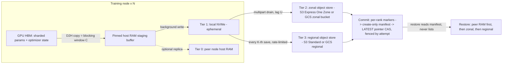

# High-Throughput Checkpointing to Object Storage

## TL;DR

A mixed-precision AdamW checkpoint is about 14 bytes per parameter, so 405B parameters means about 5.67 TB of unique state per save, before data-loader and RNG state.
Asynchronous checkpointing does not make saves free: it turns the cost into a short blocking snapshot window `C` plus a durability lag `U`, and only `C` sets the optimal checkpoint interval.
The snapshot has to finish before the next `optimizer.step()` changes parameters or moments, otherwise the checkpoint is silently torn.
Object stores have no multi-object transactions, so correctness depends on a commit protocol: immutable per-step keys, per-rank completion markers, a create-only manifest, and a pointer fenced by job attempt and advanced with compare-and-swap.
Tier by failure domain: peer RAM and local NVMe for the common single-node failure, a zonal object store (S3 Express One Zone, GCS zonal) for fast durable writes, and a regional object store every K-th save for zone loss.

## Mental Model



Think of a checkpoint as a pipeline, not a file write.
The only stage that stops training is the copy from HBM into pinned host memory, because that is the only stage that must happen before the weights change.
Every later stage (NVMe, zonal store, regional store) runs in the background, and each one buys survival against a larger failure domain at the cost of more lag and more money.
A checkpoint only exists once a single small object (the manifest) has been created atomically and the `LATEST` pointer has moved to it.
That separates the bulk data plane (terabytes of shard bytes, parallel across thousands of ranks) from a tiny control plane (a few kilobytes of commit state, written by one coordinator with conditional writes).

## Internals

### What a checkpoint actually contains

For a dense transformer trained in bf16 with fp32 master weights and AdamW, each parameter carries 2 bytes of bf16 weight, 4 bytes of fp32 master weight, and 4 + 4 bytes of first and second Adam moments, which is 14 bytes per parameter (derived).
Gradients are not saved, because they are recomputed in the first step after restore.
A 70B model is therefore about 0.98 TB and a 405B model about 5.67 TB of unique state (derived).
Bit-exact resumption also needs the data-loader position (sample index or shard cursor per data-parallel rank), RNG states for CPU, CUDA, and any dropout generators, the LR-scheduler state, and the step counter.
These are only kilobytes, but leaving them out is the most common reason a resumed run diverges from the original.
With ZeRO-3 or FSDP (see [[17-Cloud-AI-Engineering/Volume_10_AI_Infrastructure_on_Cloud/Chapter_05_Memory_Optimization_ZeRO_FSDP_and_JAX_Sharding|Memory Optimization: ZeRO, FSDP, and JAX Sharding]]), each rank in a sharding group owns a disjoint 1/N slice, so the unique bytes are spread evenly.
With HSDP or plain DDP, replicas hold identical bytes, so the save planner has to deduplicate and pick one writer per unique shard.
A naive "rank 0 of each replica group writes" policy puts all write bandwidth on a fraction of the nodes, so good planners balance writer assignment across replicas.

### The snapshot-before-mutation window

This is the mechanism getting-started guides skip, and the one that causes silent corruption.
CheckFreq (Mohan, Phanishayee, Chidambaram, FAST 2021) split checkpointing into `snapshot()` (copy state off the GPU) and `persist()` (write it to storage), and pointed out the only real ordering rule.
The snapshot of iteration `t` must finish before the optimizer update of iteration `t+1` writes to the parameters and moments.
The forward and backward passes of `t+1` only read parameters, so the device-to-host copy can overlap them.
If staging is still running when `optimizer.step()` executes, the checkpoint mixes weights from `t+1` with moments from `t`, or mixes layers from different steps.
That state is valid enough to load without error, then produces a loss spike that looks like data noise.
PyTorch Distributed Checkpoint (DCP) `async_save` handles this by staging the state dict into CPU memory before the call returns, then writing from that private copy in the background and returning a `Future` (PyTorch docs, as of 2026-10).
The blocking window `C` is therefore one D2H copy plus planning overhead, not the storage write.
The engineering levers on `C` are:
- Pre-allocated pinned buffers, so staging does not pay `cudaHostAlloc` each time and runs at DMA speed (PCIe 5.0 x16 is about 64 GB/s per direction in theory; PCI-SIG spec).
- Caching the save plan, so the gather-to-coordinator planning step is not repeated at 16k ranks.
- Limiting the pipeline to one in-flight save.

The last point is a hard memory bound: two in-flight saves double the pinned host memory, and pinned memory competes with data-loader workers and page cache.
At 405B on 2,048 nodes, the staged state is about 2.77 GB per node (derived), which is small next to multi-TiB host RAM.
At 70B on 8 nodes, it is about 122 GB per node (derived), and a second in-flight copy can OOM-kill the trainer.

### Data plane and control plane of a distributed checkpoint

The data plane is every rank streaming its shard bytes to storage in parallel.
It is embarrassingly parallel and limited by per-node NIC bandwidth, per-bucket request rate, and the aggregate throughput of the storage backend.
The control plane is three small steps: plan (who writes which shard), commit (declare the set of shards complete and consistent), and publish (move the pointer).
DCP does planning by gathering local plans to a coordinator, deduplicating into a global plan, scattering it back, having every rank write `__<rank>_<n>.distcp` files, and having the coordinator write a `.metadata` file that maps each logical tensor (FQN, chunk offsets, sizes) to file byte ranges (PyTorch docs, as of 2026-10).
That metadata is what allows load-time resharding: a checkpoint saved with one topology (for example TP=8, PP=16) can be loaded with another, because each loading rank computes which byte ranges overlap its new shard.
ByteCheckpoint (ByteDance, reported at NSDI 2025; venue UNVERIFIED) generalizes the same idea into a parallelism-agnostic representation with asynchronous pipelined I/O across frameworks.
In JAX, Orbax writes through TensorStore, and its OCDBT format packs many small array chunks into fewer large files, which cuts object count and per-request overhead on object storage (Orbax docs, as of 2026-10; UNVERIFIED this session).
The control plane must never be "list the bucket and take the highest step number."
Listing is slow at large object counts.
Listing also shows partial uploads from crashed jobs as if they were complete.
On S3 directory buckets, listing order is not lexicographic, so "highest" is not even well-defined (UNVERIFIED).

### Write path on S3 general purpose buckets: why periodic bursts are adversarial

S3 supports at least 3,500 PUT/COPY/POST/DELETE or 5,500 GET/HEAD requests per second per partitioned prefix, with no limit on the number of prefixes (AWS docs, as of 2026-10).
S3 creates partitions automatically at any point in the key string, based on the sustained request rate (AWS re:Post knowledge center, as of 2026-10).
Here is the subtle part: checkpoint traffic is close to the worst case for this mechanism.
A save sends hundreds of thousands of multipart part uploads in 10 to 60 seconds, then nothing for 15 minutes.
Averaged over a scaling window, the rate looks modest, so partitions may never be created ahead of time, and the burst hits a single cold partition that answers with `503 SlowDown`.
Then thousands of ranks retry in lockstep, which turns throttling into a synchronized retry storm (see [[17-Cloud-AI-Engineering/Volume_07_Reliability_and_SRE/Chapter_03_Resilient_Communication_Retries_Jitter_and_Circuit_Breakers|Resilient Communication: Retries, Jitter, and Circuit Breakers]]).
Three countermeasures follow from the mechanism:
- Put entropy at the front of the key (for example `ckpt/<hash(rank) mod 64>/<run>/<step>/...`) so load spreads over many potential partitions from the first request.
- Use larger parts to reduce request count.
- Smooth the regional-tier upload over the whole checkpoint interval instead of bursting it (see [[17-Cloud-AI-Engineering/Volume_01_Cloud_Architecture_Principles/Chapter_05_Constant_Work_and_Workload_Smoothing|Constant Work and Workload Smoothing]]).

Entropy-first keys break prefix listing per step, which costs nothing if restore reads the manifest instead of listing.
Multipart upload is the unit of parallelism within one shard file, with a limit of 10,000 parts and a 5 MiB minimum part size except for the last part (AWS docs; UNVERIFIED this session).
At a 16 MiB part size, a 5.67 TB checkpoint is about 338,000 part PUTs (derived), and one partitioned prefix at 3,500 writes/s would need about 97 seconds for request admission alone (derived).

### S3 Express One Zone: what changes mechanically

S3 Express One Zone stores data only in directory buckets, a separate bucket type that lives in one Availability Zone and is meant for consistent single-digit millisecond access (AWS docs, as of 2026-10).
Per AWS, it uses custom high-performance hardware and an object protocol "enhanced to streamline authentication and metadata overhead" (AWS docs, as of 2026-10).
The authentication change matters operationally.
Clients call `CreateSession` to get short-lived, bucket-scoped session credentials and sign data-plane requests with them.
That moves per-request IAM evaluation onto a session-creation path, and current AWS SDKs do this automatically.
Each directory bucket supports up to 200,000 reads and 100,000 writes per second by default, and up to 2 million reads and 200,000 writes per second through a Support increase (AWS docs, as of 2026-10).
The AWS S3 FAQ states the 2 million TPS ceiling holds regardless of how many directories the bucket has (AWS FAQ, as of 2026-10).
So, unlike general purpose buckets, key layout does not determine request capacity, and the cold-partition burst problem above mostly goes away.
Prime Video used S3 Express One Zone specifically to absorb checkpoint write bursts and reported 503 SlowDown rates below 0.1% during high-traffic events (AWS Storage Blog, 2025).
The trade-off is the failure domain.
A directory bucket is a single-AZ resource named `<base>--<az-id>--x-s3`, so losing the AZ means losing every checkpoint in it.
That is acceptable only if the training cluster is in the same AZ (it usually is, since UltraClusters and placement groups are zonal) and a regional copy exists for the zone-loss case.
Colocate by AZ ID (for example `use1-az4`), not AZ name, because AZ names map to different physical zones in different accounts.

### Write path on Google Cloud Storage

Cloud Storage buckets start at roughly 1,000 object writes and 5,000 object reads per second.
They scale by splitting key ranges as load grows, and Google's guidance is to double the request rate no faster than every 20 minutes (Google Cloud docs; UNVERIFIED this session).
Key ranges are lexicographic, so step-first or timestamp-first names push a burst onto one range server, which is the same entropy-first lesson as S3.
GCS has no per-GB ingress or write charge for same-region traffic and bills each write as a Class A operation.
Large uploads can use resumable uploads, XML API multipart uploads, or parallel composite uploads where up to 32 objects are composed into one (Google Cloud docs; UNVERIFIED this session).
Hierarchical namespace (HNS) buckets add real folders with atomic folder rename, which suits Orbax-style "write to a temp directory, then rename" finalization (UNVERIFIED this session).
Google announced Rapid Storage, a zonal bucket type on Colossus with appendable objects and gRPC bidirectional streaming, in April 2025 as a preview; its GA status as of 2026-10 is UNVERIFIED and must be checked before production use.
Anywhere Cache is a zonal SSD read cache in front of a regional bucket, which helps the restore read path but not the save path.
For GCS internals, see [[17-Cloud-AI-Engineering/Volume_03_GCP_Deep_Dive/Chapter_09_Cloud_Storage_and_Colossus_Filesystem|Cloud Storage and Colossus Filesystem]].

### Commit protocol and fencing on an object store

Both S3 (strong read-after-write since 2020) and GCS give strongly consistent single-object operations, but neither offers multi-object atomicity.
The protocol below builds atomicity out of single-object primitives.

1. Every save writes to an immutable, unique prefix: `<run>/step_<S>/a<attempt>/`, where `attempt` is a monotonically increasing job-incarnation number issued by the scheduler.
2. Each rank uploads its shard files, then writes a small per-rank marker listing its keys, byte counts, and checksums.
3. The coordinator waits for all N markers using HEAD/GET on known keys (no listing), then writes `_COMMITTED` with a create-only precondition: S3 `If-None-Match: *` or GCS `ifGenerationMatch=0`.
4. The coordinator advances `LATEST` with compare-and-swap: S3 `If-Match: <ETag>` or GCS `ifGenerationMatch=<generation>`, and only if `(attempt, step)` is greater than the current value in tuple order.

Step 4 is fencing.
Suppose a network partition makes the scheduler declare attempt 7 dead and start attempt 8, while attempt 7's uploader is still running.
Attempt 7 can still finish writing its own prefix, but it cannot move the pointer backward past attempt 8, because tuple comparison rejects it and CAS rejects a stale ETag.
This is the fencing-token pattern from lease-based distributed systems, applied to checkpoint publication.
For GCS, generation preconditions are long-standing and documented.
For S3, conditional writes (`If-None-Match`, then `If-Match`) launched for general purpose buckets in 2024.
Directory bucket support for `If-Match` in your region is UNVERIFIED and must be tested before you rely on it.

### Tiering and the goodput equation

Young (1974) gives the first-order optimal checkpoint interval `T* = sqrt(2 C M)`, where `C` is the cost of one checkpoint and `M` is the mean time between failures.
The fraction of time wasted at that optimum is `C/T + T/(2M) = sqrt(2C/M)`; Daly (2006) refines this with restart time and higher-order terms.
With asynchronous checkpointing, two different costs need to be kept apart:
- `C` is the blocking stall, which is time the accelerators do no training.
- `U` is the durable lag: the time from snapshot until the checkpoint is committed in the tier that survives a given failure.

The expected work lost per failure becomes about `T/2 + U` (valid while `U < T`), so waste is about `C/T + (T/2 + U)/M + R/M`, where `R` is the fixed restart cost.
Minimizing over `T` gives the same `T* = sqrt(2 C M)`.
The durable lag `U` only adds a constant `U/M`, so faster storage barely changes the optimal interval.
The interval is set by the stall `C`, and that is where engineering effort should go.
If `U` exceeds `T`, saves pile up, host memory fills, and you must either skip saves or stall, so `U < T` is a hard design constraint.
Lag also depends on the failure: if a node fails but its peer's RAM replica or the surviving nodes' NVMe tier is intact, the relevant `U` is the local-tier lag (about seconds), not the object-store lag.
For Llama 3 405B on 16,384 H100 GPUs, Meta reported 466 job interruptions in a 54-day snapshot, 419 of them unexpected (Llama 3 paper, 2024).
That gives an MTBF of about 186 minutes at that scale (derived), and MTBF shrinks roughly in proportion to GPU count.

### In-memory and peer checkpointing

Gemini (Wang et al., SOSP 2023) checkpoints into the CPU memory of the local machine and of peer machines.
Its placement strategy maximizes the probability that every shard survives any single-machine failure.
It also schedules checkpoint traffic into idle gaps in the training communication so the replication does not slow collectives.
MegaScale (ByteDance, NSDI 2024) uses a two-stage design, staging to host memory first and then to a distributed file system asynchronously.
On restore, MegaScale has one rank per data-parallel group read a shard and broadcast it over the training fabric instead of all replicas hitting storage.
That restore pattern is the general fix for read stampedes.
On AWS, SageMaker HyperPod launched managed tiered checkpointing in 2025, which keeps checkpoints in CPU memory across nodes with S3 as the durable tier (details and GA scope UNVERIFIED).
On Google Cloud, Orbax provides an emergency-checkpointing manager that combines local and persistent tiers with cross-slice replication, and GKE has a multi-tier checkpointing offering (GA status UNVERIFIED).
The physical fabric that peer replication uses is covered in [[17-Cloud-AI-Engineering/Volume_10_AI_Infrastructure_on_Cloud/Chapter_02_Interconnect_Technologies_NVLink_EFA_and_TPU_ICI|Interconnect Technologies: NVLink, EFA, and TPU ICI]].

### Failure domains per tier

| Tier | Survives | Does not survive | Typical lag U |
|---|---|---|---|
| HBM only | nothing | process crash | 0 |
| Pinned host RAM | CUDA fault, process restart on same node | node reboot, host failure | sub-second |
| Peer host RAM (2 replicas) | any single-node failure | correlated multi-node loss, rack power | seconds |
| Local NVMe | process crash, possibly reboot | instance replacement, host failure (ephemeral) | seconds |
| Zonal object store | any node or rack loss | AZ loss | seconds to minutes |
| Regional object store | AZ loss | region loss, account-level deletion | minutes to hours |

Local NVMe instance storage is lost when the instance stops or the host fails, so a checkpoint that exists only on NVMe is not durable for the node that failed.
Treat NVMe as a staging buffer plus a fast restore source for nodes that survived, never as the system of record.
For AZ-isolation fundamentals, see [[17-Cloud-AI-Engineering/Volume_00_Foundations_Under_the_Cloud/Chapter_06_Physical_Failure_Domains_and_Blast_Radius|Physical Failure Domains and Blast Radius]].

## Numbers to Know

| Quantity | Value | Source |
|---|---|---|
| Checkpoint bytes per param, bf16 + fp32 master + AdamW | 14 B | derived |
| 70B / 405B dense checkpoint | 0.98 TB / 5.67 TB | derived |
| S3 general purpose request rate per partitioned prefix | at least 3,500 writes/s, 5,500 reads/s | AWS docs, as of 2026-10 |
| S3 Express One Zone default per directory bucket | 200,000 reads/s, 100,000 writes/s | AWS docs, as of 2026-10 |
| S3 Express One Zone max with Support increase | 2,000,000 reads/s, 200,000 writes/s | AWS docs, as of 2026-10 |
| S3 Express One Zone latency class | consistent single-digit ms | AWS docs, as of 2026-10 |
| S3 Express One Zone price cut, effective 2025-04-10 | storage -31%, PUT -55%, GET -85%, per-GB -60% | AWS News Blog, 2025-04 |
| S3 Express One Zone storage, us-east-1 | $0.11 per GB-month | AWS pricing, as of 2026-10 |
| S3 Express One Zone PUT / GET, us-east-1 | $0.00113 / $0.00003 per 1,000 | AWS pricing, as of 2026-10 |
| S3 Express One Zone upload / retrieval per GB, us-east-1 | $0.0032 / $0.0006, applies to all bytes | AWS pricing, as of 2026-10 |
| S3 Standard storage (first 50 TB) / PUT, us-east-1 | $0.023 per GB-month / $0.005 per 1,000 | AWS pricing, as of 2026-10 |
| S3 multipart limits | 10,000 parts, 5 MiB minimum part | AWS docs, UNVERIFIED this session |
| GCS initial bucket request rate | about 1,000 writes/s, 5,000 reads/s, double every 20 min | Google Cloud docs, UNVERIFIED this session |
| GCS compose fan-in | 32 source objects per request | Google Cloud docs, UNVERIFIED this session |
| GCS default soft-delete retention on new buckets | 7 days | Google Cloud docs, UNVERIFIED this session |
| GCS Standard regional storage / Class A ops | about $0.020 per GB-month / $0.005 per 1,000 | Google Cloud pricing, UNVERIFIED this session |
| Rapid Storage (GCS zonal buckets) | announced in preview 2025-04; current status UNVERIFIED | Google Cloud Next 2025 |
| Llama 3 405B interruption rate | 466 interruptions in 54 days, 419 unexpected, 16,384 H100 | Llama 3 paper, 2024 |
| Implied MTBF at 16k GPUs | about 186 min | derived |
| p5.48xlarge local NVMe / host RAM / EFA | 8 x 3.84 TB / 2 TiB / 3,200 Gbps | AWS docs, UNVERIFIED this session |
| PCIe 5.0 x16 theoretical per direction | about 64 GB/s | PCI-SIG spec |

## AWS vs GCP Mechanism Parity

| Concern | AWS | Google Cloud | Critical difference |
|---|---|---|---|
| Zonal low-latency object tier | S3 Express One Zone in directory buckets, GA | Rapid Storage zonal buckets, preview at 2025-04 launch, status UNVERIFIED | Do not design a GCP production path on a feature you have not confirmed GA |
| Regional durable tier | S3 Standard, multi-AZ | GCS regional, dual-region, or multi-region | GCS dual-region gives a two-region failure domain in one bucket namespace |
| Request scaling unit | Per partitioned prefix, auto-split on sustained rate; Express gives fixed per-bucket TPS | Per bucket key range, auto-split with a ramp | Both punish step-first key names under bursts; Express removes the key-layout dependency |
| Auth on hot path | `CreateSession` session credentials for Express; SigV4 per request otherwise | OAuth access tokens per request, IAM evaluated by the service | Express sessions need the `s3express:CreateSession` permission, not only `s3:PutObject` |
| Create-only commit | `If-None-Match: *` on PutObject | `ifGenerationMatch=0` | GCS generation numbers are fencing tokens by design |
| Pointer CAS | `If-Match: <ETag>` | `ifGenerationMatch=<gen>` | Directory-bucket `If-Match` support UNVERIFIED; test it |
| Large-object parallelism | Multipart upload, parallel parts | XML multipart, resumable, parallel composite with compose | GCS bills each part or compose as a Class A op; S3 Express also bills per GB |
| Namespace semantics | Directory buckets have real directories; listing not lexicographic (UNVERIFIED) | HNS buckets have folders and atomic folder rename (UNVERIFIED) | Orbax rename-finalize fits HNS; manifest-commit works on both |
| PyTorch integration | `s3torchconnector.dcp` S3StorageWriter/Reader (AWS CRT) | fsspec/gcsfs writer or local-then-upload | AWS ships a first-party DCP storage plugin |
| JAX integration | Orbax over S3 via TensorStore or local-then-upload | Orbax over GCS via TensorStore, native | Orbax is GCS-first |
| Managed in-memory tier | SageMaker HyperPod managed tiered checkpointing (details UNVERIFIED) | Orbax emergency checkpointing, GKE multi-tier checkpointing (status UNVERIFIED) | Both put host RAM and peer replication ahead of the object store |
| Read cache for restore | Mountpoint cache, FSx for Lustre | Anywhere Cache, Cloud Storage FUSE file cache | Caches help restore and never help save |
| Private path | Gateway VPC endpoints for S3 and S3 Express | Private Google Access, Private Service Connect | Endpoint policies on AWS; VPC Service Controls perimeter on GCP |
| Encryption | SSE-S3 default, SSE-KMS with Bucket Keys | Google-managed default, CMEK via Cloud KMS | Per-object KMS calls at 338k objects per save is a quota hazard without bucket keys |

## Worked Example: Two-Tier Async Checkpointing with Fenced Commits

### Capacity sizing: 405B on 16,384 GPUs

Assumptions (labeled, not facts): 2,048 nodes of 8 H100, 5.67 TB unique state, about 25 GB/s effective D2H per GPU, about 3 GB/s effective object-store upload per node, $40 per node-hour all-in (ASSUMPTION, substitute your negotiated rate), restart cost `R` = 10 minutes.

1. Per-node staged bytes: 5.67 TB / 2,048 = 2.77 GB; per GPU 346 MB.
2. D2H copy: 346 MB / 25 GB/s = about 14 ms; budget `C` = 30 s to cover planning, allocator, and collective skew at 16k ranks, and treat cutting that to 5 s as the main optimization target.
3. Local NVMe write: 2.77 GB per node, under a second on an 8-drive stripe.
4. Zonal upload request floor: 5.67 TB / 16 MiB = 338k PUTs; at Express default 100,000 writes/s that is 3.4 s; on one cold S3 Standard prefix at 3,500/s it is 97 s.
5. Zonal upload bandwidth floor: 2.77 GB / 3 GB/s = about 1 s per node; the real limit is the backend's aggregate absorb rate (2,048 x 3 GB/s = 6.1 TB/s offered), which is not published and must be measured, so plan for `U` up to 3 minutes.
6. MTBF: about 186 minutes (Llama 3 scale).
7. Synchronous save to S3 Standard with `C` = 5 min: `T*` = sqrt(2 x 5 x 186) = 43 min, waste = sqrt(10/186) = 23.2%, plus `R/M` = 5.4%, for 28.6% total.
8. Async two-tier with `C` = 0.5 min and `U` = 3 min: `T*` = 13.6 min, waste = 7.3% + 1.6% + 5.4% = 14.3%.
9. Async with `C` = 5 s, peer-RAM restore (`R` = 3 min, `U` relevant only for multi-node loss, about 0.3%): 3.0% + 0.3% + 1.6% = about 4.9%.
10. Cluster burn: 2,048 x $40 = $81,920 per hour = about $1.97M per day, so each goodput point is worth about $19.7k per day, and step 7 versus step 9 is worth about $460k per day under these assumptions.
11. Express cost at 15-minute saves: per save $18.14 upload-per-GB + $0.38 PUT = $18.52; 96 saves per day = about $1,780 per day; keeping the last 3 resident = 17 TB x $0.11 = about $1,870 per month.
12. Regional tier every 2 hours to S3 Standard: PUTs $1.69 per save, 12 per day = about $20 per day; retaining 13 checkpoints (6 recent + 7 daily) = 73.7 TB x $0.023 = about $1,700 per month.
13. Checkpoint storage total is about 0.1% of cluster spend, so the per-GB Express fee is easy to justify, and the only real decision is how fast the regional copy has to be.

For broader unit-economics framing, see [[17-Cloud-AI-Engineering/Volume_09_FinOps_and_Cloud_Economics/Chapter_05_GPU_and_TPU_Unit_Economics|GPU and TPU Unit Economics]].

### Lab cost estimate

The lab runs on any CPU host, using two processes on one machine with the gloo backend.
Running it on an EC2 instance in the directory bucket's AZ is ideal, but it also works from a laptop through the zonal endpoint, with higher latency.
Each checkpoint is about 200 MB (two MLPs plus AdamW state); three saves per run, five runs, is about 3 GB uploaded.
Express cost: 3 GB x $0.0032 = $0.01 upload plus negligible PUTs and storage (AWS pricing, as of 2026-10).
GCS cost: under $0.01 in Class A operations (UNVERIFIED this session).
Expected total, excluding the optional EC2 instance: under $1.

### Budget alarms (create first)

```bash
# AWS: 25 USD monthly cost budget with an 80% actual-spend email alert.
ACCOUNT_ID=$(aws sts get-caller-identity --query Account --output text)
aws budgets create-budget --account-id "$ACCOUNT_ID" \
  --budget '{"BudgetName":"ckpt-lab","BudgetLimit":{"Amount":"25","Unit":"USD"},"TimeUnit":"MONTHLY","BudgetType":"COST"}' \
  --notifications-with-subscribers '[{"Notification":{"NotificationType":"ACTUAL","ComparisonOperator":"GREATER_THAN","Threshold":80,"ThresholdType":"PERCENTAGE"},"Subscribers":[{"SubscriptionType":"EMAIL","Address":"you@example.com"}]}]'

# Google Cloud: 25 USD budget scoped to the lab project with an 80% threshold.
gcloud billing budgets create --billing-account="$BILLING_ACCOUNT" \
  --display-name="ckpt-lab" --budget-amount=25USD \
  --threshold-rule=percent=0.8 --filter-projects="projects/$PROJECT_ID"
```

### Provision storage

```bash
# AWS: find the AZ ID (not name) that hosts your compute, then create a directory bucket there.
aws ec2 describe-availability-zones --region us-east-1 \
  --query "AvailabilityZones[].[ZoneName,ZoneId]" --output text
export AZ_ID=use1-az4                       # must be an AZ ID where S3 Express One Zone is offered
export S3_BUCKET="ckpt-lab-$RANDOM--${AZ_ID}--x-s3"
aws s3api create-bucket --bucket "$S3_BUCKET" --region us-east-1 \
  --create-bucket-configuration "Location={Type=AvailabilityZone,Name=${AZ_ID}},Bucket={DataRedundancy=SingleAvailabilityZone,Type=Directory}"
# Expire old checkpoints and abort orphaned multipart uploads, which otherwise bill silently.
aws s3api put-bucket-lifecycle-configuration --bucket "$S3_BUCKET" --region us-east-1 \
  --lifecycle-configuration '{"Rules":[{"ID":"ckpt-expiry","Status":"Enabled","Filter":{"Prefix":"ckpt/"},"Expiration":{"Days":3},"AbortIncompleteMultipartUpload":{"DaysAfterInitiation":1}}]}'

# Google Cloud: regional bucket colocated with compute; disable soft delete for churn-heavy checkpoint data.
export GCS_BUCKET="ckpt-lab-$RANDOM"
gcloud storage buckets create "gs://$GCS_BUCKET" --location=us-central1 \
  --uniform-bucket-level-access --soft-delete-duration=0
```

### Code: `ckpt_lab.py`

```python
#!/usr/bin/env python3
# Two-tier async checkpointing: DCP async_save -> local NVMe -> object store,
# with per-rank markers, a create-only manifest, and an attempt-fenced CAS pointer.
# Requires torch>=2.4 (FileSystemWriter stages a private CPU copy in async_save).
# S3:  pip install torch boto3            (boto3 handles S3 Express CreateSession)
# GCS: pip install torch google-cloud-storage
# Run: torchrun --nproc_per_node=2 ckpt_lab.py --backend s3 --bucket $S3_BUCKET --attempt 1
import argparse, glob, json, os, queue, shutil, threading, time
import torch
import torch.distributed as dist
import torch.distributed.checkpoint as dcp
from torch.distributed.checkpoint import FileSystemWriter
from torch.distributed.checkpoint.state_dict import get_state_dict, set_state_dict

MiB = 2**20


class S3Store:
    def __init__(self, bucket, region):
        import boto3
        from boto3.s3.transfer import TransferConfig
        from botocore.config import Config
        from botocore.exceptions import ClientError
        self.err = ClientError
        self.b = bucket
        self.c = boto3.client("s3", region_name=region,
                              config=Config(retries={"mode": "adaptive", "max_attempts": 10}))
        self.cfg = TransferConfig(multipart_threshold=16 * MiB, multipart_chunksize=16 * MiB,
                                  max_concurrency=16)

    def upload(self, path, key):
        self.c.upload_file(path, self.b, key, Config=self.cfg)

    def download(self, key, path):
        self.c.download_file(self.b, key, path, Config=self.cfg)

    def get(self, key):
        try:
            r = self.c.get_object(Bucket=self.b, Key=key)
            return r["Body"].read(), r["ETag"]
        except self.err as e:
            if e.response["Error"]["Code"] in ("NoSuchKey", "404", "NotFound"):
                return None, None
            raise

    def put_if_absent(self, key, body):
        try:
            self.c.put_object(Bucket=self.b, Key=key, Body=body, IfNoneMatch="*")
            return True
        except self.err as e:
            if e.response["Error"]["Code"] in ("PreconditionFailed", "ConditionalRequestConflict"):
                return False
            raise

    def cas(self, key, body, token):
        if token is None:
            return self.put_if_absent(key, body)
        try:
            self.c.put_object(Bucket=self.b, Key=key, Body=body, IfMatch=token)
            return True
        except self.err as e:
            if e.response["Error"]["Code"] in ("PreconditionFailed", "ConditionalRequestConflict"):
                return False
            raise


class GCSStore:
    def __init__(self, bucket):
        from google.cloud import storage
        from google.cloud.storage import transfer_manager
        from google.api_core.exceptions import PreconditionFailed
        self.tm, self.pf = transfer_manager, PreconditionFailed
        self.b = storage.Client().bucket(bucket)

    def upload(self, path, key):
        blob = self.b.blob(key)
        if os.path.getsize(path) > 64 * MiB:
            self.tm.upload_chunks_concurrently(path, blob, chunk_size=32 * MiB, max_workers=8)
        else:
            blob.upload_from_filename(path)

    def download(self, key, path):
        self.b.blob(key).download_to_filename(path)

    def get(self, key):
        blob = self.b.get_blob(key)
        if blob is None:
            return None, None
        return blob.download_as_bytes(if_generation_match=blob.generation), blob.generation

    def put_if_absent(self, key, body):
        return self.cas(key, body, None)

    def cas(self, key, body, token):
        try:
            self.b.blob(key).upload_from_string(body, if_generation_match=token or 0)
            return True
        except self.pf:
            return False


def digest(model):
    return float(sum(p.detach().double().sum() for p in model.parameters()))


class Uploader(threading.Thread):
    """Drains committed-local checkpoints to the object store; rank 0 runs the commit protocol."""

    def __init__(self, store, rank, world, run, attempt, keep_local):
        super().__init__(daemon=True)
        self.q = queue.Queue(maxsize=2)     # bounds host memory and NVMe usage
        self.s, self.rank, self.world = store, rank, world
        self.run_id, self.attempt, self.keep = run, attempt, keep_local
        self.local_dirs = []

    def run(self):
        while True:
            item = self.q.get()
            if item is None:
                return
            step, local, fut, dig = item
            fut.result()                    # local tier complete; .metadata exists on rank 0
            prefix = f"ckpt/{self.run_id}/step_{step:08d}/a{self.attempt}"
            files = sorted(glob.glob(os.path.join(local, f"__{self.rank}_*.distcp")))
            if self.rank == 0:
                files.append(os.path.join(local, ".metadata"))
            t0 = time.perf_counter()
            keys = []
            for f in files:
                k = f"{prefix}/{os.path.basename(f)}"
                self.s.upload(f, k)
                keys.append(k)
            self.s.put_if_absent(f"{prefix}/_ranks/{self.rank}.json", json.dumps({"keys": keys}))
            if self.rank == 0:
                self.commit(step, prefix, dig)
            print(f"[rank {self.rank}] step {step} drained in {time.perf_counter() - t0:.2f}s", flush=True)
            self.local_dirs.append(local)
            while len(self.local_dirs) > self.keep:
                shutil.rmtree(self.local_dirs.pop(0), ignore_errors=True)

    def commit(self, step, prefix, dig, timeout=600):
        deadline, all_keys = time.time() + timeout, []
        for r in range(self.world):         # HEAD/GET known keys; never LIST
            while True:
                body, _ = self.s.get(f"{prefix}/_ranks/{r}.json")
                if body is not None:
                    all_keys += json.loads(body)["keys"]
                    break
                if time.time() > deadline:
                    raise TimeoutError(f"rank {r} never committed {prefix}")
                time.sleep(1.0)
        manifest = json.dumps({"step": step, "attempt": self.attempt, "prefix": prefix,
                               "keys": all_keys, "digest": dig})
        if not self.s.put_if_absent(f"{prefix}/_COMMITTED", manifest):
            print(f"[commit] {prefix} already committed; skipping", flush=True)
        ptr_key = f"ckpt/{self.run_id}/LATEST"
        for _ in range(8):                  # CAS loop, fenced by (attempt, step)
            cur, token = self.s.get(ptr_key)
            if cur is not None:
                c = json.loads(cur)
                if (c["attempt"], c["step"]) >= (self.attempt, step):
                    print(f"[commit] pointer at newer {c['attempt']}/{c['step']}; not advancing", flush=True)
                    return
            new = json.dumps({"attempt": self.attempt, "step": step, "prefix": prefix})
            if self.s.cas(ptr_key, new, token):
                print(f"[commit] LATEST -> {prefix}", flush=True)
                return
            time.sleep(0.2)
        raise RuntimeError("pointer CAS contention did not resolve")


def restore(store, run_id, local_root, model, opt, rank):
    ptr, _ = store.get(f"ckpt/{run_id}/LATEST")
    if ptr is None:
        return 0
    prefix = json.loads(ptr)["prefix"]
    man = json.loads(store.get(f"{prefix}/_COMMITTED")[0])
    dst = os.path.join(local_root, f"restore_r{rank}")
    shutil.rmtree(dst, ignore_errors=True)
    os.makedirs(dst)
    for k in man["keys"]:                   # lab: every rank pulls all files; prod: byte ranges only
        store.download(k, os.path.join(dst, os.path.basename(k)))
    msd, osd = get_state_dict(model, opt)
    sd = {"model": msd, "optim": osd, "step": 0}
    dcp.load(sd, checkpoint_id=dst)
    set_state_dict(model, opt, model_state_dict=sd["model"], optim_state_dict=sd["optim"])
    got = digest(model)
    assert abs(got - man["digest"]) < 1e-6, f"digest mismatch {got} vs {man['digest']}"
    print(f"[rank {rank}] restored step {sd['step']} from {prefix}, digest ok", flush=True)
    return int(sd["step"])


def main():
    ap = argparse.ArgumentParser()
    ap.add_argument("--backend", choices=["s3", "gcs"], required=True)
    ap.add_argument("--bucket", required=True)
    ap.add_argument("--region", default="us-east-1")
    ap.add_argument("--run-id", default="lab")
    ap.add_argument("--attempt", type=int, required=True)   # scheduler-issued, monotonic
    ap.add_argument("--local-dir", default="/tmp/nvme/ckpt")
    ap.add_argument("--steps", type=int, default=30)
    ap.add_argument("--every", type=int, default=10)
    ap.add_argument("--keep-local", type=int, default=2)
    a = ap.parse_args()

    dist.init_process_group("gloo")
    rank, world = dist.get_rank(), dist.get_world_size()
    ckpt_pg = dist.new_group(backend="gloo")   # keep checkpoint collectives off the training group
    store = S3Store(a.bucket, a.region) if a.backend == "s3" else GCSStore(a.bucket)

    torch.manual_seed(0)
    model = torch.nn.Sequential(torch.nn.Linear(2048, 4096), torch.nn.ReLU(), torch.nn.Linear(4096, 2048))
    opt = torch.optim.AdamW(model.parameters(), lr=1e-3)

    def train_step():
        loss = model(torch.randn(64, 2048)).pow(2).mean()
        loss.backward()
        opt.step()
        opt.zero_grad(set_to_none=True)

    train_step()                            # materialize optimizer state so load has targets
    start = restore(store, a.run_id, a.local_dir, model, opt, rank)

    up = Uploader(store, rank, world, a.run_id, a.attempt, a.keep_local)
    up.start()
    pending = None
    for step in range(start + 1, start + a.steps + 1):
        train_step()
        if step % a.every == 0:
            if pending is not None:
                pending.result()            # at most one in-flight save
            dig = digest(model)             # computed on the exact state being snapshotted
            msd, osd = get_state_dict(model, opt)
            local = os.path.join(a.local_dir, f"step_{step:08d}_a{a.attempt}")
            t0 = time.perf_counter()
            pending = dcp.async_save({"model": msd, "optim": osd, "step": step},
                                     storage_writer=FileSystemWriter(local), process_group=ckpt_pg)
            print(f"[rank {rank}] step {step} blocking window C = {1e3 * (time.perf_counter() - t0):.1f} ms", flush=True)
            up.q.put((step, local, pending, dig))
    if pending is not None:
        pending.result()
    up.q.put(None)
    up.join()
    dist.barrier()
    dist.destroy_process_group()


if __name__ == "__main__":
    main()
```

### Run and verify the invariants

```bash
torchrun --nproc_per_node=2 ckpt_lab.py --backend s3 --bucket "$S3_BUCKET" --attempt 1
# Restart with a higher attempt: it must restore the latest step and pass the digest check.
torchrun --nproc_per_node=2 ckpt_lab.py --backend s3 --bucket "$S3_BUCKET" --attempt 2
# Zombie test: rerun with a stale attempt; it uploads under its own prefix but must not move LATEST.
torchrun --nproc_per_node=2 ckpt_lab.py --backend s3 --bucket "$S3_BUCKET" --attempt 1
aws s3 cp "s3://$S3_BUCKET/ckpt/lab/LATEST" - --region us-east-1
# Same three runs with --backend gcs --bucket "$GCS_BUCKET".
```

Three things to observe.
First, the printed blocking window `C` should be much smaller than the drain time.
Second, the attempt-1 rerun prints "pointer at newer" and leaves `LATEST` unchanged.
Third, killing a run with `kill -9` partway through an upload leaves a prefix without `_COMMITTED`, and the next restore ignores it.
If `IfMatch` is rejected on your directory bucket, the CAS path raises an error; treat that as the UNVERIFIED case and fall back to a general purpose bucket for the pointer object.

### Teardown

```bash
aws s3 rm "s3://$S3_BUCKET" --recursive --region us-east-1
aws s3api list-multipart-uploads --bucket "$S3_BUCKET" --region us-east-1   # must be empty; abort any listed
aws s3api delete-bucket --bucket "$S3_BUCKET" --region us-east-1
gcloud storage rm --recursive "gs://$GCS_BUCKET"
aws budgets delete-budget --account-id "$ACCOUNT_ID" --budget-name ckpt-lab
gcloud billing budgets list --billing-account="$BILLING_ACCOUNT" --format="value(name)" \
  | xargs -I{} gcloud billing budgets delete {} --quiet   # deletes ALL budgets on the account; filter to ckpt-lab if you have others
rm -rf /tmp/nvme/ckpt
```

## Failure Modes and Pitfalls

**SlowDown retry storms.**
Thousands of ranks start multipart uploads into a cold prefix at the same moment, S3 returns 503, and SDK retries with identical backoff resynchronize into waves.
Use adaptive client-side retry modes, randomize each rank's start offset by a few hundred milliseconds, use entropy-first keys, or move the hot tier to a directory bucket.

**Torn snapshot.**
A custom async path (not DCP or Orbax) snapshots tensors by reference or begins D2H on a side stream without synchronizing before `optimizer.step()`.
The checkpoint loads cleanly and the loss spikes on resume.
Detect it with per-shard checksums computed synchronously at snapshot time and verified on load, as in the lab digest.

**Mixed-step restore.**
A restore that globs "latest directory per rank" can load rank 0 from step 1200 and rank 37 from step 1180 after a partial upload.
Only manifest-based restore prevents this.

**Zombie writer.**
After a partition, a previous job attempt keeps uploading and overwrites `latest`, or writes into the same step directory as the new attempt.
Attempt-scoped prefixes plus a fenced CAS pointer prevent both.

**Host OOM masquerading as hardware failure.**
Two in-flight async saves, pinned staging buffers, and data-loader prefetch together exceed host RAM.
The OOM killer takes the trainer, and the fleet health system blames the node.
Bound in-flight saves to one and budget pinned memory explicitly.

**NVMe as system of record.**
Instance storage is ephemeral, so a host failure takes the only copy of that node's newest shards with it.
If nothing replicated those shards (to peer RAM or an object store), the whole job falls back to an older checkpoint.

**Single-AZ blast radius.**
A directory bucket or zonal bucket goes down with its AZ.
Without a regional copy, an AZ event becomes a multi-day loss of training progress.

**Restore stampede.**
At restart, every rank GETs `.metadata` and its shard ranges at once.
The coordinator should read metadata once and broadcast it.
Large shards should be read by one rank per replica group and broadcast over the training fabric, as MegaScale does.

**Saving a diverged state.**
A NaN or loss-spike state gets checkpointed and becomes the only resident copy.
Keep N checkpoints and promote `LATEST` only after a health check (finite loss, gradient-norm bound).

**Silent object corruption.**
End-to-end checksums (CRC32C on GCS; additional checksums on S3, with SDK defaults that have changed in recent releases, UNVERIFIED) plus per-shard digests in the manifest separate storage corruption from silent data corruption on the GPU.
See [[17-Cloud-AI-Engineering/Volume_10_AI_Infrastructure_on_Cloud/Chapter_08_Fault_Tolerance_and_Fleet_Resiliency_at_Scale|Fault Tolerance and Fleet Resiliency at Scale]].

**Dependency on a regional object-store control path.**
The February 28, 2017 S3 us-east-1 disruption ([AWS summary](https://aws.amazon.com/message/41926/)) showed that a regional object store can stop accepting PUTs entirely.
The June 12, 2025 Google Cloud incident ([Google Cloud status](https://status.cloud.google.com/incidents/ow5i3PPK96RduMcb1SsW), URL UNVERIFIED) caused broad API failures across products.
Training should keep running on the local and peer tiers through such events, buffering and retrying later, instead of blocking on the durable tier.
For more postmortem patterns, see [[17-Cloud-AI-Engineering/Volume_07_Reliability_and_SRE/Chapter_07_Anatomy_of_Major_Cloud_Outages|Anatomy of Major Cloud Outages]].

**Silent storage cost.**
Orphaned multipart uploads keep billing until a lifecycle rule aborts them.
S3 versioning turns every delete into a retained noncurrent version.
GCS soft delete (default 7 days on new buckets, UNVERIFIED this session) bills deleted checkpoint bytes for the whole retention window.
With 96 saves per day of 5.67 TB, that is roughly 3.8 PB of soft-deleted bytes held at any time (derived).

**Interval longer than drain.**
If `U` exceeds `T`, saves pile up behind each other.
Production code must either skip a save (and emit a metric) or stall, and must never queue without a bound.

## Security and Cost Angles

**IAM scoping.**
Grant the training role `s3express:CreateSession` on the single directory bucket ARN, and constrain it to ReadWrite session mode only for the trainer.
Give the evaluation readers ReadOnly sessions.
On GCP, grant `roles/storage.objectCreator` plus a narrowly scoped object viewer to the trainer service account, and keep `objectAdmin` (delete and overwrite) away from training jobs.
The pointer object needs overwrite permission, so put it under a separate prefix or bucket with its own tighter binding.
Use workload identity, not static keys ([[17-Cloud-AI-Engineering/Volume_08_Security_Identity_and_the_Data_Perimeter/Chapter_02_Workload_Identity_Federation|Workload Identity Federation]]).

**Encryption.**
Checkpoints are the model, so treat them as the most sensitive artifact the company produces.
Use SSE-KMS with S3 Bucket Keys, or CMEK on GCS, so that the hundreds of thousands of objects per save do not each trigger a KMS call and run into KMS request quotas.
See [[17-Cloud-AI-Engineering/Volume_08_Security_Identity_and_the_Data_Perimeter/Chapter_04_Encryption_Key_Hierarchies_and_Envelope_Encryption|Encryption Key Hierarchies and Envelope Encryption]].

**Private paths and perimeters.**
Route S3 and S3 Express traffic through gateway VPC endpoints (`com.amazonaws.<region>.s3express` for directory buckets; UNVERIFIED this session).
Attach endpoint policies that allow only your buckets, and add `aws:SourceVpce` conditions in bucket policies.
On GCP, place the project inside a VPC Service Controls perimeter ([[17-Cloud-AI-Engineering/Volume_03_GCP_Deep_Dive/Chapter_03_VPC_Service_Controls_Security_Perimeters|VPC Service Controls: Security Perimeters]]) so a stolen token cannot copy weights to an outside bucket.

**Anti-ransomware.**
The regional tier should live in a separate account or project, with Object Lock or a retention policy on promoted milestone checkpoints, so that a compromised training role cannot delete history.

**Cost levers, in order of impact.**
1. Reduce `C` before buying faster storage, since goodput points are worth orders of magnitude more than storage fees.
2. Use the Express per-GB upload fee only for the tier that needs burst absorption, and send the regional tier to Standard-class storage.
3. Shrink the bytes: save bf16 weights plus optimizer state but drop recomputable buffers; incremental or quantized checkpoints in the style of Check-N-Run are worth considering for embedding-heavy models.
4. Enforce lifecycle expiry, multipart abort, soft-delete off, and versioning off on churn buckets.
5. Never pull checkpoints across regions or clouds routinely, since egress turns a 5.67 TB save into a recurring bill ([[17-Cloud-AI-Engineering/Volume_09_FinOps_and_Cloud_Economics/Chapter_04_Network_Egress_Economics_and_Optimization|Network Egress Economics and Optimization]]).

**Spot and preemptible capacity.**
Short interruption notices make the blocking window and the local-tier commit the only things that reliably finish.
Size `C` to fit inside the notice ([[17-Cloud-AI-Engineering/Volume_09_FinOps_and_Cloud_Economics/Chapter_03_Spot_Economics_and_Interruption_Handling|Spot Economics and Interruption Handling]]).

## Interview Questions and Model Answers

### Question 1 (L5 - Senior)

You train a 70B dense model in bf16 with AdamW on 512 H100 GPUs using FSDP. How large is a checkpoint, how much does each GPU and node hold, and what dominates the wall-clock time of a synchronous save to S3 Standard versus an async two-tier save?

#### Model Answer

At 14 bytes per parameter, the checkpoint is 0.98 TB: 2 bytes bf16, 4 fp32 master, 4 + 4 Adam moments, with gradients excluded.
Add kilobytes of RNG, scheduler, step, and data-loader cursor, which are required for bit-exact resume.
With FSDP over all 512 GPUs, each GPU owns about 1.9 GB and each 8-GPU node about 15.3 GB.
A synchronous save is bounded by the slowest node, not the average.
The request floor at 16 MiB parts is 980 GB / 16 MiB = about 58k PUTs, which takes about 17 s on a single cold partition at 3,500 writes/s.
The bandwidth floor at an assumed 3 GB/s per node is about 5 s.
The tail is usually 503 retries and stragglers, so a synchronous save realistically takes tens of seconds to minutes, all of it idle GPU time.
In the async design, the blocking part is staging 1.9 GB per GPU over PCIe into pinned host memory, which is well under a second, plus planning.
The upload then becomes lag, which only costs `U/M` in expected lost work.
I would also mention the host-memory bound: about 15 GB of staging per node is fine, but only with one save in flight.

#### Follow-up Interviewer Question

To save bandwidth, a teammate proposes checkpointing only the bf16 weights every 15 minutes and full optimizer state every 2 hours. What does that do to resumption semantics and to the effective RPO?

### Question 2 (L5 - Senior)

After switching to a homegrown async checkpointer, resumed runs show a loss spike of about 0.3 that decays over a few hundred steps, and nothing errors. What are the candidate causes and how do you prove which one it is?

#### Model Answer

Three candidates, in order of likelihood.
- Torn snapshot: the D2H copy was still running on a side stream when `optimizer.step()` mutated parameters or moments, so the checkpoint mixes iterations.
- Missing non-tensor state: the data-loader cursor or RNG was not saved, so the run replays or skips data and reinitializes dropout streams.
- Mixed-step restore: some ranks loaded a newer partial upload and others an older complete one, because restore picked the latest directory per rank.

To prove which, add per-shard checksums computed synchronously at snapshot time and stored in the manifest, then compare on load.
A mismatch means torn or corrupted state.
A match with a spike points at loader or RNG state.
Mixed steps show up as differing step fields across shards.
The fixes are a stream synchronize or event barrier before the optimizer step (or DCP/Orbax, which stage a private copy before returning), saving the full trainer state, and manifest-only restore.
A good answer also notes that the spike decaying over time is consistent with optimizer moments being slightly wrong, which points first at torn state.

#### Follow-up Interviewer Question

How would you build a CI test that catches a torn-snapshot regression deterministically, instead of waiting for a loss spike in production?

### Question 3 (L6 - Staff)

Design the commit protocol for a 16,384-rank job that checkpoints to object storage with no multi-object transactions. It must survive coordinator death mid-commit, partial uploads, and a zombie previous job attempt after a network partition.

#### Model Answer

Separate data from commit.
Each save writes to an immutable prefix that includes run, step, and a monotonic attempt number issued by the scheduler.
That makes the data plane append-only: no overwrites, so no partial-overwrite states.
Each rank uploads its shards and then writes a small marker with its keys, sizes, and checksums.
The coordinator collects the markers by GET on known keys, never by LIST, because listing is O(objects), can show uncommitted data, and on directory buckets is not ordered.
The coordinator then creates `_COMMITTED` with a create-only precondition (S3 `If-None-Match`, GCS `ifGenerationMatch=0`), so a retried or duplicate coordinator cannot produce two different manifests for the same prefix.
Publication is a CAS on `LATEST` that only advances when `(attempt, step)` increases.
That makes the attempt number a fencing token, so a zombie attempt 7 can finish its own uploads but cannot regress a pointer set by attempt 8.
Coordinator death after the manifest but before the pointer is safe: restore can fall back to the newest manifest reachable from a small per-run index, or the next coordinator re-runs publication idempotently.
Death before the manifest leaves garbage that lifecycle rules expire.
At 16k ranks, marker collection itself is 16k GETs, so use hierarchical aggregation (node leaders aggregate 8 ranks, then rack leaders) to cut coordinator fan-in to a few hundred requests.
The trade-offs are an extra round trip of control-plane latency added to `U`, and a dependency on conditional-write support.
I would verify that support per bucket type, because on S3 I would not assume `If-Match` on directory buckets without testing.

#### Follow-up Interviewer Question

Your scheduler cannot issue monotonic attempt numbers because jobs are restarted by two independent controllers in different regions. How do you get a fencing token?

### Question 4 (L6 - Staff)

For a 405B run on 2,048 nodes saving every 15 minutes, choose between S3 Standard, S3 Express One Zone, FSx for Lustre, and local NVMe plus peer RAM as the primary checkpoint tier. Defend the choice with numbers and failure domains.

#### Model Answer

The primary tier is local NVMe plus peer RAM, because it survives the dominant failure (a single node) with seconds of lag and makes restore a fabric copy instead of a storage read.
The first durable tier is S3 Express One Zone in the cluster's AZ ID.
Its default 100,000 writes/s absorbs the 338k-part burst in about 3.4 s of request admission, and its per-bucket TPS does not depend on key layout.
S3 Standard on a cold prefix would need about 97 s for admission alone and would throw 503s.
Express costs about $18.50 per save, or $1,780 per day, against a cluster burning about $1.97M per day at my assumed rate, which is under 0.1%.
The regional tier is S3 Standard every 2 hours at about $20 per day in PUTs, smoothed over the interval so it never bursts, to survive AZ loss.
FSx for Lustre is a valid alternative to Express, especially if the same file system serves training data.
But it adds provisioned capacity to size and pay for continuously, and it is also zonal, so it does not remove the regional copy.
The decisive argument is goodput, not storage price.
Async with a small `C` takes waste from about 28% to single digits, worth hundreds of thousands of dollars per day at this scale.
Every storage dollar is noise next to that.

#### Follow-up Interviewer Question

AWS support will not raise your directory-bucket write TPS before launch. What do you change in the design to stay within 100,000 writes/s without lengthening `U` beyond 3 minutes?

### Question 5 (L6 - Staff)

Your 16k-GPU job's restart takes 25 minutes, and checkpoint loading is 9 of them. Walk through how you would cut restore time.

#### Model Answer

First, decompose `R`: scheduler and replacement-node acquisition, container start and image pull, NCCL or EFA initialization, metadata load, shard reads, and the first-step warmup.
Then attack the read path.
The coordinator reads `.metadata` once and broadcasts it, instead of 16k ranks GETting the same hot key.
Surviving nodes restore from their own local NVMe or pinned RAM, and only replaced nodes need remote bytes, served from peer RAM replicas over EFA (Gemini-style placement guarantees a surviving replica for single-node failures).
For full-cluster restores from object storage, one rank per data-parallel replica group reads each shard and broadcasts over the fabric, as MegaScale does.
That divides object-store read volume by the DP degree and turns a storage-bandwidth problem into a fabric-bandwidth problem.
Use large ranged GETs (16 to 64 MiB) with high concurrency per node, and for S3 Standard make sure keys are entropy-prefixed so 5,500 GET/s per partition is not the cap.
Read-side caches (Anywhere Cache, FSx or Mountpoint caches) help only if they are warm, so prewarm them with the newest committed checkpoint during training.
Outside the read path, keep hot-spare nodes with images pre-pulled, and cache NCCL topology where possible, because after reads are fixed, scheduling and initialization usually dominate.
Each minute of `R` costs `1/M`, about 0.54% goodput at a 186-minute MTBF.

#### Follow-up Interviewer Question

After the fix, restores are fast, but one restart in twenty takes 15 minutes because a single replacement node is slow to join. How do you design around a straggler during restore?

### Question 6 (L7+ - Principal)

Derive the optimal checkpoint interval for asynchronous multi-tier checkpointing, and use it to argue where the next engineering dollar should go for a fleet of 16k-GPU jobs.

#### Model Answer

With blocking stall `C`, interval `T`, durable lag `U`, restart `R`, and MTBF `M`, the expected waste fraction is about `C/T + (T/2 + U)/M + R/M`.
Minimizing over `T` gives `T* = sqrt(2 C M)`, Young's result.
The lag `U` drops out of the optimum and contributes only a constant `U/M`, as long as `U < T`.
This is the key insight: faster durable storage barely improves goodput, and reducing the stall `C` and the restart cost `R` does.
At `M` = 186 minutes:
- A synchronous 5-minute save wastes sqrt(10/186) = 23.2%.
- An async 30-second stall wastes 7.3%.
- A 5-second stall wastes 3.0%.

`R` adds about 0.54% per minute.
A multi-tier design makes `U` a function of failure type: seconds for single-node failures (peer RAM), minutes only for correlated losses.
The expected-lag term should be computed as `sum over failure classes of P(class) x U(class)`.
My priorities would be:
1. Drive `C` down with pinned double-buffering and plan caching.
2. Drive `R` down with peer restore, hot spares, and fast init.
3. Only then optimize the durable tier, mostly for cost and for zone-loss RPO.

Organizationally, `C`, `U`, `R`, and checkpoint success rate become SLIs on every job, because goodput is the fleet's real unit economics.

#### Follow-up Interviewer Question

The approximation assumes exponential, independent failures. Llama-3-style fleets show correlated failures (switch or rack power) and diurnal effects. How does your interval policy change, and would you make it adaptive?

### Question 7 (L7+ - Principal)

You are asked to build one checkpoint platform for teams training on both AWS (PyTorch on GPUs) and Google Cloud (JAX on TPUs). What is the contract, what is shared, and what do you refuse to abstract?

#### Model Answer

The shared contract is semantic, not byte-level:
- Immutable attempt-scoped prefixes.
- Per-rank markers with checksums.
- A create-only manifest that lists every key plus a logical tensor map.
- A fenced CAS pointer.
- Lifecycle tiers declared as policy (local interval, zonal interval, regional interval, retention, legal hold).

Formats stay native: DCP on PyTorch and Orbax with OCDBT on JAX.
Forcing a common format adds conversion cost inside the stall window.
Cross-framework portability happens offline in an export job that writes safetensors-style artifacts for serving.
Storage adapters implement four primitives (multipart upload, ranged get, create-only put, CAS put) on S3 directory buckets, S3 Standard, and GCS.
I refuse to abstract failure domains and the GA status of features: if the zonal GCS tier is not GA in a region, the policy engine refuses that tier there instead of silently degrading.
I also refuse cross-cloud checkpoint replication as a default, because at 5.67 TB per save, egress makes it a seven-figure line item.
Cross-cloud copies are milestone-only and explicitly budgeted.
Tenancy matters because bucket TPS is a shared resource.
Each large job gets its own directory bucket or bucket, with quotas and admission control in the platform, so one team's burst cannot slow another team's restore.
Governance means KMS or CMEK per team, object lock on milestone checkpoints, and perimeters (VPC endpoints plus SCPs, VPC Service Controls) so weights cannot leave the org.
Success is measured by fleet goodput and checkpoint SLIs, not by storage spend.

#### Follow-up Interviewer Question

A team wants to resume an AWS-trained PyTorch checkpoint on TPUs in Google Cloud after a capacity crunch. What is the fastest safe path, and what would you push back on?

## Further Reading

- [CheckFreq: Frequent, Fine-Grained DNN Checkpointing (FAST 2021)](https://www.usenix.org/conference/fast21/presentation/mohan) - Source of the snapshot/persist split and the mutation-ordering constraint every async checkpointer must respect.
- [Check-N-Run: A Checkpointing System for Training Deep Learning Recommendation Models (NSDI 2022)](https://www.usenix.org/conference/nsdi22/presentation/eisenman) - Incremental and quantized checkpoints that cut write bandwidth for embedding-heavy models.
- Gemini: Fast Failure Recovery in Distributed Training with In-Memory Checkpoints (SOSP 2023), [ACM DL](https://dl.acm.org/doi/10.1145/3600006.3613145) - Peer-RAM checkpoint placement and traffic interleaving; the design basis for tier 0.
- [MegaScale: Scaling Large Language Model Training to More Than 10,000 GPUs (NSDI 2024)](https://arxiv.org/abs/2402.15627) - Production two-stage checkpointing and read-once-broadcast restore at 10k+ GPU scale.
- [The Llama 3 Herd of Models (2024)](https://arxiv.org/abs/2407.21783) - Public interruption statistics for a 16k-GPU run, which give the MTBF used in this chapter's goodput math.
- ByteCheckpoint: A Unified Checkpointing System for Large Foundation Model Development (NSDI 2025, venue UNVERIFIED) - Parallelism-agnostic representation and load-time resharding across frameworks.
- J. W. Young, "A first order approximation to the optimum checkpoint interval," CACM 1974, and J. T. Daly, "A higher order estimate of the optimum checkpoint interval for restart dumps," FGCS 2006 - The interval math, including restart cost.
- [PyTorch Distributed Checkpoint documentation](https://pytorch.org/docs/stable/distributed.checkpoint.html) - Planner, storage writer, async_save, and resharding semantics.
- [Amazon S3 Connector for PyTorch](https://github.com/awslabs/s3-connector-for-pytorch) - First-party DCP storage writer and reader on the AWS CRT, including directory bucket support.
- [Orbax documentation](https://orbax.readthedocs.io/) - JAX async checkpointing, OCDBT, and emergency (multi-tier) checkpointing.
- [Optimizing S3 Express One Zone performance](https://docs.aws.amazon.com/AmazonS3/latest/userguide/s3-express-performance.html) - Directory bucket TPS defaults and ceilings and the session-based protocol.
- [Best practices: optimizing Amazon S3 performance](https://docs.aws.amazon.com/AmazonS3/latest/userguide/optimizing-performance.html) - Per-prefix request rates and parallelization guidance.
- [Up to 85% price reductions for S3 Express One Zone](https://aws.amazon.com/blogs/aws/up-to-85-price-reductions-for-amazon-s3-express-one-zone/) - The 2025 repricing that changed the economics of the zonal tier.
- [Prime Video checkpointing with S3 Express One Zone](https://aws.amazon.com/blogs/storage/prime-video-improved-stream-analytics-performance-with-amazon-s3-express-one-zone/) - A production case of burst checkpoint writes moved to directory buckets.
- [Cloud Storage request rate and access distribution guidelines](https://cloud.google.com/storage/docs/request-rate) - Key-range auto-splitting and ramp-up rules that drive GCS key design.
- [Cloud Storage request preconditions](https://cloud.google.com/storage/docs/request-preconditions) - Generation-match semantics used for create-only commits and fenced CAS.
- Adjacent chapters: [[17-Cloud-AI-Engineering/Volume_10_AI_Infrastructure_on_Cloud/Chapter_05_Memory_Optimization_ZeRO_FSDP_and_JAX_Sharding|Memory Optimization: ZeRO, FSDP, and JAX Sharding]] for how sharding sets per-rank bytes, [[17-Cloud-AI-Engineering/Volume_10_AI_Infrastructure_on_Cloud/Chapter_07_High_Throughput_Data_Loaders_and_Storage_IO|High-Throughput Data Loaders and Storage I/O]] for the read-side counterpart, and [[17-Cloud-AI-Engineering/Volume_02_AWS_Deep_Dive/Chapter_08_S3_Deep_Dive_Consistency_and_ShardStore|S3 Deep Dive: Consistency and ShardStore]] for the storage engine underneath.
