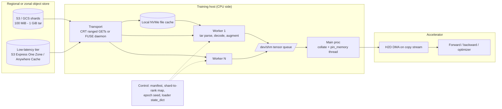

# High-Throughput Data Loaders and Storage I/O

## TL;DR

An input pipeline delivers only as much as its slowest stage, and the stages are storage request rate, bytes in flight, CPU decode and augmentation, host-to-device copy, and the training step that consumes the data.
To find GPU starvation, measure the wall-clock time the training loop spends blocked in `next(iterator)` and compare it with a synthetic-data upper bound; GPU utilization percentages are not reliable evidence.
Object stores have high latency and high bandwidth, so by Little's law you only saturate them with many concurrent large ranged GETs over sequential objects; that is why tar shards (WebDataset) cut request counts and request cost by two to three orders of magnitude compared with one object per sample.
S3 scales request rate per partitioned prefix (at least 3,500 writes and 5,500 reads per second), while GCS scales per bucket from roughly 1,000 writes and 5,000 reads per second; a sudden jump onto a cold keyspace gets throttled unless you ramp up or pre-shard.
Shuffle quality, deterministic mid-epoch resume, and equal shard counts per rank are correctness properties: uneven shards hang collectives, and batches correlated by shard silently bias gradients.

## Mental Model



Treat the loader as a pipeline of bounded queues, each of which must hold enough work in flight to hide the latency of the stage behind it.
The storage tier hides tens of milliseconds of first-byte latency through concurrency, the worker pool hides decode time through process parallelism, and the pinned-memory queue hides PCIe transfer time through asynchronous DMA.
The control plane is small but correctness-critical: a precomputed manifest, a deterministic epoch seed, a shard-to-rank assignment, and the loader's `state_dict` together decide which bytes each rank sees and in what order.
If any of these is wrong, the job does not slow down; it trains on a different distribution than intended, or it deadlocks at the end of an epoch.

## Internals

### The pipeline as a queueing system

Steady-state step time is `max(T_compute, T_ingest / overlap)`, where `T_ingest` is the per-batch time of the slowest ingestion stage.
Stages are coupled by queues of finite depth: the DataLoader holds `num_workers x prefetch_factor` batches in flight, and `prefetch_factor` defaults to 2 in PyTorch.
A deeper queue absorbs variance such as S3 tail latency or a slow JPEG, but it cannot fix a shortfall in mean throughput.
If mean ingest rate is below mean consumption rate, every queue drains and the GPU waits on the slowest stage.
DS-Analyzer, from Mohan et al. (VLDB 2021, "Analyzing and Mitigating Data Stalls in DNN Training"), formalized the diagnosis.
Measure throughput with synthetic in-GPU data (ingestion-free ceiling), with fully cached data (removes storage), and with cold storage, and the differences attribute stall time to fetch versus prep.
That paper found that data stalls consume a large share of epoch time on common image and audio models even on well-provisioned servers.
It also showed that a page-cache-thrashing access pattern can be fixed by coordinated caching (CoorDL), without buying more hardware.
Google's tf.data paper (Murray et al., VLDB 2021) makes the same argument from the framework side: input pipelines have to be parallelized and autotuned as first-class programs, because accelerators outran host CPUs.
Meta's DSI paper (Zhao et al., ISCA 2022, "Understanding Data Storage and Ingestion for Large-Scale Deep Recommendation Model Training") showed that at datacenter scale, preprocessing power and storage I/O can rival or exceed the accelerator's share of the total.
For Meta that justified moving preprocessing onto a disaggregated service.

### Stage 1: the object store request path

S3 scales request capacity per partitioned prefix, and your application gets at least 3,500 PUT/COPY/POST/DELETE or 5,500 GET/HEAD requests per second per partitioned prefix (AWS docs, as of 2026-10).
Partitioning is reactive: S3 watches sustained load and splits key ranges, and AWS documents that scaling happens gradually rather than instantly (AWS docs, as of 2026-10).
While a split is in progress, clients get HTTP 503 Slow Down and have to back off.
The design consequence is that the leading characters of object keys determine how your load spreads across partitions.
Ten prefixes give you 55,000 GET/s of headroom, but only after S3 has actually partitioned them.
GCS scales per bucket: a bucket starts at roughly 1,000 object writes and 5,000 object reads per second and auto-scales from there (Google Cloud docs, as of 2026-10).
Google tells you to ramp gradually on any bucket that has not seen high request rates for several days, or that has a new range of object keys (Google Cloud docs, as of 2026-10).
The widely cited ramp rule is to double request rate no faster than once every 20 minutes (UNVERIFIED in this revision).
Under that rule, taking a cold bucket from 5,000 to 1.28 million reads per second takes `log2(256) = 8` doublings, which is about 160 minutes of ramp.
That is the hidden reason per-sample object layouts throttle a large job in its first hours and then appear to heal.
S3 Express One Zone puts directory buckets inside a single Availability Zone and authenticates with session tokens obtained from `CreateSession`, which removes per-request SigV4 overhead from the hot path.
It is marketed for single-digit-millisecond first-byte latency (AWS docs, UNVERIFIED in this revision).
In April 2025 AWS cut its storage price by 31 percent, PUT price by 55 percent, and GET price by 85 percent; the per-GB upload and retrieval charges dropped 60 percent and now apply to all bytes (AWS News Blog, 2025-04-10).
GCS has two answers to low latency.
Anywhere Cache is a zonal SSD read cache in front of a regional bucket (Google Cloud docs, UNVERIFIED in this revision).
Rapid Bucket zonal storage has its own Cloud Storage FUSE read path; that path relies on kernel read-ahead and is incompatible with the gcsfuse file cache and buffered reader (Google Cloud docs, as of 2026-10; GA status UNVERIFIED).

### Stage 2: client transport and Little's law

Little's law, `L = lambda x W`, sets the in-flight byte budget: `bytes_in_flight = target_bandwidth x per_request_latency`.
A node that needs 2.2 GB/s from a store with 50 ms effective latency per 8 MiB ranged GET needs about 2.2 GB/s x 0.05 s / 8 MiB, which is roughly 13 GETs in flight before transfer time.
Once you include per-connection transfer rate, the practical figure is about 25 to 40 concurrent requests per node.
AWS guidance has historically been about one concurrent request per 85 to 90 MB/s of desired throughput (UNVERIFIED in this revision).
No single-threaded Python `boto3.get_object().read()` loop can sustain that, because one connection's TCP window and first-byte latency cap it.
The Amazon S3 Connector for PyTorch (`s3torchconnector`) exists for this reason.
It ships `S3IterableDataset`, `S3MapDataset`, `S3Reader`, `S3Writer`, `S3Checkpoint`, a Lightning integration, and a Distributed Checkpoint (`dcp`) module (awslabs docs, versions 1.4.x-1.5.x, as of 2026-10).
Its client is a Rust extension built on the AWS Common Runtime (CRT), the same transport stack as Mountpoint for Amazon S3.
The CRT splits large GETs into parallel part-sized ranged requests across a connection pool and reassembles them in order, so a single `read()` on a 1 GiB shard becomes dozens of concurrent ranges.
The getting-started guides leave out a fork-safety detail.
CRT event-loop threads do not survive `fork()`, so the client has to be constructed inside each DataLoader worker after the fork, not in the parent.
The worked example below builds the `S3IterableDataset` inside `__iter__`, which runs in the worker, for exactly this reason.

### Stage 3: what a FUSE read actually does

With a FUSE mount (Mountpoint for Amazon S3, GA since 2023-08-09, or Cloud Storage FUSE), each `read(2)` goes through several hops.
It enters the kernel VFS, is queued on `/dev/fuse`, is read by the userspace daemon, is translated to HTTP, and the reply is copied back through the kernel into the page cache and the user buffer.
The kernel sends FUSE reads in bounded chunks, historically 128 KiB and up to about 1 MiB with larger `max_pages` on newer kernels (UNVERIFIED in this revision), so mapping each kernel request to its own GET would issue thousands of GETs per GiB.
Each FUSE daemon therefore runs its own prefetcher.
Mountpoint watches for sequential access on a file handle, grows its in-flight read-ahead window as sequential reads continue, and resets the window on a seek.
Sequential tar streaming is cheap for it; random access inside large files is expensive, because every seek collapses the window back to small ranged GETs.
Cloud Storage FUSE has an optional file cache.
When the cache is on, gcsfuse 2.12 and later automatically use parallel downloads: several workers fetch one file in parallel into the cache directory, which doubles as a prefetch buffer, and Google cites up to nine times faster model load (Google Cloud docs, as of 2026-10).
The cache directory can sit on existing capacity such as Local SSD without extra storage charges (Google Cloud docs, as of 2026-10).
On GKE the file cache is off by default and must be enabled through CSI mount options such as `file-cache:enable-parallel-downloads:true` (Google Cloud docs, as of 2026-10).
Google's current tuning guidance assumes gcsfuse 3.0 or later, and on GKE a cluster version of 1.32.2-gke.1297001 or later (Google Cloud docs, as of 2026-10).
Metadata is a separate cost.
`stat`, `readdir`, and type lookups become HEAD and LIST calls unless they are cached, and a `ls -R` over 10 million keys is about 10,000 paginated LIST calls per client.
Both clients offer metadata TTLs.
An infinite TTL is safe only on an immutable dataset; on a mutable prefix it turns into stale reads.
Mountpoint documents relaxed POSIX semantics.
Even without `--allow-overwrite`, an object uploaded concurrently after Mountpoint's existence check can be replaced, and metadata caching widens that window (awslabs SEMANTICS.md, as of 2026-10).
Mountpoint also offers a shared cache in an S3 directory bucket for small objects (up to 1 MB) read repeatedly from many instances (awslabs CONFIGURATION.md, as of 2026-10).

### Stage 4: worker processes and the copy-on-write refcount trap

On Linux, `torch.utils.data.DataLoader` forks `num_workers` processes, and each one receives a copy-on-write image of the parent, including the `Dataset` object.
CPython keeps a reference count in every object header, so merely reading `self.paths[i]` writes to the page holding that string.
Each such write faults the 4 KiB page into a private copy for that worker.
A map-style dataset that keeps a 2 GB Python `list` of path strings and labels therefore converges to 2 GB of private RSS per worker.
On an 8-GPU node with 12 workers per GPU that is 96 processes x 2 GB = 192 GB, and the host OOM killer reports it as `DataLoader worker (pid N) is killed by signal: Killed`.
The fix is to keep the index in a few large buffers rather than many small objects: NumPy arrays, Arrow buffers, or a memory-mapped file.
`gc.freeze()` before forking also helps, because it keeps the cyclic garbage collector from touching tracked objects.
Workers return tensors to the main process through shared-memory file descriptors in `/dev/shm`.
Docker's default 64 MB `/dev/shm` produces bus errors under load, and on Kubernetes you mount an `emptyDir` with `medium: Memory` at `/dev/shm`.
For an `IterableDataset`, every worker runs the full `__iter__`, so the dataset has to split its shard list using `get_worker_info()`, after splitting by distributed rank.
If it does not, every worker yields the same samples and the effective dataset is duplicated `num_workers` times.
Each worker assembles whole batches and the main process takes batches from workers in round-robin order, so every batch comes from one worker's local stream.
That fact drives the shuffle analysis below.

### Stage 5: collate, pin, and copy

With `pin_memory=True`, a thread in the main process copies collated batches into page-locked host memory, so `tensor.to("cuda", non_blocking=True)` can issue an asynchronous DMA on a CUDA stream.
Pageable memory would force the driver to stage through an internal pinned bounce buffer, which serializes the copy.
H2D bandwidth is rarely the binding stage for compressed inputs.
It becomes binding when the pipeline ships decoded `float32` images instead of `uint8`, because `float32` is four times the bytes.
Moving decode onto the GPU (for example NVIDIA DALI with nvJPEG) shifts the CPU-bound decode stage onto the accelerator and ships compressed bytes across PCIe.
The cost is accelerator memory and some SM time taken from the training step.

### Sharded streaming: WebDataset and the shuffle math

A WebDataset shard is a POSIX tar file.
Files that make up one sample share a basename once all extensions are stripped, and shards are numbered so you can address them with brace notation such as `train-{000000..012345}.tar` (WebDataset README, as of 2026-10).
The format exists so that reads are purely sequential.
The project reports 3x to 10x higher I/O rates on local drives for sequential versus random access, and sequential reads are the only pattern that object-store prefetchers serve well (WebDataset README, as of 2026-10).
Shuffling happens at two levels: the shard list is permuted per epoch with a seed shared across ranks, and each worker keeps an in-memory shuffle buffer of `B` samples.
The following analysis is not in any getting-started guide.
A sample the buffer emits must have been read within the last `B` samples of that worker's stream, and a batch of `b` consecutive emissions comes from the same worker.
So one batch spans a read window of about `B + b` samples, and the expected number of distinct shards in a batch is about `1 + (B + b) / S` for shard size `S`.
With `S = 10,000`, `B = 1,000`, and `b = 256`, nearly every batch comes from one or two shards.
If shards were written in source order (one crawl date, one camera, one language per shard), every gradient step sees a strongly non-IID mini-batch.
The loss curve then shows periodic sawtooth spikes, and BatchNorm statistics drift.
There are three remedies, in decreasing order of effectiveness.
First, shuffle globally at write time, so every shard is already an IID sample of the corpus; this costs one offline pass.
Second, have each worker read `k` shards concurrently and interleave them, which raises shards per batch to about `k` at the cost of `k` times the buffer memory and `k` open streams.
Third, emit unbatched samples from workers and re-shuffle and batch in the main process (WebDataset's `WebLoader(...).unbatched().shuffle(n).batched(b)` pattern), at the cost of extra inter-process transfer.

### Determinism and mid-epoch resume

TorchData 0.8.0 (July 2024) introduced `StatefulDataLoader`, a drop-in replacement for `torch.utils.data.DataLoader` with `state_dict` and `load_state_dict` for mid-epoch checkpointing (meta-pytorch/data releases, as of 2026-10).
The same project deprecated DataPipes and DataLoaderV2 in 0.8.0 and scheduled their deletion for 0.10.0.
Version 0.10 introduced `torchdata.nodes`, composable iterators for building multi-threaded and multi-process pipelines (meta-pytorch/data releases, as of 2026-10).
Mid-epoch resume matters because of the fleet failure rates covered in [[17-Cloud-AI-Engineering/Volume_10_AI_Infrastructure_on_Cloud/Chapter_08_Fault_Tolerance_and_Fleet_Resiliency_at_Scale|Fault Tolerance and Fleet Resiliency at Scale]].
Without it, a job that restarts from a checkpoint either replays the start of the epoch, oversampling early shards, or skips to the next epoch, never seeing the tail.
Loader state has to be saved in the same atomic checkpoint as model and optimizer state ([[17-Cloud-AI-Engineering/Volume_10_AI_Infrastructure_on_Cloud/Chapter_06_High_Throughput_Checkpointing_to_Object_Storage|High-Throughput Checkpointing to Object Storage]]).
A minimal design-level state for a sharded stream is: epoch seed, per-worker shard cursor, byte offset or sample index within the open shard, and the shuffle-buffer RNG state.
The buffer contents can be dropped and refilled, which costs a bounded `B` samples of approximate replay.

### Disaggregated preprocessing

When decode and augmentation need more CPU cores than the GPU host has, preprocessing moves to a separate CPU fleet that streams ready-made batches.
Examples are the tf.data service (Audibert et al., SoCC 2023), Cachew (Graur et al., USENIX ATC 2022), and Meta's DPP inside DSI (ISCA 2022).
The CPU fleet scales independently, can run on Spot or preemptible capacity, and can cache preprocessed output across jobs.
In exchange you add a network hop, a scheduler, and a new failure domain whose preemption has to be invisible to the trainer.
Plumber (Kuchnik et al., MLSys 2022) shows how to find the bottleneck operator in a tf.data graph analytically before buying cores.

### Control plane versus data plane

The control plane of a data loader is listing, manifest generation, shard assignment, and credential issuance.
The data plane is ranged GETs and local reads.
Following [[17-Cloud-AI-Engineering/Volume_01_Cloud_Architecture_Principles/Chapter_04_Control_Plane_vs_Data_Plane_Separation|Control Plane vs Data Plane Separation]], keep LIST out of the training start path.
Compute the manifest once, write it as an object next to the data, and have every rank read that single object.
Startup cost then becomes O(1) in dataset size and O(ranks) in GETs, instead of O(ranks x keys / 1000) in LIST calls.

### Failure domains

A regional S3 or GCS bucket spans zones, so losing one zone degrades capacity but does not lose data.
S3 Express One Zone and zonal GCS caches sit inside one zone: if that zone fails, the cache is gone and the job falls back to the regional tier at its request-rate ceiling.
A local NVMe cache dies with its instance, so after node replacement the new node starts cold, and a mass replacement at once becomes a thundering herd against the store.

## Numbers to Know

| Quantity | Value | Source |
|---|---|---|
| S3 request rate per partitioned prefix | at least 3,500 PUT/COPY/POST/DELETE and 5,500 GET/HEAD per second | (AWS docs, as of 2026-10) |
| S3 prefix scaling behavior | Gradual, not instantaneous; 503 Slow Down while scaling | (AWS docs, as of 2026-10) |
| S3 Express One Zone price change | Storage -31%, PUT -55%, GET -85%, per-GB transfer -60% (now on all bytes) | (AWS News Blog, 2025-04-10) |
| S3 Express One Zone first-byte latency | single-digit milliseconds | (AWS docs, UNVERIFIED) |
| S3 Standard GET price | USD 0.0004 per 1,000 requests, us-east-1 | (AWS pricing, UNVERIFIED) |
| S3 Standard storage | USD 0.023 per GB-month, first 50 TB tier, us-east-1 | (AWS pricing, UNVERIFIED) |
| Concurrency rule of thumb | about 1 request per 85-90 MB/s of target throughput | (AWS docs, UNVERIFIED) |
| GCS initial bucket request rate | about 1,000 writes/s and 5,000 reads/s, then auto-scales | (Google Cloud docs, as of 2026-10) |
| GCS ramp guidance | ramp gradually after several idle days or for new key ranges | (Google Cloud docs, as of 2026-10) |
| GCS ramp doubling interval | no faster than every 20 minutes | (Google Cloud docs, UNVERIFIED) |
| GCS maximum object size | 5 TiB | (Google Cloud docs, as of 2026-10) |
| GCS Standard Class B operations | USD 0.0004 per 1,000 | (Google Cloud pricing, UNVERIFIED) |
| gcsfuse parallel downloads | auto-enabled with file cache on v2.12+; up to 9x faster model load | (Google Cloud docs, as of 2026-10) |
| gcsfuse tuning baseline | v3.0+; GKE 1.32.2-gke.1297001+ | (Google Cloud docs, as of 2026-10) |
| Mountpoint for Amazon S3 GA | 2023-08-09 | (AWS announcement via secondary source, as of 2026-10) |
| Mountpoint shared cache target | small objects up to 1 MB, in an S3 directory bucket | (awslabs docs, as of 2026-10) |
| StatefulDataLoader first release | TorchData 0.8.0, July 2024 | (meta-pytorch/data, as of 2026-10) |
| DataPipes removal | TorchData 0.10.0 | (meta-pytorch/data, as of 2026-10) |
| WebDataset sequential vs random local I/O | 3x-10x | (WebDataset README, as of 2026-10) |
| DataLoader default prefetch_factor | 2 batches per worker | (PyTorch docs, as of 2026-10) |
| Container default /dev/shm (Docker) | 64 MB | (Docker docs, UNVERIFIED) |

## AWS vs GCP Mechanism Parity

| Mechanism | AWS | Google Cloud | Critical difference |
|---|---|---|---|
| Request-rate scaling unit | Partitioned prefix; 3,500 W / 5,500 R per second each | Bucket-wide auto-scaling from about 1,000 W / 5,000 R per second | Key prefix design matters on S3; ramp rate matters on GCS |
| Throttle signal | HTTP 503 Slow Down | HTTP 429 or 5xx with exponential backoff | Both require jittered backoff; see [[17-Cloud-AI-Engineering/Volume_07_Reliability_and_SRE/Chapter_03_Resilient_Communication_Retries_Jitter_and_Circuit_Breakers\|Retries and Jitter]] |
| Low-latency tier | S3 Express One Zone directory buckets, zonal, `CreateSession` auth | Anywhere Cache (zonal SSD cache) and Rapid Bucket zonal storage (status UNVERIFIED) | Express is a separate bucket you write into; Anywhere Cache is transparent in front of a regional bucket |
| Native PyTorch connector | `s3torchconnector` on CRT: iterable and map datasets, checkpoint, DCP, Lightning | Google's Dataflux / Cloud Storage connector for PyTorch (status UNVERIFIED) | AWS connector is open source on awslabs with documented API surface |
| FUSE client | Mountpoint for Amazon S3 (Rust, CRT), relaxed POSIX, optional local and shared cache | Cloud Storage FUSE (gcsfuse), file cache plus parallel downloads, metadata caches | gcsfuse file cache doubles as a parallel prefetch buffer; Mountpoint relies on a streaming prefetcher |
| Kubernetes integration | Mountpoint for Amazon S3 CSI driver (EKS add-on) | Cloud Storage FUSE CSI driver with injected sidecar on GKE | GKE runs FUSE in a pod sidecar, so its CPU and memory count against the pod |
| Cross-node shared cache | Mountpoint shared cache in an S3 Express directory bucket | Anywhere Cache per zone | Both are zonal; both are lost on zone failure |
| Parallel file system | FSx for Lustre with S3 data repository association | Google Cloud Managed Lustre (GA status UNVERIFIED) | Lustre gives POSIX random access at per-TiB provisioned throughput; you pay for capacity even when idle |
| Read-only block fan-out | EBS io2 Multi-Attach (small fan-out, UNVERIFIED limit) | Hyperdisk ML read-only multi-attach (large fan-out, limits UNVERIFIED) | Hyperdisk ML targets model-weight and dataset fan-out to many nodes |
| Private path | S3 gateway VPC endpoint, no per-GB endpoint charge | Private Google Access or Private Service Connect | Without them, traffic through NAT pays per-GB processing |
| Encryption at rest with customer keys | SSE-KMS; S3 Bucket Keys reduce KMS calls | CMEK with Cloud KMS | SSE-KMS without Bucket Keys can turn GET rate into KMS request rate |

## Worked Example: Sharded Streaming from S3 or a FUSE Mount with Stall Accounting

### Capacity sizing first

The scenario is a 512-GPU H100 multimodal pretraining job that consumes 2,500 images per second per GPU, with images averaging 110 KB as JPEG (assumptions, not benchmarks).
Step 1, the global sample rate: 512 x 2,500 = 1.28 million samples per second.
Step 2, global read bandwidth: 1.28e6 x 110 KB = 140.8 GB/s from the object store.
Step 3, per-node bandwidth for 8 GPUs: 20,000 x 110 KB = 2.2 GB/s, or 17.6 Gbps, which fits within front-end NIC bandwidth; network is not the binding stage.
Step 4, layout with one object per sample: 1.28 million GET/s.
On S3 that needs at least 1.28e6 / 5,500 = 233 already-partitioned prefixes.
At USD 0.0004 per 1,000 GETs (UNVERIFIED) it costs 1.28e6 x 3,600 x 0.0004 / 1,000 = USD 1,843 per hour in GET charges alone.
Step 5, layout with 1 GiB WebDataset shards read as 8 MiB ranged GETs: 140.8e9 / 8,388,608 = 16,785 GET/s globally.
That costs USD 24 per hour, about 76 times less, and fits within four S3 prefixes or a modestly ramped GCS bucket.
Step 6, shard count: 1 GiB / 110 KB is about 9,761 samples per shard.
A 2 billion sample corpus is about 205,000 shards, far more than the 512 ranks x 12 workers = 6,144 readers, so the per-reader assignment can be made exactly even.
Step 7, concurrency per node: 2.2 GB/s at about 90 MB/s per stream (UNVERIFIED rule) is about 25 concurrent ranged GETs, spread across 96 workers, so even one in-flight request per worker covers it.
Step 8, CPU: at an assumed 150 decode-and-augment operations per core per second, a node needs 20,000 / 150 = 133 cores.
That is more physical cores than a typical 8-GPU host provides, so decode is the binding stage.
The fix is GPU decode, pre-resized shards, or disaggregated preprocessing, not faster storage.
Step 9, storage: 2e9 x 110 KB = 220 TB, about USD 5,060 per month at the first-tier USD 0.023 per GB-month rate (UNVERIFIED), and lower in practice because of volume tiers.
Step 10, the contrast case: LLM text pretraining of a 70B model on 1,024 H100s at 40 percent MFU consumes about 0.4 x 989e12 / (6 x 70e9) = 942 tokens per second per GPU.
That is 965,000 tokens per second globally, or about 1.9 MB/s of pre-tokenized `uint16` tokens; text LLM pretraining is almost never storage-bound, while multimodal training usually is.

### Lab cost estimate

The lab writes 64 shards of 64 MiB each, 4 GiB in total.
Storage for one day is under USD 0.01, and 10 epochs at 8 MiB ranged GETs come to about 5,120 GETs, under USD 0.01 (prices UNVERIFIED).
Run it on an in-region instance such as an `m7i.2xlarge`, at about USD 0.40 per hour (UNVERIFIED), so total lab cost stays under USD 1.
Running from outside the region adds internet egress of about USD 0.09 per GB (UNVERIFIED), which for 40 GiB read is about USD 3.60.

### Budget alarms (create before provisioning)

```bash
# AWS: monthly cost budget with an 80 percent actual-spend email alert
ACCT=$(aws sts get-caller-identity --query Account --output text)
aws budgets create-budget --account-id "$ACCT" \
  --budget '{"BudgetName":"dl-io-lab","BudgetLimit":{"Amount":"5","Unit":"USD"},"TimeUnit":"MONTHLY","BudgetType":"COST"}' \
  --notifications-with-subscribers '[{"Notification":{"NotificationType":"ACTUAL","ComparisonOperator":"GREATER_THAN","Threshold":80,"ThresholdType":"PERCENTAGE"},"Subscribers":[{"SubscriptionType":"EMAIL","Address":"you@example.com"}]}]'

# Google Cloud: budget on the billing account with an 80 percent threshold
gcloud billing budgets create --billing-account="$BILLING_ACCOUNT_ID" \
  --display-name="dl-io-lab" --budget-amount=5USD --threshold-rule=percent=0.8
```

### Provision and stage data

```bash
pip install torch numpy boto3 s3torchconnector

export REGION=us-east-1
export BUCKET=dl-io-lab-$(date +%s)
aws s3api create-bucket --bucket "$BUCKET" --region "$REGION"

python wds_s3_loader.py make --out-dir ./shards --shards 64 --per-shard 512 --sample-bytes 131072
aws s3 cp ./shards "s3://$BUCKET/train/" --recursive
```

### The loader (wds_s3_loader.py)

```python
#!/usr/bin/env python3
"""WebDataset-style sharded streaming from S3 (s3torchconnector) or a local/FUSE path.

Reports throughput and the fraction of wall time the training loop is blocked on data.
"""
import argparse
import io
import os
import random
import tarfile
import time
import warnings

import numpy as np
import torch
from torch.utils.data import DataLoader, IterableDataset, get_worker_info


def make_shards(out_dir, n_shards, per_shard, sample_bytes):
    os.makedirs(out_dir, exist_ok=True)
    rng = np.random.default_rng(0)
    for s in range(n_shards):
        path = os.path.join(out_dir, "shard-%06d.tar" % s)
        with tarfile.open(path, mode="w") as tf:
            for i in range(per_shard):
                key = "%06d_%06d" % (s, i)
                payload = rng.integers(0, 256, sample_bytes, dtype=np.uint8).tobytes()
                label = str(int(rng.integers(0, 1000))).encode()
                for ext, data in (("bin", payload), ("cls", label)):
                    info = tarfile.TarInfo("%s.%s" % (key, ext))
                    info.size = len(data)
                    tf.addfile(info, io.BytesIO(data))
    print("wrote %d shards to %s" % (n_shards, out_dir))


def iter_tar_samples(fileobj):
    """Stream a tar sequentially ('r|' mode never seeks) and group members by basename."""
    cur_key, cur = None, {}
    with tarfile.open(fileobj=fileobj, mode="r|") as tf:
        for m in tf:
            if not m.isfile():
                continue
            d, b = os.path.split(m.name)
            stem, ext = b.split(".", 1)
            key = os.path.join(d, stem)
            if cur_key is not None and key != cur_key:
                yield cur
                cur = {}
            cur_key = key
            cur[ext] = tf.extractfile(m).read()
    if cur:
        yield cur


class ShardStream(IterableDataset):
    def __init__(self, uris, source, region, rank, world, seed, shuffle_buffer):
        self.uris, self.source, self.region = list(uris), source, region
        self.rank, self.world, self.seed, self.buf = rank, world, seed, shuffle_buffer
        self.epoch = 0

    def set_epoch(self, epoch):
        # Only reaches workers if the DataLoader is rebuilt (persistent_workers=False).
        self.epoch = epoch

    def _my_shards(self):
        wi = get_worker_info()
        wid, nw = (wi.id, wi.num_workers) if wi else (0, 1)
        readers = self.world * nw
        if len(self.uris) % readers:
            warnings.warn("shards %% (ranks*workers) != 0: ranks will finish unevenly "
                          "and can hang collectives" % ())
        order = list(self.uris)
        random.Random(self.seed + self.epoch).shuffle(order)  # identical on every rank
        return order[self.rank::self.world][wid::nw], wid      # split by rank, then worker

    def _open(self, mine):
        if self.source == "s3":
            # Built here, inside the worker, after fork: CRT threads do not survive fork().
            from s3torchconnector import S3IterableDataset
            yield from S3IterableDataset.from_objects(mine, region=self.region)
        else:
            for p in mine:
                with open(p, "rb", buffering=8 << 20) as f:
                    yield f

    def __iter__(self):
        mine, wid = self._my_shards()
        rng = random.Random((self.seed + self.epoch) * 1000003 + self.rank * 1009 + wid)
        pool = []
        for fobj in self._open(mine):
            for s in iter_tar_samples(fobj):
                x = torch.frombuffer(bytearray(s["bin"]), dtype=torch.uint8)
                pool.append((x, int(s["cls"])))
                if len(pool) >= self.buf:
                    i = rng.randrange(len(pool))
                    pool[i], pool[-1] = pool[-1], pool[i]
                    yield pool.pop()
        rng.shuffle(pool)
        yield from pool


def list_uris(args):
    if args.source == "s3":
        import boto3
        s3 = boto3.client("s3", region_name=args.region)
        pages = s3.get_paginator("list_objects_v2").paginate(Bucket=args.bucket, Prefix=args.prefix + "/")
        return sorted("s3://%s/%s" % (args.bucket, o["Key"])
                      for p in pages for o in p.get("Contents", []) if o["Key"].endswith(".tar"))
    return sorted(os.path.join(args.local_dir, f)
                  for f in os.listdir(args.local_dir) if f.endswith(".tar"))


def run(args):
    uris = list_uris(args)  # in production: read a precomputed manifest object instead
    rank = int(os.environ.get("RANK", 0))
    world = int(os.environ.get("WORLD_SIZE", 1))
    dev = "cuda" if torch.cuda.is_available() else "cpu"
    ds = ShardStream(uris, args.source, args.region, rank, world, args.seed, args.shuffle_buffer)
    for epoch in range(args.epochs):
        ds.set_epoch(epoch)
        dl = DataLoader(ds, batch_size=args.batch, num_workers=args.workers,
                        pin_memory=(dev == "cuda"),
                        prefetch_factor=(4 if args.workers > 0 else None),
                        persistent_workers=False)
        wait, n, nbytes = 0.0, 0, 0
        t0 = time.perf_counter()
        it = iter(dl)
        while True:
            t = time.perf_counter()
            try:
                x, y = next(it)
            except StopIteration:
                break
            wait += time.perf_counter() - t
            x = x.to(dev, non_blocking=True)
            n += x.shape[0]
            nbytes += x.numel()
            time.sleep(args.step_ms / 1000.0)  # stand-in for forward/backward/optimizer
        el = time.perf_counter() - t0
        print("epoch=%d samples=%d MB/s=%.1f samples/s=%.0f stall_frac=%.1f%%"
              % (epoch, n, nbytes / el / 1e6, n / el, 100.0 * wait / el))


def main():
    ap = argparse.ArgumentParser()
    sub = ap.add_subparsers(dest="cmd", required=True)
    m = sub.add_parser("make")
    m.add_argument("--out-dir", required=True)
    m.add_argument("--shards", type=int, default=64)
    m.add_argument("--per-shard", type=int, default=512)
    m.add_argument("--sample-bytes", type=int, default=131072)
    r = sub.add_parser("read")
    r.add_argument("--source", choices=["s3", "local"], default="s3")
    r.add_argument("--bucket")
    r.add_argument("--prefix", default="train")
    r.add_argument("--region", default="us-east-1")
    r.add_argument("--local-dir")
    r.add_argument("--workers", type=int, default=8)
    r.add_argument("--batch", type=int, default=64)
    r.add_argument("--epochs", type=int, default=3)
    r.add_argument("--shuffle-buffer", type=int, default=256)
    r.add_argument("--step-ms", type=float, default=20.0)
    r.add_argument("--seed", type=int, default=1234)
    args = ap.parse_args()
    if args.cmd == "make":
        make_shards(args.out_dir, args.shards, args.per_shard, args.sample_bytes)
    else:
        run(args)


if __name__ == "__main__":
    main()
```

### Run the experiment

```bash
# Native connector: sweep workers and watch stall_frac fall until CPU or the network binds.
for w in 0 2 4 8 16; do
  python wds_s3_loader.py read --source s3 --bucket "$BUCKET" --region "$REGION" --workers $w --step-ms 20
done

# Synthetic ceiling: set --step-ms 0 to measure pure ingest rate; stall_frac near 100% is expected there.
python wds_s3_loader.py read --source s3 --bucket "$BUCKET" --region "$REGION" --workers 16 --step-ms 0

# FUSE comparison on AWS: Mountpoint read-only with a local cache, same loader in local mode.
sudo mkdir -p /mnt/s3 /mnt/nvme/mp-cache
mount-s3 "$BUCKET" /mnt/s3 --read-only --prefix train/ --cache /mnt/nvme/mp-cache
python wds_s3_loader.py read --source local --local-dir /mnt/s3 --workers 8 --epochs 3
```

Expected pattern: epoch 0 through Mountpoint with a cache behaves like the native connector, and epochs 1 and 2 speed up only if the 4 GiB dataset fits in the cache directory.

### Google Cloud variant with Cloud Storage FUSE and a file cache

```bash
export GBUCKET=dl-io-lab-$(date +%s)
gcloud storage buckets create "gs://$GBUCKET" --location=us-central1 --uniform-bucket-level-access
gcloud storage cp -r ./shards/* "gs://$GBUCKET/train/"

cat > gcsfuse.yaml <<'EOF'
implicit-dirs: true
cache-dir: /mnt/disks/localssd/gcsfuse-cache
file-cache:
  max-size-mb: -1
  cache-file-for-range-read: false
  enable-parallel-downloads: true
metadata-cache:
  ttl-secs: -1
  stat-cache-max-size-mb: -1
  type-cache-max-size-mb: -1
EOF
# ttl-secs: -1 is only safe because this dataset is immutable for the life of the mount.

sudo mkdir -p /mnt/gcs /mnt/disks/localssd/gcsfuse-cache
gcsfuse --config-file gcsfuse.yaml -o ro "$GBUCKET" /mnt/gcs
python wds_s3_loader.py read --source local --local-dir /mnt/gcs/train --workers 8 --epochs 3
```

### Teardown (exact)

```bash
# AWS
fusermount -u /mnt/s3 || sudo umount /mnt/s3
aws s3 rm "s3://$BUCKET" --recursive
aws s3api delete-bucket --bucket "$BUCKET" --region "$REGION"
aws budgets delete-budget --account-id "$ACCT" --budget-name dl-io-lab

# Google Cloud
fusermount -u /mnt/gcs
gcloud storage rm -r "gs://$GBUCKET"
gcloud billing budgets list --billing-account="$BILLING_ACCOUNT_ID" --format="value(name)"
gcloud billing budgets delete BUDGET_NAME_FROM_LIST --billing-account="$BILLING_ACCOUNT_ID"

rm -rf ./shards /mnt/nvme/mp-cache /mnt/disks/localssd/gcsfuse-cache
```

## Failure Modes and Pitfalls

### Cold-keyspace throttling at job start

A new dataset written under one fresh prefix, then read by thousands of ranks within seconds, returns S3 503 Slow Down or GCS 429 until partitioning or auto-scaling catches up (AWS docs; Google Cloud docs, as of 2026-10).
The symptom is a job that is slow for its first one to three hours and then looks fine, which teams misdiagnose as warm-up.
Mitigations: spread shards across hashed leading prefixes when writing, read a warm-up epoch subset at a controlled rate, use shards instead of per-sample objects, and back off with full jitter.

### LIST storms

Each rank listing a 10 million key prefix issues about 10,000 LIST calls, so 4,096 ranks issue 41 million LIST calls before the first step.
LIST is slower and pricier than GET, and it competes with GET capacity.
Fix: one manifest object generated at dataset publish time.

### Copy-on-write memory blow-up

Covered in Internals: refcount writes privatize the pages of a Python-object index, so RSS grows linearly with `num_workers`.
The OOM killer then kills workers mid-epoch, and if the loader is not resilient the rank exits, which aborts the collective.
Fix: index in NumPy or Arrow buffers, `gc.freeze()` before fork, or the `forkserver` start method with a slim parent.

### /dev/shm exhaustion

Tensors pass from workers to the main process through shared memory.
A container with the default small `/dev/shm` fails with bus errors or `unable to write to file </torch_...>` under prefetch depth.
Fix: mount a memory-backed `emptyDir` sized for `num_workers x prefetch_factor x batch_bytes` plus headroom.

### Uneven shards hang the job

If one rank gets one fewer shard, it reaches `StopIteration` while its peers are still inside an all-reduce.
The peers block until the NCCL watchdog timeout fires and the job aborts without a useful error.
Fix: make shard count divisible by `ranks x workers`, or run epochs with a fixed number of steps from an infinitely resampled stream, or use `torch.distributed.algorithms.Join` for genuinely uneven inputs.

### Same shuffle every epoch

With `persistent_workers=True`, the dataset object is pickled into the workers once, so `set_epoch` called in the main process never reaches them, and every epoch replays the same shard order.
Fix: rebuild the loader per epoch, derive the epoch from a shared counter the workers can read, or use `StatefulDataLoader` state that carries the epoch.

### Shard-correlated batches

Covered in the shuffle math: with buffer `B` much smaller than shard size `S`, each batch comes from about one shard.
The visible symptom is periodic loss spikes aligned to shard boundaries, and it does not reproduce with a map-style random sampler.
Fix: shuffle globally at write time.

### Cache thrash from shuffling shard-to-rank assignment

LRU caching has a zero hit rate under a cyclic scan larger than the cache.
Permuting the shard-to-rank mapping every epoch also means each node rarely re-reads a shard it already cached.
Teams who add a 30 TB local NVMe cache and still see 0 percent hits are usually hitting this.
Fix: keep a stable shard-to-node assignment and permute only within the node, and rely on write-time global shuffle for statistical mixing; the trade-off is weaker cross-epoch randomization.

### Stale reads through FUSE metadata caches

An infinite metadata TTL over a mutable prefix serves deleted or replaced objects for the life of the mount.
Mountpoint documents that metadata caching widens its overwrite race window (awslabs SEMANTICS.md, as of 2026-10).
Fix: immutable dataset versions under versioned prefixes, with the TTL set accordingly.

### Cross-region reads

A cluster in one region reading a bucket in another pays inter-region transfer per GB and tens of milliseconds of extra RTT, which raises the concurrency Little's law requires.
See [[17-Cloud-AI-Engineering/Volume_09_FinOps_and_Cloud_Economics/Chapter_04_Network_Egress_Economics_and_Optimization|Network Egress Economics and Optimization]].

### Regional storage outages

On 2017-02-28, an operator command meant to remove a small number of servers removed a larger set supporting the S3 index and placement subsystems in US-EAST-1.
Those subsystems needed a full restart, and S3 APIs in the region were impaired for several hours ([AWS PIR](https://aws.amazon.com/message/41926/)).
Training jobs that streamed from that region stalled, while jobs with a local NVMe copy of the current epoch's shards kept going.
The lesson for data loaders is static stability: hold enough locally cached or prefetched data to ride through a storage brownout, and checkpoint loader state so a restart does not force a full re-read.
See [[17-Cloud-AI-Engineering/Volume_01_Cloud_Architecture_Principles/Chapter_02_Regions_Zones_and_Static_Stability|Regions, Zones, and Static Stability]] and [[17-Cloud-AI-Engineering/Volume_07_Reliability_and_SRE/Chapter_07_Anatomy_of_Major_Cloud_Outages|Anatomy of Major Cloud Outages]].

### Mass node replacement creates a thundering herd

When a fleet health event replaces many nodes at once, every new node starts with a cold cache and fetches its shards at the same moment, which can push the bucket back into throttling.
Fix: jittered start, rate-limited cache warm-up, and a zonal shared cache tier.

## Security and Cost Angles

### IAM scoping

Grant training roles `s3:GetObject` on `arn:aws:s3:::bucket/datasets/<name>/<version>/*` and `s3:ListBucket` with an `s3:prefix` condition, and never `s3:*`.
S3 Express One Zone requires `s3express:CreateSession` on the directory bucket, and session credentials are scoped to the bucket.
On Google Cloud, grant `roles/storage.objectViewer` at bucket level with an IAM condition on resource name prefix where needed, and use GKE Workload Identity rather than node service account keys.
See [[17-Cloud-AI-Engineering/Volume_08_Security_Identity_and_the_Data_Perimeter/Chapter_02_Workload_Identity_Federation|Workload Identity Federation]].
FUSE mounts expose the bucket to every process in the pod, so mount read-only and do not share the mount with untrusted sidecars.

### Encryption key hierarchy and throughput

SSE-KMS encrypts each object's data key under a KMS key.
Without S3 Bucket Keys, reads can drive `kms:Decrypt` calls in proportion to object GET rate, which hits the regional KMS request quota and fails S3 reads with KMS throttling (quota values UNVERIFIED in this revision).
S3 Bucket Keys derive a bucket-level intermediate key and cut KMS traffic sharply, which is mandatory at training-scale GET rates.
Per-sample objects multiply this risk, and shards remove most of it.
For GCS CMEK, check Cloud KMS quotas against your request profile before launch.
See [[17-Cloud-AI-Engineering/Volume_08_Security_Identity_and_the_Data_Perimeter/Chapter_04_Encryption_Key_Hierarchies_and_Envelope_Encryption|Envelope Encryption]].

### Private network boundaries

Use an S3 gateway VPC endpoint with an endpoint policy restricted to the dataset buckets.
This keeps traffic off NAT gateways, whose per-GB processing charge on 140 GB/s would be ruinous.
On Google Cloud, use Private Google Access or Private Service Connect, and put training projects and dataset buckets in one VPC Service Controls perimeter so a compromised training pod cannot copy data to a bucket outside it.
See [[17-Cloud-AI-Engineering/Volume_03_GCP_Deep_Dive/Chapter_03_VPC_Service_Controls_Security_Perimeters|VPC Service Controls]] and [[17-Cloud-AI-Engineering/Volume_08_Security_Identity_and_the_Data_Perimeter/Chapter_06_Constructing_an_Impenetrable_Data_Perimeter|Data Perimeter]].

### Unit-economics levers

Request cost scales as `bytes_read / bytes_per_GET`, so shard size and part size are your biggest cost knobs, as the 76x difference in the worked example shows.
Idle GPUs cost far more than storage requests: one stalled 8-GPU node-hour costs more than millions of GETs, so cut stall fraction first and request count second.
See [[17-Cloud-AI-Engineering/Volume_09_FinOps_and_Cloud_Economics/Chapter_05_GPU_and_TPU_Unit_Economics|GPU and TPU Unit Economics]].
Local NVMe on GPU instances is already paid for, which makes it the cheapest cache tier.
S3 Express One Zone carries a storage premium but, after the April 2025 cuts, a far lower GET price, so it pays for itself on hot, repeatedly read working sets and not on cold archives.
Disaggregated preprocessing on Spot or preemptible CPU fleets can be much cheaper than buying GPU instances with more host cores, provided the service tolerates preemption.
See [[17-Cloud-AI-Engineering/Volume_09_FinOps_and_Cloud_Economics/Chapter_03_Spot_Economics_and_Interruption_Handling|Spot Economics]].
Preprocess once (resize, re-encode, tokenize) and store the result: augmentation recomputed for every epoch on every run is a recurring CPU bill.

## Interview Questions and Model Answers

### Question 1 (L5 - Senior)

Your 64-GPU training job shows 55 percent average GPU utilization in `nvidia-smi`.
How do you determine whether the data pipeline is the cause, and what do you change first?

#### Model Answer

`nvidia-smi` utilization only reports the fraction of time any kernel was running, so it misleads in both directions.
It can read high during memory-bound kernels and low during communication waits that have nothing to do with data.
I instrument the training loop: wall time blocked in `next(iterator)` per step, step time, and samples per second, per rank.
Then I run three controlled variants: synthetic tensors generated on GPU (the compute ceiling), the real pipeline over a locally cached subset (removes storage), and the real pipeline cold from object storage.
If synthetic and cached both hit the ceiling and cold does not, fetch is the bottleneck: I check GET concurrency against Little's law, look for 503 or 429 retries in client metrics, and check shard size.
If cached also falls short, prep is the bottleneck.
For prep I look at per-worker CPU, raise `num_workers` until cores saturate, check for decoding into `float32` on the CPU, and consider GPU decode with DALI or pre-resized shards.
If all three fall short of the ceiling at similar levels, the pipeline is not the problem, and I look at communication overlap or stragglers with a profiler trace.
I also check per-rank variance, because one slow rank whose data comes from a cold shard stalls every rank at the next collective.
The first change is usually the cheapest one with the most leverage: enough workers, `pin_memory=True`, `non_blocking=True` copies, and a `prefetch_factor` deep enough to absorb tail latency.
Format changes come after that.

#### Follow-up Interviewer Question

Raising `num_workers` from 8 to 16 made throughput worse and host memory doubled; explain the mechanism and the fix.

### Question 2 (L5 - Senior)

Explain why a map-style dataset with a Python list of 50 million file paths causes host OOM with many DataLoader workers, even though workers only read the list.

#### Model Answer

Linux DataLoader workers are forked, so they share the parent's pages copy-on-write.
CPython stores a reference count in every object header, and indexing the list and touching a string increments and decrements that count, which is a write.
The first write to any page faults it into a private copy for that worker, and random sampling touches every page within an epoch.
So each worker's private RSS converges to the full size of the list and its string objects.
At about 100 bytes per path string plus list overhead, 50 million paths is roughly 5 GB.
Times 96 workers on an 8-GPU host, that is 480 GB, far beyond the host.
The fix is to store the index as a few large buffers whose pages are never written: a NumPy array of fixed-width bytes, an Arrow array, or a memory-mapped file of offsets.
`gc.freeze()` before forking prevents the cyclic collector from writing to GC headers, but it does not stop refcount writes, so it is a partial fix.
The better structural fix is to drop per-sample paths altogether in favor of a shard manifest of a few hundred thousand entries.

#### Follow-up Interviewer Question

Would switching the multiprocessing start method to `spawn` fix it, and what does it cost?

### Question 3 (L6 - Staff)

Design the data ingestion for a 4,096-GPU multimodal pretraining run reading a 2 PB image-text corpus from S3, targeting less than 2 percent data-stall time.

#### Model Answer

Start with the rate.
At an assumed 2,500 samples per second per GPU and 110 KB per sample, the job consumes 10.24 million samples per second, or about 1.1 TB/s globally and 2.2 GB/s per 8-GPU node.
Layout comes first.
Per-sample objects would need about 10 million GET/s, which means about 1,900 pre-partitioned S3 prefixes, and over USD 14,000 per hour in GETs at USD 0.0004 per 1,000 (UNVERIFIED price).
So the corpus becomes globally pre-shuffled WebDataset tar shards of about 1 GiB, written under hashed leading key prefixes.
Read as 8 to 16 MiB ranged GETs, that is roughly 70,000 to 130,000 GET/s globally, across a few dozen prefixes.
Writing the data with global shuffle at shard-creation time is the decisive choice, because it makes the small per-worker shuffle buffer statistically adequate.
The transport is `s3torchconnector` in each worker, with the client built after fork, giving about 25 to 40 concurrent ranged GETs per node by Little's law.
I use FUSE only for tools that need POSIX.
CPU is the binding stage: at about 150 decodes per core per second a node would need about 133 cores.
So I either decode on the GPU with nvJPEG through DALI, or run preprocessing on a disaggregated CPU fleet on Spot capacity that streams ready batches over the front-end network.
The choice depends on whether the model can spare GPU memory and SM time.
For resilience, each node prefetches the next few shards to local NVMe, which gives minutes of static stability through an S3 brownout.
Loader state goes into the training checkpoint atomically with model state, using a `StatefulDataLoader`-style state of epoch seed, shard cursor, and sample offset.
Shard count is a multiple of ranks times workers, and each epoch has a fixed step count, so no rank runs out early and hangs an all-reduce.
On the control plane, a manifest object replaces LIST.
A ramp schedule brings readers up in waves when the corpus is first used.
Alerts fire on 503 rate, per-rank stall fraction, and p99 GET latency.
On security, Bucket Keys stop SSE-KMS from coupling GET rate to KMS quota, a gateway endpoint carries traffic, and a read-only role is scoped to the versioned dataset prefix.
I would validate the design with a 64-node dress rehearsal against the real bucket before the full run.

#### Follow-up Interviewer Question

Midway through, the data team wants to add a new 300 TB source without restarting; how do you mix it in without breaking determinism or shard balance?

### Question 4 (L6 - Staff)

The team shards data into WebDataset tars written in crawl-date order, uses a 1,000-sample shuffle buffer per worker, and sees periodic loss spikes.
Explain the cause quantitatively and rank the fixes.

#### Model Answer

In PyTorch, a DataLoader over an `IterableDataset` builds each batch inside a single worker, and batches rotate round-robin across workers.
So the shuffle a batch sees is bounded by that one worker's buffer.
Every sample the buffer emits was read within the last `B` samples, so a batch of `b` spans about `B + b` samples of a single sequential stream.
With shards of about 10,000 samples, a 1,000-sample buffer, and a 256-sample batch, the expected number of distinct shards per batch is about `1 + 1,256 / 10,000`, which is close to one.
Each batch is therefore drawn almost entirely from one crawl date, a strongly non-IID mini-batch.
The loss spikes as the stream crosses shard boundaries into a different date's distribution.
The fixes, ranked, start with a global shuffle at write time, which fixes the root cause permanently for one offline pass and lets you keep sequential I/O.
Second, have each worker interleave reads from `k` shards, raising shards per batch to about `k` at `k` times the buffer memory and open streams; it is a fast mitigation that needs no rewrite.
Third, emit unbatched samples and re-shuffle and batch in the main process across workers, at the cost of extra inter-process transfer and main-process CPU.
Simply enlarging `B` scales poorly, because getting several shards into one buffer needs a buffer of several shards, which is tens of thousands of decoded samples per worker.
I would also check that the epoch shard permutation actually changes between epochs, because `persistent_workers=True` silently freezes it.

#### Follow-up Interviewer Question

How would you test, before a long run, that batch composition is close enough to IID for this model?

### Question 5 (L6 - Staff)

When do you choose Mountpoint or Cloud Storage FUSE, a native connector like `s3torchconnector`, or a parallel file system like FSx for Lustre or Managed Lustre for training data?

#### Model Answer

The decision rests on access pattern, POSIX dependency, reuse, and how cost scales.
A native connector is best for sequential shard streaming from code you control.
It has no kernel crossings, its concurrency is tuned through the CRT, it scales elastically with no provisioned capacity, and you pay only per request and per GB stored.
The cost is that you must use its iterator, map, or reader APIs, and third-party libraries that expect file paths do not work.
FUSE is right when a library needs paths, for example tokenizers that open files, legacy readers, or model-weight loading.
Its mechanism costs are kernel round trips through `/dev/fuse`, and its performance depends on sequential access for the prefetcher.
Its semantics are relaxed: no atomic rename, constrained writes, and stale metadata under TTL caching.
The gcsfuse file cache with parallel downloads is effective for repeat-read and large single-file loads, and harmful when the dataset is much larger than the cache because of LRU cyclic-scan thrash.
A parallel file system is right for random small-file access at high IOPS, many epochs over a working set that fits, or POSIX-heavy pipelines.
You pay provisioned capacity and throughput per TiB around the clock, plus a hydration step from object storage, so it is economical only at high utilization.
My default for a large pretraining run is native connector plus pre-sharded data, with FUSE kept for weights and tooling.
I would choose Lustre when the dataset fits, is re-read many times, and the reader cannot be rewritten.

#### Follow-up Interviewer Question

Your FUSE-based loader gets 400 MB/s on random reads inside 1 GiB shards but 3 GB/s on sequential reads; explain why at the level of the client's read-ahead mechanism.

### Question 6 (L7+ - Principal)

Leadership asks whether to build a shared, disaggregated preprocessing service for all training teams, like tf.data service or Cachew, or to keep buying GPU instances with more host CPU.
Lay out the decision, the economics, and the risks.

#### Model Answer

The question is whether CPU demand for input processing is variable and independent enough of GPU demand to be scaled separately.
Meta's DSI work and the tf.data service and Cachew papers say yes at scale: preprocessing CPU demand varies by an order of magnitude across models, while GPU hosts ship a fixed core-to-GPU ratio.
Economically, I would compute stall-weighted GPU cost against service cost.
If the median job stalls 15 percent of the time on a fleet costing USD X per hour, the recoverable value is 0.15X per hour.
The service costs CPU fleet time at Spot or preemptible prices, plus front-end network, plus the team to run it.
A second benefit is cross-job caching of preprocessed outputs, which Cachew showed can remove repeated work across hyperparameter sweeps.
The risks are a new shared failure domain whose outage stalls every training job, network contention on the front-end NICs that checkpoints also use, and multi-tenant fairness.
Serialization formats also become a hard API contract between teams.
Mitigations: cell-based deployment so one tenant's poison pipeline cannot exhaust shared workers, and client-side fallback to local workers at reduced throughput when the service is unhealthy, which is static stability.
Admission control per job, preemption-tolerant workers with idempotent split assignment, and SLOs on batches delivered per second per job round out the design.
I would make it opt-in for the top consumers first, prove a measured stall reduction and dollar return over one quarter, and only then standardize.
Mandating it on day one would make the platform team a bottleneck for every model change.

#### Follow-up Interviewer Question

How do you guarantee deterministic sample order and exact resume when the preprocessing workers are preemptible and assign splits dynamically?

### Question 7 (L7+ - Principal)

Your organization trains on both AWS and Google Cloud, and the canonical dataset lives in one S3 region.
What is your data placement strategy, and how do you quantify it?

#### Model Answer

The governing facts are that inter-cloud and inter-region transfer is paid per GB, while each epoch re-reads the whole dataset.
A 220 TB corpus read for 4 epochs across clouds moves 880 TB, at a per-GB egress rate that dwarfs one-time replication.
So the strategy is to replicate once per training location and read locally.
A versioned, immutable dataset release is copied to a GCS bucket co-located with the TPU or GPU capacity, with a manifest and content hashes verified on arrival.
Training jobs never read across cloud boundaries in the data plane.
I would quantify three costs: one-time replication egress, plus doubled storage for the copy's lifetime, compared against epochs x dataset size x egress rate for remote reads.
Remote reads also have a hidden throughput cost: higher RTT raises the in-flight concurrency Little's law requires.
Replication wins whenever more than about one epoch would be read remotely, so the decision is usually obvious once written down.
The real principal-level concerns are elsewhere.
Governance has to hold: deletion and PII takedown requests must propagate to every replica, so replicas are derived artifacts with lineage, not independent copies.
Version skew must be impossible: jobs pin a dataset release ID, never a mutable prefix.
Security perimeters must match: VPC Service Controls on the GCS side and the S3 data perimeter on the AWS side, with the replication identity as the only principal allowed across.
For interconnect-based transfer and its economics, see [[17-Cloud-AI-Engineering/Volume_04_AWS_vs_GCP_Translation/Chapter_07_Multi_Cloud_and_Hybrid_Architecture_Reality|Multi-Cloud and Hybrid Architecture Reality]].

#### Follow-up Interviewer Question

A legal takedown requires removing 10,000 samples that sit inside existing 1 GiB tar shards in both clouds; how do you execute it without breaking reproducibility of past runs?

## Further Reading

- [tf.data: A Machine Learning Data Processing Framework (Murray et al., VLDB 2021)](https://arxiv.org/abs/2101.12127) - the reference design for parallel, autotuned input pipelines and the case that input processing is a first-class system.
- [Analyzing and Mitigating Data Stalls in DNN Training (Mohan et al., VLDB 2021)](https://arxiv.org/abs/2007.06775) - the DS-Analyzer methodology for attributing stalls to fetch versus prep, and CoorDL's cache coordination.
- [Understanding Data Storage and Ingestion for Large-Scale Deep Recommendation Model Training (Zhao et al., ISCA 2022)](https://arxiv.org/abs/2108.09373) - Meta's measurement that ingestion power and I/O rival accelerator cost, motivating disaggregated preprocessing.
- [Cachew: Machine Learning Input Data Processing as a Service (Graur et al., USENIX ATC 2022)](https://www.usenix.org/conference/atc22/presentation/graur) - autoscaling and cross-job caching policy for a shared preprocessing service.
- [Plumber: Diagnosing and Removing Performance Bottlenecks in ML Data Pipelines (Kuchnik et al., MLSys 2022)](https://arxiv.org/abs/2111.04131) - analytical bottleneck finding in input graphs before buying hardware.
- [High Performance I/O For Large Scale Deep Learning (Aizman et al., IEEE BigData 2019)](https://arxiv.org/abs/2001.01858) - the WebDataset and AIStore design rationale for sequential sharded I/O.
- [Best practices design patterns: optimizing Amazon S3 performance](https://docs.aws.amazon.com/AmazonS3/latest/userguide/optimizing-performance.html) - authoritative per-prefix request rates and scaling behavior.
- [Cloud Storage request rate and access distribution guidelines](https://docs.cloud.google.com/storage/docs/request-rate) - the GCS auto-scaling model and ramp-up rules.
- [Amazon S3 Connector for PyTorch](https://github.com/awslabs/s3-connector-for-pytorch) - source and API for the CRT-based datasets, checkpoint writer, and DCP integration.
- [Mountpoint for Amazon S3 semantics](https://github.com/awslabs/mountpoint-s3/blob/main/doc/SEMANTICS.md) - exactly which POSIX behaviors you give up, essential before mounting mutable data.
- [Mountpoint for Amazon S3 configuration](https://github.com/awslabs/mountpoint-s3/blob/main/doc/CONFIGURATION.md) - local and shared cache options and their consistency implications.
- [File caching in Cloud Storage FUSE](https://docs.cloud.google.com/storage/docs/cloud-storage-fuse/file-caching) - file cache and parallel download mechanics.
- [Cloud Storage FUSE performance tuning best practices](https://docs.cloud.google.com/storage/docs/cloud-storage-fuse/performance) - version-specific tuning and Rapid Bucket read-path constraints.
- [Optimize AI and ML workloads with Cloud Storage FUSE (Architecture Center)](https://docs.cloud.google.com/architecture/optimize-ai-ml-workloads-cloud-storage-fuse) - Google's reference architecture for training and serving on gcsfuse.
- [TorchData StatefulDataLoader](https://meta-pytorch.org/data/beta/torchdata.stateful_dataloader.html) - the current PyTorch path for mid-epoch resumable loading and the DataPipes deprecation notice.
- [WebDataset](https://github.com/webdataset/webdataset) - format specification and pipeline primitives for sharded streaming.
- [Efficient PyTorch I/O library for Large Datasets, Many Files, Many GPUs (PyTorch blog)](https://pytorch.org/blog/efficient-pytorch-io-library-for-large-datasets-many-files-many-gpus/) - the original framing of the many-small-files problem.
- [Announcing up to 85% price reductions for Amazon S3 Express One Zone](https://aws.amazon.com/blogs/aws/up-to-85-price-reductions-for-amazon-s3-express-one-zone/) - the April 2025 repricing that changed when a zonal hot tier pays off.
- [Timeouts, retries, and backoff with jitter (AWS Builders' Library)](https://aws.amazon.com/builders-library/timeouts-retries-and-backoff-with-jitter/) - the retry discipline every loader needs when the store returns 503.
- [Summary of the Amazon S3 Service Disruption in US-EAST-1 (2017)](https://aws.amazon.com/message/41926/) - the canonical PIR on regional object-store dependency.
- Related chapters: [[17-Cloud-AI-Engineering/Volume_02_AWS_Deep_Dive/Chapter_08_S3_Deep_Dive_Consistency_and_ShardStore|S3 Deep Dive]], [[17-Cloud-AI-Engineering/Volume_03_GCP_Deep_Dive/Chapter_09_Cloud_Storage_and_Colossus_Filesystem|Cloud Storage and Colossus]], [[17-Cloud-AI-Engineering/Volume_10_AI_Infrastructure_on_Cloud/Chapter_06_High_Throughput_Checkpointing_to_Object_Storage|Checkpointing to Object Storage]], [[17-Cloud-AI-Engineering/Volume_10_AI_Infrastructure_on_Cloud/Chapter_08_Fault_Tolerance_and_Fleet_Resiliency_at_Scale|Fault Tolerance and Fleet Resiliency]].
