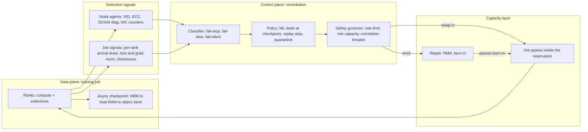

# Fault Tolerance and Fleet Resiliency at Scale

## TL;DR

In synchronous training, a job fails at the rate of its whole fleet: about 419 unexpected interruptions in 54 days on 16,384 H100s works out to one roughly every 3.1 hours, even though each individual GPU fails only about once every 5.8 years.
Failures come in three classes that need different machinery: fail-stop (crash or XID, handled by restart), fail-slow (stragglers and gray failure, handled by detection and eviction), and fail-silent (SDC, handled by replay, invariants and quarantine).
A single slow rank sets the step time for every rank, and it shows the *least* time blocked in collectives, so detectors must measure when each rank arrives at the collective, not how long it waits inside it.
Automated evacuation is a control plane that can destroy a fleet faster than any hardware fault, so it needs severity tiers, rate limits, minimum-capacity floors and a correlation breaker.
Capacity reservations are part of the resiliency design: spares sized with Little's law from the replacement turnaround, inside the same placement domain, decide whether a failure costs minutes or hours.

## Mental Model



Think of the training job as a data plane that has to keep running even when the remediation system is down.
Detection signals come from two places that do not see the same faults.
Node agents see faults the hardware itself reports: XID events, ECC counters, link errors.
Only the job can see faults the hardware does not report: a GPU that is 15% slow, or a matmul unit that returns wrong bits.
The remediation control plane sorts each signal into a failure class and picks the cheapest action that restores progress.
A safety governor stands between that decision and the fleet, so a bad health check or a bad driver rollout cannot evacuate everything.
The capacity layer closes the loop: whether a failure costs minutes or hours depends on whether a pre-qualified spare is already sitting inside the same reservation and placement domain.
Checkpointing mechanics are covered in [[17-Cloud-AI-Engineering/Volume_10_AI_Infrastructure_on_Cloud/Chapter_06_High_Throughput_Checkpointing_to_Object_Storage|High-Throughput Checkpointing to Object Storage]], and the fabric topologies in [[17-Cloud-AI-Engineering/Volume_10_AI_Infrastructure_on_Cloud/Chapter_02_Interconnect_Technologies_NVLink_EFA_and_TPU_ICI|Interconnect Technologies: NVLink, EFA, and TPU ICI]].

## Internals

### The failure arithmetic of synchronous training

A step in data-, tensor- or pipeline-parallel training finishes only when every participating rank finishes it.
If accelerators fail independently at rate lambda per device-hour, a job with N devices fails at rate N x lambda, and its MTBF is 1 / (N x lambda).
The Llama 3 405B report gives the cleanest public calibration point: [during a 54-day snapshot there were 466 job interruptions, 47 planned and 419 unexpected](https://bytez.com/docs/arxiv/2407.21783/paper) (Llama 3 paper, arXiv 2407.21783, 2024-07).
Dividing 419 failures by 16,384 GPUs x 1,296 hours gives lambda = 1.97e-5 per GPU-hour, so a single GPU fails about once every 50,700 hours (5.8 years).
The same fleet fails as a job every 3.1 hours.
The report attributes [about 78% of unexpected interruptions to confirmed or suspected hardware issues, with GPU issues the largest category at 58.7%](https://bytez.com/docs/arxiv/2407.21783/paper) (Llama 3 paper, 2024-07).
[148 interruptions (30.1%) came from faulty GPUs including NVLink, 72 (17.2%) from HBM3, and only two CPUs failed in 54 days](https://www.tomshardware.com/tech-industry/artificial-intelligence/faulty-nvidia-h100-gpus-and-hbm3-memory-caused-half-of-the-failures-during-llama-3-training-one-failure-every-three-hours-for-metas-16384-gpu-training-cluster) (Tom's Hardware summary of the Llama 3 paper, 2024-07).
The team still [achieved higher than 90% effective training time while absorbing automated firmware and kernel upgrades](https://bytez.com/docs/arxiv/2407.21783/paper) (Llama 3 paper, 2024-07).

Failure rates differ a lot between fleets, so treat any published lambda as a prior, not a constant.
Meta's research-cluster study of [11 months, 4 million jobs and over 150 million A100 GPU-hours](https://arxiv.org/pdf/2410.21680) measured an [MTTF of 7.9 hours for 1024-GPU jobs](https://arxiv.org/pdf/2410.21680) (Kokolis et al., HPCA 2025).
The Llama 3 lambda would predict about 49 hours for 1024 GPUs.
That roughly 6x gap reflects a different hardware generation, a different failure taxonomy (research clusters also count user-triggered and infrastructure-attributed failures), and different burn-in practices.
Kokolis et al. define [ETTR as the ratio of productive runtime to available wallclock time of a job run](https://www.glennklockwood.com/garden/papers/revisiting-reliability-in-large-scale-machine-learning-research-clusters), and it is the right top-level metric for this chapter.

### Failure taxonomy: fail-stop, fail-slow, fail-silent

Fail-stop faults announce themselves.
Examples are a GPU falling off the PCIe bus, an uncorrectable ECC error, an NVLink or NIC link down, or a kernel panic.
These are the cheapest faults to handle because the signal is unambiguous and the action (kill the job, evict the node, restart from checkpoint) is mechanical.
Fail-slow faults keep the job alive but tax every step.
Examples are a thermally throttled GPU, a flapping optic that forces retransmits, a PCIe link trained at reduced width, or a host daemon stealing CPU from the data loader.
Fail-silent faults (silent data corruption) keep the job alive and fast but make it wrong.
They are the most expensive class because the cost includes the steps that have to be rolled back and, in the worst case, a model whose trajectory has been quietly pushed off course.

### Silent data corruption: mechanism and detection

The term comes from CPU fleets.
Google described ["mercurial" cores whose only symptom is an erroneous computation](https://sigops.org/s/conferences/hotos/2021/papers/hotos21-s01-hochschild.pdf) (Hochschild et al., HotOS 2021).
Meta showed that [SDCs are not captured by CPU error reporting mechanisms and hence are not traceable at the hardware level](https://arxiv.org/pdf/2102.11245) (Dixit et al., arXiv 2102.11245, 2021).
Meta's follow-up notes that silent errors [are accelerated by datapath variations, temperature variance, and age](https://arxiv.org/pdf/2203.08989), and that a few hours of burn-in testing per CPU is not enough (Dixit et al., arXiv 2203.08989, 2022).
For accelerators the rate is no longer theoretical.
Gemini 1 reported that, at its scale, [SDC events were expected to impact training every week or two](https://assets.bwbx.io/documents/users/iqjWHBFdfxIU/r7G7RrtT6rnM/v0) (Gemini 1 technical report, 2023-12).
Llama 3 attributed six unplanned interruptions to SDC during its 54-day snapshot (cited in [arXiv 2502.12340](https://arxiv.org/html/2502.12340v1), 2025-02).

**The laundering mechanism.**
This mechanism is rarely written down outside the papers, and it decides which detector can work at all.
In a ring or tree all-reduce, each reduced chunk is computed once and then copied, byte for byte, to every rank during the all-gather phase.
As a result, all data-parallel replicas end every step with bit-identical gradients, even when the reduction order differs from run to run.
Now suppose a device corrupts its local gradient during the forward or backward pass.
The corrupted value enters the sum and is then distributed identically to every replica.
The corruption is laundered into a state that is consistent across replicas but wrong.
A cross-replica parameter checksum therefore cannot catch corruption that happens before the reduction.
It can catch only corruption that happens after it: in the optimizer update, in HBM holding parameters or optimizer state, or in a parameter shard broadcast.
That limitation is stated directly in the literature: checksumming parameters across replicas, as [Elsen et al. recommend](https://arxiv.org/html/2604.00726v1), does [not address corruption that arises during the forward or backward pass and propagates through gradient aggregation](https://arxiv.org/html/2604.00726v1) (arXiv 2604.00726, 2026-04).
NVIDIA's OCP whitepaper describes the same cascade: [in synchronous training a corrupting device with a persistent SDC will continue to corrupt the iteration](https://www.opencompute.org/documents/sdc-in-ai-ocp-whitepaper-ver-1-1-final-pdf/) across all accelerators (OCP SDC in AI whitepaper, 2025).

**Detection therefore needs two layers.**
Layer one is cheap invariants that run continuously.
Use loss and gradient-norm anomaly detectors as triggers.
Every K steps, compare a cross-replica 64-bit hash of each parameter shard along the replicate dimension.
Under FSDP or ZeRO-3 a rank holds only a shard, so the comparison has to run within each replica group of a hybrid-sharded layout, not across the whole job.
Layer two is replay, which handles pre-reduction corruption.
Gemini 2.5 describes the production answer: [lightweight deterministic replay repeats any step with suspicious metrics and compares per-device intermediate checksums to localize the root cause](https://arxiv.org/pdf/2507.06261).
[Around 0.25% of steps were replayed and 6% of these replays turned out to be genuine hardware corruption](https://arxiv.org/pdf/2507.06261) (Gemini 2.5 report, arXiv 2507.06261, 2025-07).
The economics work because a false positive costs one extra step, while a missed SDC costs a rollback across many steps.
There is a subtlety in replay.
Replaying on the same device catches intermittent faults, because the second run comes out different.
It does not catch a deterministic stuck-at defect, which reproduces the same wrong answer.
For those you need redundant computation on different silicon, or proactive scanning.
Google also used [proactive SDC scanners on idle machines and hot standbys](https://assets.bwbx.io/documents/users/iqjWHBFdfxIU/r7G7RrtT6rnM/v0) (Gemini 1 report, 2023-12).
All of this assumes deterministic kernels, which costs throughput and engineering discipline, and is why Google called its [fully deterministic infrastructure](https://www.datacenterdynamics.com/en/news/training-gemini-tpus-multiple-data-centers-and-risks-of-cosmic-rays/) a crucial ingredient for stable training.

### Stragglers and gray failure

Step time in synchronous training is the maximum over ranks, which is the training-cluster form of [The Tail at Scale](https://research.google/pubs/the-tail-at-scale/) (Dean and Barroso, CACM 2013).
Suppose each rank independently has a 1e-5 chance of being slow on a given step.
Then 1 - (1 - 1e-5)^16384 = 15% of steps contain at least one slow rank, and at 100,000 ranks that rises to 63%.
ByteDance's five-month trace study found that [stragglers are not trivially always caused by hardware failures, but can arise from multiple complex factors](https://www.usenix.org/conference/osdi25/presentation/lin-jinkun) (Lin et al., OSDI 2025).
A secondary summary of that paper reports about [42.5% of jobs with at least a 10% slowdown and 10.4% of allocated GPU-hours lost](https://lacuna.tiptreesystems.com/work/understanding-stragglers-in-large-model-training-using-what-if-analysis/wrk_9fedb3167f3b1f9b6f3566442dece50f).
The main causes it names are pipeline-stage imbalance, sequence-length variation and uncoordinated Python garbage collection.
The study's method is worth copying.
Log every operation with step, microbatch, PP rank and DP rank, then [simulate an alternative timeline without stragglers](https://www.usenix.org/system/files/osdi25-lin-jinkun.pdf) to attribute lost time to specific causes.

**The wait-time inversion.**
Rank i computes for c_i seconds and then blocks in a collective until the last rank arrives, so its wait time is w_i = max(c) - c_i.
The straggler is the rank with the smallest wait: zero.
Every healthy rank shows a large wait.
A dashboard that pages on "time in NCCL" points at every healthy rank and clears the guilty one.
The worked example below demonstrates this: in a 1024-rank simulation with one rank 15% slow, the slow rank waits 0 ms while the median rank waits 150 ms.
Detectors should time the compute phase with device-side events, or record when each rank arrives at each collective.
They should then apply a robust score (median and MAD) that has to persist over several steps before any action.
This matters because the cause determines the fix:

- If the same rank is slow every step, the cause is hardware or host: throttling, a degraded link, a noisy daemon. Evict or drain.
- If a different rank is slow each step, the cause is the data: sequence-length skew. Fix the batching (token-budget packing), not the fleet.
- If all ranks stall periodically in lockstep, the cause is a periodic process: GC, checkpoint stalls, logging. Disable automatic GC and collect synchronously every N steps.

MegaScale reports that a dedicated diagnosis and straggler toolchain at scale sustained [55.2% MFU training a 175B model on 12,288 GPUs](https://dl.acm.org/doi/10.5555/3691825.3691866) (Jiang et al., NSDI 2024).

Network gray failure is the cloud-specific variant.
On AWS, EFA's SRD transport sprays packets across many paths and handles retransmission in the Nitro card, so a single congested or flapping path degrades throughput instead of stalling a flow ([Shalev et al., IEEE Micro 2020](https://ieeexplore.ieee.org/document/9167399); mechanism description UNVERIFIED in this pass).
That masking cuts both ways.
It hides single-path faults from the job, but a degraded NIC or a bad cable on one host still produces a persistent per-rank straggler, and only per-rank arrival timing will find it.

### Automated node evacuation as a control loop

Evacuation is a reconciliation loop over node health, and it should be designed with the separation discipline from [[17-Cloud-AI-Engineering/Volume_01_Cloud_Architecture_Principles/Chapter_04_Control_Plane_vs_Data_Plane_Separation|Control Plane vs Data Plane Separation]].
Meta's clusters use two severities: [high severity check failures immediately remove the node and reschedule its jobs, while lower severity checks remove the node for remediation after jobs finish](https://www.glennklockwood.com/garden/papers/revisiting-reliability-in-large-scale-machine-learning-research-clusters) (Kokolis et al., HPCA 2025).
A production state machine extends that into: Healthy, Suspect (score accumulating, no action), Draining (finish to the next checkpoint boundary, then remove), Quarantined (excluded from scheduling), Repair (reboot, reset, reflash, RMA), Burn-in (multi-hour stress and diagnostics, including SDC scanners), and back to Healthy.
Kill-now is justified only when the fault guarantees the job cannot make progress, or when continuing risks corrupting state.
Draining at a checkpoint boundary instead turns an unplanned restart, which loses half a checkpoint interval of work on average, into a planned restart that loses almost nothing.
In Slurm the drain primitive is `scontrol update nodename=<node> state=drain reason=<text>`.
In Kubernetes it is a taint or cordon followed by an eviction that the training operator coordinates.

The safety governor matters most.
In the 2017 S3 us-east-1 event, a mistyped command removed more servers than intended.
AWS changed the tool to [remove capacity more slowly and to block any removal that would take a subsystem below its minimum required capacity](https://aws.amazon.com/message/41926/) (AWS PIR, 2017-03).
The same rules apply to GPU evacuation:

- Set a per-domain eviction rate limit.
- Set a global floor so the job stays at or above its required world size.
- Add a correlation breaker. If more than a threshold of nodes fail the same check with the same signature within a window, suspect the check, the driver, or a shared dependency, not the hardware. Stop evicting and page a human.

**Reconfigurable topology is a different answer to evacuation.**
Google's TPU v4 supercomputer uses SDN-managed optical circuit switches so the [ICI fabric can be dynamically reconfigured to route around machine, chip and link failures](https://www.usenix.org/conference/nsdi24/presentation/zu).
That reached [99.98% system availability, with hardware outages experienced by about 1% of training jobs](https://dl.acm.org/doi/10.5555/3691825.3691867) (Zu et al., NSDI 2024).
The mechanism here is about allocation.
With a static torus, a slice needs a contiguous set of fully healthy cubes.
With OCS, a slice can be assembled from any healthy 4x4x4 cubes, so one bad host makes its cube unusable but does not block contiguous allocation across the pod.
Gemini 2.5 pushed this into the job itself with slice-granularity elasticity.
Training [continues with fewer slices when there is a localized failure, losing tens of seconds per interruption instead of 10 or more minutes waiting for healthy machines](https://arxiv.org/pdf/2507.06261).
It [continues at around 97% throughput while the failed slice is recovering](https://arxiv.org/pdf/2507.06261) (Gemini 2.5 report, 2025-07).
The same report notes [interruptions from hardware failures multiple times per hour](https://arxiv.org/pdf/2507.06261) at that scale, which only works because recovery is no longer a full restart.

### Capacity reservation as a resiliency primitive

A replacement node arriving from outside the job's placement domain is useless if it lands on a different spine and the fabric degrades tensor- or pipeline-parallel collectives.
So the spare pool has to live inside the same reservation and placement group.
Size it with Little's law.
The mean number of nodes out of service equals the node failure rate times the repair turnaround, and you provision a Poisson quantile of that mean plus one correlated failure domain (a rack or NVLink domain).
For 2,048 nodes at the Llama 3 rate (7.8 failures per day), a 24-hour turnaround means about 7.8 nodes out on average, which needs 15 spares for P99 coverage.
A 2-hour turnaround means 0.65 nodes out and only 3 spares.
Turnaround is the lever.
That is why managed services that replace nodes automatically from reserved spare capacity (SageMaker HyperPod, GKE node auto-repair) change the economics: they shrink turnaround, not failure rate.
Product specifics are in the parity table and are UNVERIFIED as of 2026-10.

## Numbers to Know

| Quantity | Value | Source and date |
|---|---|---|
| Llama 3 405B interruptions, 54 days | 466 total; 47 planned; 419 unexpected | Llama 3 paper, arXiv 2407.21783, 2024-07 |
| Llama 3 unexpected interruptions attributed to hardware | ~78%; GPU issues 58.7% | Llama 3 paper, 2024-07 |
| Llama 3 faulty GPU / HBM3 interruptions | 148 (30.1%) / 72 (17.2%) | Llama 3 paper via Tom's Hardware, 2024-07 |
| Llama 3 effective training time | > 90% | Llama 3 paper, 2024-07 |
| Derived per-GPU failure rate (H100, Llama 3) | 1.97e-5 per GPU-hour, MTBF ~50,700 h | Derived from Llama 3 paper figures, computed 2026-10 |
| Derived job MTBF at 16,384 GPUs | ~3.1 h | Derived, 2026-10 |
| Meta research cluster MTTF, 1024-GPU jobs (A100) | 7.9 h | Kokolis et al., HPCA 2025, arXiv 2410.21680 |
| Meta research cluster study scope | 11 months, 4M jobs, >150M A100 GPU-hours | Kokolis et al., HPCA 2025 |
| Gemini 1 SDC impact frequency | every week or two | Gemini 1 report, 2023-12 |
| Gemini 1 goodput, largest job | 85% to 97% | Gemini 1 report, 2023-12 |
| Gemini 2.5 replayed steps / genuine SDC among replays | ~0.25% / 6% | Gemini 2.5 report, arXiv 2507.06261, 2025-07 |
| Gemini 2.5 elastic reconfiguration cost | tens of seconds vs 10+ min; ~97% throughput during recovery | Gemini 2.5 report, 2025-07 |
| Gemini 2.5 TPU v5p pod size | 8,960 chips | Gemini 2.5 report, 2025-07 |
| TPU v4 system availability with OCS reconfiguration | 99.98% | Zu et al., NSDI 2024 |
| MegaScale MFU, 175B on 12,288 GPUs | 55.2% | Jiang et al., NSDI 2024 |
| ByteDance GPU-hours lost to stragglers | ~10.4% (secondary summary) | Lin et al., OSDI 2025 |
| EC2 Spot interruption notice | 2 minutes | AWS docs, UNVERIFIED as of 2026-10 |
| Compute Engine preemption notice | 30 seconds | Google Cloud docs, UNVERIFIED as of 2026-10 |
| EC2 Capacity Block duration and advance window | 1 to 14 days (longer terms announced), purchasable up to 8 weeks ahead | AWS docs, UNVERIFIED as of 2026-10 |
| DWS flex-start maximum run duration | 7 days | Google Cloud docs, UNVERIFIED as of 2026-10 |
| GPU list prices | not stated; use your current pricing page | prices change too often to state here |

## AWS vs GCP Mechanism Parity

| Concern | AWS mechanism | Google Cloud mechanism | Critical difference |
|---|---|---|---|
| Scale-up fault domain | NVLink domain within a P5/P6 instance or NVL rack | TPU ICI slice; GPU NVLink domain on A3/A4 | TPU ICI faults are handled by OCS reconfiguration at cube granularity (Zu et al., NSDI 2024); NVLink faults usually take out the whole node |
| Scale-out transport under gray failure | EFA with SRD multipath spraying and Nitro-side retransmit (UNVERIFIED in this pass) | GPU: GPUDirect-TCPXO / RDMA variants; TPU: ICI within a slice, DCN across slices (UNVERIFIED in this pass) | SRD hides single-path flaps from the job; a per-host NIC fault still shows up as a straggler |
| Managed cluster resiliency | SageMaker HyperPod: deep health checks, health-monitoring agent, automatic node replacement, job auto-resume (UNVERIFIED as of 2026-10) | GKE with node auto-repair; Cluster Director for GPU clusters; multi-host TPU slices repaired as a unit (UNVERIFIED as of 2026-10) | Replacement capacity on both comes from your reservation; with no spare inside it, repair stalls |
| Host maintenance on accelerator VMs | EC2 scheduled events and instance status checks (UNVERIFIED) | GPU VMs cannot live-migrate and terminate on host maintenance, with advance notice (UNVERIFIED) | Neither cloud live-migrates GPU state; maintenance windows must line up with checkpoint boundaries |
| Short-term guaranteed capacity | EC2 Capacity Blocks for ML: prepaid, fixed window, UltraCluster-colocated (UNVERIFIED as of 2026-10) | DWS calendar mode / future reservations; DWS flex-start; TPU queued resources (UNVERIFIED as of 2026-10) | Capacity Blocks terminate at end time; flex-start obtains capacity when available; both must be planned around checkpoints |
| Open-ended guaranteed capacity | On-Demand Capacity Reservations plus Savings Plans for discount (UNVERIFIED) | Zonal reservations plus committed use discounts (UNVERIFIED) | On both, the reservation guarantees capacity and the commitment buys the discount; they are separate instruments, see [[17-Cloud-AI-Engineering/Volume_09_FinOps_and_Cloud_Economics/Chapter_02_Commitment_Discounts_Savings_Plans_vs_CUDs\|Commitment Discounts]] |
| Interruption signal for preemptible capacity | Spot 2-minute notice (UNVERIFIED) | Spot/preemptible 30-second notice (UNVERIFIED) | A 30-second notice is shorter than most checkpoint persist times, so you must rely on periodic checkpoints |
| Goodput instrumentation | Customer-built from CloudWatch and job logs | ML Goodput measurement tooling ([arXiv 2502.06982](https://arxiv.org/pdf/2502.06982) describes Google's internal metric; product status UNVERIFIED) | Google publishes a decomposed goodput metric; on AWS you build ETTR yourself |

## Worked Example: Goodput, Checkpoint Cadence, and Spare-Pool Sizing

### The artifact

The script below uses only the Python standard library and makes no cloud calls, so it costs $0.
It derives a per-GPU failure rate from the public Llama 3 figures and scales it to your job size.
It computes the Young/Daly checkpoint interval, estimates ETTR analytically and checks it with Monte Carlo, sizes a spare pool with a Poisson quantile, and demonstrates the straggler wait-time inversion.

```python
#!/usr/bin/env python3
"""Fleet resiliency calculator for synchronous accelerator training.

Stdlib only. No cloud calls. Safe to run anywhere.
Inputs default to public Llama 3 405B pre-training figures (arXiv 2407.21783).
"""
import argparse
import math
import random
import statistics


def per_gpu_rate(failures, gpus, hours):
    """Failures per GPU-hour, assuming independent, memoryless failures."""
    return failures / (gpus * hours)


def job_mtbf_s(rate_per_gpu_h, gpus):
    return 3600.0 / (rate_per_gpu_h * gpus)


def young_daly_interval_s(ckpt_block_s, mtbf_s):
    """First-order optimum: tau = sqrt(2 * delta * M)."""
    return math.sqrt(2.0 * ckpt_block_s * mtbf_s)


def analytic_waste(tau_s, ckpt_block_s, restart_s, mtbf_s):
    """Fraction of wallclock lost: checkpoint stalls + lost work + restart."""
    stall = ckpt_block_s / tau_s
    rework = (tau_s / 2.0) / mtbf_s
    restart = restart_s / mtbf_s
    return stall + rework + restart


def simulate_ettr(tau_s, ckpt_block_s, restart_s, mtbf_s, horizon_s, seed=7):
    """Monte Carlo ETTR: productive seconds / wallclock seconds."""
    rng = random.Random(seed)
    t = 0.0
    productive = 0.0
    next_fail = rng.expovariate(1.0 / mtbf_s)
    while t < horizon_s:
        if t + tau_s + ckpt_block_s <= next_fail:
            t += tau_s + ckpt_block_s
            productive += tau_s
        else:
            t = next_fail + restart_s
            next_fail = t + rng.expovariate(1.0 / mtbf_s)
    return productive / t


def poisson_quantile(mean, q):
    """Smallest k with P(X <= k) >= q for X ~ Poisson(mean)."""
    k, term = 0, math.exp(-mean)
    cdf = term
    while cdf < q:
        k += 1
        term *= mean / k
        cdf += term
    return k


def straggler_demo(ranks=1024, slow_rank=613, slow_factor=1.15, seed=11):
    """Show that the slow rank has the SMALLEST collective wait time.

    Each rank computes for c_i seconds, then blocks in an all-reduce that
    cannot complete until the last rank arrives. Wait_i = max(c) - c_i.
    """
    rng = random.Random(seed)
    compute = [rng.gauss(1.000, 0.004) for _ in range(ranks)]
    compute[slow_rank] *= slow_factor
    arrive_last = max(compute)
    wait = [arrive_last - c for c in compute]
    med = statistics.median(compute)
    mad = statistics.median(abs(c - med) for c in compute) or 1e-9
    z = [(c - med) / (1.4826 * mad) for c in compute]
    flagged = [i for i, s in enumerate(z) if s > 6.0]
    min_wait_rank = min(range(ranks), key=lambda i: wait[i])
    return {
        "flagged_by_compute_z": flagged,
        "rank_with_min_wait": min_wait_rank,
        "median_wait_ms": 1000 * statistics.median(wait),
        "slow_rank_wait_ms": 1000 * wait[slow_rank],
        "step_inflation_pct": 100 * (arrive_last / med - 1),
    }


def main():
    ap = argparse.ArgumentParser()
    ap.add_argument("--ref-failures", type=float, default=419)
    ap.add_argument("--ref-gpus", type=int, default=16384)
    ap.add_argument("--ref-hours", type=float, default=54 * 24)
    ap.add_argument("--gpus", type=int, default=16384)
    ap.add_argument("--gpus-per-node", type=int, default=8)
    ap.add_argument("--ckpt-block-s", type=float, default=60.0)
    ap.add_argument("--restart-s", type=float, default=900.0)
    ap.add_argument("--repair-turnaround-h", type=float, default=24.0)
    ap.add_argument("--usd-per-gpu-hour", type=float, default=4.00,
                    help="Illustrative input, not a list price.")
    a = ap.parse_args()

    lam = per_gpu_rate(a.ref_failures, a.ref_gpus, a.ref_hours)
    m = job_mtbf_s(lam, a.gpus)
    tau = young_daly_interval_s(a.ckpt_block_s, m)
    w = analytic_waste(tau, a.ckpt_block_s, a.restart_s, m)
    sim = simulate_ettr(tau, a.ckpt_block_s, a.restart_s, m, 200 * 86400)
    nodes = a.gpus // a.gpus_per_node
    node_fail_per_h = lam * a.gpus
    in_repair_mean = node_fail_per_h * a.repair_turnaround_h
    burn_per_h = a.gpus * a.usd_per_gpu_hour

    print(f"per-GPU failure rate        : {lam:.3e} /GPU-h "
          f"(per-GPU MTBF {1/lam:,.0f} h)")
    print(f"job MTBF at {a.gpus} GPUs     : {m/3600:.2f} h ({m:,.0f} s)")
    print(f"Young-Daly interval         : {tau:,.0f} s ({tau/60:.1f} min)")
    print(f"analytic waste / ETTR       : {100*w:.1f}% / {100*(1-w):.1f}%")
    print(f"simulated ETTR (200 days)   : {100*sim:.1f}%")
    print(f"nodes / failures per day    : {nodes} / {24*node_fail_per_h:.1f}")
    print(f"mean nodes in repair        : {in_repair_mean:.2f}")
    for q in (0.99, 0.999):
        print(f"spares for P{100*q:g} coverage  : "
              f"{poisson_quantile(in_repair_mean, q)}")
    print(f"burn rate                   : ${burn_per_h:,.0f}/h, "
          f"waste ${w*burn_per_h*24:,.0f}/day")
    print("straggler demo              :", straggler_demo())


if __name__ == "__main__":
    main()
```

Run it three ways:

```bash
python3 fleet_resiliency_calc.py
python3 fleet_resiliency_calc.py --ckpt-block-s 5 --restart-s 180 --repair-turnaround-h 2
python3 fleet_resiliency_calc.py --gpus 100000 --ckpt-block-s 5 --restart-s 30 --repair-turnaround-h 2
```

### Step-by-step capacity and cost reasoning

Step 1, the failure rate.
lambda = 419 / (16,384 x 1,296 h) = 1.973e-5 per GPU-hour, so job MTBF at 16,384 GPUs = 11,135 s = 3.09 h.
Step 2, the baseline with synchronous checkpointing.
With a 60 s blocking checkpoint and a 15 min restart (reschedule, container pull, NCCL init, checkpoint load), the Young/Daly interval is sqrt(2 x 60 x 11,135) = 1,156 s (19.3 min).
Waste adds up as stall 5.2% + rework 5.2% + restart 8.1% = 18.5%, so ETTR is 81.5%; the Monte Carlo run gives 82.9%.
Step 3, the engineered configuration.
Async checkpointing cuts the blocking part to 5 s (snapshot to host RAM, upload in the background), and hot spares plus pre-warmed images cut restart to 180 s.
The interval drops to 334 s, waste to 4.6% and ETTR to 95.4%, which matches the Llama 3 report of over 90% effective training time.
Step 4, money, at an illustrative $4.00 per GPU-hour (an input, not a list price).
The 16,384-GPU job burns $65,536 per hour.
The baseline wastes about $290,000 per day and the engineered configuration about $72,600 per day, so the engineering effort is worth about $218,000 per day.
Step 5, spares.
At 7.8 node failures per day, a 24 h repair turnaround needs 15 spare nodes for P99 (120 GPUs, 0.7% of the fleet), while a 2 h automated replacement needs 3.
Add one correlated domain (a rack) on top of the Poisson figure, because failures are not independent.
Step 6, the 100,000-GPU cliff.
MTBF falls to 1,824 s (30 min).
Even with 5 s checkpoints, a 180 s restart leaves ETTR at 82.7%.
Only cutting restart to about 30 s, which means in-job elastic recovery rather than a rescheduled restart, recovers 91%.
That is the quantitative case for the slice-granularity elasticity Gemini 2.5 describes.
Step 7, stragglers.
One rank 15% slow inflates every step by 15%, which on the 16,384-GPU job is about $9,800 per hour, more than the hourly cost of the entire spare pool.
The demo shows that rank with 0 ms collective wait against a 150 ms median.

### Read-only capacity discovery (optional)

These calls only list offerings and create nothing.
Flags are UNVERIFIED against the current CLI reference as of 2026-10.

```bash
aws ec2 describe-capacity-block-offerings \
  --instance-type p5.48xlarge --instance-count 4 --capacity-duration-hours 48 \
  --region us-east-1
gcloud compute reservations list --project "$PROJECT_ID"
```

Purchasing a Capacity Block is a prepaid, non-cancellable commitment (UNVERIFIED as of 2026-10), so treat `purchase-capacity-block` as a change-managed action, not a lab step.

### Cost estimate, budget alarm, and teardown

The lab as written costs $0, since the script is local and the list calls are read-only.
Create guard budgets before experimenting with any purchase path; AWS Budgets pricing is UNVERIFIED as of 2026-10.

```bash
cat > /tmp/budget.json <<'EOF'
{"BudgetName":"gpu-lab-guard","BudgetLimit":{"Amount":"50","Unit":"USD"},
 "TimeUnit":"MONTHLY","BudgetType":"COST"}
EOF
cat > /tmp/notif.json <<'EOF'
[{"Notification":{"NotificationType":"ACTUAL","ComparisonOperator":"GREATER_THAN",
  "Threshold":50,"ThresholdType":"PERCENTAGE"},
  "Subscribers":[{"SubscriptionType":"EMAIL","Address":"you@example.com"}]}]
EOF
aws budgets create-budget --account-id "$AWS_ACCOUNT_ID" \
  --budget file:///tmp/budget.json --notifications-with-subscribers file:///tmp/notif.json
gcloud billing budgets create --billing-account="$BILLING_ACCOUNT" \
  --display-name="gpu-lab-guard" --budget-amount=50USD --threshold-rule=percent=0.5
```

Teardown:

```bash
aws budgets delete-budget --account-id "$AWS_ACCOUNT_ID" --budget-name gpu-lab-guard
gcloud billing budgets list --billing-account="$BILLING_ACCOUNT" --format="value(name)"
gcloud billing budgets delete "$BUDGET_ID" --billing-account="$BILLING_ACCOUNT"
rm -f /tmp/budget.json /tmp/notif.json
```

## Failure Modes and Pitfalls

**Evacuation storms.**
A health check with a bad threshold, or a driver rollout that triggers spurious errors, can make the remediation controller drain healthy nodes faster than any hardware fault would.
The S3 2017 PIR is the canonical lesson: [capacity removal tooling must run slowly and refuse to cross minimum-capacity floors](https://aws.amazon.com/message/41926/) (AWS PIR, 2017-03).
Google's June 2019 networking incident showed automation descheduling control-plane jobs across several locations after a configuration was applied more broadly than intended ([Google Cloud incident 19009](https://status.cloud.google.com/incident/cloud-networking/19009), URL not re-fetched in this pass).
Mitigations:

- Run every new check in dry-run mode first.
- Rate-limit evictions per domain.
- Add a correlation breaker that freezes automation when failures cluster by signature rather than by hardware.

**Spares outside the placement domain.**
Replacement nodes that land outside the UltraCluster spine or the compact placement group satisfy the world size but add cross-spine hops to collectives, which creates a permanent straggler that no health check flags.

**Reservation cliffs.**
Fixed-window capacity (Capacity Blocks, calendar-mode reservations) ends at a fixed time whether or not your checkpoint has finished persisting.
Schedule a forced checkpoint and a drain well before the end, and verify the upload, not just the snapshot.

**Async checkpoint false safety.**
A snapshot in host RAM is not durable.
If the node dies before upload, you lose back to the previous durable checkpoint, and correlated failures (rack power) can wipe out the peer replicas too.

**Laundered SDC.**
Cross-replica checksums pass, loss looks fine, and the model is still slightly wrong, because the corruption happened before the reduction.
Without replay or redundant computation you will not find it until an eval regression weeks later.

**Deterministic defects that replay cannot see.**
A stuck-at fault reproduces identically on the same device, so a matching replay is a false negative.
Rotate replay onto different devices, or rely on proactive scanners during burn-in and on idle spares.

**Straggler misattribution.**
If you page on NCCL time you will evict healthy nodes, because the guilty rank waits least.
If you treat data-dependent slowness (sequence-length skew) as hardware, you will churn through spares and never fix the cause.

**Power and thermal coupling.**
Thousands of GPUs moving in lockstep between compute and idle, at checkpoint or collective boundaries, cause large facility power swings.
The Llama 3 report discusses this, along with diurnal throughput variation driven by temperature (UNVERIFIED in this pass).
Treat the datacenter as a component of the job.

**Planned maintenance counted as "free".**
Llama 3 saw [at least one training interruption daily](https://bytez.com/docs/arxiv/2407.21783/paper) from automated firmware and kernel upgrades.
Batch maintenance into checkpoint-aligned windows; unscheduled rolling upgrades multiply restarts.

See [[17-Cloud-AI-Engineering/Volume_07_Reliability_and_SRE/Chapter_07_Anatomy_of_Major_Cloud_Outages|Anatomy of Major Cloud Outages]] for broader PIR analysis.

## Security and Cost Angles

**IAM scoping for remediation.**
The remediation controller needs permission to terminate, reboot and replace instances only in the training cluster's account or project.
Scope it with tag conditions on AWS (for example, `aws:ResourceTag/cluster` on `ec2:TerminateInstances`) or with IAM Conditions on GCP, and deny it everywhere else with an SCP or a deny policy.
Mechanics are in [[17-Cloud-AI-Engineering/Volume_02_AWS_Deep_Dive/Chapter_01_IAM_Policy_Evaluation_Engine|IAM Policy Evaluation Engine]] and [[17-Cloud-AI-Engineering/Volume_03_GCP_Deep_Dive/Chapter_02_Cloud_IAM_Roles_Policies_and_Conditions|Cloud IAM]].
Reservation purchase rights (Capacity Blocks, future reservations) are financial commitments.
Keep them in a separate break-glass role with two-person approval, not on the automation principal.

**Checkpoint confidentiality and integrity.**
Checkpoints are the model, so encrypt them with CMEK or customer-managed KMS keys and an envelope hierarchy ([[17-Cloud-AI-Engineering/Volume_08_Security_Identity_and_the_Data_Perimeter/Chapter_04_Encryption_Key_Hierarchies_and_Envelope_Encryption|Encryption Key Hierarchies]]).
Keep checkpoint traffic on private paths (S3 gateway endpoints, Private Google Access, and VPC Service Controls perimeters).
Store a content hash per shard alongside the checkpoint manifest.
That hash doubles as an integrity check against both tampering and storage-layer corruption when you resume.

**Quarantine evidence.**
Hardware flagged for SDC should be held in a quarantine pool with its replay evidence attached, so that RMA cases and vendor escalations do not depend on someone's memory.

**Unit-economics levers, ranked by typical dollar impact.**

1. Restart time, via hot spares, pre-pulled images, cached weights and in-job elastic recovery.
2. Checkpoint blocking time, via async snapshots.
3. Straggler tax, via arrival-skew detection and synchronized GC.
4. Repair turnaround, via managed auto-replacement, which shrinks the spare pool.
5. Spare-pool utilization: lend spares to preemptible eval or data jobs, and reclaim them on failure within the job's restart budget.

Cost-per-token framing for these levers is in [[17-Cloud-AI-Engineering/Volume_09_FinOps_and_Cloud_Economics/Chapter_05_GPU_and_TPU_Unit_Economics|GPU and TPU Unit Economics]].

## Interview Questions and Model Answers

### Question 1 (L5 - Senior)

Each H100 in your fleet fails about once every six years, yet your 16,384-GPU pretraining job fails every three hours. Reconcile those numbers and choose a checkpoint interval.

#### Model Answer

Synchronous training is a series system: any single failure stops all ranks, so the job failure rate is N x lambda.
At lambda = 1.97e-5 per GPU-hour, which is the Llama 3 figure, 16,384 GPUs give 0.32 failures per hour, an MTBF of 3.1 hours.
Young/Daly gives the first-order optimum interval tau = sqrt(2 x delta x M), where delta is the *blocking* part of a checkpoint and M is the job MTBF.
With delta = 60 s, tau is about 19 minutes and waste is about 5% from stalls plus 5% from rework, before adding restart cost.
Restart cost R / M is often the biggest term: a 15-minute restart is another 8%.
So I would attack delta with async snapshots to host memory and R with hot spares and pre-warmed images, not just tune tau.
With delta = 5 s and R = 3 minutes, tau falls to about 5.6 minutes and ETTR rises to about 95%.
I would also validate lambda against our own fleet telemetry, since Meta's research clusters show 1024-GPU MTTF of 7.9 hours, several times worse than the Llama 3 rate predicts.

#### Follow-up Interviewer Question

Snapshots to host RAM take 5 s but uploads to object storage take 8 minutes. Which value goes into the formula, and what new failure mode have you introduced?

### Question 2 (L5 - Senior)

Your step time regressed 12% on a 4,096-GPU job, and the NCCL profiler shows ranks 0 to 4,094 spending 120 ms per step in all-reduce. How do you find the cause?

#### Model Answer

Time spent in a collective is wait time, and wait_i = max(compute) - compute_i, so the healthy ranks wait longest.
The culprit is likely the one rank (or the few ranks) with near-zero wait.
I would instrument the compute phase with device-side events, or log when each rank arrives at each collective.
Then I would compute a robust z-score with median and MAD and require it to persist over many steps.
Next I would sort by pattern:

- The same rank slow every step points to hardware or host: clocks, throttling, PCIe width, NIC error counters, noisy daemons. Drain it at the next checkpoint.
- A different rank each step points to data, usually sequence-length imbalance, so fix packing.
- Periodic all-rank stalls point to GC or checkpoint I/O, so disable automatic GC and collect in lockstep.

ByteDance's OSDI 2025 study found that much straggler loss is not hardware, so I would not jump straight to eviction.

#### Follow-up Interviewer Question

The slow rank moves around, but always within the same pipeline stage. What does that tell you, and what do you change?

### Question 3 (L6 - Staff)

Design SDC detection for a 10,000-accelerator pretraining run. Be specific about what each detector can and cannot catch.

#### Model Answer

I split detection by where the corruption happens relative to the gradient reduction.
After the reduction, all data-parallel replicas hold bit-identical state, because all-reduce distributes the same bytes to every rank.
So a cross-replica hash of parameter shards every K steps catches corruption in the optimizer update or in memory holding parameters and optimizer state, at a cost of a single HBM read per check.
Before the reduction, corruption in forward or backward passes gets laundered by the all-reduce into consistent-but-wrong state everywhere, so checksums cannot see it.
For that I use triggers (loss spikes, grad-norm outliers, NaN counts) plus deterministic replay of the suspicious step, comparing per-device intermediate checksums to localize the device.
Gemini 2.5 reports replaying about 0.25% of steps, with 6% genuine, so the false-positive cost is tiny next to a multi-hour rollback.
Replay on the same device misses deterministic stuck-at faults, so I add redundant computation on different devices for confirmation, plus proactive scanners on spares and during burn-in.
The prerequisite is deterministic kernels and data ordering, which I budget for in throughput.
Quarantine requires replay evidence, so that a bad trigger cannot drain the fleet.

#### Follow-up Interviewer Question

Replay of the flagged step reproduces the same output bit for bit, but the loss spike is real. What are the possible explanations, and how do you tell them apart?

### Question 4 (L6 - Staff)

Plan capacity for a 90-day, 4,096-GPU pretraining run. Choose instruments on AWS or GCP and size the spare pool.

#### Model Answer

The run is gang-scheduled and sensitive to topology, so it needs guaranteed capacity inside one placement domain for the whole 90 days.
I would separate capacity guarantee from price.
On AWS that means an open-ended capacity reservation, or chained fixed-window blocks, combined with a commitment discount.
On GCP it means a zonal reservation or calendar-mode capacity combined with a committed use discount.
Both instrument sets need verification of current terms before purchase.
For spares: 512 nodes at the Llama 3 rate fail about 1.9 times per day.
With a 24-hour repair turnaround the mean out of service is 1.9, so P99 coverage needs 6 spares; with 2-hour automated replacement it needs 2.
I would add one rack-sized correlated domain on top.
At an illustrative $4 per GPU-hour, 6 spare nodes cost about $4,600 per day.
Without spares, each failure stalls the full job at $16,384 per hour until a replacement arrives.
I would put spares in the same reservation and placement group, run eval or data jobs on them preemptibly, and schedule forced checkpoints before any fixed-window expiry.

#### Follow-up Interviewer Question

Finance asks you to drop spares to zero and rely on the cloud provider's auto-replacement. Under what measured condition would you agree?

### Question 5 (L6 - Staff)

Design the automated node evacuation controller for a 2,000-node GPU cluster. A new driver rolled out last night, and 30% of nodes began logging the same XID within an hour. Walk through what your controller does.

#### Model Answer

The controller has severity tiers.
Faults that make progress impossible or corrupt state trigger kill-now.
Faults that degrade trigger drain-at-checkpoint.
Weak signals move a node to suspect, where evidence accumulates and nothing happens yet.
Above the tiers sits a safety governor:

- A per-domain eviction rate limit.
- A floor that keeps healthy capacity at or above the job's world size plus a margin.
- A correlation breaker keyed on signature, driver version, firmware version and domain.

In the scenario, 30% of nodes with one XID signature and a shared new driver version trips the breaker within minutes.
The controller stops evicting, marks the rollout as suspect, halts the driver rollout pipeline, and pages a human.
Nodes stay in service unless the XID class is fatal, in which case the job keeps running at reduced elastic size or pauses at a checkpoint.
This follows the S3 2017 lesson: removal tooling must be slow and must respect minimum capacity.
The controller's own failure mode is static: if it dies, nodes keep running and nothing gets evicted.

#### Follow-up Interviewer Question

How do you ship a new health check to this fleet without it becoming the next incident?

### Question 6 (L7+ - Principal)

Leadership plans a 100,000-accelerator run next year. Explain why checkpoint-restart alone fails, and lay out the architecture and organizational changes you would require.

#### Model Answer

At the Llama 3 failure rate, 100,000 accelerators give an MTBF of about 30 minutes.
Even with 5 s checkpoints, a 3-minute restart caps ETTR at about 83%, which is roughly $1.6 million per day of waste at an illustrative $4 per accelerator-hour.
Restart has to stop meaning reschedule.
I would require in-job recovery: elastic data parallelism at slice or replica granularity, which Gemini 2.5 reports cuts interruption cost to tens of seconds at about 97% throughput.
I would add hot spares that join a rebuilt communicator without reloading from object storage, and in-memory peer-replicated checkpoints, with durable uploads off the critical path.
At this size SDC becomes a weekly event, so deterministic replay and quarantine are mandatory, not optional.
On the organizational side, I would make goodput a decomposed SLO with owners: scheduling goodput belongs to capacity, runtime goodput to infra, program goodput to the modeling team.
Google's ML Productivity Goodput work frames it this way.
I would also fund fleet-specific failure telemetry, because published rates vary several-fold.
Multi-datacenter training adds DCN bandwidth and correlated facility events as new failure domains, which the plan must model explicitly.

#### Follow-up Interviewer Question

Elastic data parallelism changes the global batch when a replica drops. How do you keep optimization semantics and data-loader state correct?

### Question 7 (L7+ - Principal)

The CFO wants to cut reserved GPU capacity by 30% and backfill with Spot or flex-start capacity. Defend or refine the plan.

#### Model Answer

I would split the workload portfolio by tolerance to interruption, rather than argue about the total.
Gang-scheduled pretraining needs contiguous, topology-local, guaranteed capacity.
On Spot, a 30-second or 2-minute notice is shorter than a durable checkpoint, so that work stays reserved.
Eval sweeps, data processing, small fine-tunes and batch inference can tolerate preemption and should move to flex or Spot capacity.
The spare pool inside the reservation already acts as preemptible backfill, so its utilization should be counted when judging whether the reservation is idle.
I would quantify with ETTR x price per useful accelerator-hour, not list price.
Cheap capacity that runs at 60% ETTR can cost more per useful hour than reserved capacity at 95% ETTR.
The outcome is likely a smaller cut, targeted at the elastic portion, with the savings shown on the exec dashboard as cost per useful accelerator-hour.

#### Follow-up Interviewer Question

What single metric would you put on the executive dashboard to keep this decision honest each quarter, and how do you prevent teams from gaming it?

## Further Reading

- [The Llama 3 Herd of Models (arXiv 2407.21783)](https://arxiv.org/abs/2407.21783) - the most detailed public breakdown of interruptions by root cause for a 16K-GPU run.
- [Revisiting Reliability in Large-Scale Machine Learning Research Clusters (HPCA 2025)](https://arxiv.org/pdf/2410.21680) - defines ETTR, gives MTTF across scales, and describes severity-tiered health checks.
- [Resiliency at Scale: Managing Google's TPUv4 Machine Learning Supercomputer (NSDI 2024)](https://www.usenix.org/conference/nsdi24/presentation/zu) - OCS-based reconfiguration as a fault-tolerance mechanism.
- [Gemini 2.5 technical report (arXiv 2507.06261)](https://arxiv.org/pdf/2507.06261) - slice-granularity elasticity and split-phase SDC detection, with measured rates.
- [Gemini 1 technical report](https://assets.bwbx.io/documents/users/iqjWHBFdfxIU/r7G7RrtT6rnM/v0) - SDC frequency at frontier scale, deterministic replay and proactive scanners.
- [Understanding Stragglers in Large Model Training Using What-if Analysis (OSDI 2025)](https://www.usenix.org/conference/osdi25/presentation/lin-jinkun) - the methodology for attributing straggler loss to root causes.
- [MegaScale (NSDI 2024)](https://dl.acm.org/doi/10.5555/3691825.3691866) - production diagnosis and fault-tolerance tooling for more than 10,000 GPUs.
- [Silent Data Corruptions at Scale (arXiv 2102.11245)](https://arxiv.org/pdf/2102.11245) and [Detecting silent data corruptions in the wild (arXiv 2203.08989)](https://arxiv.org/pdf/2203.08989) - Meta's foundational SDC characterization and fleet testing.
- [Cores that don't count (HotOS 2021)](https://sigops.org/s/conferences/hotos/2021/papers/hotos21-s01-hochschild.pdf) - Google's mercurial-core paper, which ended the assumption that processors fail-stop.
- [OCP: Silent Data Corruption in AI](https://www.opencompute.org/documents/sdc-in-ai-ocp-whitepaper-ver-1-1-final-pdf/) - an industry taxonomy of SDC propagation in synchronous training.
- [Machine Learning Fleet Efficiency: ML Productivity Goodput (arXiv 2502.06982)](https://arxiv.org/pdf/2502.06982) - goodput decomposition for TPU fleets.
- [Summary of the Amazon S3 Service Disruption, 2017](https://aws.amazon.com/message/41926/) - the canonical PIR for rate-limiting capacity-removal automation.
- [The Tail at Scale (CACM 2013)](https://research.google/pubs/the-tail-at-scale/) - the probability argument behind stragglers.
- Next reading in this curriculum: [[17-Cloud-AI-Engineering/Volume_14_Staff_Plus_Interview_Arena/Chapter_02_Design_Distributed_GPU_Cluster_Scheduler|System Design: Distributed GPU Cluster Scheduler]] and [[17-Cloud-AI-Engineering/Volume_09_FinOps_and_Cloud_Economics/Chapter_03_Spot_Economics_and_Interruption_Handling|Spot Economics and Interruption Handling]].
