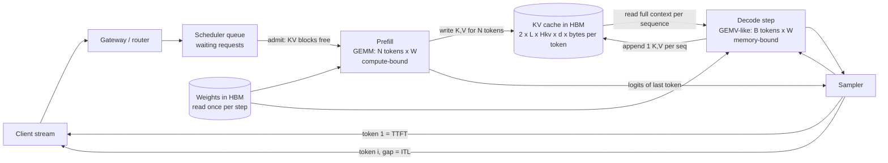

# LLM Inference Mechanics: Prefill vs Decode Phases

## TL;DR

Prefill pushes all N prompt tokens through every weight matrix in one pass, so it runs as a large GEMM with arithmetic intensity of about N FLOP/byte and is limited by tensor-core FLOPS, which sets TTFT.
Decode produces one token per sequence per step, so every step reads all weights plus that sequence's whole KV cache from HBM, and step time is roughly bytes moved divided by HBM bandwidth, which sets TPOT and ITL.
Batching spreads the weight reads across B sequences, but each sequence still reads its own KV cache, so at long context the KV term grows with B x context and batching stops paying off well before the FLOPS roofline.
TTFT = queueing + prefill compute + first decode step, and E2E = TTFT + (n_out - 1) x TPOT; p99 ITL spikes come mostly from prefill interference inside a shared iteration, not from decode itself.
Accelerator choice follows the phase mix: prefill-heavy traffic buys FLOPS per dollar, decode-heavy traffic buys HBM GB/s and GB per dollar, and fleets that ignore this split overpay by a constant factor.

## Mental Model



Think of one inference replica as a machine with two very different jobs that share the same HBM and the same tensor cores.
Prefill is a bulk job: the weight matrices are fetched once and reused across thousands of prompt tokens, so the chip runs close to its FLOPS limit and the result is one KV-cache write per token.
Decode is a loop: every iteration pulls the whole model and every active sequence's KV history through the memory system just to produce B new tokens, so the chip waits on HBM while the tensor cores sit mostly idle.
The scheduler decides how much of each job runs in each iteration.
The latency the user sees (TTFT, then a sequence of ITL gaps) is set by that scheduling choice far more than by the model itself.

## Internals

### The forward pass as matrix shapes

A decoder-only transformer layer runs, in order: QKV projection, attention over the cached keys and values, output projection, then a gated MLP (three matrices for SwiGLU models such as Llama 3).
In prefill, the activation matrix entering each linear layer has shape [N, d_model], where N is the number of prompt tokens being processed, so each linear layer is a GEMM [N, d_model] x [d_model, d_out].
In decode, the activation matrix has shape [B, d_model], where B is the number of sequences in the running batch, with one new token each, so the same weights now multiply a skinny matrix that degenerates to a GEMV when B = 1.
The weight bytes moved per layer are identical in both phases, while the FLOPs differ by a factor of N / B.

The linear-layer FLOP count per token is 2 x P for a dense model with P parameters, one multiply and one add per weight.
Attention adds about 2 x N^2 x d_model x L FLOPs for a causal prefill of N tokens over L layers (QK^T and AV each cost 2 x N^2 x d_model, halved by the causal mask).
For Llama 3.1 70B (L = 80, d_model = 8192) at N = 2048, linear layers cost 2.89e14 FLOPs and attention costs 5.5e12 FLOPs, so attention is under 2% of prefill compute at this length and only becomes dominant well past 32k tokens.

### Arithmetic intensity and the roofline

The roofline model (Williams, Waterman, Patterson, CACM 2009) says attainable throughput = min(peak FLOPS, arithmetic intensity x memory bandwidth), with intensity measured in FLOPs per byte moved from DRAM.
The ridge point is peak FLOPS divided by bandwidth: an H100 SXM at 989 dense BF16 TFLOPS and 3.35 TB/s has a ridge of about 295 FLOP/byte.
Linear layers in BF16 have intensity of about (2 x P x T) / (2 x P) = T FLOP/byte, where T is the number of tokens multiplied against the weights in that pass.
Prefill with T = 2048 sits about 7x past the H100 ridge, so it is compute-bound.
Decode with T = B = 32 sits about 9x below the ridge, so it is memory-bound and the tensor cores run at roughly 10% of peak at best.
With FP8 weights and FP8 math the bytes halve and the peak doubles, so the crossover batch stays at about 295 on H100; FP8 makes decode faster by moving fewer bytes but does not change which side of the ridge you are on.

### The mechanism most guides skip: batching amortizes weights, not KV

Each decode step at batch B and mean context C moves W + B x C x kv_bytes_per_token bytes, where W is the weight footprint.
Only the W term is shared across the batch.
The attention step for each sequence reads that sequence's private K and V history, and its arithmetic intensity does not depend on B.
For grouped-query attention (Ainslie et al., EMNLP 2023) with G query heads per KV head and BF16 KV, decode attention intensity is about G FLOP/byte: each loaded K or V element is used by G query heads, at 2 FLOPs each, divided by 2 bytes.
Llama 3.1 70B has 64 query heads and 8 KV heads, so G = 8, which is about 37x below the H100 ridge whatever the batch size.
KV per token for Llama 3.1 70B in BF16 is 2 (K and V) x 80 layers x 8 KV heads x 128 head_dim x 2 bytes = 327,680 bytes = 320 KiB.
The KV term matches the weight term when B x C = W / kv_bytes_per_token = 141.2e9 / 327,680, which is about 431k resident tokens, for example B = 105 at C = 4096 or B = 13 at C = 32k.
Past that point, doubling the batch roughly doubles step time, so aggregate throughput flattens while per-user TPOT gets worse.
This is why multi-query attention (Shazeer 2019), GQA, multi-head latent attention (DeepSeek-V2, 2024), and FP8 KV caches matter more for serving economics than raw FLOPS: they shrink the only per-sequence byte stream that batching cannot amortize.
It is also why "decode is memory-bound, so batch more" is only half right: batch until the KV term dominates or HBM capacity runs out, whichever comes first.

### Why small-M GEMMs waste the chip: tile and wave quantization

GPU GEMM kernels split the output matrix into tiles (for example 128 x 128 or 128 x 256) and assign each tile to one streaming multiprocessor; an H100 SXM has 132 SMs.
In decode with TP = 8 on a 70B model, the fused QKV projection per GPU has an output width of (8192 + 2 x 1024) / 8 = 1280 columns, and with M = B <= 128 that is only 10 output tiles of 128 columns, so about 10 of 132 SMs would hold a tile.
Decode kernels therefore use split-K or Stream-K decomposition (Osama et al., PPoPP 2023), which splits the reduction dimension across SMs and adds a reduction step, to keep enough SMs pulling bytes from HBM.
The prefill version of this effect is wave quantization: if a GEMM produces 133 tiles on 132 SMs, the second wave runs one tile and the kernel takes almost twice as long as at 132 tiles.
Chunked-prefill token budgets (for example 512, 2048, 8192) are powers of two partly so the M dimension divides evenly into tile heights.
A budget of 2000 instead of 2048 can lose a few percent of prefill throughput for no latency benefit.

### Tensor parallelism and the per-token communication floor

Megatron-style tensor parallelism shards each layer across TP chips and needs two all-reduces per layer, one after attention and one after the MLP, which is 160 all-reduces per generated token for an 80-layer model.
In decode the payload is tiny (B x d_model x 2 bytes, 1 MiB at B = 64), so each all-reduce costs mostly fixed latency, not bandwidth.
At an assumed 10 to 20 microseconds per NVLink all-reduce (UNVERIFIED, measure with nccl-tests on your topology), that adds 1.6 to 3.2 ms per token, which is 25% to 50% of the 6.6 ms weight-streaming floor computed below.
TP across nodes over EFA or RoCE raises per-hop latency by an order of magnitude, which is why decode TP almost always stays inside one NVLink, ICI, or NeuronLink domain, with pipeline or expert parallelism used across nodes.
Pope et al. (MLSys 2023, "Efficiently Scaling Transformer Inference") formalize this trade for TPU v4: weight-stationary 1D and 2D layouts for decode latency, and different layouts for prefill throughput, chosen per phase.

### Control plane versus data plane of a serving replica

The data plane is the per-iteration loop: build the batch, launch kernels (often from a captured CUDA graph in decode to remove kernel-launch overhead), sample, append KV, stream tokens.
The control plane is the scheduler policy: admission when KV blocks are free, the token budget per iteration, the prefill versus decode priority, the preemption victim, and the routing of requests to replicas.
Orca (Yu et al., OSDI 2022) introduced iteration-level scheduling, so finished sequences leave and new ones join at every step instead of at batch boundaries.
PagedAttention (Kwon et al., SOSP 2023) made KV capacity allocatable in fixed-size blocks, so admission control becomes a free-block count instead of a worst-case max_tokens reservation.
Sarathi-Serve (Agrawal et al., OSDI 2024) showed that putting a whole long prefill into one iteration stalls every co-scheduled decode for the length of that prefill, and that splitting prefills into chunks under a fixed per-iteration token budget bounds ITL at some cost to TTFT.
DistServe (Zhong et al., OSDI 2024) and Splitwise (Patel et al., ISCA 2024) go further and put prefill and decode on separate replicas, possibly separate hardware, and ship the KV cache between them, which removes interference at the cost of a KV transfer and two pools to size.

### Failure domains inside the phases

The KV cache is soft state with the same failure domain as the replica: a process crash, an Xid error, or a spot preemption loses every in-flight sequence, and the only recovery is to recompute the prefill elsewhere.
An HBM-capacity shortfall shows up as scheduler preemption: vLLM-style engines evict a running sequence's KV blocks and later recompute them, so a memory shortage turns into extra prefill compute and a TTFT cliff instead of an out-of-memory error.
A TP group is one failure domain of TP chips: one bad GPU in an 8-way group takes the whole replica down, so replica count, not GPU count, is the unit for N+k headroom.

## Numbers to Know

| Quantity | Value | Source |
| --- | --- | --- |
| H100 SXM dense BF16 / FP8 | 989 / 1,979 TFLOPS | NVIDIA H100 datasheet via secondary summary, as of 2026-10 |
| H100 SXM HBM3 | 80 GB at 3.35 TB/s, ridge ~295 FLOP/byte | NVIDIA H100 datasheet, as of 2026-10 |
| H100 SXM SM count | 132 | NVIDIA Hopper architecture, UNVERIFIED this batch |
| H200 HBM3e | 141 GB at 4.8 TB/s, same Hopper compute, ridge ~206 | NVIDIA developer blog, as of 2026-10 |
| B200 (HGX B200) | ~180 GB HBM3e per GPU (1.4 TB per 8-GPU board), ~8 TB/s, ~4.5 PFLOPS dense FP8 | NVIDIA HGX B200 datasheet and secondary sources, as of 2026-10; per-GPU dense figures UNVERIFIED |
| TPU v5p per chip | 459 BF16 TFLOPS, 95 GiB HBM, 2,765 GB/s, ridge ~166 | Google Cloud TPU docs, as of 2026-10 |
| TPU v6e (Trillium) per chip | 918 BF16 TFLOPS, 32 GiB HBM, 1,638 GB/s, ridge ~560 | Google Cloud TPU docs, as of 2026-10 |
| TPU7x (Ironwood) per chip | 2,307 BF16 / 4,614 FP8 TFLOPS, 192 GiB HBM, 7,380 GB/s, ridge ~313 | Google Cloud TPU docs, as of 2026-10 |
| Trainium2 per chip | 667 BF16 / 1,299 FP8 dense TFLOPS, 96 GiB HBM at 2.9 TB/s, ridge ~230 | AWS Neuron docs, as of 2026-10 |
| NVIDIA L4 | ~121 dense BF16 TFLOPS, 24 GB GDDR6 at ~300 GB/s | UNVERIFIED this batch |
| Llama 3.1 70B KV per token (BF16, GQA 8 KV heads) | 320 KiB; 8k-token prompt = 2.68 GB | Derived from public model config |
| Llama 3.1 8B KV per token (BF16) | 128 KiB | Derived from public model config |
| 70B BF16 decode floor, 8x H100, B = 1 | 5.3 ms/token at 100% HBM BW, 6.6 ms at 80% | Derived, this chapter |
| 70B BF16 prefill, 2048 tokens, 8x H100 at 50% MFU | ~75 ms | Derived, this chapter |
| KV capacity, 70B BF16 on 8x H100 at 90% memory | ~435 GB = ~1.33M tokens | Derived, this chapter |
| TP all-reduces per decoded token (Megatron TP) | 2 x layers (160 for 80 layers) | Megatron-LM design |
| Instance list prices (p5.48xlarge, a3-highgpu-8g, trn2.48xlarge, ct6e) | Not stated; pull live with the AWS Price List API or Cloud Billing Catalog API | UNVERIFIED this batch |

Peak numbers are marketing ceilings.
Plan on 40% to 60% MFU for prefill and 60% to 85% MBU (model bandwidth utilization, achieved bytes per second over peak) for decode until you have measured your own kernels.

## AWS vs GCP Mechanism Parity

| Mechanism | AWS | Google Cloud | Critical difference |
| --- | --- | --- | --- |
| Decode-optimized GPU (HBM capacity and BW) | P5en (8x H200), P6-B200 (8x B200) (AWS docs, as of 2026-10) | A3 Ultra (8x H200), A4 (8x B200) (Google Cloud docs, as of 2026-10) | Same silicon, so decode per-step floors match; differences come from host NIC, driver, and NCCL plugin behavior |
| Prefill-optimized FLOPS per dollar | P5 (8x H100), Trn2 (667 BF16 TFLOPS per chip) | A3 High (8x H100), TPU v6e (918 BF16 TFLOPS per chip) | v6e's ridge of ~560 makes it strong at prefill and weak at small-batch decode per chip; its 32 GiB per chip pushes large models to wide slices |
| Custom silicon for decode | Trainium2: 96 GiB, 2.9 TB/s per chip | TPU7x: 192 GiB, 7.38 TB/s per chip | TPU7x holds much more KV per chip; Trn2 relies on 16-chip trn2.48xlarge and 64-chip UltraServer NeuronLink domains (AWS docs, as of 2026-10, not re-fetched) |
| Scale-up domain for TP | NVLink within an 8-GPU instance; NeuronLink within Trn2 instance or UltraServer | NVLink within an 8-GPU VM; ICI within a TPU slice (up to 256 chips for v6e) | TPU ICI lets decode TP span far more chips without leaving the low-latency fabric, which changes how far all-reduce latency limits TP width |
| Scale-out for PD disaggregation | EFA with SRD multipath transport (3,200 Gbps on p5.48xlarge) | GPUDirect RDMA over RoCE on A3 Ultra / A4; DCN between TPU slices | KV transfer between prefill and decode pools rides the scale-out fabric; SRD's out-of-order delivery has to be handled by the transport library (libfabric / NIXL plugins) |
| Serving stack on custom silicon | vLLM / NxD Inference on Neuron SDK | vLLM TPU backend, JetStream on XLA | Static-shape compilation on both: prefill buckets and decode batch sizes are compiled ahead, so an unexpected shape means recompilation or padding waste |
| Managed model APIs | Amazon Bedrock (CloudWatch: InvocationLatency, InputTokenCount, OutputTokenCount) | Vertex AI Model Garden MaaS and Gemini API | Both expose tokens and end-to-end latency; a first-class server-side TTFT metric is UNVERIFIED, so measure TTFT at the client |
| Self-managed endpoints | SageMaker AI real-time endpoints and inference components; EKS | Vertex AI online prediction endpoints; GKE | GKE Inference Gateway adds queue- and KV-utilization-aware routing (GA status UNVERIFIED); on EKS you assemble this yourself |
| Capacity procurement | EC2 Capacity Blocks for ML, On-Demand Capacity Reservations | Dynamic Workload Scheduler (flex-start, calendar mode), reservations | Serving needs steady capacity, so reservations, not spot, back the decode floor; spot fits only stateless overflow prefill |

## Worked Example: Measure the Roofline, Then Size a 70B Fleet

### Step 1 - Analytic model (free, runs anywhere)

Save as `inference_roofline.py`.

```python
#!/usr/bin/env python3
"""Roofline model of LLM prefill and decode latency. Pure stdlib, ASCII only."""
import argparse

MODELS = {
    # params, layers, d_model, kv_heads, head_dim (public Llama 3.1 configs)
    "llama-3.1-8b": (8.03e9, 32, 4096, 8, 128),
    "llama-3.1-70b": (70.6e9, 80, 8192, 8, 128),
}
ACCEL = {
    # dense BF16 TFLOPS, HBM TB/s, HBM GB per chip
    "h100-sxm": (989.0, 3.35, 80.0),
    "h200": (989.0, 4.8, 141.0),
    "l4": (121.0, 0.30, 24.0),
    "tpu-v6e": (918.0, 1.638, 34.4),
    "trn2": (667.0, 2.9, 103.1),
    "tpu7x": (2307.0, 7.38, 206.2),
}


def main():
    ap = argparse.ArgumentParser()
    ap.add_argument("--model", default="llama-3.1-70b", choices=MODELS)
    ap.add_argument("--accel", default="h100-sxm", choices=ACCEL)
    ap.add_argument("--chips", type=int, default=8, help="tensor-parallel degree")
    ap.add_argument("--wbytes", type=float, default=2.0, help="bytes per weight")
    ap.add_argument("--kvbytes", type=float, default=2.0, help="bytes per KV element")
    ap.add_argument("--mfu", type=float, default=0.5, help="achieved fraction of peak FLOPS")
    ap.add_argument("--mbu", type=float, default=0.8, help="achieved fraction of peak HBM BW")
    ap.add_argument("--allreduce-us", type=float, default=0.0, help="latency per TP all-reduce")
    ap.add_argument("--prompt", type=int, default=2048)
    ap.add_argument("--ctx", type=int, default=4096, help="mean context during decode")
    ap.add_argument("--out", type=int, default=256)
    ap.add_argument("--mem-util", type=float, default=0.9)
    a = ap.parse_args()

    P, L, d, kvh, hd = MODELS[a.model]
    tf, bw, hbm = ACCEL[a.accel]
    flops = a.chips * tf * 1e12 * a.mfu
    bytes_s = a.chips * bw * 1e12 * a.mbu
    W = P * a.wbytes
    kv_tok = 2 * L * kvh * hd * a.kvbytes
    comm = 2 * L * a.allreduce_us * 1e-6 if a.chips > 1 else 0.0

    pf_flops = 2 * P * a.prompt + 2 * L * a.prompt ** 2 * d
    t_pf = max(pf_flops / flops, W / bytes_s) + comm
    kv_cap = a.chips * hbm * 1e9 * a.mem_util - W
    print(f"model={a.model} accel={a.accel} x{a.chips} weights={W/1e9:.1f} GB")
    print(f"KV bytes/token={kv_tok/1024:.0f} KiB  KV capacity={kv_cap/1e9:.0f} GB "
          f"= {kv_cap/kv_tok:,.0f} tokens = {int(kv_cap/kv_tok/a.ctx)} seqs at ctx {a.ctx}")
    print(f"ridge point={tf/bw:.0f} FLOP/byte  prefill({a.prompt} tok)={t_pf*1e3:.1f} ms")
    print(f"{'batch':>6} {'step_ms':>8} {'bound':>8} {'tok/s/seq':>10} {'tok/s/node':>11} {'TTFT+E2E_s':>11}")
    for B in (1, 8, 32, 64, 128, 256, 512):
        if B * a.ctx * kv_tok > kv_cap:
            print(f"{B:>6}   KV cache does not fit")
            break
        c = (2 * P * B + 4 * L * B * a.ctx * d) / flops
        m = (W + B * a.ctx * kv_tok) / bytes_s
        step = max(c, m) + comm
        e2e = t_pf + (a.out - 1) * step
        print(f"{B:>6} {step*1e3:>8.2f} {'compute' if c > m else 'memory':>8} "
              f"{1/step:>10.1f} {B/step:>11,.0f} {e2e:>11.2f}")


if __name__ == "__main__":
    main()
```

Output for `python3 inference_roofline.py` (Llama 3.1 70B BF16, TP = 8 on H100, ctx 4096, 256 output tokens):

```text
model=llama-3.1-70b accel=h100-sxm x8 weights=141.2 GB
KV bytes/token=320 KiB  KV capacity=435 GB = 1,326,904 tokens = 323 seqs at ctx 4096
ridge point=295 FLOP/byte  prefill(2048 tok)=74.5 ms
 batch  step_ms    bound  tok/s/seq  tok/s/node  TTFT+E2E_s
     1     6.65   memory      150.4         150        1.77
     8     7.09   memory      141.1       1,129        1.88
    32     8.59   memory      116.4       3,726        2.26
    64    10.59   memory       94.4       6,042        2.78
   128    14.60   memory       68.5       8,768        3.80
   256    22.61   memory       44.2      11,322        5.84
   512   KV cache does not fit
```

Read the table as a trade curve.
From B = 1 to B = 64, node throughput grows 40x while per-user speed drops only 37%, because the shared weight read dominates.
From B = 128 to B = 256, node throughput grows only 29% while per-user TPOT gets 55% worse, because the private KV reads now dominate.
Every row is memory-bound, so FP8 weights (`--wbytes 1`) and FP8 KV (`--kvbytes 1`) buy more than any FLOPS upgrade.
Adding `--allreduce-us 15` raises the B = 1 step from 6.65 to 9.05 ms, which shows how much of small-batch decode on TP = 8 is communication latency.

### Step 2 - Validate the model against a real GPU (billable, about 1 to 2 hours)

Cost estimate: one g2-standard-8 (1x L4) on demand plus a 200 GB balanced boot disk, about $1/hour (UNVERIFIED, check the Compute Engine pricing page for your region), so a 2-hour lab costs about $2 to $3.

```bash
export PROJECT=my-lab-project ZONE=us-central1-a BILLING_ACCOUNT=XXXXXX-XXXXXX-XXXXXX

# Budget alarm first: alerts at 50/90/100% of $20 for this project.
gcloud billing budgets create --billing-account="$BILLING_ACCOUNT" \
  --display-name="l4-inference-lab" --budget-amount=20USD \
  --filter-projects="projects/$PROJECT" \
  --threshold-rule=percent=0.5 --threshold-rule=percent=0.9 --threshold-rule=percent=1.0

# Pick a current Deep Learning VM CUDA image family (families rotate; do not hardcode).
gcloud compute images list --project=deeplearning-platform-release \
  --filter="family~cu12" --format="value(family)" | sort -u
export IMAGE_FAMILY=<pick-one-from-the-list>

# G2 machine types bundle the L4; GPU VMs must use TERMINATE on host maintenance.
gcloud compute instances create l4-lab --project="$PROJECT" --zone="$ZONE" \
  --machine-type=g2-standard-8 --maintenance-policy=TERMINATE \
  --image-project=deeplearning-platform-release --image-family="$IMAGE_FAMILY" \
  --boot-disk-size=200GB --metadata=install-nvidia-driver=True

gcloud compute ssh l4-lab --zone="$ZONE" -- -L 8000:localhost:8000
# On the VM (Llama 3.1 is gated: accept the license on Hugging Face and export HF_TOKEN):
pip install vllm
vllm serve meta-llama/Llama-3.1-8B-Instruct --max-model-len 8192 \
  --gpu-memory-utilization 0.90 --max-num-batched-tokens 2048
```

Save as `measure_stream.py` on your laptop; it measures TTFT, TPOT, and chunk-level ITL from the client side, which is where users experience latency.

```python
#!/usr/bin/env python3
"""Client-side TTFT / ITL / TPOT measurement against an OpenAI-compatible
streaming endpoint (vLLM, SGLang, TensorRT-LLM via trtllm-serve). ASCII only."""
import argparse, json, statistics, time
from concurrent.futures import ThreadPoolExecutor
import requests


def one(url, model, prompt_tokens, max_tokens):
    prompt = "hello " * prompt_tokens  # ~1 token per word for Llama 3 tokenizers
    body = {"model": model, "prompt": prompt, "max_tokens": max_tokens,
            "temperature": 0.0, "ignore_eos": True, "stream": True,
            "stream_options": {"include_usage": True}}
    t0 = time.perf_counter()
    first, last, gaps, n_out = None, None, [], 0
    with requests.post(url, json=body, stream=True, timeout=600) as r:
        r.raise_for_status()
        for line in r.iter_lines():
            if not line.startswith(b"data: ") or line == b"data: [DONE]":
                continue
            ev = json.loads(line[6:])
            if ev.get("usage"):
                n_out = ev["usage"]["completion_tokens"]
            if not ev.get("choices") or not ev["choices"][0].get("text"):
                continue
            now = time.perf_counter()
            if first is None:
                first = now
            else:
                gaps.append(now - last)
            last = now
    ttft = first - t0
    e2e = last - t0
    tpot = (e2e - ttft) / max(n_out - 1, 1)
    return ttft, tpot, gaps, n_out


def pct(xs, p):
    xs = sorted(xs)
    return xs[min(len(xs) - 1, int(p / 100.0 * len(xs)))]


def main():
    ap = argparse.ArgumentParser()
    ap.add_argument("--url", default="http://localhost:8000/v1/completions")
    ap.add_argument("--model", default="meta-llama/Llama-3.1-8B-Instruct")
    ap.add_argument("--prompt-tokens", type=int, default=1024)
    ap.add_argument("--max-tokens", type=int, default=128)
    ap.add_argument("--concurrency", type=int, default=1)
    ap.add_argument("--requests", type=int, default=8)
    a = ap.parse_args()
    with ThreadPoolExecutor(a.concurrency) as ex:
        res = list(ex.map(lambda _: one(a.url, a.model, a.prompt_tokens, a.max_tokens),
                          range(a.requests)))
    ttfts = [r[0] for r in res]
    tpots = [r[1] for r in res]
    gaps = [g for r in res for g in r[2]]
    print(f"concurrency={a.concurrency} prompt={a.prompt_tokens} out={a.max_tokens}")
    print(f"TTFT  p50={pct(ttfts,50)*1e3:.1f} ms  p99={pct(ttfts,99)*1e3:.1f} ms")
    print(f"TPOT  mean={statistics.mean(tpots)*1e3:.2f} ms")
    print(f"ITL   p50={pct(gaps,50)*1e3:.2f} ms  p99={pct(gaps,99)*1e3:.2f} ms  "
          f"max={max(gaps)*1e3:.1f} ms  (chunk gaps, not token gaps)")
    print(f"agg output tok/s ~ {a.concurrency / statistics.mean(tpots):.0f} (steady state)")


if __name__ == "__main__":
    main()
```

Run the experiment matrix:

```bash
python3 inference_roofline.py --model llama-3.1-8b --accel l4 --chips 1 --prompt 1024 --ctx 2048
for c in 1 4 8 16; do python3 measure_stream.py --concurrency $c --requests $((c*4)); done
# Interference test: one long prompt mixed into steady decode traffic.
python3 measure_stream.py --concurrency 8 --requests 64 --prompt-tokens 256 &
sleep 5; python3 measure_stream.py --concurrency 1 --requests 4 --prompt-tokens 6000; wait
```

The model predicts a single-sequence decode floor of 16.1 GB / (300 GB/s x 0.8), about 68 ms per token on the L4.
It also predicts KV room for only about 42k tokens after weights, so concurrency above roughly 20 at 2k context will trigger queueing or preemption.
If measured TPOT at concurrency 1 comes in well under the predicted floor, your bandwidth or model-size inputs are wrong.
If it comes in far over, look at kernel-launch overhead or a missing CUDA graph.
The interference test shows the p99 ITL of the short-prompt stream jumping while each 6000-token prefill runs; lowering `--max-num-batched-tokens` shrinks the spike and raises the long request's TTFT.

Teardown (run all three):

```bash
gcloud compute instances delete l4-lab --zone="$ZONE" --quiet
gcloud billing budgets list --billing-account="$BILLING_ACCOUNT" --format="value(name,displayName)"
gcloud billing budgets delete <BUDGET_ID> --billing-account="$BILLING_ACCOUNT"
```

### Step 3 - Capacity and cost sizing for a production 70B service

Requirements: 200 requests/s at peak, mean 2,000 input and 250 output tokens, SLO p99 TTFT < 1 s and p99 TPOT < 50 ms, Llama 3.1 70B BF16 on 8x H100 replicas.

1. Output token rate = 200 x 250 = 50,000 tokens/s; input token rate = 200 x 2,000 = 400,000 tokens/s.
2. Mean decode context is about 2,000 + 250 / 2 = 2,125 tokens; at B = 128 the model gives about 13.5 ms per step (rerun with `--ctx 2125`), which meets the 50 ms TPOT SLO with room for interference.
3. Prefill load per replica: 400,000 tokens/s x 2 x 70.6e9 FLOPs = 5.65e16 FLOP/s fleet-wide; one replica at 50% MFU delivers 8 x 989e12 x 0.5 = 3.96e15 FLOP/s, so about 14.3 replicas of pure prefill time.
4. Decode load: each replica at B = 128 produces about 128 / 0.0135 = 9,500 tokens/s if it did nothing else, so 50,000 / 9,500 = 5.3 replica-equivalents of decode time.
5. In a colocated (non-disaggregated) design the two loads add: about 14.3 + 5.3 = 19.6 replica-equivalents, so provision 24 replicas (192 H100s) for about 20% headroom and N+2 for replica-level failures.
6. This traffic is prefill-dominated (an 8:1 input to output ratio), so the bigger levers are prefix caching (a 50% hit rate on shared system prompts removes about 7 replica-equivalents) and FP8 prefill (about 2x FLOPS), not faster HBM.
7. Cost per million output tokens = (replicas x hourly rate) / (output tokens per hour / 1e6) = 24 x R / 180, where 50,000 tokens/s x 3,600 = 180M tokens/hour.
8. At an illustrative R = $60/hour per 8x H100 node (an assumption, not a list price), this comes to $8.00 per million output tokens, with input-token processing folded in.

Pull the live rate rather than trusting any number in a book:

```bash
aws pricing get-products --region us-east-1 --service-code AmazonEC2 \
  --filters Type=TERM_MATCH,Field=instanceType,Value=p5.48xlarge \
            Type=TERM_MATCH,Field=location,Value="US East (N. Virginia)" \
            Type=TERM_MATCH,Field=operatingSystem,Value=Linux \
            Type=TERM_MATCH,Field=tenancy,Value=Shared \
            Type=TERM_MATCH,Field=preInstalledSw,Value=NA \
            Type=TERM_MATCH,Field=capacitystatus,Value=Used \
  --query 'PriceList[0]' --output text | jq '.terms.OnDemand[].priceDimensions[].pricePerUnit'
```

## Failure Modes and Pitfalls

### Prefill head-of-line blocking

A single 100k-token prompt admitted unchunked into a shared iteration freezes every co-scheduled decode for that prefill's full duration, which at the roofline above is several seconds on 8x H100.
The symptom is a p99 ITL spike that is invisible in mean TPOT dashboards, because one 3-second gap among 250 tokens barely moves the mean.
The fix is a per-iteration token budget (chunked prefill, `--max-num-batched-tokens` in vLLM, on by default in the V1 engine), or routing long prompts to a dedicated prefill pool.
The trade-off is that the long request's own TTFT grows, because its prefill now shares iterations with decodes.

### Scaling on the wrong GPU metric

NVML "GPU utilization" (what nvidia-smi and many default dashboards show) is the fraction of time any kernel was running, not the fraction of SMs or tensor cores in use.
A memory-bound decode replica reports close to 100% while using a single-digit percentage of FLOPS, so an HPA on GPU utilization either never scales in or scales out without bound.
Scale on scheduler signals instead: waiting-queue depth (`vllm:num_requests_waiting`), KV-cache usage, and TTFT percentiles, plus DCGM profiling fields such as `DCGM_FI_PROF_DRAM_ACTIVE` and `DCGM_FI_PROF_PIPE_TENSOR_ACTIVE` for diagnosis.
vLLM metric names have changed across versions (for example KV usage and TPOT versus ITL histograms), so pin them per engine version in your alert rules.

### KV exhaustion turns into a TTFT cliff

When KV blocks run out, the engine preempts sequences and recomputes them later, so the overload shows up as extra prefill work exactly when the replica has the least spare capacity.
TTFT rises nonlinearly near saturation because of queueing (Little's law: queue wait = queue length / service rate), so capacity plans should target a KV usage high-water mark of about 80% at peak, not 100%.

### Prefix-cache hit-rate collapse after a deploy

A system-prompt change, a timestamp injected at the top of the prompt, or reordered tool definitions invalidates every cached prefix block.
Prefill load can jump several-fold within minutes, and the replicas sized for a 50% hit rate (Step 3 above) are now about 30% short.
Keep volatile content at the end of the prompt, alert on prefix-cache hit rate as a first-class SLI, and canary prompt-template changes the same way you canary code.

### Decode-path numerical bugs that latency SLOs never see

Anthropic's public postmortem of three overlapping August to September 2025 incidents lists a context-window routing error, a TPU server misconfiguration that corrupted token generation, and an XLA:TPU approximate top-k miscompilation that changed sampling results ([Anthropic engineering postmortem](https://www.anthropic.com/engineering/a-postmortem-of-three-recent-issues)).
The lesson for this chapter is that the sampler, which runs once per decode step in mixed precision, is part of the data plane and needs output-quality canaries, not just TTFT and TPOT alarms.

### Measurement artifacts

Servers often coalesce several tokens into one SSE chunk, so client-measured "ITL" is a chunk gap, and the sum of gaps divided by completion tokens (TPOT) is the honest per-token number.
Proxies that buffer responses (some API gateways, a misconfigured NGINX `proxy_buffering`, compression middleware) turn a stream into one late response, so TTFT appears equal to E2E.
Load-balancer idle timeouts (the ALB default is 60 seconds, not re-verified this batch) cut off non-streaming long generations that send no bytes until the end.

### Cross-node tensor parallelism

Spreading decode TP over the scale-out network multiplies the 160-per-token all-reduce latency by the network round trip, and decode TPOT can become worse than on half as many GPUs.
Keep TP inside the NVLink, ICI, or NeuronLink domain, and use pipeline, expert, or data parallelism across nodes.

## Security and Cost Angles

### IAM scoping

For managed APIs, grant `bedrock:InvokeModelWithResponseStream` and `bedrock:InvokeModel` only on specific model or inference-profile ARNs, and grant the Vertex AI `aiplatform.endpoints.predict` permission through a custom role bound to specific endpoints, not `roles/aiplatform.user` at the project level.
Serving pods should get cloud identity from EKS Pod Identity or GKE Workload Identity, so the role that reads model weights from S3 or GCS is not a static key baked into the image; see [[17-Cloud-AI-Engineering/Volume_08_Security_Identity_and_the_Data_Perimeter/Chapter_02_Workload_Identity_Federation|Workload Identity Federation]].

### Encryption and perimeter

Model weights at rest in S3 or GCS should use SSE-KMS or CMEK with a key whose policy allows decryption only from the serving role, so a leaked bucket listing does not leak a fine-tuned model.
Private connectivity: an interface VPC endpoint for `com.amazonaws.<region>.bedrock-runtime` with an endpoint policy, and VPC Service Controls around `aiplatform.googleapis.com` and `storage.googleapis.com`; see [[17-Cloud-AI-Engineering/Volume_03_GCP_Deep_Dive/Chapter_03_VPC_Service_Controls_Security_Perimeters|VPC Service Controls]].

### The KV cache is tenant data

The KV cache holds a derived form of every prompt in HBM, so in a multi-tenant replica it has the same sensitivity as the prompts themselves.
Cross-tenant prefix caching creates a timing side channel: a short TTFT tells the caller that another tenant recently sent the same prefix.
Scope the prefix cache key per tenant (vLLM's per-request cache salt for this purpose is UNVERIFIED), or turn off cross-tenant sharing for regulated workloads, and accept the extra prefill compute as a security cost.

### Unit-economics levers, ordered by typical impact

Prefix caching removes prefill FLOPs in proportion to the hit rate, which is the largest lever for RAG and agent traffic with long shared system prompts.
FP8 or INT4 weights cut decode bytes per step by 2x to 4x; FP8 KV halves the per-sequence term that batching cannot amortize; see [[17-Cloud-AI-Engineering/Volume_11_LLM_Serving_and_Inference_Systems_on_Cloud/Chapter_06_Model_Quantization_and_Compression|Model Quantization and Compression]].
Running at the batch size where the TPOT SLO binds, not at B = 1 or B = max, sets cost per token; the roofline table above is the curve to optimize along.
Phase-aware hardware (FLOPS-dense parts for prefill, HBM-dense parts for decode) is the Splitwise argument and is covered in [[17-Cloud-AI-Engineering/Volume_11_LLM_Serving_and_Inference_Systems_on_Cloud/Chapter_07_Prefill_and_Decode_Disaggregation|Prefill and Decode Disaggregation]].
Reserved or committed capacity for the decode floor and spot only for overflow follows [[17-Cloud-AI-Engineering/Volume_09_FinOps_and_Cloud_Economics/Chapter_05_GPU_and_TPU_Unit_Economics|GPU and TPU Unit Economics]].

## Interview Questions and Model Answers

### Question 1 (L5 - Senior)

Why is LLM decode memory-bandwidth-bound while prefill is compute-bound, and what is the lowest possible per-token latency for a 70B BF16 model on 8x H100?

#### Model Answer

Both phases multiply activations by the same weight matrices, so both read the same weight bytes from HBM per forward pass.
Prefill multiplies those weights by N prompt tokens at once, giving about N FLOPs per byte for BF16, and at N in the thousands that is past the H100 ridge of about 295 FLOP/byte, so tensor-core throughput is the limit.
Decode multiplies them by only B tokens, one per running sequence, so intensity is about B, and for any realistic B below about 300 the chip finishes the math long before the bytes arrive.
On top of that, decode attention reads each sequence's private KV cache at an intensity of about G (the GQA group size) whatever the batch.
The floor for one token is therefore weight bytes divided by aggregate bandwidth: 141 GB / (8 x 3.35 TB/s) = 5.3 ms at 100% bandwidth, or about 6.6 ms at a realistic 80%.
Then add the KV read for the sequence's context, 1.3 GB at 4k tokens, about 0.06 ms per GPU-share at that bandwidth, plus 160 TP all-reduces whose latency can add 1.5 to 3 ms.
So the realistic floor is roughly 7 to 9 ms per token, about 110 to 140 tokens/s for one user, and no amount of extra FLOPS changes it; only fewer bytes (quantization) or more bandwidth (H200, B200, TPU7x) does.

#### Follow-up Interviewer Question

If you switch to FP8 weights and FP8 math, does the batch size at which decode becomes compute-bound change, and why?

### Question 2 (L5 - Senior)

Define TTFT, TPOT, ITL, and E2E latency precisely, and explain how you would measure them so the numbers match what users experience.

#### Model Answer

TTFT is the time from the client sending the request to receiving the first content token.
It is the sum of network and gateway time, scheduler queue wait, prefill compute (possibly chunked over several iterations), and the first sampling step.
ITL is the gap between consecutive streamed tokens; it is a distribution, and its tail is what users notice as stutter.
TPOT is the mean per-output-token time after the first, (E2E - TTFT) / (n_out - 1), and E2E = TTFT + (n_out - 1) x TPOT.
I measure at the client or at the edge proxy with streaming on, because server-side histograms leave out queueing in the gateway, TLS, and any buffering proxy.
I compute TPOT from the usage token count, not the chunk count, because servers coalesce tokens into SSE chunks, so chunk gaps are not token gaps.
I report p50 and p99 of TTFT and ITL separately for different prompt-length buckets, because a single blended TTFT percentile mixes 200-token chats with 50k-token RAG requests and is not actionable.
I also track goodput, the fraction of requests meeting both the TTFT and TPOT SLOs (the DistServe definition), because raw tokens per second can rise while SLO attainment falls.

#### Follow-up Interviewer Question

Your server-side p99 TTFT is 300 ms but customers report 2 seconds; list the places the missing 1.7 seconds can hide, in the order you would check them.

### Question 3 (L6 - Staff)

A team says "decode is memory-bound, so we will just double the batch size to double throughput." When is this wrong, and how do you find the right operating point?

#### Model Answer

Doubling the batch doubles throughput only while the shared weight read dominates step time.
Step bytes are W + B x C x kv_bytes_per_token, and only W is shared across the batch.
For Llama 3.1 70B, KV is 320 KiB per token, so the KV term equals the 141 GB weight term at about 431k resident tokens, which is B = 105 at 4k context but only B = 13 at 32k context.
Beyond that point, step time grows almost linearly with B, so node throughput flattens while per-user TPOT degrades in proportion.
The roofline table shows this: going from 128 to 256 sequences at 4k context gives 29% more throughput for 55% worse TPOT.
There is also a hard wall: KV capacity, about 1.33M tokens on 8x H100 for this model, after which the scheduler preempts and recomputes, which costs prefill FLOPs.
The right operating point is the largest B at which p99 TPOT still meets the SLO with headroom for prefill interference, found by sweeping concurrency against a production-like length distribution, not a fixed prompt.
If that B is small because context is long, the levers are on the KV side: FP8 KV (half the bytes), architectures with fewer KV heads or latent KV, KV offload for idle sessions, or splitting long-context traffic onto HBM-rich hardware such as H200 or TPU7x.

#### Follow-up Interviewer Question

With GQA group size 8 and FP8 KV, what is decode attention's arithmetic intensity, and does any batch size make attention compute-bound on H100?

### Question 4 (L6 - Staff)

After launching a document-summarization feature, chat users on the same fleet see p99 ITL go from 40 ms to 1.5 seconds while mean TPOT barely moves. Diagnose and fix it.

#### Model Answer

The pattern of a stable mean with a blown-out tail points to periodic stalls, not a general slowdown, and the trigger is the new long-prompt traffic.
With iteration-level scheduling, a summarization request's prefill joins the same iteration as the chat decodes.
If the engine admits a whole 30k-token prefill at once, every decode in that iteration waits for the full prefill, which can be over a second on this hardware.
I would confirm this by correlating ITL spikes with the per-iteration scheduled-token count and with prompt-length histograms, and by checking whether chunked prefill is on and what the token budget is.
The first fix is a per-iteration token budget (Sarathi-Serve style stall-free batching), sized so that one iteration's prefill chunk plus decodes fits inside the ITL SLO.
For example, a 512 to 2048 token budget bounds the stall to tens of milliseconds, at the cost of a longer TTFT for the summarization request and somewhat lower prefill efficiency.
The second fix is traffic isolation: route prompts above a length threshold to a separate pool, or move to prefill/decode disaggregation, so chat decodes never share an iteration with bulk prefill.
The cost is two pools to size, a KV transfer per request, and more stranded capacity.
The third fix is admission control on the summarization tier (per-tenant token-rate limits), so a burst of long documents cannot take the shared prefill budget.
I would choose based on the traffic mix: chunking alone is usually enough below about 30% long-prompt token share, and disaggregation pays off when prefill and decode SLOs conflict persistently at scale.

#### Follow-up Interviewer Question

How do you choose the chunk size quantitatively, and what does GPU tile and wave quantization have to do with it?

### Question 5 (L6 - Staff)

Design the autoscaling signal for a self-hosted LLM fleet on EKS or GKE. Why is GPU utilization the wrong metric, and what do you use instead?

#### Model Answer

NVML GPU utilization measures the fraction of the sample window in which any kernel was running, so a decode-only replica that is badly underusing its FLOPS still reads near 100%.
It does not change with load once there is any steady traffic, so it cannot drive scale-out or scale-in decisions.
The engine's own state is the better signal.
Waiting-queue depth is a leading indicator of TTFT violation; KV-cache usage shows how close the replica is to preemption; and TTFT and ITL percentiles are the SLO itself.
I scale out when queue depth per replica, or KV usage above about 80%, persists for a short window, and I scale in only on low queue depth plus low KV usage with long stabilization, because a new GPU replica takes minutes to load weights and capture graphs.
I also need headroom planning for cold starts: the scale-out trigger must fire one cold-start time before saturation, which means forecasting from the request-rate derivative, not reacting to TTFT after it has already blown up.
Routing matters as much as replica count, so the gateway should send requests by queue depth and prefix-cache locality, not round-robin, otherwise a fleet with spare capacity still violates TTFT on hot replicas.
For diagnosis, DCGM profiling fields such as DRAM-active and tensor-pipe-active show whether a replica is bandwidth-bound or compute-bound, which tells me whether to change batch size or hardware.

#### Follow-up Interviewer Question

Prefix-cache-aware routing and least-queue routing conflict when the replica with the warm cache is also the busiest; how does your router decide?

### Question 6 (L7+ - Principal)

You must pick hardware for two products on the same 70B-class model: an enterprise RAG product (6k input, 200 output tokens) and a coding agent (1.5k input per turn with heavy prefix reuse, 1k output tokens). Candidates are H100, H200, TPU v6e, and Trainium2. Walk through the decision.

#### Model Answer

I start by turning each product into FLOP demand and byte demand per request, because the roofline says prefill buys FLOPS and decode buys bandwidth and capacity.
RAG is prefill-dominated: 6k input tokens at 2 x 70.6e9 FLOPs each is about 8.5e14 FLOPs per request, while 200 decode steps each stream weights plus a 6k-token KV.
Its cost is mostly prefill compute, and prefix caching helps little because the retrieved documents differ per query.
The coding agent is decode-dominated: 1k output steps per request, long contexts that grow across turns, and a high prefix-hit rate that removes most prefill FLOPs.
Its cost is HBM bandwidth multiplied by step count, and its concurrency is limited by KV capacity.
On the chip numbers: the TPU v6e ridge of about 560 FLOP/byte and 918 BF16 TFLOPS make it strong for RAG prefill per chip, but 32 GiB per chip forces wide slices and TP for a 70B model, with more all-reduces per token.
H200 has the same FLOPS as H100 but 43% more bandwidth and 76% more capacity, so it gains little on RAG and a lot on the agent's TPOT and concurrency.
Trainium2 offers 2.9 TB/s and 96 GiB per chip, so it is competitive on decode if the Neuron stack supports the model and its compiled shape buckets match the traffic; I would treat software maturity and compile-bucket padding as explicit risks.
The decision is then cost per goodput token at each product's SLO, measured on a benchmark that replays real length distributions, not peak specs.
My expected result is FLOPS-per-dollar parts (H100 or v6e) for RAG and bandwidth-and-capacity-per-dollar parts (H200, or TPU7x and Trn2 where the stack is proven) for the agent.
I would also weigh fleet fungibility: one hardware type lowers operational cost and lets capacity move between products, so I only split fleets if the measured cost gap is larger than the fragmentation tax, typically more than 20% to 30%.
Finally, I would revisit the choice whenever a new model architecture lands, because a move to MoE or latent-KV attention changes the byte-to-FLOP ratio more than any hardware generation.

#### Follow-up Interviewer Question

If the next model version is a sparse MoE with 8 of 128 experts active per token, how does the decode roofline change, and does your hardware choice for the agent product change with it?

### Question 7 (L7+ - Principal)

Should we disaggregate prefill and decode for our flagship model on AWS, and how do you prove the KV transfer does not erase the benefit?

#### Model Answer

Disaggregation pays when prefill interference is the binding constraint on the decode SLO, or when the two phases want different hardware or parallelism, and it is overhead otherwise.
The cost model has three parts: KV transfer time on the critical path to the first decode token, extra stranded capacity from sizing two pools, and new failure modes in the transfer path.
For Llama 3.1 70B, an 8k-token prompt produces 8,192 x 320 KiB = 2.68 GB of KV.
At p5.48xlarge's 3,200 Gbps of EFA (400 GB/s ideal), that is about 6.7 ms if transferred in one shot, compared with roughly 300 ms of prefill compute for the same prompt.
Pipelining per-layer transfers behind the prefill computation hides most of that, so bandwidth is not the problem; tail latency, fan-in congestion, and the transport's handling of multipath out-of-order delivery are.
I would prove it with an A/B test on production traffic replay, measuring goodput at fixed hardware cost: the fraction of requests meeting both TTFT and p99 ITL SLOs per dollar, colocated with tuned chunked prefill versus disaggregated.
Comparing against an untuned colocated baseline is the most common way these projects fake a win.
Operationally I would require the decode pool to degrade gracefully: if the prefill pool or the transfer path fails, decode replicas fall back to local prefill with chunking, so the design keeps a static-stability path instead of a hard dependency.
I would also check the pool ratio's sensitivity to traffic mix, because a ratio tuned for a 4:1 input-output mix becomes stranded capacity when an agent product shifts the mix to 1:2.
If goodput per dollar improves by less than about 15% after this tuning, I would not take on the operational complexity.

#### Follow-up Interviewer Question

How does prefix caching interact with disaggregation: where does the prefix cache live, and what happens to its hit rate when the router sends a session's next turn to a different prefill replica?

## Further Reading

- [Roofline: An Insightful Visual Performance Model (Williams, Waterman, Patterson, CACM 2009)](https://dl.acm.org/doi/10.1145/1498765.1498785) - The intensity versus bandwidth framework every number in this chapter comes from.
- [Efficiently Scaling Transformer Inference (Pope et al., MLSys 2023)](https://arxiv.org/abs/2211.05102) - Derives latency, MFU, and partitioning layouts for prefill versus decode on TPU v4 from first principles.
- [Orca: A Distributed Serving System for Transformer-Based Generative Models (Yu et al., OSDI 2022)](https://www.usenix.org/conference/osdi22/presentation/yu) - Origin of iteration-level scheduling, the basis of continuous batching.
- [Efficient Memory Management for LLM Serving with PagedAttention (Kwon et al., SOSP 2023)](https://arxiv.org/abs/2309.06180) - Turns KV capacity into a block allocator, which defines admission and preemption behavior.
- [Taming Throughput-Latency Tradeoff in LLM Inference with Sarathi-Serve (Agrawal et al., OSDI 2024)](https://arxiv.org/abs/2403.02310) - Quantifies generation stalls from prefill and introduces stall-free chunked prefill.
- [DistServe: Disaggregating Prefill and Decoding for Goodput-optimized LLM Serving (Zhong et al., OSDI 2024)](https://arxiv.org/abs/2401.09670) - Defines goodput and shows when phase separation beats colocation.
- [Splitwise: Efficient Generative LLM Inference Using Phase Splitting (Patel et al., ISCA 2024)](https://arxiv.org/abs/2311.18677) - Production trace analysis and the case for different hardware per phase.
- [Mooncake: A KVCache-centric Disaggregated Architecture for LLM Serving (Qin et al., FAST 2025)](https://arxiv.org/abs/2407.00079) - A production disaggregated system that treats the KV cache as a distributed storage tier.
- [Fast Transformer Decoding: One Write-Head is All You Need (Shazeer, 2019)](https://arxiv.org/abs/1911.02150) - The first paper to frame decode as a memory-bandwidth problem and shrink KV with multi-query attention.
- [GQA: Training Generalized Multi-Query Transformer Models (Ainslie et al., EMNLP 2023)](https://arxiv.org/abs/2305.13245) - The KV-head grouping used by Llama 3, which sets decode attention intensity.
- [DeepSeek-V2 (DeepSeek-AI, 2024)](https://arxiv.org/abs/2405.04434) - Multi-head latent attention, the most aggressive production KV compression to date.
- [FlashAttention (Dao et al., NeurIPS 2022)](https://arxiv.org/abs/2205.14135) - IO-aware attention that keeps long-prompt prefill compute-bound instead of HBM-bound.
- [Fast Inference via Speculative Decoding (Leviathan et al., ICML 2023)](https://arxiv.org/abs/2211.17192) - Uses idle decode FLOPS to verify several draft tokens per weight read.
- [How to Scale Your Model: Inference chapter (Google DeepMind)](https://jax-ml.github.io/scaling-book/inference/) - Worked TPU roofline arithmetic for prefill, decode, and KV sizing.
- [Cloud TPU7x (Ironwood) architecture](https://docs.cloud.google.com/tpu/docs/tpu7x) and [Cloud TPU v6e architecture](https://docs.cloud.google.com/tpu/docs/v6e) - Primary per-chip FLOPS, HBM, and ICI numbers for TPU decode planning.
- [AWS Neuron Trainium2 architecture](https://awsdocs-neuron.readthedocs-hosted.com/en/latest/about-neuron/arch/neuron-hardware/trainium2.html) - Primary NeuronCore-v3 compute, HBM, and NeuronLink figures.
- Next in this volume: [[17-Cloud-AI-Engineering/Volume_11_LLM_Serving_and_Inference_Systems_on_Cloud/Chapter_02_Inference_Engines_vLLM_SGLang_TensorRT_LLM|Inference Engines: vLLM, SGLang, and TensorRT-LLM]], then [[17-Cloud-AI-Engineering/Volume_11_LLM_Serving_and_Inference_Systems_on_Cloud/Chapter_03_KV_Cache_Management_and_PagedAttention|KV-Cache Management and PagedAttention]] and [[17-Cloud-AI-Engineering/Volume_11_LLM_Serving_and_Inference_Systems_on_Cloud/Chapter_04_Continuous_Batching_and_Scheduling_Algorithms|Continuous Batching and Scheduling Algorithms]].
- Hardware background: [[17-Cloud-AI-Engineering/Volume_10_AI_Infrastructure_on_Cloud/Chapter_01_Accelerator_Architectures_GPUs_Trainium_TPUs|Accelerator Architectures]] and [[17-Cloud-AI-Engineering/Volume_10_AI_Infrastructure_on_Cloud/Chapter_02_Interconnect_Technologies_NVLink_EFA_and_TPU_ICI|Interconnect Technologies]].
- Full cost modeling: [[17-Cloud-AI-Engineering/Volume_11_LLM_Serving_and_Inference_Systems_on_Cloud/Chapter_11_End_to_End_Latency_Throughput_and_Cost_Modeling|End-to-End Latency, Throughput, and Cost Modeling]].
