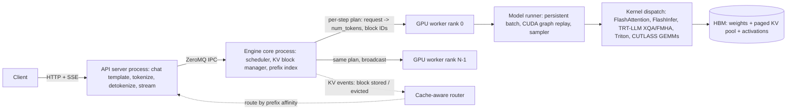

# Inference Engines: vLLM, SGLang, and TensorRT-LLM

## TL;DR

All three engines have converged on the same core design: an iteration-level scheduler, a paged KV pool of fixed-size blocks, prefix reuse, and a kernel layer chosen per GPU architecture. They differ mainly in how they identify cached blocks and how they hide CPU overhead.
vLLM identifies each cached block by a chained hash of the parent block's hash, the block's own tokens, and extra keys such as LoRA ID, multimodal hash, and cache salt. SGLang keeps an LRU radix tree over token sequences. TensorRT-LLM reuses blocks inside a C++ batch manager and since 1.0 runs a PyTorch-based executor.
Prefix caching saves prefill FLOPs and KV capacity, but it does not save decode memory bandwidth unless the attention kernel reads shared-prefix KV once per batch instead of once per sequence.
On small models and fast GPUs the CPU becomes the bottleneck: scheduling, input preparation, sampling bookkeeping, and detokenization. vLLM V1 moves the engine core into its own process, SGLang overlaps scheduling of batch N+1 with GPU execution of batch N, and all three replay CUDA graphs to remove per-kernel launch cost.
Choosing an engine is an operations decision as much as a speed decision. vLLM ships a minor release about every two weeks, TensorRT-LLM has removed its TensorRT engine backend, and cache hashes may not be reproducible across versions. Pin versions, gate upgrades on evals, and treat the prefix cache as tenant-scoped state.

## Mental Model



An inference engine is a small operating system for one GPU group.
The scheduler plays the role of the CPU scheduler: every forward pass it decides how many tokens each request gets.
The KV block manager plays the role of the page allocator: it hands out physical blocks, keeps reference counts, and evicts cold blocks.
The prefix index plays the role of the page cache: it maps content to physical blocks so identical prefixes are computed once.
Kernels are the device drivers: they turn a block table into actual memory loads on the HBM bus.
Each engine draws the boundaries between these parts a little differently, and those differences decide what you see in production.
A slow tokenizer stalls the API server, a scheduler that is too slow leaves the GPU idle between steps, a prefix index with a low hit rate wastes prefill FLOPs, and a missing kernel for your SM architecture silently falls back to a slower path.
Prefill versus decode economics come from [[17-Cloud-AI-Engineering/Volume_11_LLM_Serving_and_Inference_Systems_on_Cloud/Chapter_01_LLM_Inference_Mechanics_Prefill_vs_Decode|the previous chapter]], and the allocator internals are covered in depth in [[17-Cloud-AI-Engineering/Volume_11_LLM_Serving_and_Inference_Systems_on_Cloud/Chapter_03_KV_Cache_Management_and_PagedAttention|the next chapter]].

## Internals

### The shared lineage: Orca, PagedAttention, chunked prefill

Iteration-level scheduling comes from Orca (Yu et al., OSDI 2022).
Orca re-runs scheduling at every model iteration instead of every request, so finished sequences leave the batch immediately and new ones join without waiting for the whole batch.
PagedAttention (Kwon et al., SOSP 2023, arXiv 2309.06180) applied OS paging to the KV cache.
Each sequence holds a block table that maps logical blocks to non-contiguous physical blocks, and the attention kernel follows the indirection directly.
The paper reports 2-4x throughput over FasterTransformer and Orca at the same latency (Kwon et al., SOSP 2023).
Chunked prefill (Sarathi-Serve, Agrawal et al., OSDI 2024) splits long prompts into token-budgeted chunks and runs them in the same step as decodes, which bounds the stall a long prefill can inflict on inter-token latency.
All three engines now implement all three ideas, so comparing them really means comparing their details: how they identify blocks, the shape of the scheduler loop, where CPU work runs, and which kernels get dispatched.
The vAttention line of work (ASPLOS 2025, arXiv 2405.04437) is the main critique of paging. It argues that paging forces every attention kernel to be rewritten around block tables, and it proposes keeping KV virtually contiguous and relying on CUDA demand paging instead.
That critique explains why kernel availability, not scheduler cleverness, is often what decides whether a new model runs fast on a given engine on day one.

### vLLM V1: process topology and the unified token scheduler

vLLM V1 (default engine since 2025) uses a multi-process layout: one or more API server processes, one engine core process per data-parallel rank, and one GPU worker process per GPU (vLLM docs, as of 2026-10).
A single-node `vllm serve -tp=4` therefore runs 6 processes, and `-tp=2 -dp=4` runs 17 processes including a DP coordinator (vLLM docs, as of 2026-10).
The API server handles HTTP, chat templating, tokenization, and detokenization, and it talks to the engine core over ZeroMQ IPC (vLLM V1 blog, 2025-01).
The engine core runs a busy loop: pull new requests from its input queue, schedule, execute one forward pass, push outputs (vLLM docs, as of 2026-10).
The V1 scheduler drops the prefill/decode distinction as a scheduling concept.
Each request carries `num_tokens`, the prompt plus generated tokens so far, and `num_computed_tokens`, the tokens whose KV is already in the pool.
Each step, the scheduler hands out a per-request token count under a global token budget so that every request's `num_computed_tokens` catches up toward its `num_tokens` (vLLM V1 blog, 2025-01).
This bookkeeping is the mechanism that unifies features most readers treat as separate.
A decode is a request that needs 1 token.
A chunked prefill is a request that is granted fewer tokens than it is missing.
A prefix cache hit just moves `num_computed_tokens` forward before the first step.
Speculative decoding is a request that is granted 1 + k tokens to verify.
Because of this, vLLM can mix prefills and decodes in one step, and it schedules running (decode) requests ahead of waiting ones to protect inter-token latency (vLLM V1 blog, 2025-01).
With tensor parallelism, the engine core sends one compact scheduler output to every worker, and each worker keeps a persistent batch: input tensors are cached on the GPU side and only diffs are applied each step, so per-step host-to-device traffic is small (vLLM V1 blog, 2025-01).

### vLLM block identity: the hash chain

vLLM indexes cached KV by content, not by request.
Each full block gets the hash `H(parent_block_hash, block_token_ids, extra_keys)`, where the extra keys include LoRA adapter IDs, multimodal input hashes, and an optional cache salt for tenant isolation (vLLM prefix caching design doc, as of 2026-10).
Only full blocks are cached (vLLM design doc, as of 2026-10).
Since v0.11 the default hash is SHA-256, which removed the collision risk of the earlier builtin hash (vLLM docs, as of 2026-10).
The `--prefix-caching-hash-algo` flag offers `sha256`, `sha256_cbor`, `xxhash`, and `xxhash_cbor` (vLLM docs, as of 2026-10).
The docs warn that the default `sha256` serializes with Python pickle and may not be reproducible across Python or vLLM versions. `sha256_cbor` produces reproducible, cross-language hashes, and the non-cryptographic xxhash variants raise collision risk in multi-tenant settings (vLLM docs, as of 2026-10).
The design intentionally has no tree: each block is independent, can be allocated or freed on its own, and the chain of parent hashes carries the prefix relationship implicitly (vLLM design doc, original RFC #2614).
Lookup walks the prompt block by block and does one dictionary probe per block, stopping at the first miss.
A freed block whose reference count drops to zero is not wiped. It goes into an LRU free queue with its hash still valid, so a later request can bring it back until the allocator reuses the physical slot.

### Mechanism the getting-started guides omit: what a prefix hit actually buys

There are four consequences of the hash chain that matter in production and rarely show up in tutorials.
First, the chain means a single differing token in block k invalidates blocks k, k+1, and every block after them, so anything that changes per request (timestamps, user IDs, retrieved documents) must go after the stable instructions or it will wipe out reuse.
Second, block granularity throws away the partial tail: with block size 16, a 1,000-token shared system prompt can reuse at most 992 tokens, and the last 8 are recomputed for every request.
Third, even a 100 percent prefix match must recompute at least the last prompt position. The cache stores K and V, not the final hidden state, and the logits for the first output token need that hidden state. "Fully cached" prompts still pay one small forward pass.
Fourth, and the one teams most often get wrong when sizing: prefix sharing saves prefill compute and KV capacity, but a standard paged decode kernel still loads the shared prefix's K and V from HBM once per sequence in the batch.
A 2,048-token shared prefix across 32 decoding sequences still costs 32 reads of that prefix's KV every step unless the backend uses a shared-prefix (cascade) attention kernel that reads it once per batch. FlashInfer's cascade inference is the canonical example (FlashInfer, arXiv 2501.01005).
So your decode tokens/s ceiling does not improve with prefix caching the way your TTFT and concurrency do. The worked example below puts numbers on this.

### SGLang: RadixAttention and cache-aware scheduling

SGLang (Zheng et al., NeurIPS 2024, arXiv 2312.07104) co-designs a Python frontend language for multi-call LLM programs with a runtime built around RadixAttention (NeurIPS 2024 proceedings).
RadixAttention keeps KV for finished requests in a radix tree keyed by token sequences instead of freeing it. Edges are labeled with token runs, and nodes point to KV pages.
On insert, the tree splits an edge where a new sequence diverges, so sharing is found at token granularity rather than block granularity, subject to the configured page size (default page size UNVERIFIED).
Eviction is LRU over leaves only. A shared ancestor such as a system prompt cannot be evicted while any descendant is still cached, which protects hot prefixes from being evicted by long-tail traffic (SGLang paper, NeurIPS 2024).
Reference counts pin nodes in use by running requests, so eviction never removes KV that is being read.
The scheduler is cache-aware: by default it orders the waiting queue by matched prefix length, and the paper argues that this approximates a depth-first traversal of the tree, which maximizes hit rate for a batch of requests (SGLang paper, NeurIPS 2024).
The trade-off is fairness. Pure longest-prefix-first can starve requests with unique prefixes under sustained load, which is why production deployments set a scheduling policy deliberately and watch tail queueing time.
The paper reports up to 6.4x higher throughput than prior systems on agent, few-shot, JSON, RAG, and multi-turn workloads (SGLang paper, NeurIPS 2024).
That headline comes from workloads with heavy prefix sharing and structured control flow. On single-turn, unique-prompt traffic, the radix tree adds bookkeeping and saves nothing.
SGLang also uses compressed finite-state machines for constrained decoding: deterministic runs of the grammar are collapsed so several forced tokens can be emitted in one step instead of one per step (SGLang paper, NeurIPS 2024).
For data-parallel replicas, SGLang has a cache-aware router that predicts which replica holds a request's prefix and routes there (SGLang v0.4 coverage, 2025-02).
In January 2026, contributors formed RadixArk to commercialize services around SGLang while keeping it open source (Wikipedia citing TechCrunch, as of 2026-10). This is relevant when you assess long-term support risk.

### SGLang zero-overhead scheduling: the FutureMap trick

The usual engine loop is serial: CPU builds batch N, GPU runs batch N, CPU samples and post-processes batch N, then CPU builds batch N+1 while the GPU sits idle.
SGLang's overlap scheduler runs the CPU one batch ahead, so that metadata for batch N+1, including radix-tree matching and memory allocation, is prepared while the GPU executes batch N (SGLang docs and community walkthroughs, as of 2026-10).
The hard part is the data dependency: batch N+1's decode input is batch N's sampled token, and that token does not exist yet when the CPU builds batch N+1.
SGLang breaks the dependency with placeholders. Batch N+1's input IDs are written as negative indices into a GPU-resident FutureMap, and when batch N's sampler finishes it writes the real tokens into those slots, so batch N+1 reads them straight from device memory without a device-to-host-to-device round trip (SGLang scheduler walkthrough, as of 2026-10).
Sampling is also deferred: the forward returns a closure, and the scheduler uses the gap to post-process the previous batch, including detokenization and EOS and length checks (SGLang scheduler walkthrough, as of 2026-10).
The cost is one step of staleness: the scheduler decides batch N+1 before it knows whether batch N emitted EOS, so a finished request may have one wasted slot scheduled, and grammar-constrained requests need extra care because the mask for step N+1 depends on token N.
TensorRT-LLM's PyTorch executor has its own overlap scheduler and added support for guided decoding with overlap scheduling in 1.0 (TensorRT-LLM v1.0.0 release notes), which shows the same dependency problem had to be solved there too.

### TensorRT-LLM: from compiled engines to a PyTorch executor

TensorRT-LLM began as a compiler: you converted a checkpoint and ran `trtllm-build` to produce a serialized TensorRT engine per GPU type, TP degree, and maximum shape.
TensorRT-LLM 1.0 made the PyTorch-based architecture the stable default and stabilized the LLM API, with breaking changes that made PyTorch the default in both `LLM()` and `trtllm-serve` (TensorRT-LLM v1.0.0 release notes).
A later 1.x release removed the TensorRT engine backend entirely: `LLM(backend="tensorrt")` now raises an error, the `convert_checkpoint.py` and `trtllm-build` example paths are gone, and `trtllm-serve <hf_model>` serves straight from a Hugging Face checkpoint without an engine build (TensorRT-LLM migration guide, as of 2026-10; exact removal version UNVERIFIED).
The 1.1.0 release is built on `nvcr.io/nvidia/pytorch:25.10-py3` with PyTorch 2.9.0 (TensorRT-LLM v1.1.0 release notes).
What survives from TensorRT-LLM's lineage is the kernel library and the C++ runtime design: hand-written context-phase FMHA and generation-phase XQA kernels, precompiled cubins per SM architecture (1.0 added NVFP4 MoE cubins, for example), and a GEMM autotuner that picks tactics per shape (TensorRT-LLM release notes and changelog, as of 2026-10).
The XQA generation kernel supports FP16, BF16, FP8, and INT8 KV caches and paged blocks of 8, 16, 32, 64, or 128 tokens (TensorRT-LLM docs, as of 2026-10).

### Mechanism the getting-started guides omit: TensorRT-LLM packed batch layout and memory semantics

In-flight batching in TensorRT-LLM requires packed inputs, meaning no padding. In the current implementation, every context-phase (prefill) sequence must appear in the input tensor before any generation-phase sequence (TensorRT-LLM docs, as of 2026-10).
That ordering lets a single fused attention op split the batch at one offset and send the front to the FMHA kernel and the back to the XQA kernel, with no per-token branching.
The scheduler is bounded by three knobs: `max_batch_size` (concurrent requests), `max_seq_len`, and `max_num_tokens` (tokens per step). A large `max_num_tokens` takes activation workspace away from the KV pool, which is why NVIDIA recommends always enabling chunked context for long-context workloads (TensorRT-LLM docs, as of 2026-10).
Memory semantics differ in a way that bites teams porting configs between engines.
In TensorRT-LLM, if neither `max_tokens` nor `free_gpu_memory_fraction` is set, the KV pool takes 90 percent of the memory still free after weights and runtime buffers are allocated. If both are set, the smaller of the two wins (TensorRT-LLM memory docs, as of 2026-10).
In vLLM, `--gpu-memory-utilization` (default 0.9, UNVERIFIED for current release) is a fraction of total device memory that the whole instance may use, and the KV pool is whatever remains after weights, activation profiling, and CUDA graph memory.
So "0.9" in TensorRT-LLM and "0.9" in vLLM produce different KV pool sizes on the same GPU, and a co-located sidecar that uses 2 GB of HBM breaks the vLLM budget assumption but only shrinks the TensorRT-LLM pool.

### Custom kernel dispatching

Every engine has a dispatch layer that maps (GPU architecture, dtype, attention variant, quantization format, batch shape) to a kernel. This layer is where most "same model, different speed" surprises come from.
In vLLM, the attention backend is chosen per platform and model. FlashAttention, FlashInfer, MLA-specific backends, and Triton fallbacks sit behind a common interface that consumes block tables and slot mappings (vLLM docs; current backend list and selection flag UNVERIFIED).
In SGLang, the attention backend is selectable, FlashInfer and FlashAttention-3 are the main CUDA paths, and custom fused ops ship in the `sgl-kernel` package (UNVERIFIED for current defaults).
In TensorRT-LLM's PyTorch backend, the default attention backend wraps the TRT-LLM FMHA/XQA kernels, and FlashInfer is an alternative (TensorRT-LLM docs mirror, UNVERIFIED).
CUDA graphs are the second half of dispatch.
A decode step for an 8B model launches hundreds of small kernels, and at batch sizes where each kernel runs for only microseconds, CPU launch overhead dominates.
Engines capture CUDA graphs at a fixed ladder of batch sizes and pad each live batch up to the nearest captured size, trading a few wasted rows for replaying the whole step with one launch.
vLLM V1 pairs `torch.compile` with piecewise CUDA graphs, where attention, whose metadata varies with sequence lengths, can run outside the captured segments, and full-graph capture is available for backends whose attention metadata can be made static (vLLM V1 blog, 2025-01; current `cudagraph_mode` default UNVERIFIED).
Graph capture consumes HBM and adds startup time, so it competes directly with KV capacity and with cold-start SLOs (see [[17-Cloud-AI-Engineering/Volume_11_LLM_Serving_and_Inference_Systems_on_Cloud/Chapter_08_Cloud_GPU_Autoscaling_and_Cold_Start_Mitigation|GPU autoscaling and cold starts]]).

### Control plane versus data plane inside an engine

The data plane is the GPU workers: weights, KV pool, kernels, and NCCL collectives for tensor parallelism.
The control plane is the engine core: scheduler, block allocator, prefix index, structured-output grammar state, and LoRA adapter residency.
Within one replica, the control plane is a single point of serialization by design. One Python process decides every step for every GPU in the TP group, so its per-step latency is a direct tax on throughput.
Across replicas there is no shared state. Each replica's prefix cache is a private, soft-state cache, and the fleet-level "control plane" is the router.
NVIDIA Dynamo and llm-d style systems export per-replica KV events (block stored, block evicted) to a router that keeps an approximate global index. TensorRT-LLM already publishes KV events, including for sliding-window attention as of 1.0 (TensorRT-LLM v1.0.0 release notes).
That global index only works if every replica computes the same block identity for the same tokens. vLLM's default pickle-based SHA-256 is not guaranteed reproducible across versions, so mixed-version fleets should use `sha256_cbor` (vLLM docs, as of 2026-10).
Failure domain boundaries follow from this: a replica is the unit of failure, its KV state is never replicated, and losing a replica loses its cache, which sends a burst of cold prefills to the replicas that remain.
The cell and blast-radius discipline from [[17-Cloud-AI-Engineering/Volume_01_Cloud_Architecture_Principles/Chapter_03_Cell_Based_Architecture_and_Shuffle_Sharding|cell-based architecture]] applies directly: route tenants to stable replica sets so that both cache affinity and failure isolation hold.

## Numbers to Know

| Quantity | Value | Source |
|---|---|---|
| vLLM latest release | 0.32.0, released 2026-10-18 | (PyPI, as of 2026-10) |
| vLLM release cadence | Minor releases roughly every 2 weeks (0.29.0 on 2026-09-09, 0.30.0 on 09-22, 0.31.0 on 10-05, 0.32.0 on 10-18) | (PyPI, as of 2026-10) |
| vLLM processes, `-tp=4` single node | 6 (1 API server + 1 engine core + 4 workers) | (vLLM docs, as of 2026-10) |
| vLLM processes, `-tp=2 -dp=4` | 17 (4 API + 4 engine core + 8 workers + 1 DP coordinator) | (vLLM docs, as of 2026-10) |
| vLLM prefix-cache hash default | SHA-256 since v0.11; options sha256, sha256_cbor, xxhash, xxhash_cbor | (vLLM docs, as of 2026-10) |
| vLLM cache granularity | Full blocks only; block size 16 used in design-doc examples | (vLLM docs, as of 2026-10) |
| PagedAttention throughput vs FasterTransformer/Orca | 2-4x at the same latency | (Kwon et al., SOSP 2023) |
| SGLang throughput vs prior systems | Up to 6.4x on structured / shared-prefix workloads | (Zheng et al., NeurIPS 2024) |
| TensorRT-LLM XQA paged block sizes | 8, 16, 32, 64, 128 tokens | (TensorRT-LLM docs, as of 2026-10) |
| TensorRT-LLM default KV pool | 90 percent of free memory after weights and buffers | (TensorRT-LLM docs, as of 2026-10) |
| TensorRT-LLM 1.1.0 base | nvcr.io/nvidia/pytorch:25.10-py3, PyTorch 2.9.0 | (TensorRT-LLM release notes, as of 2026-10) |
| TensorRT-LLM execution backends | PyTorch only; TensorRT engine backend removed | (TensorRT-LLM docs, as of 2026-10) |
| Qwen3-8B KV per token, BF16 | 2 x 36 layers x 8 KV heads x 128 dim x 2 B = 144 KiB | (derived from model config; config values UNVERIFIED) |
| Llama-3.1-8B KV per token, BF16 | 2 x 32 x 8 x 128 x 2 B = 128 KiB | (derived from model config; config values UNVERIFIED) |
| NVIDIA L40S memory / bandwidth | 48 GB GDDR6 / ~864 GB/s | (UNVERIFIED) |
| EC2 g6e.xlarge on-demand, us-east-1 | ~$1.861/hr | (UNVERIFIED, check AWS pricing page) |

## AWS vs GCP Mechanism Parity

The engines are cloud-neutral, so the parity question is about the substrate each cloud provides around them.

| Concern | AWS | Google Cloud | Critical difference |
|---|---|---|---|
| Managed container running these engines | SageMaker AI Large Model Inference (LMI) containers with vLLM and TensorRT-LLM backends (UNVERIFIED as of 2026-10) | Vertex AI prebuilt vLLM serving containers via Model Garden (UNVERIFIED as of 2026-10) | Both pin an engine version for you, and upgrade cadence lags upstream by weeks to months |
| Kubernetes substrate | EKS with Karpenter GPU NodePools, see [[17-Cloud-AI-Engineering/Volume_02_AWS_Deep_Dive/Chapter_07_Amazon_EKS_Control_Plane_and_Networking\|EKS]] | GKE with node auto-provisioning, see [[17-Cloud-AI-Engineering/Volume_03_GCP_Deep_Dive/Chapter_07_GKE_Deep_Dive_Standard_vs_Autopilot\|GKE]] | GKE ships an Inference Gateway with model- and prefix-aware endpoint picking (GA status UNVERIFIED), while on EKS you assemble the equivalent yourself |
| Single-GPU dev/test tier | g6e (L40S 48 GB) (UNVERIFIED) | g2 (L4 24 GB) (UNVERIFIED) | A 24 GB L4 leaves almost no KV room for an 8B BF16 model, so FP8 weights or a smaller model are required |
| Hopper / Blackwell 8-GPU nodes | p5 / p5e / p5en / p6 families (UNVERIFIED) | A3 / A3 Ultra / A4 families (UNVERIFIED) | NVLink inside the node behaves the same on both, so engine TP inside a node is portable |
| Multi-node fabric for EP, PP, KV transfer | EFA with SRD multipath transport, see [[17-Cloud-AI-Engineering/Volume_10_AI_Infrastructure_on_Cloud/Chapter_02_Interconnect_Technologies_NVLink_EFA_and_TPU_ICI\|interconnects]] | GPUDirect RDMA over RoCE on newer A3/A4 families (UNVERIFIED) | NIXL/UCX and NCCL plugins differ, so disaggregated KV transfer must be validated per cloud |
| Non-NVIDIA serving | Inferentia2 / Trainium via Neuron SDK vLLM integration (UNVERIFIED) | TPU via vLLM TPU backend; SGLang TPU support (UNVERIFIED) | TensorRT-LLM is NVIDIA-only, so engine choice can lock you into a vendor |
| Weight distribution | S3 + VPC gateway endpoint; Mountpoint or S3 Express One Zone for fast loads | GCS + Private Google Access; Cloud Storage FUSE or Anywhere Cache | Cold-start weight streaming is covered in [[17-Cloud-AI-Engineering/Volume_10_AI_Infrastructure_on_Cloud/Chapter_07_High_Throughput_Data_Loaders_and_Storage_IO\|data loaders]] |
| Pod identity for weight buckets | EKS Pod Identity or IRSA | GKE Workload Identity Federation | Both remove static keys, see [[17-Cloud-AI-Engineering/Volume_08_Security_Identity_and_the_Data_Perimeter/Chapter_02_Workload_Identity_Federation\|workload identity]] |
| Engine metrics | Amazon Managed Service for Prometheus scraping `/metrics` | Google Cloud Managed Service for Prometheus | Metric names are engine-specific, so dashboards do not port between engines |
| Data exfiltration boundary | VPC endpoint policies + SCPs | VPC Service Controls perimeters | VPC SC can block GCS reads from outside the perimeter even with valid credentials, and AWS needs endpoint and bucket policies to approximate that |

## Worked Example: Measuring Prefix-Cache Mechanics on One L40S

### Goal

Bring up vLLM 0.32.0 on one EC2 g6e.xlarge, size its KV pool from first principles, and show two of the mechanisms above experimentally.
First, putting a per-request nonce at the start of the prompt destroys prefix reuse, while putting it at the end keeps it.
Second, prefix caching improves TTFT but does not change the decode inter-token latency.

### Cost estimate and guardrails

The g6e.xlarge costs about $1.861/hr on demand in us-east-1 (UNVERIFIED, check the pricing page before running).
A 150 GiB gp3 root volume adds about $0.02/hr (UNVERIFIED).
A 3-hour lab costs about $6, and the instance shuts itself down after 180 minutes. With `--instance-initiated-shutdown-behavior terminate`, that shutdown terminates the instance.

```bash
#!/usr/bin/env bash
# budget.sh - monthly 20 USD budget with an 80 percent actual-spend email alert
set -euo pipefail
ACCOUNT_ID="$(aws sts get-caller-identity --query Account --output text)"
aws budgets create-budget \
  --account-id "${ACCOUNT_ID}" \
  --budget '{"BudgetName":"engine-lab","BudgetLimit":{"Amount":"20","Unit":"USD"},"TimeUnit":"MONTHLY","BudgetType":"COST"}' \
  --notifications-with-subscribers '[{"Notification":{"NotificationType":"ACTUAL","ComparisonOperator":"GREATER_THAN","Threshold":80,"ThresholdType":"PERCENTAGE"},"Subscribers":[{"SubscriptionType":"EMAIL","Address":"you@example.com"}]}]'
```

### Step 1: size the KV pool before launching

```python
# kv_capacity.py - back-of-the-envelope KV and decode-bandwidth model (pure Python)
GB = 1e9

def kv_bytes_per_token(layers, kv_heads, head_dim, dtype_bytes):
    return 2 * layers * kv_heads * head_dim * dtype_bytes  # K and V

def plan(hbm_gb, util, params_b, weight_bytes, act_gb, per_tok, bw_gbs,
         shared_prefix, unique_ctx, batch):
    budget = hbm_gb * util
    weights = params_b * 1e9 * weight_bytes / GB
    kv_pool = budget - weights - act_gb
    pool_tokens = kv_pool * GB / per_tok
    ctx = shared_prefix + unique_ctx
    seqs_no_share = pool_tokens / ctx
    seqs_shared = (pool_tokens - shared_prefix) / unique_ctx
    # standard paged decode kernel reads full context KV per sequence per step
    kv_read = batch * ctx * per_tok / GB
    step_s = (weights + kv_read) / bw_gbs
    return dict(kv_pool_gb=round(kv_pool, 2), pool_tokens=int(pool_tokens),
                blocks_16=int(pool_tokens // 16),
                max_seqs_no_share=int(seqs_no_share),
                max_seqs_shared_prefix=int(seqs_shared),
                step_ms=round(step_s * 1e3, 1),
                itl_tok_s_per_seq=round(1 / step_s, 1),
                agg_tok_s=int(batch / step_s))

if __name__ == "__main__":
    per_tok = kv_bytes_per_token(36, 8, 128, 2)  # Qwen3-8B BF16 -> 147456 B
    for b in (16, 32, 64, 128):
        print(b, plan(48, 0.90, 8.19, 2, 3.0, per_tok, 864, 2048, 1024, b))
```

Here is the arithmetic, so you can redo it on a whiteboard.
Weights are 8.19B parameters x 2 bytes = 16.4 GB (parameter count UNVERIFIED).
The vLLM budget is 48 GB x 0.90 = 43.2 GB. Reserving about 3 GB for activations, the sampler, and CUDA graphs leaves a KV pool of about 23.8 GB.
At 144 KiB per token that is about 161,500 tokens, or about 10,100 blocks of 16 tokens.
Requests carry a 2,048-token shared system prompt plus 1,024 unique tokens, for a 3,072-token context.
Without prefix sharing, the pool holds about 52 such sequences.
With sharing, one copy of the prefix is stored and each sequence costs 1,024 x 144 KiB, so the pool holds about 155 sequences. Capacity roughly triples.
Decode bandwidth tells a different story, because a standard paged kernel still reads the full 3,072-token context per sequence per step.
At batch 32, the KV read is 32 x 3,072 x 144 KiB = 14.5 GB per step, plus 16.4 GB of weights, so the step is about 30.9 GB / 864 GB/s = 35.7 ms, or about 28 tok/s per stream and about 895 tok/s aggregate.
At batch 128, the KV read grows to 58 GB, the step to about 86 ms, the per-stream rate falls to about 11.6 tok/s, and the aggregate rises to about 1,490 tok/s.
If your product SLO is 20 tok/s per stream, the bandwidth model caps you near batch 60. Memory would allow 155 sequences, but the interconnect between HBM and the SMs is the binding constraint.
Unit cost at batch 64 is $1.861 / (1,219 tok/s x 3,600 s) = about $0.42 per million output tokens at 100 percent utilization. At a realistic 40 percent average utilization, divide that by 0.4 and get about $1.06.
The prefill saved per cache hit is about 2 x 8.19e9 x 2,048 = 33.5 TFLOP. At an assumed 362 dense BF16 TFLOPS (UNVERIFIED) and 50 percent MFU, that is about 185 ms of TTFT removed per request.
These derivations feed the fleet-level model in [[17-Cloud-AI-Engineering/Volume_11_LLM_Serving_and_Inference_Systems_on_Cloud/Chapter_11_End_to_End_Latency_Throughput_and_Cost_Modeling|end-to-end cost modeling]].

### Step 2: launch

```bash
#!/usr/bin/env bash
# launch.sh - one g6e.xlarge running vLLM, reachable only through an SSH tunnel
set -euo pipefail
REGION=us-east-1
KEY=engine-lab
MYIP="$(curl -s https://checkip.amazonaws.com)/32"
# SSM path for the DLAMI base image is UNVERIFIED; confirm with: aws ssm get-parameters-by-path --path /aws/service/deeplearning/ami/x86_64
AMI="$(aws ssm get-parameter --region "$REGION" \
  --name /aws/service/deeplearning/ami/x86_64/base-oss-nvidia-driver-gpu-ubuntu-22.04/latest/ami-id \
  --query Parameter.Value --output text)"
aws ec2 create-key-pair --region "$REGION" --key-name "$KEY" --query KeyMaterial --output text > "$KEY.pem"
chmod 600 "$KEY.pem"
SG="$(aws ec2 create-security-group --region "$REGION" --group-name engine-lab-sg \
  --description "ssh only" --query GroupId --output text)"
aws ec2 authorize-security-group-ingress --region "$REGION" --group-id "$SG" \
  --protocol tcp --port 22 --cidr "$MYIP"
cat > user-data.sh <<'EOF'
#!/bin/bash
shutdown -h +180
mkdir -p /opt/hf
docker run -d --name vllm --gpus all --ipc=host -p 127.0.0.1:8000:8000 \
  -v /opt/hf:/root/.cache/huggingface \
  vllm/vllm-openai:v0.32.0 \
  --model Qwen/Qwen3-8B --max-model-len 8192 \
  --gpu-memory-utilization 0.90 \
  --prefix-caching-hash-algo sha256_cbor
EOF
IID="$(aws ec2 run-instances --region "$REGION" --image-id "$AMI" \
  --instance-type g6e.xlarge --key-name "$KEY" --security-group-ids "$SG" \
  --instance-initiated-shutdown-behavior terminate \
  --block-device-mappings '[{"DeviceName":"/dev/sda1","Ebs":{"VolumeSize":150,"VolumeType":"gp3","DeleteOnTermination":true}}]' \
  --user-data file://user-data.sh \
  --tag-specifications 'ResourceType=instance,Tags=[{Key=Name,Value=engine-lab}]' \
  --query 'Instances[0].InstanceId' --output text)"
echo "$IID" > iid.txt; echo "$SG" > sg.txt
aws ec2 wait instance-running --region "$REGION" --instance-ids "$IID"
IP="$(aws ec2 describe-instances --region "$REGION" --instance-ids "$IID" \
  --query 'Reservations[0].Instances[0].PublicIpAddress' --output text)"
echo "ssh -i $KEY.pem -N -L 8000:127.0.0.1:8000 ubuntu@$IP"
```

The container binds to 127.0.0.1 on the host, so the OpenAI-compatible endpoint is never exposed to the internet. The only way in is the SSH tunnel.
The `vllm/vllm-openai:v0.32.0` tag follows the upstream tagging convention (tag existence for 0.32.0 UNVERIFIED), and the image's Docker installation and NVIDIA container runtime on this AMI are also UNVERIFIED.
Prefix caching is on by default in V1, and `sha256_cbor` is set explicitly so block hashes would be reproducible if this replica ever joined a KV-aware routed fleet (vLLM docs, as of 2026-10).

### Step 3: measure

```python
# bench_prefix.py - TTFT and ITL with nonce-at-start vs nonce-at-end, via streaming
import json, time, uuid, statistics, requests

URL = "http://127.0.0.1:8000/v1/completions"
MODEL = "Qwen/Qwen3-8B"
SYSTEM = ("You are a meticulous infrastructure reviewer. " * 220).strip()  # ~2k tokens

def run(prompt, max_tokens=64):
    body = {"model": MODEL, "prompt": prompt, "max_tokens": max_tokens,
            "temperature": 0, "stream": True}
    t0 = time.perf_counter(); first = None; stamps = []
    with requests.post(URL, json=body, stream=True, timeout=120) as r:
        r.raise_for_status()
        for line in r.iter_lines():
            if not line or not line.startswith(b"data: ") or line == b"data: [DONE]":
                continue
            chunk = json.loads(line[6:])
            if chunk["choices"][0].get("text"):
                now = time.perf_counter()
                first = first or now
                stamps.append(now)
    itl = statistics.median([b - a for a, b in zip(stamps, stamps[1:])]) if len(stamps) > 2 else float("nan")
    return (first - t0) * 1e3, itl * 1e3

def trial(label, make_prompt, n=10):
    run(make_prompt())  # warm the cache for this layout
    res = [run(make_prompt()) for _ in range(n)]
    ttft = statistics.median(r[0] for r in res); itl = statistics.median(r[1] for r in res)
    print(f"{label:<16} TTFT p50 {ttft:7.1f} ms   ITL p50 {itl:5.1f} ms")

if __name__ == "__main__":
    trial("nonce-at-start", lambda: f"[req {uuid.uuid4()}]\n{SYSTEM}\nQ: summarize.\nA:")
    trial("nonce-at-end",   lambda: f"{SYSTEM}\n[req {uuid.uuid4()}]\nQ: summarize.\nA:")
    m = requests.get("http://127.0.0.1:8000/metrics", timeout=10).text
    print("\n".join(l for l in m.splitlines() if "prefix_cache" in l and not l.startswith("#")))
```

The expected result is that nonce-at-end shows a TTFT drop of roughly the 2,048-token prefill time computed above, while ITL is essentially the same in both layouts, because the decode step still reads the full context from HBM.
The `/metrics` grep prints vLLM's prefix-cache query and hit counters without hard-coding metric names, since those have changed across releases.
To compare engines on the same box, stop the container and run SGLang (`python3 -m sglang.launch_server --model-path Qwen/Qwen3-8B --port 8000`) or TensorRT-LLM (`trtllm-serve Qwen/Qwen3-8B --port 8000`) in their official images (image tags UNVERIFIED), then rerun the same script.

### Teardown

```bash
#!/usr/bin/env bash
set -euo pipefail
REGION=us-east-1
aws ec2 terminate-instances --region "$REGION" --instance-ids "$(cat iid.txt)"
aws ec2 wait instance-terminated --region "$REGION" --instance-ids "$(cat iid.txt)"
aws ec2 delete-security-group --region "$REGION" --group-id "$(cat sg.txt)"
aws ec2 delete-key-pair --region "$REGION" --key-name engine-lab && rm -f engine-lab.pem
aws budgets delete-budget --account-id "$(aws sts get-caller-identity --query Account --output text)" --budget-name engine-lab
```

On GCP, the closest single-GPU equivalent is a g2 instance with one L4. With only 24 GB of memory, serve FP8 weights or a 3-4B model, or the KV pool will be too small to see batching effects (UNVERIFIED sizing guidance).

## Failure Modes and Pitfalls

### Preemption storms

When the KV pool runs out mid-decode, the scheduler preempts running requests. vLLM V1 preempts by freeing their blocks and recomputing later (UNVERIFIED for current default policy).
Recompute preemption is cheap when it happens rarely and catastrophic when it happens often: preempted requests come back as large prefills, consume the token budget, delay decodes, and push more requests over the memory edge.
The signature is a rising preemption counter, falling generation throughput, and TTFT p99 rising together. The fix is admission control (lower `max_num_seqs`, a lower `max_model_len`, or rejection at the gateway), not more retries. See [[17-Cloud-AI-Engineering/Volume_07_Reliability_and_SRE/Chapter_02_Load_Shedding_Backpressure_and_Admission_Control|admission control]].

### Cache hit rate diluted by scaling out

With round-robin routing, scaling from 4 to 16 replicas spreads each prefix across four times as many caches, and the LRU working set per replica stops fitting, so hit rate falls sharply exactly when load is highest.
The mitigation is prefix-affinity routing, consistent hashing on a prefix key with bounded load ([[08-Distinguished-Engineering/02-Distributed-Systems-Internals/Consistent-Hash-Ring|consistent hash ring]]) or a KV-event-driven router.
Affinity without load bounds creates hot replicas for viral prefixes, so use bounded-load hashing or a fallback to least-loaded routing.

### Prompt layout and chat template drift

A timestamp, request ID, or reordered tool list near the top of the prompt invalidates every block after it in vLLM's hash chain and every descendant in SGLang's tree.
Changing tokenizer or chat template versions changes the token IDs and silently drops the hit rate to zero right after a deploy.
Alert on hit rate as a first-class SLI, not just on latency.

### Hash non-reproducibility during rolling upgrades

During a rolling upgrade, replicas running different vLLM versions with the default pickle-based SHA-256 may produce different block hashes for identical tokens (vLLM docs, as of 2026-10).
A global KV-aware router then mispredicts hits, routes on stale affinity, and in disaggregated setups may try to transfer KV that the peer cannot find.
Use `sha256_cbor` fleet-wide before introducing KV-aware routing, and treat any change to the hash algorithm as a cache-flushing event.

### CPU starvation of the engine core

vLLM V1 runs A + DP + N processes, plus a coordinator when DP > 1 (vLLM docs, as of 2026-10). A Kubernetes CPU limit that throttles the engine core process lengthens every step and leaves the GPU idle.
The symptom is low GPU utilization with low queue depth, which looks like under-load but is really a scheduler running at a throttled clock.
Give GPU pods guaranteed CPU with no CFS throttling, and size vCPUs to the process count.

### Shared memory and NCCL

Tensor-parallel workers exchange data over shared memory and NCCL. Containers launched without `--ipc=host` or an adequately sized `/dev/shm` fail at startup or hang on the first all-reduce.
TP across GPUs without NVLink puts all-reduce traffic onto PCIe, and that can wipe out the benefit of TP for decode.

### Kernel fallback after hardware or dtype changes

Moving a deployment from Hopper to a different SM architecture, or from BF16 to FP8 KV, can silently route attention to a slower generic backend if the engine has no specialized kernel for that combination.
Benchmark every (GPU, dtype, engine version) tuple as its own SKU, and record the selected attention backend from the startup logs as a deployment artifact.

### Graph capture memory and startup time

CUDA graph capture across a wide batch-size ladder consumes HBM that would otherwise hold KV and adds tens of seconds to startup (magnitude UNVERIFIED). That affects both capacity and scale-out reaction time.

### Upstream churn and backend removal

vLLM's roughly two-week release cadence (PyPI, as of 2026-10) and TensorRT-LLM's removal of the TensorRT backend (TensorRT-LLM docs, as of 2026-10) mean that unpinned images and legacy `trtllm-build` pipelines are a standing production risk.
Pin image digests, keep a per-version eval gate (see [[13-Agentic-AI/Agentic_AI_Zero_to_Godhood/Volume_10_Evaluation_and_Observability/Chapter_07_Production_Evaluation|production evaluation]]), and canary engine upgrades exactly like kernel upgrades ([[17-Cloud-AI-Engineering/Volume_06_Infrastructure_as_Code_and_Delivery/Chapter_06_Progressive_Delivery_and_Deployment_Pipelines|progressive delivery]]).

### Public incident record

No public AWS or Google Cloud post-incident review attributes an outage specifically to one of these engines (to the author's knowledge, UNVERIFIED). The general cascade patterns of retry storms, cache cold-start after failover, and capacity exhaustion are analyzed in [[17-Cloud-AI-Engineering/Volume_07_Reliability_and_SRE/Chapter_07_Anatomy_of_Major_Cloud_Outages|major cloud outages]].

## Security and Cost Angles

### The prefix cache is a cross-tenant side channel

A prefix cache hit lowers TTFT measurably, as the worked example shows. An attacker sharing a replica can therefore probe whether another tenant recently sent a candidate prefix by timing TTFT.
vLLM's cache salt is folded into the block hash as an extra key, so tenants with different salts never share blocks (vLLM design doc, as of 2026-10). Derive the salt server-side from the authenticated tenant ID, never from a client-supplied field.
Salting removes cross-tenant sharing, so the capacity and TTFT benefit survives only within a tenant. Budget for that loss in multi-tenant pools, or give large tenants dedicated cells.
Non-cryptographic hashes (`xxhash`) theoretically raise collision risk, and the vLLM docs call out possible information leakage in multi-tenant settings (vLLM docs, as of 2026-10). Keep SHA-256 variants for shared fleets.

### Model artifacts are code

Loading a model with remote code enabled (vLLM `--trust-remote-code`) executes Python from the model repository inside the serving process, which has GPU access and the pod's cloud credentials.
Mirror approved weights into a private S3 or GCS bucket, require safetensors, scan and sign artifacts ([[17-Cloud-AI-Engineering/Volume_08_Security_Identity_and_the_Data_Perimeter/Chapter_05_Software_Supply_Chain_Security_SLSA_and_Sigstore|supply chain]]), and block egress to public model hubs from production subnets.

### Identity, keys, and network boundaries

Grant the serving pod read-only access to one weights prefix through EKS Pod Identity or GKE Workload Identity, with no write or list access beyond that prefix.
Encrypt weight buckets with customer-managed KMS keys ([[17-Cloud-AI-Engineering/Volume_08_Security_Identity_and_the_Data_Perimeter/Chapter_04_Encryption_Key_Hierarchies_and_Envelope_Encryption|envelope encryption]]), and constrain reads to the VPC endpoint on AWS or the VPC SC perimeter on GCP.
The engines' built-in API key options are a shared secret, not authorization. Put authentication, per-tenant quotas, and request logging in a gateway in front of the engine.

### Unit-economics levers

Raising the prefix hit rate is the cheapest prefill reduction available. It costs only prompt discipline and affinity routing.
Decode cost is bounded by bytes read per token, so FP8 KV, FP8 or INT4 weights ([[17-Cloud-AI-Engineering/Volume_11_LLM_Serving_and_Inference_Systems_on_Cloud/Chapter_06_Model_Quantization_and_Compression|quantization]]), shared-prefix attention kernels, and speculative decoding ([[17-Cloud-AI-Engineering/Volume_11_LLM_Serving_and_Inference_Systems_on_Cloud/Chapter_05_Speculative_Decoding_and_Advanced_Decoding|speculative decoding]]) attack the real cost driver.
Batch size trades per-stream latency for cost per token, as the table in the worked example shows. Price tiers by ITL SLO, not by a single flat rate.
Engine choice changes hardware optionality: TensorRT-LLM ties you to NVIDIA, while vLLM and SGLang keep TPU and other accelerator paths open, which matters for commitment negotiations ([[17-Cloud-AI-Engineering/Volume_09_FinOps_and_Cloud_Economics/Chapter_05_GPU_and_TPU_Unit_Economics|GPU and TPU unit economics]]).

## Interview Questions and Model Answers

### Question 1 (L5 - Senior)

Your team's system prompt is 1,000 tokens and identical for every request, yet vLLM's prefix cache hit rate is near zero. Walk through how you would diagnose it.

#### Model Answer

Start with what identifies a block: vLLM hashes each full block from the parent block hash, the block's token IDs, and extra keys (LoRA ID, multimodal hashes, cache salt). A hit therefore requires byte-identical token IDs from position zero and the same extra keys.
Check the rendered prompt, not the template source. Chat templates often inject a date, a request-scoped tool list, or a user name before the system text, and any variation in the first block breaks every block after it.
Check whether different LoRA adapters or per-request cache salts are in use, since either one partitions the cache by design.
Check the deployment: a recent tokenizer or template version change alters token IDs, and with round-robin across many replicas each replica's LRU may evict the prefix before it is reused.
Once it is fixed, expect at most 992 reused tokens with block size 16, because the trailing partial block is never cached and at least the last prompt position is always recomputed to produce logits.
Verify with the engine's prefix-cache query and hit counters and with the TTFT difference, not with assumptions.

#### Follow-up Interviewer Question

The prompt is now stable and the hit rate is 95 percent, but the GPU's decode tokens/s did not improve. Why?

### Question 2 (L5 - Senior)

The same model and GPU run with `0.9` in both vLLM and TensorRT-LLM configs, but TensorRT-LLM admits far more concurrent sequences. Explain.

#### Model Answer

The two numbers mean different things.
vLLM's `gpu_memory_utilization` caps the instance's total device memory use, and the KV pool is whatever remains after weights, activation profiling, and CUDA graph memory are subtracted.
TensorRT-LLM's default sizes the KV pool at 90 percent of memory still free after weights and runtime buffers are allocated, and when both `max_tokens` and `free_gpu_memory_fraction` are set, the smaller result wins.
On a 48 GB card with 16 GB of weights, vLLM's KV pool might be about 24 GB, while TensorRT-LLM's could be about 0.9 x (48 - 16 - buffers), which is meaningfully larger.
The larger pool raises concurrency but leaves less headroom for anything else on the device, including a second process, fragmentation, or a larger `max_num_tokens` workspace.
The right comparison fixes the KV pool in tokens for both engines and then compares throughput at equal ITL.

#### Follow-up Interviewer Question

How would you choose `max_num_tokens` for TensorRT-LLM on a long-context workload, and what does chunked context change?

### Question 3 (L6 - Staff)

You are choosing an engine for a multi-tenant agent platform on EKS and GKE: many tools, long shared prompts, JSON-constrained outputs, and tenants on both NVIDIA GPUs and TPUs. Defend a choice.

#### Model Answer

Write down the workload properties first: heavy prefix sharing within a tenant, multi-call programs with branching, constrained decoding on most calls, strict tenant isolation, and two hardware vendors.
SGLang fits the sharing pattern best. The radix tree gives token-granular reuse across branching calls, leaf-only LRU protects shared ancestors, and the cache-aware scheduler maximizes hits. The paper's up-to-6.4x results come from exactly these workloads.
vLLM's hash-chain cache is nearly as effective for linear shared prefixes and has the widest hardware and model coverage, plus a cache salt for tenant isolation.
TensorRT-LLM gives the best NVIDIA kernels and NVFP4 paths but is NVIDIA-only, so it cannot be the single engine for the TPU estate.
I would pick one primary engine for both clouds to avoid two sets of metrics, two sets of failure modes, and two upgrade pipelines. That choice is vLLM or SGLang, depending on which one's TPU path has passed our evals at the time of decision.
Isolation is not negotiable whichever engine wins: server-derived per-tenant salts or per-tenant cells, prefix-affinity routing scoped to tenant, and a gateway that enforces quotas.
Hedge against the choice with an engine-neutral contract (the OpenAI-compatible API, a common metrics adapter, and an eval suite gating every upgrade), so that swapping engines is a deployment, not a rewrite.
Revisit TensorRT-LLM for a dedicated NVIDIA cell if a high-volume tenant's cost per token justifies a second stack.

#### Follow-up Interviewer Question

How do you prove the choice was right three months later, and which metric would make you reverse it?

### Question 4 (L6 - Staff)

On an H100, an 8B model in vLLM shows 55 percent SM utilization at moderate load while queues stay short. What is happening, and how do the three engines address it?

#### Model Answer

Short queues with idle SMs point to host overhead, not a lack of demand. For small models, a decode step runs in a few milliseconds, and scheduling, input preparation, sampling bookkeeping, and detokenization become a large share of each step.
vLLM V1 moves the engine core into a dedicated process separate from the API server, keeps a persistent batch so only diffs are sent each step, and replays CUDA graphs to remove per-kernel launch cost.
SGLang overlaps scheduling of batch N+1 with GPU execution of batch N. It does this by writing future token IDs as placeholders that index into a GPU-resident FutureMap filled by the sampler, so no device-to-host round trip sits on the critical path.
TensorRT-LLM's PyTorch executor has its own overlap scheduler and relies on fused attention kernels over a packed batch where context tokens precede generation tokens.
I would confirm with a timeline profile looking for gaps between kernels, check CPU throttling on the pod, check whether the batch is padded up to a far-away graph size, and check tokenizer cost in the API server for long prompts.
Fixes, in order: remove CPU throttling, add API server processes, enable async scheduling or overlap, tune the graph batch-size ladder, and only then consider a different engine.

#### Follow-up Interviewer Question

What correctness hazards does overlap scheduling introduce for EOS handling and grammar-constrained decoding, and how would you test for them?

### Question 5 (L6 - Staff)

Prefix hit rate dropped from 70 percent to 15 percent when the fleet autoscaled from 4 to 16 replicas during a traffic spike, and TTFT p99 tripled. Explain the cascade and design the fix.

#### Model Answer

Under round-robin, each hot prefix now has to be warm in 16 independent LRU caches instead of 4, and new replicas start cold. The effective cache capacity per prefix fell even as total capacity grew.
Misses turn into full prefills, prefills eat the per-step token budget, decodes slow down, KV pressure rises, preemptions recompute even more prefill, and autoscaling responds by adding more cold replicas. That is a positive feedback loop.
The fix is to route on prefix affinity: hash a normalized prefix key (tenant plus system prompt fingerprint) onto a consistent-hash ring with bounded load, so each prefix lives on a small, stable replica set and new replicas take only their share of keys.
A better version consumes per-replica KV events to keep an approximate global block index and scores replicas by expected hit length minus load. This requires reproducible block hashes across the fleet, hence `sha256_cbor` in vLLM.
Pre-warm new replicas by replaying the top-N prefixes before they enter rotation, and scale on token-budget saturation rather than request count.
Protect the system with admission control at the gateway so a cold fleet sheds load instead of collapsing into preemption.

#### Follow-up Interviewer Question

A single viral prefix now overloads its affinity set. How does bounded-load hashing behave, and what do you sacrifice?

### Question 6 (L7+ - Principal)

Your security team asks whether the shared prefix cache in your multi-tenant inference fleet can leak data. Give your threat model and an architecture decision with its costs.

#### Model Answer

Two leak channels exist. Direct reuse means another tenant's KV is attached to my request and influences the output. Timing means TTFT reveals whether a prefix was cached.
Direct reuse needs both an identical token prefix and identical extra keys, so the realistic risk is the timing channel: an attacker submits candidate prefixes, such as a competitor's suspected system prompt or a document header, and measures TTFT.
Hash collisions are a third, theoretical channel, made negligible by SHA-256 and made non-negligible by choosing xxhash in a shared fleet, which the vLLM docs explicitly warn about.
The decision is to derive a cache salt from the authenticated tenant ID at the gateway, or to give regulated tenants dedicated cells. Never accept client-supplied salts, and keep SHA-256 hashing.
The cost is that cross-tenant sharing of common prefixes, such as a popular open-source agent framework's boilerplate, disappears, so fleet-wide hit rate and capacity drop. Quantify that from current hit attribution per tenant before deciding.
For residual timing leakage within a tenant (between users of one customer), offer opt-in per-user salts and document that caching performance is a function of isolation scope.
Make it auditable: log the salt scope per request, test isolation in CI with a timing probe, and treat any engine upgrade that changes hashing as a security-relevant change.

#### Follow-up Interviewer Question

A large customer wants cross-user caching within their org but strict isolation from everyone else, and also wants disaggregated prefill on shared prefill workers. What changes?

### Question 7 (L7+ - Principal)

Leadership wants to standardize on one engine across AWS and GCP for three years. Given the release cadence and backend churn you have seen, what is your platform strategy?

#### Model Answer

Treat the engine as a fast-moving dependency inside a stable platform contract, not as the platform itself. vLLM shipped four minor releases between early September and mid-October 2026, and TensorRT-LLM removed an entire execution backend after 1.0.
The stable contract has four parts: an OpenAI-compatible request surface, a normalized metrics schema mapped from each engine's `/metrics`, a routing layer that speaks KV events where available, and an eval suite measuring quality, TTFT, ITL, and cost per token per (model, GPU, dtype) SKU.
Pin engine versions per SKU and promote them through canary with automated rollback on eval or SLO regression. Move upgrades on a cadence you choose, not the upstream cadence.
Keep at least one alternative engine qualified on the top two models so a regression, license change, or project governance shift becomes a deployment decision.
Weigh project governance as a real risk factor: vLLM became a PyTorch Foundation hosted project in May 2025, SGLang contributors formed a commercial company in January 2026, and TensorRT-LLM is vendor-controlled. Each implies different roadmap incentives.
Tie the strategy to capacity economics: TPU and non-NVIDIA options exist only with vLLM- or SGLang-class engines, and that optionality is worth real money in commitment negotiations.
State what would end the strategy: if one engine's kernel advantage on our dominant SKU exceeds the cost of running two stacks, typically when that SKU dominates fleet spend, we run a dedicated cell on it.

#### Follow-up Interviewer Question

How would you structure the eval gate so that a numerically different but semantically equivalent kernel change does not block every upgrade?

## Further Reading

- [Efficient Memory Management for Large Language Model Serving with PagedAttention (SOSP 2023)](https://arxiv.org/abs/2309.06180) - the original paged KV design and the memory-waste analysis that every engine now builds on.
- [SGLang: Efficient Execution of Structured Language Model Programs (NeurIPS 2024)](https://arxiv.org/abs/2312.07104) - RadixAttention, cache-aware scheduling, and compressed FSM decoding with ablations.
- [Orca: A Distributed Serving System for Transformer-Based Generative Models (OSDI 2022)](https://www.usenix.org/conference/osdi22/presentation/yu) - the origin of iteration-level scheduling.
- [Taming Throughput-Latency Tradeoff in LLM Inference with Sarathi-Serve (OSDI 2024)](https://www.usenix.org/conference/osdi24/presentation/agrawal) - chunked prefill and stall-free batching, the basis for mixed prefill/decode steps.
- [vAttention (ASPLOS 2025)](https://arxiv.org/abs/2405.04437) - the strongest critique of PagedAttention's kernel-rewrite cost and a contiguous-virtual-memory alternative.
- [FlashInfer (arXiv 2501.01005)](https://arxiv.org/abs/2501.01005) - attention kernel library with block-sparse formats and cascade shared-prefix attention used across engines.
- [vLLM V1 architecture blog](https://vllm.ai/blog/2025-01-27-v1-alpha-release) - why the engine core moved to its own process and how the unified token scheduler works.
- [vLLM architecture overview](https://docs.vllm.ai/en/latest/design/arch_overview/) - process topology and CPU sizing implications.
- [vLLM automatic prefix caching design](https://docs.vllm.ai/en/stable/design/prefix_caching/) - block hash composition, cache salts, eviction, and hash-algorithm trade-offs.
- [TensorRT-LLM paged attention, IFB, and scheduling](https://nvidia.github.io/TensorRT-LLM/features/paged-attention-ifb-scheduler.html) - packed batch layout, scheduler knobs, and chunked context guidance.
- [TensorRT-LLM memory usage reference](https://nvidia.github.io/TensorRT-LLM/reference/memory.html) - exact KV pool sizing semantics that differ from vLLM.
- [TensorRT-LLM TensorRT backend removal guide](https://nvidia.github.io/TensorRT-LLM/latest/legacy/tensorrt-backend-removal.html) - migration path off `trtllm-build` engines.
- [TensorRT-LLM v1.0.0 release notes](https://github.com/NVIDIA/TensorRT-LLM/releases/tag/v1.0.0) - the PyTorch-default pivot, overlap scheduler with guided decoding, and KV events.
- [SGLang scheduler walkthrough](https://github.com/zhaochenyang20/Awesome-ML-SYS-Tutorial/blob/main/sglang/scheduler/readme-en.md) - code-level explanation of the overlap scheduler and FutureMap placeholders.
