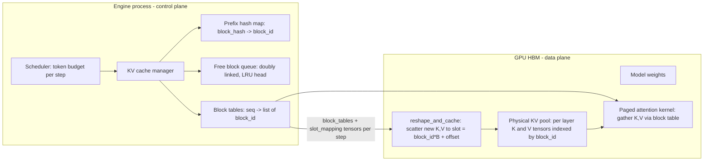

# KV-Cache Management and PagedAttention

## TL;DR

The KV cache costs `2 x layers x kv_heads x head_dim x bytes_per_element` per token. For Llama 3.1 70B in BF16 that works out to 320 KiB per token, so a single 128k-token sequence needs 40 GiB of HBM.
Before PagedAttention, serving systems reserved one contiguous max-length buffer per request, and only 20.4% to 38.2% of that memory held real token state (Kwon et al., SOSP 2023).
PagedAttention adds a per-sequence block table that maps logical token blocks to fixed-size physical blocks. External fragmentation disappears, internal waste is capped at `block_size - 1` tokens per sequence, and copy-on-write sharing becomes possible.
In vLLM, prefix caching is a hash chain over full blocks only. Each block's identity includes its parent's hash, so a single changed token near the start of a prompt invalidates every block after it.
Chunked prefill puts a token budget on each iteration. Decodes are scheduled first and prefill chunks fill what remains, which trades TTFT for tail ITL - and it only works because the paged cache lets one chunk attend to KV written by earlier chunks.

## Mental Model



The engine process is the control plane and makes every allocation decision on the CPU.
It decides which sequences run this step, how many tokens each one contributes, and which physical block IDs back each sequence's logical blocks.
The GPU is the data plane and never allocates anything.
At startup it receives one large preallocated KV pool.
Each step it receives two small integer tensors.
The block table tells the attention kernel where to read.
The slot mapping tells the cache-write kernel where to scatter new K and V vectors.
This is the same split as an OS: the kernel owns page tables and the MMU only translates.
Here the "MMU" is software, and it lives inside the attention kernel's address arithmetic.
That is why the change needed a custom kernel and not just a new allocator.

## Internals

### Why the KV cache exists and what it costs

During decode, each new token attends over the keys and values of every earlier token in every layer.
Recomputing them would turn decode into a quadratic re-prefill, so engines cache them (see [[17-Cloud-AI-Engineering/Volume_11_LLM_Serving_and_Inference_Systems_on_Cloud/Chapter_01_LLM_Inference_Mechanics_Prefill_vs_Decode|Prefill vs Decode]]).
The per-token footprint is `2 (K and V) x n_layers x n_kv_heads x head_dim x bytes`.
With multi-head attention, `n_kv_heads` equals the query head count, which is how OPT-13B reaches 800 KB per token, the example used in the PagedAttention paper.
Grouped-query attention (GQA) shares each KV head across a group of query heads.
Llama 3.1 70B keeps 64 query heads but only 8 KV heads, so its footprint drops to 320 KiB per token.
The cache grows by one token per decode step and is freed only when the request finishes.
Its final size is unknown at admission because output length is unknown.
This is the root of the allocation problem.

### The pre-paging failure: three kinds of waste

Systems before vLLM (FasterTransformer, Orca) allocated each request one contiguous tensor sized to `max_seq_len`.
The PagedAttention paper splits the resulting waste into three parts:

- **Reserved slots** hold space for tokens that will be generated later but are idle until then.
- **Internal fragmentation** is space past the actual output length that is never used.
- **External fragmentation** is gaps between variably sized allocations left by the allocator.

Its profiling found that only 20.4% to 38.2% of KV memory held actual token state (Kwon et al., SOSP 2023).
Take a mean request of 600 tokens against a 4,096-token reservation: utilization is 600 / 4096 = 14.6%.
Batch size, and therefore decode throughput, is capped by that wasted space and not by compute.

### PagedAttention: the translation layer

PagedAttention divides each sequence's KV cache into logical blocks of `B` tokens (vLLM's default `block_size` is 16).
It then maps each logical block to any free physical block in a preallocated pool.
Because every physical block has the same size, the pool cannot fragment externally: any free block can satisfy any request.
Internal waste is limited to the unfilled tail of each sequence's last block, on average `(B - 1) / 2` tokens.
For a 600-token sequence with `B = 16`, that is about 7.5 / 607.5, or 1.2%.
The paper reports near-zero waste and a 2-4x throughput gain over FasterTransformer and Orca at the same latency (Kwon et al., SOSP 2023).

### A mechanism the getting-started guides skip: the block ID is shared across layers

The physical pool is not one flat array.
Each attention layer owns its own K and V tensors, shaped roughly `[num_blocks, block_size, num_kv_heads, head_dim]`. The exact layout depends on the attention backend (UNVERIFIED for current backends).
A single block ID indexes the same slot range in every layer's tensors at once.
So a sequence needs only one block table, not one per layer.
The CPU-side manager allocates "a block" one time.
That block reserves `B` tokens of KV in all `n_layers` layers simultaneously.

This explains the size of a block on real hardware.
For Llama 3.1 70B with TP=8 and BF16, each GPU holds 1 KV head.
One 16-token block per GPU is `16 x 1 x 128 x 2 bytes = 4 KiB` for K plus 4 KiB for V, per layer, for a total of 640 KiB across 80 layers.
Across the 8-GPU node, the same block is 5 MiB.
Each step, the CPU computes `slot = block_id x B + offset` for every new token and ships this `slot_mapping` to the GPU.
A fused `reshape_and_cache` kernel then scatters the freshly projected K and V into those slots in each layer.
The paper describes this as a fused reshape and block write.
The attention kernel walks the block table, loads one K block per iteration, and computes `q . K` partial scores.
It keeps a running softmax max and sum, accumulates `softmax x V`, and moves to the next block.
That is the online-softmax technique from FlashAttention, with the address indirection added in.

### Choosing the block size

Small blocks reduce internal waste and make prefix sharing finer-grained.
They also add block-table entries and pointer chasing, and they give each kernel iteration fewer tokens to process.
At `B = 1`, the kernel does a scattered gather per token and coalescing collapses.
At `B = 256`, internal waste returns: an average of 127.5 tokens per sequence, which costs 40 MiB per sequence on a 70B model.
Prefix-cache hits are also rounded down to a 256-token boundary.
The paper found 16 to be a good balance on its GPUs, and vLLM keeps 16 as the default.
Some backends require or prefer larger blocks.
Treat `block_size` as a property of the kernel, not a free tuning knob.

### Sharing: reference counts and copy-on-write

Every physical block carries a `ref_cnt`.
For parallel sampling (`n > 1`) or beam search, sibling sequences point their block tables at the same prompt blocks, and `ref_cnt` goes above 1.
When a sibling needs to append into a shared, partially filled last block, the manager first copies that block to a fresh one and decrements the original's count.
This is copy-on-write, the same mechanism as OS `fork()` (Kwon et al., SOSP 2023).
Full blocks are never written again, so only the tail block is ever copied.

### Automatic prefix caching as a content-addressed hash chain

vLLM's prefix caching gives each full block a hash built from three inputs (vLLM design docs, as of 2026-10):

- the parent block's hash,
- the tuple of token IDs in this block,
- extra keys such as LoRA adapter IDs and multimodal input hashes.

Several consequences follow.
Only full blocks are cached, so a 1,000-token system prompt with `B = 16` reuses 992 tokens and recomputes the last 8.
Because the parent hash is included, the hash identifies the entire prefix, not just the block's own content.
Two identical blocks at different depths, or after different histories, never collide.
One edited token in the first block (a timestamp, a request ID, a reordered tool list) changes every hash after it.
Even a 100% prefix hit cannot skip all compute.
Sampling needs the final hidden state of the last prompt token, and the KV cache does not store hidden states.
The engine must therefore run at least the last token through the model.
The vLLM docs warn that the default hash is not collision-free and recommend SHA256 for multi-tenant deployments (vLLM design docs, as of 2026-10).

### Eviction: lazy and tail-first

vLLM V1 keeps every `KVCacheBlock` object in a preallocated pool.
It threads free blocks into a doubly linked list through `prev_free_block` and `next_free_block` pointers embedded in each block.
This allows O(1) removal from the middle of the list, with no Python deque wrapper objects (vLLM design docs, as of 2026-10).
When a request finishes, blocks whose `ref_cnt` drops to 0 go to the free queue, but they keep their hash.
They stay findable as cache hits until the allocator actually pops them from the head and reuses them.
Eviction is therefore lazy.
A later request that hits such a block pulls it out of the middle of the queue in O(1).

The detail most readers miss: a finished request's blocks are added to the free queue in reverse order (vLLM design docs, as of 2026-10).
The last block of a prefix, which is the most request-specific and least likely to be shared, ends up nearest the LRU head and is evicted first.
The first blocks, the shared system prompt, survive longest.
Because the hash is a chain, a surviving child without its parent is useless.
Reverse insertion makes LRU drop children before parents.

### RadixAttention as the alternative index

SGLang stores the same information as a radix tree over token sequences, with LRU eviction of leaves (Zheng et al., NeurIPS 2024).
The tree makes "longest cached prefix" a direct traversal, and token-granular sharing can be added on top of paged storage.
vLLM's flat hash map does a block-by-block lookup that stops at the first miss.
Both evict leaves first.
They differ in lookup structure and granularity more than in policy (see [[17-Cloud-AI-Engineering/Volume_11_LLM_Serving_and_Inference_Systems_on_Cloud/Chapter_02_Inference_Engines_vLLM_SGLang_TensorRT_LLM|Inference Engines]]).

### Pool sizing at startup: the profiling coupling

At startup, vLLM loads the weights and then runs a profiling forward pass at the configured maximum batched-token count to measure peak activation memory.
Whatever remains under `gpu_memory_utilization x total_HBM` becomes KV blocks.
`gpu_memory_utilization` is a fraction of total device memory per engine instance, not of free memory.
Two engines on one GPU both set to 0.9 will not fit.
The coupling that surprises people: raising `max_num_batched_tokens` raises the profiled activation peak, which shrinks the KV pool.
A setting meant to improve TTFT can therefore lower maximum concurrency.
If the pool cannot hold even one `max_model_len` sequence, the engine refuses to start rather than fail later.

### Preemption when the pool runs dry

Decode growth is not reserved ahead of time, so the pool can run out mid-flight.
The paper offers two recovery mechanisms:

- **Swap** copies victim blocks to host memory over PCIe.
- **Recompute** drops the victim's blocks and re-prefills it later.

Victims are evicted all-or-nothing per sequence group, because a partial KV cache cannot be used (Kwon et al., SOSP 2023).
vLLM's tuning guide treats frequent preemption as a sign to raise `gpu_memory_utilization` or lower `max_num_seqs` or `max_num_batched_tokens` (vLLM docs, as of 2026-10).
Current vLLM V1 uses recompute-based preemption (UNVERIFIED that swap has been fully removed).
Recompute costs FLOPs but no PCIe bandwidth.
Prefix caching softens it, because a preempted request's full blocks usually remain cached and are hit again on readmission.

### Chunked prefill

A 32k-token prefill on its own runs for many hundreds of milliseconds of compute.
If the scheduler runs it as one iteration, every in-flight decode stalls for that long, and that stall becomes the p99 inter-token latency.
SARATHI (Agrawal et al., 2023) and Sarathi-Serve (Agrawal et al., OSDI 2024) split prefills into chunks and run them in the same iteration as ongoing decodes.
Decodes are memory-bound GEMV work, so they "piggyback" on the compute-bound prefill chunk, and the weights are read once for both.
Sarathi-Serve calls this stall-free scheduling.

In vLLM V1, chunked prefill is enabled by default (vLLM docs, as of 2026-10).
Each step has a budget of `max_num_batched_tokens`.
The scheduler first admits all running decodes at one token each, then fills the remaining budget with pending prefill tokens, chunking any prefill that does not fit (vLLM docs, as of 2026-10).
The docs describe the trade-off directly (vLLM docs, as of 2026-10):

- A small budget such as 2048 gives better ITL.
- A larger budget gives better TTFT.
- For maximum throughput, especially with small models on large GPUs, the docs suggest values above 8192.

Chunked prefill depends on paging.
Chunk `i` must attend causally within itself and fully to the K and V of chunks `0..i-1`, which earlier steps already scattered into paged blocks.
The kernel therefore runs "prefill with context": queries come from the current chunk, keys and values come from the block table plus the current chunk.
The cost is re-reading the prefix KV once per chunk.
For a prompt of length `P` and chunk size `C`, that is about `P^2 / (2C)` token-reads of KV.
For `P = 32768` and `C = 2048`, that is about 262k token-reads.
This is small next to the prefill FLOPs, but it grows as `C` shrinks.
Very small chunks also underfill GEMM tiles: a 64-token chunk on a kernel tuned for 128-row tiles wastes half the tensor-core work.

### Beyond paging: virtual-memory-backed contiguity

vAttention (Prabhu et al., ASPLOS 2025) keeps the KV cache virtually contiguous and uses CUDA virtual memory APIs to map physical pages on demand.
Unmodified attention kernels then run without a block table (venue and details UNVERIFIED in this pass).
The trade-off is page granularity: driver-level physical pages are much larger than a 16-token block, so per-sequence internal waste rises.
Sharing at token-block granularity also becomes harder.
PagedAttention puts translation in the kernel; vAttention puts it in the GPU MMU.
That is the same design axis as software TLBs versus hardware page tables in [[15-Technical-Whitepapers/02-Operating-Systems-and-Kernels/Unix-and-Linux-Kernel-Foundations|Unix and Linux Kernel Foundations]].

### Tensor parallelism and KV head placement

Under tensor parallelism (TP), KV heads are split across ranks, so each GPU stores `n_kv_heads / TP` heads for every token.
When `TP > n_kv_heads` (for example, TP=16 on a model with 8 KV heads), heads must be replicated.
Each GPU then stores at least one full head, and part of the cluster's KV capacity is spent on duplicate copies.
For GQA models, keep `TP <= n_kv_heads`.
Scale further with pipeline parallelism or data-parallel replicas (see [[17-Cloud-AI-Engineering/Volume_10_AI_Infrastructure_on_Cloud/Chapter_04_Distributed_Training_Parallelism_Strategies|Parallelism Strategies]]).

### Failure domains

The KV cache is soft state stored only in HBM.
A replica crash, a Spot reclaim, or a rolling deploy erases that replica's prefix cache.
The cost is not correctness but an immediate spike in prefill FLOPs and TTFT as the cache rewarms.
In a fleet, cache locality is a property of request routing.
Round-robin load balancing across `N` replicas divides the expected per-prefix hit rate by about `N` for long-tail prefixes.
That is why prefix-aware routing (Ch 4 and [[17-Cloud-AI-Engineering/Volume_11_LLM_Serving_and_Inference_Systems_on_Cloud/Chapter_07_Prefill_and_Decode_Disaggregation|Disaggregation]]) is a cache-placement problem and not a load-balancing detail.

## Numbers to Know

| Quantity | Value | Source / status |
|---|---|---|
| KV memory actually used before paging | 20.4% to 38.2% | Kwon et al., SOSP 2023 |
| vLLM throughput vs FasterTransformer / Orca | 2-4x at same latency | Kwon et al., SOSP 2023 |
| vLLM default block size | 16 tokens | vLLM v1 source walkthroughs, as of 2026-10 |
| OPT-13B KV per token (MHA) | 800 KB | Kwon et al., SOSP 2023 |
| Llama 3.1 8B KV per token, BF16 (32 L, 8 KV heads, d=128) | 128 KiB; 16 GiB at 128k ctx | Derived from model config, as of 2026-10 |
| Llama 3.1 70B KV per token, BF16 (80 L, 8 KV heads, d=128) | 320 KiB; 40 GiB at 128k ctx | Derived from model config, as of 2026-10 |
| Llama 3.1 405B KV per token, BF16 (126 L, 8 KV heads) | 504 KiB; 63 GiB at 128k ctx | Derived from model config, as of 2026-10 |
| Qwen2.5-7B KV per token, BF16 (28 L, 4 KV heads, d=128) | 56 KiB | Derived from model config, as of 2026-10 |
| One 16-token block, 70B, whole node | 5 MiB (640 KiB per GPU at TP=8) | Derived |
| Paged internal waste, mean | (B - 1) / 2 tokens per sequence | Kwon et al., SOSP 2023, derived |
| Chunked-prefill budget for better ITL | ~2048 tokens | vLLM docs, as of 2026-10 |
| Chunked-prefill budget for throughput | > 8192 tokens | vLLM docs, as of 2026-10 |
| H100 SXM HBM / bandwidth | 80 GB / 3.35 TB/s | NVIDIA datasheet, UNVERIFIED in this pass |
| H200 HBM / bandwidth | 141 GB / 4.8 TB/s | NVIDIA datasheet, UNVERIFIED in this pass |
| L4 HBM-class memory / bandwidth | 24 GB GDDR6 / 300 GB/s | NVIDIA datasheet, UNVERIFIED in this pass |
| p5.48xlarge / a3-highgpu-8g | 8x H100 80 GB | AWS and Google Cloud docs, UNVERIFIED in this pass |
| p5e.48xlarge / a3-ultragpu-8g | 8x H200 141 GB | AWS and Google Cloud docs, UNVERIFIED in this pass |
| g6.xlarge on-demand, us-east-1 | ~$0.80/hr | AWS pricing, UNVERIFIED in this pass |

### Derived capacity: Llama 3.1 70B BF16 on 8x H100 80 GB, TP=8

These figures are bandwidth-only lower bounds.
They ignore all-reduce time, kernel launch overhead, and compute.
Expect real step times 1.3x to 2x higher.

| Step | Value |
|---|---|
| HBM budget at `gpu_memory_utilization=0.9` | 576 GB |
| Weights (70.6B params x 2 B) | ~141 GB |
| Activations and runtime reserve (assumed 4 GB per GPU) | ~32 GB |
| KV pool | ~403 GB, or ~1.23M tokens |
| Concurrent 8k-token sequences | ~150 |
| Same pool with FP8 KV | ~2.46M tokens, or ~300 sequences at 8k |
| Decode step lower bound, B=1, L=8k | 5.4 ms, ~186 tok/s node |
| Decode step lower bound, B=150, L=8k | 20.3 ms, ~7,400 tok/s node |
| Asymptotic ceiling at L=8k, B to infinity | ~10,000 tok/s per node at BF16 KV, set only by KV bandwidth |

The last row is the staff-level insight.
Per-step bytes are `W/TP + B x L x kv_per_gpu`, so at large batch and long context the KV term dominates and the weights term becomes irrelevant.
Halving KV bytes (FP8 KV, fewer KV heads, MLA-style compression) raises the throughput ceiling directly.
Weight quantization does not.

## AWS vs GCP Mechanism Parity

| Dimension | AWS | Google Cloud | Critical difference |
|---|---|---|---|
| GPU hosts for paged KV serving | P5 (H100), P5e/P5en (H200), G6 (L4) | A3 High (H100), A3 Ultra (H200), G2 (L4) | Same NVIDIA silicon, so PagedAttention behaves the same; HBM per GPU sets KV capacity (UNVERIFIED families in this pass) |
| Custom accelerators | Trainium / Inferentia via Neuron SDK, which has its own KV cache layout (UNVERIFIED for current paging support) | TPU via vLLM TPU backend using a Pallas ragged paged attention kernel (UNVERIFIED) | Paging is implemented in a different kernel stack per chip; block size and layout do not carry over |
| Self-managed engine on Kubernetes | EKS GPU node groups or Karpenter running vLLM or SGLang | GKE GPU or TPU node pools running vLLM | KV-cache behavior is engine-defined on both; the cloud only provides HBM |
| Prefix-aware routing | No first-party KV-aware router; use NVIDIA Dynamo, llm-d, or the SGLang router on EKS (UNVERIFIED status) | GKE Inference Gateway with prefix-cache-aware load balancing (UNVERIFIED GA status as of 2026-10) | GCP offers a managed gateway path; on AWS you run the router yourself |
| Host offload tier for evicted KV | Instance-store NVMe and host DRAM on P5; tools such as LMCache | Local SSD and host DRAM on A3; same tools | Offload bandwidth is PCIe-bound on both; Nitro and Titanium differences do not affect the HBM-to-host path |
| Managed prompt caching (API level) | Amazon Bedrock prompt caching (UNVERIFIED feature matrix) | Vertex AI context caching for Gemini; Claude prompt caching on Vertex | Explicit cache breakpoints vs implicit caching; see [[17-Cloud-AI-Engineering/Volume_11_LLM_Serving_and_Inference_Systems_on_Cloud/Chapter_10_Claude_on_Bedrock_and_Vertex_AI\|Claude on Bedrock and Vertex AI]] |
| Managed model serving | SageMaker AI endpoints with LMI containers using vLLM backends | Vertex AI endpoints with vLLM serving containers from Model Garden | Both expose engine flags (block size, memory fraction) through container env vars; defaults may differ from upstream |
| Weight-load path that limits cache rewarm | S3 to instance, or FSx for Lustre | GCS to instance, or Cloud Storage FUSE | Cold replicas start with empty KV caches on both; see [[17-Cloud-AI-Engineering/Volume_11_LLM_Serving_and_Inference_Systems_on_Cloud/Chapter_08_Cloud_GPU_Autoscaling_and_Cold_Start_Mitigation\|Cold-Start Mitigation]] |

## Worked Example: Measuring the Paged KV Pool and Prefix-Cache Behavior on One L4

### Goal

Launch vLLM on a single L4 GPU and read the KV pool size it computes.
Then show three things with measurements:

- a warm shared prefix lowers TTFT,
- changing a single token at the start of the prompt destroys the hit,
- the prefix-cache counters in `/metrics` confirm both.

### Back-of-the-envelope sizing before you spend money

The model is Qwen2.5-7B-Instruct in BF16, about 7.6B parameters, so about 15.2 GB of weights.
The L4 has 24 GB; at `gpu_memory_utilization=0.90` the budget is 21.6 GB.
Assume about 1.5 GB for profiled activations and runtime.
That leaves 21.6 - 15.2 - 1.5 = ~4.9 GB for KV.
At 56 KiB per token, the pool holds about 84,000 tokens, or about 5,300 blocks of 16 tokens.
At `max_model_len=8192` that is about 10 full-length sequences, or about 140 sequences averaging 600 tokens.
The decode bandwidth floor is 15.2 GB / 300 GB/s = ~51 ms per step at batch 1, so expect at most ~20 tok/s for a single stream.
The L4 is a weight-bandwidth-bound device, and batching is the only way to improve its unit economics.

### Cost estimate

| Item | Rate | Duration | Cost |
|---|---|---|---|
| g6.xlarge on-demand, us-east-1 | ~$0.80/hr (UNVERIFIED) | 3 h max (auto-shutdown) | ~$2.41 |
| 100 GB gp3 root volume | ~$0.08/GB-month (UNVERIFIED) | 3 h | ~$0.03 |
| Model download over the internet | Free ingress | - | $0 |
| Total ceiling | - | - | < $3 |

### Step 1: budget alarm (AWS)

```bash
#!/usr/bin/env bash
set -euo pipefail
ACCT=$(aws sts get-caller-identity --query Account --output text)
aws budgets create-budget --account-id "$ACCT" \
  --budget '{"BudgetName":"kv-cache-lab","BudgetLimit":{"Amount":"10","Unit":"USD"},"TimeUnit":"MONTHLY","BudgetType":"COST"}' \
  --notifications-with-subscribers '[{"Notification":{"NotificationType":"ACTUAL","ComparisonOperator":"GREATER_THAN","Threshold":50,"ThresholdType":"PERCENTAGE"},"Subscribers":[{"SubscriptionType":"EMAIL","Address":"you@example.com"}]}]'
```

### Step 2: launch with a dead-man switch

```bash
#!/usr/bin/env bash
set -euo pipefail
export AWS_REGION=us-east-1
MYIP=$(curl -s https://checkip.amazonaws.com)/32
# SSM path for the DLAMI base image; UNVERIFIED path - if it fails, run:
# aws ec2 describe-images --owners amazon --filters "Name=name,Values=Deep Learning Base OSS Nvidia Driver GPU AMI (Ubuntu 22.04)*"
AMI=$(aws ssm get-parameter \
  --name /aws/service/deeplearning/ami/x86_64/base-oss-nvidia-driver-gpu-ubuntu-22.04/latest/ami-id \
  --query Parameter.Value --output text)
aws ec2 create-key-pair --key-name kv-lab --query KeyMaterial --output text > kv-lab.pem
chmod 600 kv-lab.pem
SG=$(aws ec2 create-security-group --group-name kv-lab --description "kv lab ssh only" --query GroupId --output text)
aws ec2 authorize-security-group-ingress --group-id "$SG" --protocol tcp --port 22 --cidr "$MYIP"
cat > user-data.sh <<'EOF'
#!/bin/bash
shutdown -h +180
apt-get update -y && apt-get install -y python3-venv
sudo -u ubuntu bash -lc 'python3 -m venv ~/v && ~/v/bin/pip install -U vllm && \
  nohup ~/v/bin/vllm serve Qwen/Qwen2.5-7B-Instruct --host 127.0.0.1 --port 8000 \
  --max-model-len 8192 --gpu-memory-utilization 0.90 --enable-prefix-caching \
  > ~/vllm.log 2>&1 &'
EOF
IID=$(aws ec2 run-instances --image-id "$AMI" --instance-type g6.xlarge \
  --key-name kv-lab --security-group-ids "$SG" \
  --instance-initiated-shutdown-behavior terminate \
  --block-device-mappings '[{"DeviceName":"/dev/sda1","Ebs":{"VolumeSize":100,"VolumeType":"gp3","DeleteOnTermination":true}}]' \
  --user-data file://user-data.sh \
  --tag-specifications 'ResourceType=instance,Tags=[{Key=lab,Value=kv-cache}]' \
  --query 'Instances[0].InstanceId' --output text)
echo "$IID" > iid.txt
aws ec2 wait instance-running --instance-ids "$IID"
IP=$(aws ec2 describe-instances --instance-ids "$IID" --query 'Reservations[0].Instances[0].PublicIpAddress' --output text)
echo "ssh -i kv-lab.pem -L 8000:127.0.0.1:8000 ubuntu@$IP"
```

The server binds only to loopback, and you reach it through the SSH tunnel.
The only open port is SSH, restricted to your address.
`shutdown -h +180` together with `--instance-initiated-shutdown-behavior terminate` guarantees termination within three hours even if you forget the teardown.

### Step 3: read the pool the engine computed

```bash
ssh -i kv-lab.pem ubuntu@"$IP" 'grep -iE "KV cache|concurrency|block" ~/vllm.log | tail -n 20'
```

Look for the lines that report the GPU KV cache size in tokens and the maximum concurrency for `max_model_len`-sized requests (exact wording varies by version, UNVERIFIED).
Compare them with the ~84,000-token estimate.
The difference is your profiled activation and CUDA-graph reserve.
Restart the server with `--max-num-batched-tokens 16384` and read the logs again.
The pool shrinks, which shows the profiling coupling described in Internals.

### Step 4: probe prefix-cache behavior (Python, stdlib only)

```python
import json, time, urllib.request

URL = "http://127.0.0.1:8000"
MODEL = "Qwen/Qwen2.5-7B-Instruct"
PREFIX = "You are a careful support agent for ACME. " + ("Policy clause. " * 700)

def ttft(prompt):
    body = json.dumps({"model": MODEL, "prompt": prompt, "max_tokens": 8,
                       "stream": True, "temperature": 0}).encode()
    req = urllib.request.Request(URL + "/v1/completions", data=body,
                                 headers={"Content-Type": "application/json"})
    t0 = time.perf_counter()
    with urllib.request.urlopen(req) as r:
        for line in r:
            if line.startswith(b"data:") and b"[DONE]" not in line:
                return (time.perf_counter() - t0) * 1000.0
    return float("nan")

def cache_metrics():
    text = urllib.request.urlopen(URL + "/metrics").read().decode()
    return [l for l in text.splitlines()
            if ("prefix_cache" in l or "cache_usage" in l) and not l.startswith("#")]

print("cold   ms", round(ttft(PREFIX + "Q: reset my password"), 1))
for q in ["Q: refund status", "Q: change address", "Q: cancel order"]:
    print("warm   ms", round(ttft(PREFIX + q), 1))
print("busted ms", round(ttft("[ts=%d] " % time.time() + PREFIX + "Q: refund status"), 1))
for line in cache_metrics():
    print(line)
```

The expected shape: the cold request pays a full prefill of about 2,100 tokens.
The warm requests pay only the uncached tail and the first decode step.
The "busted" request, with a timestamp prepended, pays the full prefill again, because every block hash downstream of the first block changed.
The metric names have changed between vLLM releases, so the script matches substrings instead of exact names (UNVERIFIED current names).

### GCP variant

```bash
gcloud billing budgets create --billing-account="$BILLING_ACCOUNT" \
  --display-name=kv-cache-lab --budget-amount=10USD --threshold-rule=percent=0.5
# Image family UNVERIFIED; list with:
# gcloud compute images list --project deeplearning-platform-release --filter="family~cu12"
gcloud compute instances create kv-lab --zone=us-central1-a --machine-type=g2-standard-8 \
  --maintenance-policy=TERMINATE --boot-disk-size=100GB \
  --image-project=deeplearning-platform-release --image-family="$DLVM_FAMILY" \
  --metadata-from-file=startup-script=user-data.sh
```

### Teardown (run both even if auto-shutdown fired)

```bash
aws ec2 terminate-instances --instance-ids "$(cat iid.txt)"
aws ec2 wait instance-terminated --instance-ids "$(cat iid.txt)"
aws ec2 delete-security-group --group-id "$SG"
aws ec2 delete-key-pair --key-name kv-lab && rm -f kv-lab.pem
aws budgets delete-budget --account-id "$ACCT" --budget-name kv-cache-lab
# GCP
gcloud compute instances delete kv-lab --zone=us-central1-a --quiet
```

## Failure Modes and Pitfalls

### Preemption storm and throughput collapse

When admission control ignores future decode growth, the pool fills and the engine preempts sequences.
Preempted sequences are readmitted, re-prefill, and are preempted again.
GPU utilization stays high while useful tokens per second fall.
Signals: the preemption counter rises, TTFT and ITL rise together, and the KV usage gauge stays near 100%.
Mitigations: cap `max_num_seqs`, lower `max_model_len` to what the product needs, move to FP8 KV, and shed load at the gateway (see [[17-Cloud-AI-Engineering/Volume_07_Reliability_and_SRE/Chapter_02_Load_Shedding_Backpressure_and_Admission_Control|Admission Control]]).

### p99 ITL regression after enabling long context

Shipping a 128k context window changes the prefill length distribution.
With a large `max_num_batched_tokens`, each step that carries a big prefill chunk stretches every concurrent decode.
The ITL p50 hardly moves while p99 doubles.
Lower the budget toward about 2048, or split prefill onto separate workers (see [[17-Cloud-AI-Engineering/Volume_11_LLM_Serving_and_Inference_Systems_on_Cloud/Chapter_07_Prefill_and_Decode_Disaggregation|Disaggregation]]).

### Prefix hit rate collapse caused by prompt construction

Templating that puts volatile fields at the start of the prompt (timestamps, user IDs, A/B flags, a reshuffled tool list) breaks the hash chain at block 0.
The hit rate falls to near zero with no error anywhere.
Fix it in the prompt contract: static content first, volatile content last, and deterministic serialization of tool schemas.

### Prefix hit rate collapse caused by fleet changes

The same symptom also appears when:

- routing is switched from session-affine or prefix-aware to round-robin,
- replicas are scaled out,
- a rolling deploy restarts every replica within minutes.

Each restart empties a cache, so a fast rollout turns into a fleet-wide prefill surge exactly when capacity is reduced.
Pace rollouts by cache rewarm time, not only by health checks.

### Engine fails to start or OOMs later

Typical causes:

- a sidecar or second process holds a CUDA context,
- NCCL buffers under TP take more memory than the profile measured,
- `gpu_memory_utilization` is set as if it were a fraction of free memory.

The engine may also refuse to start when one `max_model_len` sequence cannot fit in the pool.
That is a fail-fast feature, not a bug.

### TP wider than the KV head count

Running TP=16 on an 8-KV-head model replicates KV heads, which wastes per-GPU KV capacity.
It also adds inter-node all-reduce traffic to every decode step.
The symptom is concurrency well below what the HBM total suggests.

### FP8 KV accuracy drift

Uncalibrated KV scales can degrade long-context retrieval tasks while short benchmarks still pass.
Gate FP8 KV behind long-context evals (see [[17-Cloud-AI-Engineering/Volume_11_LLM_Serving_and_Inference_Systems_on_Cloud/Chapter_06_Model_Quantization_and_Compression|Quantization]]).

### Spot and preemptible reclaim

All KV state is lost on reclaim, and every in-flight request on that replica must be retried with a full prefill elsewhere.
Spot capacity for latency-sensitive serving needs headroom for that retry surge (see [[17-Cloud-AI-Engineering/Volume_09_FinOps_and_Cloud_Economics/Chapter_03_Spot_Economics_and_Interruption_Handling|Spot Economics]]).

### Public incident analogs

OpenAI's March 2023 ChatGPT incident exposed other users' conversation titles through a bug in a caching client library (UNVERIFIED in this pass).
It is the canonical warning that shared caches must be keyed by tenant.
Anthropic's September 2025 postmortem described requests being routed to servers configured for a different context-window size, among other issues (UNVERIFIED in this pass).
It shows that heterogeneous fleets, whose KV and context configurations differ, need routing invariants that are tested like correctness properties.

## Security and Cost Angles

### Tenant isolation of the prefix cache

A shared prefix cache is a timing oracle.
If tenant B's TTFT drops when B sends a guessed prefix, B learns that some other tenant recently sent that prefix.
Mitigations:

- Mix a per-tenant salt into the block hash so prefixes never match across tenants. vLLM exposes a per-request cache salt for this (UNVERIFIED parameter name and status).
- Use SHA256 block hashing, as the vLLM docs recommend for multi-tenant setups (vLLM design docs, as of 2026-10).
- Isolate high-sensitivity tenants on dedicated replicas.

### Data at rest and in use

KV blocks in HBM are plaintext derivatives of the prompt and must be treated with the same classification as the prompt.
If you offload KV to host DRAM or local NVMe, that tier now holds prompt-derived data.
Rely on the platform's local-disk encryption and wipe-on-release semantics (AWS Nitro instance store and GCP Local SSD, UNVERIFIED specifics), and never ship offloaded KV to shared object storage without CMEK.
Confidential GPU computing for H100-class parts exists on both clouds in some form (UNVERIFIED GA status as of 2026-10).

### IAM and perimeter

The serving pod needs read-only access to the weights bucket, through IRSA or EKS Pod Identity on AWS and Workload Identity on GKE (see [[17-Cloud-AI-Engineering/Volume_08_Security_Identity_and_the_Data_Perimeter/Chapter_02_Workload_Identity_Federation|Workload Identity Federation]]).
Encrypt that bucket with a CMK.
Pull weights through S3 gateway endpoints or Private Google Access inside a VPC Service Controls perimeter, so a compromised engine cannot exfiltrate prompts to the internet.
Never expose the engine's `/metrics` endpoint publicly.
Cache-usage and prefix-hit counters leak traffic shape.

### Unit-economics levers, ranked by usual payoff

1. Right-size `max_model_len`. A 128k limit that nobody uses still shapes admission and profiling.
2. FP8 KV cache. It roughly doubles token capacity and the KV-bandwidth ceiling, subject to evals.
3. Prefix caching plus prefix-aware routing. Prefill FLOPs drop by the hit ratio, which is often the largest cost cut for agentic and RAG workloads with long static system prompts.
4. Prefer GQA, MLA, or other KV-compressed architectures when choosing a model. At long context, KV bytes, not parameters, set cost per token.
5. Tune the chunked-prefill budget per SLO class instead of using one fleet-wide value.

At the managed-API layer, Anthropic-style prompt caching bills cache writes at a premium and cache reads at a small fraction of base input price (UNVERIFIED current multipliers).
That makes the prompt-ordering discipline above directly visible on the invoice (see [[17-Cloud-AI-Engineering/Volume_09_FinOps_and_Cloud_Economics/Chapter_05_GPU_and_TPU_Unit_Economics|GPU and TPU Unit Economics]]).

## Interview Questions and Model Answers

### Question 1 (L5 - Senior)

You are serving Llama 3.1 70B in BF16 on one 8x H100 80 GB node with TP=8.
How many concurrent 8k-token conversations fit, and what is the first lever you pull to double that?

#### Model Answer

Per-token KV is `2 x 80 layers x 8 KV heads x 128 x 2 bytes = 327,680 bytes`, which is 320 KiB.
The memory budget at 0.9 utilization is 576 GB.
Subtract about 141 GB of weights and about 32 GB of activation and runtime reserve, which leaves about 403 GB, or about 1.23M tokens.
At 8,192 tokens per conversation that is about 150 concurrent sequences, assuming the paged allocator wastes almost nothing, which holds with 16-token blocks.
The first lever is FP8 KV.
It halves bytes per token, so capacity rises to about 300 sequences, and it also roughly doubles the KV-bandwidth ceiling on decode throughput.
It costs an accuracy risk on long-context retrieval, so I would gate it behind long-context evals.
Weight quantization to FP8 frees only about 70 GB, which is about 26% more KV capacity, and it does not move the long-context bandwidth ceiling.
I would also check TP: 8 KV heads at TP=8 means no replication, while TP=16 would waste capacity.

#### Follow-up Interviewer Question

Your measured concurrency is 110, not 150. Name three places the missing memory went and how you would confirm each.

### Question 2 (L5 - Senior)

Explain why PagedAttention eliminates external fragmentation but not internal fragmentation.
What happens at block sizes 1 and 256?

#### Model Answer

External fragmentation needs variable-sized allocations that leave unusable gaps.
With identical fixed-size physical blocks, any free block satisfies any request, so gaps cannot form.
Internal fragmentation remains, but only in the last partially filled block of each sequence: on average `(B - 1) / 2` tokens and at most `B - 1`.
At `B = 1`, waste is zero, but the block table is as long as the sequence.
The kernel then does one indirect gather per token, which breaks memory coalescing, and CPU-side bookkeeping grows with tokens instead of blocks.
At `B = 256`, the kernel gets long contiguous runs, but waste averages 127.5 tokens per sequence, about 40 MiB per sequence on a 70B model.
Prefix-cache hits also round down to 256-token boundaries, and copy-on-write copies become 16x larger.
Sixteen is the paper's balance point for GPU kernels, and the real constraint is what the attention backend supports.

#### Follow-up Interviewer Question

Why is a block ID shared across all layers instead of each layer having its own block table, and what would break if layers had different KV shapes, such as sliding-window layers mixed with full-attention layers?

### Question 3 (L6 - Staff)

After launching a 128k-context feature, chat ITL p99 doubles while p50 is flat and GPU utilization rises.
Walk through the diagnosis and the fix, including what you give up.

#### Model Answer

A flat p50 with a doubled p99 means some steps are much longer than others, not that every step slowed.
The new feature adds long prefills.
Under chunked prefill, each step fills `max_num_batched_tokens` with decode tokens first and then prefill chunks.
If the budget is large, for example 16k, any step carrying a large chunk takes far longer, and every decode in that batch waits.
I would confirm by correlating step latency with prefill tokens per step from engine traces, and by checking whether the affected decodes share replicas with long-context requests.
Fix options, in order:

1. Lower the budget toward about 2048 on the chat pool. This bounds per-step prefill work and so bounds the stall, at the cost of higher TTFT for long prompts, because a 100k prompt now takes about 50 steps.
2. Route long-context traffic to a separate pool with a larger budget, so each SLO class gets its own scheduler policy.
3. If both classes must share hardware at scale, disaggregate prefill from decode and pay KV transfer cost over the network.

Also watch for very small chunks.
They underfill GEMM tiles and multiply re-reads of the prefix KV (about `P^2 / 2C`), so the budget has a floor, not just a ceiling.
Finally, long-context requests consume pool capacity, so preemptions may be rising too.
Check that counter before blaming scheduling alone.

#### Follow-up Interviewer Question

How would you set the chunk budget from first principles for a given GPU, so that a decode step's latency stays under a 50 ms ITL SLO?

### Question 4 (L6 - Staff)

Prefix-cache hit rate fell from 70% to 4% overnight with no engine change.
Prefill FLOPs tripled. What happened?

#### Model Answer

The block hash chains the parent hash, the block's tokens, and extra keys.
A hit therefore requires every earlier block to be identical down to the token ID, under the same LoRA adapter and multimodal inputs.
Suspects, in order:

- **Prompt template change.** A field such as a timestamp, request ID, or locale was added near the top, or tool JSON is now serialized in non-deterministic key order. Diff the token IDs of the first block across two requests.
- **Tokenizer or chat-template change.** It shifts token boundaries even when the text is the same.
- **Routing change.** A move from prefix-affine to round-robin routing, or a scale-out, divides per-replica locality.
- **LoRA rollout.** A new LoRA ID is included in the hash.
- **Mass restart.** A rolling deploy emptied every cache, and traffic diversity plus LRU eviction kept it from rewarming.

I would bisect with the engine's hit counters per replica and a canary that replays a fixed prompt.
The durable fixes are a prompt contract (static first, volatile last, canonical serialization) enforced in CI, plus prefix-aware routing with bounded load so hot prefixes do not overload one replica.
Remember that even a full hit recomputes the last token, so TTFT never drops to zero.

#### Follow-up Interviewer Question

Prefix-aware routing concentrates a viral system prompt on one replica. How do you keep locality without creating a hot spot?

### Question 5 (L6 - Staff)

A team proposes TP=16 across two 8-GPU nodes for a 70B GQA model "to get more KV memory per replica."
Evaluate the proposal.

#### Model Answer

With 8 KV heads, TP=16 forces KV-head replication.
Each GPU must hold a full head, so per-token KV per GPU does not halve, and total KV capacity per token served grows less than the HBM doubling suggests.
Every decode step's all-reduce also crosses the inter-node fabric, EFA on AWS or GPUDirect-capable NICs on GCP.
That is far slower than NVLink inside the node and adds latency to every step of every token.
Better options:

- Two TP=8 replicas behind a router. Same HBM, no replication, no cross-node collectives in the hot path, and twice the independent batch slots. The cost is that the prefix cache is split across two replicas, which prefix-aware routing recovers.
- If one 128k+ sequence cannot fit in a single node's pool, use pipeline parallelism across nodes. PP moves only activations between stages, but it adds pipeline bubbles that need enough microbatches.
- Use FP8 KV or a KV-compressed model before reaching for cross-node TP.

#### Follow-up Interviewer Question

For which model architecture and context length would cross-node TP actually be the right answer?

### Question 6 (L7+ - Principal)

Design a fleet-wide KV cache tier for a multi-tenant agent platform on AWS and GCP, where 80% of input tokens are shared system and tool prefixes.

#### Model Answer

Treat the KV cache as a three-level hierarchy with explicit cost-of-miss economics.

- **L1** is HBM paged blocks inside each engine.
- **L2** is host DRAM and local NVMe on the same instance, holding evicted full blocks keyed by the same chained hash.
- **L3** is optional: a remote KV store for very hot, very long prefixes.

The value of a tier is the prefill FLOPs avoided per byte moved.
A 320 KiB-per-token block for 70B costs about 5 MiB per 16 tokens to fetch.
PCIe Gen5 x16 is roughly 50-60 GB/s effective (UNVERIFIED), so L2 is cheaper than recompute for long prefixes.
Remote L3 only pays when network bandwidth per GPU is high and the prefix is long.

Routing is the main lever.
A gateway computes the same block-hash chain on the tokenized prompt, so the routing key equals the cache key.
It routes with bounded-load consistent hashing over replicas, using cached-prefix length as the primary score and queue depth as the tiebreak.
On GCP I would evaluate GKE Inference Gateway's prefix-aware mode.
On AWS I would run an open-source KV-aware router on EKS, because there is no first-party equivalent (UNVERIFIED status of both).

For isolation, the per-tenant salt is mixed into the hash: shared prefixes stay shareable only within a tenant, or within an explicit "public prompt" namespace.
Use SHA256 hashing, keep metrics private, and put regulated tenants on dedicated cells (see [[17-Cloud-AI-Engineering/Volume_01_Cloud_Architecture_Principles/Chapter_03_Cell_Based_Architecture_and_Shuffle_Sharding|Cell-Based Architecture]]).

Failure handling: KV is soft state, so any tier loss degrades to recompute, never to errors.
Rollouts are paced by rewarm time, and Spot capacity is held only in pools with retry headroom.

Economics: at an 80% shared-prefix ratio and a 60% realized hit rate, prefill compute falls by about half.
I would report cost per million input tokens split into cached and uncached, so the product team sees the effect of prompt hygiene.

#### Follow-up Interviewer Question

Quantify the break-even prefix length at which fetching from L2 beats recomputing on an H100, and explain how that changes on an L4.

### Question 7 (L7+ - Principal)

Would you ever abandon PagedAttention for virtual-memory-backed contiguous KV, as in vAttention, or for a radix-tree index, as in SGLang?
Defend the choice for a GPU fleet and for a TPU fleet.

#### Model Answer

The three designs place address translation in different layers.

- PagedAttention puts it in the attention kernel, so every kernel (FlashAttention variants, FlashInfer, TPU Pallas kernels) must understand block tables.
- vAttention puts it in the GPU MMU through CUDA virtual memory APIs, so unmodified contiguous kernels work. The costs are coarser physical pages (more internal waste and coarser sharing) and dependence on driver and CUDA virtual memory behavior, which does not exist on TPU.
- A radix tree is an index choice, not a storage choice. It can sit on paged storage, gives a direct longest-prefix lookup, and makes token-granular sharing easier.

For a GPU fleet serving many short-to-medium, prefix-heavy requests, I keep paging plus a prefix index.
Fine-grained sharing and copy-on-write are worth the kernel coupling, and the ecosystem's kernels already speak block tables.
I would consider virtual-memory-backed contiguity for a fleet that runs few, very long, rarely shared sequences and wants the newest attention kernels on day one, without waiting for paged ports.
On TPU, the MMU option does not apply, so paging lives in a Pallas kernel (UNVERIFIED current implementation).
What I would protect most is the hash and routing contract, because it outlives any single kernel.

#### Follow-up Interviewer Question

Hybrid models interleave sliding-window and full-attention layers, or state-space layers. How must the block allocator change, and what happens to prefix caching for the sliding-window layers?

## Further Reading

- [Kwon et al., "Efficient Memory Management for Large Language Model Serving with PagedAttention", SOSP 2023](https://arxiv.org/abs/2309.06180) - the primary source for block tables, copy-on-write, swap versus recompute preemption, and the fragmentation measurements.
- [vLLM design doc: Automatic Prefix Caching](https://docs.vllm.ai/en/stable/design/prefix_caching/) - the exact hash-chain key, the embedded doubly linked free queue, and the reverse-order eviction heuristic.
- [vLLM docs: Optimization and Tuning](https://docs.vllm.ai/en/stable/configuration/optimization/) - authoritative guidance on V1 chunked prefill, decode-first scheduling, and preemption tuning.
- [Agrawal et al., "Taming Throughput-Latency Tradeoff in LLM Inference with Sarathi-Serve", OSDI 2024](https://www.usenix.org/conference/osdi24/presentation/agrawal) - stall-free scheduling and the analysis behind chunk-budget selection.
- [Agrawal et al., "SARATHI: Efficient LLM Inference by Piggybacking Decodes with Chunked Prefills"](https://arxiv.org/abs/2308.16369) - the original argument for why decodes ride nearly free on compute-bound prefill chunks.
- [Yu et al., "Orca: A Distributed Serving System for Transformer-Based Generative Models", OSDI 2022](https://www.usenix.org/conference/osdi22/presentation/yu) - iteration-level scheduling, the baseline PagedAttention improved on.
- [Zheng et al., "SGLang: Efficient Execution of Structured Language Model Programs" (RadixAttention)](https://arxiv.org/abs/2312.07104) - the radix-tree alternative to hash-chain prefix indexing.
- [Prabhu et al., "vAttention: Dynamic Memory Management for Serving LLMs without PagedAttention"](https://arxiv.org/abs/2405.04437) - the counter-design that moves translation into the GPU MMU.
- [Dao et al., "FlashAttention"](https://arxiv.org/abs/2205.14135) - the online-softmax tiling that paged attention kernels inherit.
- [Ainslie et al., "GQA: Training Generalized Multi-Query Transformer Models"](https://arxiv.org/abs/2305.13245) - why modern models have 8 KV heads and what that does to KV bytes per token.
- [Zhong et al., "DistServe"](https://arxiv.org/abs/2401.09670) and [Qin et al., "Mooncake"](https://arxiv.org/abs/2407.00079) - KV-centric disaggregation and fleet-level KV pooling, the bridge to Ch 7.
- [[15-Technical-Whitepapers/03-Memory-Architecture-and-Concurrency/Ulrich-Drepper-Memory-Architecture|Drepper, What Every Programmer Should Know About Memory]] - the paging and TLB background that makes the OS analogy precise.
- Next: [[17-Cloud-AI-Engineering/Volume_11_LLM_Serving_and_Inference_Systems_on_Cloud/Chapter_04_Continuous_Batching_and_Scheduling_Algorithms|Continuous Batching and Scheduling Algorithms]] covers how the scheduler spends the KV pool built here.
