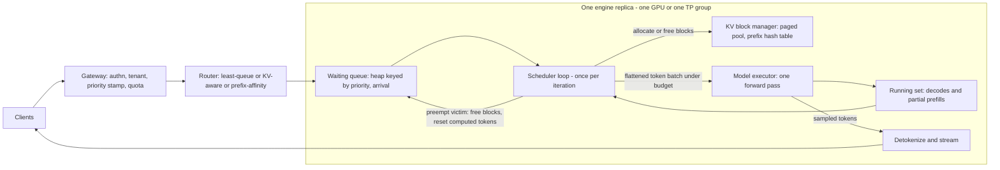

# Continuous Batching and Scheduling Algorithms

## TL;DR

An LLM serving engine is a scheduler that runs one forward pass ("iteration") at a time over a changing set of requests. Requests are no longer the unit of scheduling, so a finished sequence frees its slot at the next iteration instead of at the end of the batch (Orca, OSDI 2022).
Each iteration has two limits: a token budget (`max_num_batched_tokens`) that caps compute per step, and a sequence cap (`max_num_seqs`) plus a paged KV pool that cap memory. Together they set the trade-off between TTFT and TPOT.
Decode is memory-bandwidth-bound until per-sequence KV reads dominate weight reads. Throughput reaches half of its ceiling at a batch size of about `weight_bytes / (avg_context_tokens * kv_bytes_per_token)`, and past that point extra concurrency buys little.
Chunked prefill (Sarathi-Serve, OSDI 2024) splits long prompts into budget-sized pieces that ride along with in-flight decodes. This removes the TPOT spikes that long prompts cause, at the price of somewhat higher TTFT.
Preemption is a fallback for memory pressure, not a policy you plan around. Recompute preemption repeats work in proportion to context length, so capping concurrency below what the KV pool can hold beats overcommitting and evicting.

## Mental Model



Think of the engine as a CPU process scheduler where the "time slice" is one forward pass, typically 10 to 60 ms, and the scarce resource is HBM holding KV blocks, not CPU cycles.
On every iteration the scheduler decides, from scratch, which requests run and how many tokens each contributes. A running request contributes one token (a decode) or a chunk of prompt (a prefill).
That freedom to change the batch every step is the whole of "continuous batching".
Everything else is policy laid on top: which waiting request is admitted, how large a prompt chunk may be, which running request is evicted when memory runs out, and how the router upstream spreads requests across replicas.
The router and the engine scheduler are two separate control loops on different timescales. The engine reacts within one iteration, while the router reacts on metric-scrape or connection timescales. Most production pathologies come from those two loops working against each other.

## Internals

### From request-level to iteration-level scheduling

Classic model servers (Triton dynamic batching, TF Serving) build a batch of requests, run it to completion, and return all results together.
For autoregressive generation this is a disaster, because output lengths vary by orders of magnitude and the batch lives as long as its longest member.
If output lengths are roughly exponential with mean `m`, the expected maximum over a batch of `B` is about `m * H_B`, where `H_B` is the B-th harmonic number. For `B = 32` that gives `H_32 = 4.06`, so slot utilization is about `1 / 4.06 = 25%` before even counting padding (derived, this chapter).
Orca introduced [iteration-level scheduling](https://www.usenix.org/conference/osdi22/presentation/yu). The scheduler asks the execution engine to run only one iteration of the model over the batch, returns finished sequences right away, and admits new arrivals at the next iteration (Orca, OSDI 2022).
The second Orca idea, selective batching, is the mechanism that makes this possible on real kernels.
Requests in an iteration have different lengths and different KV histories, so their tensors cannot be stacked into one rectangular `[batch, seq, hidden]` tensor.
Selective batching flattens every token of every request into a single `[total_tokens, hidden]` matrix for the token-wise operations: QKV projection, output projection, MLP, layer norms, and the LM head. These dominate FLOPs and weight traffic.
Only the attention operation is split per request, because each request attends over its own KV history.
Modern engines go one step further. PagedAttention-style kernels (see [[17-Cloud-AI-Engineering/Volume_11_LLM_Serving_and_Inference_Systems_on_Cloud/Chapter_03_KV_Cache_Management_and_PagedAttention|KV-Cache Management and PagedAttention]]) take per-request block tables and per-request query lengths, so a single varlen attention launch handles one-token decodes and multi-thousand-token prefill chunks in the same pass.

### The unified "computed tokens" state machine

The cleanest way to reason about a modern scheduler is the representation that the vLLM V1 engine adopted (vLLM V1 design, UNVERIFIED as of 2026-10).
Each request carries two counters: `num_tokens` (prompt plus generated tokens so far) and `num_computed_tokens` (tokens whose KV is resident in HBM).
On every iteration the scheduler gives a request some number `c` of tokens to compute, with `1 <= c <= num_tokens - num_computed_tokens`.
If after the step `num_computed_tokens == num_tokens`, the last position produced logits and one token is sampled, so `num_tokens` grows by one.
Under this representation prefill, chunked prefill, decode, prefix-cache hits, and recompute after preemption are the same operation:

| Situation | num_tokens - num_computed_tokens | What the scheduler does |
|---|---|---|
| Fresh prompt of 4,000 tokens | 4,000 | Gives up to the remaining budget, e.g. 512 this step |
| Prompt with 3,000-token prefix-cache hit | 1,000 | Computed counter starts at 3,000, so only 1,000 tokens are compute |
| Steady-state decode | 1 | Gives 1 token |
| Request preempted after generating 300 tokens | 4,300 | Recomputes prompt plus generated tokens, chunked like any prefill |

There is no separate "prefill phase" in this scheduler, only a token budget spread across requests that each have some number of uncomputed tokens.
That is why chunked prefill, which Sarathi-Serve introduced as [chunked-prefills plus stall-free batching](https://www.cse.iitd.ac.in/~rijurekha/col851/scheduling_oct23_oct25/2024_osdi-sarathiserve.pdf), drops out naturally (Sarathi-Serve, OSDI 2024).

### One scheduler iteration, step by step

The following is the canonical loop shared, with variations, by vLLM, SGLang, and TensorRT-LLM in-flight batching. Names follow vLLM; per-engine details are UNVERIFIED as of 2026-10.

1. Set `budget = max_num_batched_tokens`.
2. Walk the running set in priority order (FCFS order under the default policy).
For each request, take `c = min(uncomputed, budget)` and ask the KV manager for `ceil((computed + c) / block_size) - blocks_held` new blocks.
3. If allocation fails, pick a victim from the tail of the running set (lowest priority, latest arrival) and preempt it. Preemption frees its blocks, resets its computed counter to zero (recompute mode), and pushes it to the front of its priority class in the waiting queue. Retry the allocation.
If the victim is the request being scheduled, stop scheduling running requests for this step.
4. If nothing was preempted this step, admit waiting requests in queue order while `budget > 0`, `len(running) < max_num_seqs`, and the KV pool keeps a free-block watermark after allocation.
5. Build the flattened token batch, launch the forward pass, sample, append tokens, and free the blocks of finished requests.

Three details in this loop are easy to miss in getting-started guides and decide production behavior:

The victim is always taken from the tail, so preemption is LIFO within a priority class. The newest request, which has the least sunk KV and the least user-visible progress, pays.
This bounds the cost of repeated work, but it also means the newest arrivals take the latency hit during a memory squeeze.

Admission is frozen on any step that preempted.
Without this rule the scheduler would evict request A to grow request B and then immediately admit request C into the space it just freed. That is a livelock that burns compute on recompute without making progress.

Recompute preemption is much cheaper than it looks when prefix caching is on.
Blocks freed by a preempted request go back to the free pool with their content hashes intact. They are only truly evicted when the allocator hands them to someone else, in LRU order with a request's tail blocks evicted first.
When the victim is readmitted, the prefix-cache lookup often finds most of its earlier blocks still resident, so the "recompute" shrinks to the tail that was actually overwritten (vLLM V1 prefix-caching design, UNVERIFIED as of 2026-10).
Swap-to-host preemption, offered by the vLLM paper and the V0 engine, trades PCIe bandwidth for FLOPs. The V1 engine dropped swap preemption in favor of recompute plus prefix caching (UNVERIFIED as of 2026-10).

### Dynamic slot assignment and the static-shape problem

On GPUs with eager kernels, a "slot" is just a row in the batch. The runner assigns each new request a row, and when a request finishes its row is compacted out.
vLLM V1 keeps a persistent batch: input tensors (token ids, positions, block tables) stay resident across steps and are patched with diffs rather than rebuilt, which takes Python and host-to-device copy cost out of the per-step critical path (vLLM V1 announcement, UNVERIFIED as of 2026-10).
CUDA graphs add a hidden constraint. Graphs are captured for a discrete set of batch sizes, and a decode batch of 37 runs as the next captured size up with padding. So the effective cost function is a step function of batch size, not a smooth curve (UNVERIFIED as of 2026-10).
On XLA-compiled accelerators, Google TPUs and AWS Trainium/Inferentia via Neuron, shapes must be static. Engines there pre-allocate a fixed number of decode slots and a fixed set of prefill-length buckets. JetStream's prefill-then-insert-into-slot API shows this pattern directly (JetStream and Neuron docs, UNVERIFIED as of 2026-10).
The consequence: on TPU and Trainium, `max_num_seqs` and the bucket set are compile-time decisions. A badly chosen bucket set wastes FLOPs on padding, or triggers recompilation stalls when a new shape shows up.

### The step-time model that governs every policy

For a dense model with `P` parameters stored at `w` bytes each, one iteration over `n` tokens whose attention reads `S` total resident KV tokens costs approximately:

```
t_step = t_overhead + max( 2*P*n / (F_peak * MFU) ,  (P*w + S*k) / (BW * eta) )
```

Here `k` is KV bytes per token, `F_peak` is peak dense FLOPs, `BW` is HBM bandwidth, and `MFU` and `eta` are achieved efficiencies.
`k = 2 * layers * kv_heads * head_dim * bytes_per_elem`, which comes to 128 KiB/token for Llama-3.1-8B in bf16 (32 layers, 8 KV heads, head_dim 128). For Llama-3.1-70B it is 320 KiB/token (80 layers, 8 KV heads), and for Qwen2.5-7B 56 KiB/token (28 layers, 4 KV heads) (model configs, UNVERIFIED as of 2026-10; arithmetic derived).
The model ignores attention FLOPs, which grow quadratically with prompt length, as well as sampling and tensor-parallel collectives. It is a planning tool, not a benchmark.

Two consequences of this model are the core of this chapter.

**The decode knee.**
In a pure-decode step `n = b` and `S = b * L_avg`, so throughput is `b * BW * eta / (P*w + b*L_avg*k)`.
That curve saturates at `BW * eta / (L_avg * k)` and reaches half of the ceiling at `b_half = P*w / (L_avg * k)`.
For Llama-3.1-8B on H100 with `L_avg = 1,152`, `b_half = 16.06 GB / 151 MB = 106` sequences (derived, this chapter).
Long-context workloads move the knee left: at `L_avg = 32k`, `b_half` is about 4. That is why continuous batching gains far less on long-context traffic, and why GQA, KV quantization, and MLA matter more there than scheduler tuning.

**The balanced token budget.**
A decode-heavy step is memory-bound, so it has spare tensor-core time that prefill tokens can use for free.
The prefill tokens that fit at no TPOT cost are `B* = t_mem * F_peak * MFU / (2P)`, minus the decodes already present.
For 256 concurrent 8B decodes on H100, `t_mem = 21.8 ms`, so `B*` is about 670 tokens: roughly 410 prefill tokens can piggyback per step with essentially no TPOT penalty (derived, this chapter).
Setting `max_num_batched_tokens` far above `B*` makes steps compute-bound. TPOT then rises in proportion to the budget, which raises prefill throughput but hurts every streaming user.
This is the quantitative form of Sarathi-Serve's stall-free batching insight.

### Priority, fairness, and the KV inversion problem

A priority queue on admission is not enough for priority scheduling, because memory, not compute, is the contended resource.
A low-priority request admitted during a quiet period holds KV blocks for its entire generation. When a burst of high-priority requests arrives, they find the pool full and wait behind work they outrank. This is priority inversion through memory.
There are three mechanisms that fix it, in increasing cost:
(1) Reserve headroom: cap the low class at a fraction of `max_num_seqs` or of the KV pool.
(2) Preemptive priority: when a high-priority request cannot be admitted, preempt the lowest-priority running request.
(3) Live migration of the victim's KV to another replica instead of discarding it, as Llumnix does (OSDI 2024, UNVERIFIED venue details).
Strict priority starves the low class without bound under sustained overload. The standard remedy is aging, which raises effective priority with wait time, or a weighted-fair token-budget split per class.
Several research schedulers attack head-of-line blocking from long jobs. FastServe uses skip-join multi-level feedback queues to approximate shortest-remaining-first without knowing output lengths in advance (arXiv 2023, UNVERIFIED). Learning-to-rank schedulers predict relative output length to approximate SJF (NeurIPS 2024, UNVERIFIED).
In production, the cheapest proxy for job size is the client-declared `max_tokens` plus prompt length. It is known at admission and costs nothing to compute.

### Engine-specific policy knobs

| Engine | Admission and capacity policy | Preemption | Prefix-aware ordering |
|---|---|---|---|
| vLLM (V1) | `--max-num-seqs`, `--max-num-batched-tokens`, `--scheduling-policy fcfs\|priority`, per-request `priority` (lower runs earlier) | Recompute; LIFO within class | Prefix caching via block hashes; ordering stays FCFS or priority |
| SGLang | `--schedule-policy` (e.g. `lpm` longest-prefix-match, `fcfs`), `--schedule-conservativeness` scales KV reservation | Retract to waiting queue | RadixAttention tree; `lpm` orders admission by cached-prefix length |
| TensorRT-LLM | In-flight batching; capacity scheduler `GUARANTEED_NO_EVICT` (reserve for full `max_tokens`) vs `MAX_UTILIZATION` (optimistic, may pause requests) | Pause and evict under `MAX_UTILIZATION` | KV cache reuse with block hashing |

All rows: engine docs, UNVERIFIED as of 2026-10.
`GUARANTEED_NO_EVICT` versus `MAX_UTILIZATION` is the cleanest framing of the central trade-off. Pessimistic reservation never preempts but strands memory, because it reserves for `max_tokens` that most requests never reach. Optimistic reservation fills the pool but must evict when outputs run long.

### Cluster-level scheduling above the engine

A replica's scheduler only sees its own queue, so the router decides most of the tail latency.
Round-robin ignores queue depth and is wrong for LLMs, because request cost varies by 100x or more.
Least-outstanding-requests is better but treats a 100-token chat and a 100k-token document as equal.
KV-aware routing scores replicas by waiting-queue length and KV utilization scraped from engine metrics. This is how the Kubernetes Gateway API Inference Extension endpoint picker behind GKE Inference Gateway works (GKE docs, UNVERIFIED GA status as of 2026-10).
Prefix-affinity routing sends requests that share a prefix to the replica that already caches it. This raises cache hit rate but creates hotspots when one system prompt dominates traffic, so practical routers blend affinity and load scores with a load cap that overrides affinity.
Disaggregating prefill and decode onto separate pools (DistServe, OSDI 2024; Splitwise, ISCA 2024; UNVERIFIED venue details) removes the budget trade-off within each pool and replaces it with a KV-transfer problem. See [[17-Cloud-AI-Engineering/Volume_11_LLM_Serving_and_Inference_Systems_on_Cloud/Chapter_07_Prefill_and_Decode_Disaggregation|Prefill and Decode Disaggregation]].

### Failure domain boundaries

The engine scheduler is a single-threaded control loop per replica. Its failure domain is one model replica: one GPU, or one tensor-parallel group, and with pipeline parallelism possibly several hosts.
A crash loses all in-flight KV state, and that state is not replicated anywhere, so every in-flight stream fails and must be retried from scratch by the client or gateway.
The router is the shared component, and a bug there, such as a misrouting or scoring error, affects every replica at once. It deserves cell-style blast-radius containment (see [[17-Cloud-AI-Engineering/Volume_01_Cloud_Architecture_Principles/Chapter_03_Cell_Based_Architecture_and_Shuffle_Sharding|Cell-Based Architecture and Shuffle Sharding]]).

## Numbers to Know

| Quantity | Value | Source |
|---|---|---|
| Orca throughput vs FasterTransformer at same latency (GPT-3 175B) | 36.9x | Orca, OSDI 2022 (UNVERIFIED figure, as of 2026-10) |
| vLLM throughput vs FasterTransformer and Orca at same latency | 2-4x | vLLM, SOSP 2023 (UNVERIFIED figure, as of 2026-10) |
| Sarathi-Serve serving capacity gain, Mistral-7B on 1x A100 | up to 2.6x | Sarathi-Serve, OSDI 2024 (UNVERIFIED figure, as of 2026-10) |
| Static batching slot utilization, B=32, exponential output lengths | ~25% (1/H_32) | Derived, this chapter |
| KV bytes per token, Llama-3.1-8B bf16 | 131,072 B (128 KiB) | Derived from model config (config UNVERIFIED, as of 2026-10) |
| KV bytes per token, Llama-3.1-70B bf16 | 327,680 B (320 KiB) | Derived from model config (config UNVERIFIED, as of 2026-10) |
| KV bytes per token, Qwen2.5-7B bf16 | 57,344 B (56 KiB) | Derived from model config (config UNVERIFIED, as of 2026-10) |
| H100 SXM HBM capacity and bandwidth | 80 GB, 3.35 TB/s | NVIDIA datasheet (UNVERIFIED, as of 2026-10) |
| H100 SXM dense BF16 peak | ~989 TFLOPS | NVIDIA datasheet (UNVERIFIED, as of 2026-10) |
| L40S memory and bandwidth | 48 GB GDDR6, 864 GB/s | NVIDIA datasheet (UNVERIFIED, as of 2026-10) |
| Decode half-saturation batch, 8B on H100, L_avg 1,152 | ~106 sequences | Derived, this chapter |
| Free piggyback prefill tokens per step, 256 decodes, 8B on H100 | ~410 (B* ~670 total) | Derived, this chapter |
| Simulated capacity, 8B on 1x H100, 1024 in / 256 out | ~20-22 req/s, ~5,000 output tok/s | Simulator below, this chapter |
| Chunked prefill effect, 5% 16k prompts at 7 req/s | TPOT p99 46 ms -> 20 ms, TTFT p50 53 ms -> 79 ms | Simulator below, this chapter |
| p5.48xlarge (8x H100) on-demand, us-east-1 | ~$55/hr | AWS pricing (UNVERIFIED, as of 2026-10) |
| g6e.xlarge (1x L40S) on-demand, us-east-1 | ~$1.86/hr | AWS pricing (UNVERIFIED, as of 2026-10) |
| g2-standard-8 (1x L4) on-demand, us-central1 | ~$0.85/hr | Google Cloud pricing (UNVERIFIED, as of 2026-10) |

## AWS vs GCP Mechanism Parity

| Mechanism | AWS | Google Cloud | Critical difference |
|---|---|---|---|
| Self-managed engine host | EC2 P5/P5e/P6 (H100/H200/B200), G6e (L40S) running vLLM, SGLang, or TRT-LLM (AWS docs, UNVERIFIED as of 2026-10) | Compute Engine A3/A4 (H100/H200/B200), G2 (L4) (Google Cloud docs, UNVERIFIED as of 2026-10) | Scheduler identical; differences are interconnect (EFA vs GPUDirect-TCPX/RDMA) and capacity-reservation mechanics |
| Managed container hosting | SageMaker real-time endpoints with LMI containers (vLLM, TRT-LLM backends), rolling-batch config via `OPTION_*` env vars (AWS docs, UNVERIFIED as of 2026-10) | Vertex AI endpoints with Model Garden vLLM containers (Google Cloud docs, UNVERIFIED as of 2026-10) | Both expose engine flags; neither replaces the in-engine scheduler |
| Replica routing | SageMaker `RoutingConfig` with `LEAST_OUTSTANDING_REQUESTS` (AWS docs, UNVERIFIED as of 2026-10) | GKE Inference Gateway endpoint picker scoring queue depth and KV utilization (GKE docs, UNVERIFIED as of 2026-10) | Request count vs engine-state-aware scoring; the latter handles heterogeneous prompt lengths |
| Kubernetes path | EKS plus Karpenter; Gateway API Inference Extension is open source and portable (UNVERIFIED as of 2026-10) | GKE plus Inference Gateway and custom-metrics HPA | GKE packages the extension as a managed product; on EKS you operate it |
| Static-shape accelerators | Inferentia2/Trainium via Neuron with vLLM integration; bucketed shapes, fixed decode slots (AWS Neuron docs, UNVERIFIED as of 2026-10) | TPU v5e/v6e via vLLM TPU or JetStream; fixed slots and prefill buckets (Google Cloud docs, UNVERIFIED as of 2026-10) | `max_num_seqs` and buckets are compile-time; bad choices cost padding or recompiles |
| Managed API queuing | Bedrock on-demand throttles by RPM/TPM quotas; Provisioned Throughput buys model units; cross-region inference profiles spread load (AWS docs, UNVERIFIED as of 2026-10) | Vertex AI dynamic shared quota for Gemini, Provisioned Throughput in GSUs, global endpoint (Google Cloud docs, UNVERIFIED as of 2026-10) | Scheduler is opaque; your only levers are quota, provisioned capacity, and client-side admission |
| Offline low-priority tier | Bedrock batch inference (discounted vs on-demand) (UNVERIFIED rate, as of 2026-10) | Vertex AI batch prediction (discounted vs online) (UNVERIFIED rate, as of 2026-10) | The managed equivalent of a low-priority class; latency in hours, not seconds |
| Autoscaling signal | SageMaker concurrency-based metrics or custom CloudWatch metrics from engine (UNVERIFIED as of 2026-10) | HPA on `vllm:num_requests_waiting` or KV utilization via Managed Prometheus (UNVERIFIED as of 2026-10) | GPU utilization is a useless signal on both; scale on queue depth |

## Worked Example: Simulate the Scheduler, Then Measure a Real One

### Part A - a scheduler simulator you can run on a laptop (no cloud cost)

The simulator implements the computed-tokens state machine, the token budget, `max_num_seqs`, paged KV blocks, watermark admission, LIFO recompute preemption, and FCFS or priority ordering, all on top of the step-time model from Internals.
The defaults model Llama-3.1-8B bf16 on one H100 with 50 GB left for KV.

```python
#!/usr/bin/env python3
"""Iteration-level LLM scheduler simulator with a roofline step-time model.

State per request follows the vLLM V1 idea: num_tokens (prompt + generated)
versus num_computed (tokens whose KV is resident). Prefill, chunked prefill,
decode, and recompute-after-preemption are all the same operation:
compute (num_tokens - num_computed) tokens under a shared token budget.
Pure stdlib; deterministic for a given --seed. Requires Python 3.10+.
"""
import argparse, bisect, math, random

def pct(xs, p):
    xs = sorted(xs)
    return xs[max(0, min(len(xs) - 1, int(math.ceil(p / 100.0 * len(xs))) - 1))]

class Req:
    def __init__(s, rid, prio, arr, plen, olen):
        s.rid, s.prio, s.arr, s.plen, s.olen = rid, prio, arr, plen, olen
        s.gen = s.computed = s.blocks = s.preempted = 0
        s.t_first = s.t_end = None
    def num_tokens(s):
        return s.plen + s.gen

def main():
    p = argparse.ArgumentParser()
    A = p.add_argument
    A("--rate", type=float, default=16.0)      # Poisson arrivals, req/s
    A("--n", type=int, default=2000)
    A("--prompt", type=int, default=1024)
    A("--output", type=int, default=256)
    A("--long-frac", type=float, default=0.0)  # fraction of long prompts
    A("--long-len", type=int, default=16384)
    A("--hi-frac", type=float, default=1.0)    # fraction in class 0 (high)
    A("--policy", choices=["fcfs", "priority"], default="fcfs")
    A("--chunked", type=int, default=1)
    A("--budget", type=int, default=2048)      # max_num_batched_tokens
    A("--max-seqs", type=int, default=256)     # max_num_seqs
    A("--block", type=int, default=16)         # KV block size in tokens
    A("--watermark", type=float, default=0.01) # free-block reserve for admission
    A("--kv-gb", type=float, default=50.0)     # HBM left for KV after weights
    A("--params", type=float, default=8.0e9)
    A("--wbytes", type=float, default=2.0)     # bytes per weight (bf16)
    A("--kv-bytes-tok", type=float, default=131072)
    A("--peak-flops", type=float, default=989e12)
    A("--mfu", type=float, default=0.5)
    A("--hbm-bw", type=float, default=3.35e12)
    A("--bw-eff", type=float, default=0.75)
    A("--overhead", type=float, default=0.004) # per-step CPU+launch cost, s
    A("--seed", type=int, default=7)
    a = p.parse_args()

    rng = random.Random(a.seed)
    t, reqs = 0.0, []
    for i in range(a.n):
        t += rng.expovariate(a.rate)
        prio = 0 if rng.random() < a.hi_frac else 1
        plen = a.long_len if rng.random() < a.long_frac else a.prompt
        reqs.append(Req(i, prio, t, plen, a.output))

    total = int(a.kv_gb * 1e9 // (a.kv_bytes_tok * a.block))
    free, wm = total, int(a.watermark * total)
    key = (lambda r: (r.prio, r.arr)) if a.policy == "priority" else (lambda r: (r.arr,))
    waiting, running = [], []       # both kept sorted by key
    now, steps, preempts, idx, busy = 0.0, 0, 0, 0, 0.0
    nb = lambda tok: -(-tok // a.block)

    while idx < len(reqs) or waiting or running:
        while idx < len(reqs) and reqs[idx].arr <= now:
            r = reqs[idx]; idx += 1
            bisect.insort(waiting, (key(r), r.rid, r))
        if not waiting and not running:
            now = reqs[idx].arr
            continue
        budget, batch, preempted_now = a.budget, [], False
        # Phase 1: running requests (decodes and in-flight chunked prefills).
        i = 0
        while i < len(running) and budget > 0:
            r = running[i]
            chunk = min(r.num_tokens() - r.computed, budget)
            need = nb(r.computed + chunk) - r.blocks
            while need > free:
                v = running.pop()   # victim: lowest priority, latest arrival
                free += v.blocks
                v.blocks = v.computed = 0
                v.preempted += 1; preempts += 1; preempted_now = True
                bisect.insort(waiting, (key(v), v.rid, v))
                if v is r:
                    break
            if r.blocks == 0 and r.computed == 0 and r not in running:
                break
            free -= need; r.blocks += need
            batch.append((r, chunk)); budget -= chunk
            i += 1
        # Phase 2: admit from waiting queue (skip if we just preempted).
        while (waiting and budget > 0 and not preempted_now
               and len(running) < a.max_seqs):
            r = waiting[0][2]
            rem = r.num_tokens() - r.computed
            chunk = min(rem, budget)
            if not a.chunked and chunk < rem:
                break
            need = nb(chunk)
            if free - need < wm:
                break
            waiting.pop(0)
            free -= need; r.blocks = need
            bisect.insort(running, r, key=key)
            batch.append((r, chunk)); budget -= chunk
        if not batch:
            now = reqs[idx].arr if idx < len(reqs) else now + a.overhead
            continue
        n_tok = sum(c for _, c in batch)
        kv_read = sum(r.computed + c for r, c in batch)
        dt = a.overhead + max(2 * a.params * n_tok / (a.peak_flops * a.mfu),
                              (a.params * a.wbytes + kv_read * a.kv_bytes_tok)
                              / (a.hbm_bw * a.bw_eff))
        now += dt; steps += 1; busy += dt
        for r, c in batch:
            r.computed += c
            if r.computed == r.num_tokens():   # all KV resident: sample a token
                r.gen += 1
                if r.t_first is None:
                    r.t_first = now
                if r.gen >= r.olen:
                    r.t_end = now
        for r in [r for r in running if r.t_end is not None]:
            free += r.blocks; r.blocks = 0
            running.remove(r)

    out_tok = sum(r.olen for r in reqs)
    print(f"policy={a.policy} chunked={a.chunked} budget={a.budget} "
          f"max_seqs={a.max_seqs} rate={a.rate}/s kv_blocks={total}")
    print(f"  output_tok/s={out_tok / now:7.0f} steps={steps} "
          f"preemptions={preempts} mean_step_ms={busy / steps * 1e3:5.1f}")
    for cls in sorted({r.prio for r in reqs}):
        rs = [r for r in reqs if r.prio == cls and r.plen == a.prompt]
        ttft = [r.t_first - r.arr for r in rs]
        tpot = [(r.t_end - r.t_first) / max(1, r.olen - 1) for r in rs]
        print(f"  class {cls} (short prompts, n={len(rs)}): "
              f"TTFT p50={pct(ttft, 50) * 1e3:6.0f}ms p99={pct(ttft, 99) * 1e3:6.0f}ms "
              f"TPOT p50={pct(tpot, 50) * 1e3:5.1f}ms p99={pct(tpot, 99) * 1e3:5.1f}ms")

if __name__ == "__main__":
    main()
```

Save it as `cbsim.py` and run the four experiments below. Each finishes in a few seconds. The outputs quoted are from seed 7 and are reproducible.

```bash
# 1. Load sweep: find the capacity cliff.
for r in 8 16 24; do python3 cbsim.py --rate $r; done
# 2. Long-prompt head-of-line blocking: 5% of requests carry 16k-token prompts.
python3 cbsim.py --rate 7 --long-frac 0.05 --chunked 0 --budget 20000
python3 cbsim.py --rate 7 --long-frac 0.05 --chunked 1 --budget 512
# 3. KV pressure: only 8 GB for KV (think 70B on too few GPUs).
python3 cbsim.py --rate 16 --kv-gb 8
python3 cbsim.py --rate 16 --kv-gb 8 --max-seqs 48
# 4. Priority under overload: 30% interactive, 70% batch.
python3 cbsim.py --rate 22 --hi-frac 0.3 --policy fcfs
python3 cbsim.py --rate 22 --hi-frac 0.3 --policy priority
```

What the runs show (simulator output, this chapter):

| Experiment | Result | Lesson |
|---|---|---|
| Load 8 / 16 / 24 req/s | TTFT p50 47 ms / 88 ms / 8.8 s; TPOT p50 16 / 31 / 50 ms | Capacity is ~22 req/s; past it TTFT grows without bound while TPOT flattens at the budget-bound step time |
| Long prompts, unchunked | TPOT p99 46.2 ms, TTFT p50 53 ms | A 16k prefill in one step stalls every decode in the batch |
| Long prompts, chunked budget 512 | TPOT p99 20.1 ms, TTFT p50 79 ms, p99 1.48 s | Stall-free decodes, paid for in TTFT |
| KV 8 GB, max_seqs 256 | 459 preemptions, 2,476 output tok/s | Overcommit causes recompute churn |
| KV 8 GB, max_seqs 48 | 0 preemptions, 2,636 output tok/s, TPOT p99 18.2 ms | Capping concurrency at KV capacity (61k tokens / 1,280 = 48) beats preemption |
| Priority vs FCFS at 22 req/s | High-class TTFT p50 5.4 s -> 117 ms; low class 5.5 s -> 8.4 s | Priority moves queueing delay to the low class but adds no capacity |

### Part B - back-of-the-envelope capacity and cost

Workload: 1,024 prompt tokens, 256 output tokens, Llama-3.1-8B bf16, one H100, SLO TTFT p99 < 500 ms, TPOT p99 < 40 ms.

Step 1, memory. Weights take 8.03e9 x 2 B = 16.1 GB. At `gpu_memory_utilization = 0.9` the budget is 72 GB, and after roughly 4-6 GB of activations, workspace, and CUDA graphs about 50 GB is left for KV, i.e. 50e9 / 131,072 = 381k tokens, or about 298 full-length sequences.

Step 2, compute ceiling. Each request costs 1,280 tokens x 2 x 8.03e9 = 20.6 TFLOP. At 50% MFU (495 TFLOPS) that is a hard ceiling of 24 req/s. The simulator lands at about 22 because of per-step overhead.

Step 3, concurrency from Little's law. At 16 req/s, end-to-end latency is about 0.09 s + 255 x 0.031 s = 8.0 s, so N = 16 x 8.0 = 128 concurrent sequences. That needs 128 x ~1,152 x 128 KiB = 19 GB of KV, well inside 50 GB. This deployment is compute-bound, not memory-bound.

Step 4, SLO check. At 16 req/s the simulator gives TTFT p99 268 ms and TPOT p99 39.6 ms, so 16 req/s is the SLO-compliant operating point, about 73% of the compute ceiling. That 27% headroom is what absorbs Poisson burstiness.

Step 5, cost. 16 req/s x 256 = 4,096 output tok/s = 14.7M output tokens per GPU-hour.
At ~$6.88 per H100-hour (p5.48xlarge on-demand / 8, UNVERIFIED as of 2026-10) this is about $0.47 per million output tokens, with the 1,024 input tokens per request included.
The general formula is `$/M_out = gpu_hour_price / (req_per_s * out_tokens * 3600 / 1e6)`.
See [[17-Cloud-AI-Engineering/Volume_11_LLM_Serving_and_Inference_Systems_on_Cloud/Chapter_11_End_to_End_Latency_Throughput_and_Cost_Modeling|End-to-End Latency, Throughput, and Cost Modeling]] for the multi-GPU generalization.

### Part C - validate against a real engine on AWS (billable)

Cost estimate: one g6e.xlarge for at most 2 hours, about $3.72 compute (UNVERIFIED rate as of 2026-10), plus 200 GB gp3 for 2 hours (cents). The instance terminates itself after 110 minutes.
The design has no SSH and no inbound ports. Results come back through the EC2 serial console log.

```bash
#!/usr/bin/env bash
# lab.sh - vLLM scheduler knobs on 1x L40S. Region us-east-1. Requires AWS CLI v2.
set -euo pipefail
REGION=us-east-1
ACCT=$(aws sts get-caller-identity --query Account --output text)
EMAIL=you@example.com

# 1. Budget alarm: email at 50% of a 20 USD monthly cost budget.
aws budgets create-budget --account-id "$ACCT" \
  --budget '{"BudgetName":"ch11-04-batching-lab","BudgetLimit":{"Amount":"20","Unit":"USD"},"TimeUnit":"MONTHLY","BudgetType":"COST"}' \
  --notifications-with-subscribers "[{\"Notification\":{\"NotificationType\":\"ACTUAL\",\"ComparisonOperator\":\"GREATER_THAN\",\"Threshold\":50,\"ThresholdType\":\"PERCENTAGE\"},\"Subscribers\":[{\"SubscriptionType\":\"EMAIL\",\"Address\":\"$EMAIL\"}]}]"

# 2. User data: run vLLM twice with different token budgets, benchmark each.
cat > userdata.sh <<'EOF'
#!/bin/bash
shutdown -h +110            # hard self-teardown (instance terminates on shutdown)
exec > >(tee /var/log/lab.log /dev/console) 2>&1
IMG=vllm/vllm-openai:latest  # pin an exact tag or digest for reproducibility
MODEL=Qwen/Qwen2.5-7B-Instruct
for BUDGET in 512 8192; do
  docker rm -f vllm || true
  docker run -d --name vllm --gpus all --ipc=host -p 8000:8000 \
    -v /opt/hf:/root/.cache/huggingface "$IMG" \
    --model "$MODEL" --max-model-len 8192 --gpu-memory-utilization 0.90 \
    --max-num-seqs 128 --max-num-batched-tokens "$BUDGET" \
    --enable-prefix-caching --scheduling-policy priority
  until curl -sf localhost:8000/health; do sleep 10; done
  echo "=== BUDGET=$BUDGET ==="
  docker exec vllm vllm bench serve --model "$MODEL" \
    --dataset-name random --random-input-len 1024 --random-output-len 256 \
    --request-rate 8 --num-prompts 400 \
    --percentile-metrics ttft,tpot,itl --metric-percentiles 50,99
  curl -s localhost:8000/metrics | grep -E '^vllm:(num_preemptions|num_requests_(running|waiting)|(kv|gpu)_cache_usage_perc)'
done
echo "=== LAB DONE ==="
EOF

# 3. Launch. DLAMI base image ships the NVIDIA driver, Docker, and the container toolkit.
AMI=$(aws ssm get-parameter --region $REGION \
  --name /aws/service/deeplearning/ami/x86_64/base-oss-nvidia-driver-gpu-ubuntu-22.04/latest/ami-id \
  --query Parameter.Value --output text)
IID=$(aws ec2 run-instances --region $REGION --image-id "$AMI" --instance-type g6e.xlarge \
  --instance-initiated-shutdown-behavior terminate \
  --block-device-mappings '[{"DeviceName":"/dev/sda1","Ebs":{"VolumeSize":200,"VolumeType":"gp3","DeleteOnTermination":true}}]' \
  --user-data file://userdata.sh \
  --tag-specifications 'ResourceType=instance,Tags=[{Key=lab,Value=ch11-04}]' \
  --query 'Instances[0].InstanceId' --output text)
echo "$IID" > iid.txt
echo "Wait ~30 min, then: aws ec2 get-console-output --region $REGION --instance-id $IID --latest --output text"
```

Interactive-priority probe, sent while the benchmark saturates the box. You must forward port 8000 yourself, for example via SSM, which needs an instance profile. In vLLM, lower `priority` values are served earlier (vLLM docs, UNVERIFIED as of 2026-10).

```bash
curl -s localhost:8000/v1/completions -H 'Content-Type: application/json' \
  -d '{"model":"Qwen/Qwen2.5-7B-Instruct","prompt":"ping","max_tokens":8,"priority":-10}'
```

Expected outcome: budget 512 shows lower TPOT p99 and somewhat higher TTFT than budget 8192, matching Part A in direction but not in absolute value. The L40S has 864 GB/s rather than 3.35 TB/s, and Qwen2.5-7B uses 56 KiB of KV per token.

Teardown (exact):

```bash
aws ec2 terminate-instances --region us-east-1 --instance-ids "$(cat iid.txt)"
aws ec2 wait instance-terminated --region us-east-1 --instance-ids "$(cat iid.txt)"
aws budgets delete-budget --account-id "$(aws sts get-caller-identity --query Account --output text)" --budget-name ch11-04-batching-lab
```

GCP equivalent: the same `userdata.sh` works as a startup script on a G2 VM (1x L4, 24 GB). Use `--max-model-len 4096` because the L4 leaves only about 6 GB for KV after Qwen2.5-7B weights.

```bash
# Find a current Deep Learning VM image family with CUDA 12 (family names change; do not hardcode).
gcloud compute images list --project deeplearning-platform-release --filter="family~cu12" --format="value(family)" | sort -u
gcloud billing budgets create --billing-account=XXXXXX-XXXXXX-XXXXXX \
  --display-name=ch11-04-batching-lab --budget-amount=20USD \
  --threshold-rule=percent=0.5 --threshold-rule=percent=0.9
gcloud compute instances create ch11-04 --zone us-central1-a --machine-type g2-standard-8 \
  --image-project deeplearning-platform-release --image-family FAMILY_FROM_ABOVE \
  --boot-disk-size 200GB --maintenance-policy TERMINATE \
  --metadata install-nvidia-driver=True --metadata-from-file startup-script=userdata.sh \
  --max-run-duration 2h --instance-termination-action DELETE
# Teardown:
gcloud compute instances delete ch11-04 --zone us-central1-a --quiet
```

## Failure Modes and Pitfalls

**Preemption thrash and goodput collapse.**
Symptom: GPU at 100%, `num_preemptions` climbing, output tokens/s falling as offered load rises.
Mechanism: optimistic admission lets concurrency exceed what the KV pool can sustain once outputs grow. Each preemption discards KV that must be recomputed, and the recompute cost grows with context length, so the longest-running requests become the most expensive to evict.
Fix: set `max_num_seqs` near `KV_tokens / (prompt + expected_output)`, keep an admission watermark, and alert on any sustained non-zero preemption rate. Part A showed that the capped configuration has higher throughput than the overcommitted one.

**Long-prompt head-of-line blocking.**
Without chunked prefill, or with a budget far above the balanced point `B*`, a single 32k-token prompt makes one iteration last hundreds of milliseconds. Every streaming user sees a visible freeze.
Choose the budget from your TPOT SLO, not from a throughput benchmark.

**Scaling on GPU utilization.**
A continuous-batching engine shows near-100% utilization at 10% of capacity and at 200% of capacity.
Autoscale on waiting-queue depth, KV utilization, or TTFT. See [[17-Cloud-AI-Engineering/Volume_11_LLM_Serving_and_Inference_Systems_on_Cloud/Chapter_08_Cloud_GPU_Autoscaling_and_Cold_Start_Mitigation|Cloud GPU Autoscaling and Cold-Start Mitigation]] and [[17-Cloud-AI-Engineering/Volume_05_Kubernetes_and_Platform_Engineering/Chapter_04_Autoscaling_at_Scale_HPA_KEDA_and_Karpenter|Autoscaling at Scale]].

**Ghost requests after client timeout.**
If the gateway times out at 60 s but does not propagate cancellation, the engine keeps generating for a client that is gone. Those requests hold KV and budget, and then the client retries, which doubles load exactly when the system is saturated.
Propagate aborts end to end, bound the queue wait time in the gateway, and use retry budgets ([[17-Cloud-AI-Engineering/Volume_07_Reliability_and_SRE/Chapter_03_Resilient_Communication_Retries_Jitter_and_Circuit_Breakers|Retries, Jitter, and Circuit Breakers]]).

**Unbounded `max_tokens`.**
Requests with no `max_tokens` default to the remaining context length. That breaks pessimistic schedulers (`GUARANTEED_NO_EVICT` strands memory) and makes optimistic ones preempt more.
Enforce a per-tenant cap at the gateway.

**Router fighting the engine.**
Round-robin routing across replicas with heterogeneous prompt lengths leaves one replica with a deep queue while others idle. Pure prefix-affinity concentrates a hot system prompt onto one replica.
Use load-aware scoring with an affinity bonus, plus a hard cap that overrides affinity.

**Priority starvation and priority spoofing.**
Strict priority under sustained overload starves the low class indefinitely, which shows up as batch jobs that never finish and retry storms from their clients.
Add aging or weighted-fair budget shares, and never trust a client-supplied priority field.

**Static-shape recompilation stalls on TPU and Trainium.**
A prompt length or batch size outside the compiled bucket set either pads heavily or triggers compilation in the serving path.
Precompile the full bucket set at startup and reject or route oversized requests elsewhere.

**CPU-side serialization in the scheduling loop.**
Per-step Python overhead, detokenization, and grammar-constrained decoding run on the host between GPU steps. For small models with 10 ms steps, a slow grammar compile for one request stalls the whole batch.
Watch the gap between GPU kernel time and wall-clock step time.

**Public post-incident reviews.**
Anthropic's September 2025 postmortem, "A postmortem of three recent issues", describes, among other things, a context-window routing error that sent some requests to servers configured for a different context length. Sticky routing amplified the effect for affected users, a reminder that the router is a shared failure domain above every engine (Anthropic engineering blog, UNVERIFIED details as of 2026-10).
OpenAI's December 2024 incident report describes a telemetry deployment that overloaded Kubernetes API servers and cascaded into DNS-based service discovery failures across serving clusters. Inference data planes need static stability against control-plane loss (OpenAI status page, UNVERIFIED details as of 2026-10). See [[17-Cloud-AI-Engineering/Volume_01_Cloud_Architecture_Principles/Chapter_02_Regions_Zones_and_Static_Stability|Regions, Zones, and Static Stability]].
For the general cascade anatomy see [[17-Cloud-AI-Engineering/Volume_07_Reliability_and_SRE/Chapter_07_Anatomy_of_Major_Cloud_Outages|Anatomy of Major Cloud Outages]].

## Security and Cost Angles

**Priority is an authorization decision.**
The gateway must strip any client-supplied `priority` and stamp it from the authenticated principal: IAM role, API key tier, or tenant record.
Otherwise any caller can preempt other tenants' work.

**Prefix caching is a cross-tenant side channel.**
A shared prefix cache makes TTFT depend on whether someone else recently sent the same prefix. Researchers have shown prompt-reconstruction attacks that exploit this timing difference (UNVERIFIED specific papers, as of 2026-10).
Isolate caches per tenant, either with separate replicas or by salting the block hash with a tenant identifier where the engine supports it (vLLM `cache_salt`, UNVERIFIED as of 2026-10).

**Swapped and offloaded KV is user data at rest.**
If you enable CPU swap or KV offload to local NVMe or remote storage, the offload target holds prompt contents. It needs the same encryption and tenancy controls as the request logs.

**IAM scoping.**
On AWS, grant `sagemaker:InvokeEndpoint` or `bedrock:InvokeModel` / `bedrock:InvokeModelWithResponseStream` only on specific endpoint, model, or inference-profile ARNs.
On Google Cloud, prefer a custom role with only the endpoint predict permission over the broad `roles/aiplatform.user` (Google Cloud IAM docs, UNVERIFIED permission names as of 2026-10).
See [[17-Cloud-AI-Engineering/Volume_02_AWS_Deep_Dive/Chapter_01_IAM_Policy_Evaluation_Engine|IAM Policy Evaluation Engine]] and [[17-Cloud-AI-Engineering/Volume_03_GCP_Deep_Dive/Chapter_02_Cloud_IAM_Roles_Policies_and_Conditions|Cloud IAM]].

**Network boundaries.**
Reach SageMaker Runtime and Bedrock Runtime through interface VPC endpoints (PrivateLink), and Vertex AI through Private Service Connect inside a VPC Service Controls perimeter covering `aiplatform.googleapis.com`.
The KV-aware router and metrics scrape endpoints (`/metrics`) must never be internet-reachable, because queue depth and KV utilization reveal tenant load patterns.

**Encryption.**
Encrypt model artifacts and endpoint storage volumes with customer-managed keys: the SageMaker endpoint config `KmsKeyId`, or Vertex AI CMEK.
See [[17-Cloud-AI-Engineering/Volume_08_Security_Identity_and_the_Data_Perimeter/Chapter_04_Encryption_Key_Hierarchies_and_Envelope_Encryption|Encryption Key Hierarchies and Envelope Encryption]].

**Unit-economics levers, ranked by typical impact.**
(1) Run at the SLO-compliant operating point, not the throughput maximum. The gap between 16 and 22 req/s in Part B is the price of the SLO, so measure it explicitly.
(2) Fill idle capacity with a low-priority class, such as offline evals or batch summarization, that gets preempted when interactive load arrives. This turns valley capacity into revenue without buying GPUs, and it is the self-hosted analogue of the discounted Bedrock and Vertex batch tiers.
(3) Raise the decode knee with KV quantization or GQA/MLA models rather than buying more HBM ([[17-Cloud-AI-Engineering/Volume_11_LLM_Serving_and_Inference_Systems_on_Cloud/Chapter_06_Model_Quantization_and_Compression|Model Quantization and Compression]]).
(4) Increase prefix-cache hit rate through routing affinity, which removes prefill FLOPs outright.
(5) Run the low-priority pool on Spot or preemptible capacity, since its requests already tolerate preemption ([[17-Cloud-AI-Engineering/Volume_09_FinOps_and_Cloud_Economics/Chapter_03_Spot_Economics_and_Interruption_Handling|Spot Economics and Interruption Handling]]).

## Interview Questions and Model Answers

### Question 1 (L5 - Senior)

Why does request-level batching waste GPU capacity for LLM generation, and what exactly changes with continuous batching?

#### Model Answer

With request-level batching the batch lives as long as its longest output. Finished sequences sit as padding, and new arrivals wait for the whole batch to drain.
With exponential-ish output lengths, the expected maximum of 32 samples is about 4x the mean, so slot utilization is about 25% even before prompt padding.
Continuous batching makes one forward pass the unit of scheduling. After every iteration the scheduler drops finished sequences, frees their KV blocks, and admits waiting requests, so slots never idle while there is a queue.
The kernel-level enabler is what Orca called selective batching. Token-wise operations (projections, MLP, norms) run on a flattened `[total_tokens, hidden]` matrix regardless of which request each token belongs to, and only attention is per-request, using block tables and variable query lengths.
The trade-off is a scheduler on the critical path every 10-50 ms, plus variable per-step cost, which is exactly why token budgets and chunked prefill exist.
TTFT also changes character. It stops being "wait for the next batch" and becomes "wait for admission under the token budget and KV availability".

#### Follow-up Interviewer Question

Your batch of 128 decodes takes 22 ms per step. A user sends a 30k-token prompt to an engine without chunked prefill. What happens to the other 128 users, quantitatively?

### Question 2 (L5 - Senior)

A vLLM deployment meets its TPOT SLO most of the time, but p99 TPOT spikes to 3-4x the median a few times per minute. GPU utilization is flat at 100%. Walk through the diagnosis.

#### Model Answer

Flat 100% utilization tells me nothing, so I go to engine metrics and the request log.
First hypothesis: long prompts creating compute-bound iterations.
I correlate TPOT spikes with arrivals of large-prompt requests, and check whether chunked prefill is effectively disabled or the token budget is far above the balanced point. For an 8B model with 256 decodes on H100, roughly 400 extra prefill tokens per step are free, and a budget of 8k makes those steps about 3x longer.
Second hypothesis: preemption.
If `num_preemptions` increments at the spike times, those are recompute bursts. The fix is to lower `max_num_seqs` or reserve headroom, not to change the budget.
Third hypothesis: host-side stalls such as grammar compilation, detokenization of huge outputs, or Python GC. These show up as gaps between GPU kernels in an Nsight or PyTorch profiler trace.
Fourth: CUDA graph bucket transitions or eager-mode fallback when batch size exceeds the largest captured graph size.
The remediation for the first case is to lower the budget toward `B*`, accepting higher TTFT for long-prompt users. If both TTFT and TPOT SLOs are strict, move long prompts to a separate pool or disaggregate prefill.
I would validate by replaying the production trace offline against both configurations before changing production.

#### Follow-up Interviewer Question

Lowering the budget fixed TPOT but TTFT p99 for long documents now breaks its SLO. How do you get both without doubling the fleet?

### Question 3 (L6 - Staff)

Size a single-model serving fleet: Llama-3.1-70B bf16, 400 req/s peak, 2,000 input tokens and 300 output tokens average, TTFT p99 < 1 s, TPOT p99 < 50 ms, on H100 8-GPU nodes. Show the math and the scheduler settings.

#### Model Answer

Per-replica layout first. 70B in bf16 is about 141 GB of weights, so tensor-parallel 4 across 320 GB HBM leaves roughly 140-150 GB for KV after activations. Two TP4 replicas per node is the natural unit. TP8 would halve per-replica weight-read time but double all-reduce traffic and lose replica-count granularity.
KV per token is 320 KiB, so about 145 GB holds roughly 440k tokens. At an average resident context of about 2,150 tokens that is about 200 concurrent sequences per replica, which sets the `max_num_seqs` ceiling before any SLO consideration.
Compute ceiling per replica: each request is 2,300 tokens x 2 x 70.6e9 = 325 TFLOP. Four H100s at 50% MFU give about 1,980 TFLOPS, so the ceiling is about 6.1 req/s per replica. Target 70-75% of that for SLO headroom: about 4.4 req/s.
Decode step check at that rate: Little's law with an end-to-end latency of about 0.4 s + 300 x 0.045 s = 14 s gives about 62 concurrent sequences. Per step that reads 141 GB of weights split four ways, plus 62 x 2,150 x 320 KiB = 43.7 GB of KV split four ways. That is about 46 GB per GPU at about 2.5 TB/s effective, around 18 ms plus all-reduce and overhead, so a 50 ms TPOT is achievable with room for piggybacked prefill.
Token budget: I want steps capped at about 40 ms. Compute time per token per replica is 2 x 70.6e9 / 1,980e12 = 71 microseconds, so a 40 ms step allows about 560 tokens. I set `max_num_batched_tokens` around 512.
TTFT check: a 2,000-token prompt then takes about 4 chunked steps of about 40 ms, so roughly 160 ms plus queueing, comfortably under 1 s at 73% utilization.
Fleet: 400 / 4.4 = 91 replicas, which is 46 nodes. With N+2 per zone for failure and deploys across two zones I would provision about 50 nodes.
I would set `max_num_seqs` around 128, above the expected 62 to absorb bursts but well below the KV limit of about 200, so preemption stays rare.
Cost at ~$55 per node-hour (UNVERIFIED price) is about $2,750/hr for 400 x 300 = 120k output tok/s, or about $6.4 per million output tokens with 2k input tokens bundled in. Prefix caching of shared system prompts is the first lever to cut it, because the workload is prefill-dominated: 87% of tokens are input.
The biggest risks in this estimate are MFU (it could be 35-40% with TP4 communication) and output-length variance. I would calibrate both with a trace replay on one node before committing reservations.

#### Follow-up Interviewer Question

Product says 20% of traffic will move to 32k-token prompts next quarter. Which numbers in your model break first, and does that change your recommendation toward prefill/decode disaggregation?

### Question 4 (L6 - Staff)

Design priority scheduling for a shared GPU pool serving interactive chat (strict SLO) and internal batch jobs (best effort), so that batch soaks up idle capacity without hurting chat.

#### Model Answer

The hard part is not ordering the queue. It is that KV memory, not compute, is contended, so a priority heap on admission alone gives priority inversion. Low-priority requests admitted during a lull hold blocks for their entire generation and block high-priority admission during a burst.
I would layer four mechanisms.
First, the gateway stamps priority from identity and caps each class's concurrency per replica, for example batch limited to 60% of `max_num_seqs` and 60% of KV blocks. Interactive bursts then always find headroom without any preemption.
Second, preemptive priority in the engine: when a high-priority request cannot be admitted, preempt the lowest-priority, latest-arrived running request.
Recompute is acceptable because batch requests can tolerate it. Prefix caching often keeps most of the victim's blocks resident until they are reallocated, so the real recompute cost is smaller than the context length suggests. I would still measure the repeated work as a goodput tax.
Third, starvation control: aging, or a weighted-fair split of the token budget, guarantees batch a minimum rate under sustained interactive overload. Batch has deadlines too, and starving it causes retry storms.
Fourth, at the fleet level, autoscale on interactive queue depth only. Batch demand should never trigger GPU purchases, and batch can run from a durable queue such as SQS or Pub/Sub that drains when the interactive queue is empty.
Budget split matters too. Large batch prefills should be chunked small so they do not inflate interactive TPOT. A per-class chunk limit is a simple way to do that.
I would measure success as interactive TTFT and TPOT p99 unchanged versus a dedicated pool, plus fleet goodput (SLO-meeting tokens per GPU-hour) up. Part A's simulator shows the shape: priority cut high-class TTFT p50 from 5.4 s to 117 ms at the same total throughput, so all of the value comes from moving delay, not creating capacity.

#### Follow-up Interviewer Question

Batch requests carry 50k-token contexts while interactive ones are 2k. Preempting one batch request frees 25 interactive slots but costs a 50k-token recompute. How do you choose victims to maximize goodput?

### Question 5 (L6 - Staff)

During a load test, output throughput rises with offered load, peaks, and then falls by 30% as load keeps increasing. GPU utilization stays at 100%. Explain the mechanism and fix it without adding hardware.

#### Model Answer

Throughput falling past saturation on a fully busy GPU means the GPU is doing work that does not produce delivered tokens. In a continuous-batching engine the usual culprit is preemption-driven recompute, and a close second is serving requests whose clients have already disconnected.
Mechanism: optimistic admission fills the KV pool with requests sized by their prompts. As they decode, their KV grows by one token each per step, the pool runs out, and the scheduler evicts from the tail.
Each eviction throws away `context` tokens of computed KV, and readmitting the victim costs a prefill of prompt plus generated tokens. Under overload the victims are readmitted as soon as space frees, so the cycle repeats.
Effective work per delivered token rises with load, which is classic congestion collapse.
Evidence I would collect: `num_preemptions` rate, the fraction of prefill tokens that are recomputes, waiting-queue depth, and client abort rate versus engine abort rate.
Fixes, all without new hardware:
cap `max_num_seqs` near `KV_tokens / (prompt + expected_output)` so admission, not eviction, does the limiting; Part A shows 0 preemptions and higher throughput with the cap;
keep a free-block watermark and freeze admission on steps that preempted;
enforce per-tenant `max_tokens` so expected output is bounded;
put a bounded queue with deadline-based load shedding at the gateway so excess load gets a fast 429 instead of a slow timeout ([[17-Cloud-AI-Engineering/Volume_07_Reliability_and_SRE/Chapter_02_Load_Shedding_Backpressure_and_Admission_Control|Load Shedding, Backpressure, and Admission Control]]);
propagate client cancellations so abandoned requests release KV right away.
The general principle is that a system with an expensive revocation operation must control admission, not rely on revocation.

#### Follow-up Interviewer Question

Product insists on accepting all requests during a launch spike rather than returning 429s. What do you do with the excess, and what does the client experience look like?

### Question 6 (L7+ - Principal)

You run inference for a dozen models across AWS and Google Cloud, with hundreds of replicas per model. Design the routing and scheduling hierarchy above the engines, and justify which decisions live at which layer.

#### Model Answer

I separate decisions by the timescale and the information they need.
Engine scheduler, per iteration, about 10-50 ms: token budget, chunking, KV allocation, preemption. Only the engine has exact KV state, so these decisions must stay local and never wait on a remote call.
Replica router, per request, milliseconds: score replicas on waiting-queue depth, KV utilization, and prefix-cache affinity. The scores come from asynchronously pushed or scraped engine metrics, so the router's view is 100 ms to seconds stale.
Staleness causes herding, where all routers pick the same "least loaded" replica. I use power-of-two-choices sampling over the scored set rather than a global argmin, plus a local in-flight counter per replica that corrects for staleness between scrapes.
Prefix affinity is a bonus term, never an override, with a load cap. One hot system prompt must not turn a replica into a hotspot, and for hot prefixes I would rather replicate the prefix to k replicas than pin it to one.
Regional and cell layer, seconds to minutes: admission quotas per tenant, priority classes, and cell assignment with shuffle sharding, so a poison workload (pathological prompts, a tokenizer crash) takes out a few replicas, not a model's whole fleet.
Capacity layer, minutes to hours: autoscaling on queue depth and SLO burn rate, plus reservation management. GPU capacity is the scarce, slow-to-acquire resource, so scale-out must be predictive and static stability means pre-provisioned N+k, not reactive scale-from-zero.
Cross-cloud: I treat each cloud-region as an independent cell with its own router, never a single global scheduler. Cross-cloud latency and egress make per-request global routing a bad trade. The global layer only shifts traffic weights at DNS or gateway level, on minute timescales, based on regional headroom.
Managed APIs (Bedrock, Vertex) slot in as cells whose internals I cannot see. Their scheduler is opaque, so my only levers are quota, provisioned throughput, and client-side admission, and I model them as capacity with a 429 signal.
Everything above the engine must fail static. If the metrics pipeline or control plane dies, routers keep their last weights and fall back to least-outstanding-requests, and engines keep serving.
The public routing incidents in this space show that the router is the highest-blast-radius component, so its config changes get canaries by cell like any data-plane deploy.

#### Follow-up Interviewer Question

Your KV-aware router increases prefix hit rate from 30% to 70% but p99 TTFT gets worse. Give at least two mechanisms that could explain this and how you would tell them apart.

### Question 7 (L7+ - Principal)

When do you choose chunked-prefill colocation versus prefill/decode disaggregation, and how would you defend that choice economically to a VP?

#### Model Answer

Colocation with chunked prefill uses the decode step's idle tensor-core time for prefill, which is free up to the balanced budget `B*`. It needs no KV transfer and degrades gracefully, so it wins when prompts are moderate and the TTFT and TPOT SLOs are not both extreme.
Its failure point is that one budget knob serves two masters. Once prompts are long relative to output, or TTFT and TPOT SLOs are both tight, no budget satisfies both: lowering it starves prefill, raising it breaks TPOT.
Disaggregation gives each phase its own pool, parallelism, and even hardware generation. Prefill on compute-dense parts, decode on bandwidth- and memory-rich parts, each sized to its own SLO.
The price is shipping the full KV per request across the network: 2,000 tokens x 320 KiB = 655 MB per 70B request. At 400 req/s that is 262 GB/s of sustained cross-node traffic, which needs RDMA-class fabrics (EFA or GPUDirect RDMA) and careful placement.
It also adds two pools to scale, a transfer failure mode, and ratio tuning between pools that drifts as traffic mix changes.
My decision rule: compute the fleet size for each option under the same SLOs from a trace replay. Disaggregate only if the saving clearly exceeds the added network cost and operational risk, typically when input-to-output token ratios are high and SLOs are strict.
For the VP I frame it as dollars per million SLO-compliant tokens at the committed SLO, not peak throughput, with the reservation and network costs included and a reversible migration path: start colocated, carve out a prefill pool for the longest-prompt traffic class first.
See [[17-Cloud-AI-Engineering/Volume_11_LLM_Serving_and_Inference_Systems_on_Cloud/Chapter_07_Prefill_and_Decode_Disaggregation|Prefill and Decode Disaggregation]] for the transfer mechanics.

#### Follow-up Interviewer Question

The decode pool is on a different instance generation from the prefill pool, and a capacity shortage hits the decode generation in one region. What does your system do in the first five minutes?

## Further Reading

- [Orca: A Distributed Serving System for Transformer-Based Generative Models (OSDI 2022)](https://www.usenix.org/conference/osdi22/presentation/yu) - The origin of iteration-level scheduling and selective batching. Read the selective batching section for the kernel-level reason continuous batching works.
- [Sarathi-Serve: Taming Throughput-Latency Tradeoff in LLM Inference (OSDI 2024)](https://www.cse.iitd.ac.in/~rijurekha/col851/scheduling_oct23_oct25/2024_osdi-sarathiserve.pdf) - Chunked prefills and stall-free batching. This is the formal version of the token-budget trade-off derived in this chapter.
- [Efficient Memory Management for LLM Serving with PagedAttention (SOSP 2023)](https://arxiv.org/abs/2309.06180) - The vLLM paper. Its scheduling and preemption sections (recompute vs swap) underlie every modern engine.
- [DistServe (OSDI 2024)](https://arxiv.org/abs/2401.09670) - Goodput-oriented argument for prefill/decode disaggregation. Use it to frame Question 7.
- [Splitwise (ISCA 2024)](https://arxiv.org/abs/2311.18677) - Phase splitting across heterogeneous hardware, from production traces.
- [Llumnix (OSDI 2024)](https://arxiv.org/abs/2406.03243) - Live migration of in-flight requests across instances. This is the cluster-scale answer to preemption and priority inversion.
- [SGLang: Efficient Execution of Structured Language Model Programs](https://arxiv.org/abs/2312.07104) - RadixAttention and cache-aware scheduling. Required background for prefix-affinity routing.
- [vLLM documentation: optimization and tuning](https://docs.vllm.ai/en/latest/configuration/optimization.html) - Authoritative, current semantics of `max_num_seqs`, `max_num_batched_tokens`, chunked prefill, and preemption. Check it against your pinned version.
- [Gateway API Inference Extension](https://gateway-api-inference-extension.sigs.k8s.io/) - Open specification of KV- and queue-aware endpoint picking used by GKE Inference Gateway and portable to EKS.
- [[17-Cloud-AI-Engineering/Volume_11_LLM_Serving_and_Inference_Systems_on_Cloud/Chapter_03_KV_Cache_Management_and_PagedAttention|KV-Cache Management and PagedAttention]] - Previous chapter. The block allocator this scheduler drives.
- [[17-Cloud-AI-Engineering/Volume_11_LLM_Serving_and_Inference_Systems_on_Cloud/Chapter_05_Speculative_Decoding_and_Advanced_Decoding|Speculative Decoding and Advanced Decoding]] - Next chapter. How draft tokens change the per-step token budget and the decode knee.
- [[17-Cloud-AI-Engineering/Volume_14_Staff_Plus_Interview_Arena/Chapter_01_Design_Multi_Tenant_LLM_Inference_Platform|System Design: Multi-Tenant LLM Inference Platform]] - Interview-arena application of this chapter's priority and routing hierarchy.
- [[17-Cloud-AI-Engineering/Volume_15_Capstones_Production_Systems/Chapter_03_Capstone_High_Throughput_LLM_Serving_Stack|Capstone 3: High-Throughput LLM Serving Stack]] - Production build where these scheduler settings are tuned against real metrics.
