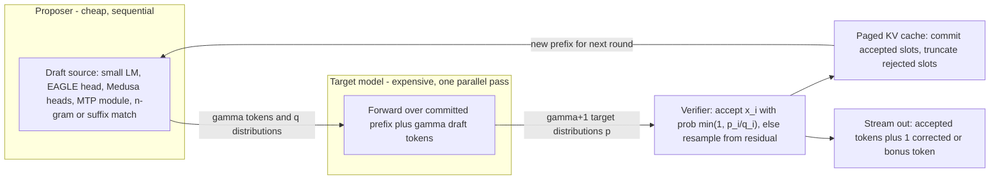

# Speculative Decoding and Advanced Decoding

## TL;DR

At small and medium batch sizes, autoregressive decode is limited by memory bandwidth, so the accelerator's math units sit mostly idle.
Speculative decoding turns that idle capacity into extra tokens: a cheap proposer guesses gamma tokens, and the target model checks all of them in one forward pass.
The modified rejection rule (accept with probability min(1, p/q), otherwise resample from norm(max(0, p - q))) keeps the output distribution exactly equal to the target model's, so a bad drafter can only cost speed, never quality.
The economics come down to three numbers: the acceptance rate alpha, the draft cost ratio c, and the batch level at which verification stops being free (the roofline ridge point).
Long context keeps decode memory-bound and keeps speculation profitable, while large batches, MoE expert spread, and drafter drift after a target retrain make it worse than doing nothing - so the acceptance rate must be monitored as an SLI.

## Mental Model



The target model works like a judge whose fee is roughly the same whether it reviews 1 token or 5, as long as reviewing is limited by reading weights and KV from HBM rather than by arithmetic.
The proposer is a fast guesser whose only job is to be right often enough.
Each round, the target reads its weights once, scores every draft position in parallel, keeps the longest prefix that passes the rejection rule, and always adds one token of its own (a correction or a bonus).
The two parts are separate in a precise sense: the proposer decides how fast tokens come out, and the verifier alone decides which tokens come out.
That is why the proposer can be swapped, retrained, or corrupted without changing the output distribution, as long as the verifier is exact.

## Internals

### Why decode leaves FLOPs on the table

One decode step for a dense model with N parameters in BF16 must stream about 2N bytes of weights plus the batch's KV cache from HBM, and it does about 2N FLOPs per token in the batch.
Arithmetic intensity is therefore about B tokens per weight read, where B is the number of tokens processed in the step.
For an accelerator with about 3.35 TB/s of HBM and about 989 dense BF16 TFLOP/s (H100 SXM class, UNVERIFIED datasheet values), the ridge point is about 295 FLOP/byte, which here means about 295 tokens per step before compute becomes the bottleneck.
A Llama-3.1-8B-shaped model at batch 1 spends about 4.8 ms reading 16 GB of weights and about 16 microseconds on arithmetic, so more than 99 percent of the math capacity is idle.
Verifying gamma+1 tokens instead of 1 raises the tokens per step from B to B(gamma+1), and while that stays well under the ridge, step time barely moves.
For the per-step mechanics of prefill and decode this chapter builds on, see [[17-Cloud-AI-Engineering/Volume_11_LLM_Serving_and_Inference_Systems_on_Cloud/Chapter_01_LLM_Inference_Mechanics_Prefill_vs_Decode|LLM Inference Mechanics: Prefill vs Decode]].

### The verification rule and why it is exact

Leviathan, Kalman, and Matias (ICML 2023, PMLR 202) and, independently, Chen et al. at DeepMind (arXiv 2302.01318) published the same rule.
The drafter samples x from q(.).
The target computes p(.) at the same position in the parallel pass.
Accept x with probability min(1, p(x)/q(x)).
On rejection, sample from the residual r(x) = max(0, p(x) - q(x)) / sum_y max(0, p(y) - q(y)) and stop the round.
Proof of exactness: P(emit x) = q(x) min(1, p(x)/q(x)) + (1 - beta) r(x), where beta = sum_y min(p(y), q(y)) is the total acceptance probability.
The first term is min(p(x), q(x)).
The residual's normalizer is exactly 1 - beta, so the second term is max(0, p(x) - q(x)).
The two terms add up to p(x) for every x, so the emitted token is distributed exactly as the target's p.
The per-token acceptance rate is alpha = sum_x min(p(x), q(x)) = 1 - TV(p, q), one minus the total variation distance between the target and drafter distributions.
The lab script below checks this numerically: on a random 8-token vocabulary, the empirical output distribution matched p to within sampling noise (TV = 0.0019 over 200k trials), and the measured acceptance of 0.5454 matched the theoretical 0.5449.
Greedy decoding is the special case where p is one-hot at argmax: accept while the draft equals the target's argmax, and replace the first mismatch with the argmax.
If all gamma drafts are accepted, the target has already computed p at position gamma+1, so one extra "bonus" token is sampled at no cost.
A practical consequence: whatever logit processing is applied to p in normal decoding (temperature, top-k, top-p, repetition penalties, grammar masks) must be applied identically to p at every draft position, using the penalty state as it would be after the preceding draft tokens.
Getting this wrong does not crash anything; it quietly breaks the exactness proof.

### Expected tokens per round and choosing gamma

If each draft position is accepted independently with probability alpha, the expected number of tokens emitted per verify round, including the bonus or correction, is E = (1 - alpha^(gamma+1)) / (1 - alpha) (Leviathan et al. 2023).
With alpha = 0.8, E is 1.80, 2.44, 2.95, 3.36, and 4.33 for gamma = 1, 2, 3, 4, and 8 (computed by the lab script).
E is capped at 1/(1 - alpha) no matter how large gamma gets, so at alpha = 0.6 more speculation runs out of value almost immediately: E is 2.31 at gamma = 4 and only 2.47 at gamma = 8.
Leviathan et al. give the wall-time improvement as E / (gamma c + 1), where c is the cost of one draft step relative to one target step.
That formula assumes verification is free, which holds only below the ridge point.
In practice acceptance is not independent across positions: it decays with depth, because a draft conditioned on its own earlier guesses compounds its errors.
So the per-position acceptance curve should be measured and gamma chosen from it, rather than assuming a single alpha.

### Proposer taxonomy

A separate draft model, such as a 1B model drafting for a 70B, must share the target's tokenizer and vocabulary, keeps its own KV cache, and adds its gamma sequential forward passes to the critical path of every round.
Medusa (Cai et al., arXiv 2401.10774) skips the separate model: it attaches K lightweight heads to the target's last hidden state, and the k-th head predicts the token at position t+k+1.
The paper reports over 2.2x speedup for Medusa-1 (heads trained on a frozen backbone, lossless) and 2.3-3.6x for Medusa-2 (heads fine-tuned jointly with the backbone) (Cai et al., as of 2026-10).
Medusa-2 changes the backbone weights, so it produces a different model that needs its own quality sign-off.
Medusa also offers "typical acceptance", which accepts a candidate when its target probability exceeds an entropy-dependent threshold; it is deliberately not distribution-preserving.
The EAGLE family runs autoregression on the target's hidden features rather than on tokens.
EAGLE-3 (Li, Wei, Zhang, Zhang, arXiv 2503.01840) drops the feature-prediction constraint in favor of direct token prediction and fuses low, middle, and high-layer features.
It uses a "training-time test", which simulates multi-step drafting during training so that errors accumulated at inference are seen during training.
EAGLE-3 reports speedups of up to 6.5x, about 1.4x better than EAGLE-2 at batch size 1, and a 1.38x throughput gain at batch size 64 in SGLang (Li et al., as of 2026-10).
Because an EAGLE drafter reads the target's hidden states, it must run in the same process, on the same devices, as the target.
That rules out placing it on a separate node, but it means drafting reuses features the target has already computed.
Multi-token-prediction (MTP) modules trained alongside the target model act as built-in drafters, and vLLM exposes them as `method: "mtp"` for models that ship them (vLLM docs, as of 2026-10).
N-gram (prompt lookup) proposers match the last few generated tokens against the prompt and propose whatever followed that match.
They cost essentially nothing and do well on retrieval-augmented summarization, code editing, and extraction, where the output copies spans of the input.
Suffix decoding generalizes this to suffix trees with a dynamic speculation depth (vLLM docs, as of 2026-10).
Lookahead decoding (Fu, Bailis, Stoica, Zhang, ICML 2024) needs no drafter at all.
It runs Jacobi fixed-point iterations over a 2D window (W positions ahead, N steps of trajectory history), collects the n-grams that appear along the trajectory into a pool, and verifies candidate n-grams from the pool in a parallel branch of the same forward pass.
It is exact, but it spends a lot of extra FLOPs per round, so it only fits deployments with abundant spare compute (low batch).
vLLM's method guide rates EAGLE "High gain" at low QPS and "Medium to high gain" at high QPS, and n-gram "Low to medium" at low QPS (vLLM docs, as of 2026-10).

### Tree verification and multi-draft sampling

A single chain of drafts wastes the whole round if the first token is wrong, whereas a tree spends the round's spare FLOPs hedging across several branches.
The verifier flattens the candidate tree into one sequence, gives each node a position ID equal to its depth, and applies a tree attention mask so that each node attends only to the committed prefix and its own ancestors.
Medusa builds this tree from the Cartesian product of each head's top-k candidates, pruned to a fixed shape, while EAGLE-2 grows it dynamically according to draft confidence.
For greedy decoding, the verifier picks the deepest root-to-leaf path that matches the target's argmax.
For sampling, multi-draft verification tries sibling candidates one at a time.
After each rejection, the target distribution is replaced by the normalized residual before the next sibling is tested.
This preserves exactness across multiple candidates (SpecInfer, Miao et al., ASPLOS 2024).
The trade-off: a tree with T nodes costs T verify tokens per sequence per round, which consumes the compute headroom that batching would otherwise use.
Trees are a latency tool for low batch; at high batch, use a short chain or turn speculation off.

### Engine integration: scheduler, paged KV, graphs

In a paged KV engine (see [[17-Cloud-AI-Engineering/Volume_11_LLM_Serving_and_Inference_Systems_on_Cloud/Chapter_03_KV_Cache_Management_and_PagedAttention|KV-Cache Management and PagedAttention]]), the scheduler must reserve gamma+1 KV slots for each running sequence before it launches a round.
Rejected positions are rolled back by truncating the sequence's logical length.
Their slots stay inside an already allocated block and get overwritten next round, so no data is copied.
The reservation does create memory pressure.
Under the admission logic from [[17-Cloud-AI-Engineering/Volume_11_LLM_Serving_and_Inference_Systems_on_Cloud/Chapter_04_Continuous_Batching_and_Scheduling_Algorithms|Continuous Batching and Scheduling Algorithms]], a pool near full preempts sooner with speculation on, and preemption is the main source of tail latency.
A separate draft model's KV cache comes out of the same HBM budget, which lowers maximum concurrency.
Verification batches have shape B x (gamma+1) or B x T, so an engine that uses captured CUDA graphs must capture these shapes as well.
That costs graph memory and warm-up time, and it is one reason engines limit the allowed speculation settings.
The proposer and the target are on each other's critical path: draft round t+1 cannot start until verification t has committed.
Feature-level drafters like EAGLE and MTP shorten this dependency because their input is a byproduct of the target's own pass.
Parallel drafters such as vLLM's PARD and DFlash methods emit all gamma tokens in a single draft pass (vLLM docs, as of 2026-10).
vLLM also offers non-standard rejection samplers, including a lossy "fly" verifier (`rejection_sample_method`, default `standard`) (vLLM docs, as of 2026-10).
Any non-standard sampler should be treated as a model-quality change that has to pass evals, not as a performance flag.

### The batch-size crossover and the two effects that move it

Rejected draft tokens use real FLOPs.
Below the ridge those FLOPs are free; above it, they are paid for.
A roofline model in the lab (an 8B dense model, alpha = 0.8, c = 0.05, short context, ignoring kernel overheads) predicts a speedup of 2.80x at gamma = 4 for batch sizes 1 through 32, 2.62x at batch 64, 1.42x at batch 128, and 0.74x at batch 256.
Because batch x (gamma+1) passes 295 at a lower batch when gamma is larger, the best gamma shrinks as batch grows.
At batch 128 the model prefers gamma = 2 (1.74x) over gamma = 8 (1.01x).
That is the mechanism behind every "spec decode hurt our throughput" ticket, and the reason production engines adapt or disable speculation when batches are large.
The first effect that moves the crossover is long context.
The key and value tensors of the committed prefix are read from HBM once per round and shared by all gamma+1 query positions.
KV bytes therefore scale with batch x context, not with batch x (gamma+1).
In the same model with 8192 tokens of context per sequence (1 GiB of KV per sequence for a Llama-3.1-8B shape: 32 layers x 8 KV heads x 128 head dim x 2 tensors x 2 bytes = 128 KiB per token), the 2.80x speedup at gamma = 4 holds up to batch 48, the most that fits on 80 GB, because the step stays limited by KV reads.
Long-context agentic and RAG workloads are the case where speculation stays profitable at production batch sizes.
The second effect is MoE expert spread.
In a top-k MoE at low batch, verifying gamma+1 tokens can activate up to (gamma+1) x k distinct experts per layer instead of k, so weight bytes read per round grow with the verify width.
For MoE models, the "verification is free" assumption breaks at much smaller batch sizes than for dense models (this follows from routing arithmetic, not from a published benchmark).
Measure it on the real router before assuming dense-model gains carry over.

### Lossless in distribution is not bitwise identical

The exactness proof assumes the verification pass computes exactly the same p as normal decoding would.
GPU GEMM and attention kernels choose tiling and split-K reduction order based on problem shape.
A verify pass with M = B(gamma+1) rows can sum floating-point values in a different order than a decode pass with M = B rows, so logits differ in the last bits.
Under greedy decoding, a near-tie at argmax can then flip, and from that point the text diverges completely, even though nothing is wrong with the method.
The same issue exists without speculation whenever batch composition changes, because continuous batching changes M on every iteration.
Speculation simply makes the effect easy to reproduce.
AWS documents greedy outputs as "bit-exact" for its Neuron EAGLE3 implementation (AWS Neuron docs, as of 2026-10).
On GPU engines that guarantee should not be assumed unless the engine advertises batch-invariant kernels and they are turned on.
The correct acceptance test is distribution-level evaluation (task accuracy, per-token log-likelihood agreement), not exact string matching against a run without speculation.

### Placement and failure domains

Speculation is a single-replica data-plane feature.
Drafter and target must run within one NVLink or NeuronLink domain, because every round is a synchronous dependency, and a network round trip per round would cost more than the speedup gains.
For the scale-up fabric constraints, see [[17-Cloud-AI-Engineering/Volume_10_AI_Infrastructure_on_Cloud/Chapter_02_Interconnect_Technologies_NVLink_EFA_and_TPU_ICI|Interconnect Technologies: NVLink, EFA, and TPU ICI]].
The control plane decides which drafter artifact runs, its gamma and tree shape, and the batch threshold at which speculation turns off.
Drafter weights should be versioned and rolled out progressively together with the target model, never independently.
For the rollout mechanics, see [[17-Cloud-AI-Engineering/Volume_06_Infrastructure_as_Code_and_Delivery/Chapter_06_Progressive_Delivery_and_Deployment_Pipelines|Progressive Delivery and Deployment Pipelines]].
Failure is contained in a useful way: a drafter that crashes or degrades should fall back to plain decoding on the same replica.
A deployment where a broken drafter fails the replica's health check has turned a speed optimization into an availability dependency.

## Numbers to Know

| Quantity | Value | Source |
| --- | --- | --- |
| Per-token acceptance rate | alpha = 1 - TV(p, q) = sum min(p, q) | Leviathan et al., ICML 2023 |
| Expected tokens per round | (1 - alpha^(gamma+1)) / (1 - alpha), capped at 1/(1 - alpha) | Leviathan et al., ICML 2023 |
| E at alpha 0.8 for gamma 1 / 3 / 4 / 8 | 1.80 / 2.95 / 3.36 / 4.33 | Computed, lab script |
| E at alpha 0.6 for gamma 4 / 8 | 2.31 / 2.47 | Computed, lab script |
| Medusa-1 speedup (frozen backbone) | over 2.2x | Cai et al., arXiv 2401.10774 (as of 2026-10) |
| Medusa-2 speedup (joint fine-tune) | 2.3-3.6x | Cai et al., arXiv 2401.10774 (as of 2026-10) |
| EAGLE-3 peak speedup | up to 6.5x, about 1.4x over EAGLE-2 at batch 1 | Li et al., arXiv 2503.01840 (as of 2026-10) |
| EAGLE-3 throughput at batch 64 in SGLang | 1.38x | Li et al., arXiv 2503.01840 (as of 2026-10) |
| vLLM n-gram example config | num_speculative_tokens 5, prompt_lookup_max 4 | vLLM docs (as of 2026-10) |
| Neuron EAGLE3 example config | TP 8, max_num_seqs 4, num_speculative_tokens 5 | AWS Neuron docs (as of 2026-10) |
| H100 SXM HBM bandwidth / dense BF16 | 3.35 TB/s / 989 TFLOP/s | UNVERIFIED (NVIDIA datasheet values) |
| Ridge point on that part | about 295 tokens per step for a BF16 dense model | Derived from the row above |
| Llama-3.1-8B KV per token (BF16) | 128 KiB (32 x 8 x 128 x 2 x 2 bytes) | Derived from public model config |
| Modeled crossover, alpha 0.8, gamma 4, short context | gain 2.62x at batch 64, 0.74x at batch 256 | Computed, lab roofline model |
| Modeled gain, 8K context, gamma 4 | 2.80x up to memory-limited batch 48 | Computed, lab roofline model |
| g6e.xlarge on-demand (us-east-1) | about 1.86 USD/hour | UNVERIFIED; fetch with the pricing CLI in the lab |

Roofline numbers are upper bounds.
EAGLE-3's measured 1.38x at batch 64, against this model's 2.6x, shows how much kernel overhead, tree masks, and scheduler cost the roofline leaves out.
For a planning baseline, derate modeled gains by at least 30 percent until there are measurements.

## AWS vs GCP Mechanism Parity

| Dimension | AWS | Google Cloud | Critical difference |
| --- | --- | --- | --- |
| Self-managed GPU serving | vLLM, SGLang, or TensorRT-LLM on EC2 GPU instances (P5 H100, G6e L40S) or EKS | Same engines on Compute Engine A3 (H100) or G2 (L4), or GKE | Speculation lives in the engine; the cloud only changes HBM size and bandwidth, which moves the crossover batch (instance names as of 2026-10) |
| Custom silicon path | Trainium and Inferentia through vLLM Neuron, with EAGLE3 via `speculative_config` (AWS Neuron docs, as of 2026-10) | TPU through vLLM TPU or JetStream; speculative decoding support UNVERIFIED | Neuron documents bit-exact greedy output; on TPU, XLA compiles fixed verify shapes, so gamma must be static |
| Managed foundation-model APIs | Amazon Bedrock; speculation knobs not exposed; a "latency-optimized" performance option exists, but its mechanism is UNVERIFIED | Vertex AI and Model Garden managed endpoints; no exposed speculation knobs (UNVERIFIED) | Managed APIs hide the drafter; you buy a latency tier, not an acceptance rate |
| Drafter-target coupling | Same process and same NVLink or NeuronLink domain; EFA is too slow to sit inside the round | Same process and same NVLink or ICI domain | Placing the drafter on another node is an anti-pattern on both clouds |
| Artifact storage | S3 with SSE-KMS; read through a gateway VPC endpoint | Cloud Storage with CMEK; read through Private Google Access inside a VPC SC perimeter | Same envelope-encryption pattern; perimeter mechanics differ (see the Security section) |
| Acceptance telemetry | Engine Prometheus metrics into Amazon Managed Service for Prometheus or CloudWatch | Engine Prometheus metrics into Google Cloud Managed Service for Prometheus | Metric names come from the engine, not the cloud; alarms are defined the same way on both |
| Determinism | Engine and kernel property | Engine and kernel property | Neither cloud guarantees bitwise reproducibility across verify shapes on GPU |

## Worked Example: Measuring Acceptance Economics and Sizing a Fleet

### Part A - CPU-only acceptance and roofline model (no cloud cost)

Save the following as `specdec_economics.py` and run `python3 specdec_economics.py`.

```python
#!/usr/bin/env python3
"""Speculative decoding economics: losslessness check plus roofline speedup model.
Pure CPU, no cloud resources, no dependencies beyond numpy."""
import numpy as np

rng = np.random.default_rng(0)


def spec_sample(p, q, rng):
    """One draft token from q, verified against target p (Leviathan/Chen rule)."""
    x = rng.choice(len(q), p=q)
    if rng.random() < min(1.0, p[x] / q[x]):
        return x, True
    resid = np.maximum(p - q, 0.0)
    resid /= resid.sum()
    return rng.choice(len(p), p=resid), False


def check_lossless(vocab=8, trials=200_000):
    p = rng.dirichlet(np.ones(vocab) * 0.5)
    q = rng.dirichlet(np.ones(vocab) * 0.5)
    counts = np.zeros(vocab)
    acc = 0
    for _ in range(trials):
        x, ok = spec_sample(p, q, rng)
        counts[x] += 1
        acc += ok
    emp = counts / trials
    alpha_theory = np.minimum(p, q).sum()
    tv = 0.5 * np.abs(emp - p).sum()
    print(f"TV(empirical, target) = {tv:.4f}  (sampling noise only)")
    print(f"acceptance: empirical {acc / trials:.4f} vs 1-TV(p,q) {alpha_theory:.4f}")


def expected_tokens(alpha, gamma):
    """E[tokens emitted per verify step], i.i.d. acceptance, includes bonus token."""
    if alpha >= 1.0:
        return gamma + 1
    return (1 - alpha ** (gamma + 1)) / (1 - alpha)


def step_time(n_tokens, params, bytes_per_param, hbm_bw, peak_flops, kv_bytes=0.0, ctx=0):
    """Roofline: max(weight+KV read time, compute time) for one forward pass.
    Attention FLOPs per query token: 4 * layers * ctx * (q_heads * head_dim), Llama-3.1-8B shape."""
    t_mem = (params * bytes_per_param + kv_bytes) / hbm_bw
    attn_flops = 4.0 * 32 * ctx * 4096
    t_cmp = (2.0 * params + attn_flops) * n_tokens / peak_flops
    return max(t_mem, t_cmp)


KV_BYTES_PER_TOKEN = 32 * 8 * 128 * 2 * 2  # layers*kv_heads*head_dim*(K,V)*bf16


def speedup(batch, alpha, gamma, c_draft, hw, ctx=0):
    kv = batch * ctx * KV_BYTES_PER_TOKEN  # prefix KV is read once per step for all gamma+1 queries
    base = step_time(batch, kv_bytes=kv, ctx=ctx, **hw)
    verify = step_time(batch * (gamma + 1), kv_bytes=kv, ctx=ctx, **hw)
    draft = gamma * c_draft * base
    per_tok_spec = (verify + draft) / (batch * expected_tokens(alpha, gamma))
    per_tok_base = base / batch
    return per_tok_base / per_tok_spec


if __name__ == "__main__":
    check_lossless()
    # Illustrative accelerator: 3.35e12 B/s HBM, 9.89e14 dense BF16 FLOP/s (UNVERIFIED datasheet values).
    hw = dict(params=8e9, bytes_per_param=2, hbm_bw=3.35e12, peak_flops=9.89e14)
    print("\nE[tokens/step] by alpha (rows) and gamma (cols 1..8)")
    for a in (0.5, 0.6, 0.7, 0.8, 0.9):
        print(f"alpha={a:.1f} " + " ".join(f"{expected_tokens(a, g):5.2f}" for g in range(1, 9)))
    print("\nSpeedup vs batch, alpha=0.8, c_draft=0.05 (EAGLE-like head)")
    for b in (1, 8, 32, 64, 128, 256):
        row = " ".join(f"{speedup(b, 0.8, g, 0.05, hw):5.2f}" for g in (1, 2, 3, 4, 6, 8))
        print(f"batch={b:4d} gamma[1,2,3,4,6,8]: {row}")
    print("\nSame, but every sequence carries 8192 tokens of context (KV-read bound)")
    print("(8192 tokens x 128 KiB = 1 GiB KV per sequence; ~60 sequences fit beside 16 GB of weights on 80 GB)")
    for b in (1, 8, 16, 32, 48):
        row = " ".join(f"{speedup(b, 0.8, g, 0.05, hw, ctx=8192):5.2f}" for g in (1, 2, 3, 4, 6, 8))
        print(f"batch={b:4d} gamma[1,2,3,4,6,8]: {row}")
    print("\nSpeedup vs batch, alpha=0.6, c_draft=0.15 (separate small draft model)")
    for b in (1, 8, 32, 64, 128, 256):
        row = " ".join(f"{speedup(b, 0.6, g, 0.15, hw):5.2f}" for g in (1, 2, 3, 4, 6, 8))
        print(f"batch={b:4d} gamma[1,2,3,4,6,8]: {row}")
```

Observed output (abridged): the lossless check gives TV = 0.0019 and acceptance 0.5454 against a theoretical 0.5449.
With a separate small draft model (alpha 0.6, c 0.15), the best gain is only 1.51x at gamma = 2, and gamma = 4 already falls to 0.83x at batch 128.
A drafter with mediocre acceptance and non-trivial cost has a very narrow window in which it helps.

### Part B - Measure real acceptance on one GPU (AWS, billable)

Cost estimate: one g6e.xlarge (1x L40S 48 GB) at about 1.86 USD/hour (UNVERIFIED) plus a 200 GB gp3 root volume, for about 2 hours, comes to under 5 USD.
Confirm the live price before launching.

```bash
aws pricing get-products --region us-east-1 --service-code AmazonEC2 \
  --filters Type=TERM_MATCH,Field=instanceType,Value=g6e.xlarge \
            Type=TERM_MATCH,Field=location,Value="US East (N. Virginia)" \
            Type=TERM_MATCH,Field=operatingSystem,Value=Linux \
            Type=TERM_MATCH,Field=tenancy,Value=Shared \
            Type=TERM_MATCH,Field=preInstalledSw,Value=NA \
            Type=TERM_MATCH,Field=capacitystatus,Value=Used \
  --query 'PriceList[0]' --output text | jq '.terms.OnDemand[].priceDimensions[].pricePerUnit'
```

Budget alarm (10 USD monthly, email at 80 percent of actual spend):

```bash
ACCT=$(aws sts get-caller-identity --query Account --output text)
cat > /tmp/budget.json <<'EOF'
{"BudgetName":"specdec-lab","BudgetLimit":{"Amount":"10","Unit":"USD"},
 "TimeUnit":"MONTHLY","BudgetType":"COST"}
EOF
cat > /tmp/notify.json <<'EOF'
[{"Notification":{"NotificationType":"ACTUAL","ComparisonOperator":"GREATER_THAN",
  "Threshold":80,"ThresholdType":"PERCENTAGE"},
  "Subscribers":[{"SubscriptionType":"EMAIL","Address":"you@example.com"}]}]
EOF
aws budgets create-budget --account-id "$ACCT" --budget file:///tmp/budget.json \
  --notifications-with-subscribers file:///tmp/notify.json
```

Provision. The instance shuts itself down, and therefore terminates, after 3 hours as a cost backstop:

```bash
set -euo pipefail
REGION=us-east-1
AMI=$(aws ec2 describe-images --region $REGION --owners amazon \
  --filters "Name=name,Values=Deep Learning Base OSS Nvidia Driver GPU AMI (Ubuntu 22.04)*" \
  --query 'sort_by(Images,&CreationDate)[-1].ImageId' --output text)
MYIP=$(curl -s https://checkip.amazonaws.com)/32
aws ec2 create-key-pair --region $REGION --key-name specdec-lab \
  --query KeyMaterial --output text > ~/.ssh/specdec-lab.pem && chmod 600 ~/.ssh/specdec-lab.pem
SG=$(aws ec2 create-security-group --region $REGION --group-name specdec-lab \
  --description "specdec lab ssh" --query GroupId --output text)
aws ec2 authorize-security-group-ingress --region $REGION --group-id $SG \
  --protocol tcp --port 22 --cidr "$MYIP"
IID=$(aws ec2 run-instances --region $REGION --image-id $AMI --instance-type g6e.xlarge \
  --key-name specdec-lab --security-group-ids $SG \
  --instance-initiated-shutdown-behavior terminate \
  --block-device-mappings 'DeviceName=/dev/sda1,Ebs={VolumeSize=200,VolumeType=gp3,DeleteOnTermination=true}' \
  --user-data '#!/bin/bash
shutdown -h +180' \
  --tag-specifications 'ResourceType=instance,Tags=[{Key=Name,Value=specdec-lab}]' \
  --query 'Instances[0].InstanceId' --output text)
echo "$IID $SG" > /tmp/specdec-lab.ids
aws ec2 wait instance-running --region $REGION --instance-ids $IID
aws ec2 describe-instances --region $REGION --instance-ids $IID \
  --query 'Reservations[0].Instances[0].PublicIpAddress' --output text
```

On the instance (Llama 3.1 is gated, so export an `HF_TOKEN` with access), install vLLM and start one server configuration at a time.
Pin the vLLM version you tested; the `speculative_config` schema below follows the vLLM docs (as of 2026-10).

```bash
python3 -m venv ~/v && ~/v/bin/pip install -U pip vllm
export HF_TOKEN=...   # gated model access
M=meta-llama/Llama-3.1-8B-Instruct
COMMON="--max-model-len 8192 --gpu-memory-utilization 0.90 --port 8000"
# Run 1: baseline
~/v/bin/vllm serve $M $COMMON
# Run 2: EAGLE-3 head
~/v/bin/vllm serve $M $COMMON --speculative-config \
  '{"method":"eagle3","model":"yuhuili/EAGLE3-LLaMA3.1-Instruct-8B","num_speculative_tokens":4}'
# Run 3: n-gram prompt lookup
~/v/bin/vllm serve $M $COMMON --speculative-config \
  '{"method":"ngram","num_speculative_tokens":5,"prompt_lookup_max":4}'
```

Client (`bench_spec.py`, standard library only).
It reads the engine's `spec_decode` counters from `/metrics` without hardcoding exact metric names, because those names differ across engine versions.

```python
#!/usr/bin/env python3
"""Decode speed and speculative acceptance per workload against a vLLM OpenAI-compatible server.
Usage: python3 bench_spec.py http://127.0.0.1:8000 <concurrency>"""
import concurrent.futures as cf
import json
import sys
import time
import urllib.request

BASE = sys.argv[1] if len(sys.argv) > 1 else "http://127.0.0.1:8000"
CONC = int(sys.argv[2]) if len(sys.argv) > 2 else 1
MODEL = "meta-llama/Llama-3.1-8B-Instruct"
PROMPTS = {
    "code_edit": "Add type hints to every function below and change nothing else:\n"
    + "".join(f"def f{i}(a, b):\n    return a * {i} + b\n\n" for i in range(25)),
    "rag_summary": "Summarize the report in 5 bullets, quoting figures exactly:\n"
    + "Revenue grew 12 percent to 4.1 billion while operating cost fell 3 percent. " * 25,
    "creative": "Write an original short story about a lighthouse keeper on Mars.",
}


def post(path, body):
    req = urllib.request.Request(BASE + path, data=json.dumps(body).encode(),
                                 headers={"Content-Type": "application/json"})
    with urllib.request.urlopen(req, timeout=900) as r:
        return json.loads(r.read())


def one(prompt, temperature):
    t0 = time.perf_counter()
    out = post("/v1/chat/completions", {"model": MODEL, "max_tokens": 512, "temperature": temperature,
                                        "messages": [{"role": "user", "content": prompt}]})
    return out["usage"]["completion_tokens"], time.perf_counter() - t0


def spec_counters():
    with urllib.request.urlopen(BASE + "/metrics", timeout=30) as r:
        text = r.read().decode()
    vals = {}
    for line in text.splitlines():
        if line.startswith("#") or "spec_decode" not in line:
            continue
        name, _, v = line.rpartition(" ")
        key = name.split("{")[0]
        vals[key] = vals.get(key, 0.0) + float(v)
    return vals


def find(d, must, avoid="per_pos"):
    return sum(v for k, v in d.items() if must in k and avoid not in k)


if __name__ == "__main__":
    for name, prompt in PROMPTS.items():
        for temp in (0.0, 0.8):
            before = spec_counters()
            with cf.ThreadPoolExecutor(CONC) as ex:
                res = list(ex.map(lambda _: one(prompt, temp), range(CONC * 4)))
            after = spec_counters()
            tps = sum(t for t, _ in res) / sum(d for _, d in res)
            drafted = find(after, "num_draft_tokens") - find(before, "num_draft_tokens")
            accepted = find(after, "num_accepted_tokens") - find(before, "num_accepted_tokens")
            acc = f"{accepted / drafted:.3f}" if drafted else "n/a"
            print(f"{name:12s} T={temp} conc={CONC} per-request tok/s={tps:7.1f} draft_accept={acc}")
```

Run `python3 bench_spec.py http://127.0.0.1:8000 1` and then with `16` and `64` against each server configuration, and record the tables side by side.
Expect n-gram to do well on `code_edit` and `rag_summary` and to gain almost nothing on `creative`.
Expect the EAGLE-3 gain to shrink between concurrency 1 and concurrency 64.
The per-request tok/s number includes prefill, so compare configurations against each other rather than reading it as pure decode speed.

Teardown (run all of it; the 3-hour self-shutdown is only a backstop):

```bash
read IID SG < /tmp/specdec-lab.ids
aws ec2 terminate-instances --region us-east-1 --instance-ids $IID
aws ec2 wait instance-terminated --region us-east-1 --instance-ids $IID
aws ec2 delete-security-group --region us-east-1 --group-id $SG
aws ec2 delete-key-pair --region us-east-1 --key-name specdec-lab && rm -f ~/.ssh/specdec-lab.pem
aws budgets delete-budget --account-id "$(aws sts get-caller-identity --query Account --output text)" \
  --budget-name specdec-lab
```

GCP equivalent: a g2-standard-8 (1x L4 24 GB) can hold the 8B BF16 model with a small KV pool, so use `--max-model-len 4096` there.
The Deep Learning VM family name changes over time, so list the families first (image family name UNVERIFIED as of 2026-10).

```bash
gcloud compute images list --project deeplearning-platform-release --filter="family~cu12" \
  --format="value(family)" | sort -u
gcloud billing budgets create --billing-account=XXXXXX-XXXXXX-XXXXXX \
  --display-name=specdec-lab --budget-amount=10USD --threshold-rule=percent=0.8
gcloud compute instances create specdec-lab --zone=us-central1-a --machine-type=g2-standard-8 \
  --image-project=deeplearning-platform-release --image-family=FAMILY_FROM_ABOVE \
  --boot-disk-size=200GB --maintenance-policy=TERMINATE --metadata=install-nvidia-driver=True \
  --max-run-duration=3h --instance-termination-action=DELETE
# teardown
gcloud compute instances delete specdec-lab --zone=us-central1-a --quiet
gcloud billing budgets delete BUDGET_ID --billing-account=XXXXXX-XXXXXX-XXXXXX
```

### Part C - Back-of-the-envelope fleet sizing

Requirement: 24,000 output tokens per second at peak (60 requests per second x 400 output tokens), with a per-stream decode rate of at least 60 tok/s (TPOT at most 16.7 ms).
Model: Llama-3.1-8B BF16 at TP1 on an 80 GB, 3.35 TB/s part (UNVERIFIED hardware values), with 4096 tokens of context per sequence, which is 0.5 GiB of KV per sequence.
Step 1, the memory ceiling: (0.9 x 80 GB - 16 GB weights - 2 GB overhead) / 0.537 GB is about 100 concurrent sequences per GPU.
Step 2, the baseline latency ceiling: the step time is (16e9 + B x 0.537e9) / 3.35e12 seconds, and holding it at or below 16.7 ms gives B at most 74.
Per-GPU baseline capacity is therefore 74 x 60 = 4,450 tok/s, and 24,000 / 4,450 rounds up to 6 GPUs.
Step 3, with EAGLE-3 at a measured alpha of 0.8 and gamma = 3: E = 2.95, and the round costs 1.15 baseline steps (verification is still memory-bound at 400 verify tokens: about 7.3 ms of compute against a 20.8 ms memory-bound step).
At B = 100, per-token time is 1.15 x 20.8 / 2.95, about 8.1 ms, or 123 tok/s per stream, a modeled 2.57x gain.
After a 30 percent derate on the gain (2.1x), the rate is 101 tok/s per stream, or about 10,100 tok/s per GPU, so 24,000 / 10,100 rounds up to 3 GPUs.
Capacity is now limited by KV memory rather than latency, so the next lever is KV quantization (see [[17-Cloud-AI-Engineering/Volume_11_LLM_Serving_and_Inference_Systems_on_Cloud/Chapter_06_Model_Quantization_and_Compression|Model Quantization and Compression]]).
Step 4, unit cost at a placeholder price P = 4 USD per GPU-hour (illustrative, not a quoted price): the baseline costs 6 x 4 / (24,000 x 3,600) x 1e6, about 0.28 USD per million output tokens, and speculation costs about 0.14 USD.
Step 5, the risk: if a target retrain drops alpha to 0.6, then E = 2.18, the derated gain is about 1.6x, and 3 GPUs deliver about 23,400 tok/s, below demand.
Plan the speculative fleet at the alpha observed at p10 over a week, not at the mean, and add N+1 per zone as described in [[17-Cloud-AI-Engineering/Volume_01_Cloud_Architecture_Principles/Chapter_02_Regions_Zones_and_Static_Stability|Regions, Zones, and Static Stability]].

## Failure Modes and Pitfalls

**The throughput cliff at peak.** Teams that benchmarked at batch 1 turn speculation on fleet-wide, and at peak batch the extra verify tokens push each step past the ridge, so cost per token rises exactly when load is highest.
Mitigation: a batch-size threshold above which gamma shrinks or speculation turns off, validated with load tests at the real peak concurrency.

**Silent acceptance collapse after a target update.** A new target checkpoint, a new system prompt template, or a new chat template changes p, the old drafter's q stops matching, and acceptance can drop from 0.8 to 0.5 with no errors anywhere.
Outputs remain correct, so quality evals pass while latency and cost regress.
Mitigation: treat acceptance per position as an SLI with burn-rate alerts ([[17-Cloud-AI-Engineering/Volume_07_Reliability_and_SRE/Chapter_01_SLIs_SLOs_and_Error_Budget_Engineering|SLIs, SLOs, and Error Budget Engineering]]), and make drafter retraining a blocking step in the target release pipeline.

**Tokenizer and template mismatch.** A separate draft model with a different vocabulary, or even with the same vocabulary but different special-token handling, produces near-zero acceptance or fails at load.

**"Spec decode changed my greedy outputs".** This comes from the batch-shape numerics described in Internals, not from a broken algorithm.
Customers with snapshot tests will see diffs, so the reproducibility contract has to be written down in advance.

**Logit-processor drift in the verifier.** Repetition and presence penalties, logit bias, and grammar-constrained decoding must be applied to every draft position's p, using the state those earlier draft tokens would have produced.
An implementation that applies them only at the first position silently breaks exactness.
The closest public precedent is Anthropic's September 2025 postmortem, which described token-selection errors caused by precision mismatches in a top-k sampling path on TPUs (UNVERIFIED link in Further Reading).
The lesson: sampler numerics are part of model correctness, and every speculative sampler change needs distribution-level evals, as covered in [[17-Cloud-AI-Engineering/Volume_12_AI_Applications_MLOps_and_Data_Platforms/Chapter_06_Model_Evaluation_Monitoring_and_Drift_Detection|Model Evaluation, Monitoring, and Drift Detection]].
No widely cited public cloud outage review is attributed specifically to speculative decoding as of 2026-10 (UNVERIFIED).

**KV pressure and preemption storms.** Reserving gamma+1 slots per sequence, plus a separate draft model's KV cache, pushes a nearly full block pool into preemption and recompute, which inflates p99 TTFT for newly admitted requests.
Size the KV pool with speculation on, not off.

**Bursty streaming and misleading ITL metrics.** Tokens now arrive in bursts of 1 to gamma+1, so the inter-token latency distribution becomes bimodal.
Clients that render per chunk show visible stutter, and a p99 ITL alarm calibrated without speculation will fire at the wrong times.
Alert on TPOT averaged over the request and on time to first token instead.

**Stop sequences inside an accepted block.** Accepted tokens past an EOS token or a stop string must be discarded, and the KV cache truncated to match.
Off-by-one bugs here leak tokens past the stop.

**MoE models losing the free lunch.** Verification widens the set of activated experts, so gains measured on a dense model fail to transfer, and expert-parallel deployments also pay more all-to-all traffic per round (see [[17-Cloud-AI-Engineering/Volume_10_AI_Infrastructure_on_Cloud/Chapter_04_Distributed_Training_Parallelism_Strategies|Distributed Training Parallelism Strategies]]).

**Long-context drafter degradation.** A drafter trained on short sequences loses acceptance at positions deep into long contexts, even though long context is where the roofline says speculation should pay off most.
Evaluate acceptance in context-length buckets.

**Interaction with disaggregation.** With prefill and decode on separate pools ([[17-Cloud-AI-Engineering/Volume_11_LLM_Serving_and_Inference_Systems_on_Cloud/Chapter_07_Prefill_and_Decode_Disaggregation|Prefill and Decode Disaggregation]]), an EAGLE drafter also needs the target's hidden states from the prefill, so the KV transfer must carry the drafter's state too, or the first decode round has no draft.

## Security and Cost Angles

**IAM scoping.** The serving role needs only read access to the specific drafter and target prefixes: `s3:GetObject` on `arn:aws:s3:::models-bucket/llama31-8b/*` and `kms:Decrypt` on the bucket key, with a `kms:ViaService` condition pinned to `s3.us-east-1.amazonaws.com`.
On GCP, grant `roles/storage.objectViewer` on the bucket (not the project) and `roles/cloudkms.cryptoKeyDecrypter` on the CMEK key to the workload's service account via Workload Identity ([[17-Cloud-AI-Engineering/Volume_08_Security_Identity_and_the_Data_Perimeter/Chapter_02_Workload_Identity_Federation|Workload Identity Federation]]).

**Encryption and perimeter.** Store drafter weights under the same envelope-encryption hierarchy as target weights ([[17-Cloud-AI-Engineering/Volume_08_Security_Identity_and_the_Data_Perimeter/Chapter_04_Encryption_Key_Hierarchies_and_Envelope_Encryption|Encryption Key Hierarchies and Envelope Encryption]]).
Pull them through an S3 gateway endpoint with an endpoint policy that restricts access to the organization's buckets, or through Private Google Access inside a VPC Service Controls perimeter ([[17-Cloud-AI-Engineering/Volume_03_GCP_Deep_Dive/Chapter_03_VPC_Service_Controls_Security_Perimeters|VPC Service Controls]]).

**Drafter supply chain.** With exact verification, a malicious or corrupted drafter cannot change the output distribution; the worst it can do is drive acceptance to zero, which amounts to a cost-and-latency denial of service.
That guarantee disappears as soon as a lossy acceptor is enabled (Medusa typical acceptance, a lossy verifier, or Medusa-2 backbone changes).
At that point the drafter is part of the model's behavior and must go through the same signing and provenance checks as the target ([[17-Cloud-AI-Engineering/Volume_08_Security_Identity_and_the_Data_Perimeter/Chapter_05_Software_Supply_Chain_Security_SLSA_and_Sigstore|Software Supply Chain Security]]).
Load drafters only from safetensors with pinned hashes, and refuse `trust_remote_code` for drafter repositories.

**Timing side channel.** How many tokens arrive in each streamed chunk reveals the acceptance rate, which reflects how predictable the output was to the proposer.
With per-request prompt lookup, this only reveals information about the requester's own content.
If a proposer caches n-grams or suffix trees across requests, acceptance for tenant A depends on what tenant B generated, which gives A a timing oracle for B's outputs.
Mitigation: scope proposer caches per tenant, and for high-sensitivity tenants, coalesce streamed chunks to fixed intervals ([[17-Cloud-AI-Engineering/Volume_12_AI_Applications_MLOps_and_Data_Platforms/Chapter_08_Cloud_Security_for_AI_Systems_Attacks_and_Defenses|Cloud Security for AI Systems]]).

**Unit economics.** Speculation converts idle FLOPs into tokens.
It lowers cost per token only when a latency SLO, rather than memory or compute, is what limits batch size, as in the sizing example where speculation removed the latency ceiling and memory became the limit.
The cost KPI is cost per million output tokens at the SLO, tracked alongside two efficiency ratios: accepted tokens per round, and wasted verify fraction = 1 - E/(gamma+1).
Training cost is real too: EAGLE-style drafters need target hidden states for every training sample.
That is a GPU job on the order of the target's inference cost over the distillation corpus, and it recurs with every target release.
For the cost-per-token framework, see [[17-Cloud-AI-Engineering/Volume_09_FinOps_and_Cloud_Economics/Chapter_05_GPU_and_TPU_Unit_Economics|GPU and TPU Unit Economics]] and [[17-Cloud-AI-Engineering/Volume_11_LLM_Serving_and_Inference_Systems_on_Cloud/Chapter_11_End_to_End_Latency_Throughput_and_Cost_Modeling|End-to-End Latency, Throughput, and Cost Modeling]].

## Interview Questions and Model Answers

### Question 1 (L5 - Senior)

Prove that speculative sampling preserves the target model's output distribution, and derive the acceptance rate.

#### Model Answer

Draft x from q, accept with probability min(1, p(x)/q(x)), and on rejection sample from r(x), which is proportional to max(0, p(x) - q(x)).
The probability of emitting x through acceptance is q(x) min(1, p(x)/q(x)) = min(p(x), q(x)).
The total acceptance probability is beta = sum_y min(p(y), q(y)), so rejection happens with probability 1 - beta.
The residual's normalizer is sum_y max(0, p(y) - q(y)) = 1 - beta, because p sums to 1 and splits into a min part and a positive-excess part.
The probability of emitting x through rejection is therefore (1 - beta) x max(0, p(x) - q(x)) / (1 - beta) = max(0, p(x) - q(x)).
The sum is min(p, q) + max(0, p - q) = p(x), which proves exactness for one position.
By induction over positions, each later draft is conditioned on an accepted prefix that is itself distributed according to p, and the round stops at the first rejection, so the joint distribution over the sequence is preserved.
The acceptance rate is alpha = beta = 1 - TV(p, q), which shows directly that the drafter's quality metric is total variation distance to the target, not perplexity.
If all gamma drafts are accepted, the bonus token comes from p at position gamma+1, which was computed in the same pass, so it does not affect exactness.
The proof assumes the p used in verification is bitwise identical to the p that normal decoding would compute, including every logit processor; this is where real implementations break.

#### Follow-up Interviewer Question

What happens when q(x) = 0 for a token the target would sometimes emit, and does truncating q with top-p in the drafter break exactness?

### Question 2 (L5 - Senior)

You enabled EAGLE-3 with gamma 4: staging at concurrency 1 showed a 2.5x improvement in time per output token, but in production aggregate tokens per GPU dropped 15 percent at peak. Explain and fix.

#### Model Answer

At concurrency 1, the step is limited by weight reads, so verifying 5 tokens costs about the same as decoding 1, and the gain is E / (1 + gamma c).
At production peak, the batch might be 96, so each round processes 96 x 5 = 480 tokens, beyond a ridge of about 300 tokens per step for a dense 8B model.
Step time then grows linearly with verify tokens.
Every rejected draft is a paid-for FLOP, and with E around 3.4 out of 5 verified positions, about 32 percent of verify compute is wasted.
That is enough to push throughput below the baseline, which matches the observed 15 percent loss.
The fix is to make speculation depth depend on batch size.
At small batch, keep gamma 4 or a tree; as the batch nears the ridge, shrink gamma to 1 or 2; above a threshold, turn speculation off.
Calibrate the thresholds from a load-test sweep, not from theory, because kernel overheads move the real crossover below the roofline estimate.
Separately, check whether peak traffic has a different mix (more creative, high-temperature traffic with lower acceptance), because a lower alpha also lowers the crossover.
Finally, check KV pressure: the extra gamma+1 slot reservation may be causing preemptions at peak, which shows up as lost throughput.

#### Follow-up Interviewer Question

How would you pick the gamma schedule automatically at runtime, and what signal would you use: the batch size, the measured step time, or the per-position acceptance curve?

### Question 3 (L6 - Staff)

Choose a proposer strategy for three products on the same 70B dense target: an IDE code-edit assistant, a RAG summarizer over customer documents, and a multilingual consumer chat app at temperature 1.0. Justify each with mechanisms and costs.

#### Model Answer

The code-edit assistant mostly re-emits the input file with local changes, so the outputs copy long spans of the prompt.
Prompt-lookup n-gram or suffix decoding gets very high acceptance on the copied spans at essentially zero draft cost, and needs no training pipeline or extra memory.
I would start with n-gram and add an EAGLE-3 head only if the edited regions dominate latency.
The RAG summarizer also copies figures and phrases, but it paraphrases more.
A hybrid works best: a trained EAGLE-3 head for the general case, plus n-gram matches when they are long.
Contexts are long here, which helps, because the step stays bound by KV reads and speculation remains profitable at production batch.
I would still bucket acceptance by context length, since drafters trained on short sequences degrade at depth.
The temperature-1.0 multilingual chat is the worst case: the target distribution is high-entropy, so TV(p, q) is large and acceptance drops, especially for languages that are underrepresented in the drafter's training data.
Here I would either train an EAGLE-3 head on multilingual target-generated data and use a short chain (gamma 2), or skip speculation and spend the engineering effort on quantization.
I would reject a separate 8B draft model for all three cases.
It costs about 10 percent of target time per draft step at TP parity, needs its own KV pool, and must track tokenizer and template changes.
Its acceptance is usually below that of feature-level heads, which see the target's own hidden states.
Across all three products, the lossy options (Medusa typical acceptance, lossy verifiers) would need explicit product sign-off, because they change outputs.

#### Follow-up Interviewer Question

The chat product uses per-tenant LoRA adapters, so how does that change your drafter choice and what would you monitor?

### Question 4 (L6 - Staff)

A customer files a P1: "Enabling speculative decoding changed our temperature-0 outputs, so your 'lossless' claim is false." Diagnose, respond, and define the engineering contract.

#### Model Answer

First, find out whether outputs differ in distribution or only in specific strings.
Rerun the same prompts with speculation off but at different batch compositions.
If outputs differ even without speculation, the cause is batch-variant numerics: GEMM and attention kernels pick tiling and split-K reduction order by shape, so the M = B x (gamma+1) verify pass and the M = B decode pass produce last-bit logit differences.
At greedy decoding, a near-tie at argmax flips, and the text diverges from there on.
Second, rule out a real bug: check that every logit processor (penalties, logit bias, grammar mask, stop handling) is applied per draft position with the correct state, and that the sampler runs at the same precision as the non-speculative path.
A real bug shows up as degraded evals or log-likelihood disagreement, not just string diffs.
In the customer response, say clearly that speculative sampling is exact in distribution, that bitwise reproducibility on GPU is not guaranteed even without speculation because continuous batching changes shapes every iteration, and what option they have.
That option is pinning their traffic to a deterministic configuration: batch-invariant kernels if the engine supports them, a fixed batch shape, or speculation turned off for their tenant, with the cost stated.
The internal contract is that distribution-level evals and per-token log-probability agreement are the release gate for any sampler or speculation change, string equality is never a gate, and the reproducibility tier is a documented, separately priced product feature.

#### Follow-up Interviewer Question

How would you build a CI test that catches a broken repetition penalty in the verifier but does not flag benign numerical divergence?

### Question 5 (L6 - Staff)

Size a fleet for 24,000 output tokens per second at a TPOT of 16.7 ms or better on an 8B dense model, with and without speculation, and tell me what would make your plan fail.

#### Model Answer

Without speculation, the step time is (weights + B x KV per sequence) / HBM bandwidth.
With 16 GB of weights, 0.537 GB of KV per sequence at 4K context, and 3.35 TB/s, a 16.7 ms step allows B = 74, which is 4,450 tok/s per GPU and requires 6 GPUs.
With EAGLE-3 at alpha 0.8 and gamma 3, E = 2.95 and the round costs about 1.15 steps.
Verification stays memory-bound at B = 100 (400 verify tokens take about 7 ms of compute against a 21 ms memory-bound step).
Per-stream speed is about 123 tok/s modeled, or 101 tok/s after a 30 percent derate, which gives about 10,100 tok/s per GPU and 3 GPUs.
At that point the limit is KV memory, not latency, which tells me KV quantization is the next lever.
The plan fails in four ways.
Acceptance drift: alpha falling to 0.6 drops capacity to about 23,400 tok/s, an SLO breach, so I size at p10 alpha and alarm on it.
Traffic-mix shift: more high-temperature traffic lowers alpha.
Context growth: KV per sequence grows linearly, which caps concurrency.
Losing a zone without N+1.
I would also confirm the derate with the Part B benchmark before committing reservations, because the gap between the roofline estimate and EAGLE-3's published 1.38x at batch 64 shows how optimistic the model is.

#### Follow-up Interviewer Question

If the target becomes a top-2 MoE with the same active parameters, which terms of your calculation change, and in which direction?

### Question 6 (L7+ - Principal)

Design speculative decoding as a platform capability for a multi-tenant inference service running on both AWS and GCP, covering drafter lifecycle, control plane, SLIs, and security.

#### Model Answer

Data plane: speculation runs inside each engine replica, with the drafter in the same process and scale-up domain as the target.
That means NVLink-local on P5 or A3, and Neuron's EAGLE3 path on Trainium, never across EFA or the datacenter network.
Each replica falls back to plain decoding if the drafter fails, so the drafter is never an availability dependency.
Control plane: a policy service pushes per-model, per-tenant-class speculation profiles (method, gamma schedule as a function of batch size, tree shape, off-threshold) as configuration, without restarting engines, and rollouts are canaried and gated on acceptance and TPOT.
Drafter lifecycle: every target release triggers a distillation job that regenerates target hidden states and retrains the EAGLE-3 or MTP head.
The release is blocked if the drafter's acceptance on a held-out replay of real traffic falls below the target bar.
Drafter and target are versioned as one artifact pair stored under KMS or CMEK and signed, and lossy acceptors are banned by policy unless a product owner signs off.
SLIs: per-position acceptance, accepted tokens per round, wasted verify fraction, and TPOT, all bucketed by tenant, language, temperature band, and context length.
A burn-rate alert on acceptance catches drafter drift before it turns into a capacity incident.
Capacity planning reads the p10 acceptance from this telemetry.
Security: proposer caches are scoped per tenant to remove the cross-tenant timing oracle, high-sensitivity tenants get coalesced streaming, and drafter repositories never load remote code.
Cross-cloud: the mechanism is identical; only the artifact store, KMS, perimeter, and managed Prometheus differ.
Managed Bedrock and Vertex endpoints are treated as black-box latency tiers, outside this control plane.
Economics: the platform publishes cost per million tokens at SLO with and without speculation per model, so product teams can see when speculation is turned off at peak and why.

#### Follow-up Interviewer Question

A large tenant asks for a shared suffix cache across its own sub-accounts to raise acceptance, so how do you decide whether that is safe, and what isolation boundary do you enforce?

### Question 7 (L7+ - Principal)

The research team proposes Medusa-2 for a 3x latency win on the flagship model. Make the call.

#### Model Answer

Medusa-2 fine-tunes the backbone jointly with the heads, so the deployed weights are a new model, not an accelerated version of the old one.
The decision is therefore a model-quality and governance decision, not an infrastructure one.
The reported 2.3-3.6x is attractive, but every downstream eval, safety evaluation, and customer-facing behavior guarantee tied to the current checkpoint would need to be re-run and re-certified.
The 2x-plus gains from Medusa-1 or EAGLE-3 come with no change to the model.
I would ask for a head-to-head comparison on the flagship's real traffic replay: Medusa-2 against EAGLE-3 on the frozen target, measured at the production batch-size distribution, not at batch 1.
At production batch, both run into the same ridge, and the difference in gain often shrinks.
If Medusa-2 still wins clearly, I would ship it as a new model version through the full release process, with its own evals, a canary, and rollback, not as a serving flag.
I would also reject typical acceptance on the flagship unless product owners accept an explicit distribution change, because it removes the property that bounds drafter risk to performance only.
The principle: keep accelerations that leave the model unchanged as infrastructure decisions, and route anything that changes outputs through model governance.

#### Follow-up Interviewer Question

How would you quantify, in dollars per month, the value of the extra speedup over EAGLE-3, so the eval and recertification cost can be compared against it?

## Further Reading

- [Leviathan, Kalman, Matias - Fast Inference from Transformers via Speculative Decoding (ICML 2023)](https://arxiv.org/abs/2211.17192) - the exactness proof, the expected-tokens formula, and the wall-time model everything else builds on.
- [Chen et al. - Accelerating Large Language Model Decoding with Speculative Sampling (DeepMind, 2023)](https://arxiv.org/abs/2302.01318) - independent derivation of the same rule, at large-model scale.
- [Cai et al. - Medusa: Simple LLM Inference Acceleration Framework with Multiple Decoding Heads](https://arxiv.org/abs/2401.10774) - multi-head drafting, tree attention, and typical acceptance as an explicitly lossy design point.
- [Li, Wei, Zhang, Zhang - EAGLE-3: Scaling up Inference Acceleration via Training-Time Test](https://arxiv.org/abs/2503.01840) - feature-level drafting, multi-layer fusion, and the only widely cited measurement of speculation gains at batch 64 in a production engine.
- [Fu, Bailis, Stoica, Zhang - Lookahead Decoding (ICML 2024), LMSYS write-up](https://www.lmsys.org/blog/2023-11-21-lookahead-decoding/) - exact speculation without a drafter, using Jacobi trajectories and an n-gram pool, and a good illustration of trading FLOPs for latency.
- [vLLM Speculative Decoding documentation](https://docs.vllm.ai/en/latest/features/speculative_decoding/) - the current `speculative_config` schema, the method selection guidance by QPS, and the rejection sampler options, including lossy ones.
- [AWS Neuron - Speculative Decoding (EAGLE3) in vLLM Neuron](https://awsdocs-neuron.readthedocs-hosted.com/en/latest/vllm-neuron/docs/design/speculation/speculative_decoding_design.html) - how speculation maps onto Trainium and Inferentia, including the greedy bit-exactness claim.
- [Miao et al. - SpecInfer: Tree-based Speculative Inference and Verification (ASPLOS 2024)](https://arxiv.org/abs/2305.09781) - multi-draft tree verification that stays exact under sampling.
- [Anthropic - A postmortem of three recent issues (2025)](https://www.anthropic.com/engineering/a-postmortem-of-three-recent-issues) - a public example of sampling-path numerics causing token-selection errors in production, and why sampler changes need distribution-level evals.
